# A1 Agent Core

<details>
<summary>Relevant source files</summary>

The following files were used as context for generating this wiki page:

- [biomni/agent/a1.py](biomni/agent/a1.py)
- [biomni/tool/support_tools.py](biomni/tool/support_tools.py)
- [biomni/tool/tool_description/support_tools.py](biomni/tool/tool_description/support_tools.py)
- [biomni/utils.py](biomni/utils.py)

</details>


This document describes the **A1 agent class**, which is the central orchestrator of the Biomni system. It handles initialization, configuration, resource management (tools, data, software), LLM integration, and workflow orchestration.

For information about the execution pipeline and state machine that A1 orchestrates, see [Execution Pipeline](#2.2). For LLM provider configuration details, see [LLM Integration Layer](#2.3). For tool discovery and retrieval mechanisms, see [Tool Registry and Retrieval](#2.4).

---

## Overview

The `A1` class serves as the primary interface for creating and configuring biomedical AI agents. It integrates multiple subsystems including LLM providers, tool registries, retrieval systems, data lakes, and execution environments into a cohesive agent capable of autonomous task execution.

**Key Responsibilities:**
- Initialize agent with configurable parameters (LLM, timeout, commercial mode)
- Manage tool ecosystem (built-in, custom, and MCP tools)
- Handle data and software resource registration
- Configure and orchestrate LangGraph-based execution workflow
- Provide interfaces for agent invocation (`go()`, `go_stream()`)

Sources: [biomni/agent/a1.py:56-224]()

---

## A1 Class Architecture

The following diagram shows the A1 class structure with its key attributes and methods:

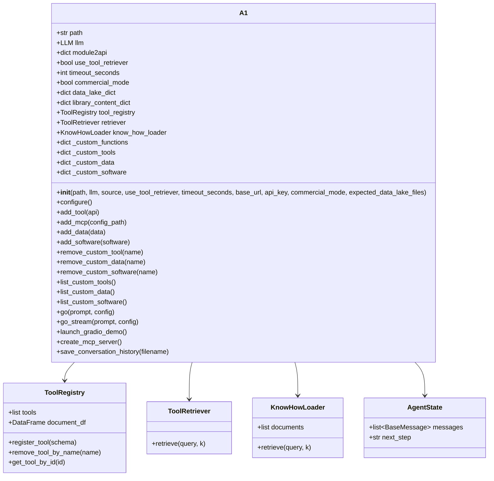

Sources: [biomni/agent/a1.py:56-224](), [biomni/agent/a1.py:225-348](), [biomni/agent/a1.py:676-820]()

---

## Initialization Flow

The A1 agent initialization involves several sequential steps, from parameter resolution to data lake synchronization:

```mermaid
flowchart TD
    Start["A1.__init__()"]
    
    ResolveParams["Resolve Parameters<br/>from default_config"]
    
    ImportMode{"commercial_mode?"}
    
    ImportCommercial["Import from<br/>biomni.env_desc_cm"]
    ImportAcademic["Import from<br/>biomni.env_desc"]
    
    CreatePath["Create path directory<br/>if not exists"]
    
    CreateDirs["Create biomni_data/<br/>benchmark, data_lake dirs"]
    
    CheckDataLake{"expected_data_lake_files<br/>is None?"}
    
    DownloadDataLake["check_and_download_s3_files()<br/>Download missing files"]
    SkipDataLake["Skip datalake download"]
    
    CheckBenchmark["Check benchmark<br/>directory structure"]
    
    DownloadBenchmark{"Benchmark<br/>complete?"}
    
    GetBenchmark["Download benchmark<br/>from S3"]
    
    ReadModule["read_module2api()<br/>Load tool descriptions"]
    
    CreateLLM["get_llm()<br/>Initialize LLM provider"]
    
    InitRetriever{"use_tool_retriever?"}
    
    CreateRegistry["ToolRegistry(module2api)"]
    CreateRetriever["ToolRetriever()"]
    
    InitKnowHow["KnowHowLoader()"]
    
    FilterKnowHow{"commercial_mode?"}
    
    FilterDocs["_filter_know_how_for_commercial_mode()"]
    
    Configure["configure()<br/>Setup LangGraph workflow"]
    
    End["A1 instance ready"]
    
    Start --> ResolveParams
    ResolveParams --> ImportMode
    
    ImportMode -->|True| ImportCommercial
    ImportMode -->|False| ImportAcademic
    
    ImportCommercial --> CreatePath
    ImportAcademic --> CreatePath
    
    CreatePath --> CreateDirs
    CreateDirs --> CheckDataLake
    
    CheckDataLake -->|Yes| DownloadDataLake
    CheckDataLake -->|No| SkipDataLake
    
    DownloadDataLake --> CheckBenchmark
    SkipDataLake --> CheckBenchmark
    
    CheckBenchmark --> DownloadBenchmark
    DownloadBenchmark -->|No| GetBenchmark
    DownloadBenchmark -->|Yes| ReadModule
    GetBenchmark --> ReadModule
    
    ReadModule --> CreateLLM
    CreateLLM --> InitRetriever
    
    InitRetriever -->|True| CreateRegistry
    InitRetriever -->|False| InitKnowHow
    
    CreateRegistry --> CreateRetriever
    CreateRetriever --> InitKnowHow
    
    InitKnowHow --> FilterKnowHow
    FilterKnowHow -->|True| FilterDocs
    FilterKnowHow -->|False| Configure
    
    FilterDocs --> Configure
    Configure --> End
```

**Parameter Resolution Order:**
1. Constructor parameters (if provided)
2. `default_config` values (if constructor param is `None`)
3. Environment variables (via `default_config`)

**Data Lake Synchronization:**
- Default: Downloads all files in `data_lake_dict.keys()` (~11GB)
- Skip with: `expected_data_lake_files=[]`
- Downloads from: `https://biomni-release.s3.amazonaws.com`

Sources: [biomni/agent/a1.py:57-224](), [biomni/utils.py:921-1018]()

---

## Configuration System Integration

The A1 agent integrates with the centralized configuration system:

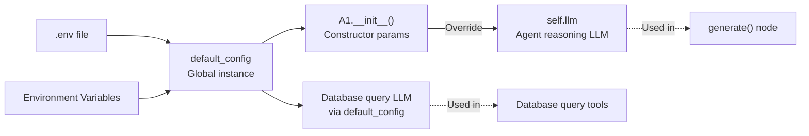

**Important Distinction:**
- **Agent LLM** (`self.llm`): Specified in constructor, used for agent reasoning and code generation
- **Database LLM**: Uses `default_config.llm`, used for tool retrieval and database queries
- **Recommended Pattern**: Use specialized model (Biomni-R0) for agent, general model (Claude) for databases

**Configuration Parameters:**

| Parameter | Type | Default | Description |
|-----------|------|---------|-------------|
| `path` | `str` | `default_config.path` | Data directory path |
| `llm` | `str` | `default_config.llm` | LLM model name |
| `source` | `SourceType` | `default_config.source` | Provider type |
| `use_tool_retriever` | `bool` | `default_config.use_tool_retriever` | Enable tool retrieval |
| `timeout_seconds` | `int` | `default_config.timeout_seconds` | Code execution timeout |
| `base_url` | `str` | `default_config.base_url` | Custom LLM endpoint |
| `api_key` | `str` | `default_config.api_key` | API key |
| `commercial_mode` | `bool` | `default_config.commercial_mode` | Filter non-commercial resources |
| `expected_data_lake_files` | `list` | All files | Files to download |

Sources: [biomni/agent/a1.py:57-99](), [biomni/agent/a1.py:116-147](), [biomni/config/__init__.py:1-50]()

---

## AgentState Structure

The `AgentState` TypedDict defines the state passed between LangGraph nodes:

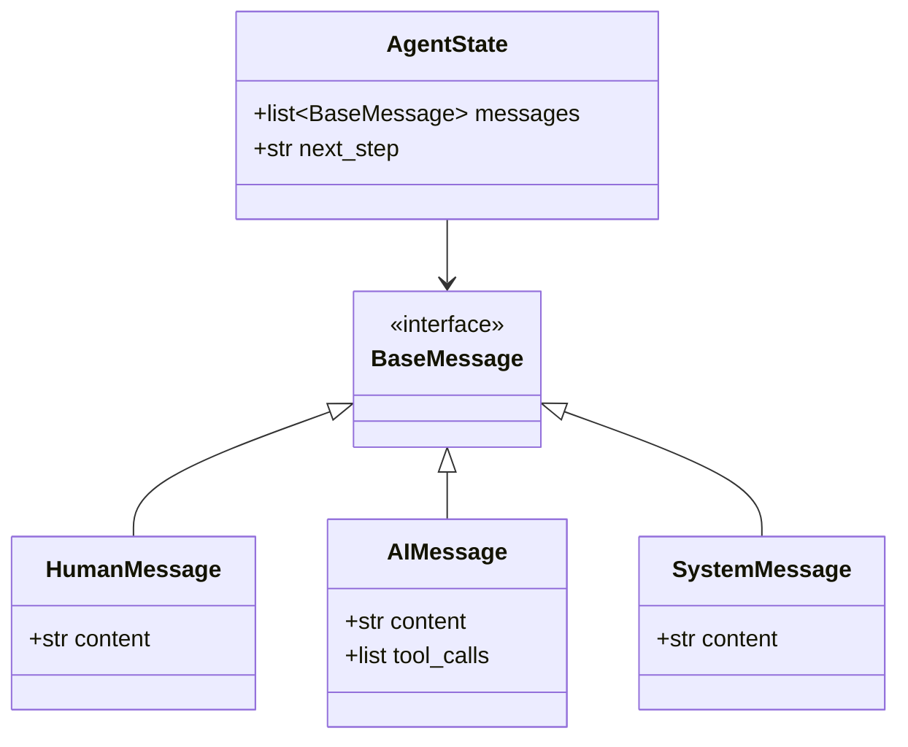

**State Fields:**
- `messages`: List of conversation messages (HumanMessage, AIMessage, SystemMessage)
- `next_step`: Routing signal (`"execute"`, `"end"`, or `None`)

**State Flow:**
1. User prompt → HumanMessage added to `messages`
2. Generate node → AIMessage with code/solution tags
3. Execute node → Observation wrapped in tags
4. Loop continues until `next_step="end"`

Sources: [biomni/agent/a1.py:51-54](), [langchain_core.messages imports at biomni/agent/a1.py:12]()

---

## Tool Management System

The A1 agent provides comprehensive tool management APIs:

### Adding Custom Tools

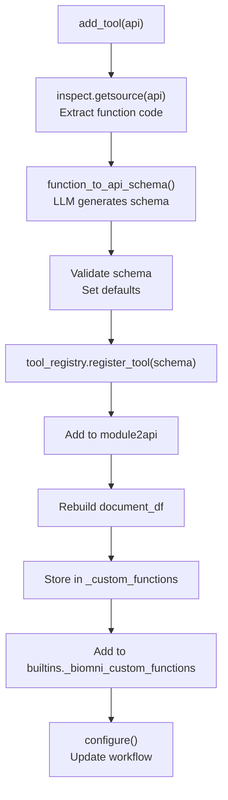

**Schema Generation Process:**
1. Extract source code via `inspect.getsource()`
2. LLM generates structured schema with `function_to_api_schema()`
3. Schema includes: name, description, required_parameters, optional_parameters
4. Tool registered in multiple locations for discoverability

**Storage Locations:**
- `self._custom_functions`: Original function references
- `self._custom_tools`: Metadata for highlighting
- `self.module2api`: For system prompt generation
- `self.tool_registry.tools`: For retrieval
- `builtins._biomni_custom_functions`: For runtime execution

Sources: [biomni/agent/a1.py:225-348](), [biomni/utils.py:251-290]()

### MCP Server Integration

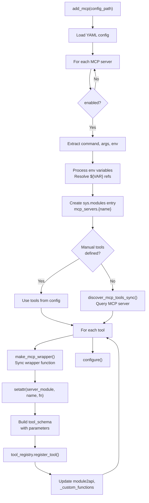

**MCP Wrapper Pattern:**
- Creates synchronous wrapper around async MCP tool calls
- Uses `StdioServerParameters` for server communication
- Handles both `asyncio.run()` and running event loop cases
- Returns JSON or text based on MCP response content

**Parameter Handling:**
- Manual tools: Check `required` field in each parameter spec
- Auto-discovered tools: Use `inputSchema.required` list
- Both map to `required_parameters` and `optional_parameters` in schema

Sources: [biomni/agent/a1.py:350-587]()

---

## Resource Management

The A1 agent manages three types of custom resources:

### Data Lake Resources

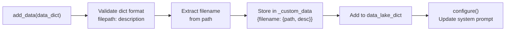

**Data Structure:**
```python
_custom_data = {
    "dataset.csv": {
        "path": "/full/path/to/dataset.csv",
        "description": "Gene expression data"
    }
}
```

**Operations:**
- `add_data(dict)`: Add data resources
- `get_custom_data(name)`: Retrieve data info
- `list_custom_data()`: List all custom data
- `remove_custom_data(name)`: Remove data entry

Sources: [biomni/agent/a1.py:676-775]()

### Software Library Resources

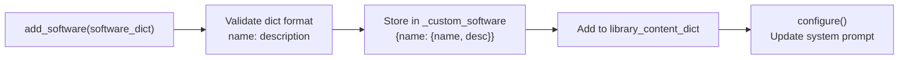

**Software Structure:**
```python
_custom_software = {
    "custom_tool": {
        "name": "custom_tool",
        "description": "Analysis tool for processing data"
    }
}
```

**Operations:**
- `add_software(dict)`: Add software resources
- `get_custom_software(name)`: Retrieve software info
- `list_custom_software()`: List all custom software
- `remove_custom_software(name)`: Remove software entry

Sources: [biomni/agent/a1.py:777-875]()

---

## Commercial vs Academic Mode

The A1 agent supports two operational modes that filter available resources based on licensing:

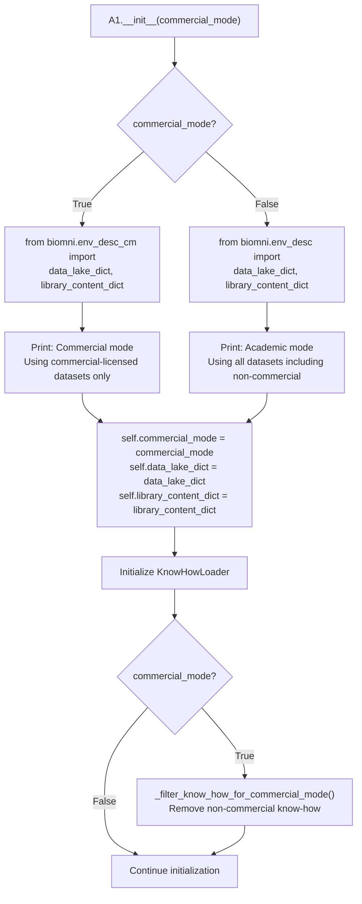

**Mode Comparison:**

| Aspect | Academic Mode | Commercial Mode |
|--------|--------------|-----------------|
| Data Lake | `env_desc.data_lake_dict` | `env_desc_cm.data_lake_dict` |
| Software Library | `env_desc.library_content_dict` | `env_desc_cm.library_content_dict` |
| Know-How Docs | All documents | Filtered for commercial use |
| Use Case | Research, education | Commercial applications |

**Know-How Filtering:**
- Checks `commercial_use` metadata in each document
- Removes documents marked as non-commercial only
- Filters happen after KnowHowLoader initialization

Sources: [biomni/agent/a1.py:100-113](), [biomni/agent/a1.py:215-217]()

---

## Workflow Configuration

The `configure()` method sets up the LangGraph state machine that orchestrates agent execution:

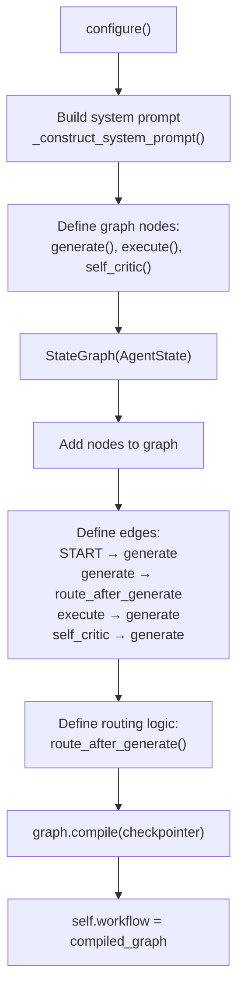

**System Prompt Construction:**

The system prompt is dynamically generated based on:
1. **Tool Retrieval** (if `use_tool_retriever=True`):
   - Retrieves relevant tools via `ToolRetriever`
   - Includes only selected tool descriptions
2. **Full Tool List** (if `use_tool_retriever=False`):
   - Includes all tools from `module2api`
   - Formatted via `textify_api_dict()`
3. **Know-How Documents**:
   - Retrieved based on query relevance
   - Includes best practices and protocols
4. **Data Lake & Software Library**:
   - Lists available data files and descriptions
   - Lists available software packages

**Graph Structure:**
- **Nodes**: `generate`, `execute`, `self_critic`
- **Edges**: Conditional routing based on `next_step` state
- **Checkpointer**: `MemorySaver` for conversation persistence

Sources: [biomni/agent/a1.py:877-1100]() (configure method location inferred from class structure)

---

## Key Execution Methods

The A1 agent provides two primary execution interfaces:

### Synchronous Execution

```python
def go(self, prompt: str, config: dict = None) -> str:
```

**Flow:**
1. Wraps prompt in `HumanMessage`
2. Invokes `self.workflow.invoke()` with state
3. Returns final solution content

**Use Case:** Simple synchronous task execution

### Streaming Execution

```python
def go_stream(self, prompt: str, config: dict = None) -> Generator:
```

**Flow:**
1. Wraps prompt in `HumanMessage`
2. Streams updates via `self.workflow.stream()`
3. Yields intermediate state updates
4. Returns generator of state snapshots

**Use Case:** Real-time monitoring, Gradio interfaces, interactive applications

Sources: [biomni/agent/a1.py structure]() (method signatures from class overview)

---

## Integration Points

The A1 agent integrates with multiple subsystems:

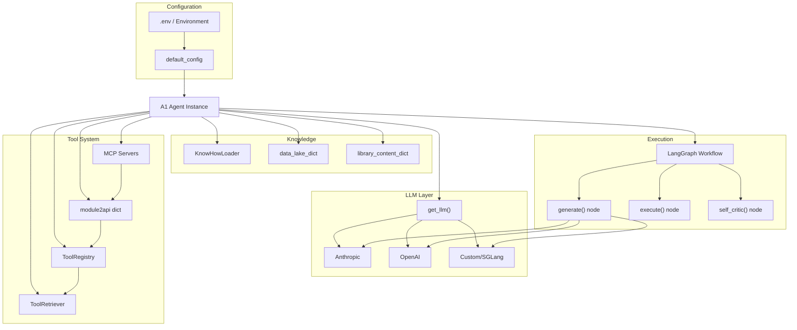

**Dependencies:**
- **LLM Integration**: See [LLM Integration Layer](#2.3)
- **Tool Discovery**: See [Tool Registry and Retrieval](#2.4)
- **Execution Pipeline**: See [Execution Pipeline](#2.2)
- **Configuration**: See [Configuration System](#2.5)
- **Data Infrastructure**: See [Data Infrastructure](#2.6)
- **Know-How**: See [Know-How Library](#2.7)

Sources: [biomni/agent/a1.py:1-1019](), [biomni/llm/__init__.py](), [biomni/model/retriever.py](), [biomni/tool/tool_registry.py]()

---