# Execution Pipeline

<details>
<summary>Relevant source files</summary>

The following files were used as context for generating this wiki page:

- [biomni/agent/a1.py](biomni/agent/a1.py)
- [biomni/tool/support_tools.py](biomni/tool/support_tools.py)
- [biomni/tool/tool_description/support_tools.py](biomni/tool/tool_description/support_tools.py)
- [biomni/utils.py](biomni/utils.py)

</details>


## Purpose and Scope

This document provides a detailed technical explanation of the code execution pipeline in Biomni, which enables the A1 agent to execute Python, R, and Bash code in a controlled environment. The execution pipeline is the core mechanism that transforms LLM-generated code into actual computational results.

This page covers:
- The generate-execute loop implemented via LangGraph
- Language detection and code dispatching
- Execution mechanisms for Python, R, and Bash
- Timeout management and thread-based execution control
- Result capture including stdout, stderr, and plots
- Integration with the conversation state

For information about the overall A1 Agent architecture, see [A1 Agent Core](#2.1). For tool registry and retrieval mechanisms, see [Tool Registry and Retrieval](#2.4).

---

## Generate-Execute Loop Architecture

The execution pipeline operates as a cyclic workflow where the LLM generates code in `<execute>` tags, the system executes it, returns observations, and the LLM continues reasoning. This loop is implemented using LangGraph's `StateGraph`.

### LangGraph Workflow Structure

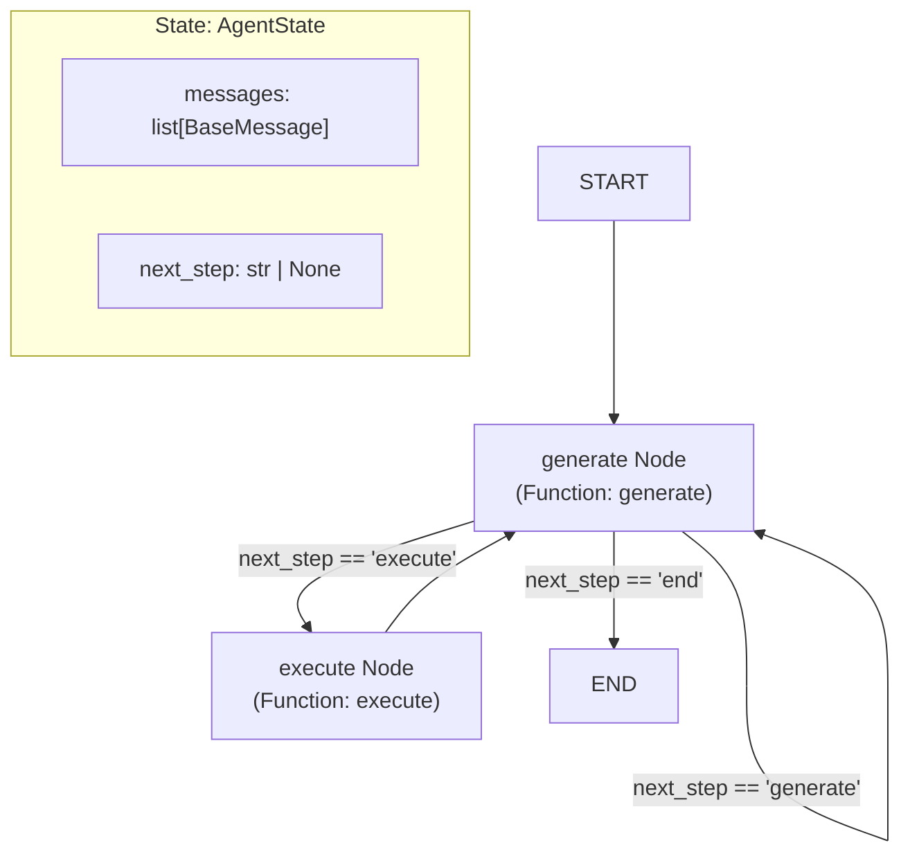

**Sources:** [biomni/agent/a1.py:1481-1519](), [biomni/agent/a1.py:50-53]()

### Generate Node

The `generate` node invokes the LLM with the current conversation history and system prompt, then parses the response to extract structured content.

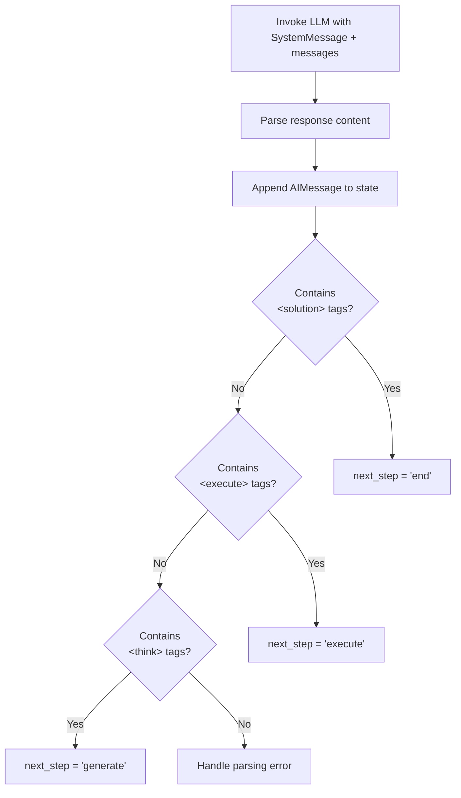

**Tag Pattern Matching:**
- ``: Internal reasoning (sets `next_step='generate'`)
- `<execute>...</execute>`: Code to execute (sets `next_step='execute'`)
- `<solution>...</solution>`: Final answer (sets `next_step='end'`)

**Sources:** [biomni/agent/a1.py:1291-1344]()

### Execute Node

The `execute` node extracts code from `<execute>` tags, detects the programming language, executes the code with timeout protection, and captures results.

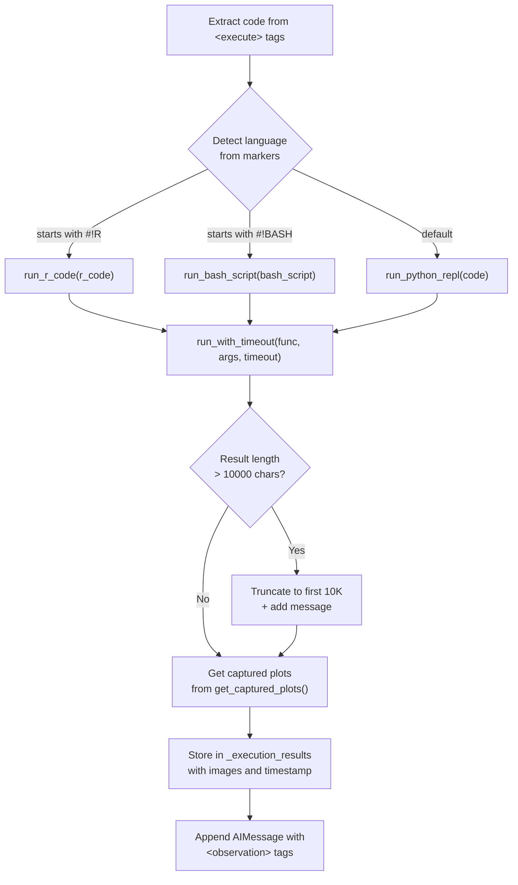

**Sources:** [biomni/agent/a1.py:1346-1428]()

---

## Code Language Detection

Language detection occurs by examining markers at the beginning of code blocks. The system supports three languages with specific marker patterns.

### Detection Pattern Table

| Language | Marker Patterns | Function Called | Cleanup Pattern |
|----------|----------------|-----------------|-----------------|
| R | `#!R`, `# R code`, `# R script` | `run_r_code` | Remove marker from start |
| Bash | `#!BASH`, `# Bash script`, `#!CLI` | `run_bash_script` | Remove marker from start |
| Python | (default, no marker) | `run_python_repl` | No cleanup needed |

### Detection Implementation

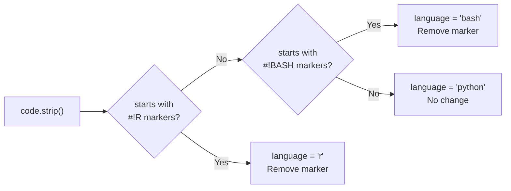

**Sources:** [biomni/agent/a1.py:1360-1384]()

---

## Code Execution Mechanisms

Each language has a dedicated execution function that handles language-specific setup, execution, and cleanup. All execution functions are wrapped with `run_with_timeout` for safety.

### Python Execution: `run_python_repl`

Python code execution maintains a persistent namespace across invocations, allowing variables and imports to persist between execute blocks.

**Key Features:**
- Persistent global namespace (`_persistent_namespace`)
- Plot capture via matplotlib backend interception
- Custom function injection from `agent.add_tool()`
- Direct execution with `exec()` in controlled namespace

**Namespace Injection Flow:**

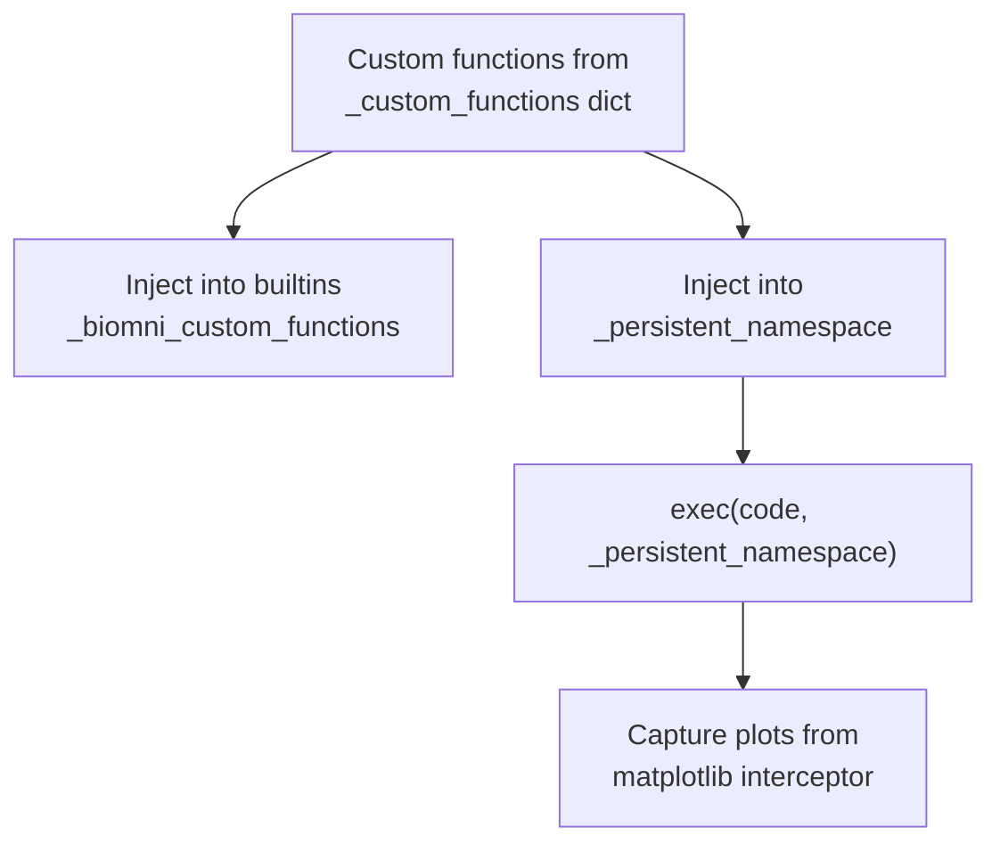

**Sources:** [biomni/agent/a1.py:1388-1395](), [biomni/utils.py:1283-1313]()

### R Execution: `run_r_code`

R code is executed using the `Rscript` command-line tool via subprocess.

**Implementation Details:**

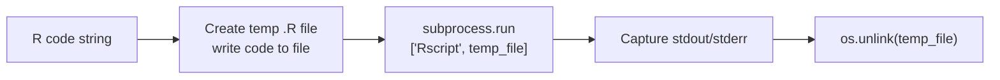

**Error Handling:**
- Non-zero return code: Return `f"Error running R code:\n{stderr}"`
- Exception during execution: Return `f"Error running R code: {str(e)}"`

**Sources:** [biomni/utils.py:25-54]()

### Bash Execution: `run_bash_script`

Bash scripts are executed with full shell capabilities including variables, loops, conditionals, and pipes.

**Implementation Details:**

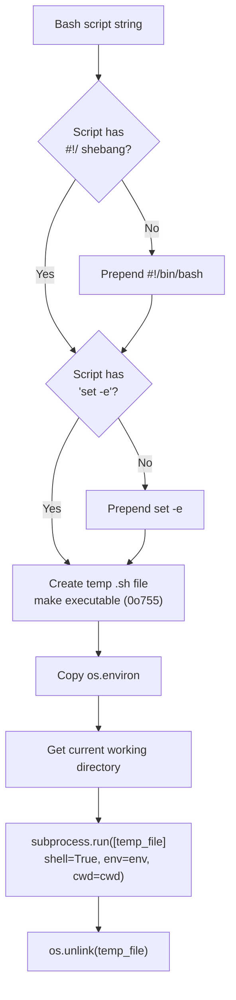

**Environment Preservation:**
- Inherits all environment variables from parent process
- Executes in current working directory
- Supports complex scripts with `set -e` for early exit on errors

**Sources:** [biomni/utils.py:56-145]()

---

## Timeout Management

All code execution is protected by a thread-based timeout mechanism to prevent indefinite blocking. The default timeout is configurable via `timeout_seconds` parameter.

### Thread-Based Timeout Architecture

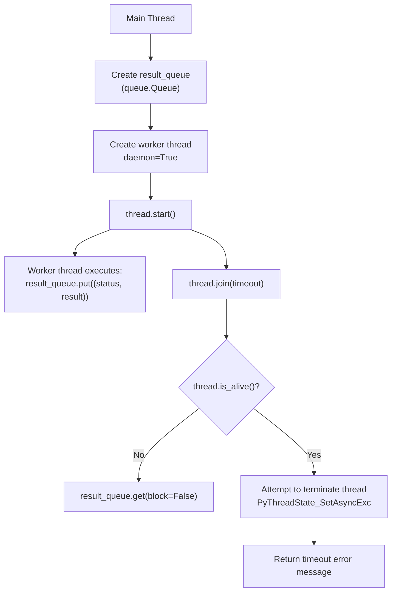

**Key Implementation Details:**

| Aspect | Implementation |
|--------|---------------|
| Thread type | `daemon=True` (terminates with main thread) |
| Result passing | `queue.Queue` (thread-safe) |
| Default timeout | 600 seconds (10 minutes) |
| Timeout message | "ERROR: Code execution timed out after {timeout} seconds..." |
| Thread termination | `ctypes.pythonapi.PyThreadState_SetAsyncExc` (best-effort) |

**Timeout Execution Flow:**

```python
# Simplified version of run_with_timeout
result_queue = queue.Queue()
thread = threading.Thread(target=func, args=args, daemon=True)
thread.start()
thread.join(timeout)

if thread.is_alive():
    # Timeout occurred
    return f"ERROR: Code execution timed out after {timeout} seconds..."
else:
    # Normal completion
    return result_queue.get()
```

**Sources:** [biomni/utils.py:183-243](), [biomni/agent/a1.py:1357-1395]()

---

## Result Capture and Processing

Execution results include both text output (stdout/stderr) and generated plots. These are stored with metadata for later retrieval and display.

### Execution Result Structure

The `_execution_results` list stores dictionaries with the following structure:

```python
execution_entry = {
    "triggering_message": str,      # The AI message containing <execute>
    "images": list,                 # Base64 encoded plot images
    "timestamp": str               # ISO format timestamp
}
```

### Result Capture Flow

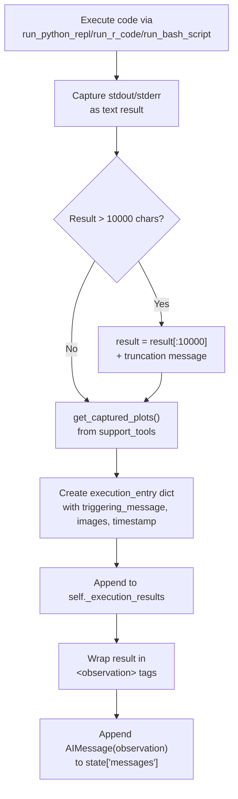

**Sources:** [biomni/agent/a1.py:1396-1427]()

### Plot Capture Mechanism

Python code execution captures matplotlib plots automatically through a backend interceptor in the `run_python_repl` function.

**Plot Capture Process:**

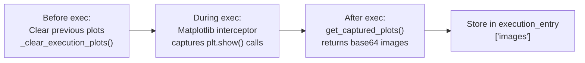

**Sources:** [biomni/agent/a1.py:1388-1416]()

---

## Error Handling

The execution pipeline includes multiple layers of error handling to ensure robust operation even when code execution fails.

### Error Handling Layers

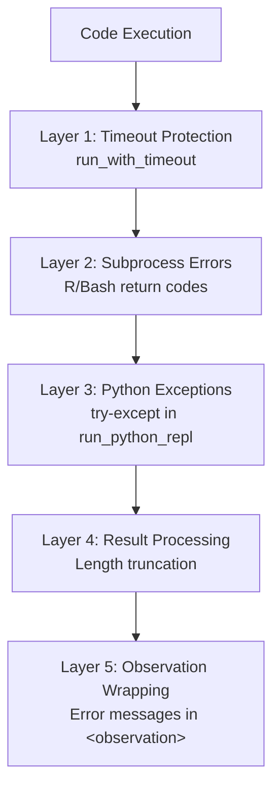

### Error Message Format by Layer

| Layer | Error Format | Example |
|-------|--------------|---------|
| Timeout | `"ERROR: Code execution timed out after {timeout} seconds..."` | Includes guidance to break task into smaller steps |
| Subprocess | `"Error running {language} code:\n{stderr}"` | Full stderr from subprocess |
| Exception | `"Error in execution: {result}"` | Python exception traceback |
| Truncation | `"The output is too long... first 10K characters...\n{result[:10000]}"` | Prevents context overflow |

### Parsing Error Recovery

When the LLM response doesn't contain required tags, the system implements error recovery:

```mermaid
flowchart TD
    ParseResponse["Parse LLM response"]
    
    CheckTags{"Has ` | Internal reasoning |
| `AIMessage` | `<execute>...</execute>` | Code to execute |
| `AIMessage` | `<observation>...</observation>` | Execution results |
| `AIMessage` | `<solution>...</solution>` | Final answer |

**Sources:** [biomni/agent/a1.py:50-53](), [biomni/agent/a1.py:1346-1428]()

### Execution Results Storage

In addition to the conversation history, execution results with images are stored separately in `_execution_results` for later retrieval during conversation history export:

```mermaid
flowchart LR
    Execute["execute node"]
    
    Messages["state['messages']<br/>(text only)"]
    ExecResults["self._execution_results<br/>(images + metadata)"]
    
    Export["save_conversation_history()<br/>Combines both sources"]
    
    Execute --> Messages
    Execute --> ExecResults
    
    Messages --> Export
    ExecResults --> Export
```

**Access Pattern:**

```python
# During execution
self._execution_results.append({
    "triggering_message": last_message,
    "images": execution_plots,
    "timestamp": datetime.now().isoformat()
})

# During export
for exec_result in self._execution_results:
    if exec_result["triggering_message"] in clean_output:
        # Associate images with triggering message
        for image_data in exec_result["images"]:
            content += f"\n\n"
```

**Sources:** [biomni/agent/a1.py:1403-1424](), [biomni/agent/a1.py:2188-2212]()

---

## Execution Pipeline Configuration

The execution pipeline behavior can be configured through initialization parameters:

| Parameter | Type | Default | Purpose |
|-----------|------|---------|---------|
| `timeout_seconds` | `int` | 600 | Maximum execution time per code block |
| `llm` | `str` | `default_config.llm` | LLM model for generation |
| `self_critic` | `bool` | `False` | Enable self-critic feedback loop |

**Configuration Flow:**

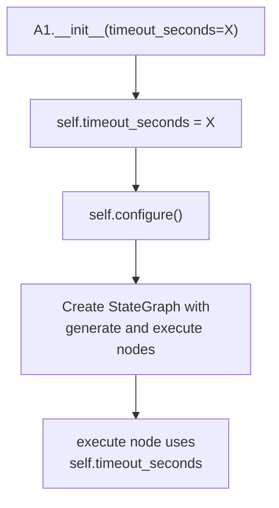

**Sources:** [biomni/agent/a1.py:56-210](), [biomni/agent/a1.py:1217-1519]()

---