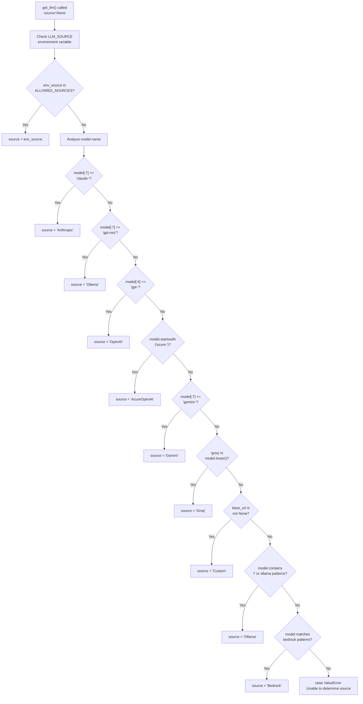
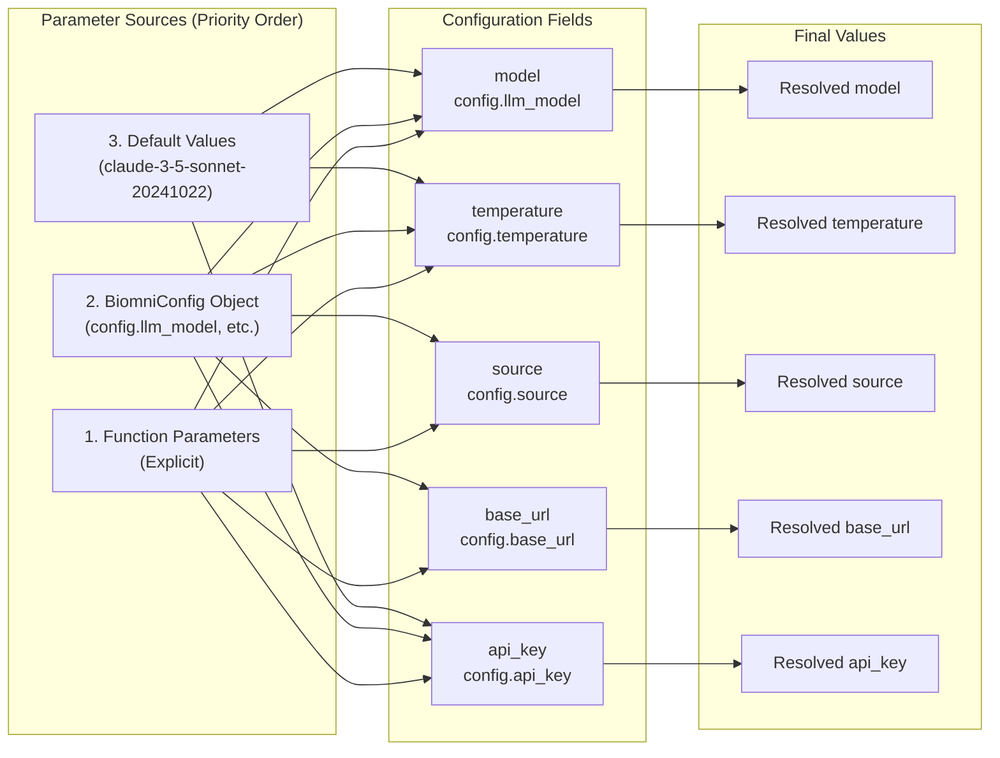

# LLM Integration Layer

Relevant source files

The following files were used as context for generating this wiki page:

- [README.md](README.md)
- [biomni/eval/__init__.py](biomni/eval/__init__.py)
- [biomni/eval/biomni_eval1.py](biomni/eval/biomni_eval1.py)
- [biomni/know_how/__init__.py](biomni/know_how/__init__.py)
- [biomni/know_how/loader.py](biomni/know_how/loader.py)
- [biomni/llm.py](biomni/llm.py)
- [biomni/model/retriever.py](biomni/model/retriever.py)
- [biomni/version.py](biomni/version.py)
- [tutorials/biomni_101.ipynb](tutorials/biomni_101.ipynb)

## Purpose and Scope

This document describes Biomni's unified LLM integration layer, which provides a single abstraction for interacting with multiple language model providers. The system supports automatic provider detection based on model names, seamless configuration management, and consistent interfaces across different LLM services. For overall system architecture, see [System Architecture](#2). For configuration details, see [Configuration Management](#2.5).

## Architecture Overview

The LLM integration layer centers around the `get_llm()` function in [biomni/llm.py:13-223](), which serves as a factory for creating language model instances. This function abstracts away provider-specific implementations while maintaining full access to underlying capabilities.

### LLM Provider Factory Architecture

```mermaid
graph TB
    subgraph "Entry Point"
        get_llm["get_llm()"]
    end
    
    subgraph "Configuration Sources"
        BiomniConfig["BiomniConfig"]
        EnvVars["Environment Variables"]
        FunctionParams["Function Parameters"]
        Defaults["Default Values"]
    end
    
    subgraph "Auto-Detection Logic"
        SourceDetection["Source Detection Logic"]
        ModelNameParsing["Model Name Parsing"]
        EnvSourceCheck["LLM_SOURCE Check"]
    end
    
    subgraph "Provider Implementations"
        OpenAI["ChatOpenAI<br/>(OpenAI)"]
        AzureOpenAI["AzureChatOpenAI<br/>(Azure)"]
        Anthropic["ChatAnthropic<br/>(Anthropic)"]
        Gemini["ChatOpenAI<br/>(Gemini via OpenAI API)"]
        Groq["ChatOpenAI<br/>(Groq via OpenAI API)"]
        Ollama["ChatOllama<br/>(Local/Ollama)"]
        Bedrock["ChatBedrock<br/>(AWS Bedrock)"]
        Custom["ChatOpenAI<br/>(Custom base_url)"]
    end
    
    subgraph "Output"
        BaseChatModel["BaseChatModel<br/>(LangChain Interface)"]
    end
    
    get_llm --> BiomniConfig
    get_llm --> EnvVars
    get_llm --> FunctionParams
    get_llm --> Defaults
    
    get_llm --> SourceDetection
    SourceDetection --> ModelNameParsing
    SourceDetection --> EnvSourceCheck
    
    get_llm --> OpenAI
    get_llm --> AzureOpenAI
    get_llm --> Anthropic
    get_llm --> Gemini
    get_llm --> Groq
    get_llm --> Ollama
    get_llm --> Bedrock
    get_llm --> Custom
    
    OpenAI --> BaseChatModel
    AzureOpenAI --> BaseChatModel
    Anthropic --> BaseChatModel
    Gemini --> BaseChatModel
    Groq --> BaseChatModel
    Ollama --> BaseChatModel
    Bedrock --> BaseChatModel
    Custom --> BaseChatModel
```

Sources: [biomni/llm.py:13-223]()

## Supported Providers

The LLM integration layer supports eight distinct provider types through the `SourceType` literal definition. Each provider has specific instantiation logic and configuration requirements.

| Provider | Source Type | Implementation | Base URL | API Key Source |
|----------|-------------|----------------|----------|----------------|
| OpenAI | `"OpenAI"` | `ChatOpenAI` | Default | `OPENAI_API_KEY` |
| Azure OpenAI | `"AzureOpenAI"` | `AzureChatOpenAI` | `OPENAI_ENDPOINT` | `OPENAI_API_KEY` |
| Anthropic | `"Anthropic"` | `ChatAnthropic` | Default | `ANTHROPIC_API_KEY` |
| Google Gemini | `"Gemini"` | `ChatOpenAI` | `generativelanguage.googleapis.com` | `GEMINI_API_KEY` |
| Groq | `"Groq"` | `ChatOpenAI` | `api.groq.com` | `GROQ_API_KEY` |
| Ollama | `"Ollama"` | `ChatOllama` | Default (localhost) | None |
| AWS Bedrock | `"Bedrock"` | `ChatBedrock` | AWS Region | AWS Credentials |
| Custom | `"Custom"` | `ChatOpenAI` | User-specified | User-specified |

Sources: [biomni/llm.py:9-10](), [biomni/llm.py:98-222]()

## Automatic Source Detection

The system implements sophisticated automatic source detection when no explicit `source` parameter is provided. The detection logic follows a hierarchical approach with multiple fallback mechanisms.

### Source Detection Flow

The detection logic includes specific patterns for identifying Ollama models [biomni/llm.py:75-89]() and Bedrock models [biomni/llm.py:90-93]().

Sources: [biomni/llm.py:56-95]()

## Configuration Integration

The LLM integration layer seamlessly integrates with Biomni's configuration system through the optional `config` parameter. When a `BiomniConfig` object is provided, unspecified parameters inherit values from the configuration.

### Parameter Resolution Hierarchy

The parameter resolution follows a clear precedence: explicit function parameters override config values, which override system defaults.

Sources: [biomni/llm.py:35-54]()

## Provider-Specific Implementation Details

### OpenAI Integration
The OpenAI provider uses the standard `ChatOpenAI` implementation from LangChain with support for temperature control and stop sequences. Models are passed directly without modification.

Sources: [biomni/llm.py:98-105]()

### Azure OpenAI Integration
Azure OpenAI requires additional configuration including endpoint and deployment mapping. The system strips the `"azure-"` prefix from model names and uses API version `"2024-12-01-preview"`.

Sources: [biomni/llm.py:107-122]()

### Anthropic Integration
Anthropic models use `ChatAnthropic` with a default `max_tokens` setting of 8192 and full support for stop sequences and temperature control.

Sources: [biomni/llm.py:124-136]()

### Gemini Integration
Gemini models are accessed through OpenAI-compatible endpoints using the Google Generative Language API base URL. This approach provides consistent interface while accessing Google's models.

Sources: [biomni/llm.py:138-157]()

### Custom Provider Integration
The Custom provider enables integration with any OpenAI-compatible API endpoint. It requires explicit `base_url` specification and supports custom API keys for proprietary or self-hosted models.

Sources: [biomni/llm.py:200-217]()

## Error Handling and Validation

The system implements comprehensive error handling for missing dependencies and invalid configurations. Each provider checks for required packages and raises informative `ImportError` messages with installation instructions.

### Dependency Management

| Provider | Required Package | Import Error Message |
|----------|------------------|---------------------|
| OpenAI/Azure/Gemini/Groq/Custom | `langchain-openai` | "Install with: pip install langchain-openai" |
| Anthropic | `langchain-anthropic` | "Install with: pip install langchain-anthropic" |
| Ollama | `langchain-ollama` | "Install with: pip install langchain-ollama" |
| Bedrock | `langchain-aws` | "Install with: pip install langchain-aws" |

The system also validates source types against `ALLOWED_SOURCES` and provides clear error messages for unsupported configurations.

Sources: [biomni/llm.py:99-104](), [biomni/llm.py:108-113](), [biomni/llm.py:125-130](), [biomni/llm.py:175-180](), [biomni/llm.py:187-192](), [biomni/llm.py:220-222]()

---