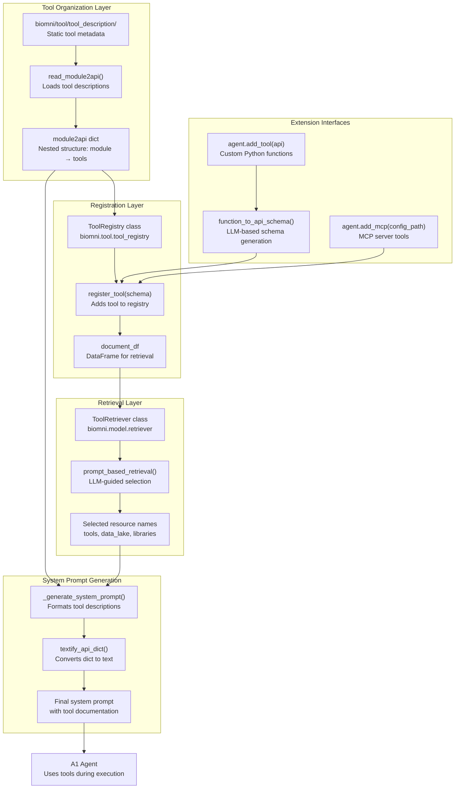
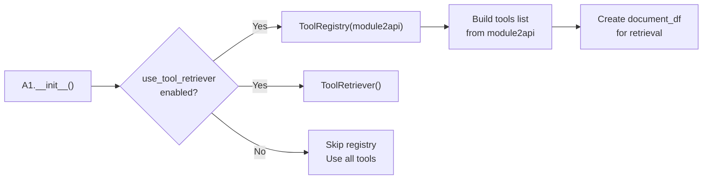
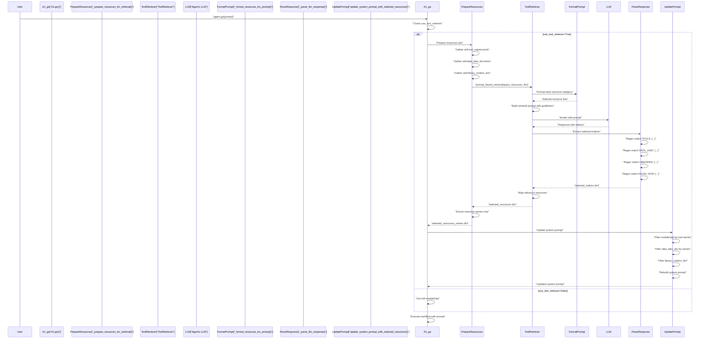
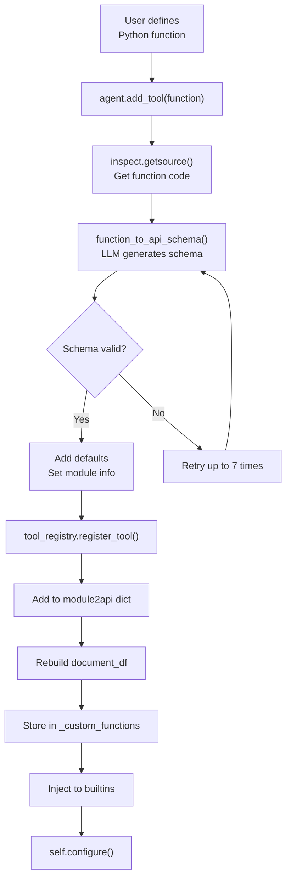

# Tool Registry and Retrieval

<details>
<summary>Relevant source files</summary>

The following files were used as context for generating this wiki page:

- [biomni/agent/a1.py](biomni/agent/a1.py)
- [biomni/know_how/__init__.py](biomni/know_how/__init__.py)
- [biomni/know_how/loader.py](biomni/know_how/loader.py)
- [biomni/llm.py](biomni/llm.py)
- [biomni/model/retriever.py](biomni/model/retriever.py)
- [biomni/tool/support_tools.py](biomni/tool/support_tools.py)
- [biomni/tool/tool_description/support_tools.py](biomni/tool/tool_description/support_tools.py)
- [biomni/utils.py](biomni/utils.py)
- [tutorials/biomni_101.ipynb](tutorials/biomni_101.ipynb)

</details>


This document describes the tool management system that enables the A1 agent to discover, organize, and selectively use over 100+ built-in tools. The system consists of a central registry, an optional retrieval mechanism for context window optimization, and extensibility interfaces for adding custom tools.

For information about how tools are executed during agent operation, see page 2.2 (Execution Pipeline). For details on adding custom tools via `agent.add_tool()` and `agent.add_mcp()`, see page 4.4 (Working with Custom Resources) and page 4.5 (MCP Integration).

## Overview

The tool management system provides three core capabilities:

1. **Centralized Registration**: All tools are registered in a structured format with metadata including name, description, parameters, and module location
2. **Optional Retrieval**: When enabled, uses LLM-based selection to reduce context window usage by identifying relevant tools for each query
3. **Dynamic Extension**: Supports runtime addition of custom Python functions and MCP (Model Context Protocol) server tools

## Architecture

### Component Diagram



**Sources**: [biomni/agent/a1.py:17-21](), [biomni/agent/a1.py:191-210](), [biomni/utils.py:845-874]()

## Tool Organization Structure

### module2api Dictionary

The `module2api` dictionary is the central data structure for organizing tools. It maps module names to lists of tool schemas.

**Structure**:
```python
{
    "biomni.tool.database": [
        {
            "name": "query_uniprot",
            "description": "Query UniProt database...",
            "required_parameters": [...],
            "optional_parameters": [...]
        },
        ...
    ],
    "biomni.tool.scRNA_tools": [...],
    "biomni.tool.bioimaging": [...],
    ...
}
```

The dictionary is populated by `read_module2api()`, which imports tool descriptions from the `biomni/tool/tool_description/` directory.

| Field | Type | Purpose |
|-------|------|---------|
| Module Name | `str` | Python import path (e.g., `"biomni.tool.database"`) |
| Tool List | `list[dict]` | Array of tool schema dictionaries |
| Tool Schema | `dict` | Contains `name`, `description`, `required_parameters`, `optional_parameters` |

**Sources**: [biomni/utils.py:845-874](), [biomni/agent/a1.py:191]()

### Tool Schema Format

Each tool in `module2api` follows a standardized schema:

```python
{
    "name": str,                      # Function name
    "description": str,               # Natural language description
    "required_parameters": [          # List of required parameters
        {
            "name": str,
            "type": str,              # Python type as string
            "description": str,
            "default": None
        }
    ],
    "optional_parameters": [          # List of optional parameters
        {
            "name": str,
            "type": str,
            "description": str,
            "default": Any            # Actual default value
        }
    ],
    "module": str                     # Added during registration
}
```

**Sources**: [biomni/utils.py:251-290](), [biomni/agent/a1.py:229-254]()

## ToolRegistry Class

### Initialization and Registration

The `ToolRegistry` class maintains an indexed collection of all available tools.



**Sources**: [biomni/agent/a1.py:204-206]()

### Registration Flow

**Built-in Tools Registration**:
1. `A1.__init__()` calls `read_module2api()` [biomni/agent/a1.py:191]()
2. `read_module2api()` imports tool descriptions from 20 modules [biomni/utils.py:845-874]()
3. If `use_tool_retriever=True`, creates `ToolRegistry(module2api)` [biomni/agent/a1.py:205]()
4. Registry builds internal data structures for efficient retrieval

**Custom Tools Registration**:
1. User calls `agent.add_tool(function)` [biomni/agent/a1.py:212-335]()
2. Function source is extracted via `inspect.getsource()` [biomni/agent/a1.py:221]()
3. `function_to_api_schema()` generates schema using LLM [biomni/agent/a1.py:226]()
4. Schema is validated and enhanced with defaults [biomni/agent/a1.py:234-251]()
5. Tool is registered via `self.tool_registry.register_tool(schema)` [biomni/agent/a1.py:258]()
6. Tool is added to `module2api` structure [biomni/agent/a1.py:268-285]()
7. Document DataFrame is rebuilt for retrieval [biomni/agent/a1.py:288-301]()

**Sources**: [biomni/agent/a1.py:212-335](), [biomni/utils.py:251-290]()

## Tool Retrieval System

### Prompt-Based Selection

When `use_tool_retriever=True`, the agent uses LLM-based retrieval to select relevant tools for each query.



**Sources**: [biomni/model/retriever.py:14-132](), [biomni/model/retriever.py:154-203](), [biomni/agent/a1.py:1521-1594]()
</thinking>

### Retrieval Prompt Construction

The `ToolRetriever.prompt_based_retrieval()` method constructs a detailed prompt for the LLM to select relevant resources. The prompt structure is:

**Prompt Components** [biomni/model/retriever.py:29-89]():

1. **System Context**: "You are an expert biomedical research assistant..."
2. **User Query**: The actual query string
3. **Available Resources**: Indexed lists of tools, data lake items, libraries, and know-how documents
4. **Response Format**: Specific format with category labels and index lists
5. **Selection Guidelines**: Rules for resource selection

**Example Prompt Format**:
```
USER QUERY: Design CRISPR screen for gene regulation

AVAILABLE TOOLS:
0. query_uniprot: Query UniProt database for protein information
1. design_knockout_sgrna: Design sgRNAs for CRISPR knockout experiments
2. query_kegg: Query KEGG database for pathway information
...

AVAILABLE DATA LAKE ITEMS:
0. protein_interactions.csv: Protein-protein interaction data
1. sgrna_library_human.csv: Human sgRNA library
...

AVAILABLE SOFTWARE LIBRARIES:
0. pandas: Data manipulation and analysis
1. biopython: Biological computation tools
...

AVAILABLE KNOW-HOW DOCUMENTS:
0. sgRNA Design Best Practices: 3-tier strategy for sgRNA design
1. Single Cell Annotation: 4-step workflow for cell type identification
...

For each category, respond with ONLY the indices of relevant items:
TOOLS: [list of indices]
DATA_LAKE: [list of indices]
LIBRARIES: [list of indices]
KNOW_HOW: [list of indices]

IMPORTANT GUIDELINES:
1. Be generous but not excessive - include all potentially relevant resources
2. ALWAYS prioritize database tools for general queries
3. Include all literature search tools
4. For wet lab queries, ALWAYS include molecular biology tools
...
```

**Selection Guidelines** [biomni/model/retriever.py:77-87]():
- Prioritize database tools for general queries
- Include all literature search tools
- Include molecular biology tools for sequence/wet lab queries
- Be generous with inclusion (better to include than exclude)
- When in doubt about database or molecular biology tools, include them

**Sources**: [biomni/model/retriever.py:14-89]()
</old_str>
<new_str>
### Prompt-Based Selection

When `use_tool_retriever=True`, the agent uses LLM-based retrieval to select relevant tools for each query.


**Sources**: [biomni/model/retriever.py:14-132](), [biomni/model/retriever.py:154-203](), [biomni/agent/a1.py:1521-1594]()

### Retrieval Prompt Construction

The `ToolRetriever.prompt_based_retrieval()` method constructs a detailed prompt for the LLM to select relevant resources.

**Prompt Structure** [biomni/model/retriever.py:29-89]():

1. **System Context**: "You are an expert biomedical research assistant..."
2. **User Query**: The actual query string
3. **Available Resources**: Indexed lists of tools, data lake items, libraries, and know-how documents
4. **Response Format**: Specific format with category labels and index lists
5. **Selection Guidelines**: Rules for resource selection

**Resource Formatting** [biomni/model/retriever.py:134-152]():

Each resource is formatted with its index and description:
```
0. query_uniprot: Query UniProt database for protein information
1. design_knockout_sgrna: Design sgRNAs for CRISPR knockout experiments
2. query_kegg: Query KEGG database for pathway information
```

The method handles three resource formats:
- **Dictionary format**: Extracts `name` and `description` keys
- **String format**: Uses string directly
- **Object format**: Extracts `name` and `description` attributes

**Selection Guidelines** [biomni/model/retriever.py:77-87]():
```
IMPORTANT GUIDELINES:
1. Be generous but not excessive - aim to include all potentially relevant resources
2. ALWAYS prioritize database tools for general queries - include as many database tools as possible
3. Include all literature search tools
4. For wet lab sequence type of queries, ALWAYS include molecular biology tools
5. For data lake items, include datasets that could provide useful information
6. For libraries, include those that provide functions needed for analysis
7. For know-how documents, include those that provide relevant protocols, best practices, or troubleshooting guidance
8. Don't exclude resources just because they're not explicitly mentioned in the query
9. When in doubt about a database tool or molecular biology tool, include it rather than exclude it
```

**Response Parsing** [biomni/model/retriever.py:154-203]():

The `_parse_llm_response()` method extracts indices using regex patterns:

| Category | Regex Pattern | Example Match |
|----------|---------------|---------------|
| Tools | `r"TOOLS:\s*\[(.*?)\]"` | `TOOLS: [0, 3, 5, 7]` |
| Data Lake | `r"DATA_LAKE:\s*\[(.*?)\]"` | `DATA_LAKE: [1, 2]` |
| Libraries | `r"LIBRARIES:\s*\[(.*?)\]"` | `LIBRARIES: [0, 2, 4]` |
| Know-How | `r"KNOW[-_]HOW:\s*\[(.*?)\]"` | `KNOW_HOW: [0, 1]` |

The method handles both plain string responses and LangChain Responses API format (list of content blocks).

**Sources**: [biomni/model/retriever.py:14-203]()

### Retrieval Implementation

The retrieval process involves coordination between the A1 agent and the ToolRetriever:

**Resource Preparation** [biomni/agent/a1.py:1521-1594]():

The `_prepare_resources_for_retrieval()` method gathers resources from multiple sources:

```python
resources = {
    "tools": self.tool_registry.tools,        # All registered tool schemas
    "data_lake": data_lake_list,              # [{name: path, description: desc}, ...]
    "libraries": library_list,                # [{name: lib, description: desc}, ...]
    "know_how": know_how_list                 # [{name: title, description: desc}, ...]
}
```

**Retriever Invocation** [biomni/model/retriever.py:14-132]():

```python
selected_resources = self.retriever.prompt_based_retrieval(
    query=prompt,
    resources=resources,
    llm=self.llm  # Agent's LLM for retrieval
)
```

Returns dictionary with actual resource objects (not just names):
```python
{
    "tools": [tool_schema_dict, ...],
    "data_lake": [{name: "file.csv", description: "..."}, ...],
    "libraries": [{name: "pandas", description: "..."}, ...],
    "know_how": [{name: "Protocol", description: "..."}, ...]
}
```

**Name Extraction** [biomni/agent/a1.py:1567-1594]():

The method extracts just the names for filtering:
```python
selected_resources_names = {
    "tools": [tool["name"] for tool in selected_resources["tools"]],
    "data_lake": [item["name"] for item in selected_resources["data_lake"]],
    "libraries": [item["name"] for item in selected_resources["libraries"]],
    "know_how": [doc["name"] for doc in selected_resources.get("know_how", [])]
}
```

**System Prompt Update** [biomni/agent/a1.py:1666-1768]():

`update_system_prompt_with_selected_resources()` filters the full resource dictionaries:
- Filters `module2api` by selected tool names
- Filters `data_lake_dict` by selected data lake names
- Filters `library_content_dict` by selected library names
- Filters know-how documents by selected document names
- Regenerates system prompt with filtered resources via `_generate_system_prompt()`

**Sources**: [biomni/agent/a1.py:1521-1594](), [biomni/model/retriever.py:14-132](), [biomni/agent/a1.py:1666-1768]()

## Dynamic Tool Extension

### Custom Python Functions

The `add_tool()` method enables runtime addition of user-defined functions.



**Sources**: [biomni/agent/a1.py:212-335](), [biomni/utils.py:251-290]()

### Schema Generation Process

The `function_to_api_schema()` utility [biomni/utils.py:251-290]() uses the agent's LLM to automatically generate tool schemas:

**Input**: Function source code as string
**Process**: 
1. Constructs prompt with schema format example
2. Uses `llm.with_structured_output(api_schema)` for structured generation
3. Retries up to 7 times on parsing errors
4. Uses `ast.literal_eval()` to preserve Python types (e.g., `None` vs `null`)

**Output**: Dictionary matching tool schema format

**Key Features**:
- Extracts parameter names, types, descriptions from function signature and docstring
- Identifies required vs optional parameters based on default values
- Generates clear, succinct descriptions
- Preserves type information (`None`, `True`/`False`, not `null`, `true`/`false`)

**Sources**: [biomni/utils.py:251-290](), [biomni/agent/a1.py:226]()

### MCP Tool Integration

The `add_mcp()` method [biomni/agent/a1.py:337-574]() enables integration with Model Context Protocol servers.

**Configuration File Format** (YAML):
```yaml
mcp_servers:
  server_name:
    enabled: true
    command: ["uvx", "mcp-server-package"]
    env:
      API_KEY: "${ENV_VAR_NAME}"
    tools:  # Optional - auto-discovery if omitted
      - biomni_name: "tool_name"
        description: "Tool description"
        parameters:
          param_name:
            type: "string"
            description: "Parameter description"
            required: true
```

**MCP Integration Flow**:

| Step | Action | Code Reference |
|------|--------|----------------|
| 1. Load Config | Parse YAML configuration file | [biomni/agent/a1.py:438-444]() |
| 2. Discovery | Auto-discover tools if not manually specified | [biomni/agent/a1.py:484-497]() |
| 3. Create Wrappers | Generate synchronous wrapper functions | [biomni/agent/a1.py:402-431]() |
| 4. Register | Add to tool registry and module2api | [biomni/agent/a1.py:558-563]() |
| 5. Store | Add to `_custom_functions` dict | [biomni/agent/a1.py:566-571]() |

**Wrapper Function Details**:
- Converts async MCP calls to synchronous interface [biomni/agent/a1.py:402-431]()
- Handles both stdio client sessions and tool invocation
- Supports environment variable substitution in config [biomni/agent/a1.py:466-474]()
- Returns JSON or text responses based on MCP result type

**Sources**: [biomni/agent/a1.py:337-574]()

## System Prompt Integration

### Textification Process

The `textify_api_dict()` function [biomni/utils.py:807-842]() converts the nested `module2api` structure into formatted text for the system prompt:

**Input**: `module2api` dictionary
**Output**: Formatted string with this structure:

```
Import file: biomni.tool.database
==================================
Method: query_uniprot
  Description: Query UniProt database for protein information
  Required Parameters:
    - protein_id (str): UniProt accession number [Default: None]
  Optional Parameters:
    - fields (List[str]): Fields to retrieve [Default: ['accession', 'protein_name']]

Method: query_kegg
  ...
```

**Sources**: [biomni/utils.py:807-842]()

### System Prompt Structure

The `_generate_system_prompt()` method [biomni/agent/a1.py:863-1215]() creates the agent's system prompt with multiple sections:

1. **Base Instructions**: ReAct loop guidelines, tag usage (`<execute>`, `<solution>`)
2. **Custom Resources Section** (if any): Highlighted tools/data/software added by user
3. **Function Dictionary**: Tool descriptions from `module2api` (or selected subset)
4. **Data Lake**: Available datasets with descriptions
5. **Software Library**: Available software packages with usage notes

**Custom Resources Highlighting**:
When custom tools/data/software are added, they appear first with emoji markers:
- 🔧 Custom Tools
- 📊 Custom Data
- ⚙️ Custom Software

This prioritization helps the LLM recognize user-added resources.

**Sources**: [biomni/agent/a1.py:863-1215](), [biomni/agent/a1.py:1051-1141]()

## Tool Access Patterns

### Module Import Pattern

Tools are imported and invoked using standard Python import statements in the `<execute>` block:

```python
from biomni.tool.database import query_uniprot
result = query_uniprot(protein_id="P12345")
print(result)
```

The system prompt includes module information to guide the LLM [biomni/utils.py:807-842]():
```
Import file: biomni.tool.database
==================================
Method: query_uniprot
  Description: Query UniProt database for protein information
  Required Parameters:
    - protein_id (str): UniProt accession number [Default: None]
  Optional Parameters:
    - fields (List[str]): Fields to retrieve [Default: ['accession', 'protein_name']]
```

This format explicitly shows:
- The import path (`Import file:`)
- The function name (`Method:`)
- Parameter specifications with types and defaults

**Sources**: [biomni/utils.py:807-842]()

### Custom Function Injection

Custom functions are made available through multiple mechanisms:

1. **Global Namespace**: Stored in `builtins._biomni_custom_functions` [biomni/agent/a1.py:320-322]()
2. **REPL Injection**: Injected into persistent execution namespace [biomni/utils.py:1282-1311]()
3. **Module2api Registration**: Added to module structure for system prompt [biomni/agent/a1.py:268-285]()

The `_inject_custom_functions_to_repl()` helper [biomni/agent/a1.py:1821-1826]() ensures custom functions are available during code execution by calling `inject_custom_functions_to_repl()` [biomni/utils.py:1282-1311](), which:
- Accesses `_persistent_namespace` from `run_python_repl`
- Injects all custom functions by name
- Updates `builtins._biomni_custom_functions` for broad access

**Sources**: [biomni/agent/a1.py:1821-1826](), [biomni/utils.py:1282-1311](), [biomni/agent/a1.py:320-322]()

## Configuration Options

### use_tool_retriever Parameter

Controls whether the retrieval system is enabled:

| Value | Behavior | Context Window Usage |
|-------|----------|---------------------|
| `True` | LLM selects relevant tools per query | Reduced - only selected tools |
| `False` | All tools included in system prompt | Full - entire `module2api` |
| `None` | Uses `default_config.use_tool_retriever` | Depends on default |

**Trade-offs**:
- **Retrieval Enabled**: Better for complex queries requiring focused tool selection; adds LLM call overhead
- **Retrieval Disabled**: Simpler flow; uses more tokens; suitable when all tools may be relevant

**Sources**: [biomni/agent/a1.py:56-210](), [biomni/agent/a1.py:1606-1608]()

### Tool Management Methods

The A1 agent provides methods for managing custom tools:

| Method | Purpose | Returns |
|--------|---------|---------|
| `add_tool(api)` | Register custom Python function | Tool schema dict |
| `add_mcp(config_path)` | Register MCP server tools | None |
| `get_custom_tool(name)` | Retrieve custom tool by name | Function object or None |
| `list_custom_tools()` | List all custom tool names | List of strings |
| `remove_custom_tool(name)` | Remove custom tool | Boolean (success) |

**Sources**: [biomni/agent/a1.py:212-661]()

## Tool Parsing and Detection

### Code Analysis Utilities

The system includes utilities to detect which tools are being used in code:

**`parse_tool_calls_from_code()`** [biomni/utils.py:1129-1151]():
- Analyzes Python code for import statements and function calls
- Returns list of tool names detected
- Used for tracking tool usage in execution logs

**`parse_tool_calls_with_modules()`** [biomni/utils.py:1154-1246]():
- Returns list of `(tool_name, module_name)` tuples
- Handles various import patterns: `from X import Y`, `import X`, `X.Y()`
- Uses regex matching and AST-like analysis

**Example**:
```python
code = """
from biomni.tool.database import query_uniprot
from biomni.tool.scRNA_tools import analyze_scRNA
result = query_uniprot("P12345")
"""

tools = parse_tool_calls_with_modules(code, module2api)
# Returns: [("analyze_scRNA", "biomni.tool.scRNA_tools"), 
#           ("query_uniprot", "biomni.tool.database")]
```

**Sources**: [biomni/utils.py:1129-1246]()

## Registry Data Structures

### Internal Storage

The `ToolRegistry` class maintains these key data structures:

```python
class ToolRegistry:
    self.tools: list[dict]           # List of all tool schemas
    self.document_df: pd.DataFrame   # DataFrame with columns:
                                     #   - docid: int (tool index)
                                     #   - document_content: dict (tool schema)
```

The `document_df` DataFrame is used by `ToolRetriever` for efficient retrieval operations.

**Document Content Format** for retrieval [biomni/utils.py:400-429]():
```
"<name>, <description>, <url>, required_params: <json>, optional_params: <json>"
```

This concatenated string format enables text-based similarity search during retrieval.

**Sources**: [biomni/agent/a1.py:288-301](), [biomni/utils.py:400-429]()

### Custom Tool Tracking

Custom tools are tracked separately in multiple instance attributes:

```python
self._custom_functions: dict[str, Callable]  # Name -> function object
self._custom_tools: dict[str, dict]          # Name -> metadata dict
                                             #   {"name", "description", "module"}
```

This dual storage enables:
1. **Execution**: `_custom_functions` provides callable objects
2. **Display**: `_custom_tools` provides metadata for system prompt highlighting
3. **Cleanup**: Both dictionaries updated when tools are removed

**Sources**: [biomni/agent/a1.py:304-315](), [biomni/agent/a1.py:1258-1277]()

---