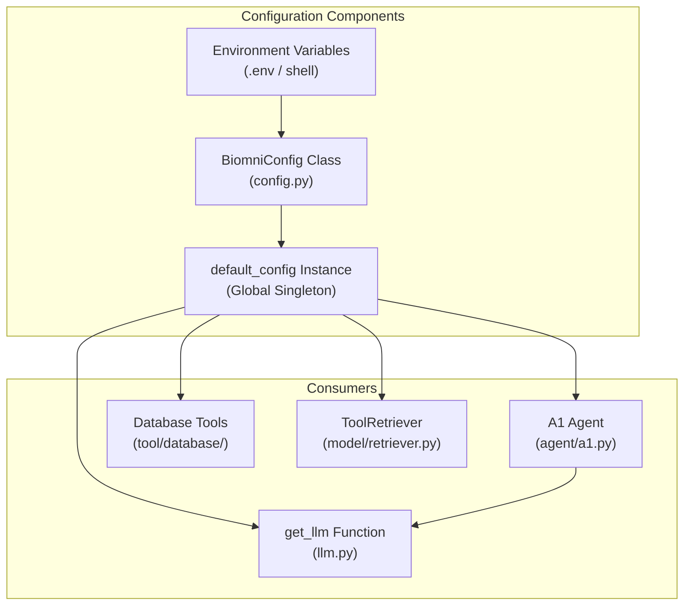
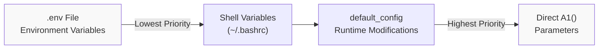
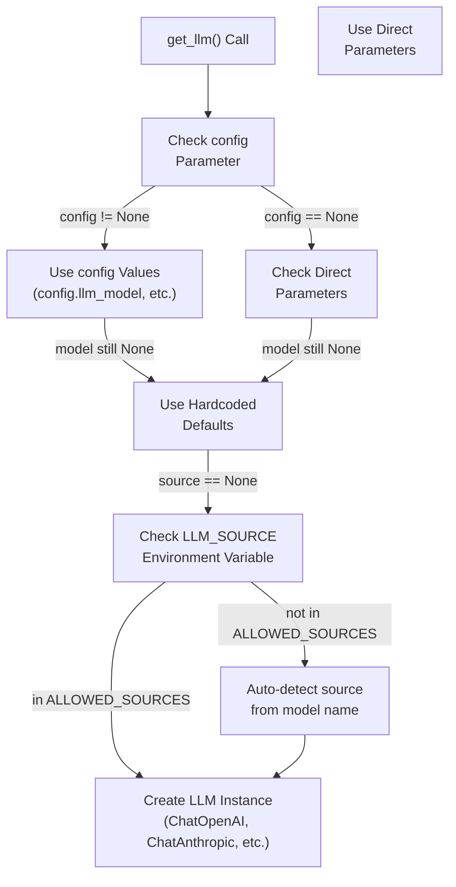
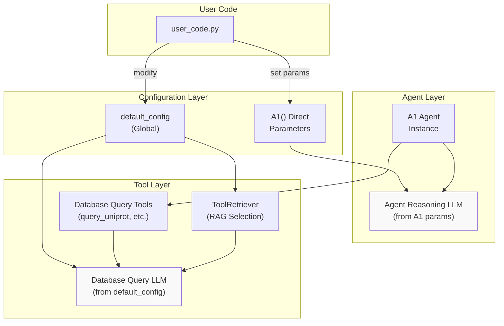
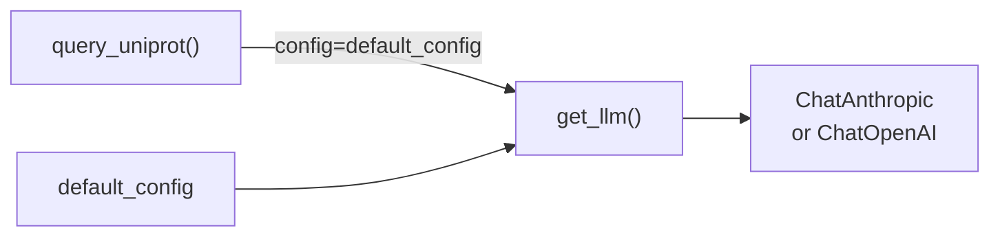

# Configuration System

<details>
<summary>Relevant source files</summary>

The following files were used as context for generating this wiki page:

- [README.md](README.md)
- [biomni/eval/__init__.py](biomni/eval/__init__.py)
- [biomni/eval/biomni_eval1.py](biomni/eval/biomni_eval1.py)
- [biomni/know_how/__init__.py](biomni/know_how/__init__.py)
- [biomni/know_how/loader.py](biomni/know_how/loader.py)
- [biomni/llm.py](biomni/llm.py)
- [biomni/model/retriever.py](biomni/model/retriever.py)
- [biomni/version.py](biomni/version.py)
- [tutorials/biomni_101.ipynb](tutorials/biomni_101.ipynb)

</details>


## Purpose and Scope

The Configuration System provides a centralized, hierarchical mechanism for managing settings across the Biomni platform. It controls LLM provider selection, API authentication, execution timeouts, data paths, and operational modes. This system enables consistent behavior across agent reasoning, database queries, and tool execution through multiple configuration sources.

For information about LLM provider integration, see [LLM Integration Layer](#2.3). For data path management, see [Data Infrastructure](#2.6).

## Core Components

The configuration system consists of three primary components:



Sources: [biomni/llm.py:1-276](), [biomni/config.py]()

### BiomniConfig Class

The `BiomniConfig` class is a dataclass that encapsulates all configurable parameters for the Biomni system. While not directly visible in the provided files, its structure is inferred from usage patterns in [biomni/llm.py:20-46]().

**Key Attributes:**
- `llm_model`: LLM model identifier (e.g., "claude-3-5-sonnet-20241022")
- `temperature`: Generation temperature (default: 0.7)
- `source`: Provider type ("OpenAI", "Anthropic", "Ollama", etc.)
- `base_url`: Custom model serving endpoint
- `api_key`: API authentication key
- `timeout_seconds`: Execution timeout limit (default: 600)
- `path`: Data lake directory path
- `use_tool_retriever`: Enable/disable RAG-based tool selection
- `commercial_mode`: Filter non-commercial resources

### default_config Instance

The `default_config` is a global singleton instance of `BiomniConfig` that serves as the system-wide default configuration. All components that don't receive explicit configuration parameters fall back to `default_config` values.

Sources: [README.md:192-209]()

## Configuration Sources and Hierarchy

The configuration system supports multiple sources with a well-defined precedence order:



Sources: [README.md:58-128](), [biomni/llm.py:36-46]()

### Configuration Hierarchy

| Priority | Source | Scope | Example |
|----------|--------|-------|---------|
| 1 (Highest) | Direct A1() parameters | Single agent instance | `A1(llm="gpt-4")` |
| 2 | `default_config` modifications | All operations (global) | `default_config.llm = "gpt-4"` |
| 3 | Shell environment variables | Process lifetime | `export LLM_SOURCE="Anthropic"` |
| 4 (Lowest) | `.env` file | Project-specific | `ANTHROPIC_API_KEY=sk-...` |

**Important Behavior:** Direct parameters to `A1()` only affect that agent's reasoning LLM. Database queries and tool retrieval always use `default_config` or environment variables. For consistent configuration, modify `default_config` instead of using direct parameters.

Sources: [README.md:192-209]()

## Environment Variables

The system recognizes the following environment variables, which can be set via `.env` file or shell exports:

### Authentication Keys

```bash
# LLM Provider API Keys
ANTHROPIC_API_KEY=sk-ant-...           # Required for Claude models
OPENAI_API_KEY=sk-...                  # Required for OpenAI/GPT models
GEMINI_API_KEY=...                     # Required for Gemini models
GROQ_API_KEY=...                       # Required for Groq models
AWS_BEARER_TOKEN_BEDROCK=...           # Required for AWS Bedrock
```

Sources: [README.md:74-99]()

### Provider Configuration

```bash
# LLM Source Selection
LLM_SOURCE=Anthropic                   # Options: OpenAI, AzureOpenAI, Anthropic, 
                                       # Ollama, Gemini, Bedrock, Groq, Custom

# Azure OpenAI Specific
OPENAI_ENDPOINT=https://....openai.azure.com/

# AWS Bedrock Specific
AWS_REGION=us-east-1                   # Default region for Bedrock
```

The `LLM_SOURCE` environment variable is checked in [biomni/llm.py:56-59]() and used for auto-detection when no explicit source is provided.

Sources: [biomni/llm.py:56-95](), [README.md:93-124]()

### Custom Model Serving

```bash
# For self-hosted models (SGLang, vLLM, etc.)
CUSTOM_MODEL_BASE_URL=http://localhost:8000/v1
CUSTOM_MODEL_API_KEY=EMPTY
```

Sources: [README.md:101-103]()

### System Paths and Timeouts

```bash
# Data lake directory
BIOMNI_DATA_PATH=/path/to/data         # Default: ./data

# Execution timeout (seconds)
BIOMNI_TIMEOUT_SECONDS=600             # Default: 600
```

Sources: [README.md:105-109]()

### Environment Variable Loading

The system loads API keys with fallback behavior demonstrated in [biomni/llm.py:168-182](), where it attempts to source `~/.bash_profile` if `ANTHROPIC_API_KEY` is not in the environment:

```python
# Ensure ANTHROPIC_API_KEY is loaded from bash_profile if not in environment
if not os.environ.get("ANTHROPIC_API_KEY"):
    result = subprocess.run(
        ["bash", "-c", "source ~/.bash_profile 2>/dev/null && echo $ANTHROPIC_API_KEY"],
        capture_output=True,
        text=True,
        timeout=5,
    )
    if result.stdout.strip():
        os.environ["ANTHROPIC_API_KEY"] = result.stdout.strip()
```

Sources: [biomni/llm.py:168-182]()

## Configuration Parameters Reference

### LLM Configuration

| Parameter | Type | Default | Description |
|-----------|------|---------|-------------|
| `llm_model` | str | "claude-3-5-sonnet-20241022" | Model identifier |
| `temperature` | float | 0.7 | Generation temperature (0.0-1.0) |
| `source` | SourceType | Auto-detected | Provider: OpenAI, Anthropic, etc. |
| `base_url` | str \| None | None | Custom model endpoint |
| `api_key` | str \| None | "EMPTY" | API authentication key |

Sources: [biomni/llm.py:13-54]()

### Agent Configuration

| Parameter | Type | Default | Description |
|-----------|------|---------|-------------|
| `path` | str | "./data" | Data lake directory |
| `timeout_seconds` | int | 600 | Execution timeout (seconds) |
| `use_tool_retriever` | bool | True | Enable RAG-based tool selection |
| `commercial_mode` | bool | False | Filter non-commercial resources |

Sources: [README.md:141-158]()

### Provider Types (SourceType)

The `SourceType` literal defines allowed LLM providers in [biomni/llm.py:9-10]():

```python
SourceType = Literal["OpenAI", "AzureOpenAI", "Anthropic", "Ollama", 
                     "Gemini", "Bedrock", "Groq", "Custom"]
ALLOWED_SOURCES: set[str] = set(SourceType.__args__)
```

Sources: [biomni/llm.py:9-10]()

## Configuration Flow Through the System

### LLM Creation Pipeline

The `get_llm` function demonstrates the configuration resolution hierarchy:



Sources: [biomni/llm.py:13-96]()

The resolution logic in [biomni/llm.py:36-54]():

```python
# Use config values for any unspecified parameters
if config is not None:
    if model is None:
        model = config.llm_model
    if temperature is None:
        temperature = config.temperature
    if source is None:
        source = config.source
    # ... etc

# Use defaults if still not specified
if model is None:
    model = "claude-3-5-sonnet-20241022"
if temperature is None:
    temperature = 0.7
```

### Agent-Database Configuration Split

A critical architectural pattern: **agent reasoning** and **database queries** use separate configuration paths:



Sources: [README.md:192-209](), [biomni/llm.py:13-46]()

**Example from README:**

```python
from biomni.config import default_config
from biomni.agent import A1

# Database queries use default_config
default_config.llm = "claude-3-5-sonnet-20241022"
default_config.source = "Anthropic"

# Agent reasoning uses direct parameters (if provided)
agent = A1(
    llm="biomni/Biomni-R0-32B-Preview",
    source="Custom",
    base_url="http://localhost:30000/v1",
    api_key="EMPTY",
)
```

This allows using a specialized local model (Biomni-R0) for agent reasoning while using Claude for database queries and retrieval.

Sources: [README.md:292-309]()

## Usage Patterns

### Pattern 1: Global Configuration (Recommended)

Modify `default_config` for consistent behavior across all operations:

```python
from biomni.config import default_config
from biomni.agent import A1

# Set global defaults
default_config.llm = "gpt-4"
default_config.timeout_seconds = 1200

# All agents and database queries use these settings
agent = A1()  # Uses gpt-4 for everything
```

**Advantages:**
- Consistent LLM usage across agent and database queries
- Single point of configuration
- Predictable behavior

Sources: [README.md:192-209]()

### Pattern 2: Hybrid Configuration

Use different models for agent reasoning vs. database queries:

```python
from biomni.config import default_config
from biomni.agent import A1

# Database queries use default_config
default_config.llm = "claude-3-5-sonnet-20241022"
default_config.source = "Anthropic"

# Agent reasoning uses custom model
agent = A1(
    llm="biomni/Biomni-R0-32B-Preview",
    source="Custom",
    base_url="http://localhost:30000/v1",
)
```

**Advantages:**
- Optimize cost/performance per operation type
- Use specialized models for agent reasoning
- Maintain reliable database query models

**Trade-offs:**
- More complex configuration
- Must understand the configuration split

Sources: [README.md:292-309]()

### Pattern 3: Environment-Only Configuration

Set all configuration via environment variables:

```bash
# .env file
ANTHROPIC_API_KEY=sk-ant-...
LLM_SOURCE=Anthropic
BIOMNI_TIMEOUT_SECONDS=1200
BIOMNI_DATA_PATH=/mnt/data
```

```python
from biomni.agent import A1

# Configuration loaded from environment
agent = A1()
```

**Advantages:**
- Clean separation of config from code
- Easy deployment to different environments
- Secure credential management

Sources: [README.md:58-128]()

### Pattern 4: Commercial Mode Filtering

Enable commercial mode to filter non-commercial datasets and tools:

```python
from biomni.agent import A1

# Only use commercially licensed resources
agent = A1(commercial_mode=True)
```

This filtering applies to:
- Data lake dataset selection
- Know-how document availability
- Tool function visibility

Sources: [README.md:141-158]()

## Provider-Specific Configuration

### OpenAI Configuration

Auto-detected for models starting with "gpt-":

```python
from biomni.agent import A1

# Automatically uses OpenAI provider
agent = A1(llm="gpt-4o")
```

For GPT-5 models, special handling disables unsupported parameters in [biomni/llm.py:106-134]():

```python
# GPT-5 models require Responses API and reject 'stop' parameter
use_responses = model.startswith("gpt-5")
if use_responses:
    # Custom subclass removes 'stop' and 'temperature' from payload
    return _ChatOpenAIResponsesNoStop(
        model=model,
        temperature=1,
        use_responses_api=True,
        output_version="v0",
    )
```

Sources: [biomni/llm.py:98-140]()

### Azure OpenAI Configuration

Requires `azure-` prefix and environment variables:

```python
import os
from biomni.agent import A1

# Set Azure-specific variables
os.environ["OPENAI_API_KEY"] = "your-azure-key"
os.environ["OPENAI_ENDPOINT"] = "https://your-resource.openai.azure.com/"

# Use azure- prefix for auto-detection
agent = A1(llm="azure-gpt-4o")
```

The Azure provider implementation in [biomni/llm.py:142-157]() strips the prefix and uses the deployment name:

```python
elif source == "AzureOpenAI":
    API_VERSION = "2024-12-01-preview"
    model = model.replace("azure-", "")
    return AzureChatOpenAI(
        openai_api_key=os.getenv("OPENAI_API_KEY"),
        azure_endpoint=os.getenv("OPENAI_ENDPOINT"),
        azure_deployment=model,
        openai_api_version=API_VERSION,
        temperature=temperature,
    )
```

Sources: [biomni/llm.py:142-157](), [README.md:164]()

### Anthropic Configuration

Auto-detected for models starting with "claude-":

```python
from biomni.agent import A1

# Automatically uses Anthropic provider
agent = A1(llm="claude-3-5-sonnet-20241022")
```

Includes automatic API key loading from `~/.bash_profile` as fallback in [biomni/llm.py:168-182]().

Sources: [biomni/llm.py:159-189]()

### Custom Model Serving

For locally hosted models (SGLang, vLLM, etc.):

```python
from biomni.agent import A1

# Point to OpenAI-compatible endpoint
agent = A1(
    llm="your-model-name",
    source="Custom",
    base_url="http://localhost:8000/v1",
    api_key="EMPTY",
)
```

The custom provider requires `base_url` to be specified in [biomni/llm.py:253-270]():

```python
elif source == "Custom":
    assert base_url is not None, "base_url must be provided for customly served LLMs"
    llm = ChatOpenAI(
        model=model,
        temperature=temperature,
        max_tokens=8192,
        base_url=base_url,
        api_key=api_key,
    )
    return llm
```

Sources: [biomni/llm.py:253-270](), [README.md:284-309]()

## Configuration in Database Tools

Database query tools use the global configuration through the `get_llm` function. Tool implementations pass `config=default_config` to ensure consistent LLM usage:



Sources: [biomni/llm.py:13-46]()

## Configuration in Tool Retrieval

The `ToolRetriever` class uses an LLM for prompt-based tool selection. It accepts an optional LLM parameter in [biomni/model/retriever.py:14-21]():

```python
def prompt_based_retrieval(self, query: str, resources: dict, llm=None) -> dict:
    """Use a prompt-based approach to retrieve the most relevant resources.
    
    Args:
        llm: Optional LLM instance to use for retrieval 
             (if None, will create a new one)
    """
```

When `llm=None`, it creates a default instance in [biomni/model/retriever.py:91-93]():

```python
# Use the provided LLM or create a new one
if llm is None:
    llm = ChatOpenAI(model="gpt-4o")
```

The agent system passes the agent's LLM to the retriever for consistent configuration.

Sources: [biomni/model/retriever.py:14-93]()

## Configuration Validation and Defaults

### Auto-Detection Logic

The `get_llm` function includes comprehensive auto-detection for LLM providers in [biomni/llm.py:56-95]():

```python
# Auto-detect source from model name if not specified
if source is None:
    env_source = os.getenv("LLM_SOURCE")
    if env_source in ALLOWED_SOURCES:
        source = env_source
    else:
        if model[:7] == "claude-":
            source = "Anthropic"
        elif model[:7] == "gpt-oss":
            source = "Ollama"
        elif model[:4] == "gpt-":
            source = "OpenAI"
        elif model.startswith("azure-"):
            source = "AzureOpenAI"
        elif model[:7] == "gemini-":
            source = "Gemini"
        elif "groq" in model.lower():
            source = "Groq"
        elif base_url is not None:
            source = "Custom"
        elif "/" in model or any(name in model.lower() for name in [...]):
            source = "Ollama"
        elif model.startswith(("anthropic.claude-", "amazon.titan-", ...)):
            source = "Bedrock"
        else:
            raise ValueError("Unable to determine model source.")
```

This allows users to specify just the model name in most cases.

Sources: [biomni/llm.py:56-95]()

### Default Values

| Parameter | Default | Location |
|-----------|---------|----------|
| model | "claude-3-5-sonnet-20241022" | [biomni/llm.py:50]() |
| temperature | 0.7 | [biomni/llm.py:52]() |
| api_key | "EMPTY" | [biomni/llm.py:54]() |
| timeout_seconds | 600 | [README.md:109]() |
| path | "./data" | [README.md:106]() |
| use_tool_retriever | True | Inferred |
| commercial_mode | False | Inferred |

Sources: [biomni/llm.py:48-54](), [README.md:105-109]()

## Configuration Best Practices

### 1. Use default_config for Consistency

**Recommended:**
```python
from biomni.config import default_config
default_config.llm = "gpt-4"
agent = A1()
```

**Avoid:**
```python
# Database queries won't use gpt-4
agent = A1(llm="gpt-4")
```

### 2. Store Credentials in Environment

Never hardcode API keys. Use `.env` file or shell variables:

```bash
# .env file
ANTHROPIC_API_KEY=sk-ant-...
OPENAI_API_KEY=sk-...
```

### 3. Set Appropriate Timeouts

Adjust timeout based on task complexity:

```python
from biomni.config import default_config

# For complex analyses requiring long execution
default_config.timeout_seconds = 1800  # 30 minutes

# For simple queries
default_config.timeout_seconds = 300   # 5 minutes
```

### 4. Use Commercial Mode for Production

When deploying commercially, enable filtering:

```python
agent = A1(commercial_mode=True)
```

This ensures compliance with dataset licensing restrictions.

### 5. Document Custom Configurations

When using custom models, document the setup:

```python
# Configuration for local Biomni-R0 server
# Server must be running: sglang.launch_server --model-path ...
agent = A1(
    llm="biomni/Biomni-R0-32B-Preview",
    source="Custom",
    base_url="http://localhost:30000/v1",
    api_key="EMPTY",
)
```

Sources: [README.md:192-309]()

---