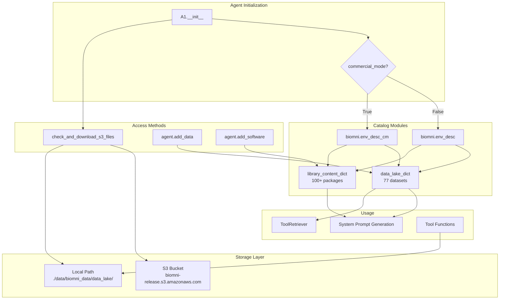
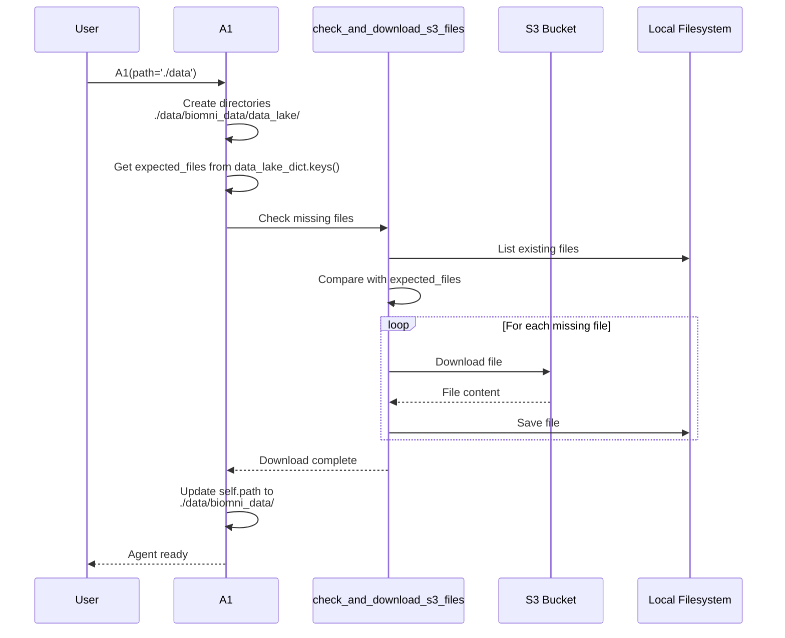
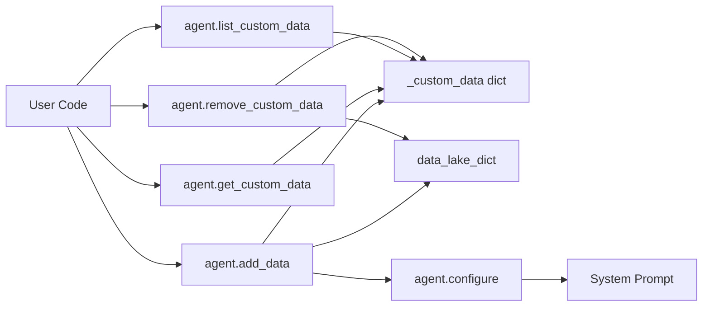

# Data Infrastructure

<details>
<summary>Relevant source files</summary>

The following files were used as context for generating this wiki page:

- [README.md](README.md)
- [biomni/agent/a1.py](biomni/agent/a1.py)
- [biomni/env_desc.py](biomni/env_desc.py)
- [biomni/eval/__init__.py](biomni/eval/__init__.py)
- [biomni/eval/biomni_eval1.py](biomni/eval/biomni_eval1.py)
- [biomni/tool/molecular_biology.py](biomni/tool/molecular_biology.py)
- [biomni/tool/support_tools.py](biomni/tool/support_tools.py)
- [biomni/tool/tool_description/support_tools.py](biomni/tool/tool_description/support_tools.py)
- [biomni/utils.py](biomni/utils.py)
- [biomni/version.py](biomni/version.py)

</details>


This document describes Biomni's data infrastructure, which provides centralized management of datasets, software libraries, and computational resources used by the agent and tools. The infrastructure includes a data lake catalog, software registry, automatic S3-based distribution, and commercial licensing filters.

For information about how tools access and query specific databases, see [Database Query Tools](#5.2). For details on data retrieval mechanisms used by the agent, see [Tool Registry and Retrieval](#2.4).

---

## Overview

Biomni's data infrastructure consists of four main components:

1. **Data Lake Dictionary** - Catalog of 77 pre-indexed datasets (~11GB total)
2. **Library Content Dictionary** - Registry of 100+ software packages and CLI tools
3. **S3 Distribution System** - Automatic download and validation of data files
4. **Commercial Mode Filter** - License-aware dataset filtering for commercial use

The infrastructure is initialized when the A1 agent is created and provides discovery metadata to the LLM through the tool retrieval system.

Sources: [biomni/env_desc.py:1-222](), [biomni/agent/a1.py:56-223]()

---

## Architecture Diagram



**Data Infrastructure Architecture** - Shows initialization flow, catalog modules, storage layer, and usage patterns.

Sources: [biomni/agent/a1.py:56-223](), [biomni/env_desc.py:1-222]()

---

## Data Lake Dictionary

The `data_lake_dict` is a Python dictionary mapping dataset filenames to human-readable descriptions. It serves as the central catalog for all pre-indexed datasets available to Biomni agents.

### Structure

```python
data_lake_dict = {
    "filename.extension": "Description of the dataset",
    ...
}
```

### Dataset Categories

The data lake contains 77 datasets organized into the following categories:

| Category | Example Files | Count | Description |
|----------|--------------|-------|-------------|
| Protein Interactions | `affinity_capture-ms.parquet`, `two-hybrid.parquet` | 8 | PPI data from various methods |
| Drug Discovery | `BindingDB_All_202409.tsv`, `broad_repurposing_hub_*.parquet` | 5 | Binding affinities, drug libraries |
| Genomics & Variants | `genebass_*.pkl`, `gwas_catalog.pkl` | 7 | GWAS, variant annotations |
| Expression Data | `gtex_tissue_gene_tpm.parquet`, `DepMap_*.csv` | 5 | Tissue expression, cell line data |
| Gene Sets | `msigdb_human_*.parquet`, `mousemine_*.parquet` | 18 | MSigDB, MouseMine gene sets |
| Drug Interactions | `ddinter_*.csv` | 8 | Drug-drug interactions by category |
| sgRNA Libraries | `sgRNA_KO_SP_human.txt`, `sgRNA_KO_SP_mouse.txt` | 2 | CRISPR knockout guides |
| Assay Data | `evebio_*.csv` | 7 | High-throughput screening results |
| Ontologies | `go-plus.json`, `hp.obo` | 2 | Gene Ontology, HPO terms |
| Other | Various | 15 | Knowledge graphs, markers, etc. |

Sources: [biomni/env_desc.py:2-79]()

### File Formats

The data lake uses multiple file formats optimized for different use cases:

- **Parquet** (`.parquet`) - Columnar format for efficient querying (43 files)
- **CSV/TSV** (`.csv`, `.tsv`) - Plain text tabular data (19 files)
- **Pickle** (`.pkl`) - Serialized Python objects (6 files)
- **JSON** (`.json`) - Structured ontology data (1 file)
- **OBO** (`.obo`) - Ontology format (1 file)
- **Plain text** (`.txt`) - sgRNA libraries (2 files)

Sources: [biomni/env_desc.py:2-79]()

### Access Pattern

Tools access data lake files through absolute paths constructed from the agent's `path` attribute:

```python
# Example from design_knockout_sgrna
library_path = data_lake_path + "/sgRNA_KO_SP_human.txt"
df = pd.read_csv(library_path, delimiter="\t")
```

Sources: [biomni/tool/molecular_biology.py:876-916]()

---

## Library Content Dictionary

The `library_content_dict` catalogs all available software packages, libraries, and CLI tools. Unlike the data lake, this dictionary provides descriptive metadata rather than file locations.

### Structure

```python
library_content_dict = {
    "package_name": "[Type] Description and usage notes",
    ...
}
```

### Software Categories

The library contains 100+ entries across three categories:

**Python Packages (80+)**

| Subcategory | Examples | Count |
|-------------|----------|-------|
| Bioinformatics | `biopython`, `scanpy`, `scikit-bio` | 15 |
| Genomics | `pysam`, `pyranges`, `pybedtools` | 8 |
| Single-cell | `scvi-tools`, `scrublet`, `cellxgene-census` | 5 |
| Drug Discovery | `rdkit`, `deeppurpose`, `openmm` | 8 |
| Data Science | `pandas`, `numpy`, `scipy`, `scikit-learn` | 10 |
| Visualization | `matplotlib`, `seaborn`, `opencv-python` | 4 |
| Specialized | `mageck`, `cellpose`, `cooler` | 30+ |

**R Packages (15+)**

| Category | Examples |
|----------|----------|
| Core Analysis | `ggplot2`, `dplyr`, `tidyr` |
| Bioconductor | `DESeq2`, `edgeR`, `limma` |
| Enrichment | `clusterProfiler` |
| Integration | `harmony`, `WGCNA` |

**CLI Tools (20+)**

| Category | Examples |
|----------|----------|
| Sequence Analysis | `samtools`, `bowtie2`, `bwa`, `bedtools` |
| Quality Control | `fastqc`, `trimmomatic` |
| Alignment | `mafft`, `muscle` |
| ChIP-seq | `macs2`, `Homer` |
| Genetics | `plink`, `plink2`, `gcta64` |
| Docking | `vina`, `autosite`, `ADFR` |

Sources: [biomni/env_desc.py:82-221]()

### Usage Instructions

Each entry includes type prefix and usage instructions:

```python
"samtools": "[CLI Tool] A suite of programs for interacting with high-throughput sequencing data. Use with subprocess.run(['samtools', ...])."

"DESeq2": "[R Package] Differential gene expression analysis based on the negative binomial distribution. Use with subprocess.run(['Rscript', '-e', 'library(DESeq2); ...'])."

"scanpy": "[Python Package] A scalable toolkit for analyzing single-cell gene expression data, specifically designed for large datasets using AnnData."
```

These descriptions are embedded in the agent's system prompt to help the LLM select appropriate tools.

Sources: [biomni/env_desc.py:82-221]()

---

## Storage and Distribution System

### S3 Bucket Structure

Data files are hosted on AWS S3 at `https://biomni-release.s3.amazonaws.com/`:

```
biomni-release.s3.amazonaws.com/
├── data_lake/
│   ├── affinity_capture-ms.parquet
│   ├── BindingDB_All_202409.tsv
│   ├── gtex_tissue_gene_tpm.parquet
│   └── ... (74 more files)
└── benchmark/
    └── hle/
        └── ... (evaluation data)
```

Sources: [biomni/agent/a1.py:166-189]()

### Automatic Download Flow



**Automatic Download Sequence** - Files are downloaded on first agent initialization.

Sources: [biomni/agent/a1.py:151-194]()

### Implementation Details

The download process is triggered during agent initialization:

[biomni/agent/a1.py:163-173]()

```python
if expected_data_lake_files is None:
    expected_data_lake_files = list(self.data_lake_dict.keys())
    
    # Check and download missing data lake files
    print("Checking and downloading missing data lake files...")
    check_and_download_s3_files(
        s3_bucket_url="https://biomni-release.s3.amazonaws.com",
        local_data_lake_path=data_lake_dir,
        expected_files=expected_data_lake_files,
        folder="data_lake",
    )
```

Users can skip download by providing an empty list:

```python
# Skip automatic datalake download
agent = A1(path='./data', expected_data_lake_files=[])
```

Sources: [biomni/agent/a1.py:151-194](), [README.md:151-163]()

---

## Commercial Mode Filtering

Biomni provides a `commercial_mode` flag to filter datasets based on licensing restrictions. When enabled, only commercially-licensed datasets are available.

### Implementation

Two separate environment description modules exist:

| Module | Usage | Content |
|--------|-------|---------|
| `biomni.env_desc` | Academic mode (default) | All 77 datasets |
| `biomni.env_desc_cm` | Commercial mode | Commercially-licensed subset only |

The appropriate module is imported at initialization:

[biomni/agent/a1.py:100-113]()

```python
# Import appropriate env_desc based on commercial_mode
if commercial_mode:
    from biomni.env_desc_cm import data_lake_dict, library_content_dict
    print("🏢 Commercial mode: Using commercial-licensed datasets only")
else:
    from biomni.env_desc import data_lake_dict, library_content_dict
    print("🎓 Academic mode: Using all datasets (including non-commercial)")
```

### Configuration

Commercial mode can be set via:

1. **Constructor parameter**:
   ```python
   agent = A1(commercial_mode=True)
   ```

2. **Global default config**:
   ```python
   from biomni.config import default_config
   default_config.commercial_mode = True
   ```

3. **Environment variable**:
   ```bash
   export BIOMNI_COMMERCIAL_MODE=true
   ```

Sources: [biomni/agent/a1.py:66-113](), [README.md:192-209]()

### Know-How Filtering

Commercial mode also filters know-how documents to exclude non-commercial content:

[biomni/agent/a1.py:214-217]()

```python
# Filter know-how documents based on commercial mode
if commercial_mode:
    self._filter_know_how_for_commercial_mode()
```

Sources: [biomni/agent/a1.py:214-219]()

---

## Custom Data Management

Users can extend the data infrastructure by adding custom datasets and software at runtime.

### Adding Custom Datasets

The `add_data` method registers new datasets with the data lake:

[biomni/agent/a1.py:676-721]()

```python
def add_data(self, data):
    """Add new data to the data lake.
    
    Args:
        data: Dictionary with file path as key and description as value
              e.g., {'my_dataset.csv': 'A dataset containing gene expression data'}
    """
```

**Usage Example**:

```python
agent = A1()

# Add custom dataset
agent.add_data({
    'my_protein_interactions.csv': 'Custom PPI network from in-house experiments',
    '/path/to/variant_calls.vcf': 'Whole genome sequencing variant calls'
})

# Dataset is now available in data_lake_dict
# and will appear in system prompt for tool selection
```

The method performs the following operations:

1. Validates input format
2. Extracts filename from path
3. Stores metadata in `self._custom_data`
4. Adds to `self.data_lake_dict` for LLM discovery
5. Reconfigures agent to update system prompt

Sources: [biomni/agent/a1.py:676-721]()

### Adding Custom Software

The `add_software` method registers new software tools:

[biomni/agent/a1.py:777-820]()

```python
def add_software(self, software):
    """Add new software to the software library.
    
    Args:
        software: Dictionary with software name as key and description as value
                 e.g., {'custom_tool': 'A custom analysis tool for processing data'}
    """
```

**Usage Example**:

```python
agent = A1()

# Register custom software
agent.add_software({
    'blast+': '[CLI Tool] NCBI BLAST suite for sequence alignment',
    'my_aligner': '[Python Package] Custom read alignment tool with GPU support'
})

# Software is now discoverable by the LLM
```

Sources: [biomni/agent/a1.py:777-820]()

### Custom Data Lifecycle



**Custom Data Lifecycle** - Data flows from user addition through storage to system prompt generation.

Sources: [biomni/agent/a1.py:676-775]()

---

## Data Access Patterns in Tools

### Direct File Access

Most tools directly read data lake files using the agent's `data_lake_path` parameter:

[biomni/tool/molecular_biology.py:876-916]()

```python
def design_knockout_sgrna(
    gene_name: str,
    data_lake_path: str,
    species: str = "human",
    num_guides: int = 1,
) -> dict[str, Any]:
    DEFAULT_LIBRARIES = {
        "human": data_lake_path + "/sgRNA_KO_SP_human.txt",
        "mouse": data_lake_path + "/sgRNA_KO_SP_mouse.txt",
    }
    
    library_path = DEFAULT_LIBRARIES[species.lower()]
    
    if not os.path.exists(library_path):
        raise FileNotFoundError(f"Library file for {species} not found at path: {library_path}")
    
    df = pd.read_csv(library_path, delimiter="\t")
    # ... process data
```

### Synapse Integration

For large external datasets, tools can download from Synapse:

[biomni/tool/support_tools.py:199-388]()

```python
def download_synapse_data(
    entity_ids: str | list[str],
    download_location: str = ".",
    entity_type: str = "dataset",
    timeout: int = 300,
):
    """Download data from Synapse using entity IDs.
    
    Requires SYNAPSE_AUTH_TOKEN environment variable for authentication.
    """
```

This function:
1. Checks for `SYNAPSE_AUTH_TOKEN` environment variable
2. Validates entity types (file, dataset, folder, project)
3. Uses `synapse` CLI for actual downloads
4. Handles multiple files and recursive downloads
5. Returns detailed status and error information

Sources: [biomni/tool/support_tools.py:199-388](), [biomni/tool/tool_description/support_tools.py:30-74]()

---

## Data Infrastructure Configuration Display

When an agent initializes, it prints a detailed configuration report:

```
==================================================
🔧 BIOMNI CONFIGURATION
==================================================
📋 DEFAULT CONFIG (Including Database LLM):
  Path: ./data/biomni_data
  Llm: claude-sonnet-4-20250514
  Source: Anthropic
  Commercial Mode: Academic (all datasets)
  Timeout Seconds: 600
  Use Tool Retriever: True

🤖 AGENT LLM (Constructor Override):
  LLM Model: gpt-4
  Source: OpenAI
==================================================

🎓 Academic mode: Using all datasets (including non-commercial)
📚 Loaded 5 know-how documents
Checking and downloading missing data lake files...
```

The display shows:
- Default configuration values
- Agent-specific overrides
- Commercial vs academic mode
- Number of loaded know-how documents
- Download progress

Sources: [biomni/agent/a1.py:115-147]()

---

## Summary

The Biomni data infrastructure provides:

1. **Centralized Catalog** - `data_lake_dict` (77 datasets) and `library_content_dict` (100+ packages)
2. **Automatic Distribution** - S3-based download with validation via `check_and_download_s3_files`
3. **License Compliance** - `commercial_mode` filtering for licensed resources
4. **Runtime Extension** - `add_data()` and `add_software()` for custom resources
5. **Multiple Formats** - Parquet, CSV, Pickle, JSON, OBO for different data types
6. **External Integration** - Synapse download support via `download_synapse_data()`

The infrastructure serves two primary purposes:
- **Discovery**: Metadata in system prompts enables LLM tool selection
- **Execution**: Local files provide data for tool functions

All infrastructure operations are orchestrated through the A1 agent's initialization and configuration system.

Sources: [biomni/env_desc.py:1-222](), [biomni/agent/a1.py:56-223](), [biomni/tool/support_tools.py:199-388]()

---