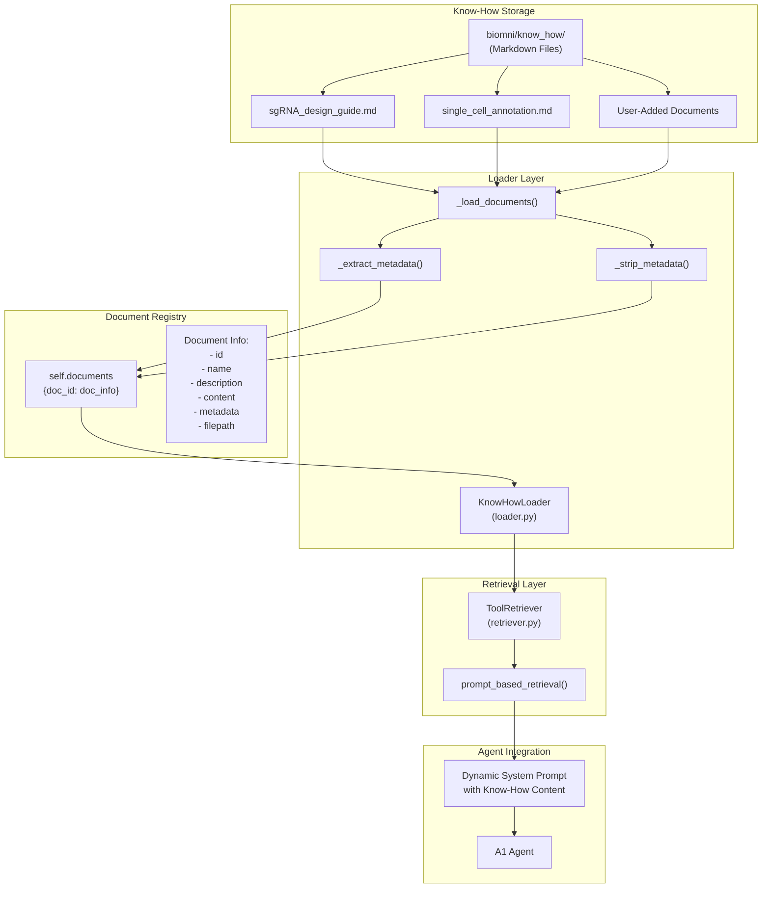
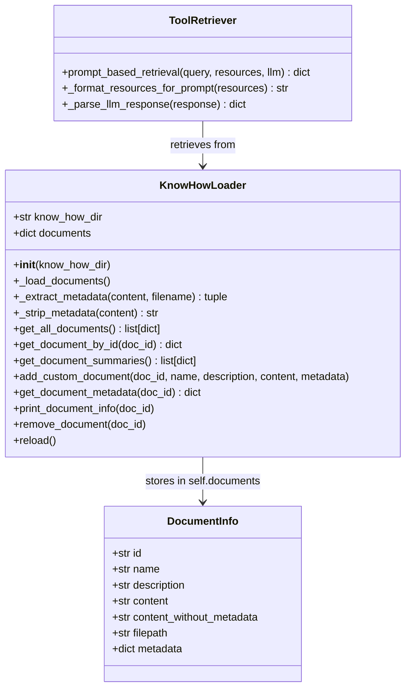
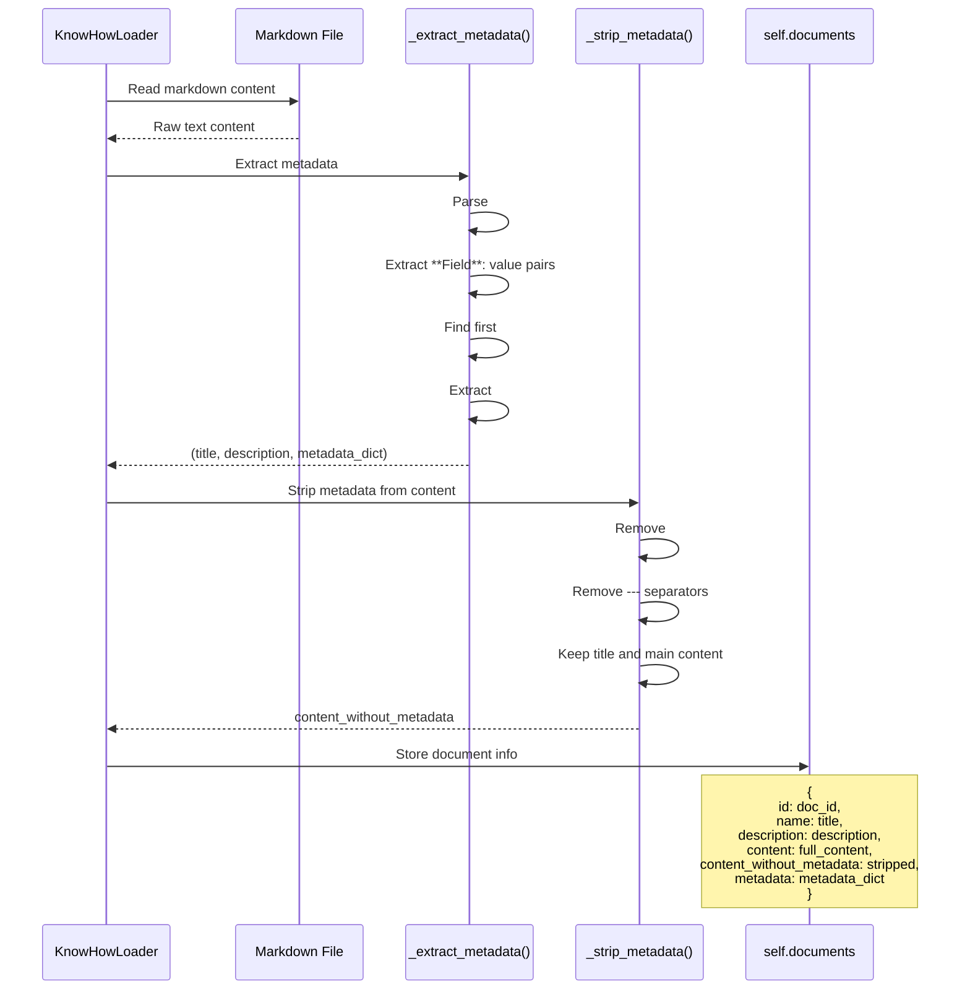
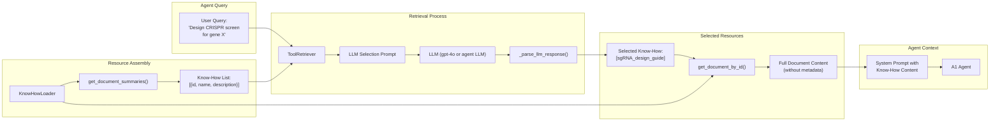

# Know-How Library

<details>
<summary>Relevant source files</summary>

The following files were used as context for generating this wiki page:

- [biomni/know_how/__init__.py](biomni/know_how/__init__.py)
- [biomni/know_how/loader.py](biomni/know_how/loader.py)
- [biomni/know_how/sgRNA_design_guide.md](biomni/know_how/sgRNA_design_guide.md)
- [biomni/know_how/single_cell_annotation.md](biomni/know_how/single_cell_annotation.md)
- [biomni/llm.py](biomni/llm.py)
- [biomni/model/retriever.py](biomni/model/retriever.py)
- [tutorials/biomni_101.ipynb](tutorials/biomni_101.ipynb)

</details>


## Purpose and Scope

The Know-How Library provides a structured repository of best practices, protocols, and troubleshooting guides that augment the A1 agent's capabilities with domain-specific expertise. These markdown documents contain step-by-step procedures, decision trees, and validated workflows that the agent references during task execution.

This page covers the architecture, document format, loading mechanism, and integration with the agent system. For information about the data lake (datasets), see [Data Infrastructure](#2.6). For tool-specific documentation, see [Tool Reference](#5).

**Sources**: [biomni/know_how/__init__.py:1-9](), [biomni/know_how/loader.py:1-10]()

## System Architecture



**Diagram 1: Know-How Library Architecture and Integration Flow**

The system consists of three main layers: storage (markdown files), loading (KnowHowLoader), and retrieval (ToolRetriever integration). The loader parses documents and extracts metadata, while the retriever selects relevant documents for each query.

**Sources**: [biomni/know_how/loader.py:8-27](), [biomni/model/retriever.py:8-133]()

## KnowHowLoader Class



**Diagram 2: KnowHowLoader Class Structure and Relationships**

The `KnowHowLoader` class manages document lifecycle and provides access methods. Each document is stored as a `DocumentInfo` dictionary with both original and metadata-stripped content.

**Sources**: [biomni/know_how/loader.py:8-349]()

## Document Format and Structure

### Markdown Structure

Know-how documents follow a standardized format with metadata sections:

```markdown
# Document Title

---

## Metadata

**Short Description**: Brief summary for retrieval

**Authors**: Author names

**Version**: Version number

**Last Updated**: Date

**License**: License type (e.g., CC BY 4.0)

**Commercial Use**: ✅ Allowed / ❌ Not Allowed

---

## Overview

Main content overview paragraph...

## Section 1

Detailed content...
```

**Sources**: [biomni/know_how/sgRNA_design_guide.md:1-32](), [biomni/know_how/single_cell_annotation.md:1-26]()

### Metadata Extraction Process



**Diagram 3: Metadata Extraction and Document Processing Workflow**

The loader extracts metadata fields using pattern matching for `**Field**:` syntax and separates metadata from content for cleaner agent prompts.

**Sources**: [biomni/know_how/loader.py:64-164](), [biomni/know_how/loader.py:165-224]()

### Metadata Fields

| Field | Purpose | Example |
|-------|---------|---------|
| `short_description` | Used for retrieval prompt | "Comprehensive guide for sgRNA design" |
| `authors` | Attribution | "Biomni Team" |
| `version` | Version tracking | "1.0" |
| `last_updated` | Freshness indicator | "November 2025" |
| `license` | Usage rights | "CC BY 4.0" |
| `commercial_use` | Commercial filtering | "✅ Allowed" or "❌ Not Allowed" |

**Sources**: [biomni/know_how/loader.py:89-128](), [biomni/know_how/sgRNA_design_guide.md:6-18]()

## Loading and Initialization

### Default Initialization

```python
from biomni.know_how import KnowHowLoader

# Load from default directory (biomni/know_how/)
loader = KnowHowLoader()
```

The loader automatically discovers all `.md` files in the directory, excluding uppercase filenames like `README.MD`.

**Sources**: [biomni/know_how/loader.py:11-26]()

### Document Discovery Logic

The `_load_documents()` method [biomni/know_how/loader.py:28-62]() implements the following logic:

1. Glob pattern: `os.path.join(self.know_how_dir, "*.md")` [biomni/know_how/loader.py:30-31]()
2. Skip uppercase filenames: `if filename.upper() in ["README.MD", "QUICK_START.MD"] or filename_without_ext.isupper()` [biomni/know_how/loader.py:38-39]()
3. Extract metadata using `_extract_metadata()` [biomni/know_how/loader.py:46]()
4. Store in `self.documents` dictionary with `doc_id` as key [biomni/know_how/loader.py:54-62]()

### Custom Directory

```python
# Load from custom directory
loader = KnowHowLoader(know_how_dir="/path/to/custom/docs")
```

**Sources**: [biomni/know_how/loader.py:11-26]()

## Accessing Documents

### Get All Documents

```python
# Get full document list with content
all_docs = loader.get_all_documents()

# Returns list of dicts:
# [
#   {
#     'id': 'sgRNA_design_guide',
#     'name': 'sgRNA Design Guide: Three-Tiered Approach',
#     'description': 'Comprehensive guide for finding or designing sgRNAs...',
#     'content': '# sgRNA Design Guide...',
#     'content_without_metadata': '# sgRNA Design Guide\n\n## Overview...',
#     'filepath': '/path/to/sgRNA_design_guide.md',
#     'metadata': {'short_description': '...', 'authors': '...', ...}
#   },
#   ...
# ]
```

**Sources**: [biomni/know_how/loader.py:226-233]()

### Get Document Summaries

```python
# Get summaries without full content (for display/selection)
summaries = loader.get_document_summaries()

# Returns:
# [
#   {'id': 'sgRNA_design_guide', 'name': '...', 'description': '...'},
#   {'id': 'single_cell_annotation', 'name': '...', 'description': '...'}
# ]
```

This method is used by `ToolRetriever` to list available documents for LLM-based selection.

**Sources**: [biomni/know_how/loader.py:247-256]()

### Get Specific Document

```python
# Get document by ID
doc = loader.get_document_by_id('sgRNA_design_guide')

if doc:
    print(doc['name'])
    print(doc['content_without_metadata'])  # Content without metadata section
```

**Sources**: [biomni/know_how/loader.py:235-245]()

### Get Document Metadata Only

```python
# Get just the metadata dictionary
metadata = loader.get_document_metadata('sgRNA_design_guide')

# Returns:
# {
#   'short_description': '...',
#   'authors': 'Biomni Team',
#   'version': '1.0',
#   'commercial_use': '✅ Allowed',
#   ...
# }
```

**Sources**: [biomni/know_how/loader.py:281-292]()

## Integration with ToolRetriever



**Diagram 4: Know-How Document Selection and Integration Flow**

The `ToolRetriever.prompt_based_retrieval()` method selects relevant know-how documents using an LLM, then the full content (without metadata) is included in the agent's system prompt.

**Sources**: [biomni/model/retriever.py:14-132](), [biomni/know_how/loader.py:226-256]()

### Retrieval Prompt Format

The retriever formats know-how documents for LLM selection [biomni/model/retriever.py:46-51]():

```python
"""
AVAILABLE KNOW-HOW DOCUMENTS (Best Practices & Protocols):
0. sgRNA Design Guide: Three-Tiered Approach: Comprehensive guide for finding or designing sgRNAs...
1. Single Cell RNA-seq Cell Type Annotation: Best practices for annotating cell types...
"""
```

The LLM responds with indices:
```
KNOW_HOW: [0]  # Select sgRNA guide
```

**Sources**: [biomni/model/retriever.py:48-71](), [biomni/model/retriever.py:134-152](), [biomni/model/retriever.py:196-201]()

## Available Know-How Documents

### Current Document Catalog

| Document ID | Title | Description | Commercial |
|------------|-------|-------------|------------|
| `sgRNA_design_guide` | sgRNA Design Guide: Three-Tiered Approach | Comprehensive guide for finding or designing sgRNAs using validated sequences, CRISPick datasets, or de novo design tools | ✅ Allowed |
| `single_cell_annotation` | Single Cell RNA-seq Cell Type Annotation | Best practices for annotating cell types using marker-based, automated, and reference-based approaches | ✅ Allowed |

**Sources**: [biomni/know_how/sgRNA_design_guide.md:1-420](), [biomni/know_how/single_cell_annotation.md:1-224]()

### sgRNA Design Guide Contents

Key sections in [biomni/know_how/sgRNA_design_guide.md]():

1. **Option 1: Search Validated sgRNA Sequences** [biomni/know_how/sgRNA_design_guide.md:40-143]()
   - Method 1: Database search (`addgene_grna_sequences.csv`)
   - Method 2: Advanced web search (required even if Method 1 fails)

2. **Option 2: Download CRISPick Dataset** [biomni/know_how/sgRNA_design_guide.md:148-333]()
   - 238 pre-computed datasets for various organisms and Cas enzymes
   - Download links in `CRISPick_download_links.txt`
   - Selection by Combined Rank, On-Target Rank, or Off-Target Rank

3. **Option 3: General Design Guidelines** [biomni/know_how/sgRNA_design_guide.md:336-369]()
   - PAM requirements for different Cas enzymes
   - GC content and sequence constraints
   - Target location strategies

### Single Cell Annotation Guide Contents

Key sections in [biomni/know_how/single_cell_annotation.md]():

1. **Three Annotation Approaches** [biomni/know_how/single_cell_annotation.md:32-50]()
   - Manual marker-based
   - Automated annotation (CellTypist)
   - Reference-based label transfer (scArches)

2. **Recommended Workflow** [biomni/know_how/single_cell_annotation.md:52-113]()
   - Quality control first
   - Initial marker assessment
   - Automated validation
   - Reference-based refinement

3. **Common Pitfalls** [biomni/know_how/single_cell_annotation.md:131-148]()
   - Doublet clusters
   - Ambient RNA contamination
   - Over-interpretation of small clusters

4. **Key Marker Genes** [biomni/know_how/single_cell_annotation.md:160-179]()
   - Blood/Immune cells
   - Epithelial cells
   - Stromal cells

## Adding Custom Documents

### Programmatic Addition

```python
from biomni.know_how import KnowHowLoader

loader = KnowHowLoader()

# Add custom protocol
loader.add_custom_document(
    doc_id='my_protocol',
    name='Custom CRISPR Protocol',
    description='Lab-specific protocol for CRISPR experiments',
    content='''
# Custom CRISPR Protocol

## Overview
This protocol describes our lab's approach...

## Materials
- sgRNA (designed using Option 1 or 2)
- Cas9 protein
...
    ''',
    metadata={
        'authors': 'Lab Name',
        'version': '1.0',
        'commercial_use': '✅ Allowed'
    }
)

# Verify addition
print(loader.get_document_by_id('my_protocol')['name'])
```

**Sources**: [biomni/know_how/loader.py:258-279]()

### File-Based Addition

1. Create markdown file: `/path/to/custom/my_protocol.md`
2. Follow standard format with metadata section
3. Initialize loader with custom directory:

```python
loader = KnowHowLoader(know_how_dir='/path/to/custom')
```

Or place file in default directory: `biomni/know_how/my_protocol.md`

**Sources**: [biomni/know_how/loader.py:11-26](), [biomni/know_how/loader.py:28-62]()

### Removing Documents

```python
# Remove document from registry
loader.remove_document('my_protocol')

# Reload all documents from disk (discards programmatic additions)
loader.reload()
```

**Sources**: [biomni/know_how/loader.py:335-348]()

## Commercial Mode Filtering

### Metadata-Based Filtering

Documents include a `commercial_use` metadata field [biomni/know_how/sgRNA_design_guide.md:17]():

```markdown
**Commercial Use**: ✅ Allowed
```

or

```markdown
**Commercial Use**: ❌ Not Allowed
```

### Filtering Logic (Implementation Pattern)

While the current `KnowHowLoader` doesn't implement built-in commercial filtering, the pattern for filtering would be:

```python
def get_commercial_documents(loader, commercial_mode=False):
    """Filter documents by commercial use permission."""
    all_docs = loader.get_all_documents()
    
    if commercial_mode:
        # In commercial mode, only use documents with ✅ Allowed
        filtered = [
            doc for doc in all_docs
            if doc.get('metadata', {}).get('commercial_use') == '✅ Allowed'
        ]
    else:
        # Academic mode: use all documents
        filtered = all_docs
    
    return filtered
```

This pattern mirrors the commercial mode filtering applied to data lake resources in the A1 agent.

**Sources**: [biomni/know_how/sgRNA_design_guide.md:17](), [biomni/know_how/single_cell_annotation.md:19]()

## Document Content Usage

### Content vs Content Without Metadata

Each document provides two content versions:

1. **`content`**: Full document including metadata section
2. **`content_without_metadata`**: Stripped version for agent prompts

```python
doc = loader.get_document_by_id('sgRNA_design_guide')

# Full content with metadata (for archival/display)
full_text = doc['content']

# Clean content for agent system prompt (recommended)
clean_text = doc['content_without_metadata']
```

The `_strip_metadata()` method [biomni/know_how/loader.py:165-224]() removes:
- The `## Metadata` section and all its fields
- Separator lines (`---`) around metadata
- Preserves title (first `#`) and all other content

**Sources**: [biomni/know_how/loader.py:52-62](), [biomni/know_how/loader.py:165-224]()

### Example Usage in Agent Context

```python
# 1. Retrieve relevant documents
selected_docs = retriever.prompt_based_retrieval(
    query="Design sgRNAs for TP53",
    resources={
        'tools': [...],
        'data_lake': [...],
        'libraries': [...],
        'know_how': loader.get_document_summaries()
    },
    llm=llm
)

# 2. Get full content for selected documents
know_how_content = []
for doc_summary in selected_docs.get('know_how', []):
    doc = loader.get_document_by_id(doc_summary['id'])
    if doc:
        # Use content_without_metadata for cleaner prompts
        know_how_content.append(doc['content_without_metadata'])

# 3. Include in system prompt
system_prompt = f"""
You are a biomedical research assistant.

AVAILABLE KNOW-HOW:
{chr(10).join(know_how_content)}

USER QUERY: {query}
"""
```

**Sources**: [biomni/model/retriever.py:14-132](), [biomni/know_how/loader.py:226-256]()

## Document Format Best Practices

### Recommended Structure

1. **Title**: Single `#` heading
2. **Metadata Section**: Always include for proper cataloging
3. **Overview Section**: `## Overview` - high-level summary
4. **Main Content**: Hierarchical sections with `##`, `###`
5. **Examples**: Code blocks with language hints
6. **Tables**: For structured comparisons
7. **Citations**: If derived from published sources

### Metadata Requirements

Minimum required fields:
- `short_description`: Used for retrieval
- `authors`: Attribution
- `version`: Version tracking
- `last_updated`: Freshness indicator
- `commercial_use`: ✅ or ❌ for filtering

Optional but recommended:
- `license`: Usage rights
- `affiliations`: Institutional context
- `source`: Original source URL
- `citation`: Publication reference

**Sources**: [biomni/know_how/sgRNA_design_guide.md:1-32](), [biomni/know_how/single_cell_annotation.md:1-26]()

## File Organization

```
biomni/know_how/
├── __init__.py                    # Exports KnowHowLoader
├── loader.py                      # KnowHowLoader class implementation
├── sgRNA_design_guide.md          # sgRNA design protocol
├── single_cell_annotation.md      # scRNA-seq annotation guide
└── resource/
    ├── addgene_grna_sequences.csv       # Validated sgRNA database
    └── CRISPick_download_links.txt      # CRISPick dataset URLs
```

The `resource/` subdirectory stores auxiliary data files referenced by know-how documents but not loaded as documents themselves.

**Sources**: [biomni/know_how/__init__.py:1-9](), [biomni/know_how/sgRNA_design_guide.md:50](), [biomni/know_how/sgRNA_design_guide.md:170]()

## Performance Considerations

### Memory Footprint

Documents are loaded into memory on initialization. For large document collections:

```python
# Get summaries only (lightweight)
summaries = loader.get_document_summaries()  # No full content

# Load specific documents on demand
if user_needs_sgrna_guide:
    doc = loader.get_document_by_id('sgRNA_design_guide')
```

**Sources**: [biomni/know_how/loader.py:247-256](), [biomni/know_how/loader.py:235-245]()

### Reload Mechanism

The `reload()` method [biomni/know_how/loader.py:345-348]() clears the registry and re-scans the directory:

```python
# Add new files to know_how directory
# ...

# Reload to pick up changes
loader.reload()
```

This is useful during development but discards programmatically added documents.

**Sources**: [biomni/know_how/loader.py:345-348]()

## Error Handling

### Missing Documents

```python
doc = loader.get_document_by_id('nonexistent_doc')
if doc is None:
    print("Document not found")
```

**Sources**: [biomni/know_how/loader.py:235-245]()

### Malformed Metadata

The `_extract_metadata()` method [biomni/know_how/loader.py:64-163]() gracefully handles:
- Missing metadata sections (extracts from overview or first paragraph)
- Missing title (uses filename as fallback)
- Empty metadata fields (stores empty strings)

**Sources**: [biomni/know_how/loader.py:64-163]()

## Summary

The Know-How Library provides structured domain expertise through markdown documents that:

1. **Follow standardized format** with metadata for cataloging and commercial filtering
2. **Load automatically** via `KnowHowLoader` from the `biomni/know_how/` directory
3. **Integrate with agent** through `ToolRetriever` for LLM-based selection
4. **Support custom additions** both programmatically and via file system
5. **Separate metadata from content** for cleaner agent prompts

Key classes:
- `KnowHowLoader` [biomni/know_how/loader.py:8-349](): Document lifecycle management
- `ToolRetriever` [biomni/model/retriever.py:8-204](): Selection and integration

Current documents provide protocols for sgRNA design and single-cell annotation, with extensibility for additional domain-specific guides.

---