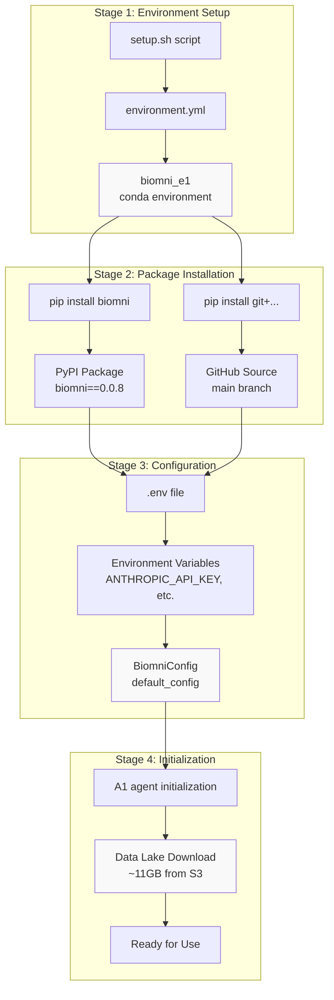
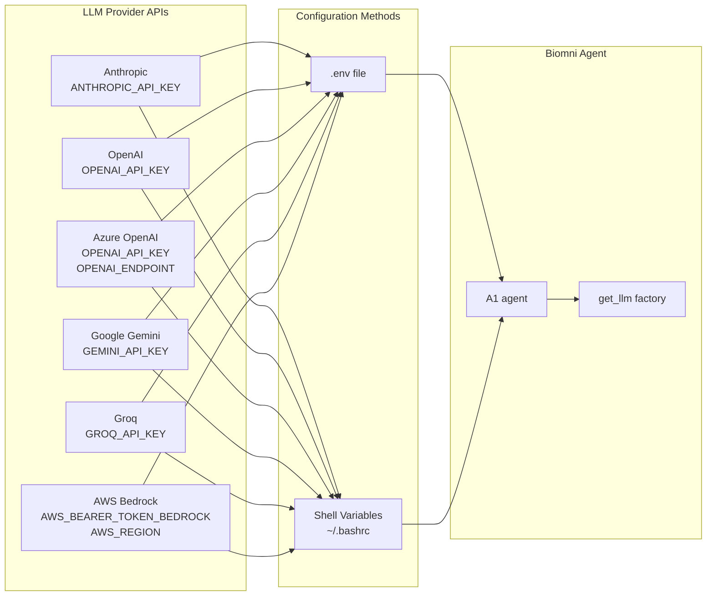
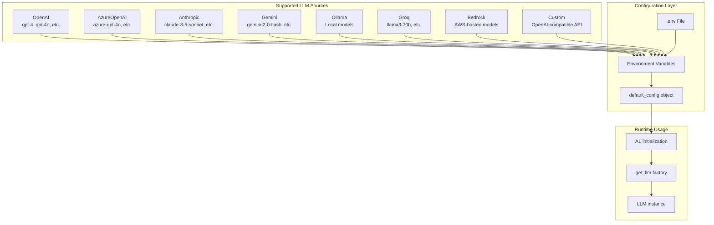

# Installation and Setup

<details>
<summary>Relevant source files</summary>

The following files were used as context for generating this wiki page:

- [README.md](README.md)
- [biomni/eval/__init__.py](biomni/eval/__init__.py)
- [biomni/eval/biomni_eval1.py](biomni/eval/biomni_eval1.py)
- [biomni/version.py](biomni/version.py)
- [biomni_env/environment.yml](biomni_env/environment.yml)

</details>


This page provides a complete guide to installing Biomni and configuring your environment for biomedical research automation. The installation process involves setting up a conda environment with 80+ Python packages and 20+ bioinformatics tools, configuring API keys for LLM providers, and initializing the data lake with ~11GB of curated biomedical datasets.

**Scope**: This page covers the core installation workflow and configuration options. For detailed instructions on specific components, see:
- [Environment Setup](#3.1) for conda environment and dependency management
- [API Keys and Configuration](#3.2) for LLM provider setup
- [Data Lake Initialization](#3.3) for dataset download and management
- [Biomni-R0 Model Setup](#3.4) for local reasoning model deployment

**Related pages**: For basic usage after installation, see [Quick Start](#4.1). For advanced configuration options, see [Configuration Guide](#4.3).

---

## Installation Overview

The Biomni installation process follows a three-stage pipeline: environment setup, package installation, and configuration. The system requires a managed conda environment (`biomni_e1`) to ensure compatibility across 100+ scientific packages spanning genomics, pharmacology, and machine learning domains.



**Diagram**: Installation pipeline from environment setup to ready-to-use agent

Sources: [README.md:35-128](), [biomni_env/environment.yml:1-40]()

---

## Prerequisites and System Requirements

Before beginning installation, ensure your system meets the following requirements:

| Requirement | Specification | Notes |
|------------|---------------|-------|
| **Operating System** | Linux, macOS, or WSL2 | Windows requires WSL2 for bioinformatics tools |
| **Python Version** | 3.11 | Specified in [biomni_env/environment.yml:7]() |
| **Conda/Mamba** | Latest version | Required for environment management |
| **Disk Space** | ~15GB minimum | 11GB for data lake + 4GB for packages |
| **RAM** | 8GB minimum | 16GB+ recommended for large-scale analyses |
| **Network** | Stable connection | For data lake download from S3 |

### Required API Keys

At minimum, one LLM provider API key is required. The system supports multiple providers for flexibility:



**Diagram**: Supported LLM providers and configuration methods mapping to `A1` agent and `get_llm` factory

Sources: [README.md:58-128]()

---

## Core Installation Steps

### Step 1: Environment Setup

The `biomni_e1` conda environment provides a consistent software stack across all installations. The environment is defined in [biomni_env/environment.yml]() and installed via the `setup.sh` script.

```bash
# Follow instructions in biomni_env/README.md to run setup.sh
# This creates the biomni_e1 environment with all dependencies

# Activate the environment
conda activate biomni_e1
```

**Key components installed**:
- **Python packages**: NumPy 2.1, pandas, scikit-learn, transformers, LangChain, LangGraph
- **LLM integrations**: langchain-openai, langchain-anthropic, langchain-ollama
- **Web interfaces**: gradio (for UI), jupyter (for notebooks)
- **Utilities**: pytest (testing), python-dotenv (configuration), mcp (Model Context Protocol)

The complete dependency list is in [biomni_env/environment.yml:6-40]().

**See [Environment Setup](#3.1) for detailed instructions on running `setup.sh` and managing the conda environment.**

Sources: [README.md:35-44](), [biomni_env/environment.yml:1-40]()

### Step 2: Package Installation

After activating the conda environment, install the Biomni package:

```bash
# Option 1: Install from PyPI (stable release)
pip install biomni --upgrade

# Option 2: Install from GitHub source (latest features)
pip install git+https://github.com/snap-stanford/Biomni.git@main
```

The current stable version is `0.0.8` as defined in [biomni/version.py:1](). The PyPI installation provides the core `biomni` package with all tool functions, agent logic, and evaluation benchmarks.

**Package contents**:
- `biomni.agent` module with `A1` class ([A1 Agent Core](#2.1))
- `biomni.tool` module with 100+ tool functions ([Tool Reference](#5))
- `biomni.eval` module with `BiomniEval1` class ([BiomniEval1 Overview](#7.1))
- `biomni.config` module with `BiomniConfig` and `default_config` ([Configuration System](#2.5))

Sources: [README.md:46-56](), [biomni/version.py:1]()

### Step 3: API Key Configuration

Configure LLM provider API keys using either a `.env` file (recommended) or shell environment variables.

#### Option 1: Using .env File (Recommended)

Create a `.env` file in your project directory:

```bash
# Copy the example template
cp .env.example .env

# Edit with your API keys
nano .env  # or use your preferred editor
```

Example `.env` configuration:

```env
# Required: At least one LLM provider
ANTHROPIC_API_KEY=sk-ant-api03-...

# Optional: Additional providers
OPENAI_API_KEY=sk-...
GEMINI_API_KEY=AIza...
GROQ_API_KEY=gsk_...

# Optional: Azure OpenAI
OPENAI_API_KEY=your_azure_key
OPENAI_ENDPOINT=https://your-resource.openai.azure.com/

# Optional: AWS Bedrock
AWS_BEARER_TOKEN_BEDROCK=your_token
AWS_REGION=us-east-1

# Optional: Custom model serving
CUSTOM_MODEL_BASE_URL=http://localhost:8000/v1
CUSTOM_MODEL_API_KEY=your_key

# Optional: Data lake path override
BIOMNI_DATA_PATH=/path/to/your/data

# Optional: Execution timeout (seconds)
BIOMNI_TIMEOUT_SECONDS=600
```

The `.env` file is automatically loaded by the `python-dotenv` package when the agent initializes.

#### Option 2: Shell Environment Variables

Add API keys to your shell profile (`~/.bashrc`, `~/.zshrc`, etc.):

```bash
export ANTHROPIC_API_KEY="sk-ant-api03-..."
export OPENAI_API_KEY="sk-..."
export GEMINI_API_KEY="AIza..."
export LLM_SOURCE="Anthropic"  # Optional: default provider
```

**See [API Keys and Configuration](#3.2) for comprehensive configuration options and troubleshooting.**

Sources: [README.md:58-128]()

---

## Data Lake Initialization

The Biomni data lake contains ~11GB of curated biomedical datasets stored on AWS S3. On first initialization, the `A1` agent automatically downloads required datasets to the specified path.

```python
from biomni.agent import A1

# Initialize agent - data lake downloads automatically
agent = A1(path='./data', llm='claude-sonnet-4-20250514')
```

The download process is triggered by the `expected_data_lake_files` parameter in the `A1` constructor. By default, this includes 77 datasets covering:

| Category | Example Datasets | Count |
|----------|-----------------|-------|
| **Protein Interactions** | STRING, BioGRID, IntAct | 8 |
| **Drug Discovery** | BindingDB, Enamine REAL | 2 |
| **Genomics & Variants** | GWAS Catalog, UK Biobank | 5+ |
| **Expression Data** | GTEx, DepMap | 4+ |
| **Gene Sets** | MSigDB, Gene Ontology | 10+ |
| **CRISPR Libraries** | Human/Mouse sgRNA libraries | 2 |

### Controlling Data Lake Downloads

For faster initialization or limited storage scenarios, you can skip automatic downloads:

```python
# Skip all automatic downloads
agent = A1(path='./data', llm='claude-sonnet-4-20250514', 
           expected_data_lake_files=[])

# Manually download specific datasets later if needed
from biomni.tool.support import download_synapse_data
download_synapse_data('syn12345678')
```

This is useful for:
- Testing and development workflows
- Environments with bandwidth constraints
- Cases where only specific tools (not requiring data lake) are used

**See [Data Lake Initialization](#3.3) for detailed information on dataset structure, manual downloads, and data lake management.**

Sources: [README.md:142-163]()

---

## Optional Components

### Gradio Web Interface

The Gradio web interface provides a no-code interface for interacting with Biomni agents. It requires Gradio 5.x (not compatible with Gradio 6.x due to API changes).

```bash
# Install Gradio 5.x
pip install "gradio>=5.0,<6.0"
```

Launch the interface:

```python
from biomni.agent import A1

agent = A1(path='./data', llm='claude-sonnet-4-20250514')
agent.launch_gradio_demo(
    share=True,  # Create public shareable link
    server_name="0.0.0.0",  # Accept external connections
    require_verification=True  # Require access code (default: "Biomni2025")
)
```

The interface will be available at `http://localhost:7860`.

**See [Gradio Web Interface](#4.6) for detailed usage instructions.**

Sources: [README.md:166-189]()

### PDF Report Generation

PDF generation requires one of three external tools for converting execution traces to PDF format:

```bash
# Option 1: WeasyPrint (recommended for layout control)
conda install weasyprint

# Option 2: markdown2pdf (Rust-based, fast)
brew install theiskaa/tap/markdown2pdf  # macOS
cargo install markdown2pdf              # Windows/Linux

# Option 3: Pandoc
pip install pandoc
```

Generate reports:

```python
agent.go("Design a CRISPR screen for T cell exhaustion")
agent.save_conversation_history("crispr_screen_analysis.pdf")
```

**See [PDF Report Generation](#4.7) for more details.**

Sources: [README.md:211-257]()

### Biomni-R0 Local Model

Biomni-R0 is a specialized reasoning model for biology built on Qwen-32B. It requires a local SGLang server for deployment.

```bash
# Launch SGLang server with Biomni-R0
python -m sglang.launch_server \
    --model-path RyanLi0802/Biomni-R0-Preview \
    --port 30000 \
    --host 0.0.0.0 \
    --mem-fraction-static 0.8 \
    --tp 2 \
    --trust-remote-code \
    --json-model-override-args '{"rope_scaling":{"rope_type":"yarn","factor":1.0,"original_max_position_embeddings":32768}, "max_position_embeddings": 131072}'
```

Configure agent to use Biomni-R0:

```python
from biomni.config import default_config
from biomni.agent import A1

# Database queries use Claude
default_config.llm = "claude-3-5-sonnet-20241022"
default_config.source = "Anthropic"

# Agent reasoning uses Biomni-R0 via SGLang
agent = A1(
    llm="biomni/Biomni-R0-32B-Preview",
    source="Custom",
    base_url="http://localhost:30000/v1",
    api_key="EMPTY"
)
```

**See [Biomni-R0 Model Setup](#3.4) for detailed deployment instructions and hardware requirements.**

Sources: [README.md:275-309]()

---

## Verification and Testing

After installation, verify your setup:

```python
from biomni.agent import A1
from biomni.eval import BiomniEval1

# Test basic agent initialization
agent = A1(path='./data', llm='claude-sonnet-4-20250514')
print(f"Agent initialized with {len(agent.tool_registry.tools)} tools")

# Test evaluation framework
evaluator = BiomniEval1()
print(f"BiomniEval1 loaded: {len(evaluator)} instances")

# Test a simple query
agent.go("Query UniProt for BRCA1 protein information")
```

**Expected output**:
- Agent initialization completes without errors
- Data lake downloads (if not already present)
- Tool registry loads 100+ functions
- BiomniEval1 loads 433 benchmark instances
- Agent successfully executes the test query

### Common Installation Issues

| Issue | Cause | Solution |
|-------|-------|----------|
| **Conda environment fails** | Dependency conflicts | See [Environment Setup](#3.1) for known conflicts |
| **Data lake download hangs** | Network issues or S3 access | Check connectivity; use `expected_data_lake_files=[]` to skip |
| **API key errors** | Missing or invalid keys | Verify `.env` file or environment variables ([API Keys and Configuration](#3.2)) |
| **Package import fails** | Incorrect environment | Ensure `conda activate biomni_e1` was run |
| **Timeout errors** | Default timeout too short | Increase via `BIOMNI_TIMEOUT_SECONDS` env var |

Sources: [README.md:35-163](), [biomni/eval/biomni_eval1.py:1-40]()

---

## Configuration Reference

### Environment Variables

The following environment variables control Biomni behavior:

| Variable | Purpose | Default | Example |
|----------|---------|---------|---------|
| `ANTHROPIC_API_KEY` | Anthropic Claude API key | None (required) | `sk-ant-api03-...` |
| `OPENAI_API_KEY` | OpenAI API key | None | `sk-...` |
| `OPENAI_ENDPOINT` | Azure OpenAI endpoint | None | `https://....openai.azure.com/` |
| `GEMINI_API_KEY` | Google Gemini API key | None | `AIza...` |
| `GROQ_API_KEY` | Groq API key | None | `gsk_...` |
| `AWS_BEARER_TOKEN_BEDROCK` | AWS Bedrock token | None | `...` |
| `AWS_REGION` | AWS region | `us-east-1` | `us-west-2` |
| `LLM_SOURCE` | Default LLM provider | `Anthropic` | `OpenAI`, `Groq`, etc. |
| `CUSTOM_MODEL_BASE_URL` | Custom model endpoint | None | `http://localhost:8000/v1` |
| `BIOMNI_DATA_PATH` | Data lake directory | `./data` | `/mnt/biomni/data` |
| `BIOMNI_TIMEOUT_SECONDS` | Execution timeout | `600` | `1200` |

### LLM Provider Specifications



**Diagram**: LLM provider configuration flow from environment variables through `default_config` to `A1` agent and `get_llm` factory

Sources: [README.md:58-128](), [README.md:192-209]()

---

## Next Steps

After completing installation:

1. **Try the quick start**: See [Quick Start](#4.1) for your first agent execution
2. **Explore tutorials**: Work through [Getting Started Tutorial](#6.1) (`biomni_101.ipynb`)
3. **Configure advanced options**: See [Configuration Guide](#4.3) for timeout, retrieval, and execution settings
4. **Add custom resources**: Learn to extend Biomni with custom tools ([Working with Custom Resources](#4.4))
5. **Run evaluations**: Test your setup with [BiomniEval1](#7.1) benchmark tasks

**For development contributions**: See [Contributing Guidelines](#8.2) for adding tools, datasets, and software to the Biomni ecosystem.

Sources: [README.md:135-149](), [README.md:391-396]()

---