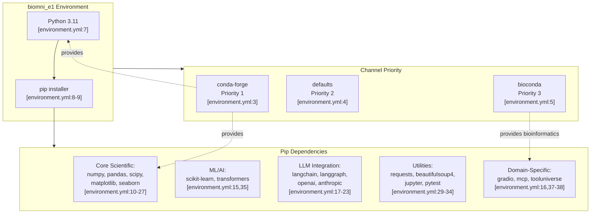
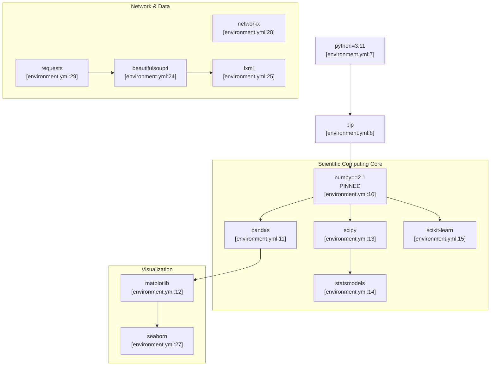
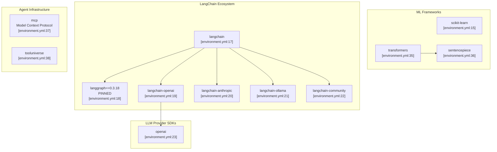
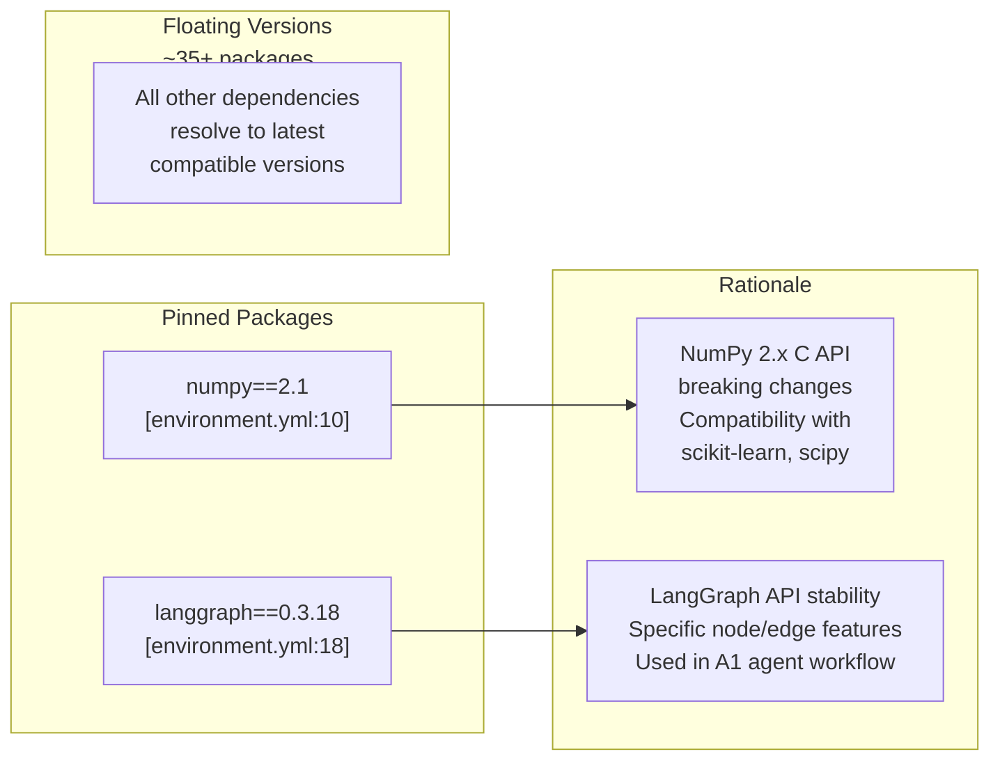
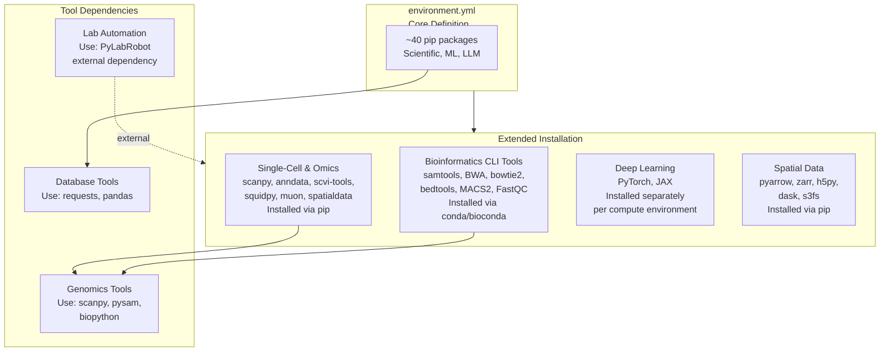
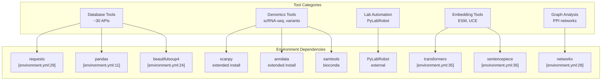
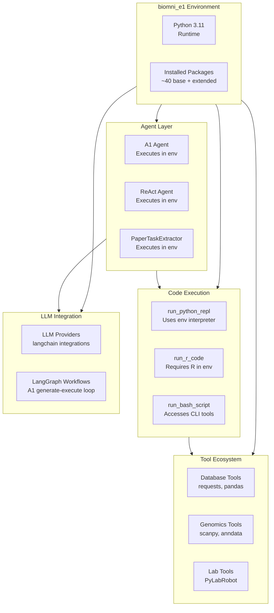

# Conda Environment

<details>
<summary>Relevant source files</summary>

The following files were used as context for generating this wiki page:

- [README.md](README.md)
- [biomni/eval/__init__.py](biomni/eval/__init__.py)
- [biomni/eval/biomni_eval1.py](biomni/eval/biomni_eval1.py)
- [biomni/version.py](biomni/version.py)
- [biomni_env/environment.yml](biomni_env/environment.yml)

</details>


## Purpose and Scope

This document describes the `biomni_e1` Conda environment, which serves as the foundational execution environment for the Biomni platform. The environment provides a carefully curated set of dependencies spanning bioinformatics tools, scientific computing libraries, machine learning frameworks, and LLM integration packages that enable the A1 agent and associated tools to execute biomedical research tasks.

For information about installing and setting up this environment, see [Installation and Setup](#3). For details on configuring LLM providers within this environment, see [LLM Provider Setup](#3.2). For information about the system-level configuration that runs within this environment, see [Configuration System](#2.5).

## Environment Overview

The `biomni_e1` environment is defined in [biomni_env/environment.yml:1-40]() and represents the complete dependency stack required for Biomni's operation. The environment uses Python 3.11 as its foundation and organizes dependencies across multiple functional layers to support diverse biomedical computing workflows.



**Diagram: biomni_e1 Environment Structure and Dependency Flow**

The environment definition follows a minimalist approach, specifying only essential version constraints while allowing most packages to resolve to their latest compatible versions. This strategy balances stability with access to current features and bug fixes.

Sources: [biomni_env/environment.yml:1-40]()

## Channel Strategy

The environment uses a three-tier channel priority system defined in [biomni_env/environment.yml:2-5]():

| Priority | Channel | Purpose |
|----------|---------|---------|
| 1 | `conda-forge` | Community-maintained packages, latest updates, broad package coverage |
| 2 | `defaults` | Anaconda-maintained packages, stability-focused |
| 3 | `bioconda` | Specialized bioinformatics tools (CLI tools like samtools, BWA, MACS2) |

This ordering ensures that:
- Community packages from `conda-forge` are preferred, providing access to the most up-to-date versions
- Anaconda's curated packages serve as fallbacks when community versions are unavailable
- Bioinformatics-specific tools are sourced from the specialized `bioconda` channel

The channel strategy is particularly important for resolving conflicts between general-purpose scientific packages and domain-specific bioinformatics tools, which may have complex dependency chains involving C/C++ libraries and system tools.

Sources: [biomni_env/environment.yml:2-5]()

## Dependency Layers

### Core Python Stack

The environment is built on Python 3.11 [environment.yml:7](), which provides performance improvements and enhanced type hinting capabilities compared to earlier versions. The `pip` package manager [environment.yml:8]() is included to handle packages not available through conda channels.



**Diagram: Core Python Dependencies and Their Relationships**

The scientific computing stack is anchored by **numpy==2.1** [environment.yml:10](), which is one of only two pinned packages in the environment. NumPy 2.x introduced breaking changes to the C API, making version pinning necessary to ensure compatibility with downstream packages that may not have updated their builds.

Sources: [biomni_env/environment.yml:7-15,24-29]()

### Machine Learning and LLM Integration

The environment includes comprehensive support for modern machine learning workflows and LLM-based agent systems:



**Diagram: ML and LLM Integration Dependencies**

**langgraph==0.3.18** [environment.yml:18]() is the second pinned package, ensuring API stability for the agent workflow implementation. LangGraph's API evolved rapidly in earlier versions, and version 0.3.18 provides the specific node-based workflow features used by the A1 agent's generate-execute loop (see [A1 Agent Core](#2.1)).

The `mcp` package [environment.yml:37]() enables integration with external tools via the Model Context Protocol, allowing dynamic extension of agent capabilities at runtime (see [MCP Integration](#4.5)).

Sources: [biomni_env/environment.yml:15,17-23,35-38]()

### Development and Utility Tools

The environment includes essential development tools and utilities:

| Package | Purpose | Reference |
|---------|---------|-----------|
| `jupyter` | Interactive notebook interface | [environment.yml:31]() |
| `notebook` | Classic notebook server | [environment.yml:32]() |
| `ipykernel` | Jupyter kernel support | [environment.yml:33]() |
| `pytest` | Testing framework | [environment.yml:34]() |
| `gradio` | Web UI framework | [environment.yml:16]() |
| `pyyaml` | YAML configuration parsing | [environment.yml:30]() |
| `python-dotenv` | Environment variable management | [environment.yml:39]() |
| `tqdm` | Progress bars | [environment.yml:26]() |

These utilities support various interaction modes with the Biomni platform: Jupyter notebooks for interactive exploration, Gradio for web-based interfaces, pytest for development and testing, and python-dotenv for managing API keys and configuration (see [LLM Provider Setup](#3.2)).

Sources: [biomni_env/environment.yml:16,26,30-34,39]()

## Version Pinning Strategy

The environment employs a **minimal pinning strategy**, with only two packages having explicit version constraints:



**Diagram: Version Pinning Strategy and Rationale**

This approach offers several advantages:

1. **Latest Features**: Unpinned packages automatically receive updates with new features and bug fixes
2. **Security Patches**: Security vulnerabilities in dependencies are addressed through regular updates
3. **Reduced Conflicts**: Fewer version constraints reduce the likelihood of dependency resolution failures
4. **Maintenance Burden**: Minimal version specifications reduce the need for frequent environment updates

The two pinned versions address specific stability requirements:
- **numpy==2.1**: NumPy 2.0 introduced breaking changes to the C API that affected binary compatibility with packages built against NumPy 1.x. Pinning to 2.1 ensures all numeric computing packages use compatible builds.
- **langgraph==0.3.18**: The A1 agent's workflow implementation (see [A1 Agent Core](#2.1)) relies on specific LangGraph features for node-based execution graphs and state management that were stabilized in version 0.3.18.

Sources: [biomni_env/environment.yml:10,18]()

## Extended Dependencies

While the core environment definition in [environment.yml]() specifies the foundational packages, the complete Biomni ecosystem includes additional dependencies installed through various mechanisms:



**Diagram: Extended Dependency Ecosystem**

These extended dependencies are installed through installation scripts that supplement the base environment:

- **Bioinformatics CLI tools** are installed via conda from the `bioconda` channel, providing command-line utilities like `samtools`, `BWA`, `bowtie2`, `bedtools`, `MACS2`, and `FastQC`. These tools are invoked by genomics-related functions (see [Genomics and Single-Cell Tools](#5.2)).

- **Single-cell and omics packages** (`scanpy`, `anndata`, `scvi-tools`, `squidpy`, `muon`, `spatialdata`) are installed via pip and provide specialized analysis capabilities for single-cell RNA-seq, spatial transcriptomics, and multi-omics data integration.

- **Deep learning frameworks** (PyTorch, JAX) may be installed separately based on compute requirements (CPU vs GPU) and are not included in the base environment to avoid unnecessary dependencies.

- **Spatial data libraries** (`pyarrow`, `zarr`, `h5py`, `dask`, `s3fs`) enable efficient handling of large-scale biological datasets stored in chunked formats or cloud storage (see [Data Infrastructure](#2.6)).

Sources: [biomni_env/environment.yml:1-40]() (base definition), inferred from high-level architecture diagrams

## Tool Integration Dependencies

Different tool categories within Biomni have specific dependency requirements that map to packages in the environment:

| Tool Category | Key Dependencies | Usage Example |
|--------------|------------------|---------------|
| Database Query Tools | `requests`, `pandas`, `beautifulsoup4` | REST API queries to UniProt, PDB, KEGG (see [Database Query Tools](#5.1)) |
| Genomics Tools | `scanpy`, `anndata`, `pysam`, bioinformatics CLI | Single-cell analysis, variant calling, ChIP-seq (see [Genomics and Single-Cell Tools](#5.2)) |
| Lab Automation | `PyLabRobot` (external) | Liquid handling script generation (see [Lab Automation Tools](#5.3)) |
| Embedding Generation | `transformers`, `sentencepiece` | ESM protein embeddings, UCE cell embeddings |
| Graph Analysis | `networkx` | Protein-protein interaction networks, pathway analysis |



**Diagram: Tool Category Dependencies Mapped to Environment Packages**

The modular dependency structure allows tools to be selectively loaded based on available packages, with graceful degradation when optional dependencies are missing. For example, deep learning-based embedding tools check for PyTorch availability before attempting to load models.

Sources: [biomni_env/environment.yml:11,24,28-29,35-36](), inferred from tool architecture

## Environment Management

### Creating the Environment

The environment is created using the standard conda workflow:

```bash
conda env create -f biomni_env/environment.yml
```

This command:
1. Reads the environment specification from [environment.yml]()
2. Resolves dependencies across the three configured channels (conda-forge, defaults, bioconda)
3. Installs Python 3.11 and pip via conda
4. Uses pip to install the specified Python packages

### Activating and Using the Environment

Once created, activate the environment for all Biomni operations:

```bash
conda activate biomni_e1
```

The A1 agent and all tools expect to run within this environment. Code execution nodes in the agent workflow (see [Execution Pipeline](#2.2)) inherit the activated environment's Python interpreter and installed packages.

### Updating Dependencies

To update unpinned dependencies to their latest compatible versions:

```bash
conda activate biomni_e1
pip install --upgrade pandas scipy scikit-learn matplotlib seaborn \
    langchain langchain-openai langchain-anthropic \
    transformers requests beautifulsoup4 gradio jupyter
```

Note that `numpy` and `langgraph` should **not** be upgraded without testing, as they have pinned versions for stability reasons.

### Verifying the Installation

After environment creation, verify that key packages are available:

```python
import numpy as np
import pandas as pd
import langchain
import langgraph
from transformers import AutoModel

print(f"NumPy: {np.__version__}")        # Should be 2.1.x
print(f"LangGraph: {langgraph.__version__}")  # Should be 0.3.18
```

Sources: [biomni_env/environment.yml:1-40]()

## Relationship to System Components

The conda environment serves as the execution foundation for multiple system components:



**Diagram: Environment's Role in System Architecture**

Key integration points:

1. **Agent Execution**: The A1 agent (see [A1 Agent Core](#2.1)) runs within the environment, accessing `langchain` and `langgraph` for workflow orchestration
2. **Code Execution Pipeline**: The execution nodes (see [Execution Pipeline](#2.2)) use the environment's Python interpreter for `run_python_repl`, and access CLI tools like `samtools` for `run_bash_script`
3. **Tool Registry**: Tools registered in the ToolRegistry (see [Tool Registry and Retrieval](#2.4)) import from environment packages
4. **LLM Integration**: The `get_llm` function (see [LLM Integration Layer](#2.3)) uses provider-specific packages like `langchain-openai` and `langchain-anthropic`

The environment's minimal pinning strategy allows the system to remain current with ecosystem improvements while maintaining stability for core agent functionality.

Sources: [biomni_env/environment.yml:1-40](), inferred from system architecture

---