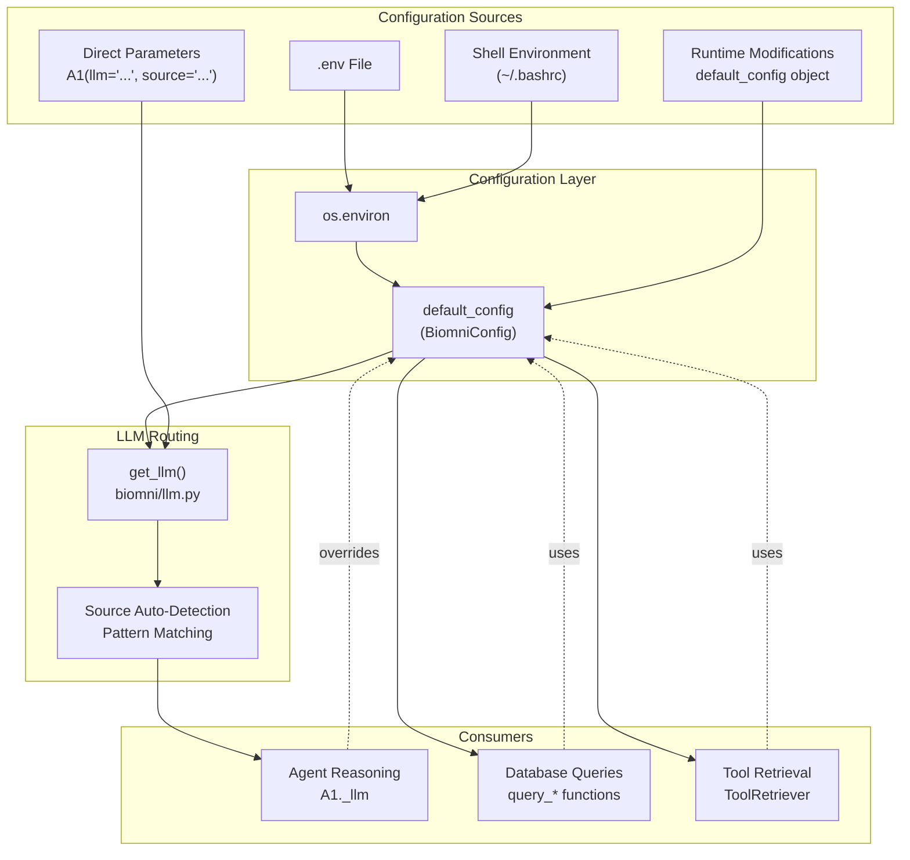
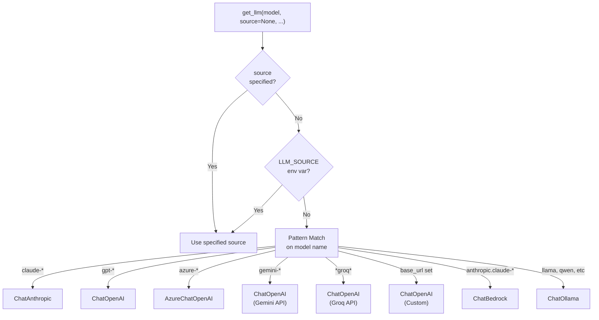
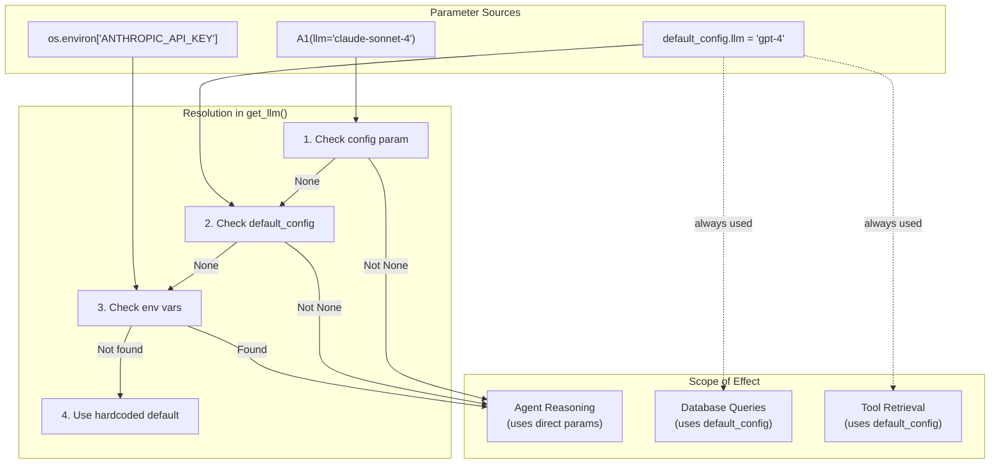
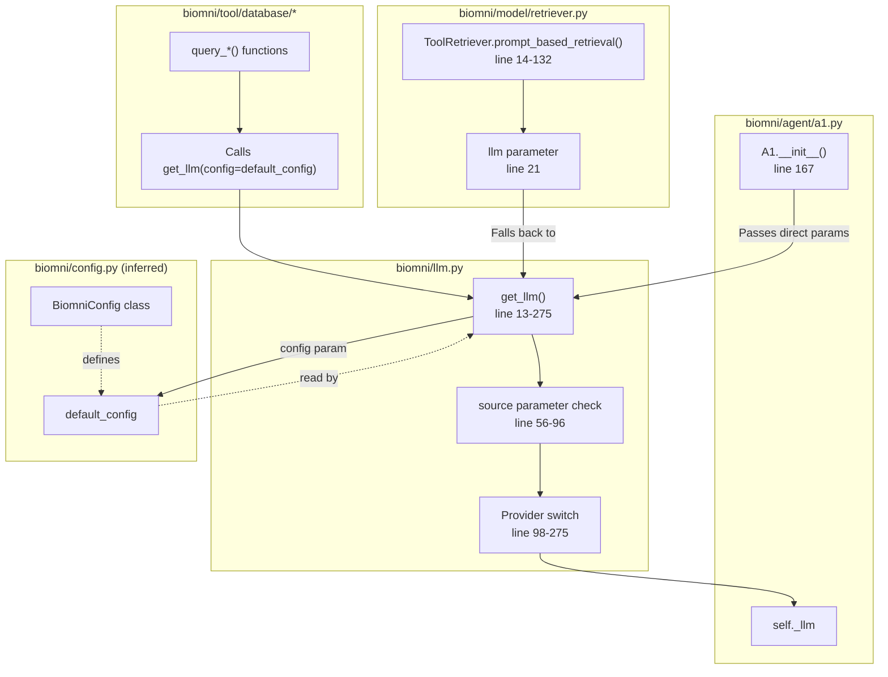

# API Keys and Configuration

<details>
<summary>Relevant source files</summary>

The following files were used as context for generating this wiki page:

- [README.md](README.md)
- [biomni/eval/__init__.py](biomni/eval/__init__.py)
- [biomni/eval/biomni_eval1.py](biomni/eval/biomni_eval1.py)
- [biomni/know_how/__init__.py](biomni/know_how/__init__.py)
- [biomni/know_how/loader.py](biomni/know_how/loader.py)
- [biomni/llm.py](biomni/llm.py)
- [biomni/model/retriever.py](biomni/model/retriever.py)
- [biomni/version.py](biomni/version.py)
- [tutorials/biomni_101.ipynb](tutorials/biomni_101.ipynb)

</details>


This page explains how to configure API keys and settings for Biomni's LLM providers. Configuration controls which models the A1 agent uses for reasoning, which models database query tools use, and various runtime parameters like timeouts and temperature settings.

For information about agent initialization parameters and runtime behavior, see [Basic Agent Usage](#4.2). For configuration of the tool retrieval system, see [Configuration Guide](#4.3).

---

## Overview

Biomni supports multiple configuration methods with the following precedence hierarchy (highest to lowest):

1. **Direct parameters** passed to agent initialization (`A1(llm='...', source='...')`)
2. **`default_config` object** modified at runtime
3. **Environment variables** from `.env` file or shell

The key distinction: direct parameters to `A1()` only affect **that agent's reasoning model**, while `default_config` and environment variables affect **both the agent and database queries**.

Sources: [README.md:58-207](), [biomni/llm.py:13-96]()

---

## Configuration Architecture

The following diagram shows how configuration flows through the system:



Sources: [README.md:189-207](), [biomni/llm.py:13-96]()

---

## Environment Variable Reference

### Core API Keys

| Variable | Provider | Required | Description |
|----------|----------|----------|-------------|
| `ANTHROPIC_API_KEY` | Anthropic | Yes (for Claude) | API key for Claude models |
| `OPENAI_API_KEY` | OpenAI/Azure | Conditional | API key for OpenAI or Azure OpenAI |
| `OPENAI_ENDPOINT` | Azure OpenAI | Azure only | Azure endpoint URL |
| `GEMINI_API_KEY` | Google | Conditional | API key for Gemini models |
| `GROQ_API_KEY` | Groq | Conditional | API key for Groq-served models |
| `AWS_BEARER_TOKEN_BEDROCK` | AWS Bedrock | Conditional | Bedrock API token |
| `AWS_REGION` | AWS Bedrock | Optional | AWS region (default: us-east-1) |

### Configuration Variables

| Variable | Default | Description |
|----------|---------|-------------|
| `LLM_SOURCE` | Auto-detected | Force provider: "OpenAI", "AzureOpenAI", "Anthropic", "Ollama", "Gemini", "Bedrock", "Groq", "Custom" |
| `BIOMNI_DATA_PATH` | `./data` | Path to data lake directory |
| `BIOMNI_TIMEOUT_SECONDS` | `600` | Code execution timeout |
| `CUSTOM_MODEL_BASE_URL` | None | Base URL for custom model servers |
| `CUSTOM_MODEL_API_KEY` | None | API key for custom servers |

Sources: [README.md:74-110](), [biomni/llm.py:56-59]()

---

## .env File Configuration

### Setup

Create a `.env` file in your project directory:

```bash
cp .env.example .env
```

Edit with your API keys. The file is loaded automatically using Python's environment variable system.

### Example Configuration

**Option 1: Anthropic Only (Recommended)**
```env
ANTHROPIC_API_KEY=sk-ant-api03-...
```

**Option 2: Multi-Provider**
```env
ANTHROPIC_API_KEY=sk-ant-api03-...
OPENAI_API_KEY=sk-proj-...
GEMINI_API_KEY=AIzaSy...
```

**Option 3: Azure OpenAI**
```env
OPENAI_API_KEY=your_azure_key
OPENAI_ENDPOINT=https://your-resource-name.openai.azure.com/
```

**Option 4: Custom Model Server (e.g., SGLang)**
```env
ANTHROPIC_API_KEY=sk-ant-api03-...
CUSTOM_MODEL_BASE_URL=http://localhost:30000/v1
CUSTOM_MODEL_API_KEY=EMPTY
```

Sources: [README.md:63-110]()

---

## Shell Environment Configuration

Alternatively, configure API keys in your shell profile (`~/.bashrc`, `~/.bash_profile`, or `~/.zshrc`):

```bash
export ANTHROPIC_API_KEY="YOUR_API_KEY"
export OPENAI_API_KEY="YOUR_API_KEY"
export GEMINI_API_KEY="YOUR_GEMINI_API_KEY"
export GROQ_API_KEY="YOUR_GROQ_API_KEY"
export LLM_SOURCE="Anthropic"
```

**Note**: The Anthropic provider specifically attempts to load `ANTHROPIC_API_KEY` from `~/.bash_profile` if not found in the current environment ([biomni/llm.py:168-182]()).

Sources: [README.md:114-127](), [biomni/llm.py:168-182]()

---

## LLM Provider Auto-Detection

The `get_llm()` function auto-detects the provider based on model name patterns:



### Detection Rules

| Pattern | Detected Source | Class |
|---------|----------------|-------|
| `claude-*` | Anthropic | `ChatAnthropic` |
| `gpt-*` | OpenAI | `ChatOpenAI` |
| `azure-*` | AzureOpenAI | `AzureChatOpenAI` |
| `gemini-*` | Gemini | `ChatOpenAI` (via Gemini API) |
| `*groq*` | Groq | `ChatOpenAI` (via Groq API) |
| Has `base_url` | Custom | `ChatOpenAI` (OpenAI-compatible) |
| `anthropic.claude-*`, `amazon.titan-*` | Bedrock | `ChatBedrock` |
| `llama`, `mistral`, `qwen`, etc. | Ollama | `ChatOllama` |

Sources: [biomni/llm.py:56-96]()

---

## Configuration Precedence and Scope

The following diagram shows how configuration parameters are resolved and which components they affect:



### Critical Pattern

```python
from biomni.config import default_config
from biomni.agent import A1

# ❌ WRONG: Direct params only affect agent, not database queries
agent = A1(llm="gpt-4o")  # Agent uses gpt-4o, but databases still use default

# ✅ CORRECT: Modify default_config for consistency
default_config.llm = "gpt-4o"
agent = A1()  # Both agent and databases use gpt-4o
```

Sources: [README.md:189-207](), [biomni/llm.py:34-46]()

---

## Multi-Model Configuration Patterns

### Pattern 1: Dual-Model Setup (Recommended)

Use a specialized model for agent reasoning and a general model for database queries:

```python
from biomni.config import default_config
from biomni.agent import A1

# Database queries use Claude (fast, cheap)
default_config.llm = "claude-3-5-sonnet-20241022"
default_config.source = "Anthropic"

# Agent reasoning uses Biomni-R0 (specialized for biology)
agent = A1(
    llm="biomni/Biomni-R0-32B-Preview",
    source="Custom",
    base_url="http://localhost:30000/v1",
    api_key="EMPTY",
)
```

This pattern is optimal because:
- Database queries need fast, cheap models for schema understanding
- Agent reasoning benefits from domain-specific models like Biomni-R0
- Each component uses the model best suited to its task

Sources: [README.md:280-307]()

---

### Pattern 2: Single Model for All Operations

```python
from biomni.config import default_config
from biomni.agent import A1

# Set global default
default_config.llm = "claude-sonnet-4-20250514"
default_config.temperature = 0.7
default_config.timeout_seconds = 1200

# Agent inherits all defaults
agent = A1()
```

Sources: [README.md:196-203]()

---

### Pattern 3: Azure OpenAI

Always prefix Azure model names with `azure-`:

```python
from biomni.agent import A1

# Requires OPENAI_API_KEY and OPENAI_ENDPOINT in environment
agent = A1(llm="azure-gpt-4o")
```

Sources: [README.md:164](), [biomni/llm.py:142-157]()

---

## Configuration Code Flow

This diagram maps the configuration flow through code entities:



Sources: [biomni/llm.py:13-275](), [biomni/model/retriever.py:14-132]()

---

## Provider-Specific Configuration

### Anthropic

```python
# Option 1: Environment variable
export ANTHROPIC_API_KEY="sk-ant-api03-..."

# Option 2: .env file
ANTHROPIC_API_KEY=sk-ant-api03-...

# Usage
agent = A1(llm="claude-sonnet-4-20250514")
```

The Anthropic provider specifically loads from `~/.bash_profile` as a fallback ([biomni/llm.py:168-182]()).

Sources: [biomni/llm.py:159-189]()

---

### OpenAI

```python
# Environment
export OPENAI_API_KEY="sk-proj-..."

# Usage
agent = A1(llm="gpt-4o")
```

**Special handling for GPT-5 models**: Uses Responses API and automatically removes `stop` and `temperature` parameters ([biomni/llm.py:108-140]()).

Sources: [biomni/llm.py:98-140]()

---

### Azure OpenAI

```python
# Environment
export OPENAI_API_KEY="your_azure_key"
export OPENAI_ENDPOINT="https://your-resource-name.openai.azure.com/"

# Usage (must prefix with "azure-")
agent = A1(llm="azure-gpt-4o")
```

API version is hardcoded to `2024-12-01-preview` ([biomni/llm.py:149]()).

Sources: [biomni/llm.py:142-157]()

---

### Google Gemini

```python
# Environment
export GEMINI_API_KEY="AIzaSy..."

# Usage
agent = A1(llm="gemini-2.0-flash-exp")
```

Uses OpenAI-compatible API at `https://generativelanguage.googleapis.com/v1beta/openai/` ([biomni/llm.py:204-210]()).

Sources: [biomni/llm.py:191-210]()

---

### Groq

```python
# Environment
export GROQ_API_KEY="gsk_..."
export LLM_SOURCE="Groq"  # Optional: forces Groq detection

# Usage
agent = A1(llm="llama-3.3-70b-versatile")
```

Uses OpenAI-compatible API at `https://api.groq.com/openai/v1` ([biomni/llm.py:219-225]()).

Sources: [biomni/llm.py:212-225]()

---

### AWS Bedrock

```python
# Environment
export AWS_BEARER_TOKEN_BEDROCK="your_token"
export AWS_REGION="us-east-1"  # Optional, default is us-east-1

# Usage (use Bedrock model IDs)
agent = A1(llm="anthropic.claude-3-sonnet-20240229-v1:0")
```

Sources: [biomni/llm.py:239-251]()

---

### Custom Model Servers (SGLang, vLLM, etc.)

For OpenAI-compatible servers:

```python
# Environment
export CUSTOM_MODEL_BASE_URL="http://localhost:30000/v1"
export CUSTOM_MODEL_API_KEY="EMPTY"

# Usage with explicit parameters
agent = A1(
    llm="biomni/Biomni-R0-32B-Preview",
    source="Custom",
    base_url="http://localhost:30000/v1",
    api_key="EMPTY"
)
```

The `base_url` parameter triggers Custom source detection ([biomni/llm.py:73-74](), [biomni/llm.py:253-270]()).

Sources: [biomni/llm.py:253-270]()

---

### Ollama (Local Models)

```python
# No API key needed for local Ollama

# Usage
agent = A1(llm="llama3.1:8b")  # Auto-detects Ollama
agent = A1(llm="qwen2.5:32b")
```

Auto-detection triggers for model names containing: `llama`, `mistral`, `qwen`, `gemma`, `phi`, `dolphin`, `orca`, `vicuna`, `deepseek` ([biomni/llm.py:75-89]()).

Sources: [biomni/llm.py:227-237]()

---

## Configuration Validation

### Key Resolution Order

For each parameter, `get_llm()` checks in order:

1. Direct parameter passed to function
2. `config` parameter (usually `default_config`)
3. Environment variables
4. Hardcoded defaults

```python
# From biomni/llm.py:36-46
if model is None:
    model = config.llm_model  # Step 2
if temperature is None:
    temperature = config.temperature  # Step 2
if source is None:
    source = config.source  # Step 2
```

Sources: [biomni/llm.py:36-54]()

---

### Error Handling

Common configuration errors:

**Missing API Key**: Provider-specific errors raised by LangChain
```python
# Will raise error at runtime if ANTHROPIC_API_KEY not set
agent = A1(llm="claude-sonnet-4-20250514")
```

**Invalid Source**: Raises `ValueError` if source detection fails
```python
# From biomni/llm.py:95
raise ValueError("Unable to determine model source. Please specify 'source' parameter.")
```

**Invalid Provider Name**: Raises `ValueError` for unsupported sources
```python
# From biomni/llm.py:272-275
raise ValueError(
    f"Invalid source: {source}. Valid options are 'OpenAI', 'AzureOpenAI', ..."
)
```

Sources: [biomni/llm.py:95](), [biomni/llm.py:272-275]()

---

## Security Considerations

### API Key Management

**✅ DO:**
- Store API keys in `.env` file (not tracked by git)
- Use shell environment variables for production
- Set restrictive file permissions: `chmod 600 .env`
- Use separate keys for development and production

**❌ DON'T:**
- Hardcode API keys in code
- Commit `.env` file to version control
- Share API keys in public repositories
- Use production keys in development

### Execution Context

**Warning**: Biomni executes LLM-generated code with full system privileges ([README.md:403-404]()):
- Code can access any files the Python process can access
- Code can make network requests
- Code can execute shell commands

**Mitigation**:
- Use isolated environments (Docker, VMs) for production
- Run with restricted user permissions
- Monitor execution logs and network activity
- Use `timeout_seconds` to limit execution time

Sources: [README.md:402-406]()

---

## Configuration Examples

### Example 1: Basic Academic Setup

```python
from biomni.agent import A1

# Minimal configuration - uses Claude by default
agent = A1(path='./data')
```

### Example 2: Cost-Optimized Multi-Provider

```python
from biomni.config import default_config
from biomni.agent import A1

# Use cheaper model for database queries
default_config.llm = "claude-3-5-haiku-20241022"

# Use more powerful model for agent reasoning
agent = A1(llm="claude-sonnet-4-20250514")
```

### Example 3: Local Development with Ollama

```python
from biomni.config import default_config
from biomni.agent import A1

# All operations use local model
default_config.llm = "llama3.1:8b"
default_config.source = "Ollama"

agent = A1()
```

### Example 4: Production with Timeout and Retry

```python
from biomni.config import default_config
from biomni.agent import A1

default_config.llm = "claude-sonnet-4-20250514"
default_config.timeout_seconds = 1800  # 30 minutes for long tasks
default_config.temperature = 0.3  # More deterministic

agent = A1(path='/mnt/data')
```

Sources: [README.md:139-149](), [README.md:189-207]()

---

## Troubleshooting

### Issue: "Unable to determine model source"

**Cause**: Model name doesn't match any pattern and `source` not specified.

**Solution**: Explicitly provide `source` parameter:
```python
agent = A1(llm="my-custom-model", source="Custom", base_url="http://...")
```

### Issue: Database queries use wrong model

**Cause**: Direct parameters to `A1()` don't affect database queries.

**Solution**: Set `default_config`:
```python
from biomni.config import default_config
default_config.llm = "desired-model"
agent = A1()
```

### Issue: Azure model returns 404 error

**Cause**: Missing `azure-` prefix on model name.

**Solution**: Prefix model name:
```python
agent = A1(llm="azure-gpt-4o")  # Not just "gpt-4o"
```

### Issue: GPT-5 returns "Unsupported parameter: 'stop'" error

**Cause**: GPT-5 models require Responses API and reject legacy parameters.

**Solution**: This is handled automatically in [biomni/llm.py:108-134](). If still occurring, update to latest Biomni version.

Sources: [biomni/llm.py:108-134]()

---

## Summary

Configuration in Biomni follows a clear hierarchy:
1. **Direct parameters** override everything but only affect agent reasoning
2. **`default_config`** provides consistent defaults for all components
3. **Environment variables** provide baseline configuration

For most use cases, set `default_config` once at the start of your script to ensure consistent model usage across agent reasoning, database queries, and tool retrieval.

Sources: [README.md:189-207](), [biomni/llm.py:13-96]()

---