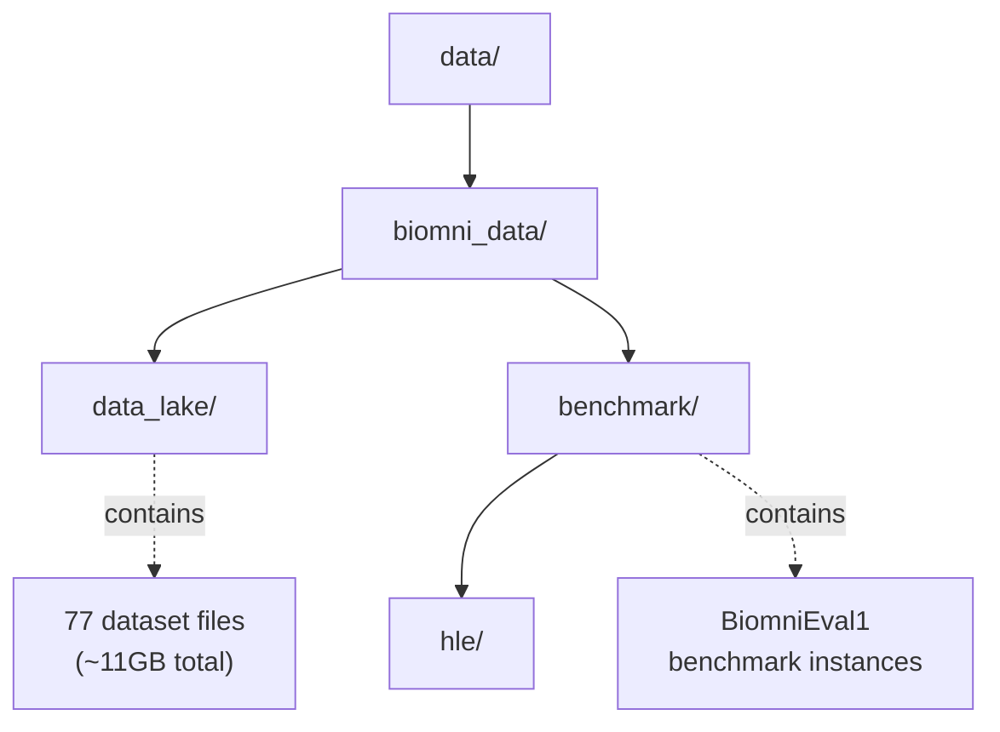
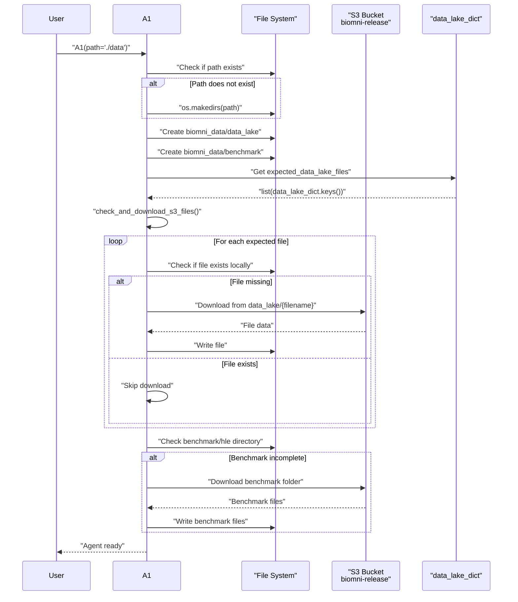
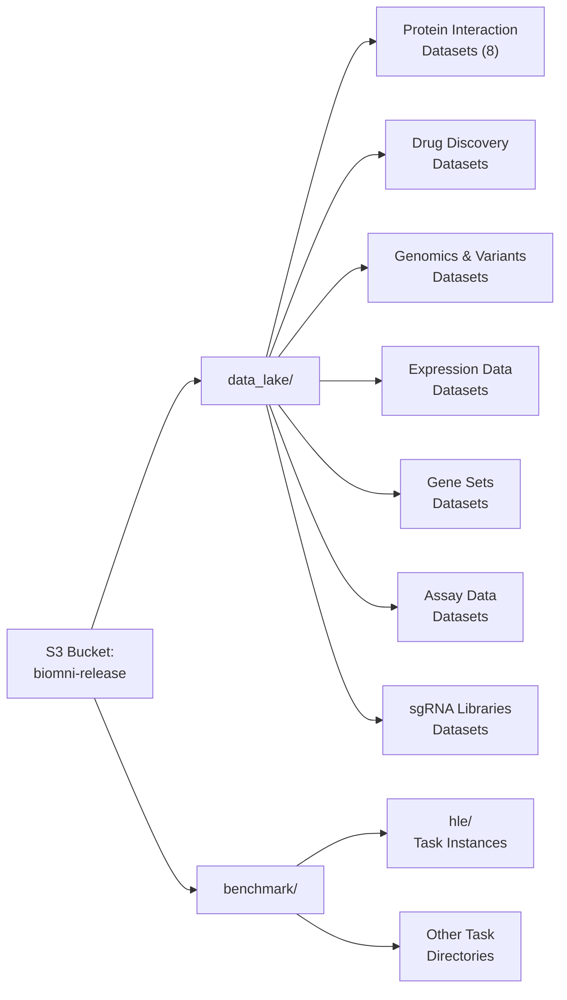
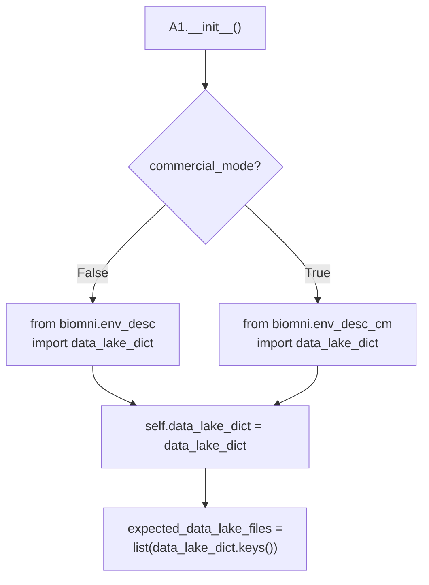
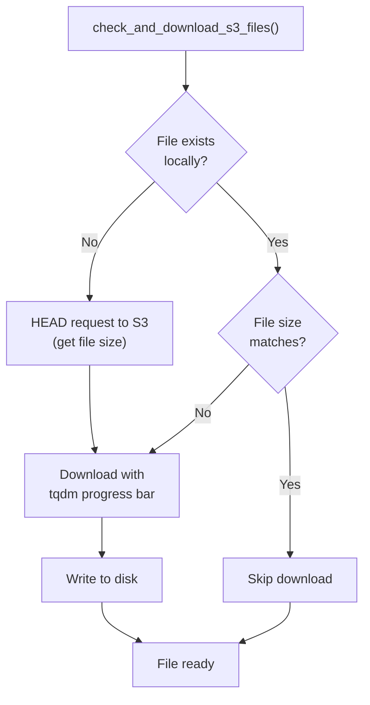
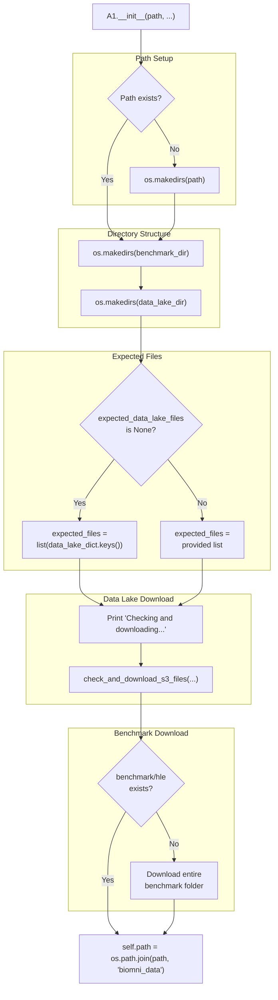
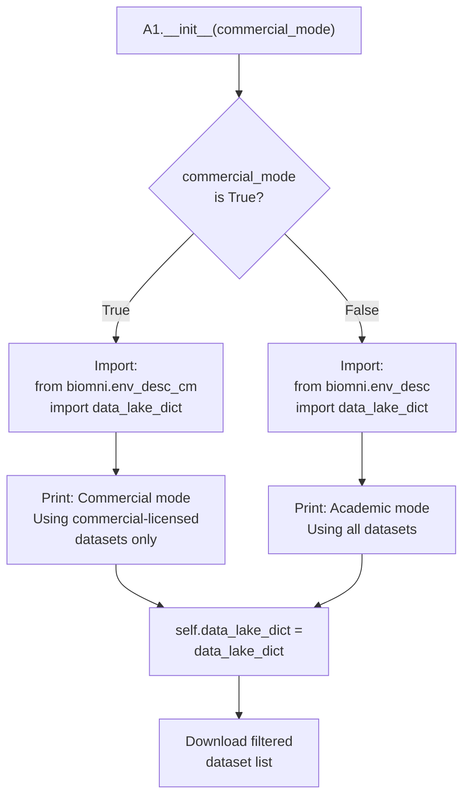
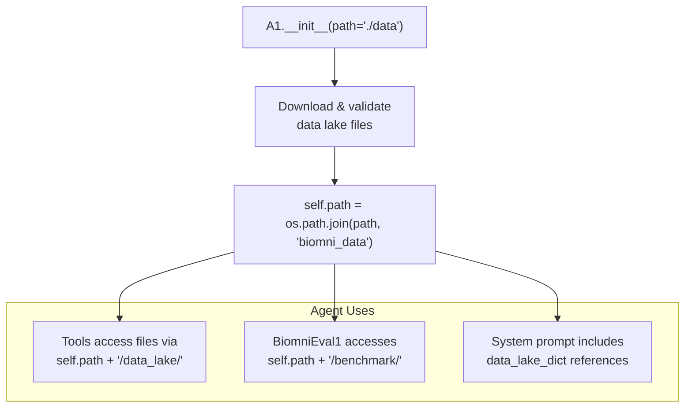

# Data Lake Initialization

<details>
<summary>Relevant source files</summary>

The following files were used as context for generating this wiki page:

- [README.md](README.md)
- [biomni/agent/a1.py](biomni/agent/a1.py)
- [biomni/eval/__init__.py](biomni/eval/__init__.py)
- [biomni/eval/biomni_eval1.py](biomni/eval/biomni_eval1.py)
- [biomni/tool/support_tools.py](biomni/tool/support_tools.py)
- [biomni/tool/tool_description/support_tools.py](biomni/tool/tool_description/support_tools.py)
- [biomni/utils.py](biomni/utils.py)
- [biomni/version.py](biomni/version.py)

</details>


This document explains the automatic data lake download mechanism in Biomni, including the S3 structure, directory layout, expected files, and how to control the initialization behavior. The data lake provides approximately 11GB of curated biomedical datasets that are automatically downloaded when the A1 agent is first initialized.

For information about setting up the conda environment before data lake initialization, see [Environment Setup](#3.1). For configuring API keys and agent parameters, see [API Keys and Configuration](#3.2).

## Purpose and Scope

The data lake initialization system ensures that all required datasets are available locally before the agent begins operation. This process:
- Creates the required directory structure under the specified data path
- Downloads missing datasets from AWS S3 storage
- Validates that expected files are present
- Supports selective download for bandwidth-constrained environments
- Handles both data lake datasets and benchmark files

## Directory Structure

When initialized, Biomni creates a standardized directory structure to organize datasets and benchmark files.



**Directory Layout**

| Directory | Purpose | Typical Size |
|-----------|---------|--------------|
| `{path}/biomni_data/` | Root directory for all Biomni data | ~11GB |
| `{path}/biomni_data/data_lake/` | Curated biomedical datasets | ~10GB |
| `{path}/biomni_data/benchmark/` | BiomniEval1 benchmark files | ~1GB |
| `{path}/biomni_data/benchmark/hle/` | HLE task instances | Variable |

Sources: [biomni/agent/a1.py:150-194]()

## Initialization Flow

The data lake initialization occurs automatically during A1 agent instantiation unless explicitly disabled.



**Initialization Steps**

1. **Path Creation**: Creates base directory if it doesn't exist
2. **Structure Setup**: Creates `biomni_data/data_lake/` and `biomni_data/benchmark/` subdirectories
3. **Expected Files List**: Retrieves list of required files from `data_lake_dict`
4. **Data Lake Download**: Calls `check_and_download_s3_files()` to fetch missing datasets
5. **Benchmark Validation**: Checks for `benchmark/hle` directory as validation marker
6. **Benchmark Download**: Downloads entire benchmark folder if validation fails

Sources: [biomni/agent/a1.py:150-194](), [biomni/utils.py:183-243]()

## S3 Bucket Structure

All data is hosted in the public S3 bucket `biomni-release.s3.amazonaws.com` with a well-defined folder structure.



**S3 URL Pattern**

- Base URL: `https://biomni-release.s3.amazonaws.com`
- Data lake files: `https://biomni-release.s3.amazonaws.com/data_lake/{filename}`
- Benchmark files: `https://biomni-release.s3.amazonaws.com/benchmark/{path}`

Sources: [biomni/agent/a1.py:169-173](), [biomni/agent/a1.py:184-189]()

## Data Lake Dictionary

The `data_lake_dict` serves as the central registry of all available datasets. It maps filenames to human-readable descriptions.

**Dictionary Structure**

The dictionary is imported based on commercial mode setting:
- **Academic mode**: `from biomni.env_desc import data_lake_dict` (all datasets)
- **Commercial mode**: `from biomni.env_desc_cm import data_lake_dict` (licensed datasets only)



**Dataset Categories** (77 total datasets)

| Category | Example Datasets | Count |
|----------|------------------|-------|
| Protein Interactions | STRING, BioGRID, HuRI | 8 |
| Drug Discovery | BindingDB, Enamine REAL | Variable |
| Genomics & Variants | GWAS Catalog, GeneBass | Variable |
| Expression Data | GTEx, DepMap | Variable |
| Gene Sets | MSigDB, GO annotations | Variable |
| Assay Data | EveBio screens | Variable |
| sgRNA Libraries | Human, Mouse libraries | Variable |

Sources: [biomni/agent/a1.py:100-113](), [biomni/agent/a1.py:163-164]()

## Download Mechanism

The `check_and_download_s3_files()` function in `biomni/utils.py` handles the actual file transfer with progress tracking.



**Download Function Signature**

The function signature from [biomni/utils.py]():
```python
check_and_download_s3_files(
    s3_bucket_url: str,           # "https://biomni-release.s3.amazonaws.com"
    local_data_lake_path: str,    # Path to data_lake directory
    expected_files: list,         # List of filenames to check/download
    folder: str                   # "data_lake" or "benchmark"
)
```

**Key Features**
- **Resume support**: Checks file size to skip already-downloaded files
- **Progress tracking**: Uses `tqdm` to show download progress
- **Batch processing**: Handles entire folder downloads for benchmark files
- **Error handling**: Continues with remaining files if one download fails

Sources: [biomni/utils.py]() (check_and_download_s3_files function), [biomni/agent/a1.py:166-173]()

## Controlling Download Behavior

Users can control whether and which datasets are downloaded during initialization.

### Skipping Data Lake Download

To initialize the agent without downloading any data lake files:

```python
from biomni.agent import A1

# Skip all data lake downloads
agent = A1(path='./data', expected_data_lake_files=[])
```

**Use Cases for Skipping Download**
- Faster initialization during development/testing
- Limited storage or bandwidth environments
- Using only tools that don't require data lake files
- Running on systems where data is already present

Sources: [biomni/agent/a1.py:163-192](), [README.md:151-163]()

### Selective Download

To download only specific datasets, provide a filtered list:

```python
# Only download protein interaction datasets
selected_files = [
    'string_protein_interactions.csv',
    'biogrid_interactions.csv'
]
agent = A1(path='./data', expected_data_lake_files=selected_files)
```

### Default Behavior

When `expected_data_lake_files` is `None` (default):
1. Retrieves all keys from `data_lake_dict`
2. Downloads all missing files (~11GB)
3. Validates and downloads benchmark files

```python
# Full download (default behavior)
agent = A1(path='./data')  # Downloads all 77 datasets
```

Sources: [biomni/agent/a1.py:163-173]()

## Initialization Code Flow

The core initialization logic resides in the `A1.__init__()` method.



**Key Variables and Paths**

| Variable | Value | Purpose |
|----------|-------|---------|
| `path` | Constructor parameter | Base data directory (e.g., `'./data'`) |
| `benchmark_dir` | `{path}/biomni_data/benchmark` | Benchmark files location |
| `data_lake_dir` | `{path}/biomni_data/data_lake` | Dataset files location |
| `expected_data_lake_files` | `list` or `None` | Files to download |
| `self.path` | `{path}/biomni_data` | Final agent data path |

Sources: [biomni/agent/a1.py:150-194]()

## Commercial Mode Filtering

The data lake initialization respects commercial mode settings to exclude non-commercial datasets.



**Commercial Mode Impact**

- **Academic mode** (`commercial_mode=False`): Downloads all 77 datasets from `env_desc.py`
- **Commercial mode** (`commercial_mode=True`): Downloads only commercially-licensed datasets from `env_desc_cm.py`

The filtering is transparent to the download mechanism - it simply receives a different dictionary of expected files.

Sources: [biomni/agent/a1.py:100-113]()

## Error Handling and Validation

The initialization process includes multiple validation checkpoints to ensure data integrity.

**Validation Steps**

1. **Directory Creation**: Uses `os.makedirs(exist_ok=True)` to safely create directories
2. **File Existence**: Checks if files exist before attempting download
3. **Size Validation**: Compares local file size with S3 HEAD response
4. **Benchmark Validation**: Checks for `benchmark/hle` directory as marker
5. **Graceful Degradation**: Continues operation even if some downloads fail

**Error Messages**

| Scenario | Message | Action |
|----------|---------|--------|
| Path creation | `"Created directory: {path}"` | Informational |
| Missing files | `"Checking and downloading missing data lake files..."` | Initiates download |
| Benchmark incomplete | `"Checking and downloading benchmark files..."` | Downloads benchmark |
| Download skipped | `"Skipping datalake download (load_datalake=False)"` | Warning |

Sources: [biomni/agent/a1.py:150-194]()

## Environment Variable Override

The default data path can be overridden via environment variable.

```mermaid
graph LR
    constructor["A1(path=None)"]
    check_param{"path is None?"}
    use_config["path = default_config.path"]
    use_param["path = provided value"]
    
    check_env{"BIOMNI_DATA_PATH<br/>set?"}
    use_env["path = os.getenv('BIOMNI_DATA_PATH')"]
    use_default["path = './data'"]
    
    constructor --> check_param
    check_param -->|Yes| use_config
    check_param -->|No| use_param
    use_config --> check_env
    check_env -->|Yes| use_env
    check_env -->|No| use_default
```

**Configuration Hierarchy** (highest to lowest precedence)

1. Constructor parameter: `A1(path='/custom/path')`
2. Environment variable: `export BIOMNI_DATA_PATH=/custom/path`
3. Default config: `default_config.path`
4. Hard-coded default: `'./data'`

Sources: [biomni/agent/a1.py:83-84](), [README.md:105-106]()

## Integration with Agent Configuration

The data path is stored and used throughout the agent lifecycle.



**Path Usage Throughout Agent**

- **Tools**: Biomni tools construct full paths by appending to `agent.path`
- **Benchmarks**: Evaluation tasks load data from `{agent.path}/benchmark/`
- **System Prompt**: References to available datasets come from `data_lake_dict`
- **Know-how**: Protocol documents may reference data lake files

Sources: [biomni/agent/a1.py:194]()

## Performance Considerations

**Download Time Estimates**

| Connection Speed | Full Download (~11GB) | Single Dataset (~100MB) |
|------------------|----------------------|-------------------------|
| 1 Gbps | ~2 minutes | ~1 second |
| 100 Mbps | ~15 minutes | ~8 seconds |
| 10 Mbps | ~2.5 hours | ~80 seconds |

**Optimization Strategies**

1. **Selective Download**: Only download datasets needed for specific tasks
2. **Shared Storage**: Point multiple agent instances to same data path
3. **Pre-downloaded Data**: Copy data from another system to avoid download
4. **Network Conditions**: Run initial download on fast connection, then deploy

**Storage Requirements**

- Full data lake: ~11GB
- Benchmark files: ~1GB
- Total: ~12GB minimum recommended free space

Sources: [README.md:142](), [biomni/agent/a1.py:190-192]()

---