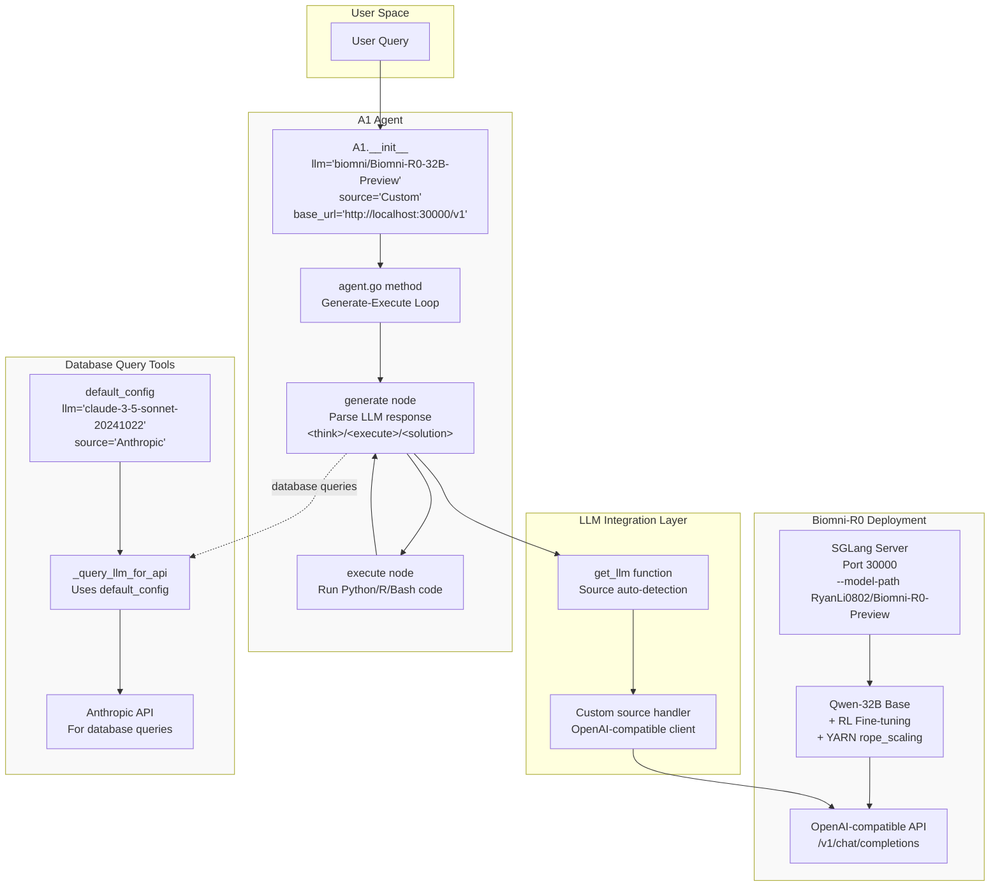
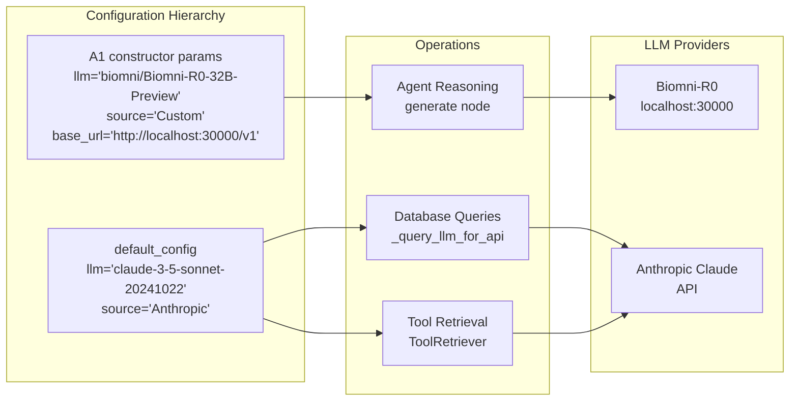
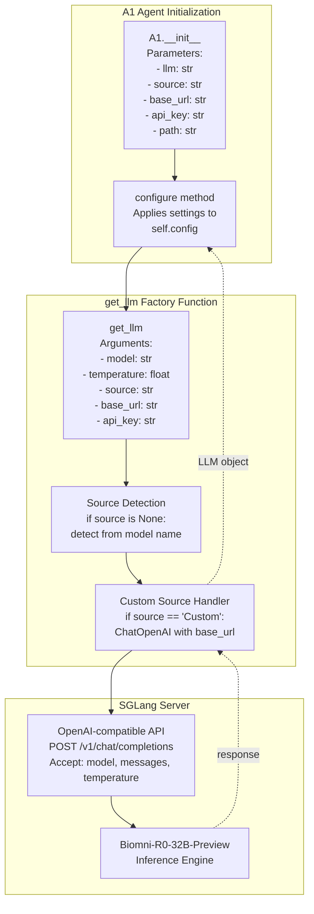

# Biomni-R0 Model Setup

<details>
<summary>Relevant source files</summary>

The following files were used as context for generating this wiki page:

- [README.md](README.md)
- [biomni/eval/__init__.py](biomni/eval/__init__.py)
- [biomni/eval/biomni_eval1.py](biomni/eval/biomni_eval1.py)
- [biomni/version.py](biomni/version.py)

</details>


## Purpose and Scope

This page covers the installation, configuration, and integration of **Biomni-R0**, a specialized 32B reasoning model optimized for biomedical agent tasks. It explains how to deploy Biomni-R0 using SGLang, configure the OpenAI-compatible API endpoint, and integrate it with the A1 agent for enhanced reasoning capabilities.

For general LLM provider configuration (Anthropic, OpenAI, etc.), see [LLM Provider Setup](#3.2). For environment setup, see [Conda Environment](#3.1). For agent usage patterns, see [Basic Agent Usage](#4.2).

---

## Overview

**Biomni-R0** is a 32B parameter reasoning model built on Qwen-32B and fine-tuned using reinforcement learning from agent interaction data. It generates structured outputs with `

<execute>
import pandas as pd
from biomni.tool.database import query_depmap

# Query DepMap for T cell exhaustion genes
results = query_depmap(
    cell_line_type="T cell",
    effect_threshold=-1.5,
    top_n=32
)
print(results)
</execute>
```

**Parsing logic in `generate` node:**
1. Extract `<think>` content → Internal reasoning (logged, not executed)
2. Extract `<execute>` content → Python/R/Bash code passed to `execute` node
3. Extract `<solution>` content → Final answer (triggers workflow end)

The `_extract_tags()` method in [biomni/agent/a1.py]() handles XML tag extraction and validation.

Sources: [README.md:273-278](), [biomni/agent/a1.py]()

---

## Architecture

The following diagram illustrates how Biomni-R0 integrates into the Biomni system architecture:



**Key Design Pattern:** Biomni-R0 handles **agent reasoning** (think-execute-observe), while a separate LLM provider (typically Claude or GPT-4) handles **database queries** and **tool retrieval**. This separation optimizes cost and performance.

Sources: [README.md:243-270]()

---

## Prerequisites

Before setting up Biomni-R0, ensure you have:

| Requirement | Details |
|-------------|---------|
| **Conda Environment** | `biomni_e1` activated (see [Conda Environment](#3.1)) |
| **Python** | Version 3.11 (included in biomni_e1) |
| **SGLang** | Installed via pip (included in biomni_e1) |
| **GPU** | NVIDIA GPU with at least 48GB VRAM for --tp 2 |
| **CUDA** | Compatible CUDA version for PyTorch |
| **Model Access** | HuggingFace account (model is public) |

**Hardware Requirements:**

| Configuration | GPU Memory | Tensor Parallel (--tp) |
|---------------|------------|------------------------|
| Minimum | 48GB | 2 (e.g., 2x A100-40GB) |
| Recommended | 80GB | 2 (e.g., 2x A100-80GB) |
| Single GPU | 80GB | 1 (e.g., 1x A100-80GB) |

Sources: [README.md:245-249]()

---

## SGLang Server Setup

### Launch Command

The Biomni-R0 model is served using **SGLang**, which provides an OpenAI-compatible API. Launch the server with the following command:

```bash
python -m sglang.launch_server \
    --model-path RyanLi0802/Biomni-R0-Preview \
    --port 30000 \
    --host 0.0.0.0 \
    --mem-fraction-static 0.8 \
    --tp 2 \
    --trust-remote-code \
    --json-model-override-args '{"rope_scaling":{"rope_type":"yarn","factor":1.0,"original_max_position_embeddings":32768}, "max_position_embeddings": 131072}'
```

**Parameter Breakdown:**

| Parameter | Value | Purpose |
|-----------|-------|---------|
| `--model-path` | `RyanLi0802/Biomni-R0-Preview` | HuggingFace model identifier |
| `--port` | `30000` | API endpoint port |
| `--host` | `0.0.0.0` | Bind to all network interfaces |
| `--mem-fraction-static` | `0.8` | Reserve 80% GPU memory for static allocation |
| `--tp` | `2` | Tensor parallelism across 2 GPUs |
| `--trust-remote-code` | N/A | Allow custom model code execution |
| `--json-model-override-args` | JSON config | YARN rope scaling for extended context (131K tokens) |

### YARN Rope Scaling Configuration

The model uses **YARN** (Yet Another RoPE extensioN method) to extend context length:

```json
{
  "rope_scaling": {
    "rope_type": "yarn",
    "factor": 1.0,
    "original_max_position_embeddings": 32768
  },
  "max_position_embeddings": 131072
}
```

This configuration extends the model's context window from 32K to 131K tokens, enabling longer conversation histories and larger code outputs.

Sources: [README.md:245-249]()

---

## Configuration Patterns

### Pattern 1: Biomni-R0 for Reasoning + Claude for Database Queries (Recommended)

This is the **recommended configuration** that separates concerns:

```python
from biomni.config import default_config
from biomni.agent import A1

# Configure default_config for database queries and tool retrieval
default_config.llm = "claude-3-5-sonnet-20241022"
default_config.source = "Anthropic"

# Initialize agent with Biomni-R0 for reasoning
agent = A1(
    llm="biomni/Biomni-R0-32B-Preview",
    source="Custom",
    base_url="http://localhost:30000/v1",
    api_key="EMPTY",  # SGLang doesn't require authentication
)

agent.go("Plan a CRISPR screen to identify genes regulating T cell exhaustion")
```

**Configuration Flow:**



**Why this pattern?**
- **Cost optimization**: Biomni-R0 runs locally (free after deployment)
- **Performance**: Claude/GPT-4 are faster for simple query translation
- **Specialization**: Biomni-R0 excels at multi-step reasoning, Claude excels at structured outputs

Sources: [README.md:251-270]()

### Pattern 2: Biomni-R0 for All Operations

Use Biomni-R0 for both reasoning and database queries:

```python
from biomni.config import default_config
from biomni.agent import A1

# Set Biomni-R0 as the global default
default_config.llm = "biomni/Biomni-R0-32B-Preview"
default_config.source = "Custom"
default_config.base_url = "http://localhost:30000/v1"
default_config.api_key = "EMPTY"

# Agent will use default_config values
agent = A1()

agent.go("Annotate cell types in this scRNA-seq dataset")
```

**Trade-offs:**
- ✅ Simplified configuration
- ✅ Consistent reasoning across all operations
- ❌ Slower database query translation
- ❌ Higher inference latency

Sources: [README.md:156-169]()

### Pattern 3: Environment Variable Configuration

Configure Biomni-R0 via environment variables:

```bash
# In .env or shell profile
export LLM_SOURCE="Custom"
export CUSTOM_MODEL_BASE_URL="http://localhost:30000/v1"
export CUSTOM_MODEL_API_KEY="EMPTY"
```

```python
from biomni.agent import A1

# Reads from environment variables
agent = A1(llm="biomni/Biomni-R0-32B-Preview")
```

Sources: [README.md:101-103]()

---

## Integration with A1 Agent

### Parameter Mapping

The following diagram shows how configuration parameters flow from initialization to LLM provider selection:



### Code Execution in Generate Node

When using Biomni-R0, the agent's `generate` node ([biomni/agent/a1.py]()) parses structured outputs:

**Biomni-R0 Output Format:**
```xml


<execute>
import pandas as pd
from biomni.tool.database import query_depmap

# Query DepMap for T cell exhaustion genes
results = query_depmap(
    cell_line_type="T cell",
    effect_threshold=-1.5,
    top_n=32
)
print(results)
</execute>
```

The agent extracts:
1. `<think>` content → Internal reasoning (logged but not executed)
2. `<execute>` content → Python/R/Bash code to execute
3. `<solution>` content → Final answer (when task is complete)

Sources: [README.md:236-242](), High-level diagrams (Diagram 2)

---

## Advanced Configuration

### Multi-GPU Configuration

Adjust tensor parallelism based on available GPUs:

| GPUs | --tp Flag | Memory Per GPU | Example |
|------|-----------|----------------|---------|
| 1x A100-80GB | `--tp 1` | ~72GB | Single large GPU |
| 2x A100-40GB | `--tp 2` | ~36GB each | Default config |
| 4x A40-48GB | `--tp 4` | ~32GB each | Distributed inference |

```bash
# Single GPU setup
python -m sglang.launch_server \
    --model-path RyanLi0802/Biomni-R0-Preview \
    --port 30000 \
    --tp 1 \
    --mem-fraction-static 0.9
```

### Custom Port Configuration

If port 30000 is in use, change the port and update the agent configuration:

```bash
# Launch on port 8080
python -m sglang.launch_server \
    --model-path RyanLi0802/Biomni-R0-Preview \
    --port 8080 \
    --host 0.0.0.0
```

```python
agent = A1(
    llm="biomni/Biomni-R0-32B-Preview",
    source="Custom",
    base_url="http://localhost:8080/v1",  # Updated port
    api_key="EMPTY",
)
```

### Temperature and Sampling Configuration

Control generation randomness via the `temperature` parameter:

```python
from biomni.config import default_config

# For agent reasoning with Biomni-R0
agent = A1(
    llm="biomni/Biomni-R0-32B-Preview",
    source="Custom",
    base_url="http://localhost:30000/v1",
    api_key="EMPTY",
    temperature=0.7,  # Higher for more creative reasoning
)

# For database queries (using default_config)
default_config.temperature = 0.0  # Lower for deterministic queries
```

| Temperature | Use Case | Recommended For |
|-------------|----------|-----------------|
| 0.0 | Deterministic outputs | Database queries, API calls |
| 0.3-0.5 | Balanced reasoning | General agent tasks |
| 0.7-1.0 | Creative exploration | Hypothesis generation, brainstorming |

Sources: Configuration system patterns, [biomni/config/default_config.py]()

---

## Verification and Testing

### Check Server Health

Verify the SGLang server is running:

```bash
curl http://localhost:30000/health
```

Expected output:
```json
{"status": "ok"}
```

### Test API Endpoint

Test the OpenAI-compatible `/v1/chat/completions` endpoint:

```bash
curl -X POST http://localhost:30000/v1/chat/completions \
  -H "Content-Type: application/json" \
  -d '{
    "model": "biomni/Biomni-R0-32B-Preview",
    "messages": [{"role": "user", "content": "What is CRISPR?"}],
    "temperature": 0.7
  }'
```

Expected response format:
```json
{
  "id": "chatcmpl-xxx",
  "object": "chat.completion",
  "created": 1234567890,
  "model": "biomni/Biomni-R0-32B-Preview",
  "choices": [
    {
      "index": 0,
      "message": {
        "role": "assistant",
        "content": "CRISPR (Clustered Regularly Interspaced Short Palindromic Repeats)..."
      },
      "finish_reason": "stop"
    }
  ]
}
```

### Test with A1 Agent

Verify end-to-end integration:

```python
from biomni.agent import A1

agent = A1(
    llm="biomni/Biomni-R0-32B-Preview",
    source="Custom",
    base_url="http://localhost:30000/v1",
    api_key="EMPTY",
)

# Test with a simple query
response = agent.go("List three important genes in cancer biology")
print(response)
```

**Expected behavior:**
1. Agent invokes Biomni-R0 via `self.llm.invoke()` in `generate` node
2. Response contains structured XML tags: `<think>`, `<execute>`, `<solution>`
3. Code in `<execute>` tags is executed by `execute` node
4. No connection errors to `localhost:30000`
5. Final solution is biologically relevant

**Verification checklist:**
- [ ] Server responds within 10-30 seconds per request
- [ ] GPU utilization visible in `nvidia-smi` during inference
- [ ] Agent conversation state shows `generate` → `execute` transitions
- [ ] Final output contains biological gene names (e.g., TP53, BRCA1, EGFR)

Sources: [README.md:280-308](), [biomni/agent/a1.py]()

---

## Troubleshooting

### Common Issues

| Issue | Symptom | Solution |
|-------|---------|----------|
| **Connection Refused** | `ConnectionError: localhost:30000` | Verify server: `curl http://localhost:30000/health` |
| **Out of Memory** | `CUDA out of memory` | Reduce `--mem-fraction-static` to 0.7 or increase `--tp` |
| **Slow Inference** | >30s per response | Check GPU util with `nvidia-smi`, verify `--tp` matches GPU count |
| **Model Download Fails** | HuggingFace `401 Unauthorized` | Model is public, check internet connection |
| **Wrong API Key** | `Authentication failed` | SGLang requires no auth, use `api_key="EMPTY"` |
| **Port In Use** | `Address already in use` | Change `--port` and update `base_url` in `A1.__init__()` |
| **YAML Config Error** | `rope_scaling` not applied | Ensure `--json-model-override-args` uses valid JSON syntax |

### Debug Mode

Enable verbose logging for SGLang:

```bash
export SGLANG_LOG_LEVEL=DEBUG
python -m sglang.launch_server \
    --model-path RyanLi0802/Biomni-R0-Preview \
    --port 30000 \
    --log-level info
```

### Performance Monitoring

Monitor GPU usage during inference:

```bash
watch -n 1 nvidia-smi
```

Expected GPU utilization:
- **Idle**: 10-20% GPU usage, 40-50GB VRAM (model loaded)
- **Inference**: 80-100% GPU usage, 45-55GB VRAM (generation)

### Fallback to Cloud Providers

If local deployment is not feasible, use cloud-hosted LLMs:

```python
from biomni.config import default_config
from biomni.agent import A1

# Fallback to Anthropic Claude
agent = A1(
    llm="claude-3-5-sonnet-20241022",
    source="Anthropic",
)

# Or OpenAI GPT-4
agent = A1(
    llm="gpt-4-turbo-preview",
    source="OpenAI",
)
```

See [LLM Provider Setup](#3.2) for cloud provider configuration.

---

## Next Steps

- **Basic Usage**: Learn how to run biomedical tasks with the A1 agent ([Basic Agent Usage](#4.2))
- **Custom Tools**: Extend Biomni-R0 with domain-specific tools ([Working with Custom Resources](#4.4))
- **Evaluation**: Benchmark Biomni-R0 performance on BiomniEval1 ([Running Evaluations](#7.2))

Sources: [README.md:236-270](), High-level diagrams (Diagram 4), Table of contents structure

---