# User Guide

<details>
<summary>Relevant source files</summary>

The following files were used as context for generating this wiki page:

- [README.md](README.md)
- [biomni/agent/a1.py](biomni/agent/a1.py)
- [biomni/eval/__init__.py](biomni/eval/__init__.py)
- [biomni/eval/biomni_eval1.py](biomni/eval/biomni_eval1.py)
- [biomni/tool/support_tools.py](biomni/tool/support_tools.py)
- [biomni/tool/tool_description/support_tools.py](biomni/tool/tool_description/support_tools.py)
- [biomni/utils.py](biomni/utils.py)
- [biomni/version.py](biomni/version.py)

</details>


## Purpose and Scope

This guide provides practical instructions for using Biomni to execute biomedical research tasks. It covers agent initialization, task execution, configuration management, and customization options through the Python API and web interface.

For installation and environment setup, see [Installation and Setup](#3). For detailed tool documentation, see [Tool Reference](#5). For example workflows, see [Tutorials and Examples](#6).

---

## Agent Workflow Overview

The following diagram illustrates the typical user workflow when working with Biomni:

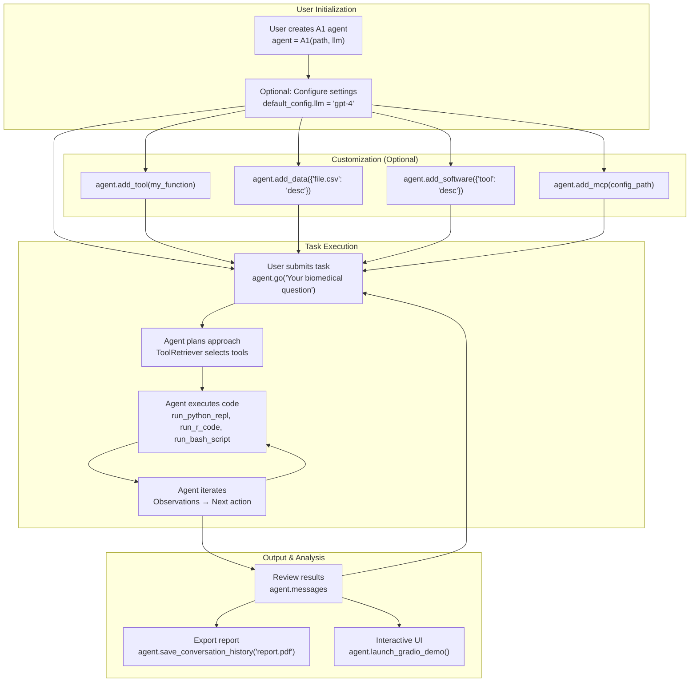

**Sources:** [biomni/agent/a1.py:56-224]()

---

## Core Agent Interaction Pattern

### Agent Initialization

The `A1` class is the primary interface for interacting with Biomni. Initialization accepts configuration parameters and automatically downloads required data:

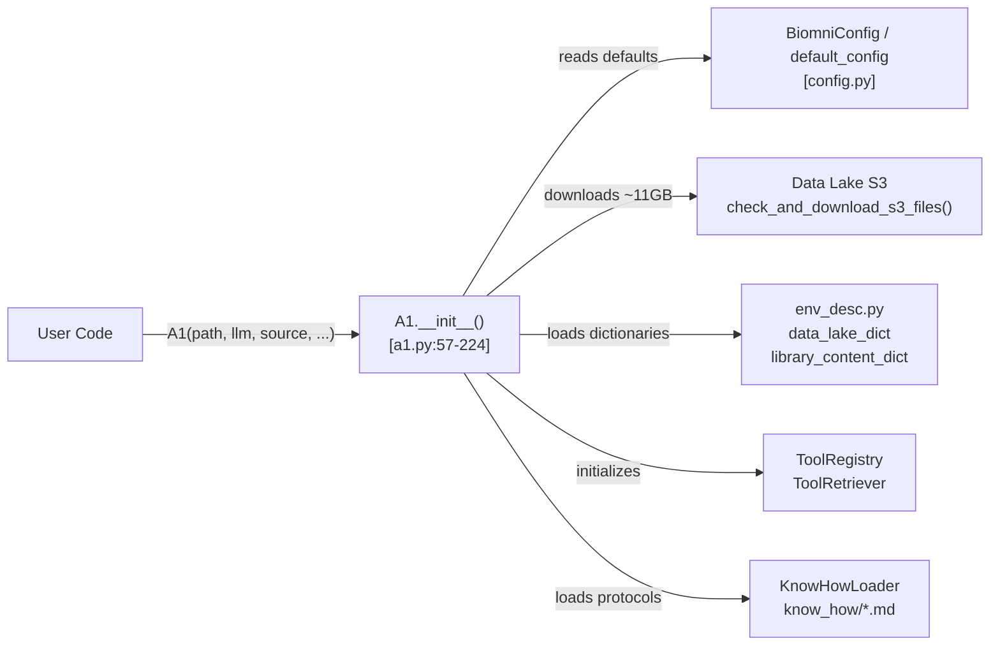

**Key Parameters:**
- `path`: Directory for data storage (default: from `default_config.path`)
- `llm`: Model name (e.g., `"claude-sonnet-4-20250514"`, `"gpt-4"`)
- `source`: Provider type from [`SourceType`]() enum (`"OpenAI"`, `"Anthropic"`, `"Custom"`, etc.)
- `use_tool_retriever`: Enable RAG-based tool selection (default: `True`)
- `timeout_seconds`: Code execution timeout (default: `600`)
- `commercial_mode`: Filter for licensed-only resources (default: `False`)
- `expected_data_lake_files`: List of files to download, or `[]` to skip download

**Sources:** [biomni/agent/a1.py:57-224](), [biomni/config.py:17-96]()

### Task Execution with agent.go()

The `go()` method is the primary execution interface that accepts natural language tasks:

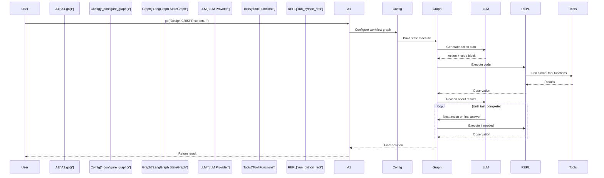

**Method Signature:** [biomni/agent/a1.py:899-1009]()

**Returns:**
- `mode="default"`: Returns final `AIMessage` object with solution
- `mode="stream"`: Returns generator yielding messages as they're created
- `mode="gradio"`: Returns generator with Gradio-compatible message format

For detailed usage patterns, see [Basic Agent Usage](#4.2).

**Sources:** [biomni/agent/a1.py:899-1009](), [biomni/agent/a1.py:728-897]()

---

## Configuration Management

Biomni uses a hierarchical configuration system with three precedence levels:

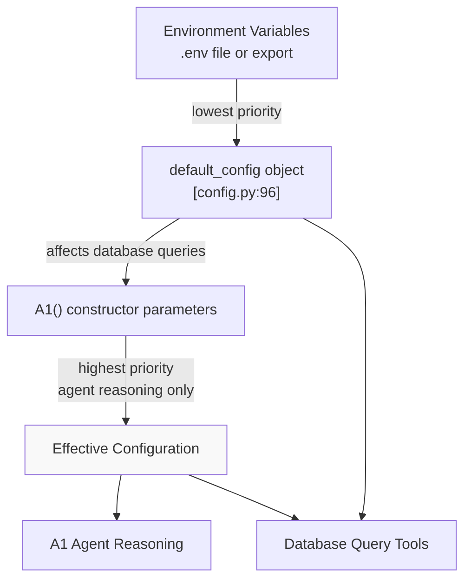

**Configuration Hierarchy:**

1. **Environment Variables** (lowest priority): Set via `.env` file or shell exports
   - `ANTHROPIC_API_KEY`, `OPENAI_API_KEY`, `GEMINI_API_KEY`, etc.
   - `LLM_SOURCE`, `BIOMNI_DATA_PATH`, `BIOMNI_TIMEOUT_SECONDS`

2. **`default_config` Object** (middle priority): Global settings affecting all operations
   - Modifiable at runtime: `default_config.llm = "gpt-4"`
   - Affects both agent reasoning AND database query tools
   - See [biomni/config.py:17-96]()

3. **A1 Constructor Parameters** (highest priority): Per-agent overrides
   - Only affects that agent's reasoning, NOT database queries
   - Example: `A1(llm="biomni/Biomni-R0-32B-Preview", source="Custom")`

**Critical Note:** For consistent LLM usage across all operations including database queries, modify `default_config` rather than passing parameters to `A1()`. Constructor parameters only override agent reasoning, not tool execution.

For complete configuration details, see [Configuration Guide](#4.3).

**Sources:** [README.md:192-209](), [biomni/agent/a1.py:82-148](), [biomni/config.py:17-96]()

---

## Customization Capabilities

### Adding Custom Tools

The `add_tool()` method dynamically registers user-defined functions as agent-callable tools:

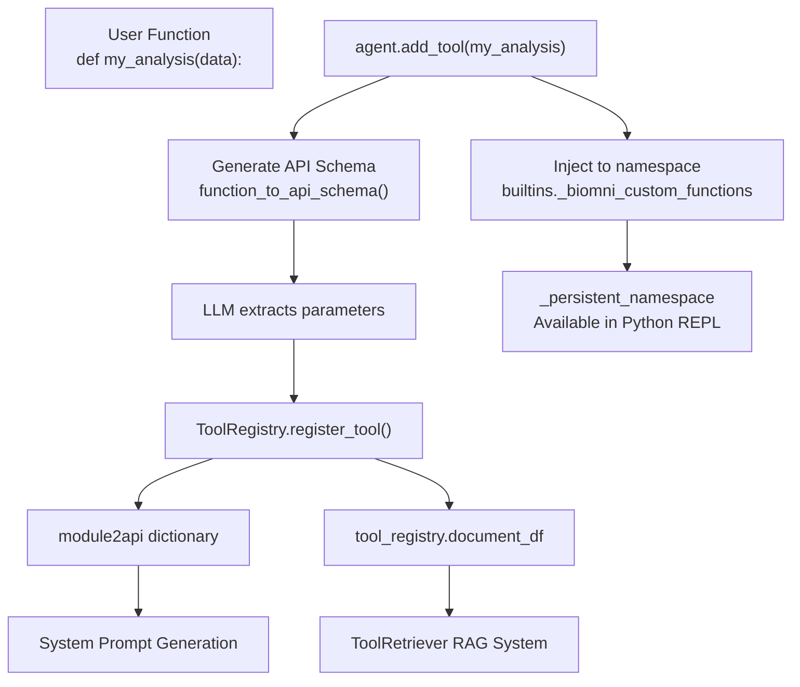

**Method Signature:** [biomni/agent/a1.py:225-348]()

**Example:**
```python
def calculate_ic50(concentrations, responses):
    """Calculate IC50 from dose-response data."""
    # Implementation here
    return ic50_value

agent.add_tool(calculate_ic50)
agent.go("Calculate IC50 for compound X with data in file.csv")
```

The function becomes available for:
- Direct execution in Python REPL via `run_python_repl`
- Tool retrieval via RAG system
- System prompt inclusion

For detailed guidance, see [Working with Custom Resources](#4.4).

**Sources:** [biomni/agent/a1.py:225-348](), [biomni/utils.py:251-291]()

### Adding Custom Data and Software

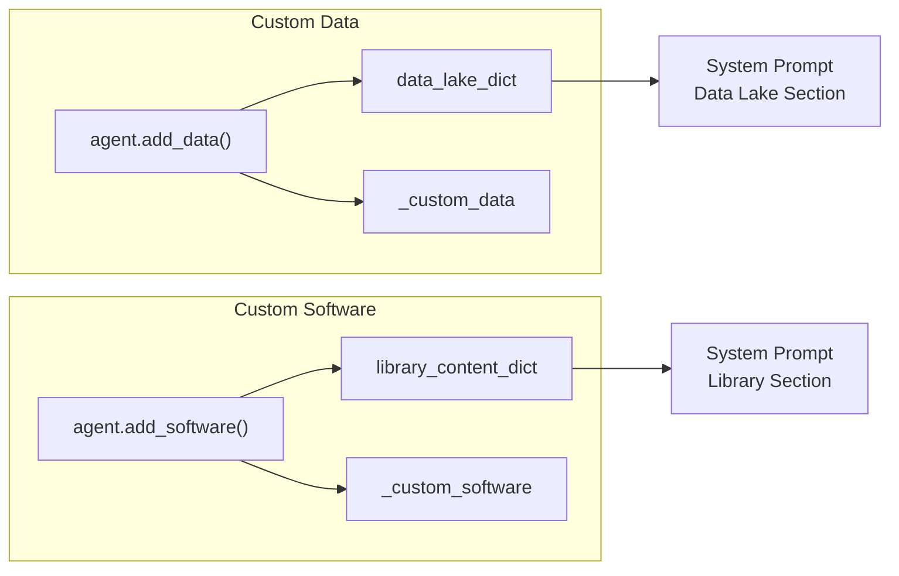

**Data Management Methods:**
- `add_data(dict)`: [biomni/agent/a1.py:676-721]() - Add files to data lake
- `get_custom_data(name)`: [biomni/agent/a1.py:723-735]() - Retrieve data info
- `list_custom_data()`: [biomni/agent/a1.py:737-746]() - List all custom data
- `remove_custom_data(name)`: [biomni/agent/a1.py:748-775]() - Remove data entry

**Software Management Methods:**
- `add_software(dict)`: [biomni/agent/a1.py:777-820]() - Add software to library
- `get_custom_software(name)`: [biomni/agent/a1.py:822-834]() - Retrieve software info
- `list_custom_software()`: [biomni/agent/a1.py:836-845]() - List all custom software
- `remove_custom_software(name)`: [biomni/agent/a1.py:847-875]() - Remove software entry

**Example:**
```python
# Add custom dataset
agent.add_data({
    'my_screen_data.csv': 'CRISPR screen results for immune cells'
})

# Add custom software
agent.add_software({
    'custom_aligner': 'Specialized sequence alignment tool for long reads'
})
```

**Sources:** [biomni/agent/a1.py:676-875]()

### Model Context Protocol (MCP) Integration

The `add_mcp()` method enables integration with external MCP servers:

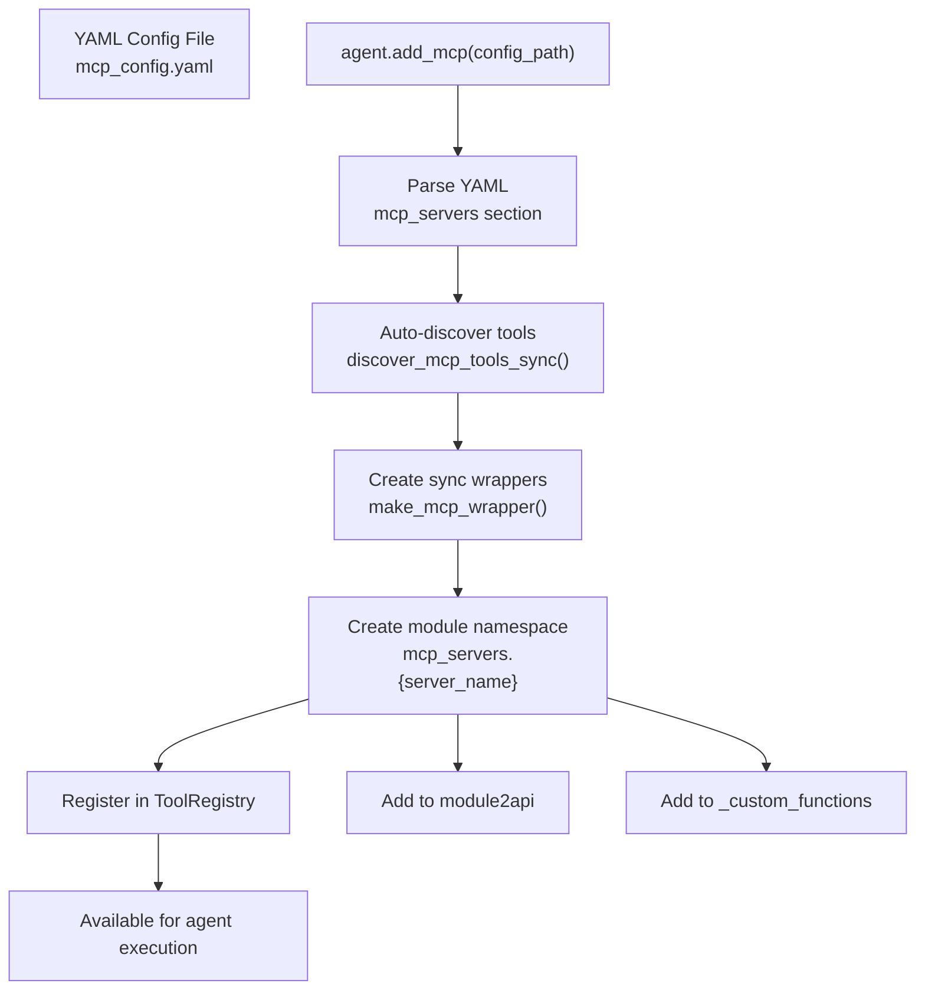

**Configuration Structure:**
```yaml
mcp_servers:
  fda_server:
    enabled: true
    command: ["uvx", "fda-mcp-server"]
    tools:
      - biomni_name: "query_fda_drugs"
        description: "Search FDA drug database"
        parameters: {...}
```

**Method Signature:** [biomni/agent/a1.py:350-587]()

For detailed MCP setup and examples, see [MCP Integration](#4.5).

**Sources:** [biomni/agent/a1.py:350-587](), [README.md:259-273]()

---

## User Interfaces

### Python API (Primary Interface)

The standard Python interface provides full programmatic control:

```python
from biomni.agent import A1

# Initialize agent
agent = A1(path='./data', llm='claude-sonnet-4-20250514')

# Execute tasks
result = agent.go("Plan a CRISPR screen for T cell exhaustion genes")

# Access conversation history
for msg in agent.messages:
    print(msg.type, msg.content[:100])

# Save results
agent.save_conversation_history("results.pdf")
```

**Key Methods:**
- `go(query, mode="default")`: [biomni/agent/a1.py:899-1009]() - Execute biomedical task
- `reset_agent()`: [biomni/agent/a1.py:1019-1037]() - Clear conversation history
- `save_conversation_history(filename)`: [biomni/agent/a1.py:1039-1110]() - Export to PDF
- `launch_gradio_demo()`: [biomni/agent/a1.py:1112-1395]() - Start web interface

**Sources:** [README.md:136-149](), [biomni/agent/a1.py:899-1395]()

### Gradio Web Interface

The `launch_gradio_demo()` method provides an interactive chat interface:

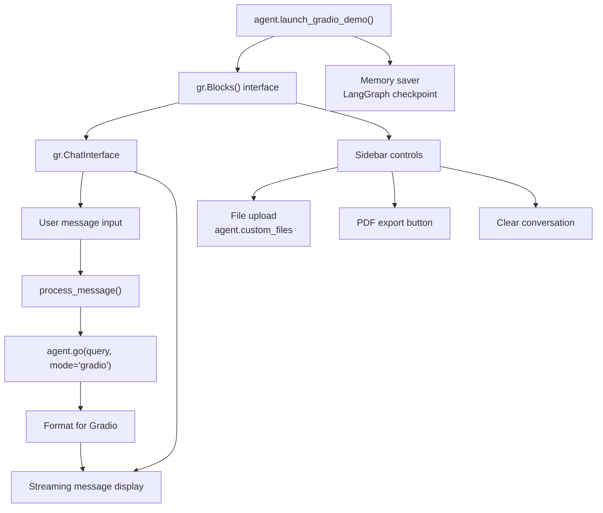

**Launch Options:**
- `share=True`: Create public shareable link via Gradio tunnel
- `server_name="127.0.0.1"`: Localhost only (default: `"0.0.0.0"`)
- `require_verification=True`: Require access code (default: `"Biomni2025"`)

**Method Signature:** [biomni/agent/a1.py:1112-1395]()

**Requirements:**
```bash
pip install "gradio>=5.0,<6.0"
```

For detailed interface documentation, see [Gradio Web Interface](#4.6).

**Sources:** [README.md:167-190](), [biomni/agent/a1.py:1112-1395]()

---

## Execution Environment

### Multi-Language Code Execution

Biomni supports Python, R, and Bash execution with automatic language detection:

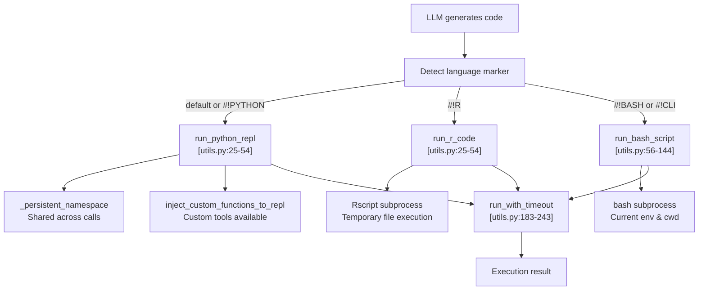

**Language Markers in Code:**
- Python: Default or `#!PYTHON` header
- R: `#!R` header
- Bash: `#!BASH` header
- CLI: `#!CLI` header

**Key Features:**
- **Persistent Python REPL**: Variables and imports maintained across executions via `_persistent_namespace` [biomni/tool/support_tools.py:7-44]()
- **Timeout Protection**: Configurable timeout via `run_with_timeout()` [biomni/utils.py:183-243]()
- **Custom Function Injection**: User-added tools automatically available [biomni/utils.py:1460-1488]()
- **Environment Preservation**: Bash scripts inherit current directory and environment

**Sources:** [biomni/tool/support_tools.py:1-44](), [biomni/utils.py:25-243](), [biomni/agent/a1.py:728-897]()

### Tool Execution Flow

The following diagram maps user queries to code execution:

```mermaid
sequenceDiagram
    participant Query["User Query"]
    participant Planner["_plan_with_llm()<br/>[a1.py:799-863]"]
    participant Retriever["ToolRetriever.retrieve()<br/>[retriever.py]"]
    participant Executor["_execute_agent_step()<br/>[a1.py:865-897]"]
    participant REPL["run_python_repl<br/>[support_tools.py:13-44]"]
    participant Tools["Tool Functions<br/>biomni.tool.*"]
    
    Query->>Planner: Natural language task
    Planner->>Retriever: Select relevant tools/data
    Retriever-->>Planner: Filtered tool schemas
    Planner->>Planner: Generate system prompt
    Planner->>Planner: LLM generates action + code
    Planner-->>Executor: Code block to execute
    
    Executor->>Executor: Parse language marker
    
    alt Python code
        Executor->>REPL: run_python_repl(code)
        REPL->>Tools: Import and call tool functions
        Tools-->>REPL: Results
        REPL-->>Executor: Observation string
    else R code
        Executor->>REPL: run_r_code(code)
        REPL-->>Executor: R script output
    else Bash/CLI
        Executor->>REPL: run_bash_script(code)
        REPL-->>Executor: Shell command output
    end
    
    Executor-->>Planner: Observation added to state
    Planner->>Planner: Reason about result
```

**Sources:** [biomni/agent/a1.py:728-897](), [biomni/tool/support_tools.py:13-44](), [biomni/model/retriever.py]()

---

## Output Management

### Conversation History

The agent maintains conversation state in the `messages` attribute:

```python
# Access raw messages
for msg in agent.messages:
    print(f"{msg.type}: {msg.content}")

# Filter by message type
from langchain_core.messages import AIMessage, HumanMessage
ai_messages = [m for m in agent.messages if isinstance(m, AIMessage)]
```

**Message Types:** [langchain_core.messages]()
- `HumanMessage`: User queries
- `AIMessage`: Agent responses with reasoning
- `SystemMessage`: System prompts (internal)

**Sources:** [biomni/agent/a1.py:51-54]()

### PDF Report Generation

The `save_conversation_history()` method exports formatted reports:

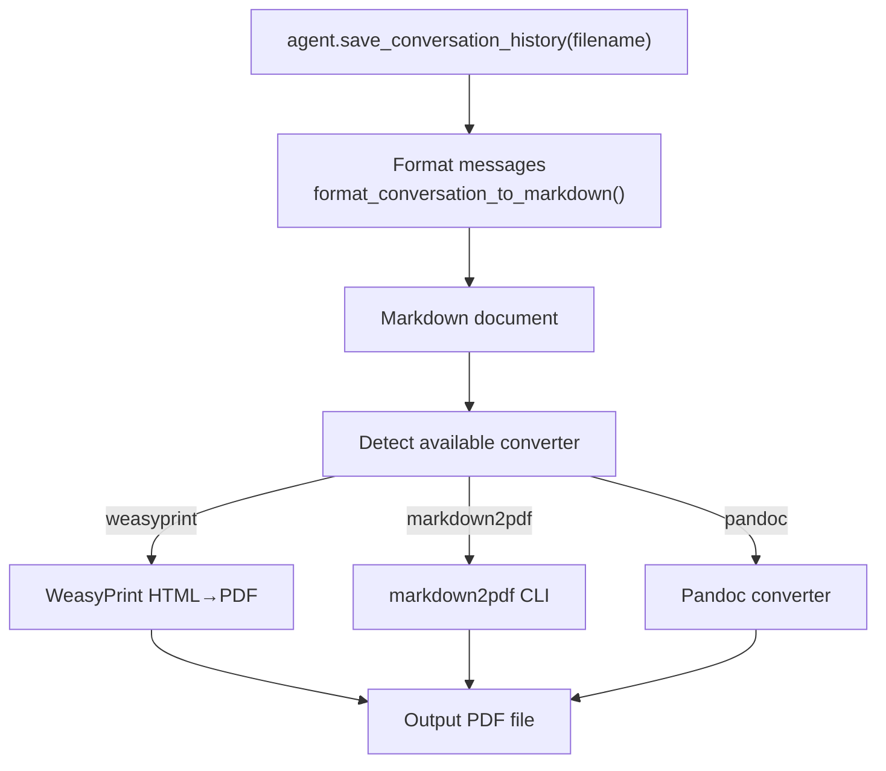

**Method Signature:** [biomni/agent/a1.py:1039-1110]()

**Installation Options:**
```bash
# Option 1: WeasyPrint (recommended)
conda install weasyprint

# Option 2: markdown2pdf (fast Rust-based)
brew install theiskaa/tap/markdown2pdf

# Option 3: Pandoc
pip install pandoc
```

For detailed setup instructions, see [PDF Report Generation](#4.7).

**Sources:** [README.md:212-258](), [biomni/agent/a1.py:1039-1110](), [biomni/utils.py:1684-1796]()

---

## Commercial Mode

When `commercial_mode=True`, Biomni filters resources to only include commercially licensed content:

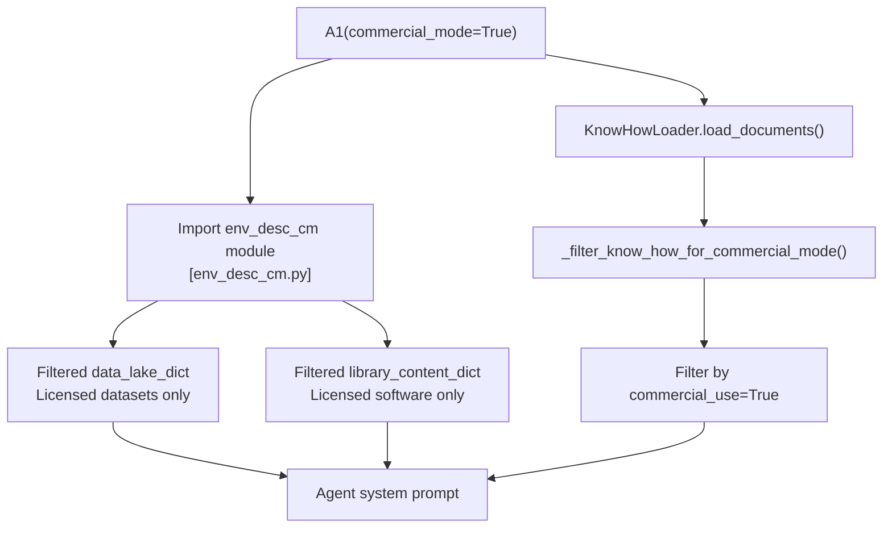

**Filtered Resources:**
- Data lake files with non-commercial licenses excluded
- Software packages with restrictive licenses excluded
- Know-how documents marked as non-commercial excluded

**Method Signature:** [biomni/agent/a1.py:100-113]()

**Example:**
```python
# Academic mode (default) - all resources
agent = A1(commercial_mode=False)

# Commercial mode - licensed resources only
agent = A1(commercial_mode=True)
```

For detailed information about filtered resources, see [Commercial Mode](#4.8).

**Sources:** [biomni/agent/a1.py:100-113](), [biomni/agent/a1.py:215-218](), [biomni/know_how/loader.py:79-110]()

---

## Evaluation Interface

Biomni includes the `BiomniEval1` benchmark for testing agent capabilities:

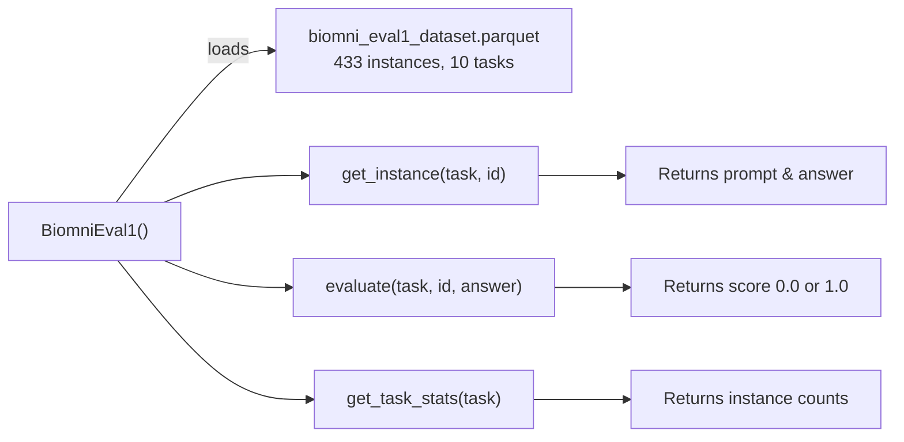

**Basic Usage:**
```python
from biomni.eval import BiomniEval1

evaluator = BiomniEval1()

# Get task instance
instance = evaluator.get_instance('gwas_causal_gene_opentargets', 0)
prompt = instance['prompt']
ground_truth = instance['answer']

# Evaluate answer
score = evaluator.evaluate('gwas_causal_gene_opentargets', 0, 'BRCA1')
```

**Key Methods:**
- `evaluate(task_name, task_instance_id, user_answer)`: [biomni/eval/biomni_eval1.py:41-70]() - Score answer
- `get_instance(task_name, task_instance_id)`: [biomni/eval/biomni_eval1.py:160-185]() - Get instance data
- `list_tasks()`: [biomni/eval/biomni_eval1.py:187-189]() - List available tasks
- `get_task_stats(task_name)`: [biomni/eval/biomni_eval1.py:191-219]() - Get statistics

For complete evaluation documentation, see [Evaluation and Benchmarking](#7).

**Sources:** [biomni/eval/biomni_eval1.py:14-265](), [README.md:311-333]()

---

## Quick Reference: Common Workflows

### Standard Task Execution
```python
from biomni.agent import A1

agent = A1(path='./data', llm='claude-sonnet-4-20250514')
result = agent.go("Design primers for gene X")
```

### Configuration with Custom LLM
```python
from biomni.config import default_config
from biomni.agent import A1

# Set global defaults (affects all operations)
default_config.llm = "gpt-4"
default_config.timeout_seconds = 1200

agent = A1()  # Uses defaults
```

### Adding Custom Functionality
```python
# Add custom tool
def my_analysis(data):
    return processed_data

agent.add_tool(my_analysis)

# Add custom data
agent.add_data({'my_data.csv': 'Experimental results'})

# Add MCP server
agent.add_mcp('./mcp_config.yaml')
```

### Streaming Execution
```python
for message in agent.go("Analyze dataset.csv", mode="stream"):
    print(message.content)
```

### Export Results
```python
agent.go("Your task...")
agent.save_conversation_history("results.pdf")
```

### Web Interface
```python
agent.launch_gradio_demo(share=True)  # Creates public URL
```

**Sources:** [README.md:136-258](), [biomni/agent/a1.py:56-1395]()

---