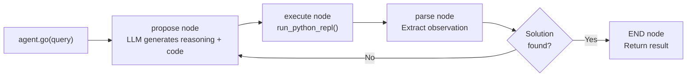

# Quick Start

<details>
<summary>Relevant source files</summary>

The following files were used as context for generating this wiki page:

- [README.md](README.md)
- [biomni/eval/__init__.py](biomni/eval/__init__.py)
- [biomni/eval/biomni_eval1.py](biomni/eval/biomni_eval1.py)
- [biomni/know_how/__init__.py](biomni/know_how/__init__.py)
- [biomni/know_how/loader.py](biomni/know_how/loader.py)
- [biomni/llm.py](biomni/llm.py)
- [biomni/model/retriever.py](biomni/model/retriever.py)
- [biomni/version.py](biomni/version.py)
- [tutorials/biomni_101.ipynb](tutorials/biomni_101.ipynb)

</details>


This page provides the minimal steps to get started with Biomni. For complete installation, see [Environment Setup](#3.1). For detailed usage patterns, see [Basic Agent Usage](#4.2).

## Prerequisites

1. Conda environment `biomni_e1` installed and activated (see [Environment Setup](#3.1))
2. At least one LLM API key configured (see [API Keys and Configuration](#3.2))
3. Internet connection for data lake download (~11GB on first run)

```bash
conda activate biomni_e1
```

**Sources:** [README.md:40-44]()

## Install Biomni Package

Install the Biomni package from PyPI:

```bash
pip install biomni --upgrade
```

For the latest development version from GitHub:

```bash
pip install git+https://github.com/snap-stanford/Biomni.git@main
```

**Sources:** [README.md:46-56]()

## Three-Line Quick Start

The absolute minimal usage requires only three lines of Python:

```python
from biomni.agent import A1

agent = A1(path='./data', llm='claude-sonnet-4-20250514')
agent.go("What is the function of the BRCA1 gene?")
```

The first line imports the `A1` agent class. The second line initializes an agent instance, which automatically downloads the data lake (~11GB) on first run. The third line executes a biomedical task using natural language.

**Sources:** [README.md:136-149](), [tutorials/biomni_101.ipynb:110-116]()

## Initialization Flow

**A1 Agent Initialization Process**

When you create an `A1` agent instance, the following operations execute automatically:

```mermaid
graph TB
    init["A1.__init__()"]
    config["BiomniConfig.load()"]
    mkdir["os.makedirs()<br/>data_lake/, benchmark/"]
    download["check_and_download_s3_files()<br/>Download ~11GB data lake"]
    llm["get_llm()<br/>Initialize LLM client"]
    tools["read_module2api()<br/>Load ToolRegistry"]
    graph["configure()<br/>Build LangGraph StateGraph"]
    ready["Agent ready"]
    
    init --> config
    config --> mkdir
    mkdir --> download
    download --> llm
    llm --> tools
    tools --> graph
    graph --> ready
```

| Step | Code Entity | Purpose |
|------|-------------|---------|
| 1 | `BiomniConfig` | Load configuration from environment variables and defaults |
| 2 | `os.makedirs()` | Create directory structure: `{path}/data_lake/`, `{path}/benchmark/` |
| 3 | `check_and_download_s3_files()` | Download 77 data lake files from S3 (skipped if files exist) |
| 4 | `get_llm()` | Create LangChain LLM client (`ChatAnthropic`, `ChatOpenAI`, etc.) |
| 5 | `read_module2api()` | Load 100+ tool function schemas from `tool_description/` |
| 6 | `StateGraph.add_node()` | Build LangGraph workflow with `propose`, `execute`, `parse` nodes |
| 7 | Ready | Agent initialized, `agent.go()` can be called |

**Sources:** [biomni/agent/a1.py:56-211](), [biomni/utils.py:975-1017](), [biomni/llm.py:13-276](), [biomni/config.py]()

## Example Tasks

Once initialized, you can execute diverse biomedical tasks using natural language:

```python
from biomni.agent import A1
agent = A1(path='./data', llm='claude-sonnet-4-20250514')

# Database query
agent.go("Look up protein interactions for TP53 in STRING database")

# Genomics analysis
agent.go("Perform scRNA-seq annotation on data at ./my_data.h5ad")

# CRISPR design
agent.go("Plan a CRISPR screen to identify genes that regulate T cell exhaustion")

# Drug discovery
agent.go("Predict ADMET properties for this compound: CC(C)CC1=CC=C(C=C1)C(C)C(=O)O")
```

Each call to `agent.go()` triggers an iterative ReAct loop where the LLM generates reasoning, writes Python code, executes it, and observes results until the task is complete. See [Basic Agent Usage](#4.2) for details on the execution workflow.

**Sources:** [README.md:145-149](), [tutorials/biomni_101.ipynb:139-149]()

## Skip Data Lake Download (Development Mode)

The data lake download (~11GB) can be skipped by passing `expected_data_lake_files=[]`:

```python
agent = A1(path='./data', llm='claude-sonnet-4-20250514', expected_data_lake_files=[])
```

This creates an agent without the 77 data lake datasets, useful for:
- Rapid prototyping and testing
- Limited storage environments
- Tasks using only database APIs (no local data required)

Note that tools requiring data lake files (e.g., `download_synapse_data`) will fail without the data lake.

**Sources:** [README.md:152-164](), [biomni/agent/a1.py:165-172]()

## Execution Flow (agent.go())

**agent.go() ReAct Loop**

The `agent.go()` method implements a Reasoning and Acting (ReAct) loop:



| Node | Function | Code Entity |
|------|----------|-------------|
| `propose` | LLM generates reasoning and Python code in `<execute>` blocks | `AgentState.thoughts`, `AgentState.code` |
| `execute` | Execute code in persistent Python REPL namespace | `run_python_repl()`, `_persistent_namespace` |
| `parse` | Extract execution results/errors | `AgentState.observations` |
| Decision | Check if solution is reached or max iterations (50) exceeded | `StateGraph.add_conditional_edges()` |

The loop continues until the LLM determines the task is complete or the iteration limit is reached.

**Sources:** [biomni/agent/a1.py:1413-1637](), [biomni/agent/a1.py:524-625]()

## Essential Configuration

For quick start, you only need to set your API key. Three configuration methods are available:

### Method 1: Environment File (.env)

Create a `.env` file in your working directory:

```bash
ANTHROPIC_API_KEY=your_key_here
```

### Method 2: Shell Environment

Export environment variables in your shell:

```bash
export ANTHROPIC_API_KEY="your_key_here"
```

### Method 3: Direct Parameters

Pass configuration directly to `A1()`:

```python
agent = A1(
    path='./data',
    llm='claude-sonnet-4-20250514',
    timeout_seconds=1200
)
```

For comprehensive configuration options including Azure OpenAI, custom models, and advanced settings, see [Configuration Guide](#4.3).

**Sources:** [README.md:58-128](), [biomni/config.py](), [biomni/llm.py:13-276]()

## Next Steps

- **Configuration details**: See [Configuration Guide](#4.2) for comprehensive configuration options including Azure OpenAI, custom models, and advanced settings
- **Explore tools**: See [Tool Ecosystem](#4.3) for the 100+ available tools across database queries, genomics, bioimaging, and more
- **Add custom functionality**: See [Adding Custom Tools and Data](#4.5) for extending the agent with domain-specific tools
- **MCP integration**: See [MCP Integration](#4.6) for connecting external tool servers
- **Complete tutorials**: See [Tutorials and Examples](#5) for end-to-end workflows

**Sources:** [biomni/agent/a1.py](), [README.md]()

---