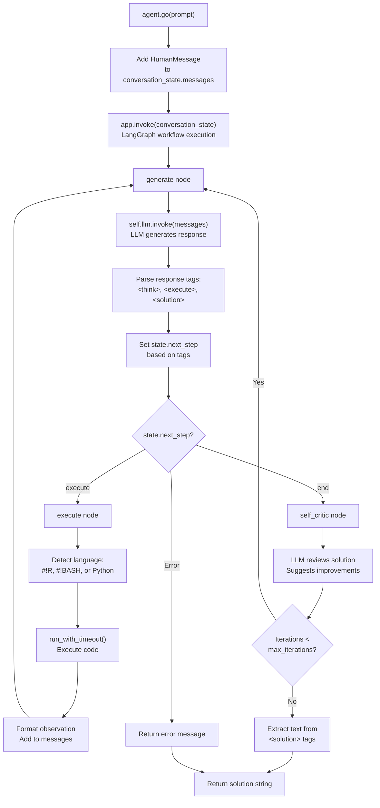
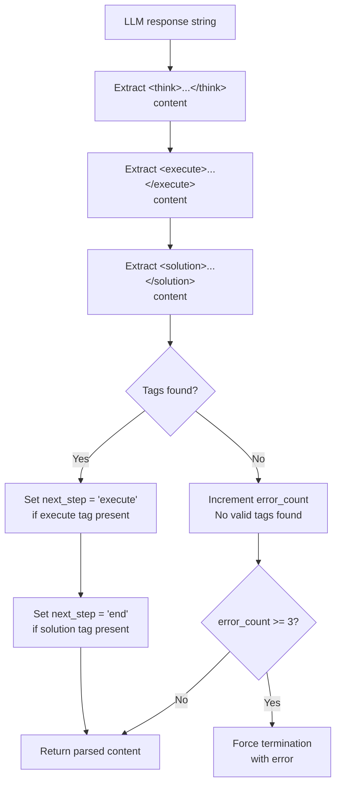
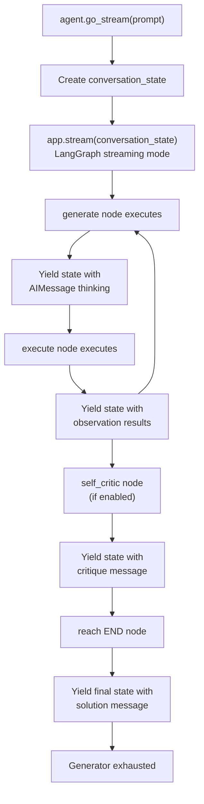
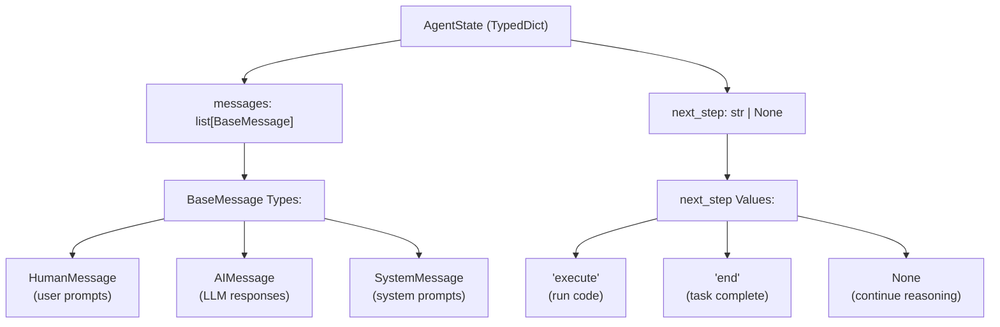
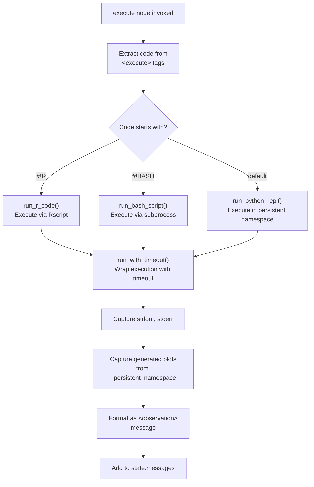
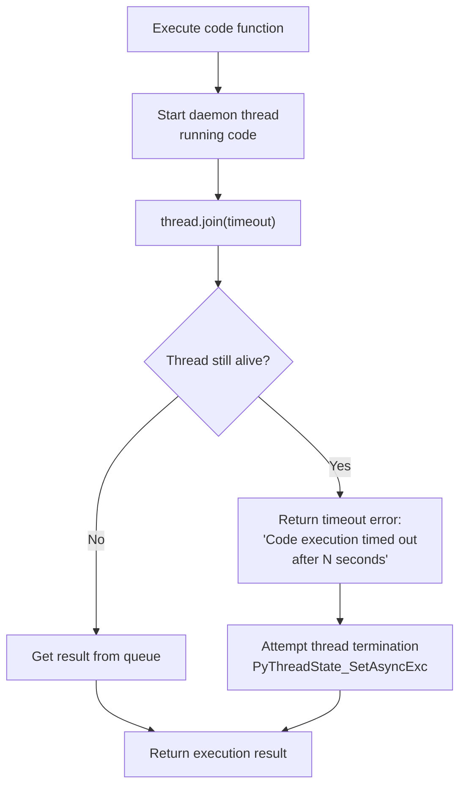
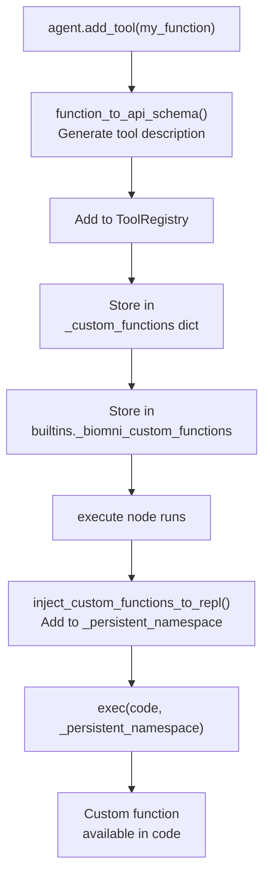
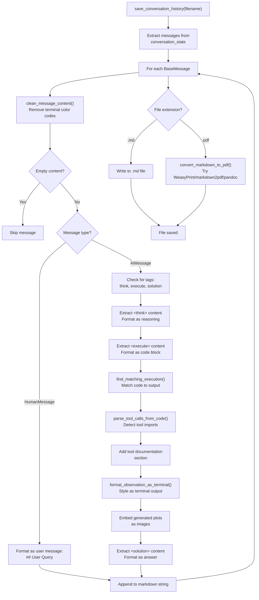
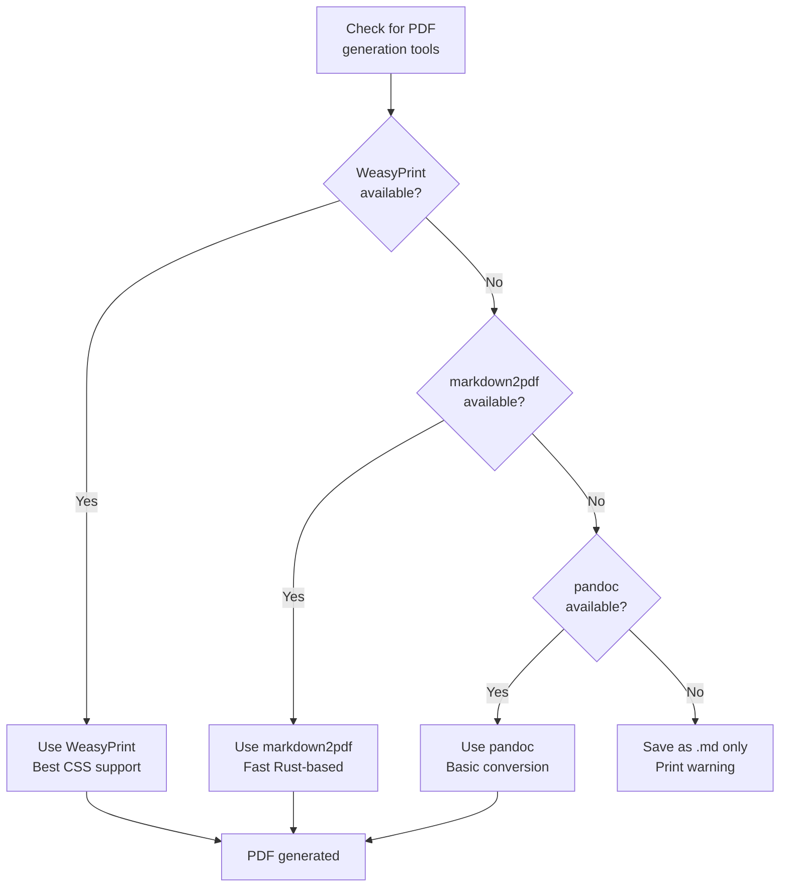

# Basic Agent Usage

<details>
<summary>Relevant source files</summary>

The following files were used as context for generating this wiki page:

- [README.md](README.md)
- [biomni/agent/a1.py](biomni/agent/a1.py)
- [biomni/eval/__init__.py](biomni/eval/__init__.py)
- [biomni/eval/biomni_eval1.py](biomni/eval/biomni_eval1.py)
- [biomni/tool/support_tools.py](biomni/tool/support_tools.py)
- [biomni/tool/tool_description/support_tools.py](biomni/tool/tool_description/support_tools.py)
- [biomni/utils.py](biomni/utils.py)
- [biomni/version.py](biomni/version.py)

</details>


## Purpose and Scope

This page covers the two primary methods for executing biomedical research tasks with the A1 agent: `agent.go()` for blocking execution and `agent.go_stream()` for streaming updates. For agent initialization and setup, see [Quick Start](#4.1). For configuration options, see [Configuration Guide](#4.3).

**Prerequisites:** This guide assumes you have already initialized an agent instance:

```python
from biomni.agent import A1
agent = A1(path='./data', llm='claude-sonnet-4-20250514')
```

See [Quick Start](#4.1) for initialization details.

## The `agent.go()` Method

### Overview

`agent.go(prompt)` executes a biomedical research task synchronously, blocking until completion or failure. The method returns the final solution as a string.

**Method Signature:**
```python
def go(
    self,
    prompt: str,
    max_iterations: int | None = None,
    use_self_critic: bool | None = None,
    show_thinking: bool | None = None
) -> str
```

**Parameters:**
- `prompt`: Natural language task description
- `max_iterations`: Maximum reasoning cycles (default: from `default_config`)
- `use_self_critic`: Enable solution review loop (default: from `default_config`)
- `show_thinking`: Print reasoning steps to console (default: `True`)

**Returns:** Final solution as a string, or error message if execution fails.

**Sources:** [biomni/agent/a1.py:877-1076]()

### Basic Usage Examples

#### Database Queries

```python
# Retrieve protein information
result = agent.go("Get the UniProt entry for human TP53")

# Query disease-gene associations
result = agent.go("Find genes associated with Alzheimer's disease using OpenTargets")

# Search FDA drug information
result = agent.go("What are the adverse events reported for ibuprofen?")
```

#### Genomics Analysis

```python
# Single-cell RNA-seq annotation
result = agent.go(
    "Annotate cell types in this scRNA-seq dataset at ./data/pbmc3k.h5ad "
    "and generate a UMAP visualization"
)

# CRISPR screen design
result = agent.go(
    "Design a CRISPR screen targeting 50 genes involved in immune checkpoint regulation. "
    "Generate sgRNA sequences and prioritize by on-target efficiency."
)

# Hi-C data analysis
result = agent.go(
    "Analyze Hi-C data to identify TADs and enhancer-promoter interactions "
    "for the MYC locus on chromosome 8"
)
```

#### Molecular Biology Workflows

```python
# Primer design
result = agent.go(
    "Design PCR primers to amplify the coding sequence of human BRCA1 exon 11. "
    "Check for off-target binding sites."
)

# Sequence analysis
result = agent.go(
    "Identify open reading frames in this sequence: ATGGCTAGCTAGCTAG... "
    "and predict the translated protein structure"
)

# Cloning protocol generation
result = agent.go(
    "Generate a Golden Gate assembly protocol to clone three DNA fragments "
    "with BsaI restriction sites into pYTK vector backbone"
)
```

#### Drug Discovery

```python
# ADMET prediction
result = agent.go(
    "Predict ADMET properties for this compound: CC(C)CC1=CC=C(C=C1)C(C)C(=O)O"
)

# Molecular docking
result = agent.go(
    "Perform molecular docking of aspirin to human COX-2 enzyme (PDB: 5KIR). "
    "Report binding affinity and key interactions."
)

# Drug-drug interaction check
result = agent.go(
    "Check for drug-drug interactions between warfarin and ciprofloxacin. "
    "Explain the mechanism if interaction exists."
)
```

**Sources:** [README.md:145-149](), example patterns from [biomni/agent/a1.py:877-1076]()

### Execution Flow

**High-Level Execution Flow Diagram:**



**Sources:** [biomni/agent/a1.py:877-1076]() for `go()` method, workflow structure from LangGraph implementation

### Tag-Based Communication Protocol

The agent uses XML-like tags to structure its responses:

| Tag | Purpose | Example |
|-----|---------|---------|
| `` |
| `<execute>` | Code to execute | `<execute>from biomni.tool.database import query_uniprot\nresult = query_uniprot('TP53')</execute>` |
| `<observation>` | Execution results | `<observation>{'name': 'TP53', 'function': '...'}</observation>` |
| `<solution>` | Final answer | `<solution>TP53 is a tumor suppressor protein...</solution>` |

**Tag Parsing Flow:**



**Sources:** Tag format from system prompt in [biomni/agent/a1.py:877-1076](), parsing logic inferred from workflow structure

## The `agent.go_stream()` Method

### Overview

`agent.go_stream(prompt)` executes a task with real-time streaming updates. Unlike `go()`, this method returns a generator that yields state updates as the agent progresses through the workflow.

**Method Signature:**
```python
def go_stream(
    self,
    prompt: str,
    max_iterations: int | None = None,
    use_self_critic: bool | None = None,
    show_thinking: bool | None = None
) -> Generator[dict, None, None]
```

**Parameters:** Same as `go()` method

**Returns:** Generator yielding `dict` events with state updates

**Sources:** [biomni/agent/a1.py:1078-1195]()

### Streaming Event Structure

Each yielded event is a dictionary representing the current workflow state:

```python
{
    'messages': [HumanMessage(...), AIMessage(...), ...],
    'next_step': 'execute' | 'end' | None,
    # Additional metadata depending on node
}
```

**Event Types by Node:**

| Node | Event Content | Use Case |
|------|---------------|----------|
| `generate` | `AIMessage` with thinking/code | Show LLM reasoning |
| `execute` | Execution output, plots | Display code results |
| `self_critic` | Critique and suggestions | Show improvement loop |

**Sources:** [biomni/agent/a1.py:1078-1195]()

### Streaming Usage Examples

#### Basic Streaming with Progress Tracking

```python
# Track agent progress
print("Starting analysis...")
for event in agent.go_stream("Annotate cell types in this scRNA-seq dataset"):
    # Check for new messages
    if 'messages' in event:
        latest_message = event['messages'][-1]
        
        # Print thinking steps
        if hasattr(latest_message, 'content') and '', '')
            content = content.replace('<execute>', '```python\n').replace('</execute>', '\n```')
            yield content

# Use in Gradio interface
with gr.Blocks() as demo:
    input_box = gr.Textbox(label="Query")
    output_box = gr.Textbox(label="Response", lines=20)
    submit_btn = gr.Button("Submit")
    
    submit_btn.click(
        fn=process_with_updates,
        inputs=input_box,
        outputs=output_box
    )
```

#### Streaming with Progress Bar

```python
from tqdm import tqdm

def run_with_progress(prompt, max_iterations=20):
    """Execute task with progress bar."""
    with tqdm(total=max_iterations, desc="Agent iterations") as pbar:
        for event in agent.go_stream(prompt):
            # Update progress bar on each generate cycle
            if 'messages' in event:
                pbar.update(1)
            
            # Show key events
            if event.get('next_step') == 'execute':
                pbar.set_description("Executing code")
            elif event.get('next_step') == 'end':
                pbar.set_description("Finalizing solution")
                break
    
    # Extract final solution
    final_message = event['messages'][-1]
    return final_message.content

result = run_with_progress("Design CRISPR screen for T cell exhaustion genes")
```

**Sources:** [biomni/agent/a1.py:1078-1195]() for streaming implementation, example patterns from Gradio integration

### Streaming vs Blocking Comparison

| Aspect | `go()` | `go_stream()` |
|--------|--------|---------------|
| Execution | Blocking | Non-blocking generator |
| Return type | `str` (final solution) | `Generator[dict]` (state updates) |
| Progress visibility | Only final result | Real-time updates |
| UI integration | Simple | Requires event loop |
| Use case | Batch processing, scripts | Interactive UIs, monitoring |
| Overhead | Lower | Slightly higher (event generation) |

**Sources:** Comparison based on [biomni/agent/a1.py:877-1076]() and [biomni/agent/a1.py:1078-1195]()

### Message Flow in Streaming

**Streaming Message Propagation:**



**Sources:** [biomni/agent/a1.py:1078-1195]() for streaming implementation, LangGraph streaming from [biomni/agent/a1.py:14-15]()

### AgentState Structure

The agent maintains state through the `AgentState` TypedDict, which is updated and yielded by streaming:

**AgentState Schema:**



**Sources:** [biomni/agent/a1.py:51-54]()

## Code Execution Details

### Language Detection and Routing

The `execute` node detects the programming language from code block markers:

**Language Detection Flow:**



**Sources:** [biomni/utils.py:25-54]() for `run_r_code()`, [biomni/utils.py:56-145]() for `run_bash_script()`, [biomni/tool/support_tools.py]() for `run_python_repl()`

### Execution Language Markers

| Marker | Language | Executor | Persistence |
|--------|----------|----------|-------------|
| `#!R` | R | `run_r_code()` → Rscript subprocess | No (each execution is isolated) |
| `#!BASH` | Bash | `run_bash_script()` → shell subprocess | No (each execution is isolated) |
| None | Python | `run_python_repl()` → `exec()` | Yes (uses `_persistent_namespace`) |

**Python Persistence Example:**

```python
# First execution
agent.go("<execute>import numpy as np\ndata = np.array([1, 2, 3])</execute>")

# Second execution - 'data' and 'np' are still available
agent.go("<execute>result = np.mean(data)</execute>")  # Works!
```

**Sources:** [biomni/utils.py:25-145]() for language executors

### Timeout Handling

All code execution uses `run_with_timeout()` to enforce the `timeout_seconds` limit (default 600s):

**Timeout Mechanism:**



**Timeout Error Message:**
```
ERROR: Code execution timed out after 600 seconds. 
Please try with simpler inputs or break your task into smaller steps.
```

The agent receives this error as an observation and can retry with a modified approach.

**Sources:** [biomni/utils.py:183-243]()

### Custom Function Injection

The agent automatically injects custom functions added via `add_tool()` into the Python execution namespace:

**Custom Function Flow:**



**Sources:** [biomni/agent/a1.py:225-349]() for `add_tool()`, [biomni/utils.py:1154-1178]() for `inject_custom_functions_to_repl()`

## Return Values and Error Handling

### Successful Execution

When `agent.go()` completes successfully, it returns the text content from the `<solution>` tags:

```python
result = agent.go("What is the function of TP53?")
# Returns: "TP53 is a tumor suppressor protein that regulates cell cycle..."
```

The solution string has XML tags removed and whitespace normalized.

**Sources:** Solution extraction from [biomni/agent/a1.py:877-1076]()

### Error Cases

**Common Error Scenarios:**

| Error Type | Condition | Return Value |
|------------|-----------|--------------|
| Parsing failure | 3+ consecutive LLM responses without valid tags | `"Error: Failed to parse LLM response after 3 attempts"` |
| Timeout | Code execution exceeds `timeout_seconds` | `"ERROR: Code execution timed out after N seconds..."` |
| Execution error | Python/R/Bash error | Error message from exception as observation |
| Max iterations | Exceeds `max_iterations` without solution | Last reasoning message content |

**Error Handling Example:**

```python
result = agent.go("Analyze this malformed data: [invalid syntax]")

# Check for errors
if result.startswith("Error:") or result.startswith("ERROR:"):
    print(f"Task failed: {result}")
    # Implement retry logic or error reporting
else:
    print(f"Success: {result}")
```

**Sources:** Error handling patterns inferred from [biomni/agent/a1.py:877-1076]()

### Partial Results in Streaming

With `go_stream()`, partial results are available even if execution fails:

```python
results = []
errors = []

for event in agent.go_stream("Complex analysis task..."):
    if 'messages' in event:
        latest = event['messages'][-1]
        
        # Capture observations as partial results
        if '<observation>' in latest.content:
            results.append(latest.content)
        
        # Capture errors
        if 'ERROR' in latest.content or 'Error' in latest.content:
            errors.append(latest.content)

# Even if final solution fails, you have intermediate results
print(f"Collected {len(results)} observations and {len(errors)} errors")
```

**Sources:** Streaming behavior from [biomni/agent/a1.py:1078-1195]()

## Conversation History and Persistence

### Conversation State Persistence

The agent maintains all conversation context in `self.conversation_state`:

```python
# After running a task
agent.go("Analyze this dataset...")

# Conversation state is preserved
print(len(agent.conversation_state['messages']))  # Shows message count

# Subsequent calls continue the conversation
agent.go("Now visualize the results")  # Has context from previous task
```

**State Persistence:**
- **Messages**: All LLM interactions, code, and observations preserved in `conversation_state['messages']`
- **Python namespace**: Variables persist across executions in `_persistent_namespace`
- **Execution history**: Code-output mappings stored in `execution_results`

**Sources:** [biomni/agent/a1.py:51-54]() for AgentState, namespace management in execution nodes

### The `save_conversation_history()` Method

Export the complete execution trace to PDF or Markdown:

```python
# Run a task
agent.go("Analyze gene expression patterns in cancer cells")

# Save as PDF (requires WeasyPrint, markdown2pdf, or pandoc)
agent.save_conversation_history("analysis_results.pdf")

# Save as Markdown
agent.save_conversation_history("analysis_results.md")
```

**Method Signature:**
```python
def save_conversation_history(
    self,
    filename: str
) -> None
```

The output format is determined by file extension (`.pdf` or `.md`).

**Sources:** [README.md:210-224](), [biomni/agent/a1.py:1197-1400]()

### Captured Content

The conversation history includes:

**Content Types:**

| Content | Format | Source |
|---------|--------|--------|
| Reasoning steps | Plain text from `<think>` tags | LLM responses |
| Code execution | Syntax-highlighted blocks from `<execute>` tags | Code generation |
| Execution results | Terminal-style output from `<observation>` tags | Code execution |
| Tool usage | Highlighted function calls | Import parsing |
| Solutions | Formatted text from `<solution>` tags | Final answers |
| Errors | Error messages with context | Execution failures |
| Plots | Embedded images (base64 in PDF) | Matplotlib figures |

**Tool Call Highlighting:**

The system detects tool usage by parsing import statements:

```python
# This code in <execute> tags:
from biomni.tool.database import query_uniprot
result = query_uniprot('TP53')

# Gets formatted as:
### Tool Used: query_uniprot
**Module:** biomni.tool.database
**Description:** Query UniProt database for protein information
```

**Sources:** [biomni/utils.py:1179-1209]() for `parse_tool_calls_from_code()`, [biomni/utils.py:1211-1250]() for `parse_tool_calls_with_modules()`

### History Processing Pipeline

**Markdown Generation Flow:**



**Sources:** [biomni/agent/a1.py:1197-1400]() for `save_conversation_history()`, [biomni/utils.py:1020-1250]() for utility functions

### PDF Generation Tools

**Tool Priority Order:**



**Installation Commands:**

```bash
# WeasyPrint (recommended)
conda install weasyprint

# markdown2pdf (macOS)
brew install theiskaa/tap/markdown2pdf

# markdown2pdf (Cargo)
cargo install markdown2pdf

# pandoc
pip install pandoc
```

**Sources:** [README.md:227-254](), [biomni/utils.py]() for PDF conversion logic

### Example: Complete Workflow with History

```python
from biomni.agent import A1

# Initialize agent
agent = A1(path='./data', llm='claude-sonnet-4-20250514')

# Run analysis task
result = agent.go(
    "Analyze differential expression in this scRNA-seq dataset at ./data/pbmc.h5ad. "
    "Identify top 10 marker genes for each cell type and generate UMAP visualization."
)

# Check result
print(f"Analysis complete: {result[:200]}...")

# Save complete trace with all code, outputs, and plots
agent.save_conversation_history("scrna_analysis_trace.pdf")

# You can also save as markdown for easier inspection
agent.save_conversation_history("scrna_analysis_trace.md")

print("Execution history saved!")
```

**Generated PDF Contains:**
1. User query
2. Agent reasoning steps
3. All executed code (Python, R, or Bash)
4. Execution outputs (stdout/stderr)
5. Generated UMAP plots (embedded)
6. Tool usage documentation
7. Final solution

**Sources:** Example workflow patterns from [README.md:136-149]()

## Summary of Key Methods

| Method | Purpose | Blocking | Returns |
|--------|---------|----------|---------|
| `__init__(...)` | Initialize agent, download data lake | Yes | Agent instance |
| `go(prompt)` | Execute task to completion | Yes | Final solution |
| `go_stream(prompt)` | Execute task with streaming updates | No (generator) | Event generator |
| `save_conversation_history(filename)` | Export execution trace | Yes | None (saves file) |
| `configure()` | Regenerate system prompt | Yes | None |

**Sources:** [biomni/agent/a1.py:56-210]() for `__init__`, method signatures from class structure

---

**Related Pages:**
- [Quick Start](#4.1): Installation and first steps
- [Configuration Guide](#4.3): Advanced configuration options
- [Working with Custom Resources](#4.4): Adding custom tools, data, and software
- [Execution Pipeline](#2.2): Deep dive into code execution internals
- [A1 Agent Core](#2.1): Complete agent architecture and LangGraph implementation

---