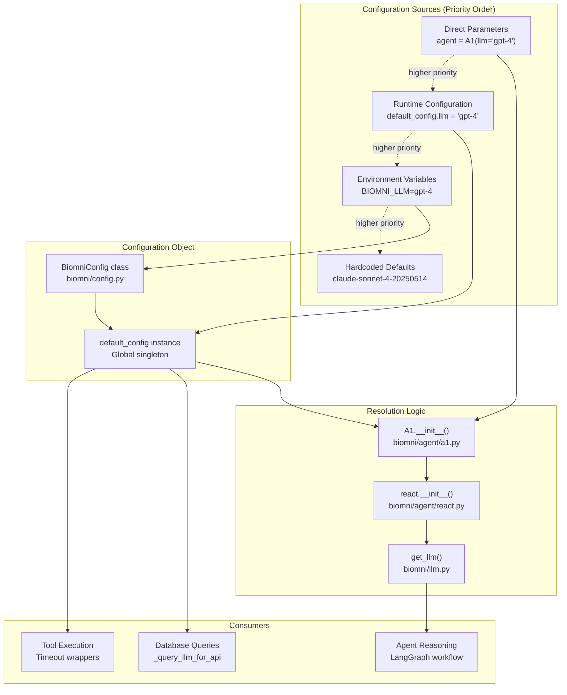
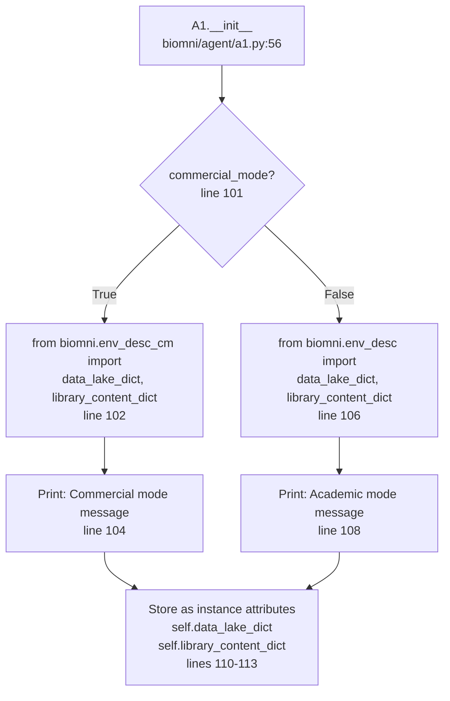
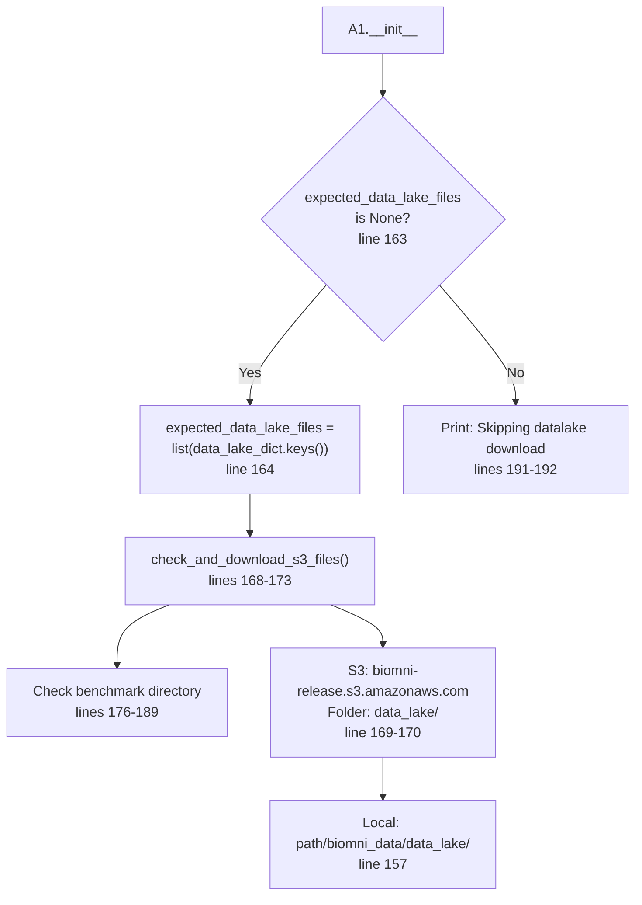
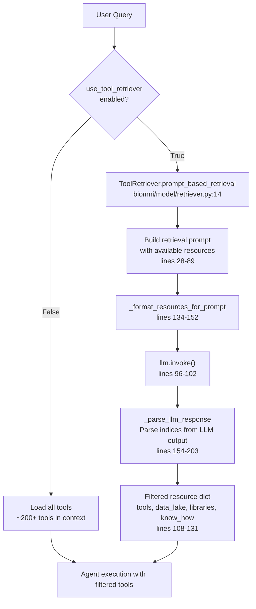
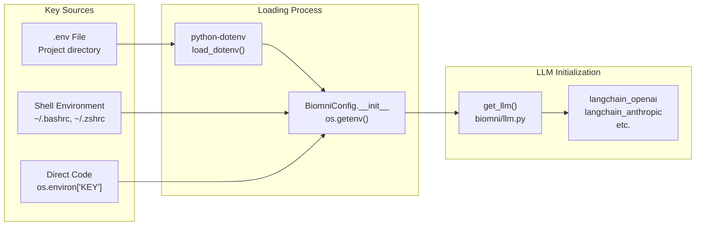
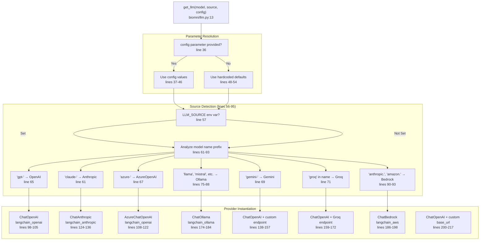
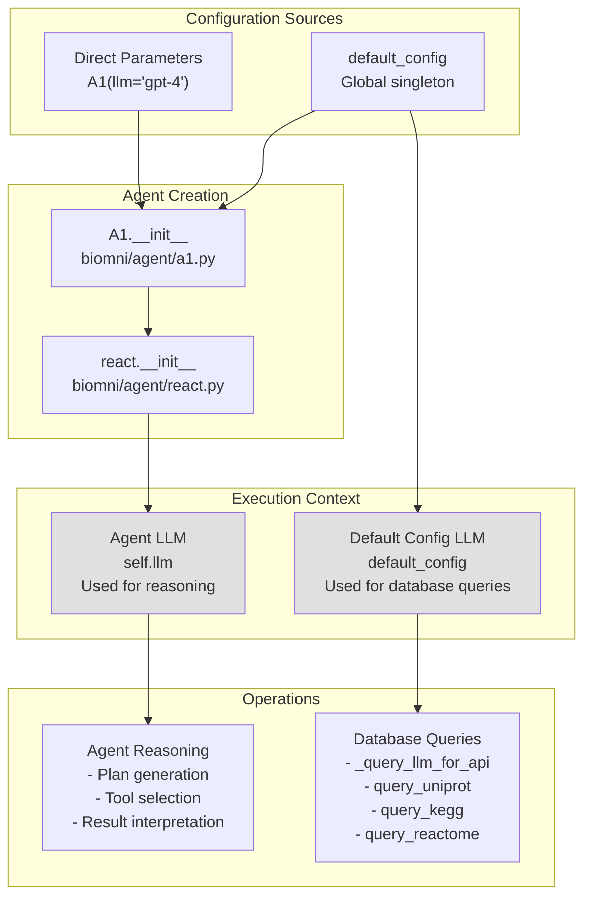
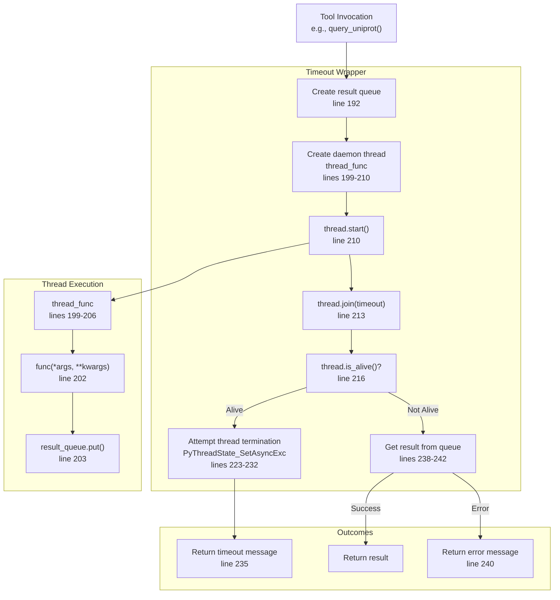
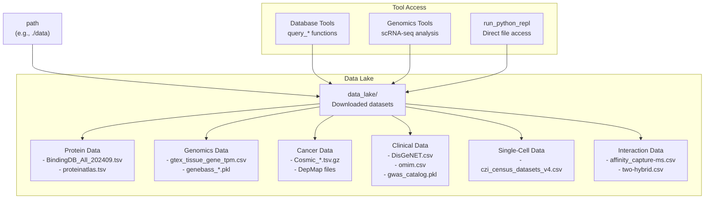

# Configuration Guide

<details>
<summary>Relevant source files</summary>

The following files were used as context for generating this wiki page:

- [README.md](README.md)
- [biomni/agent/a1.py](biomni/agent/a1.py)
- [biomni/eval/__init__.py](biomni/eval/__init__.py)
- [biomni/eval/biomni_eval1.py](biomni/eval/biomni_eval1.py)
- [biomni/know_how/__init__.py](biomni/know_how/__init__.py)
- [biomni/know_how/loader.py](biomni/know_how/loader.py)
- [biomni/llm.py](biomni/llm.py)
- [biomni/model/retriever.py](biomni/model/retriever.py)
- [biomni/tool/support_tools.py](biomni/tool/support_tools.py)
- [biomni/tool/tool_description/support_tools.py](biomni/tool/tool_description/support_tools.py)
- [biomni/utils.py](biomni/utils.py)
- [biomni/version.py](biomni/version.py)
- [tutorials/biomni_101.ipynb](tutorials/biomni_101.ipynb)

</details>


## Purpose and Scope

This document explains how to configure Biomni's runtime behavior, including API key management, language model selection, timeout settings, and data lake paths. Configuration affects both agent reasoning and tool execution, with important distinctions between agent-level and system-level settings.

For information about extending Biomni with custom tools and data, see [Adding Custom Tools and Data](#4.5). For details on the LLM provider integration architecture, see [LLM Integration Layer](#2.3).

## Configuration Architecture Overview

Biomni uses a centralized configuration system based on the `default_config` object defined in [biomni/config.py](). The `A1` agent constructor accepts multiple parameters that control runtime behavior. All configuration parameters flow through a four-tier resolution hierarchy that determines the final values used at runtime.

### A1 Constructor Parameters

The `A1` class constructor at [biomni/agent/a1.py:56-99]() accepts the following parameters:

| Parameter | Type | Default | Description |
|-----------|------|---------|-------------|
| `path` | `str \| None` | `None` | Data lake storage directory |
| `llm` | `str \| None` | `None` | Language model identifier |
| `source` | `SourceType \| None` | `None` | LLM provider (e.g., "OpenAI", "Anthropic") |
| `use_tool_retriever` | `bool \| None` | `None` | Enable prompt-based tool selection |
| `timeout_seconds` | `int \| None` | `None` | Tool execution timeout in seconds |
| `base_url` | `str \| None` | `None` | Custom model serving endpoint |
| `api_key` | `str \| None` | `None` | Custom model API key |
| `commercial_mode` | `bool \| None` | `None` | Filter to commercial-licensed datasets only |
| `expected_data_lake_files` | `list \| None` | `None` | List of data lake files to download/verify |

**Sources:** [biomni/agent/a1.py:56-99](), [biomni/config.py]()

### Configuration Resolution Flow



**Sources:** [biomni/config.py](), [biomni/llm.py:13-223](), [biomni/agent/react.py:39-66]()

### The BiomniConfig Class

The `BiomniConfig` class centralizes all configuration parameters with automatic environment variable loading:

| Parameter | Type | Default | Environment Variable | Description |
|-----------|------|---------|---------------------|-------------|
| `path` | `str` | `"./data"` | `BIOMNI_DATA_PATH` | Data lake storage directory |
| `timeout_seconds` | `int` | `600` | `BIOMNI_TIMEOUT_SECONDS` | Tool execution timeout (seconds) |
| `llm_model` | `str` | `"claude-sonnet-4-20250514"` | `BIOMNI_LLM` | Language model identifier |
| `temperature` | `float` | `0.7` | `BIOMNI_TEMPERATURE` | LLM sampling temperature |
| `use_tool_retriever` | `bool` | `True` | `BIOMNI_USE_TOOL_RETRIEVER` | Enable prompt-based tool selection |
| `source` | `str \| None` | `None` | `BIOMNI_SOURCE` | LLM provider (auto-detected if None) |
| `base_url` | `str \| None` | `None` | `BIOMNI_CUSTOM_BASE_URL` | Custom model serving endpoint |
| `api_key` | `str \| None` | `None` | `BIOMNI_CUSTOM_API_KEY` | Custom model API key |
| `commercial_mode` | `bool` | `False` | `BIOMNI_COMMERCIAL_MODE` | Filter to commercial-licensed datasets |

**Sources:** [biomni/config.py]()
</thinking>

<old_str>
## Advanced Configuration Topics

### Temperature Control

The `temperature` parameter controls LLM sampling randomness (0.0 = deterministic, 1.0 = creative):

```python
default_config.temperature = 0.2  # More deterministic for reproducibility
agent = A1()

# Temperature is passed to get_llm at line 52 of biomni/llm.py
```

### Tool Retriever Configuration

The `use_tool_retriever` flag enables prompt-based tool selection, reducing context window usage:

```python
default_config.use_tool_retriever = True   # Default: Use retrieval
agent = A1()

# Or disable for full tool access
agent = A1(use_tool_retriever=False)
```

When enabled, the system uses the LLM to select relevant tools before execution via the `ToolRetriever` class at [biomni/model/retriever.py:8-204]().

**Sources:** [biomni/config.py](), [biomni/model/retriever.py:8-204]()
</str>
<new_str>
## Commercial Mode Configuration

### Overview

The `commercial_mode` parameter filters the available datasets and resources to only those with commercial-friendly licenses. This is critical for production deployments and commercial applications.

```python
from biomni.agent import A1

# Enable commercial mode
agent = A1(commercial_mode=True)
```

### Implementation Details

When `commercial_mode=True`, the agent imports `biomni.env_desc_cm` instead of `biomni.env_desc` at [biomni/agent/a1.py:100-108](). This loads filtered versions of:

- `data_lake_dict`: Only datasets with commercial licenses
- `library_content_dict`: Only software libraries with commercial-friendly licenses



### Know-How Document Filtering

Commercial mode also filters know-how documents at [biomni/agent/a1.py:212-217](). The `_filter_know_how_for_commercial_mode()` method removes documents that:

- Have `commercial_use: "No"` in metadata
- Lack explicit commercial use permissions
- Are marked as non-commercial in their license field

```python
# Example: Know-how metadata
"""
## Metadata
**Authors**: Jane Doe
**License**: CC BY-NC 4.0
**Commercial Use**: No
"""
# This document would be filtered out in commercial mode
```

### Commercial vs Academic Mode Comparison

| Aspect | Academic Mode | Commercial Mode |
|--------|---------------|-----------------|
| Data Lake | ~75 datasets (all) | ~45 datasets (commercial-licensed) |
| Software Libraries | All available | Commercial-licensed only |
| Know-How Documents | All documents | Commercial-use-allowed documents only |
| Typical Use Case | Research, prototyping | Production deployments |
| Configuration | `commercial_mode=False` (default) | `commercial_mode=True` |

### Setting Commercial Mode

**Method 1: Constructor Parameter**
```python
agent = A1(commercial_mode=True)
```

**Method 2: default_config**
```python
from biomni.config import default_config

default_config.commercial_mode = True
agent = A1()
```

**Method 3: Environment Variable**
```bash
export BIOMNI_COMMERCIAL_MODE=true
```

**Sources:** [biomni/agent/a1.py:100-113](), [biomni/agent/a1.py:212-217]()

## Data Lake File Management

### The expected_data_lake_files Parameter

The `expected_data_lake_files` parameter at [biomni/agent/a1.py:163-192]() controls which data lake files are automatically downloaded during agent initialization.

**Default Behavior** (when `expected_data_lake_files=None`):
```python
# Downloads all data lake files (~11GB)
agent = A1(path='./data')
```

**Skip Data Lake Download**:
```python
# Initialize without downloading any data lake files
agent = A1(path='./data', expected_data_lake_files=[])
```

**Selective Download**:
```python
# Download only specific files
agent = A1(
    path='./data',
    expected_data_lake_files=['BindingDB_All_202409.tsv', 'proteinatlas.tsv']
)
```

### Data Lake Download Process

The download mechanism at [biomni/agent/a1.py:163-189]() works as follows:



### Use Cases for expected_data_lake_files

**1. Fast Development/Testing**
```python
# Skip data lake for faster initialization
agent = A1(expected_data_lake_files=[])
```

**2. Limited Storage**
```python
# Only download essential files
agent = A1(expected_data_lake_files=[
    'proteinatlas.tsv',
    'uniprot_human.pkl'
])
```

**3. Production with Pre-Loaded Data**
```python
# Data already exists, verify only
agent = A1(
    path='/shared/biomni/data',
    expected_data_lake_files=[]
)
```

**Sources:** [biomni/agent/a1.py:163-192](), [README.md:152-163]()

## Advanced Configuration Topics

### Temperature Control

The `temperature` parameter controls LLM sampling randomness (0.0 = deterministic, 1.0 = creative):

```python
default_config.temperature = 0.2  # More deterministic for reproducibility
agent = A1()

# Temperature is passed to get_llm at line 52 of biomni/llm.py
```

### Tool Retriever Configuration

The `use_tool_retriever` flag enables prompt-based tool selection, reducing context window usage:

```python
default_config.use_tool_retriever = True   # Default: Use retrieval
agent = A1()

# Or disable for full tool access
agent = A1(use_tool_retriever=False)
```

When enabled, the system uses the LLM to select relevant tools before execution via the `ToolRetriever` class at [biomni/model/retriever.py:8-204]().

**Tool Retriever Workflow:**



**Key Implementation Details:**

The `prompt_based_retrieval` method at [biomni/model/retriever.py:14-132]() accepts a resources dictionary with keys:
- `tools`: List of tool schemas from ToolRegistry
- `data_lake`: List of data lake file descriptions
- `libraries`: List of software library descriptions  
- `know_how`: List of know-how document summaries

The LLM responds with indices for each category, which are parsed using regex patterns at [biomni/model/retriever.py:176-201]():
```python
# Example response format
TOOLS: [0, 3, 5, 7, 9]
DATA_LAKE: [1, 2, 4]
LIBRARIES: [0, 2, 4, 5, 8]
KNOW_HOW: [0, 1]
```

**Performance Impact:**

| Mode | Context Size | Cost per Query | Response Quality |
|------|-------------|----------------|------------------|
| Full Tools (`use_tool_retriever=False`) | ~150K tokens | Higher | Complete tool access |
| Retrieved Tools (`use_tool_retriever=True`) | ~30K tokens | Lower | Relevant subset only |

**Sources:** [biomni/model/retriever.py:14-203]()

## Configuration Methods

### Method 1: Environment Variables (Recommended for Production)

Environment variables provide persistent, project-level configuration that works across all scripts and sessions. Create a `.env` file in your project directory:

```bash
# Required: At least one API key
ANTHROPIC_API_KEY=sk-ant-...
OPENAI_API_KEY=sk-...

# Biomni settings
BIOMNI_LLM=claude-3-5-sonnet-20241022
BIOMNI_TIMEOUT_SECONDS=1200
BIOMNI_PATH=/path/to/data
BIOMNI_USE_TOOL_RETRIEVER=true
```

**Sources:** [README.md:63-110](), [docs/configuration.md:24-37]()

### Method 2: Runtime Configuration (Recommended for Scripts)

Modify the `default_config` singleton at runtime to change behavior for all subsequently created agents and tool invocations:

```python
from biomni.config import default_config
from biomni.agent import A1

# Modify global configuration
default_config.llm = "gpt-4"
default_config.timeout_seconds = 1200
default_config.path = "/custom/data/path"

# All agents and database queries use these settings
agent = A1()
```

This approach affects **both** agent reasoning and database query operations, ensuring consistent model usage throughout the system.

**Sources:** [README.md:152-170](), [docs/configuration.md:39-47]()

### Method 3: Direct Parameters (Use with Caution)

Pass parameters directly to the `A1` constructor:

```python
agent = A1(
    path='./data',
    llm='claude-3-5-sonnet-20241022',
    timeout_seconds=900
)
```

**⚠️ Important Limitation:** Direct parameters only affect the agent's reasoning process. Database query functions always use `default_config`, which can lead to inconsistent model usage if not carefully managed. This is documented at [README.md:168]().

**Sources:** [biomni/agent/react.py:39-54](), [docs/configuration.md:49-54]()

## API Key Configuration

### Provider-Specific API Keys

Biomni supports multiple LLM providers through LangChain integrations. Configure provider-specific API keys via environment variables:

| Provider | Environment Variables | Notes |
|----------|----------------------|-------|
| **Anthropic** | `ANTHROPIC_API_KEY` | Default provider; Claude models |
| **OpenAI** | `OPENAI_API_KEY` | GPT-3.5, GPT-4 models |
| **Azure OpenAI** | `OPENAI_API_KEY`<br/>`OPENAI_ENDPOINT` | Requires endpoint URL; prefix model with `azure-` |
| **Google Gemini** | `GEMINI_API_KEY` | Gemini models via AI Studio |
| **Groq** | `GROQ_API_KEY` | Fast inference models |
| **AWS Bedrock** | `AWS_BEARER_TOKEN_BEDROCK`<br/>`AWS_REGION` | Claude via Bedrock; region defaults to `us-east-1` |
| **Ollama** | None required | Local models; requires Ollama server running |
| **Custom** | `BIOMNI_CUSTOM_BASE_URL`<br/>`BIOMNI_CUSTOM_API_KEY` | OpenAI-compatible endpoints |

**Sources:** [README.md:63-128](), [biomni/llm.py:98-222]()

### API Key Loading Sequence



**Sources:** [biomni/config.py](), [biomni/llm.py:13-35]()

## Model Selection and Provider Routing

### The get_llm Factory Function

The `get_llm` function at [biomni/llm.py:13-223]() implements automatic provider detection based on model name patterns:



**Sources:** [biomni/llm.py:13-223]()

### Model Name Patterns and Auto-Detection

The auto-detection logic at [biomni/llm.py:56-95]() uses these patterns:

| Model Name Pattern | Detected Provider | Example |
|-------------------|-------------------|---------|
| `claude-*` | Anthropic | `claude-3-5-sonnet-20241022` |
| `gpt-*` (not `gpt-oss`) | OpenAI | `gpt-4`, `gpt-3.5-turbo` |
| `azure-*` | Azure OpenAI | `azure-gpt-4o` |
| `gemini-*` | Google Gemini | `gemini-1.5-pro` |
| Contains `groq` | Groq | `llama-3-70b-8192-groq` |
| `llama`, `mistral`, `qwen`, `gemma`, `phi`, `dolphin`, `orca`, `vicuna`, `deepseek` | Ollama | `llama3.1:8b` |
| `anthropic.claude-*`, `amazon.titan-*`, `meta.llama-*`, `mistral.*`, `cohere.*`, `ai21.*`, `us.*` | AWS Bedrock | `anthropic.claude-v2` |
| Has `base_url` parameter | Custom | Any model name |

**Sources:** [biomni/llm.py:56-95]()

### Provider Selection Example

```python
from biomni.llm import get_llm
from biomni.config import default_config

# Auto-detected as Anthropic
llm1 = get_llm("claude-3-5-sonnet-20241022")

# Auto-detected as OpenAI
llm2 = get_llm("gpt-4")

# Auto-detected as Ollama
llm3 = get_llm("llama3.1:8b")

# Explicit source override
llm4 = get_llm("my-custom-model", source="Custom", base_url="http://localhost:8000/v1")

# Using default_config
default_config.source = "Gemini"
default_config.llm = "gemini-1.5-pro"
llm5 = get_llm(config=default_config)
```

**Sources:** [biomni/llm.py:13-35](), [docs/configuration.md:58-83]()

## Critical Configuration Distinction: Agent vs Database

### The Configuration Split

Biomni has a critical architectural distinction: **agent reasoning** and **database query operations** use different configuration resolution paths. This can lead to inconsistent model usage if not understood.



**Sources:** [README.md:168-169](), [biomni/agent/react.py:39-66](), [biomni/tool/database.py]()

### Consistency Recommendations

To ensure consistent model usage:

**Pattern 1: Use default_config Only (Recommended)**

```python
from biomni.config import default_config
from biomni.agent import A1

# Configure once
default_config.llm = "gpt-4"
default_config.timeout_seconds = 1200

# All operations use gpt-4
agent = A1()
```

**Pattern 2: Cost Optimization (Advanced)**

```python
# Cheaper model for database queries
default_config.llm = "claude-3-5-haiku-20241022"

# More powerful model for agent reasoning
agent = A1(llm="claude-3-5-sonnet-20241022")

# Result: Agent uses Sonnet, database queries use Haiku
```

**Anti-Pattern: Inconsistent Configuration**

```python
# ❌ PROBLEMATIC: Agent and database use different models unintentionally
default_config.llm = "gpt-3.5-turbo"  # Database queries use this
agent = A1(llm="gpt-4")               # Agent uses this
# This may cause unexpected behavior in tool execution
```

**Sources:** [README.md:152-170](), [docs/configuration.md:60-73]()

## Timeout Configuration

### Tool Execution Timeouts

The `timeout_seconds` parameter controls how long individual tool executions can run before being forcefully terminated. This is implemented using multiprocessing at [biomni/agent/react.py:90-152]().

```python
from biomni.config import default_config

# Set global timeout
default_config.timeout_seconds = 1200  # 20 minutes

# Or per-agent
agent = A1(timeout_seconds=900)  # 15 minutes
```

### Timeout Enforcement Mechanism

The timeout wrapper at [biomni/utils.py:183-243]() uses daemon threads to enforce execution limits:



**Note:** The implementation uses daemon threads rather than multiprocessing to maintain persistent state in the global namespace. The thread termination mechanism at [biomni/utils.py:223-232]() uses `PyThreadState_SetAsyncExc`, which is not 100% reliable but allows variables to persist between executions.

**Sources:** [biomni/utils.py:183-243]()

### Recommended Timeout Values

| Use Case | Recommended Timeout | Rationale |
|----------|-------------------|-----------|
| Quick queries | 300s (5 min) | Database lookups, simple calculations |
| Standard analysis | 600s (10 min) | Default; handles most genomics tasks |
| Long-running tasks | 1200-1800s (20-30 min) | Large scRNA-seq analyses, image processing |
| Very intensive | 3600s+ (1+ hour) | Genome-wide analyses, deep learning |

### Timeout Application in Tools

The timeout is applied to tool execution via the `run_with_timeout` wrapper at [biomni/utils.py:183-243](). Tools that require long execution times include:

- **Database queries** with large result sets
- **Genomics analyses** (scRNA-seq, ChIP-seq, Hi-C)
- **Molecular docking** simulations
- **Image processing** (western blot analysis, microscopy)
- **R and Bash script execution** via `run_r_code` and `run_bash_script`

The timeout is configured at agent initialization and stored in `self.timeout_seconds` at [biomni/agent/a1.py:222]().

**Sources:** [biomni/utils.py:183-243](), [biomni/agent/a1.py:222]()

## Data Lake Path Configuration

The `path` parameter specifies where Biomni stores and accesses the data lake, which contains 75+ curated biomedical datasets (~11GB).

```python
from biomni.config import default_config

# System-wide configuration
default_config.path = "/shared/biomni/data"

# Per-agent configuration
agent = A1(path="/custom/data/location")
```

### Data Lake Structure



### Path Configuration in Tools

The data lake path is stored in the agent instance at initialization and made available to tools. The path is processed during agent initialization at [biomni/agent/a1.py:149-194]():

```python
# From A1.__init__
self.path = path

if not os.path.exists(path):
    os.makedirs(path)
    
# Create biomni_data directory structure
benchmark_dir = os.path.join(path, "biomni_data", "benchmark")
data_lake_dir = os.path.join(path, "biomni_data", "data_lake")

# Download data lake files if needed
check_and_download_s3_files(
    s3_bucket_url="https://biomni-release.s3.amazonaws.com",
    local_data_lake_path=data_lake_dir,
    expected_files=expected_data_lake_files,
    folder="data_lake",
)
```

Tools access data lake files through the persistent Python REPL namespace, where they can reference files using the configured path.

**Sources:** [biomni/agent/a1.py:149-194]()

## Common Configuration Patterns

### Pattern 1: Standard Setup with Environment Variables

```bash
# .env file
ANTHROPIC_API_KEY=sk-ant-...
BIOMNI_LLM=claude-3-5-sonnet-20241022
BIOMNI_PATH=/data/biomni
BIOMNI_TIMEOUT_SECONDS=900
```

```python
from biomni.agent import A1

# Configuration loaded from .env automatically
agent = A1()
agent.go("Analyze this protein sequence...")
```

### Pattern 2: Multi-Model Setup

```python
from biomni.config import default_config
from biomni.agent import A1

# High-performance agent with cost-effective database queries
default_config.llm = "claude-3-5-haiku-20241022"  # Fast, cheap for DB
agent = A1(llm="claude-3-5-sonnet-20241022")      # Powerful for reasoning

# Or use the same model everywhere
default_config.llm = "gpt-4"
agent = A1()
```

### Pattern 3: Local Models with Ollama

```python
from biomni.config import default_config

default_config.source = "Ollama"
default_config.llm = "llama3.1:70b"
default_config.temperature = 0.5

agent = A1()
```

### Pattern 4: Azure OpenAI Enterprise

```bash
# .env file
OPENAI_API_KEY=your_azure_key
OPENAI_ENDPOINT=https://your-resource.openai.azure.com/
BIOMNI_LLM=azure-gpt-4o
BIOMNI_SOURCE=AzureOpenAI
```

```python
# Azure models must be prefixed with 'azure-'
agent = A1(llm='azure-gpt-4o')
```

### Pattern 5: Custom Self-Hosted Models

```python
from biomni.config import default_config

default_config.source = "Custom"
default_config.base_url = "http://localhost:8000/v1"
default_config.api_key = "local-key"
default_config.llm = "my-finetuned-model"

agent = A1()
```

**Sources:** [docs/configuration.md:56-83](), [README.md:150]()

## Advanced Configuration Topics

### Temperature Control

The `temperature` parameter controls LLM sampling randomness (0.0 = deterministic, 1.0 = creative):

```python
default_config.temperature = 0.2  # More deterministic for reproducibility
agent = A1()

# Temperature is passed to get_llm at line 52 of biomni/llm.py
```

### Tool Retriever Configuration

The `use_tool_retriever` flag enables prompt-based tool selection, reducing context window usage:

```python
default_config.use_tool_retriever = True   # Default: Use retrieval
agent = A1()

# Or disable for full tool access
agent = A1(use_tool_retriever=False)
```

When enabled, the system uses the LLM to select relevant tools before execution. See [biomni/agent/react.py:354-436]() for implementation details.

**Sources:** [biomni/config.py](), [biomni/agent/react.py:354-436]()

## Troubleshooting

### Problem: API Key Not Found

**Symptoms:** `ImportError` or authentication errors when initializing agent

**Solutions:**
1. Verify `.env` file exists in working directory
2. Check environment variable is set: `echo $ANTHROPIC_API_KEY`
3. Ensure `.env` is not in `.gitignore` and is being loaded
4. Try setting directly in shell: `export ANTHROPIC_API_KEY=your_key`

### Problem: Wrong Model Being Used

**Symptoms:** Database queries use different model than expected

**Cause:** Direct parameters only affect agent reasoning, not database queries

**Solution:**
```python
# Set model in default_config to affect everything
default_config.llm = "gpt-4"
agent = A1()  # Both agent and database use gpt-4
```

### Problem: Azure Model Not Found

**Symptoms:** `ValueError: Unable to determine model source`

**Solution:** Prefix model name with `azure-`:
```python
agent = A1(llm='azure-gpt-4o')  # Not 'gpt-4o'
```

### Problem: Timeout Too Short

**Symptoms:** Tools consistently return timeout errors

**Solution:** Increase timeout for intensive operations:
```python
default_config.timeout_seconds = 1800  # 30 minutes
agent = A1()
```

### Problem: Custom Model Not Working

**Symptoms:** `ValueError: Invalid source`

**Solution:** Specify `source` explicitly:
```python
default_config.source = "Custom"
default_config.base_url = "http://localhost:8000/v1"
default_config.llm = "custom-model"
```

**Sources:** [docs/configuration.md:134-147](), [biomni/llm.py:94-95]()

## Configuration Reference Table

### Complete Environment Variables

| Variable | Type | Default | Description |
|----------|------|---------|-------------|
| `ANTHROPIC_API_KEY` | string | None | Anthropic API key for Claude models |
| `OPENAI_API_KEY` | string | None | OpenAI or Azure OpenAI API key |
| `OPENAI_ENDPOINT` | string | None | Azure OpenAI endpoint URL |
| `GEMINI_API_KEY` | string | None | Google Gemini API key |
| `GROQ_API_KEY` | string | None | Groq API key |
| `AWS_BEARER_TOKEN_BEDROCK` | string | None | AWS Bedrock API token |
| `AWS_REGION` | string | `us-east-1` | AWS region for Bedrock |
| `LLM_SOURCE` | string | None | Force specific provider |
| `BIOMNI_PATH` | string | `./data` | Data lake directory |
| `BIOMNI_TIMEOUT_SECONDS` | integer | `600` | Tool execution timeout |
| `BIOMNI_LLM` | string | `claude-sonnet-4-20250514` | Model identifier |
| `BIOMNI_TEMPERATURE` | float | `0.7` | Sampling temperature |
| `BIOMNI_USE_TOOL_RETRIEVER` | boolean | `true` | Enable tool retrieval |
| `BIOMNI_SOURCE` | string | None | Override provider detection |
| `BIOMNI_CUSTOM_BASE_URL` | string | None | Custom model endpoint |
| `BIOMNI_CUSTOM_API_KEY` | string | None | Custom model API key |

### Complete default_config Attributes

| Attribute | Type | Environment Variable | Description |
|-----------|------|---------------------|-------------|
| `path` | `str` | `BIOMNI_DATA_PATH` | Data lake storage path |
| `timeout_seconds` | `int` | `BIOMNI_TIMEOUT_SECONDS` | Tool timeout in seconds |
| `llm_model` | `str` | `BIOMNI_LLM` | Model name/identifier |
| `temperature` | `float` | `BIOMNI_TEMPERATURE` | LLM temperature (0.0-1.0) |
| `use_tool_retriever` | `bool` | `BIOMNI_USE_TOOL_RETRIEVER` | Enable tool retrieval |
| `source` | `str \| None` | `BIOMNI_SOURCE` | LLM provider name |
| `base_url` | `str \| None` | `BIOMNI_CUSTOM_BASE_URL` | Custom endpoint URL |
| `api_key` | `str \| None` | `BIOMNI_CUSTOM_API_KEY` | Custom API key |

**Sources:** [biomni/config.py](), [README.md:89-110]()

---