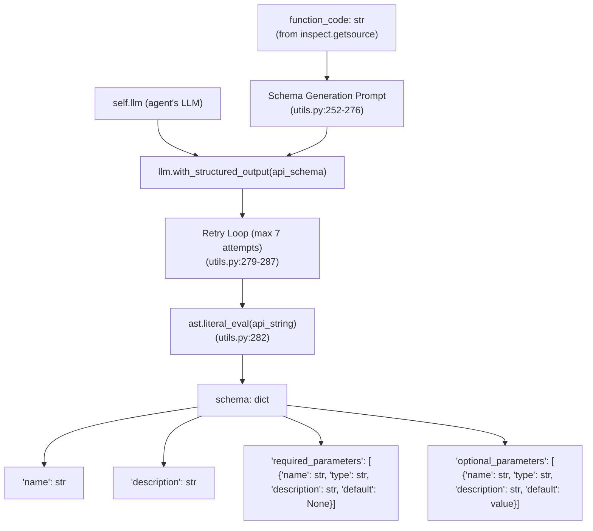
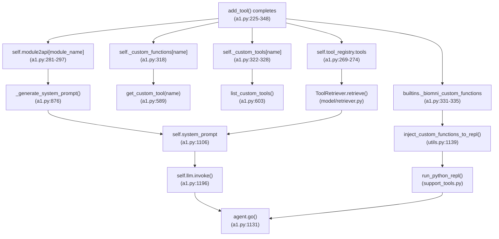
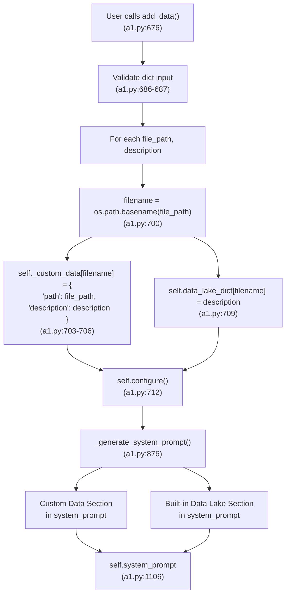
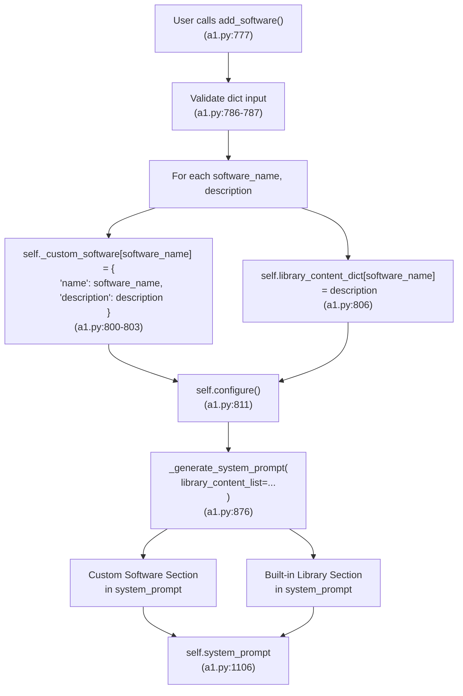
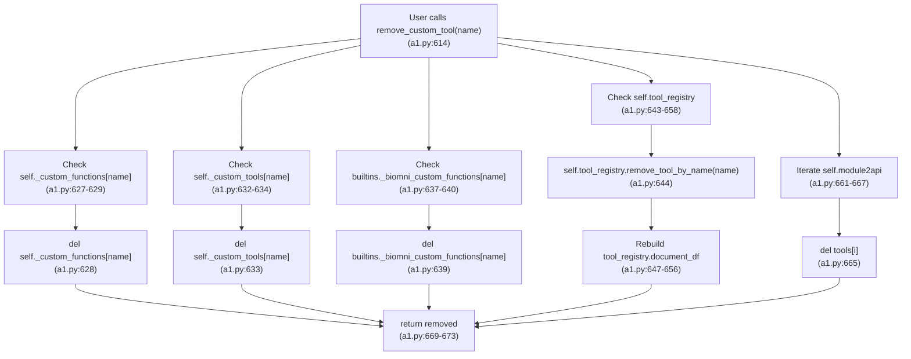
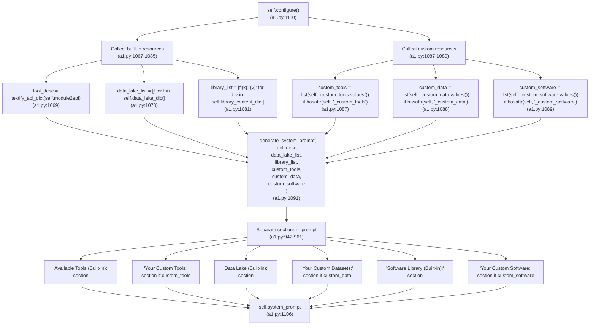
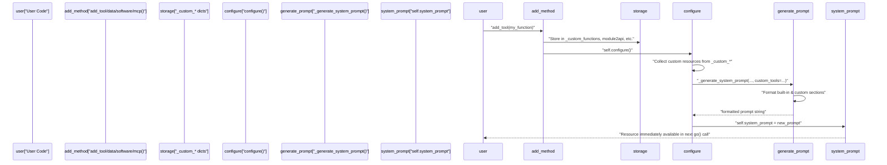
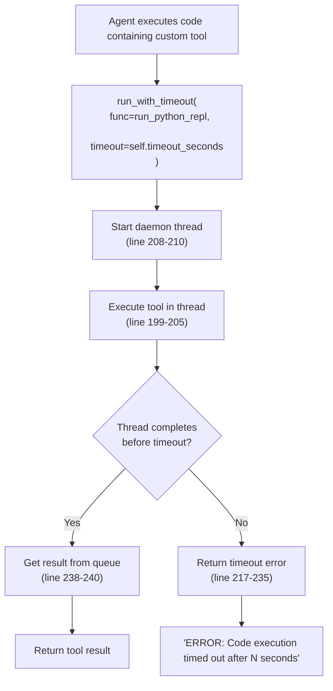

# Working with Custom Resources

<details>
<summary>Relevant source files</summary>

The following files were used as context for generating this wiki page:

- [biomni/agent/a1.py](biomni/agent/a1.py)
- [biomni/tool/support_tools.py](biomni/tool/support_tools.py)
- [biomni/tool/tool_description/support_tools.py](biomni/tool/tool_description/support_tools.py)
- [biomni/utils.py](biomni/utils.py)

</details>


This page documents Biomni's runtime extensibility mechanisms for adding custom tools, datasets, software descriptions, and MCP servers without modifying the core codebase. These methods enable domain-specific customization and rapid prototyping during agent execution.

For permanent contributions to the Biomni repository, see the Development Guide (page 8). For detailed MCP integration workflows, see page 4.5.

## Purpose and Scope

The `A1` agent class provides three primary extension methods for runtime customization:

| Method | Purpose | Primary Storage | System Integration |
|--------|---------|----------------|-------------------|
| `add_tool()` | Add custom Python functions as executable tools | `self._custom_functions` dict | `self.module2api`, `self.tool_registry.tools`, `builtins._biomni_custom_functions` |
| `add_data()` | Add custom datasets to data lake | `self._custom_data` dict | `self.data_lake_dict` |
| `add_software()` | Add software descriptions to library | `self._custom_software` dict | `self.library_content_dict` |

All custom resources become immediately available after registration and persist for the agent instance lifetime. Each extension method triggers `self.configure()` to rebuild `self.system_prompt`.

**Note on MCP Integration:** The `A1` class also provides `add_mcp()` for integrating external Model Context Protocol servers. This is documented separately in page 4.5 (MCP Integration) due to its distinct configuration requirements and integration patterns.

Sources: [biomni/agent/a1.py:225-873]()

---

## Extension System Architecture

### Custom Tool Registration Flow

```mermaid
sequenceDiagram
    participant User
    participant add_tool["A1.add_tool()<br/>(a1.py:225)"]
    participant inspect["inspect.getsource()<br/>(a1.py:234)"]
    participant function_to_api_schema["function_to_api_schema()<br/>(utils.py:251)"]
    participant llm["self.llm.invoke()<br/>(utils.py:281)"]
    participant tool_registry["self.tool_registry<br/>.register_tool()"]
    participant module2api["self.module2api<br/>[module_name]"]
    participant custom_functions["self._custom_functions<br/>[name]"]
    participant builtins["builtins._biomni<br/>_custom_functions"]
    participant configure["self.configure()<br/>(a1.py:340)"]
    
    User->>add_tool: "add_tool(api)"
    activate add_tool
    
    add_tool->>inspect: "getsource(api)"
    inspect-->>add_tool: "function_code: str"
    
    add_tool->>function_to_api_schema: "function_to_api_schema(function_code, self.llm)"
    activate function_to_api_schema
    
    function_to_api_schema->>llm: "llm.with_structured_output(api_schema)"
    llm-->>function_to_api_schema: "{'api_schema': '...'}"
    
    function_to_api_schema->>function_to_api_schema: "ast.literal_eval(api)"
    function_to_api_schema-->>add_tool: "schema: dict"
    deactivate function_to_api_schema
    
    add_tool->>add_tool: "Validate & enhance schema<br/>(a1.py:245-266)"
    
    opt "self.tool_registry exists"
        add_tool->>tool_registry: "register_tool(schema)"
        tool_registry->>tool_registry: "self.tools.append(schema)"
    end
    
    add_tool->>module2api: "self.module2api[module_name].append(schema)"
    
    add_tool->>custom_functions: "self._custom_functions[name] = api"
    add_tool->>custom_functions: "self._custom_tools[name] = metadata"
    
    add_tool->>builtins: "builtins._biomni_custom_functions[name] = api"
    
    add_tool->>configure: "self.configure()"
    Note over configure: Regenerates self.system_prompt<br/>with tool in module2api
    
    add_tool-->>User: "return schema"
    deactivate add_tool
```

**Diagram: Custom Tool Registration Pipeline**

This sequence shows how `add_tool()` uses `inspect.getsource()` to extract function source, invokes `function_to_api_schema()` for LLM-based schema generation, then registers the tool in `self.tool_registry`, `self.module2api`, `self._custom_functions`, and `builtins._biomni_custom_functions`. Finally calls `self.configure()` to rebuild `self.system_prompt`.

Sources: [biomni/agent/a1.py:225-348](), [biomni/utils.py:251-290]()

---

## Adding Custom Tools with `add_tool()`

### Method Signature and Behavior

The `add_tool()` method at [biomni/agent/a1.py:225]() accepts a Python function and automatically generates an API schema using `self.llm`:

```python
def add_tool(self, api):
    """Add a new tool to the agent's tool registry and make it available for retrieval.
    
    Args:
        api: A callable function to be added as a tool
    """
```

The method performs these operations:
1. Extracts function source with `inspect.getsource(api)` at [a1.py:233]()
2. Generates schema via `function_to_api_schema(function_code, self.llm)` at [a1.py:239]()
3. Registers in `self.tool_registry.register_tool(schema)` at [a1.py:271]()
4. Adds to `self.module2api[module_name]` at [a1.py:297]()
5. Stores in `self._custom_functions[name]` at [a1.py:318]()
6. Injects into `builtins._biomni_custom_functions[name]` at [a1.py:334]()
7. Triggers `self.configure()` to rebuild system prompt at [a1.py:340]()

Sources: [biomni/agent/a1.py:225-348]()

### Schema Generation with `function_to_api_schema`

The `function_to_api_schema()` utility in [biomni/utils.py:251-290]() converts Python function source code into structured API schemas using LLM-based parsing:



**Diagram: LLM-Based Schema Generation Pipeline**

The prompt template at [biomni/utils.py:252-276]() instructs the LLM to extract function metadata while enforcing strict formatting:

```python
prompt = """
Based on a code snippet and help me write an API docstring in the format like this:

{'name': 'get_gene_set_enrichment',
'description': 'Given a list of genes, identify a pathway that is enriched...',
'required_parameters': [{'name': 'genes',
'type': 'List[str]',
'description': 'List of gene symbols to analyze',
'default': None}],
'optional_parameters': [{'name': 'top_k',
'type': 'int',
'description': 'Top K pathways to return',
'default': 10}]}

Strictly follow the input from the function - don't create fake optional parameters.
For variable without default values, set them as None, not null.
For variable with boolean values, use capitalized True or False, not true or false.
"""
```

The function retries up to 7 times if parsing fails, using `ast.literal_eval()` to safely convert the string response to a Python dictionary.

Sources: [biomni/utils.py:251-290]()

### Tool Registration and Availability

After schema generation, `add_tool()` registers the function in multiple subsystems to ensure availability during agent execution:

| Storage Location | Purpose | Registration Code | Access Pattern |
|-----------------|---------|-------------------|----------------|
| `self._custom_functions[name]` | Original function object storage | [a1.py:318]() | `get_custom_tool(name)` at [a1.py:589]() |
| `self._custom_tools[name]` | Metadata for system prompt highlighting | [a1.py:322-328]() | `list_custom_tools()` at [a1.py:603]() |
| `self.module2api[module_name]` | Tool discovery for prompt generation | [a1.py:281-297]() | `_generate_system_prompt()` at [a1.py:876]() |
| `self.tool_registry.tools` | Retrieval-augmented tool selection | [a1.py:269-274]() | `ToolRetriever.retrieve()` |
| `builtins._biomni_custom_functions[name]` | Global execution namespace injection | [a1.py:331-335]() | `inject_custom_functions_to_repl()` at [utils.py:1139]() |



**Diagram: Custom Tool Registration and Runtime Access**

Custom tools registered via `add_tool()` are stored in five locations: `self._custom_functions` for retrieval, `self._custom_tools` for metadata, `self.module2api` for prompt generation, `self.tool_registry.tools` for RAG retrieval, and `builtins._biomni_custom_functions` for REPL execution. These are accessed during `agent.go()` execution through `_generate_system_prompt()`, `ToolRetriever.retrieve()`, and `run_python_repl()`.

Sources: [biomni/agent/a1.py:225-348](), [biomni/utils.py:1139-1155]()

### Example: Adding a Custom Biological Function

```python
from biomni.agent import A1

# Initialize agent
agent = A1()

# Define custom function
def calculate_gc_content(sequence: str) -> float:
    """Calculate GC content percentage of a DNA sequence.
    
    Args:
        sequence: DNA sequence string
        
    Returns:
        GC content as percentage (0-100)
    """
    gc_count = sequence.upper().count('G') + sequence.upper().count('C')
    return (gc_count / len(sequence)) * 100 if len(sequence) > 0 else 0.0

# Add tool to agent (schema auto-generated via function_to_api_schema)
schema = agent.add_tool(calculate_gc_content)

# Tool is now available in:
# - self._custom_functions['calculate_gc_content']
# - self.module2api['__main__']
# - builtins._biomni_custom_functions['calculate_gc_content']

# Agent can now use the tool
result = agent.go("Calculate the GC content of sequence ATGCGCTA")
```

The `function_to_api_schema()` at [utils.py:251]() automatically generates a schema like:

```python
{
    'name': 'calculate_gc_content',
    'description': 'Calculate GC content percentage of a DNA sequence.',
    'required_parameters': [{
        'name': 'sequence',
        'type': 'str',
        'description': 'DNA sequence string',
        'default': None
    }],
    'optional_parameters': [],
    'module': '__main__'
}
```

Sources: [biomni/agent/a1.py:225-348](), [biomni/utils.py:251-290]()

---

## Adding Data with `add_data()`

### Method Signature and Data Structure

The `add_data()` method at [biomni/agent/a1.py:676]() extends `self.data_lake_dict` with custom datasets:

```python
def add_data(self, data):
    """Add new data to the data lake.
    
    Args:
        data: Dictionary with file path as key and description as value
              e.g., {'my_dataset.csv': 'A dataset containing gene expression data'}
              or {'path/to/file.txt': 'Description of the file'}
    """
```

Implementation details:
1. Validates input is dict at [a1.py:686-687]()
2. Stores in `self._custom_data[filename]` at [a1.py:703-706]()
3. Adds to `self.data_lake_dict[filename]` at [a1.py:709]()
4. Calls `self.configure()` at [a1.py:712]()

Sources: [biomni/agent/a1.py:676-721]()

### Data Storage Architecture



**Diagram: add_data() Storage and Prompt Integration**

Custom datasets are stored in `self._custom_data` with full metadata (path + description) and in `self.data_lake_dict` with description only. The `configure()` method triggers `_generate_system_prompt()` to include custom data in a separate section from built-in data lake entries.

Sources: [biomni/agent/a1.py:676-721]()

### Example: Adding Custom Dataset

```python
# Add experimental dataset
agent.add_data({
    'patient_cohort_2024.csv': 'Clinical data for 500 patients with treatment outcomes',
    '/data/proteomics/experiment_results.h5': 'Mass spectrometry results in HDF5 format'
})

# Data is immediately available in agent's context
result = agent.go("Analyze the patient cohort data for treatment response patterns")

# List all custom data
custom_datasets = agent.list_custom_data()
# Returns: [('patient_cohort_2024.csv', 'Clinical data...'), (...)]
```

Sources: [biomni/agent/a1.py:663-733]()

---

## Adding Software Descriptions with `add_software()`

### Method Signature and Purpose

The `add_software()` method at [biomni/agent/a1.py:777]() adds software descriptions to `self.library_content_dict`:

```python
def add_software(self, software):
    """Add new software to the software library.
    
    Args:
        software: Dictionary with software name as key and description as value
                 e.g., {'custom_tool': 'A custom analysis tool for processing data'}
    """
```

Implementation details:
1. Validates dict input at [a1.py:786-787]()
2. Stores in `self._custom_software[software_name]` at [a1.py:800-803]()
3. Adds to `self.library_content_dict[software_name]` at [a1.py:806]()
4. Calls `self.configure()` at [a1.py:811]()

Sources: [biomni/agent/a1.py:777-820]()

### Software Registry Architecture



**Diagram: add_software() Storage and Prompt Integration**

Custom software is stored in `self._custom_software` with name+description metadata and in `self.library_content_dict` with description only. The `configure()` method triggers `_generate_system_prompt()` which separates custom software from built-in library entries in the system prompt.

Sources: [biomni/agent/a1.py:777-820]()

### Example: Adding Custom Software

```python
# Add custom bioinformatics tools
agent.add_software({
    'custom_aligner': 'Fast sequence alignment tool with GPU acceleration',
    'metabolomics_pipeline': 'End-to-end pipeline for metabolite identification from MS data'
})

# Software descriptions are included in agent's system prompt
result = agent.go("Use the custom_aligner to align these sequences against hg38")
```

Sources: [biomni/agent/a1.py:764-807]()


---

## Resource Management Operations

### Query and Removal Methods

The `A1` class provides management methods for custom resources:

| Category | Method | Purpose | Returns | Implementation |
|----------|--------|---------|---------|----------------|
| **Tools** | `list_custom_tools()` | List all added tool names | `list[str]` | [a1.py:603-612]() |
| | `get_custom_tool(name)` | Retrieve tool function object | `callable \| None` | [a1.py:589-601]() |
| | `remove_custom_tool(name)` | Remove tool from all registries | `bool` | [a1.py:614-674]() |
| **Data** | `list_custom_data()` | List datasets with descriptions | `list[tuple[str, str]]` | [a1.py:737-746]() |
| | `get_custom_data(name)` | Retrieve data metadata dict | `dict \| None` | [a1.py:723-735]() |
| | `remove_custom_data(name)` | Remove dataset entry | `bool` | [a1.py:748-775]() |
| **Software** | `list_custom_software()` | List software with descriptions | `list[tuple[str, str]]` | [a1.py:836-845]() |
| | `get_custom_software(name)` | Retrieve software metadata dict | `dict \| None` | [a1.py:822-834]() |
| | `remove_custom_software(name)` | Remove software entry | `bool` | [a1.py:847-873]() |

### Removal Operations



**Diagram: remove_custom_tool() Cleanup Process**

The `remove_custom_tool()` method at [a1.py:614-674]() checks and removes the tool from five locations: `self._custom_functions`, `self._custom_tools`, `builtins._biomni_custom_functions`, `self.tool_registry`, and `self.module2api`. After registry removal, it rebuilds `tool_registry.document_df`. Similar patterns apply to `remove_custom_data()` at [a1.py:748]() and `remove_custom_software()` at [a1.py:847]().

Sources: [biomni/agent/a1.py:589-873]()

### Example: Managing Custom Resources

```python
# List all custom tools (from self._custom_functions.keys())
tools = agent.list_custom_tools()
# Returns: ['calculate_gc_content', 'custom_alignment_tool']

# Get a specific tool (from self._custom_functions[name])
tool_fn = agent.get_custom_tool('calculate_gc_content')
# Returns: <function calculate_gc_content at 0x...>

# Remove a tool (from all registries)
removed = agent.remove_custom_tool('calculate_gc_content')
# Returns: True (removed from _custom_functions, _custom_tools, builtins, tool_registry, module2api)

# List custom data with descriptions (from self._custom_data.items())
datasets = agent.list_custom_data()
# Returns: [('patient_cohort_2024.csv', 'Clinical data...'), ...]

# Remove dataset (from _custom_data and data_lake_dict)
agent.remove_custom_data('patient_cohort_2024.csv')
# Returns: True

# List custom software (from self._custom_software.items())
software_list = agent.list_custom_software()
# Returns: [('custom_aligner', 'Fast sequence alignment tool...'), ...]
```

Sources: [biomni/agent/a1.py:589-873]()

---

## System Prompt Integration

### Custom Resource Highlighting

The `_generate_system_prompt()` method at [biomni/agent/a1.py:876-1108]() distinguishes custom resources from built-in resources when generating `self.system_prompt`:

```python
def _generate_system_prompt(
    self,
    tool_desc,  # from textify_api_dict(self.module2api)
    data_lake_content,  # from self.data_lake_dict
    library_content_list,  # from self.library_content_dict
    self_critic=False,
    is_retrieval=False,
    custom_tools=None,  # from self._custom_tools
    custom_data=None,  # from self._custom_data
    custom_software=None,  # from self._custom_software
):
```

The method receives custom resource metadata separately and formats them with distinct sections to help the LLM distinguish user-added extensions from built-in capabilities. Custom tools appear in a separate "Your Custom Tools" section, custom data in "Your Custom Datasets", and custom software in "Your Custom Software".

Sources: [biomni/agent/a1.py:876-908]()

### Prompt Formatting for Custom Resources



**Diagram: System Prompt Generation with Custom Resource Separation**

The `configure()` method at [a1.py:1110]() collects built-in resources from `self.module2api`, `self.data_lake_dict`, and `self.library_content_dict`, and custom resources from `self._custom_tools`, `self._custom_data`, and `self._custom_software`. These are passed to `_generate_system_prompt()` at [a1.py:1091]() which separates them into distinct sections at [a1.py:942-961](). The final prompt is stored in `self.system_prompt` at [a1.py:1106]().

Sources: [biomni/agent/a1.py:876-1108](), [biomni/agent/a1.py:1110-1129]()

---

## Comparison: Runtime Extension vs. Permanent Contribution

The extension methods provide runtime customization, while permanent contributions require the full PR workflow:

| Aspect | Runtime Extension (`add_*`) | Permanent Contribution (PR) |
|--------|----------------------------|----------------------------|
| **Setup Time** | Immediate | Requires fork, branch, testing |
| **Availability** | Current agent session only | All users after merge |
| **Schema Generation** | Automatic via LLM | Manual (use helper then edit) |
| **Quality Control** | User responsibility | PR review process |
| **Installation** | None required | May need `new_software_*.sh` |
| **Documentation** | Optional | Required in tool descriptions |
| **Use Case** | Prototyping, domain-specific | General-purpose, widely useful |

Sources: [CONTRIBUTION.md:14-97](), [biomni/agent/a1.py:212-861]()

### When to Use Each Approach

**Use Runtime Extension when:**
- Prototyping new functionality
- Tools are domain-specific or project-specific
- Rapid iteration is needed
- Working with proprietary data or methods

**Use Permanent Contribution when:**
- Tool has broad applicability
- You want to share with the community
- Long-term maintenance is expected
- Tool should be in benchmarks

Sources: [CONTRIBUTION.md:1-130]()

---

## Complete Extension Example

This example demonstrates all four extension methods working together:

```python
from biomni.agent import A1
import pandas as pd

# Initialize agent
agent = A1(path="./my_project")

# 1. Add custom tool
def analyze_variants(vcf_file: str, min_quality: float = 30.0) -> pd.DataFrame:
    """Analyze variants from VCF file.
    
    Args:
        vcf_file: Path to VCF file
        min_quality: Minimum quality score threshold
        
    Returns:
        DataFrame of filtered variants
    """
    # Implementation here
    return pd.DataFrame()

tool_schema = agent.add_tool(analyze_variants)
print(f"Added tool: {tool_schema['name']}")

# 2. Add custom dataset
agent.add_data({
    'cohort_variants.vcf': 'Variant calls from whole genome sequencing of 1000 samples',
    'phenotype_data.csv': 'Clinical phenotypes and demographic data'
})

# 3. Add custom software
agent.add_software({
    'custom_variant_caller': 'In-house variant caller optimized for long reads',
    'phenotype_predictor': 'ML model for phenotype prediction from variants'
})

# All custom resources are now available
result = agent.go("""
Analyze the cohort_variants.vcf file using the analyze_variants tool.
Filter for high-quality variants and correlate with phenotype_data.csv.
Use custom_variant_caller if needed for quality control.
""")

# List all custom resources
print("Custom tools:", agent.list_custom_tools())
print("Custom data:", agent.list_custom_data())
print("Custom software:", agent.list_custom_software())
```

Sources: [biomni/agent/a1.py:212-861]()

---

## Resource Lifecycle and Persistence

### Extension Lifecycle

Custom resources are bound to the agent instance lifetime and do not persist across separate `A1()` instantiations:

```mermaid
stateDiagram-v2
    [*] --> constructor["A1.__init__()<br/>(line 56-210)"]
    
    constructor --> init_complete["Initial state:<br/>No custom resources<br/>Built-in tools/data only"]
    
    init_complete --> ready["configure() completes<br/>(line 210)"]
    
    ready --> add_extension["Call add_tool/data/software/mcp"]
    add_extension --> store["Store in _custom_* dicts"]
    store --> auto_configure["Auto-call configure()<br/>(line 327, 699, 799, 574)"]
    auto_configure --> extended["Extended state:<br/>Custom resources available"]
    
    extended --> more_extensions["Add more resources"]
    more_extensions --> store
    
    extended --> execute["agent.go(prompt)"]
    execute --> extended
    
    extended --> remove["remove_custom_*()"]
    remove --> auto_configure
    
    extended --> destroy["Agent object destroyed"]
    destroy --> [*]
    
    note right of store
        Storage locations:
        - self._custom_functions[name]
        - self._custom_tools[name]
        - self._custom_data[name]
        - self._custom_software[name]
        - builtins._biomni_custom_functions
        - self.module2api[module_name]
    end note
    
    note right of [*]
        Custom resources do NOT persist.
        New A1() instance starts fresh.
    end note
```

**Diagram: Custom Resource Lifecycle Management**

Each `add_*()` method automatically triggers `configure()` to rebuild the system prompt with updated resource lists. Resources exist only during the agent instance's lifetime.

Sources: [biomni/agent/a1.py:56-210](), [biomni/agent/a1.py:212-861]()

### Automatic Configuration Rebuild

Every extension method calls `self.configure()` to regenerate the system prompt with updated resource lists:

| Extension Method | configure() Call Location |
|-----------------|--------------------------|
| `add_tool()` | [a1.py:340]() |
| `add_data()` | [a1.py:712]() |
| `add_software()` | [a1.py:812]() |



**Diagram: Automatic System Prompt Rebuild After Extension**

The `configure()` method ensures that any custom resource additions immediately affect the agent's behavior by regenerating the system prompt that guides LLM tool selection.

Sources: [biomni/agent/a1.py:340](), [biomni/agent/a1.py:712](), [biomni/agent/a1.py:812]()

---

## Error Handling and Robustness

### Schema Generation Retry Logic

The `function_to_api_schema()` function at [biomni/utils.py:251-290]() implements a 7-attempt retry loop to handle LLM parsing errors:

```python
for _ in range(7):
    try:
        api = llm.invoke(prompt.format(code=function_string)).dict()["api_schema"]
        return ast.literal_eval(api)  # Safely eval the string to dict
    except Exception as e:
        print("API string:", api)
        print("Error parsing the API string:", e)
        continue

return "Error: Could not parse the API schema"
```

The retry mechanism at [utils.py:279-289]() ensures robustness against:
- LLM formatting inconsistencies
- JSON/Python dict syntax errors
- Missing required schema fields

### Tool Execution Timeout

Custom tools execute within the same timeout framework as built-in tools via `run_with_timeout()` at [biomni/utils.py:183-242]():



**Diagram: Custom Tool Timeout Protection**

Custom tools added via `add_tool()` are injected into `builtins._biomni_custom_functions` and executed within the Python REPL at [biomni/tool/support_tools.py]. The REPL execution is wrapped by `run_with_timeout()`, protecting against long-running custom tool calls.

Sources: [biomni/utils.py:183-242](), [biomni/utils.py:279-289]()

---

## Summary

Biomni's extension system provides four runtime methods for customizing agent capabilities:

1. **`add_tool()`** - Auto-generates schemas using LLM, registers in multiple locations
2. **`add_mcp()`** - Integrates external MCP servers with async-to-sync wrapping
3. **`add_data()`** - Extends data lake with custom datasets
4. **`add_software()`** - Adds software descriptions to library catalog

All extensions are immediately available after registration and persist for the agent's lifetime. For permanent contributions, use the PR workflow documented in [CONTRIBUTION.md]().

Sources: [biomni/agent/a1.py:212-861](), [biomni/utils.py:251-290](), [CONTRIBUTION.md:1-130]()

---