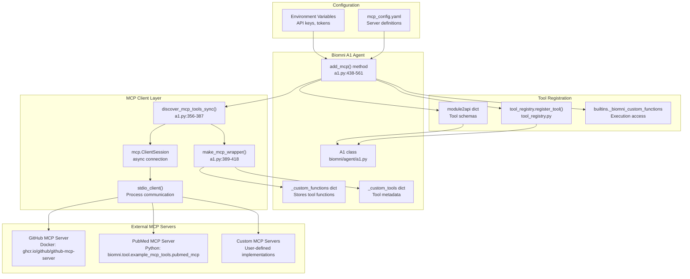
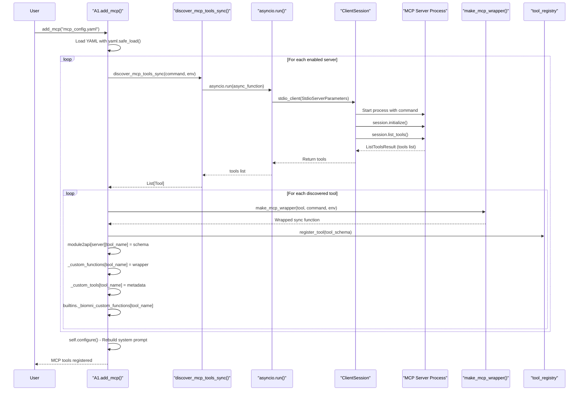
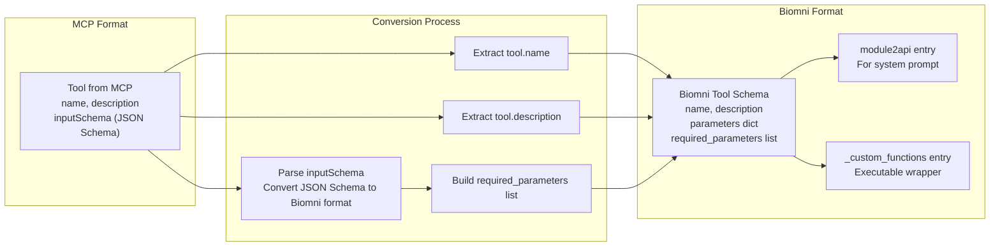
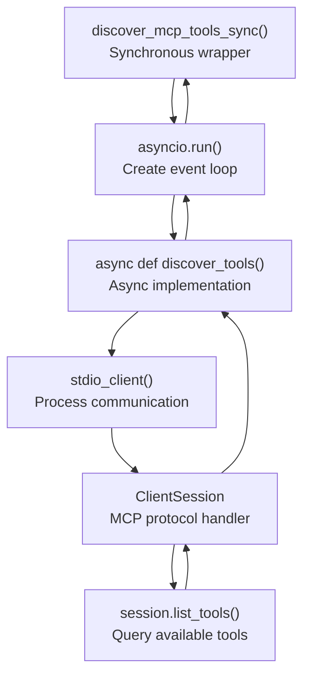
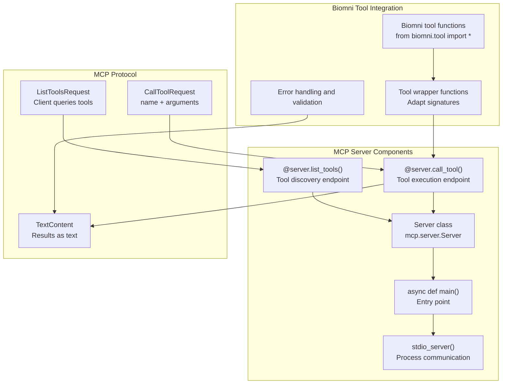

# MCP Integration

<details>
<summary>Relevant source files</summary>

The following files were used as context for generating this wiki page:

- [.gitignore](.gitignore)
- [biomni/agent/a1.py](biomni/agent/a1.py)
- [biomni/tool/support_tools.py](biomni/tool/support_tools.py)
- [biomni/tool/tool_description/support_tools.py](biomni/tool/tool_description/support_tools.py)
- [biomni/utils.py](biomni/utils.py)

</details>


This document covers Model Context Protocol (MCP) integration in Biomni, explaining how to configure and connect to external MCP servers, discover and register their tools, and create custom MCP servers that expose Biomni's internal tools. For adding custom Python functions directly, see page 4.5. For practical MCP examples, see page 5.4.

## Overview

The Model Context Protocol (MCP) is a standardized protocol for connecting AI agents to external tools and data sources. Biomni implements MCP integration through:

- **MCP Client Functionality**: Connect to external MCP servers and import their tools into the agent's tool registry
- **MCP Server Creation**: Expose Biomni's built-in tools as MCP servers for use by external clients
- **YAML Configuration**: Declarative server definitions with environment variable substitution
- **Async-to-Sync Bridging**: Integration layer that handles MCP's async protocol within Biomni's sync execution model

## MCP Architecture in Biomni

### System Architecture Diagram



**MCP Integration Flow**: The `A1.add_mcp()` method orchestrates MCP server integration. It reads YAML configuration files, establishes connections via `stdio_client()`, discovers available tools through `ClientSession.list_tools()`, wraps async tool calls with sync adapters, and registers tools in three locations: `tool_registry` for discovery, `module2api` for schema access, and `builtins._biomni_custom_functions` for code execution.

Sources: [biomni/agent/a1.py:324-561](), [biomni/agent/a1.py:438-561]()

## MCP Configuration Format

### YAML Configuration Structure

MCP servers are configured using YAML files that define server connection parameters, environment variables, and optional manual tool schemas. Configuration files are loaded by `A1.add_mcp(config_path)` and processed at runtime.

```yaml
mcp_servers:
  github:
    command: ["docker", "run", "-i", "--rm", "-e", "GITHUB_PERSONAL_ACCESS_TOKEN", 
              "ghcr.io/github/github-mcp-server"]
    enabled: true
    env:
      GITHUB_PERSONAL_ACCESS_TOKEN: "${GITHUB_TOKEN}"
  
  pubmed:
    command: ["python", "-m", "biomni.tool.example_mcp_tools.pubmed_mcp"]
    enabled: true
    tools:
      - biomni_name: search_pubmed
        description: "Search PubMed for biomedical literature"
        parameters:
          query: 
            type: str
            required: true
            description: "PubMed search query"
          max_results: 
            type: int
            required: false
            default: 10
            description: "Maximum number of results to return"
```

### Configuration Fields

| Field | Type | Required | Description | Processed By |
|-------|------|----------|-------------|--------------|
| `command` | List[str] | Yes | Server startup command and arguments | `StdioServerParameters` |
| `enabled` | bool | No | Whether to load this server (default: true) | `add_mcp()` loop filter |
| `env` | Dict[str, str] | No | Environment variables with `${VAR}` substitution | `add_mcp()` at lines 454-461 |
| `tools` | List[Dict] | No | Manual tool schema definitions (overrides auto-discovery) | Tool registration at lines 545-550 |

### Environment Variable Substitution

The configuration system supports environment variable substitution using the `${VARIABLE_NAME}` syntax. This is processed during server initialization:

```python
# In A1.add_mcp() method:
if "env" in server_config:
    for key, value in server_config["env"].items():
        if isinstance(value, str) and value.startswith("${") and value.endswith("}"):
            env_var_name = value[2:-1]
            server_config["env"][key] = os.environ.get(env_var_name, "")
```

Common environment variables used in MCP configurations:

| Variable | Purpose | Example Usage |
|----------|---------|---------------|
| `GITHUB_TOKEN` | GitHub API authentication | GitHub MCP server |
| `NCBI_EMAIL` | NCBI E-utilities requirement | PubMed/NCBI tools |
| `ANTHROPIC_API_KEY` | Claude API access | LLM-based tools |
| `OPENAI_API_KEY` | OpenAI API access | GPT-based tools |

Sources: [biomni/agent/a1.py:438-561](), [biomni/agent/a1.py:454-461]()

## MCP Tool Discovery and Registration

### Tool Discovery Sequence Diagram



**Key Code Paths**:
- Tool discovery: `discover_mcp_tools_sync()` wraps async operations in `asyncio.run()` [biomni/agent/a1.py:356-387]()
- Tool wrapping: `make_mcp_wrapper()` creates sync adapter for async MCP calls [biomni/agent/a1.py:389-418]()
- Registration: Tools stored in three locations for different purposes [biomni/agent/a1.py:545-561]()

Sources: [biomni/agent/a1.py:356-418](), [biomni/agent/a1.py:438-561]()

### Tool Schema Conversion

MCP tools are converted from MCP protocol format to Biomni's internal schema format:



**Schema Mapping**: MCP's JSON Schema `inputSchema` is converted to Biomni's parameter dictionary format. The `properties` field becomes `parameters`, and `required` array becomes `required_parameters` list. This conversion happens during tool registration in `add_mcp()`.

Sources: [biomni/agent/a1.py:524-550]()

## Adding MCP Servers to Agent

### The add_mcp() Method

The `A1.add_mcp()` method is the primary interface for MCP server integration. It handles configuration loading, server connection, tool discovery, and registration.

**Method Signature**:
```python
def add_mcp(self, config_path: str) -> None:
    """Add MCP servers and their tools to the agent.
    
    Args:
        config_path: Path to YAML configuration file defining MCP servers
    """
```

**Implementation Location**: [biomni/agent/a1.py:438-561]()

### Usage Patterns

#### Basic Usage
```python
from biomni.agent import A1

# Initialize agent
agent = A1()

# Add MCP servers from configuration file
agent.add_mcp(config_path="./mcp_config.yaml")

# MCP tools are now available - agent automatically discovers them
result = agent.go("Search PubMed for recent papers on CRISPR")
```

#### Multiple Configuration Files
```python
# Add different MCP server groups
agent.add_mcp(config_path="./database_servers.yaml")  # Database tools
agent.add_mcp(config_path="./github_servers.yaml")    # GitHub integration
agent.add_mcp(config_path="./custom_servers.yaml")    # Custom tools
```

#### Checking Registered Tools
```python
# List all custom tools (including MCP tools)
tools = agent.list_custom_tools()
for tool_name in tools:
    print(f"Available tool: {tool_name}")

# Get specific tool information
tool_func = agent.get_custom_tool("search_pubmed")
```

### Processing Steps

The `add_mcp()` method executes the following operations:

| Step | Operation | Code Reference |
|------|-----------|----------------|
| 1. Load Config | Parse YAML file with `yaml.safe_load()` | Lines 439-442 |
| 2. Filter Servers | Skip servers with `enabled: false` | Lines 446-447 |
| 3. Process Environment | Substitute `${VAR}` with environment values | Lines 454-461 |
| 4. Discover Tools | Call `discover_mcp_tools_sync()` for each server | Lines 464-465 |
| 5. Wrap Tools | Create sync wrappers with `make_mcp_wrapper()` | Lines 481-483 |
| 6. Register Tools | Add to `tool_registry` and `module2api` | Lines 545-550 |
| 7. Update Prompt | Rebuild system prompt with `configure()` | Line 560 |

Sources: [biomni/agent/a1.py:438-561]()

### Async-to-Sync Bridging

MCP protocol is asynchronous, but Biomni executes tools synchronously. The bridging mechanism involves two key functions:

#### discover_mcp_tools_sync()


**Purpose**: `discover_mcp_tools_sync()` wraps the async tool discovery in `asyncio.run()` to provide a synchronous interface. Located at [biomni/agent/a1.py:356-387]().

#### make_mcp_wrapper()
Creates a synchronous wrapper function for each MCP tool that:
1. Captures tool metadata (name, command, environment)
2. Creates new `ClientSession` for each invocation
3. Wraps `session.call_tool()` in `asyncio.run()`
4. Returns results to the agent

**Implementation**: [biomni/agent/a1.py:389-418]()

Sources: [biomni/agent/a1.py:356-418]()

## Creating Custom MCP Servers

Biomni provides infrastructure for creating MCP servers that expose internal tools to external clients. This enables other MCP-compatible applications to use Biomni's biomedical tools.

### MCP Server Implementation Template

Custom MCP servers are implemented using the `mcp` package and follow a standard structure:



**Key Components**:
- `@server.list_tools()`: Decorator that registers tool discovery handler
- `@server.call_tool()`: Decorator that registers tool execution handler
- `stdio_server()`: Provides stdio-based communication (required for MCP protocol)

Sources: [biomni/tool/example_mcp_tools/]()

### Example: PubMed MCP Server

The PubMed MCP server demonstrates how to expose Biomni tools via MCP protocol:

**Server Structure** (conceptual, based on typical implementation):

| Component | Purpose | Implementation |
|-----------|---------|----------------|
| Tool Schema | Define available tools | `Tool` objects with name, description, inputSchema |
| Tool Handlers | Execute tool calls | Wrapper functions that call Biomni's database tools |
| Error Handling | Manage exceptions | Try-except blocks with TextContent error responses |
| Main Loop | Server lifecycle | `async def main()` with `stdio_server()` |

**Tool Registration Pattern**:
```python
@server.list_tools()
async def handle_list_tools() -> list[types.Tool]:
    return [
        types.Tool(
            name="search_pubmed",
            description="Search PubMed for biomedical literature",
            inputSchema={
                "type": "object",
                "properties": {
                    "query": {"type": "string", "description": "Search query"},
                    "max_results": {"type": "integer", "default": 10}
                },
                "required": ["query"]
            }
        )
    ]
```

**Tool Execution Pattern**:
```python
@server.call_tool()
async def handle_call_tool(
    name: str, 
    arguments: dict
) -> list[types.TextContent]:
    if name == "search_pubmed":
        # Call Biomni's query_pubmed or similar function
        results = query_pubmed(arguments["query"], arguments.get("max_results", 10))
        return [types.TextContent(type="text", text=str(results))]
```

Sources: [biomni/tool/example_mcp_tools/]()

### Integration with Biomni Tools

To expose Biomni's internal tools via MCP, the server implementation needs to:

1. **Import Required Tools**:
   ```python
   from biomni.tool.database import query_pubmed, query_uniprot
   from biomni.tool.genomics import annotate_cells
   ```

2. **Define Tool Schemas**: Convert Biomni tool signatures to JSON Schema format
   
3. **Create Wrapper Functions**: Adapt Biomni function calls to MCP protocol
   
4. **Handle Async/Sync Mismatch**: Most Biomni tools are synchronous, wrap them appropriately
   
5. **Serialize Results**: Convert Python objects to string representations for `TextContent`

### Running Custom MCP Servers

Custom MCP servers are launched as separate processes and connected via stdio:

**Command-line Execution**:
```bash
# Run as Python module
python -m biomni.tool.example_mcp_tools.pubmed_mcp

# Run with uvx (if packaged)
uvx biomni-pubmed-mcp
```

**Integration with Biomni**:
```yaml
# mcp_config.yaml
mcp_servers:
  custom_pubmed:
    command: ["python", "-m", "biomni.tool.example_mcp_tools.pubmed_mcp"]
    enabled: true
```

Sources: [biomni/tool/example_mcp_tools/]()

## Best Practices

### Security and Access Control

1. **Environment Variable Management**: Store API keys in `.env` files or environment variables, never in configuration files
2. **Docker Security**: Use trusted Docker images for MCP servers and consider security implications
3. **Permission Scoping**: Ensure external tools have appropriate access permissions

### Performance Optimization

1. **Tool Discovery Caching**: Tool discovery happens once during `add_mcp()` calls
2. **Connection Management**: MCP servers are created on-demand for each tool execution
3. **Error Handling**: Failed tool calls are properly wrapped and reported

### Configuration Management

1. **Modular Configuration**: Separate MCP server configurations by functionality
2. **Environment Validation**: Test environment variable availability before server initialization
3. **Tool Naming**: Ensure unique tool names across different servers to avoid conflicts

### Development Workflow

1. **Incremental Integration**: Add and test one MCP server at a time
2. **Schema Validation**: Verify tool schemas match expected formats
3. **Fallback Handling**: Implement graceful degradation when external tools are unavailable

Sources: [docs/mcp_integration.md:158-189]()

---