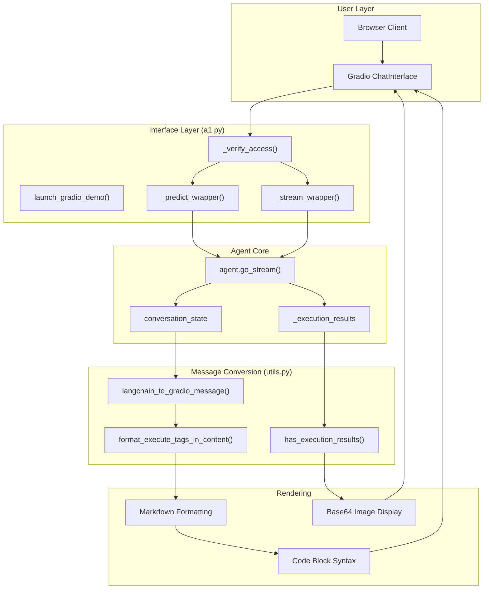
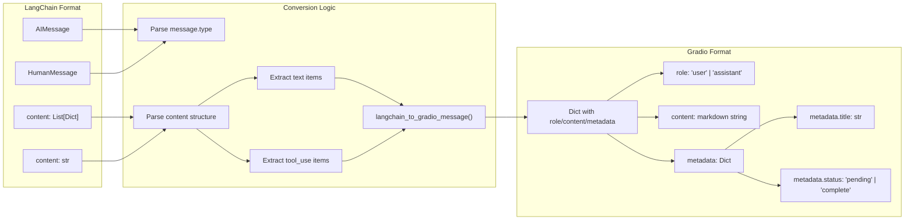
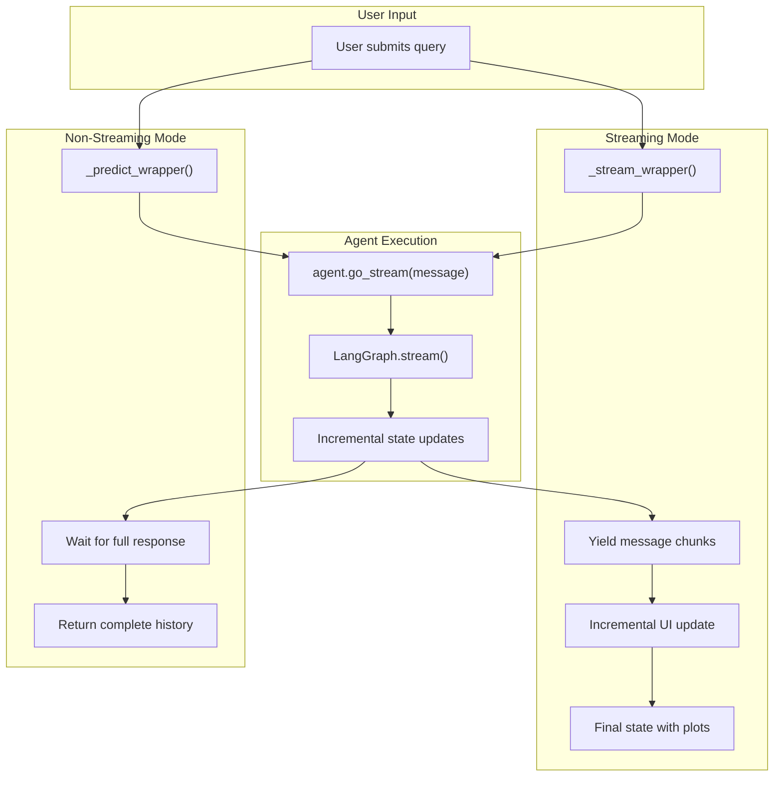

# Gradio Web Interface

<details>
<summary>Relevant source files</summary>

The following files were used as context for generating this wiki page:

- [README.md](README.md)
- [biomni/eval/__init__.py](biomni/eval/__init__.py)
- [biomni/eval/biomni_eval1.py](biomni/eval/biomni_eval1.py)
- [biomni/version.py](biomni/version.py)

</details>


This page documents the Gradio-based web interface for Biomni agents, which provides an interactive chat interface for executing biomedical research tasks through a browser. For programmatic agent usage via Python API, see [Basic Agent Usage](#4.2). For PDF report generation from conversations, see [PDF Report Generation](#4.7).

## Overview

The Gradio interface provides a no-code web UI for interacting with Biomni agents. It supports real-time streaming responses, plot visualization, code execution feedback, and optional access control. The interface automatically converts between LangChain message formats and Gradio chat format, handling multi-modal content including text, code blocks, and images.

**Sources:** [README.md:166-188](), [biomni/agent/a1.py:870-980]()

## Installation

The Gradio interface requires an additional dependency:

```bash
pip install gradio
```

The interface is compatible with Gradio's latest version and uses the `ChatInterface` component for conversation management.

**Sources:** [README.md:178-180]()

## Basic Usage

Launch the interface by calling `launch_gradio_demo()` on an initialized agent:

```python
from biomni.agent import A1

# Initialize agent with desired configuration
agent = A1(path='./data', llm='claude-sonnet-4-20250514')

# Launch web interface (default: http://localhost:7860)
agent.launch_gradio_demo()
```

The interface will automatically open in your default browser with a chat-based UI for submitting biomedical queries.

**Sources:** [README.md:168-175](), [biomni/agent/a1.py:870-900]()

## Configuration Options

### Method Signature

The `launch_gradio_demo()` method accepts the following parameters:

| Parameter | Type | Default | Description |
|-----------|------|---------|-------------|
| `share` | `bool` | `False` | Create a public shareable link via Gradio tunneling |
| `server_name` | `str` | `"0.0.0.0"` | Server bind address (`"127.0.0.1"` for localhost only) |
| `require_verification` | `bool` | `False` | Enable password protection for access control |

### Configuration Examples

**Localhost Only (Secure):**
```python
agent.launch_gradio_demo(server_name="127.0.0.1")
```

**Public Sharing (with Password):**
```python
agent.launch_gradio_demo(share=True, require_verification=True)
# Default password: "Biomni2025"
```

**Custom Port Binding:**
```python
agent.launch_gradio_demo(server_name="0.0.0.0")  # Accessible on local network
```

**Sources:** [README.md:183-186](), [biomni/agent/a1.py:870-900]()

## Architecture

### Component Structure



**Sources:** [biomni/agent/a1.py:870-980](), [biomni/utils.py:724-769]()

### Message Conversion Flow

The interface converts between LangChain message objects and Gradio's expected format:



**Sources:** [biomni/utils.py:724-769]()

## Chat Interface Components

### Message Types and Rendering

The interface handles three main message types:

#### 1. Text Messages

Plain text responses from the LLM are rendered as markdown. Special XML tags like `", "\n")
content = content.replace("<solution>", "\n")
content = content.replace("</solution>", "\n")
```

**Sources:** [biomni/utils.py:760-765]()

#### 2. Code Execution Messages

When the agent executes Python code, the interface displays:
- Code block with syntax highlighting
- "🛠️ Writing code..." status indicator
- Execution results (stdout/stderr)
- Generated plots (if any)

```python
# Tool detection logic (from utils.py:742-746)
if item["name"] == "run_python_repl":
    gradio_message["metadata"]["title"] = "🛠️ Writing code..."
    gradio_message["metadata"]["log"] = "Executing Code block..."
    gradio_message["content"] = f"##### Code: \n ```python \n {item['input']['command']} \n``` \n"
```

**Sources:** [biomni/utils.py:742-746]()

#### 3. Plot Visualization

Generated plots are automatically embedded as base64-encoded images in the chat. The interface searches for plot references in execution results and displays them inline.

```python
# Plot handling logic (from a1.py:940-955)
plot_section = "\n\n### 📊 Generated Plots\n\n"
for plot_id, plot_data in self._execution_results.items():
    if f"![plot_{plot_id}]" in response_text:
        plot_section += f"\n\n"
```

**Sources:** [biomni/agent/a1.py:940-960]()

### Streaming vs. Non-Streaming Modes

The interface supports both response modes:



**Sources:** [biomni/agent/a1.py:900-980]()

## Security Features

### Access Control

When `require_verification=True`, the interface implements a password gate:

```python
# Verification logic (from a1.py:875-888)
def _verify_access(password):
    correct_password = "Biomni2025"
    if password == correct_password:
        return True
    return False
```

Users must enter the correct password (default: `"Biomni2025"`) before accessing the chat interface.

**Sources:** [biomni/agent/a1.py:875-888]()

### Security Considerations

| Risk | Description | Mitigation |
|------|-------------|------------|
| Code Execution | Agent executes LLM-generated code | Run in isolated environment; use `server_name="127.0.0.1"` for local-only access |
| Public Exposure | `share=True` creates public URL | Always enable `require_verification=True` with sharing |
| Data Leakage | Conversation history visible in browser | Avoid sensitive data in queries; clear browser cache after use |
| Network Access | Agent can make external API calls | Monitor network traffic; use firewall rules |

**Sources:** [README.md:402-404](), [biomni/agent/a1.py:870-900]()

## Implementation Details

### Key Functions

#### `launch_gradio_demo()`

Main entry point that initializes the Gradio `ChatInterface` with custom prediction and streaming functions.

**Location:** [biomni/agent/a1.py:870-980]()

**Key responsibilities:**
- Creates `gr.ChatInterface` with agent's prediction logic
- Configures verification gate if required
- Sets up server parameters (host, port, sharing)
- Launches blocking web server

#### `langchain_to_gradio_message()`

Converts LangChain message objects to Gradio's expected dictionary format.

**Location:** [biomni/utils.py:724-769]()

**Input:** `BaseMessage` (AIMessage, HumanMessage, etc.)

**Output:** `List[Dict]` with keys:
- `role`: `"user"` or `"assistant"`
- `content`: Markdown-formatted string
- `metadata`: Dict with `title`, `log`, `status` fields

#### `has_execution_results()`

Checks if a response contains references to generated plots.

**Location:** [biomni/utils.py:1086-1100]()

**Logic:** Searches for `, [biomni/utils.py:724-769](), [biomni/utils.py:1086-1100]()

### Message Metadata Structure

The interface uses metadata to provide rich UI feedback:

```python
{
    "role": "assistant",
    "content": "##### Code: \n ```python \n print('Hello') \n``` \n",
    "metadata": {
        "title": "🛠️ Writing code...",
        "log": "Executing Code block...",
        "status": "pending"  # or "complete"
    }
}
```

This structure enables:
- Progress indicators during long-running operations
- Collapsible code blocks with titles
- Visual distinction between reasoning and execution steps

**Sources:** [biomni/utils.py:730-753]()

## Advanced Usage

### Customizing the Interface

While the default implementation provides a complete chat interface, advanced users can extend it by:

1. **Custom CSS Styling:** Modify Gradio's theme parameters
2. **Additional Components:** Add file upload, parameter sliders, etc.
3. **Multi-Agent Setup:** Create tabs for different agent configurations

Example multi-agent setup:

```python
import gradio as gr
from biomni.agent import A1

agent1 = A1(llm='claude-sonnet-4-20250514')
agent2 = A1(llm='gpt-4')

with gr.Blocks() as demo:
    with gr.Tab("Claude Agent"):
        agent1.launch_gradio_demo()
    with gr.Tab("GPT-4 Agent"):
        agent2.launch_gradio_demo()

demo.launch()
```

### Integration with External Systems

The Gradio interface can be integrated with:
- **Jupyter Notebooks:** Embed in notebook cells for interactive development
- **Web Applications:** Use `share=True` for temporary public access
- **Enterprise Deployments:** Reverse proxy through nginx/Apache with authentication

**Sources:** [biomni/agent/a1.py:870-980]()

## Troubleshooting

### Common Issues

| Issue | Symptom | Solution |
|-------|---------|----------|
| Port already in use | `OSError: [Errno 48] Address already in use` | Change port or kill existing Gradio process |
| Verification fails | Cannot access interface despite correct password | Clear browser cookies and retry |
| Plots not displaying | Code executes but no images shown | Check `_execution_results` is populated; verify plot generation code |
| Streaming broken | Messages appear all at once | Verify `go_stream()` is yielding incremental updates |

### Debug Mode

Enable verbose logging by checking the console output where `launch_gradio_demo()` was called. The interface prints:
- Verification attempts
- Message conversion errors
- Plot rendering failures

**Sources:** [biomni/agent/a1.py:870-980](), [biomni/utils.py:724-769]()

---