# PDF Report Generation

<details>
<summary>Relevant source files</summary>

The following files were used as context for generating this wiki page:

- [README.md](README.md)
- [biomni/eval/__init__.py](biomni/eval/__init__.py)
- [biomni/eval/biomni_eval1.py](biomni/eval/biomni_eval1.py)
- [biomni/version.py](biomni/version.py)

</details>


## Purpose and Scope

This document describes the PDF report generation system in Biomni, which converts agent conversation histories into formatted PDF documents. The system captures complete conversation traces including reasoning steps, code execution blocks, observations, plots, and solutions. For information about the agent execution workflow itself, see [Execution Pipeline](#2.2). For details on plot generation within tools, see [Tool Reference](#5).

**Sources:** [biomni/agent/a1.py:2055-2132]()

---

## Overview

The PDF report generation system provides a complete audit trail of agent interactions by converting conversation history into professionally formatted PDF documents. The system tracks execution results, captures generated plots as base64-encoded images, and applies structured styling to different content types.

### Key Components

| Component | Primary Function | Key Code Entity |
|-----------|-----------------|-----------------|
| Save API | Entry point for PDF generation | `A1.save_conversation_history()` |
| Markdown Generator | Converts conversation to markdown | `A1._generate_markdown_content()` |
| PDF Converter | Converts markdown to PDF | `convert_markdown_to_pdf()` |
| Execution Tracker | Stores code execution results | `A1._execution_results` |
| Content Formatter | Formats different content types | `format_execute_tags_in_content()` |
| CSS Styler | Applies styling to PDF | `get_pdf_css_content()` |

**Sources:** [biomni/agent/a1.py:2055-2132](), [biomni/utils.py:1922-2366]()

---

## PDF Generation Workflow

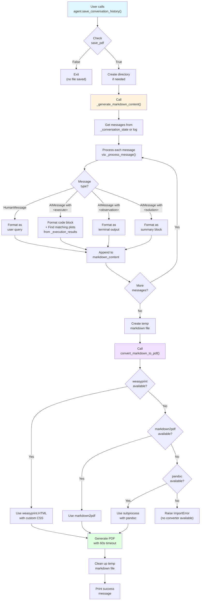

**Sources:** [biomni/agent/a1.py:2055-2132](), [biomni/agent/a1.py:2133-2166](), [biomni/utils.py:1922-2000]()

---

## Core API: save_conversation_history()

### Method Signature

The `save_conversation_history()` method is defined in the `A1` agent class:

```python
def save_conversation_history(
    self, 
    filepath: str, 
    include_images: bool = True, 
    save_pdf: bool = True
) -> None
```

### Parameters

| Parameter | Type | Default | Description |
|-----------|------|---------|-------------|
| `filepath` | `str` | Required | Path where to save the PDF file (without extension). If path doesn't end with `.pdf`, it will be appended automatically. |
| `include_images` | `bool` | `True` | Whether to include captured plots and images in the output. |
| `save_pdf` | `bool` | `True` | Whether to save as PDF. If `False`, no file is saved. |

### Return Value

Returns `None`. Prints status messages to console including file path and step count.

### Timeout Protection

The method includes a 60-second timeout for PDF generation using `signal.SIGALRM` to prevent hanging on large documents.

**Sources:** [biomni/agent/a1.py:2055-2132]()

---

## Message Processing Pipeline

```mermaid
graph LR
    A["_conversation_state<br/>or self.log"] --> B["_get_messages_for_processing()"]
    
    B --> C1{"Source?"}
    C1 -->|"conversation_state"| D1["_normalize_conversation_state_messages()"]
    C1 -->|"log"| D2["_normalize_log_messages()"]
    
    D1 --> E["Normalized message list<br/>(content, type, original)"]
    D2 --> E
    
    E --> F["Loop: _process_message()<br/>for each message"]
    
    F --> G["clean_message_content()<br/>(remove ANSI codes)"]
    
    G --> H{"should_skip_message()?"}
    H -->|Yes| F
    H -->|No| I{"Message<br/>type?"}
    
    I -->|"human"| J1["Increment step_number<br/>Add ## Step X"]
    I -->|"ai with<br/>&lt;execute&gt;"| J2["format_execute_tags_in_content()<br/>parse_tool_calls_with_modules()"]
    I -->|"ai with<br/>&lt;observation&gt;"| J3["format_observation_as_terminal()"]
    I -->|"other ai"| J4["format_lists_in_text()<br/>format_solution_tags_in_content()"]
    
    J1 --> K["Append to<br/>markdown_content"]
    J2 --> L{"has_execution_results()?"}
    J3 --> K
    J4 --> K
    
    L -->|Yes| M["find_matching_execution()"]
    L -->|No| K
    
    M --> N{"Images<br/>present?"}
    N -->|Yes| O["Append base64<br/>images to content"]
    N -->|No| K
    
    O --> K
    
    K --> P{"More<br/>messages?"}
    P -->|Yes| F
    P -->|No| Q["Return complete<br/>markdown_content"]
    
    style B fill:#e1f5ff
    style F fill:#fff4e1
    style L fill:#f0e1ff
    style Q fill:#e1ffe1
```

**Sources:** [biomni/agent/a1.py:2168-2186](), [biomni/agent/a1.py:2133-2166](), [biomni/utils.py:1021-1066]()

---

## Execution Results Tracking

### Execution Entry Structure

During code execution, the agent stores execution results with metadata in `_execution_results`:

```python
execution_entry = {
    "triggering_message": last_message,    # AI message containing <execute>
    "images": execution_plots,             # List of base64 encoded images
    "timestamp": datetime.now().isoformat()
}
```

### Plot Capture Workflow

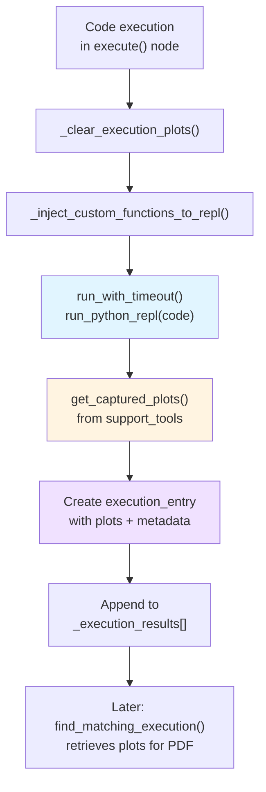

**Sources:** [biomni/agent/a1.py:1465-1547](), [biomni/agent/a1.py:1522-1543]()

---

## Content Formatting System

The system applies different formatting to different content types using specialized functions in `biomni/utils.py`:

### Content Type Formatting

| Content Type | Formatting Function | Output Style | CSS Class |
|--------------|-------------------|--------------|-----------|
| Code Execution | `format_execute_tags_in_content()` | Tool call block with syntax highlighting | `.tool-call-highlight` |
| Observations | `format_observation_as_terminal()` | Terminal-style output | `.title-text.observation` |
| Solutions | `format_solution_tags_in_content()` | Summary block | `.title-text.summary` |
| Plans | `format_lists_in_text()` | Checkbox list | `.title-text.plan` |
| Parsing Errors | `create_parsing_error_html()` | Error box | `.parsing-error-box` |

### Execute Tag Formatting Pipeline

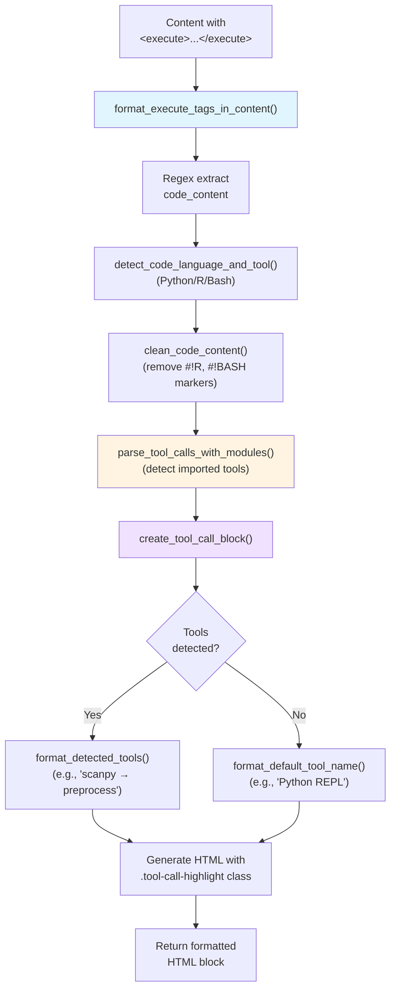

**Sources:** [biomni/utils.py:1316-1360](), [biomni/utils.py:1362-1542]()

### Tool Detection Details

The `parse_tool_calls_with_modules()` function uses regex patterns to detect tool usage:

- **Import statements**: `from biomni.tool.genomics import analyze_cells`
- **Direct calls**: `result = analyze_cells(data)`
- **Module patterns**: `biomni.tool.database.query_uniprot()`

Output format: List of `(tool_name, module_name)` tuples

**Sources:** [biomni/utils.py:1156-1249]()

---

## PDF Conversion Strategies

### Conversion Library Priority

The system attempts multiple PDF conversion strategies in order:

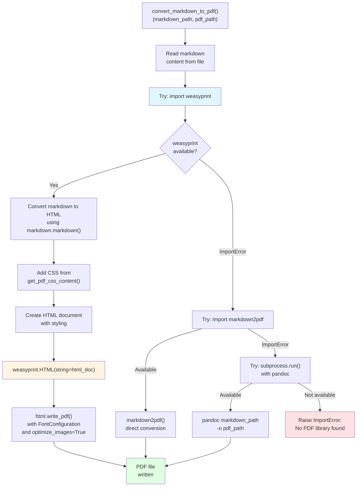

### Library Comparison

| Library | Priority | Advantages | Performance |
|---------|----------|------------|-------------|
| `weasyprint` | 1st (preferred) | Best layout control, custom CSS, image embedding | Slower but high quality |
| `markdown2pdf` | 2nd (fallback) | Simple API, automatic conversion | Medium speed |
| `pandoc` | 3rd (last resort) | Widely available, command-line tool | Fast but less control |

**Sources:** [biomni/utils.py:1922-2000]()

---

## CSS Styling System

### Style Architecture

The `get_pdf_css_content()` function returns comprehensive CSS for PDF generation with optimized typography and layout:

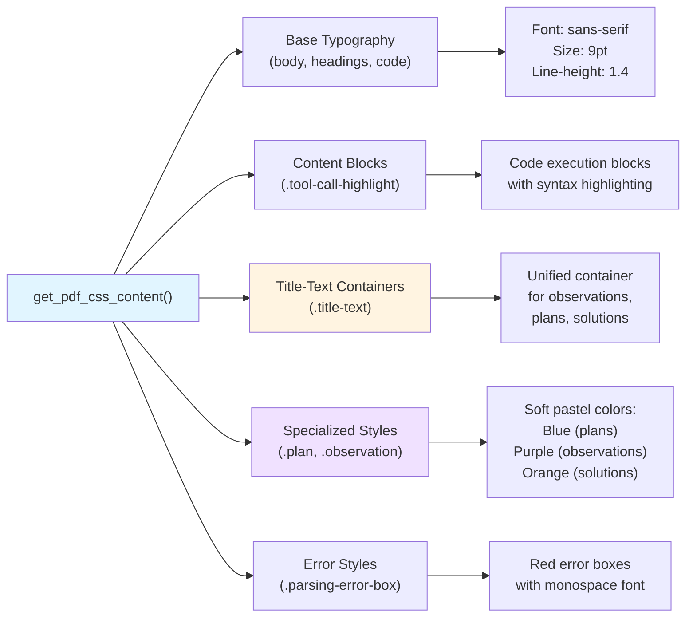

### Key CSS Classes

| CSS Class | Purpose | Color Scheme | Applied To |
|-----------|---------|--------------|------------|
| `.tool-call-highlight` | Code execution blocks | Gray background | `<execute>` tags |
| `.title-text.plan` | Plan checklists | Soft blue (#e3f2fd) | Plan with checkboxes |
| `.title-text.observation` | Execution results | Soft purple (#f3e5f5) | `<observation>` tags |
| `.title-text.summary` | Final solutions | Soft orange (#fff3e0) | `<solution>` tags |
| `.parsing-error-box` | Error messages | Red (#ffebee) | Parsing errors |

### Font Specifications

- **Body text**: 9pt sans-serif, line-height 1.4
- **Code blocks**: 8pt Monaco/Menlo/Ubuntu Mono, monospace
- **Headings**: Hierarchical sizing from 16pt (h1) to 9pt (h5/h6)
- **Code in text**: 8pt with light gray background

**Sources:** [biomni/utils.py:2002-2366]()

---

## Observation Formatting

### Terminal Output Handling

The `format_observation_as_terminal()` function processes observation content with length limits:

**Maximum Length**: 10,000 characters (approximately 2 A4 pages)

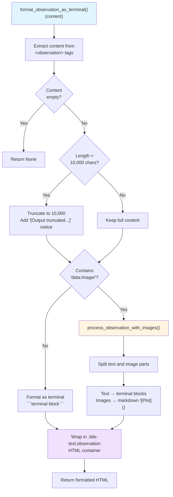

**Sources:** [biomni/utils.py:1584-1645](), [biomni/utils.py:1647-1706]()

---

## List and Plan Formatting

### Checkbox List Processing

The system automatically detects and formats plan checklists with checkbox symbols:

**Input Pattern**: `1. [✓] Completed step` or `1. [ ] Pending step`

**Output Format**: HTML list with styled checkboxes

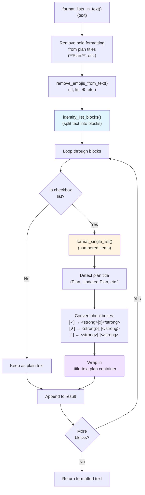

**Sources:** [biomni/utils.py:1746-1793](), [biomni/utils.py:1795-1850](), [biomni/utils.py:1853-1920]()

---

## Error Handling

### Timeout Protection

The system includes multiple timeout mechanisms:

| Timeout Type | Duration | Purpose | Implementation |
|--------------|----------|---------|----------------|
| PDF Generation | 60 seconds | Prevent hanging on large documents | `signal.SIGALRM` in `save_conversation_history()` |
| Code Execution | Configurable (default 600s) | Prevent infinite loops | `run_with_timeout()` in `execute()` node |

### Error Cases and Handling

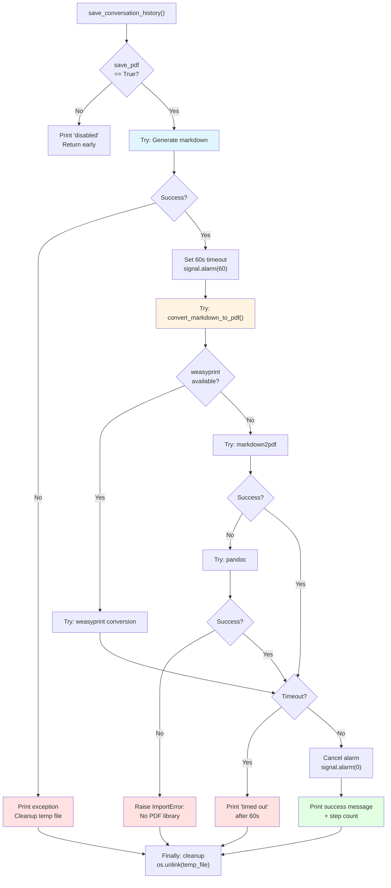

**Sources:** [biomni/agent/a1.py:2055-2132](), [biomni/utils.py:1922-2000]()

---

## Usage Examples

### Basic PDF Generation

```python
from biomni.agent import A1

# Initialize agent
agent = A1(path="./workspace")

# Execute some task
agent.go("Analyze gene expression data for BRCA1")

# Save conversation history as PDF
agent.save_conversation_history("results/analysis_report.pdf")
# Output: results/analysis_report.pdf
```

### PDF Without Images

```python
# Generate PDF without including plots/images
agent.save_conversation_history(
    "reports/text_only.pdf",
    include_images=False
)
```

### Disable PDF Generation

```python
# Skip PDF generation (e.g., for testing)
agent.save_conversation_history(
    "output.pdf",
    save_pdf=False
)
# Output: "PDF saving is disabled. No file will be saved."
```

### Automatic Extension Handling

```python
# Extension is added automatically if missing
agent.save_conversation_history("report")
# Creates: report.pdf

agent.save_conversation_history("report.pdf")
# Creates: report.pdf (no duplicate extension)

agent.save_conversation_history("report.md")
# Creates: report.pdf (replaces .md with .pdf)
```

**Sources:** [biomni/agent/a1.py:2055-2132]()

---

## Integration with Agent Workflow

### Conversation State Storage

The PDF generation system accesses conversation data from two sources:

| Source | Access Pattern | Priority |
|--------|---------------|----------|
| `_conversation_state` | Set by `go()` and `go_stream()` after execution completes | 1st (preferred) |
| `self.log` | Populated during streaming with `pretty_print()` output | 2nd (fallback) |

### Data Flow During Execution

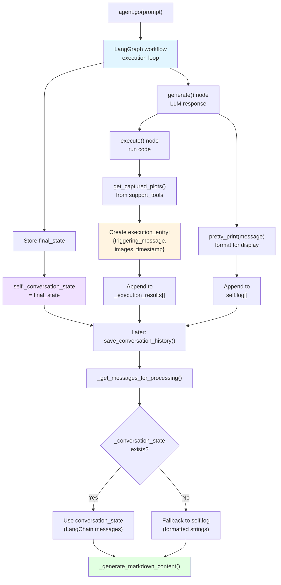

**Sources:** [biomni/agent/a1.py:1753-1783](), [biomni/agent/a1.py:1465-1547](), [biomni/agent/a1.py:2168-2186]()

---

## Performance Considerations

### Optimization Strategies

The system includes several optimizations for large documents:

| Optimization | Implementation | Benefit |
|--------------|----------------|---------|
| Minimal markdown extensions | Only `fenced_code` extension | Faster HTML conversion |
| Observation truncation | 10,000 character limit | Fits within 2 A4 pages |
| Image optimization | `optimize_images=True` in weasyprint | Smaller PDF file size |
| Timeout protection | 60-second limit | Prevents hanging |
| Temporary file cleanup | `os.unlink()` in finally block | Prevents disk bloat |

### Memory Management

- **Execution results**: Stored in memory during conversation
- **Base64 images**: Embedded directly in markdown (no external files)
- **Temporary files**: Created and deleted automatically
- **Plot clearing**: `_clear_execution_plots()` before each execution

**Sources:** [biomni/agent/a1.py:2055-2132](), [biomni/utils.py:1922-2000](), [biomni/utils.py:1584-1645]()

---

## File System Interaction

### Path Handling

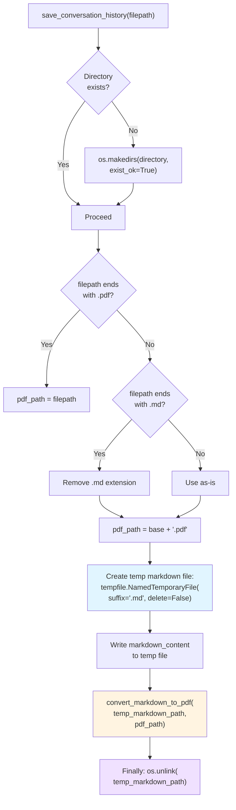

**Sources:** [biomni/agent/a1.py:2074-2132]()

---