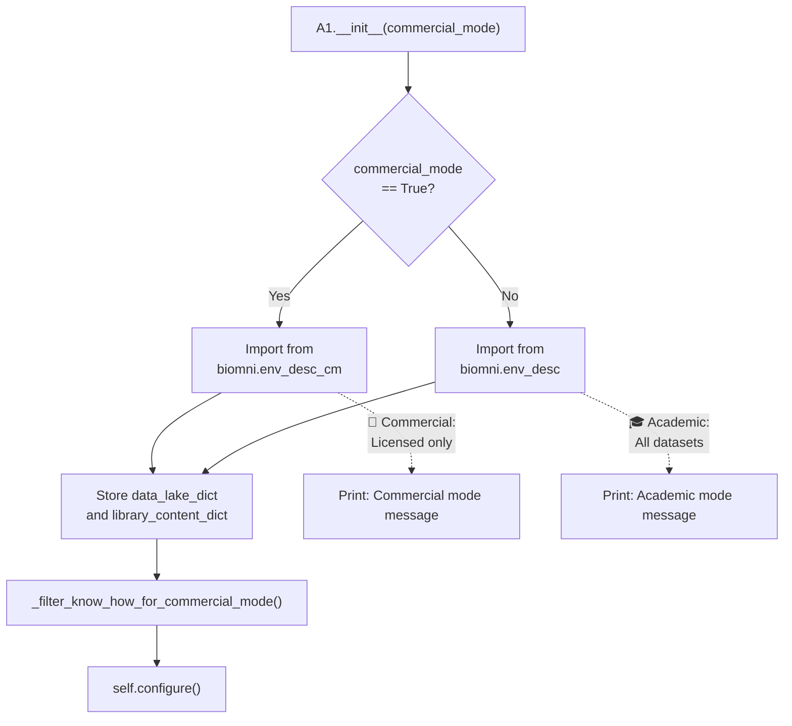
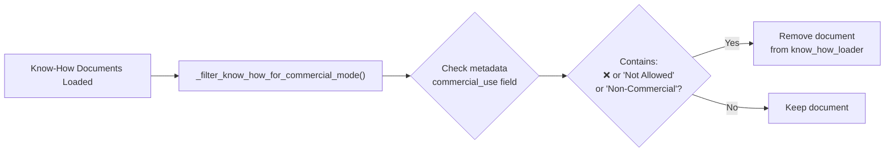
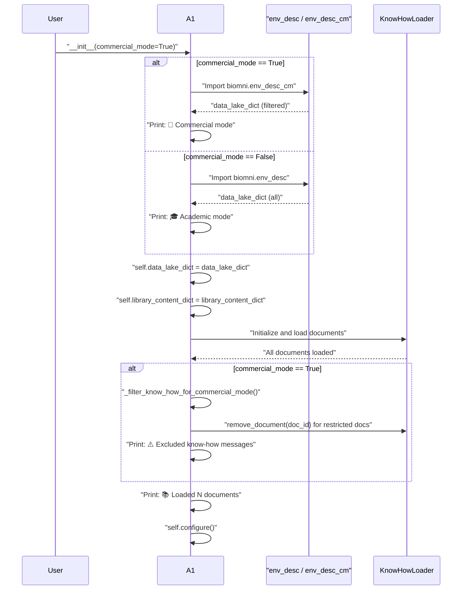

# Commercial Mode

<details>
<summary>Relevant source files</summary>

The following files were used as context for generating this wiki page:

- [biomni/agent/a1.py](biomni/agent/a1.py)
- [biomni/tool/support_tools.py](biomni/tool/support_tools.py)
- [biomni/tool/tool_description/support_tools.py](biomni/tool/tool_description/support_tools.py)
- [biomni/utils.py](biomni/utils.py)

</details>


This document describes the Commercial Mode feature in Biomni, which enables organizations to use the system in commercial environments by filtering out resources with non-commercial licensing restrictions.

**Scope**: This page covers the commercial mode configuration parameter, its effects on data lake resources and know-how documents, and the filtering mechanisms. For information about data lake management in general, see [Data Infrastructure](#2.6). For know-how document structure, see [Know-How Library](#2.7).

---

## Overview

Commercial Mode is a licensing compliance feature that restricts the A1 agent to only use resources that permit commercial use. When enabled, Biomni automatically excludes:

- **Data lake datasets** with non-commercial licenses
- **Know-how documents** marked as non-commercial only

This ensures that organizations using Biomni for commercial research or product development do not inadvertently use resources that violate licensing terms.

**Sources**: [biomni/agent/a1.py:66-79]()

---

## Configuration

### Enabling Commercial Mode

Commercial mode is controlled by the `commercial_mode` parameter in the A1 agent constructor:

```python
# Commercial mode enabled - only licensed datasets
agent = A1(commercial_mode=True)

# Academic mode (default) - all datasets available
agent = A1(commercial_mode=False)
```

The parameter can also be set globally via the `BiomniConfig` object in `default_config`:

```python
from biomni.config import default_config

default_config.commercial_mode = True
```

**Sources**: [biomni/agent/a1.py:66-79](), [biomni/agent/a1.py:97-98]()

---

## System Architecture

### Mode Selection Flow



**Sources**: [biomni/agent/a1.py:97-113]()

---

## Resource Filtering

### Data Lake Filtering

When `commercial_mode=True`, the system imports a separate module that contains only commercially-licensed datasets:

| Mode | Import Module | Contents |
|------|---------------|----------|
| **Academic** | `biomni.env_desc` | All datasets, including non-commercial |
| **Commercial** | `biomni.env_desc_cm` | Only commercially-licensed datasets |

The filtering happens at import time by using different Python modules that define `data_lake_dict` and `library_content_dict` with pre-filtered content.

**Sources**: [biomni/agent/a1.py:100-113]()

### Know-How Document Filtering

Know-how documents are filtered dynamically during agent initialization. The filtering logic examines document metadata:



The filtering method examines each document's `commercial_use` metadata field and removes documents that contain restriction markers.

**Sources**: [biomni/agent/a1.py:876-897]()

---

## Implementation Details

### Commercial Mode Detection

The `_filter_know_how_for_commercial_mode()` method implements the filtering logic:

**Location**: [biomni/agent/a1.py:876-897]()

**Algorithm**:
1. Iterate through all loaded know-how documents
2. Extract `metadata.commercial_use` field from each document
3. Check for restriction indicators:
   - `"❌"` emoji
   - `"Not Allowed"` string
   - `"Non-Commercial"` string
4. Collect document IDs to remove
5. Call `know_how_loader.remove_document(doc_id)` for each restricted document
6. Print exclusion messages for transparency

**Key Code Elements**:
- `self.know_how_loader.documents`: Dictionary of all loaded documents
- `doc.get("metadata", {})`: Metadata extraction
- `metadata.get("commercial_use", "")`: Commercial use field
- `self.know_how_loader.remove_document(doc_id)`: Document removal

**Sources**: [biomni/agent/a1.py:876-897]()

---

## Configuration Display

When the agent initializes, it displays the active mode in the configuration summary:

```
==================================================
🔧 BIOMNI CONFIGURATION
==================================================
📋 DEFAULT CONFIG (Including Database LLM):
  Commercial Mode: Commercial (licensed datasets only)
  
[or]

  Commercial Mode: Academic (all datasets)
==================================================
```

The display includes special formatting for the `commercial_mode` parameter to make the licensing status immediately visible.

**Sources**: [biomni/agent/a1.py:115-147]()

---

## Mode-Specific Messages

### Commercial Mode Active

```
🏢 Commercial mode: Using commercial-licensed datasets only
📚 Loaded N know-how documents
  ⚠️  Excluded know-how 'Document Name' (non-commercial license)
  ⚠️  Excluded know-how 'Another Doc' (non-commercial license)
```

### Academic Mode Active

```
🎓 Academic mode: Using all datasets (including non-commercial)
📚 Loaded N know-how documents
```

**Sources**: [biomni/agent/a1.py:104-108](), [biomni/agent/a1.py:894-896]()

---

## Integration Points

### Initialization Sequence



**Sources**: [biomni/agent/a1.py:97-224]()

---

## Effects on System Behavior

### Affected Resources

| Resource Type | Filter Mechanism | Commercial Mode Effect |
|---------------|------------------|------------------------|
| **Data Lake Datasets** | Module-level import | Uses `env_desc_cm` module with pre-filtered datasets |
| **Library Content** | Module-level import | Uses `env_desc_cm` module with pre-filtered software list |
| **Know-How Documents** | Runtime filtering | Removes documents with non-commercial restrictions |
| **Tool Functions** | No filtering | All tools available regardless of mode |

**Note**: Tool functions themselves are not filtered by commercial mode. Only the data and documentation resources they may reference are affected.

**Sources**: [biomni/agent/a1.py:100-113](), [biomni/agent/a1.py:215-218]()

---

## Persistence

Once the agent is initialized with a specific commercial mode setting, that setting persists for the lifetime of the agent instance. The filtered resources are stored in:

- `self.data_lake_dict`: Filtered data lake resources
- `self.library_content_dict`: Filtered library/software resources  
- `self.know_how_loader.documents`: Filtered know-how documents
- `self.commercial_mode`: Boolean flag for reference

These filtered dictionaries are then used throughout the agent's operation when generating system prompts and retrieving resources.

**Sources**: [biomni/agent/a1.py:110-113]()

---

## Code Mapping

### Key Classes and Methods

| Component | Location | Description |
|-----------|----------|-------------|
| `A1.__init__` | [biomni/agent/a1.py:57-224]() | Main initialization with commercial_mode parameter |
| `_filter_know_how_for_commercial_mode` | [biomni/agent/a1.py:876-897]() | Filters know-how documents based on metadata |
| `data_lake_dict` | `biomni.env_desc` or `biomni.env_desc_cm` | Dictionary of data lake resources |
| `library_content_dict` | `biomni.env_desc` or `biomni.env_desc_cm` | Dictionary of software/library resources |
| `KnowHowLoader` | [biomni/know_how.py]() | Manages know-how document loading and filtering |

**Sources**: [biomni/agent/a1.py:57-897]()

---

## Best Practices

### For Commercial Users

1. **Always enable commercial mode** when using Biomni in commercial contexts:
   ```python
   agent = A1(commercial_mode=True)
   ```

2. **Verify filtered resources** by checking the initialization messages to see which resources were excluded

3. **Document mode selection** in your code to maintain licensing compliance audit trails

### For Academic Users

1. **Use default academic mode** to access all available datasets:
   ```python
   agent = A1(commercial_mode=False)  # or omit parameter
   ```

2. **Be aware** that some resources may have non-commercial restrictions if you later transition to commercial use

**Sources**: [biomni/agent/a1.py:66-79]()

---