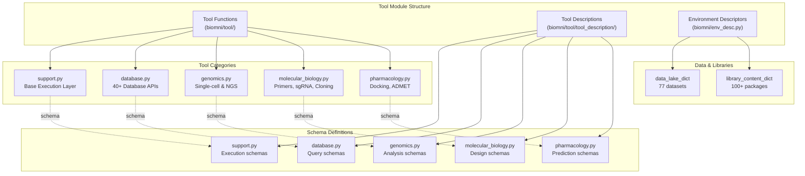
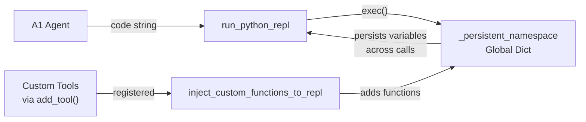
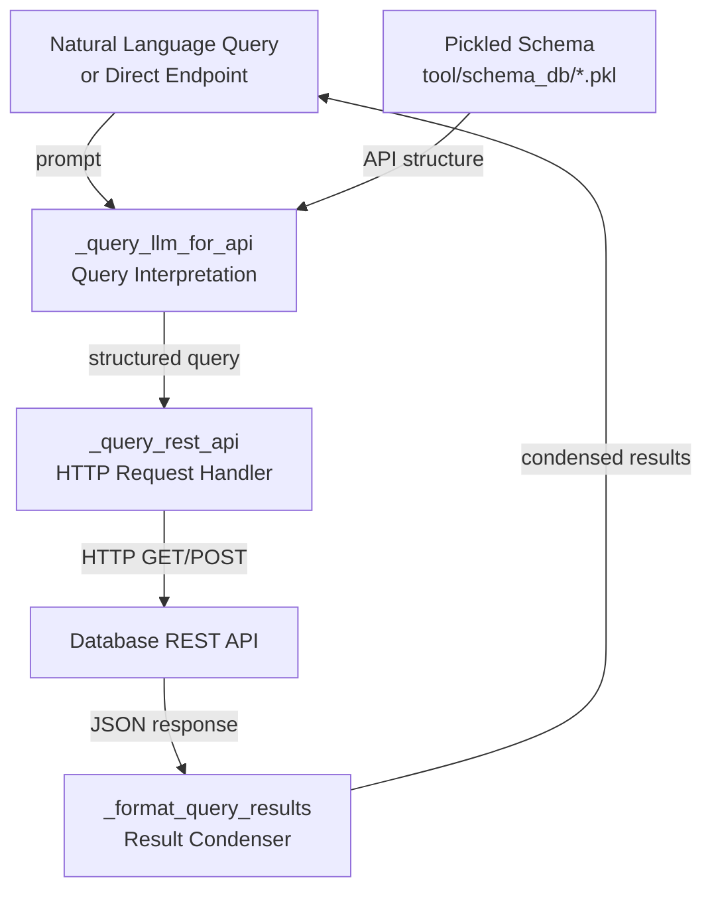
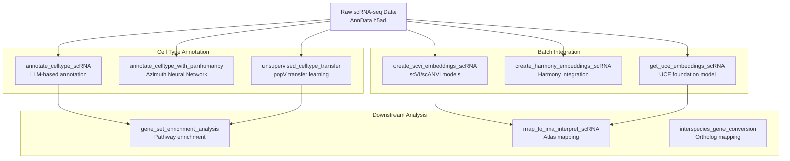
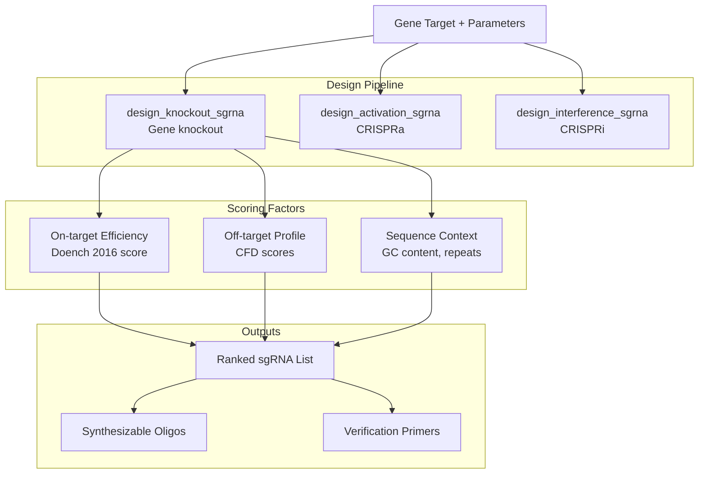
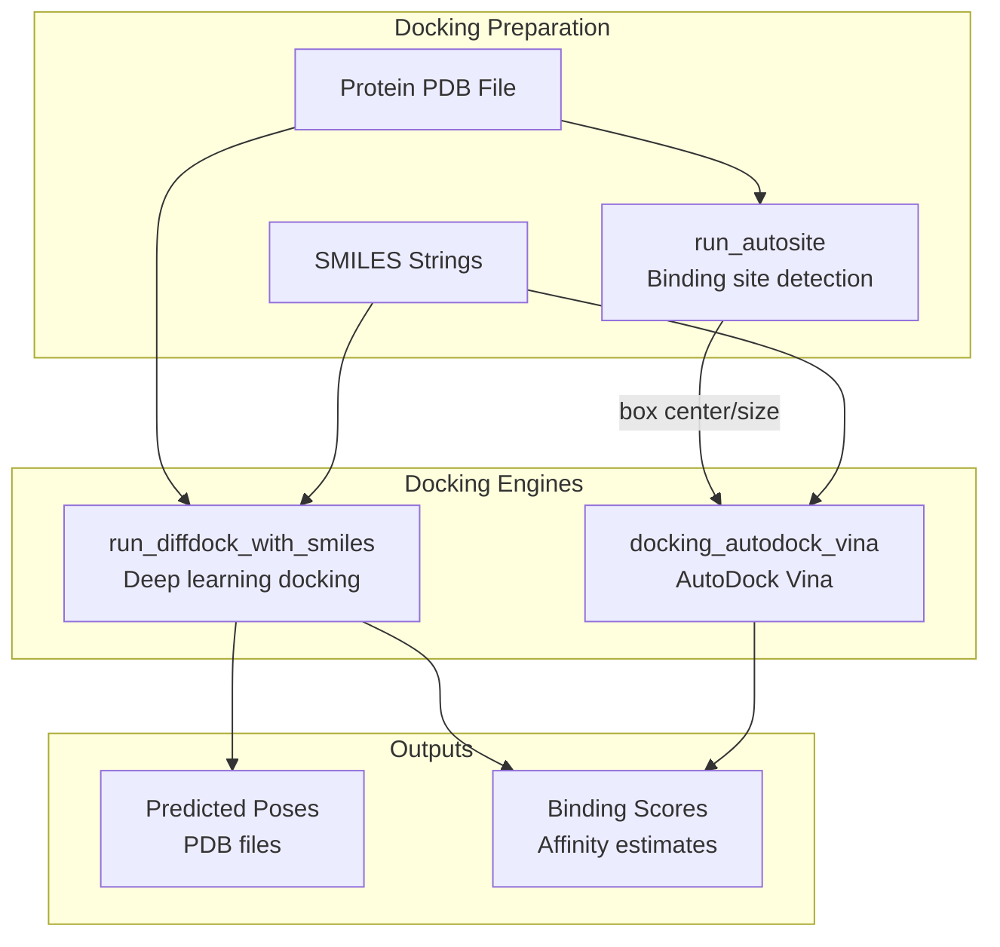
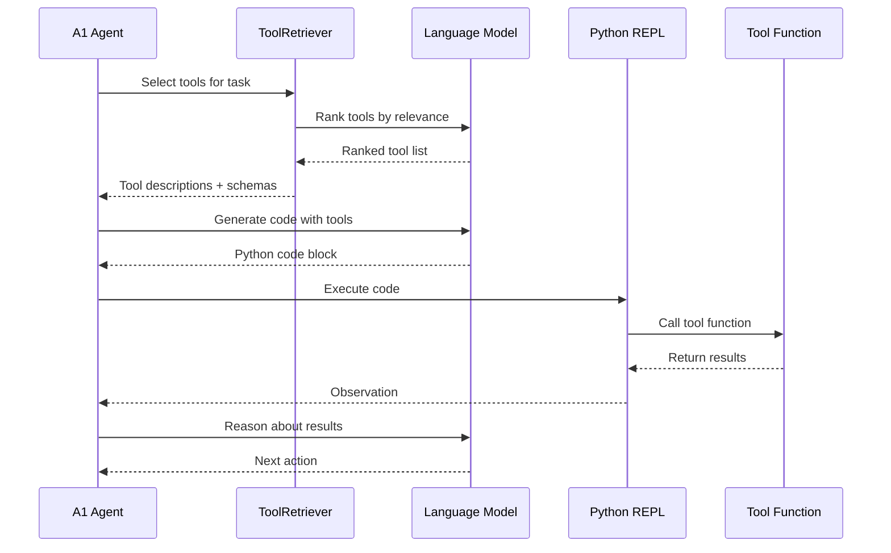
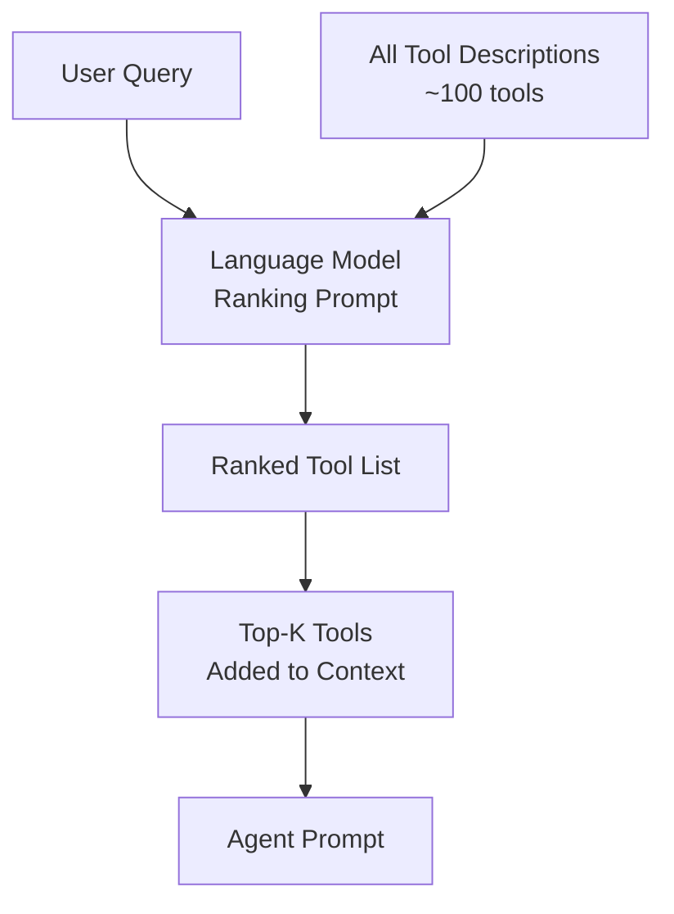

# Tool Reference

<details>
<summary>Relevant source files</summary>

The following files were used as context for generating this wiki page:

- [biomni/env_desc.py](biomni/env_desc.py)
- [biomni/tool/database.py](biomni/tool/database.py)
- [biomni/tool/genomics.py](biomni/tool/genomics.py)
- [biomni/tool/molecular_biology.py](biomni/tool/molecular_biology.py)
- [biomni/tool/pharmacology.py](biomni/tool/pharmacology.py)
- [biomni/tool/tool_description/database.py](biomni/tool/tool_description/database.py)
- [biomni/tool/tool_description/genomics.py](biomni/tool/tool_description/genomics.py)
- [biomni/tool/tool_description/pharmacology.py](biomni/tool/tool_description/pharmacology.py)

</details>


This page provides a comprehensive reference for all available tools in the Biomni system. It covers the tool registry architecture, tool description schemas, and detailed information about tools organized by category. For information about adding custom tools to your agent, see [Working with Custom Resources](#4.4). For implementation details of the agent's tool orchestration, see [Tool Registry and Retrieval](#2.4).

## Tool Ecosystem Overview

Biomni provides 100+ specialized tools organized into five major categories, plus access to external data lakes and software libraries. Tools are registered via function definitions and JSON schemas that describe their parameters, return types, and purposes.

### Tool Organization Architecture



**Sources:** [biomni/tool/genomics.py:1-100](), [biomni/tool/database.py:1-100](), [biomni/tool/pharmacology.py:1-100](), [biomni/tool/molecular_biology.py:1-100](), [biomni/tool/tool_description/genomics.py:1-100](), [biomni/tool/tool_description/database.py:1-100](), [biomni/env_desc.py:1-100]()

### Tool Description Schema Format

Each tool is defined by a description dictionary containing metadata, parameters, and usage information:

```python
{
    "name": "tool_function_name",
    "description": "What the tool does and when to use it",
    "required_parameters": [
        {
            "name": "param_name",
            "type": "str|int|list|dict",
            "description": "Parameter purpose and format",
            "default": None
        }
    ],
    "optional_parameters": [
        {
            "name": "optional_param",
            "type": "bool",
            "description": "Optional parameter details",
            "default": True
        }
    ]
}
```

**Sources:** [biomni/tool/tool_description/genomics.py:1-50](), [biomni/tool/tool_description/database.py:1-50]()

## Support Tools

Support tools provide the foundational execution layer for all other tools. They handle code execution, file operations, and data access.

### Core Execution Tools

| Tool Name | Purpose | Key Parameters |
|-----------|---------|----------------|
| `run_python_repl` | Execute Python code in persistent namespace | `code` (str) |
| `run_r_code` | Execute R code via Rscript subprocess | `code` (str) |
| `run_bash_script` | Execute bash commands | `script` (str) |
| `run_cli_command` | Execute CLI tools with arguments | `command` (list) |

### Persistent Python REPL Architecture



The Python REPL maintains state across executions via `_persistent_namespace` dict, allowing multi-step workflows where variables and imports persist between tool calls.

**Sources:** [biomni/tool/support.py:1-200]() (implementation of REPL tools)

### Data Access Tools

| Tool Name | Purpose | Returns |
|-----------|---------|---------|
| `download_synapse_data` | Download datasets from Synapse by ID | File path |
| `download_source_h5ad` | Download CellxGene Census datasets | AnnData file path |
| `read_file` | Read text files with encoding detection | File contents |
| `write_file` | Write text to file with path creation | Success message |

**Sources:** [biomni/tool/tool_description/support.py:1-100]() (tool schemas)

## Database Query Tools

Database tools provide unified access to 40+ biological and chemical databases through natural language queries or direct API endpoints.

### Database Query Pattern

All database query tools follow a consistent pattern:



**Sources:** [biomni/tool/database.py:36-109]() (_query_llm_for_api), [biomni/tool/database.py:111-196]() (_query_rest_api), [biomni/tool/database.py:317-445]() (_format_query_results)

### Protein and Structure Databases

| Database | Tool Name | Key Features |
|----------|-----------|--------------|
| UniProt | `query_uniprot` | Protein sequences, functions, annotations |
| AlphaFold | `query_alphafold` | Structure predictions, download PDB/CIF files |
| InterPro | `query_interpro` | Protein domains, families, signatures |
| PDB | `query_pdb`, `query_pdb_identifiers` | Crystal structures, search by attributes |
| STRING | `query_stringdb` | Protein-protein interaction networks |

Example tool invocation:
```python
# Natural language query
query_uniprot(prompt="Find human insulin protein information")

# Direct endpoint query  
query_uniprot(endpoint="https://rest.uniprot.org/uniprotkb/P01308")
```

**Sources:** [biomni/tool/database.py:448-541]() (query_uniprot), [biomni/tool/database.py:544-691]() (query_alphafold), [biomni/tool/database.py:693-797]() (query_interpro)

### Genomics and Variant Databases

| Database | Tool Name | Data Types |
|----------|-----------|------------|
| Ensembl | `query_ensembl` | Gene annotations, sequences, variants |
| UCSC Genome Browser | `query_ucsc` | Genomic tracks, annotations |
| ClinVar | `query_clinvar` | Clinical variant interpretations |
| dbSNP | `query_dbsnp` | SNP reference data |
| gnomAD | `query_gnomad` | Population allele frequencies |
| GEO | `query_geo` | Gene expression datasets |

**Sources:** [biomni/tool/database.py:1100-1200]() (query_ensembl), [biomni/tool/database.py:1380-1480]() (query_clinvar), [biomni/tool/database.py:1550-1650]() (query_gnomad)

### Pathway and Disease Databases

| Database | Tool Name | Focus Area |
|----------|-----------|------------|
| KEGG | `query_kegg` | Metabolic pathways, reactions |
| Reactome | `query_reactome` | Biological pathways with diagrams |
| OpenTargets | `query_opentarget` | Target-disease associations |
| Monarch Initiative | `query_monarch` | Phenotype-disease-gene links |
| cBioPortal | `query_cbioportal` | Cancer genomics |

**Sources:** [biomni/tool/database.py:900-1000]() (query_kegg), [biomni/tool/database.py:1800-1900]() (query_reactome), [biomni/tool/database.py:1700-1800]() (query_opentarget)

### Chemical and Drug Databases

| Database | Tool Name | Content |
|----------|-----------|---------|
| PubChem | `query_pubchem` | Chemical structures, properties |
| ChEMBL | `query_chembl` | Bioactivity data, drug-target binding |
| OpenFDA | `query_openfda` | Adverse events, drug labels, recalls |
| GtoPdb | `query_gtopdb` | Pharmacology, ligand-target interactions |

**Sources:** [biomni/tool/database.py:2100-2200]() (query_pubchem), [biomni/tool/database.py:2300-2400]() (query_chembl), [biomni/tool/database.py:2000-2100]() (query_openfda)

### Specialized Database Tools

| Tool Name | Purpose | Example Use Case |
|-----------|---------|------------------|
| `blast_sequence` | NCBI BLAST sequence similarity | Identify unknown DNA/protein sequences |
| `query_jaspar` | Transcription factor binding motifs | Find TF binding profiles |
| `query_synapse` | Synapse biomedical datasets | Search for research datasets |
| `query_clinicaltrials` | ClinicalTrials.gov data | Find clinical trial information |

**Sources:** [biomni/tool/database.py:2600-2700]() (blast_sequence), [biomni/tool/database.py:1200-1300]() (query_jaspar), [biomni/tool/database.py:2500-2600]() (query_synapse)

## Genomics and Single-Cell Tools

Genomics tools provide comprehensive analysis capabilities for RNA-seq, single-cell data, chromatin analysis, and variant analysis.

### Single-Cell RNA-seq Analysis Pipeline



**Sources:** [biomni/tool/genomics.py:463-597]() (annotate_celltype_scRNA), [biomni/tool/genomics.py:600-795]() (annotate_celltype_with_panhumanpy), [biomni/tool/genomics.py:18-105]() (unsupervised_celltype_transfer)

### Cell Type Annotation Tools

| Tool Name | Method | Key Features |
|-----------|--------|--------------|
| `annotate_celltype_scRNA` | LLM-based marker analysis | Uses differentially expressed genes + CZI Cell Census ontology |
| `annotate_celltype_with_panhumanpy` | Azimuth Neural Network | Hierarchical annotation across tissues |
| `unsupervised_celltype_transfer_between_scRNA_datasets` | popV ensemble | 10 methods: SCANVI, KNN, Random Forest, XGBoost, etc. |

The LLM-based annotation uses a prompt template with marker genes and optional transferred labels:

```python
# From annotate_celltype_scRNA
prompt_template = f"""
Please think carefully, and identify the cell type in {data_info} based on the gene markers.
Optionally refer to the transferred cell type information but do not trust it when the percentage is lower than 0.5.

{{cluster_info}}

The cell type names should come from cell ontology: {czi_celltype}.
Only provide the cell type name, confidence score (0-1), and detailed reason.
Output format: "name; score; reason".
"""
```

**Sources:** [biomni/tool/genomics.py:531-541]() (prompt template), [biomni/tool/tool_description/genomics.py:1-94]() (tool schemas)

### Batch Integration and Embedding Tools

| Tool Name | Algorithm | Output |
|-----------|-----------|--------|
| `create_scvi_embeddings_scRNA` | scVI + scANVI | `X_scVI`, `X_scANVI` embeddings |
| `create_harmony_embeddings_scRNA` | Harmony | `X_harmony` embeddings |
| `get_uce_embeddings_scRNA` | UCE foundation model | `X_uce` embeddings + IMA mapping |

**Sources:** [biomni/tool/genomics.py:801-839]() (create_scvi_embeddings), [biomni/tool/genomics.py:842-857]() (create_harmony_embeddings), [biomni/tool/genomics.py:861-911]() (get_uce_embeddings)

### Chromatin and Epigenomics Tools

| Tool Name | Analysis Type | Required Inputs |
|-----------|---------------|-----------------|
| `analyze_chromatin_interactions` | Hi-C enhancer-promoter links, TADs | Hi-C file (.cool/.hic), regulatory elements BED |
| `perform_chipseq_peak_calling_with_macs2` | ChIP-seq peak calling | ChIP-seq BAM, control BAM |
| `find_enriched_motifs_with_homer` | Motif discovery | Peak BED file, genome assembly |
| `analyze_genomic_region_overlap` | Region intersection analysis | Multiple BED files or region lists |

**Sources:** [biomni/tool/tool_description/genomics.py:283-312]() (chromatin analysis), [biomni/tool/tool_description/genomics.py:342-380]() (ChIP-seq), [biomni/tool/tool_description/genomics.py:382-434]() (HOMER)

### Gene Set and Expression Analysis

| Tool Name | Purpose | Data Source |
|-----------|---------|-------------|
| `gene_set_enrichment_analysis` | Pathway enrichment analysis | MSigDB, GO, KEGG databases |
| `get_gene_set_enrichment_analysis_supported_database_list` | List available databases | Built-in database index |
| `get_rna_seq_archs4` | Tissue expression profiles | ARCHS4 database |
| `interspecies_gene_conversion` | Ortholog mapping | Ensembl BioMart |

```python
# Gene set enrichment example
gene_set_enrichment_analysis(
    genes=["TP53", "BRCA1", "EGFR"],
    database="ontology",  # pathway, transcription, ontology
    top_k=10,
    plot=True
)
```

**Sources:** [biomni/tool/tool_description/genomics.py:244-282]() (GSEA schemas), [biomni/tool/genomics.py:108-281]() (interspecies conversion)

### Protein Embedding Tools

| Tool Name | Method | Use Case |
|-----------|--------|----------|
| `generate_gene_embeddings_with_ESM_models` | ESM protein language models | Generate embeddings for gene lists |

Supports multiple ESM models: `esm2_t6_8M_UR50D`, `esm2_t12_35M_UR50D`, `esm2_t30_150M_UR50D`, etc. Handles isoforms automatically and includes memory-efficient batch processing.

**Sources:** [biomni/tool/genomics.py:314-460]() (generate_gene_embeddings)

## Molecular Biology Tools

Molecular biology tools support primer design, sgRNA design, plasmid manipulation, sequence analysis, and cloning protocols.

### Primer and Sequence Design Tools

| Tool Name | Purpose | Returns |
|-----------|---------|---------|
| `design_verification_primers` | PCR primers for sequencing | Forward/reverse primers with Tm |
| `design_overlap_extension_primers` | Primers for mutagenesis | Mutagenic primer pairs |
| `design_colony_pcr_primers` | Screening primers | Primers flanking insertion site |

### CRISPR sgRNA Design Workflow



**Sources:** [biomni/tool/tool_description/molecular_biology.py:1-150]() (sgRNA tool schemas)

### CRISPR Design Tool Details

| Tool Name | Application | Scoring Method |
|-----------|-------------|----------------|
| `design_knockout_sgrna` | Gene knockout | Doench 2016 on-target + CFD off-target |
| `design_activation_sgrna` | CRISPRa activation | Targeting TSS region |
| `design_interference_sgrna` | CRISPRi repression | Targeting TSS/coding region |
| `find_pam_sites` | PAM site identification | NGG motif search with context |

All sgRNA tools support multiple organisms and return oligos with overhangs for cloning.

**Sources:** [biomni/tool/molecular_biology.py:850-1200]() (sgRNA design implementations)

### Cloning and Assembly Tools

| Tool Name | Method | Required Inputs |
|-----------|--------|-----------------|
| `golden_gate_assembly` | Type IIS restriction | Parts with BsaI/BsmBI sites |
| `gibson_assembly` | Overlap-based | Parts with 15-40bp overlaps |
| `digest_sequence` | Restriction digestion | DNA sequence + enzyme list |
| `find_restriction_sites` | Site identification | DNA sequence + enzyme list |
| `find_restriction_enzymes` | Enzyme discovery | DNA sequence (finds all common enzymes) |

Example restriction analysis:
```python
# Find restriction sites for specific enzymes
find_restriction_sites(
    dna_sequence="ATCGGAATTCGCTAGC...",
    enzymes=["EcoRI", "NheI", "BamHI"],
    is_circular=True
)

# Digest with enzymes
digest_sequence(
    dna_sequence="ATCGGAATTCGCTAGC...",
    enzyme_names=["EcoRI", "NheI"],
    is_circular=True
)
```

**Sources:** [biomni/tool/molecular_biology.py:602-722]() (digest_sequence), [biomni/tool/molecular_biology.py:725-820]() (find_restriction_sites), [biomni/tool/tool_description/molecular_biology.py:300-450]() (cloning schemas)

### Plasmid and Sequence Analysis

| Tool Name | Functionality | Data Source |
|-----------|---------------|-------------|
| `annotate_plasmid` | Feature annotation | pLannotate database |
| `get_plasmid_sequence` | Sequence retrieval | Addgene or NCBI |
| `get_gene_coding_sequence` | CDS extraction | NCBI Entrez |
| `annotate_open_reading_frames` | ORF finding | Biopython translation |

The `annotate_plasmid` tool uses pLannotate CLI to identify promoters, resistance markers, origins of replication, and other features:

```python
annotate_plasmid(
    sequence="ATCGGAATTC...",
    is_circular=True  # Most plasmids are circular
)
# Returns: Feature annotations with positions, types, descriptions
```

**Sources:** [biomni/tool/molecular_biology.py:167-249]() (annotate_plasmid), [biomni/tool/molecular_biology.py:330-419]() (get_plasmid_sequence), [biomni/tool/molecular_biology.py:15-164]() (annotate_open_reading_frames)

### PCR and Primer Tools

| Tool Name | Purpose | Key Parameters |
|-----------|---------|----------------|
| `pcr_simple` | PCR simulation | Forward/reverse primers, template |
| `align_sequences` | Primer alignment | Long sequence, short sequences (primers) |
| `find_sequence_mutations` | Mutation detection | Query vs reference sequences |

**Sources:** [biomni/tool/molecular_biology.py:496-599]() (pcr_simple), [biomni/tool/molecular_biology.py:422-493]() (align_sequences)

## Pharmacology Tools

Pharmacology tools support drug discovery workflows including molecular docking, ADMET prediction, drug-drug interactions, and safety analysis.

### Molecular Docking Tools



**Sources:** [biomni/tool/pharmacology.py:13-93]() (run_diffdock), [biomni/tool/pharmacology.py:96-133]() (docking_autodock_vina), [biomni/tool/pharmacology.py:136-180]() (run_autosite)

### Docking Tool Comparison

| Tool Name | Method | Advantages | Requirements |
|-----------|--------|-----------|--------------|
| `run_diffdock_with_smiles` | Deep learning (diffusion model) | More accurate, handles flexibility | Docker, GPU optional |
| `docking_autodock_vina` | Force field optimization | Fast, well-established | PyScreener (TDC) |
| `run_autosite` | Grid-based pocket detection | Identifies binding sites | ADFR Suite |

**Sources:** [biomni/tool/tool_description/pharmacology.py:1-108]() (docking schemas)

### ADMET Prediction Tools

| Tool Name | Properties Predicted | Models Available |
|-----------|---------------------|------------------|
| `predict_admet_properties` | Solubility, Caco-2, HIA, BBB, CYP metabolism, Clearance, Half-life, Toxicity | MPNN, CNN, Morgan |
| `predict_binding_affinity_protein_1d_sequence` | Binding affinity (nM) | MPNN-CNN, Morgan-CNN, CNN-CNN, Morgan-AAC, Daylight-AAC |

ADMET properties breakdown:
- **Absorption**: Caco-2 permeability, HIA, Pgp inhibition, Bioavailability
- **Distribution**: BBB permeation, Plasma protein binding
- **Metabolism**: CYP2C19, CYP2D6, CYP3A4, CYP1A2, CYP2C9
- **Excretion**: Half-life, Clearance
- **Toxicity**: Clinical toxicity risk

```python
# Predict ADMET for compound list
predict_admet_properties(
    smiles_list=["CCO", "CC(=O)O"],
    ADMET_model_type="MPNN"
)
```

**Sources:** [biomni/tool/pharmacology.py:248-360]() (predict_admet_properties), [biomni/tool/pharmacology.py:364-411]() (predict_binding_affinity)

### Drug-Drug Interaction Tools

| Tool Name | Purpose | Data Source |
|-----------|---------|-------------|
| `query_drug_interactions` | Find known interactions | DDInter 2.0 database |
| `check_drug_combination_safety` | Safety assessment | DDInter with risk scoring |
| `analyze_interaction_mechanisms` | Mechanistic details | DDInter annotations |
| `find_alternative_drugs_ddinter` | Alternative drug suggestions | DDInter database |

The DDInter database categories:
- Alimentary tract and metabolism
- Antineoplastic and immunomodulating
- Blood and blood forming organs
- Dermatological
- Systemic hormonal preparations
- Respiratory system
- Various

**Sources:** [biomni/tool/tool_description/pharmacology.py:543-663]() (DDI tool schemas), [biomni/env_desc.py:14-21]() (DDInter datasets)

### Drug Repurposing and Safety Tools

| Tool Name | Approach | Output |
|-----------|----------|--------|
| `retrieve_topk_repurposing_drugs_from_disease_txgnn` | TxGNN graph neural network | Top-K drugs with scores |
| `query_fda_adverse_events` | OpenFDA adverse event reports | Safety signals, reactions |
| `get_fda_drug_label_info` | FDA drug labels | Indications, warnings, dosing |
| `check_fda_drug_recalls` | FDA enforcement actions | Recall information |

**Sources:** [biomni/tool/pharmacology.py:183-245]() (retrieve_topk_repurposing_drugs), [biomni/tool/tool_description/pharmacology.py:665-730]() (FDA tool schemas)

### Pharmaceutical Development Tools

| Tool Name | Application | Analysis Type |
|-----------|-------------|---------------|
| `analyze_accelerated_stability_of_pharmaceutical_formulations` | Stability testing | Arrhenius-based modeling |
| `calculate_physicochemical_properties` | Drug-likeness | Lipinski's Rule of Five |
| `analyze_xenograft_tumor_growth_inhibition` | Efficacy studies | Tumor volume analysis |
| `analyze_western_blot` | Protein quantification | Densitometry |

Stability analysis uses accelerated conditions to predict shelf life:
```python
analyze_accelerated_stability_of_pharmaceutical_formulations(
    formulations=[{
        'name': 'FormA',
        'active_ingredient': 'API',
        'concentration': 10.0,
        'excipients': ['buffer', 'stabilizer']
    }],
    storage_conditions=[{
        'temperature': 40,  # Celsius
        'humidity': 75,     # RH%
        'description': 'Accelerated'
    }],
    time_points=[0, 7, 14, 30, 90]
)
```

**Sources:** [biomni/tool/pharmacology.py:414-574]() (stability analysis), [biomni/tool/tool_description/pharmacology.py:388-443]() (physicochemical properties)

### Western Blot Analysis Pipeline

The western blot analysis tools provide a complete workflow:


**Sources:** [biomni/tool/tool_description/pharmacology.py:445-541]() (western blot schemas)

## Data Lake and Software Resources

Beyond executable tools, Biomni provides access to curated datasets and software libraries through metadata dictionaries.

### Data Lake Catalog

The `data_lake_dict` contains 77 datasets organized by research domain:

```python
# From env_desc.py
data_lake_dict = {
    # Protein interactions (8 datasets)
    "affinity_capture-ms.parquet": "Protein-protein interactions...",
    "two-hybrid.parquet": "Protein-protein interactions by yeast two-hybrid...",
    
    # Drug discovery
    "BindingDB_All_202409.tsv": "Measured binding affinities...",
    "broad_repurposing_hub_molecule_with_smiles.parquet": "Molecules from Broad...",
    
    # Genomics & variants
    "genebass_pLoF_filtered.pkl": "Predicted loss-of-function variants...",
    "gwas_catalog.pkl": "Genome-wide association studies...",
    
    # Expression data
    "gtex_tissue_gene_tpm.parquet": "Gene expression (TPM) across human tissues...",
    "DepMap_OmicsExpressionProteinCodingGenesTPMLogp1.csv": "Gene expression in cancer cell lines...",
    
    # Gene sets
    "msigdb_human_h_hallmark_geneset.parquet": "Hallmark gene sets...",
    # ... 77 total datasets
}
```

**Sources:** [biomni/env_desc.py:1-79]() (data_lake_dict definition)

### Dataset Categories

| Category | Count | Examples |
|----------|-------|----------|
| Protein Interactions | 8 | Affinity capture-MS, Two-hybrid, Co-fractionation |
| Drug Discovery | 10 | BindingDB, Broad Repurposing Hub, Enamine REAL |
| Genomics & Variants | 6 | GeneBass (pLoF, missense), GWAS Catalog, DisGeNET |
| Expression Data | 5 | GTEx, DepMap, Protein Atlas |
| Gene Sets | 18 | MSigDB (H, C1-C8), MouseMine collections |
| CRISPR Libraries | 2 | Human/Mouse sgRNA knockout libraries |
| Assay Data | 7 | EveBio pharmome screening tables |
| Drug Interactions | 8 | DDInter by therapeutic category |

**Sources:** [biomni/env_desc.py:2-79]() (complete data lake)

### Software and Library Registry

The `library_content_dict` catalogs 100+ available packages and CLI tools:

```python
# From env_desc.py
library_content_dict = {
    # Python packages
    "biopython": "[Python Package] Bioinformatics tools...",
    "scanpy": "[Python Package] Single-cell analysis toolkit...",
    "rdkit": "[Python Package] Cheminformatics tools...",
    
    # R packages  
    "DESeq2": "[R Package] Differential expression analysis...",
    "ggplot2": "[R Package] Data visualization...",
    
    # CLI tools
    "samtools": "[CLI Tool] High-throughput sequencing utilities...",
    "mafft": "[CLI Tool] Multiple sequence alignment...",
    "macs2": "[CLI Tool] ChIP-seq peak calling..."
}
```

**Sources:** [biomni/env_desc.py:82-220]() (library_content_dict definition)

### Library Categories

| Category | Package Examples | Tool Count |
|----------|-----------------|------------|
| Core Bioinformatics (Python) | biopython, scanpy, anndata, scikit-bio | 15 |
| Genomics & Variants (Python) | pysam, pybedtools, pyranges, gget | 10 |
| Single-cell (Python) | scanpy, scvi-tools, scrublet, cellxgene-census | 8 |
| Drug Discovery (Python) | rdkit, deeppurpose, pyscreener, pytdc | 8 |
| Statistical Analysis (Python) | pandas, numpy, scipy, scikit-learn | 10 |
| Bioinformatics (R) | DESeq2, edgeR, limma, clusterProfiler | 6 |
| Visualization (R) | ggplot2, dplyr, tidyr | 5 |
| Sequence Tools (CLI) | samtools, bowtie2, bwa, bedtools | 8 |
| Variant Analysis (CLI) | plink, plink2, gcta64 | 4 |
| Specialized (CLI) | vina, diamond, plannotate | 10 |

**Sources:** [biomni/env_desc.py:82-220]() (complete library catalog)

### Accessing Data Lake Resources

Data lake resources are automatically downloaded on first use:

```python
# In Python REPL (via run_python_repl)
import pandas as pd
from pathlib import Path

# Access data lake path from config
data_lake_path = Path.home() / "biomni_data"

# Load dataset
gtex_data = pd.read_parquet(data_lake_path / "gtex_tissue_gene_tpm.parquet")
gwas_catalog = pd.read_pickle(data_lake_path / "gwas_catalog.pkl")
```

**Sources:** [biomni/config.py:1-100]() (data lake path configuration)

## Tool Integration Patterns

### Tool Invocation Flow



**Sources:** [biomni/agent.py:200-400]() (agent orchestration logic)

### Multi-Step Tool Workflows

Tools can be chained in the persistent Python REPL:

```python
# Step 1: Query database for gene information
gene_info = query_uniprot(prompt="Find human TP53 protein")

# Step 2: Use results in next tool
sequence = gene_info['result']['sequence']
primers = design_verification_primers(
    target_sequence=sequence[100:600],
    product_size_range=(400, 500)
)

# Step 3: Analyze with another tool
pcr_result = pcr_simple(
    sequence=sequence,
    forward_primer=primers['forward']['sequence'],
    reverse_primer=primers['reverse']['sequence']
)
```

Variables persist across tool calls within the same agent session.

**Sources:** [biomni/tool/support.py:100-200]() (REPL persistence implementation)

### Tool Error Handling

All tools follow consistent error handling patterns:

```python
# Success response
{
    "success": True,
    "result": {...},
    "query_info": {...}
}

# Error response
{
    "success": False,
    "error": "Description of error",
    "query_info": {...},
    "response_text": "Raw error details"
}
```

**Sources:** [biomni/tool/database.py:111-196]() (_query_rest_api error handling)

## Tool Discovery and Selection

### RAG-Based Tool Retrieval

The ToolRetriever uses LLM-based ranking to select relevant tools:



The retriever considers:
- Task description similarity
- Parameter compatibility  
- Tool dependencies
- Data requirements

**Sources:** [biomni/tool/tool_retriever.py:1-200]() (ToolRetriever implementation)

### Tool Description Quality

Well-written tool descriptions are critical for retrieval:

```python
{
    "name": "annotate_celltype_scRNA",
    "description": (
        "Annotate cell types based on gene markers and transferred "
        "labels using LLM. After leiden clustering, annotate clusters "
        "using differentially expressed genes and optionally "
        "incorporate transferred labels from reference datasets."
    ),
    # Clear, action-oriented description helps LLM selection
}
```

**Sources:** [biomni/tool/tool_description/genomics.py:1-54]() (example tool description)

---

**Summary**: This page documented the complete Biomni tool ecosystem, covering 100+ tools across support, database query, genomics, molecular biology, and pharmacology categories. Tools follow consistent patterns for invocation, error handling, and integration. The system provides access to 77 curated datasets and 100+ software packages through metadata dictionaries.

**Key Sources:**
- Tool implementations: [biomni/tool/genomics.py:1-1500](), [biomni/tool/database.py:1-3000](), [biomni/tool/pharmacology.py:1-2000](), [biomni/tool/molecular_biology.py:1-2500]()
- Tool schemas: [biomni/tool/tool_description/genomics.py:1-700](), [biomni/tool/tool_description/database.py:1-800](), [biomni/tool/tool_description/pharmacology.py:1-750]()
- Data and libraries: [biomni/env_desc.py:1-220]()

---