# Support Tools

<details>
<summary>Relevant source files</summary>

The following files were used as context for generating this wiki page:

- [biomni/agent/a1.py](biomni/agent/a1.py)
- [biomni/tool/support_tools.py](biomni/tool/support_tools.py)
- [biomni/tool/tool_description/support_tools.py](biomni/tool/tool_description/support_tools.py)
- [biomni/utils.py](biomni/utils.py)

</details>


## Purpose and Scope

Support Tools provide the foundational execution layer for the Biomni agent system. These tools enable multi-language code execution (Python, R, Bash) and data access capabilities that all higher-level specialized tools depend on. This document covers the core execution tools: `run_python_repl`, `run_r_code`, `run_bash_script`, and `download_synapse_data`.

For information about specialized domain tools built on this foundation, see:
- Database query tools: [Database Query Tools](#5.2)
- Genomics analysis tools: [Genomics and Single-Cell Tools](#5.3)
- Molecular biology tools: [Molecular Biology Tools](#5.4)
- Pharmacology tools: [Pharmacology Tools](#5.5)

## Architecture Overview

Support tools form the base execution layer that enables the A1 agent to execute code and access data. The following diagram illustrates how these tools integrate with the agent system:

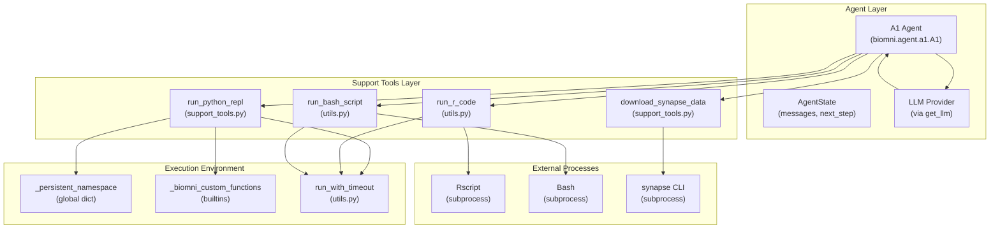

**Sources:** [biomni/agent/a1.py:1-223](), [biomni/tool/support_tools.py:1-389](), [biomni/utils.py:24-244]()

## Python REPL Execution

### Function: `run_python_repl`

The `run_python_repl` function provides persistent Python code execution, allowing variables and imports to persist across multiple executions within the same agent session.

**Location:** [biomni/tool/support_tools.py:13-44]()

### Key Features

| Feature | Description |
|---------|-------------|
| **Persistent State** | Variables defined in one execution remain available in subsequent executions |
| **Namespace Isolation** | Uses global `_persistent_namespace` dict to maintain execution context |
| **Custom Function Support** | Injected custom functions via `inject_custom_functions_to_repl` |
| **Matplotlib Integration** | Automatic plot capture with monkey-patched `plt.show()` and `plt.savefig()` |
| **Error Handling** | Returns error messages as strings rather than raising exceptions |

### Persistent Namespace Architecture

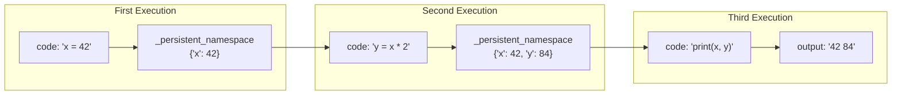

**Sources:** [biomni/tool/support_tools.py:6-44]()

### Parameters

| Parameter | Type | Required | Description |
|-----------|------|----------|-------------|
| `command` | `str` | Yes | Python code to execute in the persistent environment |

### Implementation Details

The function uses Python's `exec()` built-in with a persistent global namespace:

```python
# Global namespace shared across all executions
_persistent_namespace = {}

def run_python_repl(command: str) -> str:
    exec(command, _persistent_namespace)
```

The namespace includes:
- All previously defined variables
- All imported modules
- Custom functions injected via `inject_custom_functions_to_repl` [biomni/utils.py:1284-1314]()
- Built-in functions from `builtins._biomni_custom_functions`

**Sources:** [biomni/tool/support_tools.py:6-44](), [biomni/utils.py:1284-1314]()

### Matplotlib Plot Capture

The REPL applies monkey patches to matplotlib functions to automatically capture generated plots:

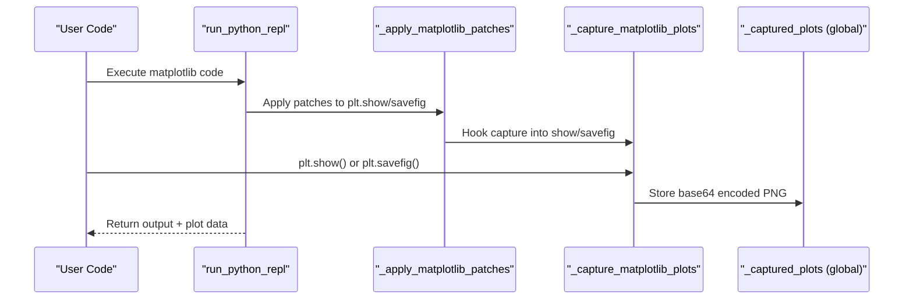

**Sources:** [biomni/tool/support_tools.py:47-127]()

## R Code Execution

### Function: `run_r_code`

The `run_r_code` function executes R code by creating a temporary R script file and running it via the `Rscript` command-line tool.

**Location:** [biomni/utils.py:25-53]()

### Architecture

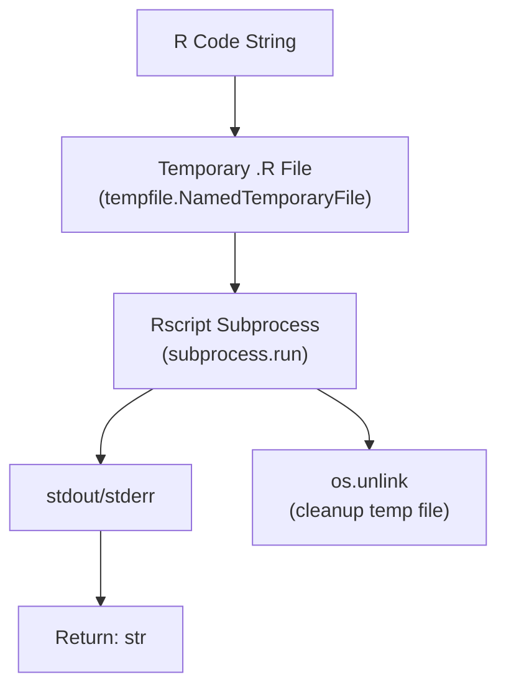

**Sources:** [biomni/utils.py:25-53]()

### Parameters

| Parameter | Type | Required | Description |
|-----------|------|----------|-------------|
| `code` | `str` | Yes | R code to execute via Rscript |

### Implementation Details

The function:
1. Creates a temporary `.R` file containing the code
2. Invokes `Rscript` as a subprocess
3. Captures stdout and stderr
4. Cleans up the temporary file
5. Returns output or error messages

**Key Code:** [biomni/utils.py:36-53]()

```python
# Create temporary R file
with tempfile.NamedTemporaryFile(suffix=".R", mode="w", delete=False) as f:
    f.write(code)
    temp_file = f.name

# Execute via Rscript
result = subprocess.run(["Rscript", temp_file], capture_output=True, text=True, check=False)

# Cleanup
os.unlink(temp_file)
```

**Sources:** [biomni/utils.py:25-53]()

## Bash Script Execution

### Function: `run_bash_script`

The `run_bash_script` function executes Bash scripts with automatic shebang and error handling setup.

**Location:** [biomni/utils.py:56-144]()

### Features

| Feature | Description |
|---------|-------------|
| **Auto-shebang** | Adds `#!/bin/bash` if not present |
| **Error Handling** | Adds `set -e` to exit on first error |
| **Environment Preservation** | Inherits current environment variables |
| **Working Directory** | Maintains current working directory |
| **Executable Permissions** | Sets chmod 0755 on temp script |

### Architecture

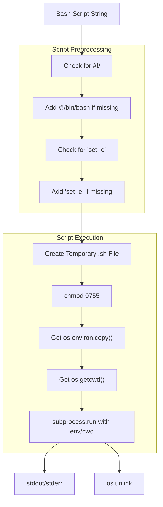

**Sources:** [biomni/utils.py:56-144]()

### Parameters

| Parameter | Type | Required | Description |
|-----------|------|----------|-------------|
| `script` | `str` | Yes | Bash script code to execute |

### Implementation Details

**Preprocessing:** [biomni/utils.py:96-112]()

```python
# Add shebang if not present
if not script.startswith("#!/"):
    f.write("#!/bin/bash\n")

# Add set -e to exit on error
if "set -e" not in script:
    f.write("set -e\n")

f.write(script)
```

**Execution:** [biomni/utils.py:115-130]()

```python
# Get current environment and working directory
env = os.environ.copy()
cwd = os.getcwd()

# Run with preserved environment
result = subprocess.run(
    [temp_file],
    shell=True,
    capture_output=True,
    text=True,
    check=False,
    env=env,
    cwd=cwd,
)
```

**Sources:** [biomni/utils.py:56-144]()

## Synapse Data Download

### Function: `download_synapse_data`

The `download_synapse_data` function downloads datasets, files, folders, or projects from Synapse repositories using the Synapse CLI.

**Location:** [biomni/tool/support_tools.py:199-389]()

### Entity Types and Usage

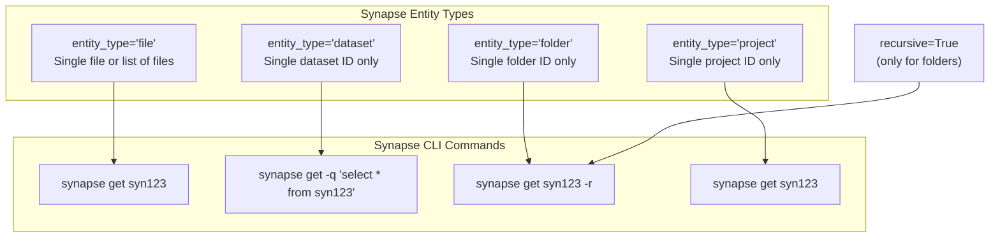

**Sources:** [biomni/tool/support_tools.py:199-389]()

### Parameters

| Parameter | Type | Default | Description |
|-----------|------|---------|-------------|
| `entity_ids` | `str \| list[str]` | Required | Entity ID(s). Multiple IDs only for `entity_type="file"` |
| `download_location` | `str` | `"."` | Download directory path |
| `follow_link` | `bool` | `False` | Follow links to download linked entities |
| `recursive` | `bool` | `False` | Recursive download. **Only valid for `entity_type="folder"`** |
| `timeout` | `int` | `300` | Timeout in seconds per download operation |
| `entity_type` | `str` | `"dataset"` | Entity type: `"file"`, `"dataset"`, `"folder"`, or `"project"` |

### Critical Validation Rules

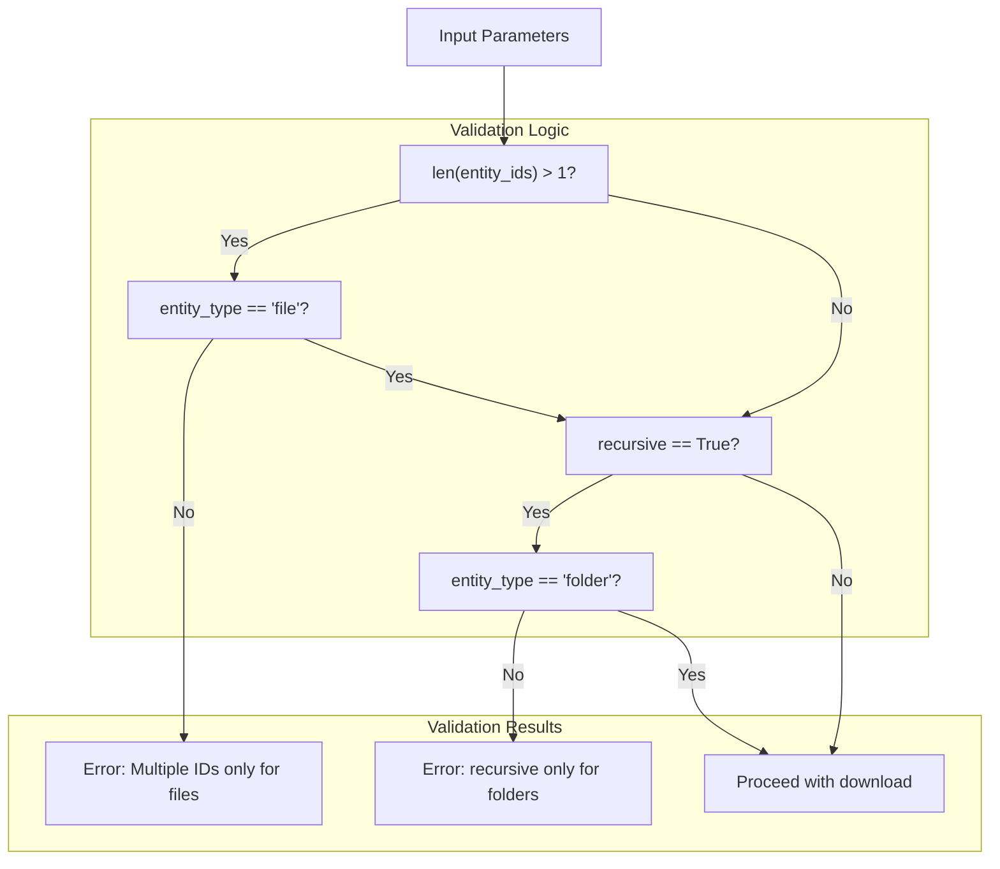

**Sources:** [biomni/tool/support_tools.py:305-321]()

### Authentication

The function requires the `SYNAPSE_AUTH_TOKEN` environment variable:

```python
synapse_token = os.environ.get("SYNAPSE_AUTH_TOKEN")
if not synapse_token:
    return {
        "success": False,
        "error": "SYNAPSE_AUTH_TOKEN environment variable is required"
    }
```

**Sources:** [biomni/tool/support_tools.py:277-283]()

### CLI Command Construction

| Entity Type | CLI Command Pattern |
|-------------|---------------------|
| `"file"` | `synapse -p {token} get {entity_id} --downloadLocation {dir}` |
| `"dataset"` | `synapse -p {token} get -q "select * from {entity_id}" --downloadLocation {dir}` |
| `"folder"` | `synapse -p {token} get {entity_id} --downloadLocation {dir} [-r]` |
| `"project"` | `synapse -p {token} get {entity_id} --downloadLocation {dir}` |

**Sources:** [biomni/tool/support_tools.py:332-353]()

### Return Value Structure

```python
{
    "success": bool,                  # Overall success status
    "total_requested": int,           # Number of entities requested
    "successful": int,                # Number of successful downloads
    "failed": int,                    # Number of failed downloads
    "download_location": str,         # Download directory path
    "results": [                      # Per-entity results
        {
            "entity_id": str,
            "success": bool,
            "stdout": str,            # (if successful)
            "download_location": str, # (if successful)
            "error": str              # (if failed)
        }
    ],
    "errors": list[str] | None       # List of error messages
}
```

**Sources:** [biomni/tool/support_tools.py:376-388]()

## Execution Environment Architecture

### Language Detection and Routing

The agent detects language markers in code to route execution to the appropriate tool:

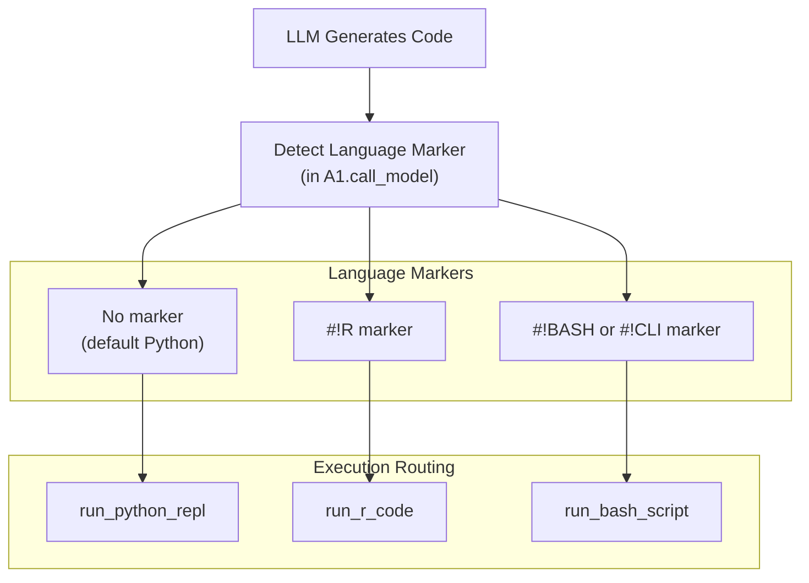

**Sources:** [biomni/agent/a1.py:1466-1490]()

### Code Execution Flow in A1 Agent

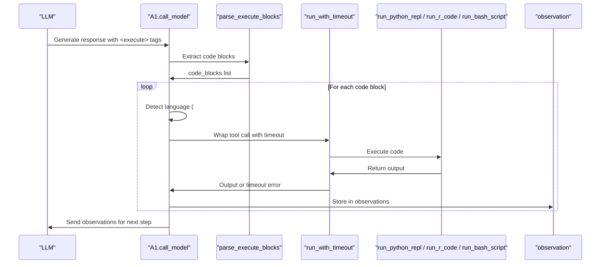

**Sources:** [biomni/agent/a1.py:1466-1490](), [biomni/utils.py:183-243]()

## Timeout Protection

### Function: `run_with_timeout`

All support tool executions are wrapped with timeout protection to prevent infinite loops or long-running operations.

**Location:** [biomni/utils.py:183-243]()

### Architecture

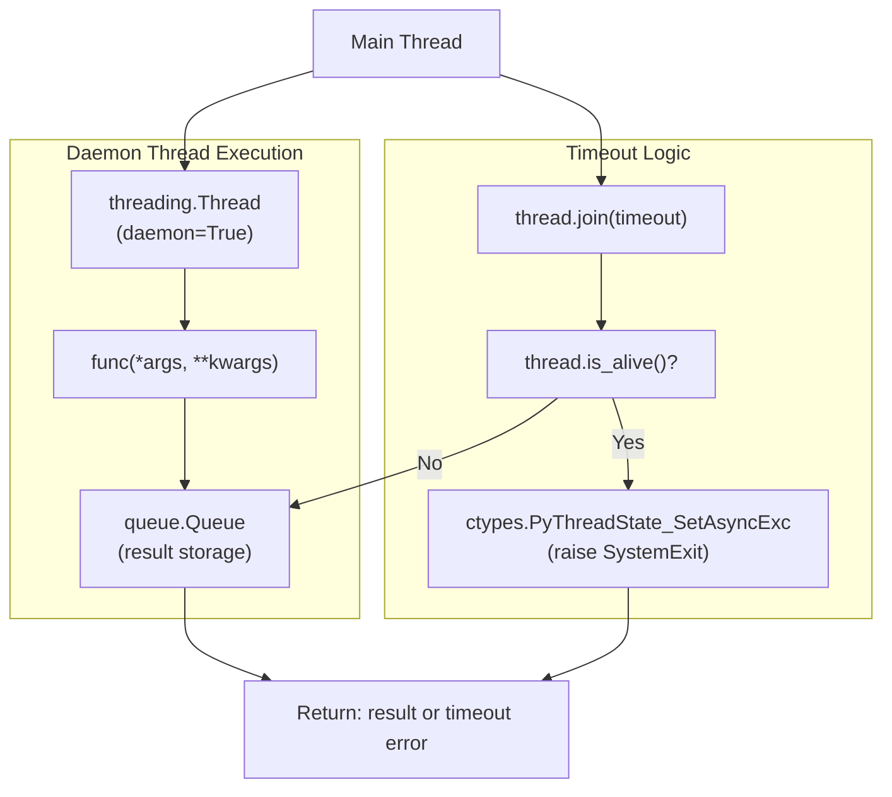

**Sources:** [biomni/utils.py:183-243]()

### Parameters

| Parameter | Type | Default | Description |
|-----------|------|---------|-------------|
| `func` | `callable` | Required | Function to execute |
| `args` | `list` | `[]` | Positional arguments |
| `kwargs` | `dict` | `{}` | Keyword arguments |
| `timeout` | `int` | `600` | Timeout in seconds |

### Implementation Details

**Thread Creation:** [biomni/utils.py:198-210]()

```python
def thread_func(func, args, kwargs, result_queue):
    try:
        result = func(*args, **kwargs)
        result_queue.put(("success", result))
    except Exception as e:
        result_queue.put(("error", str(e)))

thread = threading.Thread(target=thread_func, args=(func, args, kwargs, result_queue))
thread.daemon = True  # Daemon thread will be killed when main thread exits
thread.start()
```

**Timeout Handling:** [biomni/utils.py:212-235]()

```python
thread.join(timeout)

if thread.is_alive():
    # Attempt to terminate thread using ctypes
    thread_id = thread.ident
    if thread_id:
        res = ctypes.pythonapi.PyThreadState_SetAsyncExc(
            ctypes.c_long(thread_id),
            ctypes.py_object(SystemExit)
        )
    
    return f"ERROR: Code execution timed out after {timeout} seconds"
```

**Sources:** [biomni/utils.py:183-243]()

### Timeout Configuration

The default timeout is configured in the A1 agent initialization:

| Configuration | Default | Location |
|---------------|---------|----------|
| `timeout_seconds` | `600` (10 minutes) | [biomni/agent/a1.py:92]() |
| `default_config.timeout_seconds` | `600` | [biomni/config.py]() |

**Sources:** [biomni/agent/a1.py:63-223]()

## Custom Function Injection

### Function: `inject_custom_functions_to_repl`

Custom tools added via `agent.add_tool()` are injected into the Python REPL execution environment to make them callable during code execution.

**Location:** [biomni/utils.py:1284-1314]()

### Injection Architecture

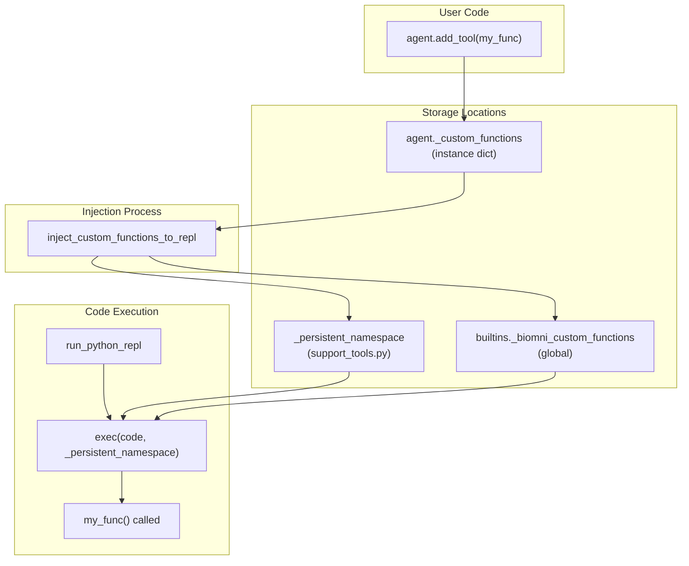

**Sources:** [biomni/utils.py:1284-1314](), [biomni/agent/a1.py:225-341]()

### Implementation Details

**Injection Process:** [biomni/utils.py:1300-1314]()

```python
def inject_custom_functions_to_repl(custom_functions: dict):
    if custom_functions:
        # Access the persistent namespace used by run_python_repl
        from biomni.tool.support_tools import _persistent_namespace
        
        # Inject all custom functions into the execution namespace
        for name, func in custom_functions.items():
            _persistent_namespace[name] = func
        
        # Also make them available in builtins for broader access
        import builtins
        if not hasattr(builtins, "_biomni_custom_functions"):
            builtins._biomni_custom_functions = {}
        builtins._biomni_custom_functions.update(custom_functions)
```

### Storage During add_tool()

**Storage Locations:** [biomni/agent/a1.py:316-339]()

```python
# Store in instance attribute
if not hasattr(self, "_custom_functions"):
    self._custom_functions = {}
self._custom_functions[schema["name"]] = api

# Store in builtins for direct access
import builtins
if not hasattr(builtins, "_biomni_custom_functions"):
    builtins._biomni_custom_functions = {}
builtins._biomni_custom_functions[schema["name"]] = api
```

**Sources:** [biomni/agent/a1.py:225-349](), [biomni/utils.py:1284-1314]()

## Tool Descriptions

The tool descriptions used for LLM tool selection and documentation are stored in structured format.

**Location:** [biomni/tool/tool_description/support_tools.py:1-75]()

### Description Schema

Each tool description follows this schema:

```python
{
    "name": str,                    # Function name
    "description": str,             # Purpose and usage notes
    "required_parameters": [        # Required params list
        {
            "name": str,
            "type": str,
            "description": str,
            "default": None
        }
    ],
    "optional_parameters": [        # Optional params list
        {
            "name": str,
            "type": str,
            "description": str,
            "default": any
        }
    ]
}
```

### Tool Description Summary

| Tool | Description | Required Parameters |
|------|-------------|---------------------|
| `run_python_repl` | Executes Python in persistent notebook environment | `command: str` |
| `read_function_source_code` | Reads source code of a function from any module | `function_name: str` |
| `download_synapse_data` | Downloads data from Synapse repositories with CLI | `entity_ids: str \| list[str]` |

**Sources:** [biomni/tool/tool_description/support_tools.py:1-75]()

---