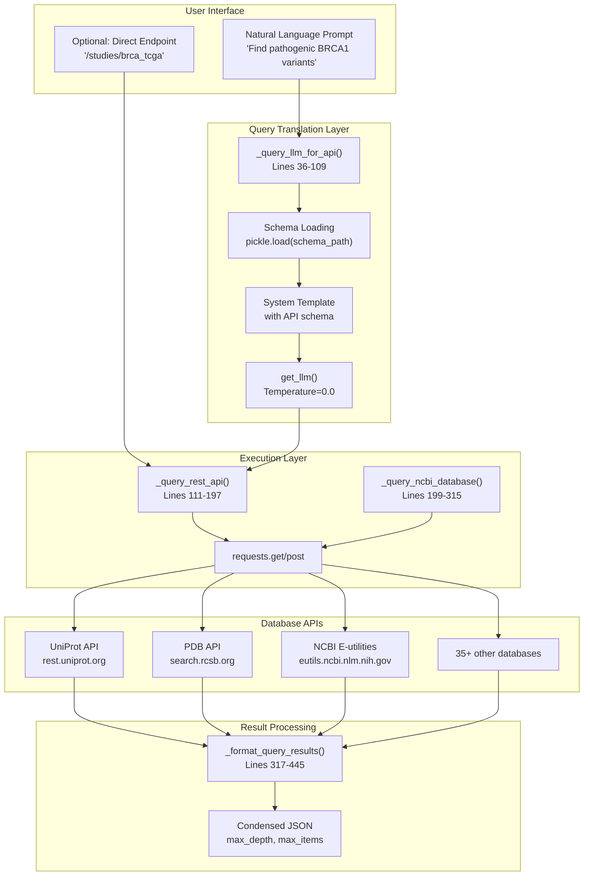
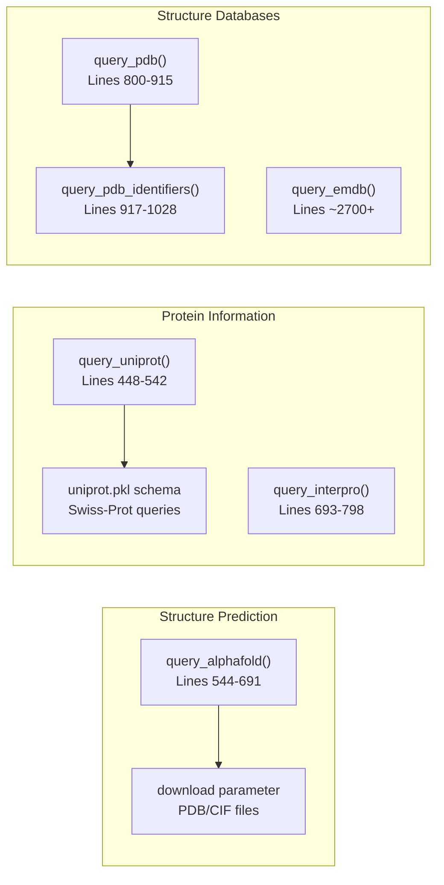
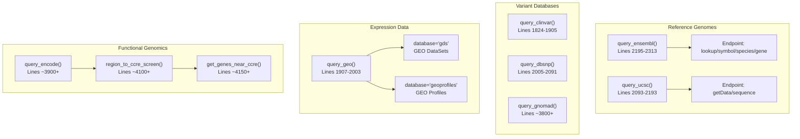
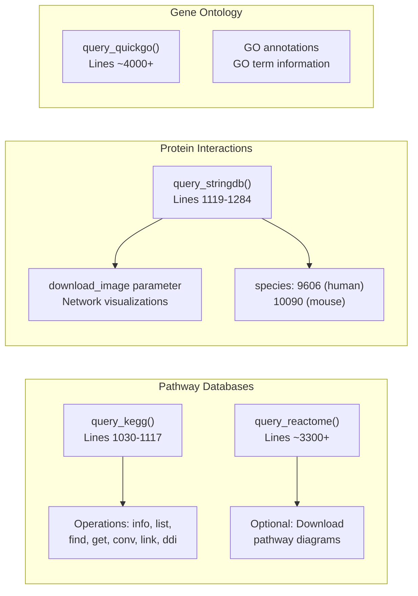
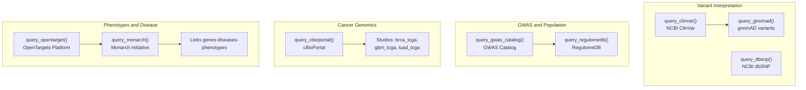
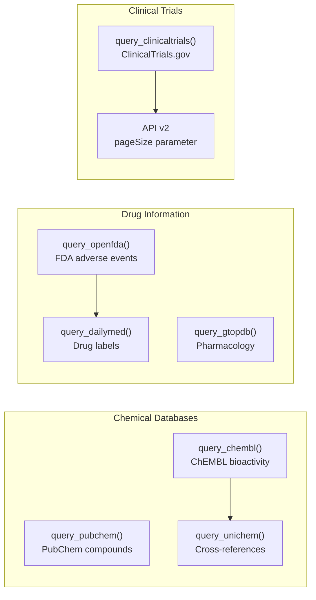
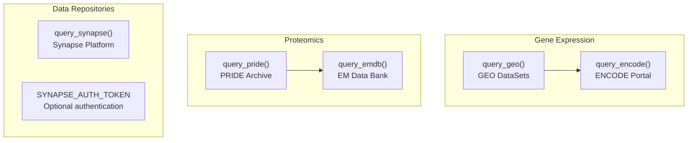
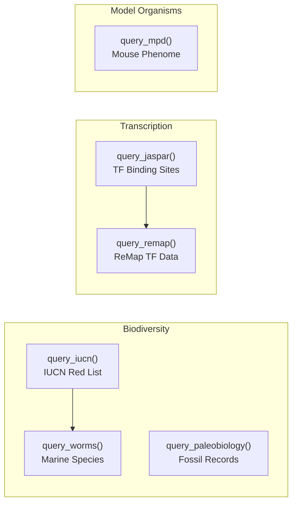
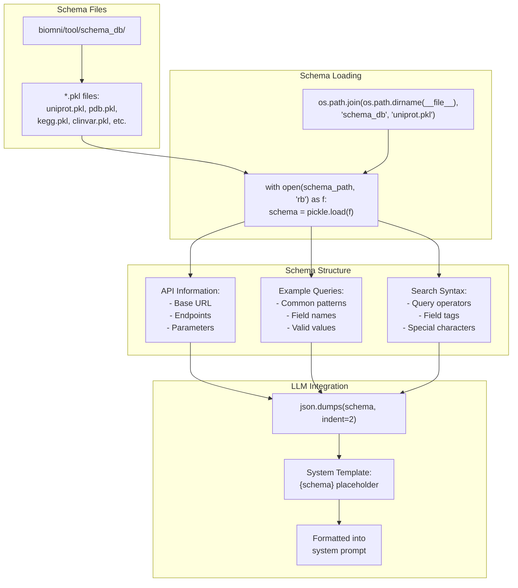
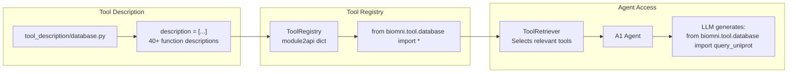

# Database Query Tools

<details>
<summary>Relevant source files</summary>

The following files were used as context for generating this wiki page:

- [biomni/tool/database.py](biomni/tool/database.py)
- [biomni/tool/tool_description/database.py](biomni/tool/tool_description/database.py)

</details>


## Purpose and Scope

The Database Query Tools provide a unified interface for querying over 40 biological, chemical, and clinical databases using natural language or direct API endpoints. These tools use LLM-based query translation to convert natural language prompts into properly formatted API requests, returning structured results that can be processed by the agent.

For genomics-specific analysis tools, see [Genomics and Single-Cell Tools](#5.2). For computational drug discovery tools, see [Pharmacology Tools](#5.4). For molecular biology protocols, see [Molecular Biology Tools](#5.3).

**Sources:** [biomni/tool/database.py:1-100](), [biomni/tool/tool_description/database.py:1-731]()

---

## Architecture Overview

### LLM-Powered Query Translation Pattern

All database query functions follow a common architecture where natural language prompts are converted to structured API calls through LLM-based interpretation:



**Sources:** [biomni/tool/database.py:36-197]()

---

## Core Infrastructure Functions

### _query_llm_for_api()

The central function that handles natural language to API translation for all database query tools. It loads a pre-generated schema, constructs a system prompt, and invokes the LLM to generate structured API calls.

**Key Features:**
- Uses `default_config.llm` for model selection (defaults to `claude-3-5-haiku-20241022`)
- Temperature set to 0.0 for deterministic outputs
- Returns JSON with `success`, `data`, and optional `raw_response` fields
- Handles JSON parsing with extraction from LLM explanations

**Sources:** [biomni/tool/database.py:36-109]()

### _query_rest_api()

General-purpose REST API query function with consistent error handling across all database tools.

| Parameter | Type | Description |
|-----------|------|-------------|
| `endpoint` | str | Full URL endpoint to query |
| `method` | str | HTTP method ("GET" or "POST") |
| `params` | dict | Query parameters for URL |
| `headers` | dict | HTTP headers (defaults to JSON) |
| `json_data` | dict | JSON body for POST requests |
| `description` | str | Description for error messages |

**Return Structure:**
```python
{
    "success": True,
    "query_info": {
        "endpoint": "...",
        "method": "GET",
        "description": "..."
    },
    "result": {...}  # Parsed JSON or raw_text
}
```

**Sources:** [biomni/tool/database.py:111-197]()

### _query_ncbi_database()

Specialized helper for NCBI databases (ClinVar, GEO, dbSNP, etc.) using NCBI E-utilities (ESearch and ESummary).

**Workflow:**
1. Executes ESearch to get matching IDs
2. Uses WebEnv/query_key for result history
3. Fetches detailed records via ESummary
4. Applies optional result formatter
5. Returns structured data with total count

**Sources:** [biomni/tool/database.py:199-315]()

### _format_query_results()

Reduces verbose API responses to manageable sizes by summarizing nested structures, truncating long lists, and excluding debugging keys.

**Formatting Options:**

| Option | Default | Description |
|--------|---------|-------------|
| `max_items` | 5 | Max items in lists |
| `max_depth` | 20 | Max recursion depth |
| `exclude_keys` | `["raw_response", "debug_info"]` | Keys to omit |
| `summarize_lists` | True | Summarize long lists |
| `truncate_strings` | 100 | Max string length |

**Sources:** [biomni/tool/database.py:317-445]()

---

## Database Categories and Functions

### Protein and Structure Databases



#### query_uniprot()

Queries the UniProt REST API for protein information using natural language or direct endpoints.

**Parameters:**
- `prompt` (required): Natural language query (e.g., "Find information about human insulin")
- `endpoint` (optional): Direct UniProt URL or path
- `max_results` (optional, default=5): Maximum results to return

**Example Usage:**
```python
# Natural language query
result = query_uniprot(prompt="Find kinase domains in human EGFR protein")

# Direct endpoint
result = query_uniprot(endpoint="https://rest.uniprot.org/uniprotkb/P01308")
```

**Schema Features:**
- Defaults to reviewed (Swiss-Prot) entries
- Assumes human organism (taxonomy ID 9606) unless specified
- Uses `gene_exact:` for precise gene name searches
- Supports field-specific queries: `accession:`, `gene:`, `organism_id:`

**Sources:** [biomni/tool/database.py:448-542](), [biomni/tool/tool_description/database.py:1-22]()

#### query_alphafold()

Retrieves protein structure predictions from AlphaFold Database with optional file downloads.

**Parameters:**
- `uniprot_id` (required): UniProt accession (e.g., "P53_HUMAN")
- `endpoint` (optional, default="prediction"): "prediction", "summary", or "annotations"
- `residue_range` (optional): Residue range as "start-end"
- `download` (optional, default=False): Whether to download structure files
- `output_dir` (optional): Directory for downloaded files
- `file_format` (optional, default="pdb"): "pdb" or "cif"
- `model_version` (optional, default="v4"): "v4", "v3", "v2", "v1"
- `model_number` (optional, default=1): Model number (1-5)

**Download Naming Convention:**
```
AF-{uniprot_id}-F{model_number}-model_{model_version}.{file_format}
```

**Sources:** [biomni/tool/database.py:544-691](), [biomni/tool/tool_description/database.py:23-53]()

#### query_interpro()

Queries InterPro for protein domain and family information.

**Key Features:**
- Path components: `entry`, `protein`, `structure`, `set`, `taxonomy`, `proteome`
- Common sources: `interpro`, `pfam`, `cdd`, `uniprot`, `pdb`
- Supports hierarchical endpoints: `/entry/interpro/protein/uniprot/P04637`
- Uses lowercase accessions (e.g., "ipr000001")

**Sources:** [biomni/tool/database.py:693-798](), [biomni/tool/tool_description/database.py:54-69]()

#### query_pdb()

Searches the RCSB PDB database using natural language or structured queries.

**Query Structure:**
```python
{
    "query": {
        "type": "terminal",  # or "group" for combined queries
        "service": "full_text",  # or "text" for attribute-specific
        "parameters": {"value": "insulin"}
    },
    "return_type": "entry",  # or "assembly", "polymer_entity", etc.
    "request_options": {
        "paginate": {"start": 0, "rows": 3}
    }
}
```

**Search Services:**
- `full_text`: General keyword search across multiple fields
- `text`: Attribute-specific (requires `attribute`, `operator`, `value`)
- Specialized: `sequence`, `structure`, `motif` searches

**Sources:** [biomni/tool/database.py:800-915](), [biomni/tool/tool_description/database.py:70-85]()

#### query_pdb_identifiers()

Retrieves detailed data and downloads structure files for PDB identifiers returned by `query_pdb()`.

**Return Type Endpoints:**

| return_type | Endpoint Format | Example Identifier |
|-------------|----------------|-------------------|
| `entry` | `/core/entry/{id}` | `4HHB` |
| `polymer_entity` | `/core/polymer_entity/{entry}/{entity}` | `4HHB_1` |
| `assembly` | `/core/assembly/{entry}/{assembly}` | `4HHB-1` |
| `polymer_instance` | `/core/polymer_entity_instance/{entry}/{asym}` | `4HHB.A` |

**Download Feature:**
- Downloads from `files.rcsb.org/download/{pdb_id}.pdb`
- Saves to `biomni/tool/data/pdb/` directory
- Extracts PDB ID from composite identifiers

**Sources:** [biomni/tool/database.py:917-1028](), [biomni/tool/tool_description/database.py:86-107]()

---

### Genomic Databases



#### query_ensembl()

Queries the Ensembl REST API for genomic features, sequences, and variant information.

**Key Capabilities:**
- Gene lookups: `lookup/symbol/homo_sapiens/BRCA2`
- Sequence retrieval: supports `genomic`, `cdna`, `cds`, `protein` types
- Variant coordinates: converts rsID to hg38 coordinates
- Overlapping features: `/overlap/region/homo_sapiens/chr:start-end`
- Chromosome band info: `/info/assembly/homo_sapiens/chr` with `band=1`

**Constraints:**
- Maximum region length: 4,900,000 bp
- Returns error if query exceeds this limit

**Sources:** [biomni/tool/database.py:2195-2313](), [biomni/tool/tool_description/database.py:285-300]()

#### query_ucsc()

Queries the UCSC Genome Browser API for genomic sequences and annotations.

**Important Notes:**
- Chromosome names require "chr" prefix (e.g., "chr1", "chrX", "chrM")
- Positions are 0-based (first base = position 0)
- Common genomes: "hg38" (human), "mm39" (mouse), "danRer11" (zebrafish)

**Common Endpoints:**
- `getData/sequence`: Retrieve DNA sequences
- `list/chromosomes`: List chromosomes for genome
- `list/ucscGenomes`: Available genomes

**Sources:** [biomni/tool/database.py:2093-2193](), [biomni/tool/tool_description/database.py:269-284]()

#### query_clinvar()

Searches ClinVar database for genetic variants and their clinical significance.

**Search Syntax:**

| Tag | Purpose | Example |
|-----|---------|---------|
| `[gene]` | Gene name | `BRCA1[gene]` |
| `[clinsig]` | Clinical significance | `pathogenic[clinsig]` |
| `[rsid]` | dbSNP RS ID | `rs6025[rsid]` |
| `[chr]` | Chromosome | `17[chr]` |
| `[chrpos37]` | Position (GRCh37) | `43000000:44000000[chrpos37]` |

**Combining Terms:**
- Use `AND`, `OR`, `NOT` (capitalized)
- Use parentheses for complex logic
- Multi-word terms: Use quotes or underscores

**Example Queries:**
```python
# Pathogenic BRCA1 variants
query_clinvar(prompt="Find pathogenic BRCA1 variants")
# Generated: "BRCA1[gene] AND clinsig_pathogenic[prop]"

# Specific variant
query_clinvar(search_term="rs6025[rsid]")

# Genomic region
query_clinvar(search_term="17[chr] AND 43000000:44000000[chrpos37]")
```

**Sources:** [biomni/tool/database.py:1824-1905](), [biomni/tool/tool_description/database.py:221-236]()

#### query_dbsnp()

Queries the NCBI dbSNP database for single nucleotide polymorphisms and variants.

**Search Tags:**

| Tag | Description |
|-----|-------------|
| `[Gene Name]` | Gene symbol |
| `[Clinical Significance]` | Clinical relevance |
| `[rs]` | dbSNP RS identifier |
| `[Chromosome]` | Chromosome number |
| `[Base Position]` | Genomic coordinates |
| `[COMMON]` | Common variants filter |

**Example:**
```python
# Common SNPs in EGFR
query_dbsnp(prompt="Find common SNPs in EGFR gene")
# Generated: "EGFR[Gene Name] AND common[COMMON]"
```

**Sources:** [biomni/tool/database.py:2005-2091](), [biomni/tool/tool_description/database.py:253-268]()

#### query_geo()

Queries NCBI Gene Expression Omnibus for RNA-seq, microarray, and expression data.

**Database Selection:**
- `gds`: GEO DataSets (Series, Datasets, Platforms, Samples metadata)
- `geoprofiles`: GEO Profiles (gene expression data)

**Search Tags:**

| Tag | Purpose | Example |
|-----|---------|---------|
| `[ETYP]` | Entry type | `gse[ETYP]` for Series |
| `[ORGN]` | Organism | `Mus musculus[ORGN]` |
| `[PDAT]` | Publication date | `2020[PDAT]` |
| `[Title]` | Dataset title | `breast cancer[Title]` |
| `[Gene Symbol]` | Gene name | `TP53[Gene Symbol]` |

**Example Queries:**
```python
# RNA-seq breast cancer data
query_geo(prompt="Find RNA-seq datasets for breast cancer")
# Generated: "RNA-seq AND breast cancer AND gse[ETYP]", database="gds"

# Expression profiles of TP53
query_geo(prompt="Expression profiles of TP53 in lung cancer")
# Generated: "TP53[Gene Symbol] AND lung cancer", database="geoprofiles"
```

**Sources:** [biomni/tool/database.py:1907-2003](), [biomni/tool/tool_description/database.py:237-252]()

---

### Pathway and Interaction Databases



#### query_kegg()

Queries the KEGG (Kyoto Encyclopedia of Genes and Genomes) database for pathway, gene, and compound information.

**KEGG API Operations:**

| Operation | Purpose | Example |
|-----------|---------|---------|
| `info` | Database info | `/info/pathway/hsa00010` |
| `list` | List entries | `/list/pathway/hsa` |
| `find` | Search entries | `/find/genes/shigella+toxin` |
| `get` | Get entry | `/get/hsa:672` |
| `conv` | Convert IDs | `/conv/genes/ncbi-geneid:672` |
| `link` | Find related | `/link/pathway/hsa:672` |
| `ddi` | Drug interactions | `/ddi/D00001+D00002` |

**Common Patterns:**
- Human pathways: `hsa` prefix (e.g., `hsa00010` for glycolysis)
- Gene IDs: `hsa:672` format (organism:gene_id)
- Pathway listing: `/list/pathway/{organism}`

**Sources:** [biomni/tool/database.py:1030-1117](), [biomni/tool/tool_description/database.py:108-118]()

#### query_stringdb()

Queries STRING database for protein-protein interaction networks.

**Parameters:**
- `prompt`: Natural language query
- `endpoint`: Direct STRING endpoint
- `download_image`: Whether to download network images
- `output_dir`: Directory for image files

**Key Features:**
- Common species IDs: 9606 (human), 10090 (mouse), 7227 (fly), 4932 (yeast)
- Identifiers: Gene names (e.g., "BRCA1") or UniProt IDs (e.g., "P38398")
- `required_score`: Confidence threshold (0-1000, higher = more stringent)
- Always adds `caller_identity=bioagentos_api` parameter

**Output Formats:**
- `json`: Structured data
- `tsv`: Tab-separated values
- `image`/`svg`: Network visualizations

**Example:**
```python
# Query and download network
result = query_stringdb(
    prompt="Show protein interactions for BRCA1 and BRCA2 in humans",
    download_image=True,
    output_dir="./networks"
)
```

**Sources:** [biomni/tool/database.py:1119-1284](), [biomni/tool/tool_description/database.py:119-141]()

#### query_reactome()

Queries Reactome pathway database with optional diagram downloads.

**Key Features:**
- Biological pathways and reactions
- Pathway diagrams available for download
- Supports pathway hierarchy traversal
- Links pathways to proteins, genes, and compounds

**Sources:** [biomni/tool/database.py:3300+](), [biomni/tool/tool_description/database.py:395-415]()

---

### Clinical and Variant Databases



#### query_cbioportal()

Queries cBioPortal for cancer genomics data from TCGA and other studies.

**Common Study IDs:**
- `brca_tcga`: Breast invasive carcinoma
- `gbm_tcga`: Glioblastoma multiforme
- `luad_tcga`: Lung adenocarcinoma
- `coadread_tcga`: Colorectal adenocarcinoma

**Molecular Profile Format:**
```
{study_id}_{data_type}
```
Examples: `brca_tcga_mutations`, `gbm_tcga_rna_seq_v2_mrna`

**Query Parameters:**
- Gene identifiers: Hugo symbol (e.g., "BRCA1") or Entrez ID (e.g., 672)
- Projection: Use `projection=DETAILED` for comprehensive results
- Pagination: `pageNumber` and `pageSize` parameters

**Sources:** [biomni/tool/database.py:1722-1822](), [biomni/tool/tool_description/database.py:205-220]()

#### query_opentarget()

Queries OpenTargets Platform using GraphQL for drug target-disease associations.

**Key Features:**
- GraphQL interface (not REST)
- Disease IDs use EFO ontology (e.g., "EFO_0000249" for Alzheimer's)
- Target IDs use Ensembl IDs (e.g., "ENSG00000197386")
- Always limit results with `first` parameter (e.g., `first: 10`)
- Escape quotes in GraphQL strings: `\"`

**Example GraphQL Query Structure:**
```python
{
    "query": "query diseaseAssociations($diseaseId: String!) { ... }",
    "variables": {"diseaseId": "EFO_0000249"}
}
```

**Sources:** [biomni/tool/database.py:2315-2413](), [biomni/tool/tool_description/database.py:301-317]()

#### query_monarch()

Queries Monarch Initiative for integrated gene-disease-phenotype information.

**Parameters:**
- `prompt`: Natural language query
- `endpoint`: Direct Monarch API endpoint
- `max_results`: Maximum results (adds `limit` parameter)
- `verbose`: Return detailed or formatted results

**Biolink Categories:**
- `biolink:Disease`
- `biolink:Gene`
- `biolink:PhenotypicFeature`
- `biolink:Variant`

**Common Endpoints:**
- `/search`: General search across categories
- `/entity/{id}`: Get specific entity (e.g., "MONDO:0007947" for Marfan)
- `/association`: Query associations between entities

**Sources:** [biomni/tool/database.py:2416-2530](), [biomni/tool/tool_description/database.py:318-334]()

---

### Chemical and Drug Databases



#### query_pubchem()

Queries PubChem PUG-REST API for chemical compound information.

**Key Features:**
- Rate limited to 5 requests per second
- Supports compound, substance, and assay data
- Various input types: CID, name, SMILES, InChI
- Multiple output formats: JSON, XML, CSV, PNG (images)

**Common Query Types:**
- By CID: `/compound/cid/{cid}/property/MolecularFormula/JSON`
- By name: `/compound/name/{name}/property/...`
- Similarity search: `/compound/fastsimilarity_2d/cid/{cid}/...`

**Sources:** [biomni/tool/database.py:3700+](), [biomni/tool/tool_description/database.py:552-572]()

#### query_chembl()

Queries ChEMBL database for bioactivity data, drug information, and target interactions.

**Input Methods:**
- Natural language prompt
- Direct endpoint
- ChEMBL ID (e.g., "CHEMBL25" for aspirin)
- SMILES string (for similarity/substructure search)
- Molecule name

**Key Features:**
- Bioactivity assays and IC50 values
- Target information and classifications
- Drug mechanism of action
- Clinical candidate information

**Example:**
```python
# By ChEMBL ID
result = query_chembl(chembl_id="CHEMBL25")

# By SMILES
result = query_chembl(smiles="CC(=O)Oc1ccccc1C(=O)O")

# Natural language
result = query_chembl(prompt="Find bioactivity data for aspirin")
```

**Sources:** [biomni/tool/database.py:3800+](), [biomni/tool/tool_description/database.py:573-597]()

#### query_openfda()

Queries OpenFDA API for drug adverse events, recalls, and labeling information.

**Endpoints:**
- `/drug/event`: Adverse event reports
- `/drug/label`: Drug labeling information
- `/drug/enforcement`: Drug recalls and enforcement
- `/device/event`: Device adverse events
- `/food/enforcement`: Food recalls

**Query Parameters:**
- `search`: Search criteria (e.g., `patient.drug.openfda.brand_name:"Aspirin"`)
- `count`: Aggregate counts (e.g., `count=patient.reaction.reactionmeddrapt.exact`)
- `limit`: Max results (default 100)
- `skip`: Pagination offset

**Sources:** [biomni/tool/database.py:2530+](), [biomni/tool/tool_description/database.py:335-355]()

#### query_clinicaltrials()

Queries ClinicalTrials.gov API v2 for clinical trial information.

**Key Features:**
- Search by condition, intervention, location, or trial ID
- Filter by study status, phase, sponsor
- Pagination with `pageSize` parameter
- Study details including eligibility, outcomes, contacts

**Common Query Fields:**
- Condition: Disease or condition studied
- Intervention: Drug, device, or procedure
- Location: Geographic location of study sites
- NCT ID: ClinicalTrials.gov identifier (e.g., "NCT00000001")

**Sources:** [biomni/tool/database.py:4200+](), [biomni/tool/tool_description/database.py:615-635]()

---

### Expression and Omics Databases



#### query_pride()

Queries the PRIDE (PRoteomics IDEntifications) Archive for proteomics datasets.

**Key Features:**
- Mass spectrometry data
- Protein identification results
- Quantitative proteomics experiments
- Links to raw data files

**Query Capabilities:**
- Search by project accession
- Filter by organism, tissue, instrument
- Search by protein or peptide
- Date range filtering

**Sources:** [biomni/tool/database.py:3400+](), [biomni/tool/tool_description/database.py:433-447]()

#### query_encode()

Queries ENCODE Portal for functional genomics data including ChIP-seq, RNA-seq, and ATAC-seq.

**Data Types:**
- Experiments: High-throughput sequencing experiments
- Files: Raw and processed data files
- Biosamples: Cell lines and tissue samples
- Datasets: Collections of related data

**Parameters:**
- `max_results`: Limit or "all" for complete results
- Supports complex filters on data type, assay, biosample

**Related Functions:**
- `region_to_ccre_screen()`: Find cCREs in genomic regions
- `get_genes_near_ccre()`: Find genes near cCREs

**Sources:** [biomni/tool/database.py:3900+](), [biomni/tool/tool_description/database.py:670-696]()

#### region_to_ccre_screen()

Retrieves ENCODE SCREEN candidate cis-regulatory elements (cCREs) that intersect a genomic region.

**Parameters:**
- `coord_chrom` (required): Chromosome (e.g., "chr12")
- `coord_start` (required): Start coordinate
- `coord_end` (required): End coordinate
- `assembly` (optional, default="GRCh38"): Genome assembly

**Return Data:**
- cCRE accessions
- Coordinates
- Classification (promoter, enhancer, CTCF-bound, etc.)
- DNase and H3K27ac signals

**Sources:** [biomni/tool/database.py:4100+](), [biomni/tool/tool_description/database.py:697-708]()

#### get_genes_near_ccre()

Returns the k nearest genes to a given cCRE, sorted by distance.

**Parameters:**
- `accession` (required): ENCODE cCRE accession (e.g., "EH38E1516980")
- `assembly` (required): Genome assembly (e.g., "GRCh38")
- `chromosome` (required): Chromosome of cCRE (e.g., "chr12")
- `k` (optional, default=10): Number of nearby genes

**Return Data:**
- Gene symbols
- Gene coordinates
- Distance from cCRE
- Strand information

**Sources:** [biomni/tool/database.py:4150+](), [biomni/tool/tool_description/database.py:709-731]()

#### query_synapse()

Queries Synapse platform for biomedical datasets with optional authentication.

**Authentication:**
- Set `SYNAPSE_AUTH_TOKEN` environment variable
- Token required for private datasets
- Public datasets accessible without authentication

**Query Parameters:**
- `query_term`: Search term(s) - list uses AND logic
- `return_fields`: Fields to return (default: name, node_type, description)
- `max_results`: Typical 20, up to 50 allowed
- `query_type`: "dataset", "file", or "folder"

**Example:**
```python
# Public dataset search
result = query_synapse(
    prompt="Find Alzheimer's disease RNA-seq datasets",
    query_type="dataset",
    max_results=20
)
```

**Sources:** [biomni/tool/database.py:4400+](), [biomni/tool/tool_description/database.py:512-550]()

---

### Specialized Databases



#### query_iucn()

Queries the IUCN Red List API for species conservation status.

**Authentication:**
- Requires IUCN API token
- Get token at: https://apiv3.iucnredlist.org/api/v3/token

**Parameters:**
- `prompt`: Natural language query
- `endpoint`: Direct endpoint
- `token` (required): IUCN API token
- `verbose`: Return detailed results

**Key Features:**
- Conservation status by species
- Taxonomic information
- Geographic distribution
- Population trends
- Threats and conservation measures

**Note:** Token is hidden in results for security

**Sources:** [biomni/tool/database.py:1286-1391](), [biomni/tool/tool_description/database.py:142-156]()

#### query_jaspar()

Queries JASPAR database for transcription factor binding site profiles.

**Key Features:**
- Position frequency matrices (PFMs)
- Position weight matrices (PWMs)
- Binding site logos
- Taxonomic groups: vertebrates, plants, fungi, insects, nematodes
- Collections: CORE, UNVALIDATED, PENDING

**Matrix IDs:**
- Format: MA####.# (e.g., "MA0002.2")
- Version-specific identifiers

**Inference Capability:**
- Infer matrices from protein sequences
- Provide sequence directly in API path

**Sources:** [biomni/tool/database.py:1521-1623](), [biomni/tool/tool_description/database.py:173-188]()

#### query_worms()

Queries World Register of Marine Species (WoRMS) for marine taxonomy.

**Key Features:**
- Scientific name searches
- Fuzzy matching with `fuzzy=true` parameter
- AphiaID main identifier system
- Taxonomic hierarchy
- Synonyms and vernacular names

**Common Endpoints:**
- `AphiaRecordByName`: Exact name match
- `AphiaRecordsByName`: Broader results
- `AphiaRecordByID`: Query by AphiaID

**Example:**
```python
result = query_worms(prompt="Find information about the blue whale")
# Uses endpoint: /AphiaRecordByName/Balaenoptera%20musculus
```

**Sources:** [biomni/tool/database.py:1625-1720](), [biomni/tool/tool_description/database.py:189-204]()

#### query_paleobiology()

Queries Paleobiology Database (PBDB) for fossil records and paleontological data.

**Output Formats:**
- `.json`: JSON format
- `.txt`: Plain text
- `.csv`: Comma-separated
- `.tsv`: Tab-separated
- `.png`: Visualization images

**Key Query Types:**
- Taxonomic searches: Specific ranks and names
- Geographic queries: Countries, continents, bounding boxes
- Time intervals: Geological time names (e.g., "Cretaceous", "Maastrichtian")
- Occurrence data: Fossil locations and characteristics

**Vocabulary Parameters:**
- `vocab=pbdb`: Default PBDB vocabulary
- `vocab=com`: Compact vocabulary

**Sources:** [biomni/tool/database.py:1393-1519](), [biomni/tool/tool_description/database.py:157-172]()

---

## Schema Management System

### Schema Storage and Loading

All database query functions use pre-generated schemas stored as pickle files in [biomni/tool/schema_db/]():



**Sources:** [biomni/tool/database.py:482-484, 730-732, 831-834]()

### Schema Loading Pattern

Each database query function follows this pattern:

```python
# Load schema from pickle file
schema_path = os.path.join(os.path.dirname(__file__), "schema_db", "uniprot.pkl")
with open(schema_path, "rb") as f:
    schema = pickle.load(f)

# Create system prompt with schema
system_template = """
You are an expert in using the {database} API.

{database} API SCHEMA:
{schema}

Your response should be a JSON object with:
1. "full_url": The complete URL to query
2. "description": What the query does

SPECIAL NOTES:
- Database-specific guidance
- Common patterns
- Important constraints
"""

# Query LLM with schema
llm_result = _query_llm_for_api(
    prompt=prompt,
    schema=schema,
    system_template=system_template
)
```

**Sources:** [biomni/tool/database.py:482-515, 730-762]()

### Common Schema Elements

Most schemas include:

| Element | Description |
|---------|-------------|
| `base_url` | API base URL |
| `endpoints` | Available endpoints with parameters |
| `operations` | Supported operations (GET, POST, etc.) |
| `search_fields` | Searchable fields and their tags |
| `common_attributes` | Frequently used attributes |
| `example_queries` | Sample queries demonstrating syntax |
| `special_notes` | Database-specific constraints |

---

## Usage Patterns and Best Practices

### Natural Language Query Pattern

All `query_*` functions support natural language input:

```python
from biomni.tool.database import query_uniprot, query_kegg, query_clinvar

# Protein information
result = query_uniprot(
    prompt="Find all kinase domains in human EGFR protein"
)

# Pathway information
result = query_kegg(
    prompt="Show human pathways related to glycolysis"
)

# Variant interpretation
result = query_clinvar(
    prompt="What is the pathogenicity of BRCA1 p.Cys61Gly variant?"
)
```

**Sources:** [biomni/tool/database.py:448-542, 1030-1117, 1824-1905]()

### Direct Endpoint Pattern

For precise control, provide direct endpoints:

```python
# Direct UniProt URL
result = query_uniprot(
    endpoint="https://rest.uniprot.org/uniprotkb/P01308"
)

# Direct PDB query
result = query_pdb(
    query={
        "query": {
            "type": "terminal",
            "service": "full_text",
            "parameters": {"value": "insulin"}
        },
        "return_type": "entry"
    }
)
```

**Sources:** [biomni/tool/database.py:530-542, 879-913]()

### Result Formatting Pattern

Control output verbosity:

```python
# Verbose (default) - full API response
result = query_kegg(prompt="Find BRCA1 pathways", verbose=True)

# Condensed - formatted summary
result = query_kegg(prompt="Find BRCA1 pathways", verbose=False)
# Uses _format_query_results() internally
```

The `_format_query_results()` function:
- Limits list lengths to 5 items by default
- Truncates strings to 100 characters
- Excludes debugging keys
- Summarizes nested structures
- Preserves critical information

**Sources:** [biomni/tool/database.py:317-445, 1113-1115]()

### Combining Query Results

Chain queries for comprehensive analysis:

```python
# Step 1: Find structures
pdb_results = query_pdb(prompt="Find structures of human insulin")

# Step 2: Get detailed information
identifiers = [item["identifier"] for item in pdb_results["result"]["result_set"]]
details = query_pdb_identifiers(
    identifiers=identifiers,
    download=True  # Download PDB files
)

# Step 3: Get AlphaFold prediction
af_result = query_alphafold(
    uniprot_id="P01308",
    download=True,
    file_format="pdb"
)
```

**Sources:** [biomni/tool/database.py:800-915, 917-1028, 544-691]()

### Error Handling Pattern

All query functions return consistent error structures:

```python
result = query_uniprot(prompt="...")

if "error" in result:
    # Handle error
    print(f"Query failed: {result['error']}")
    if "llm_response" in result:
        print(f"LLM output: {result['llm_response']}")
else:
    # Process successful result
    data = result["result"]
```

**Sources:** [biomni/tool/database.py:99-108, 186-196]()

---

## Integration with A1 Agent

### Tool Discovery and Registration

Database query functions are automatically discovered and registered through the tool description system:



**Sources:** [biomni/tool/tool_description/database.py:1-731]()

### Execution Within Agent Context

When the A1 agent executes database queries:

1. **Tool Selection**: ToolRetriever identifies relevant query functions based on user prompt
2. **Code Generation**: LLM generates import and function call statements
3. **Execution**: Code runs in persistent Python namespace (`_persistent_namespace`)
4. **Result Capture**: Return values stored and displayed to user

**Example Agent Execution:**

```python
# User prompt: "Find pathogenic BRCA1 variants"

# Agent generates and executes:
from biomni.tool.database import query_clinvar

result = query_clinvar(
    prompt="Find pathogenic BRCA1 variants",
    max_results=5
)

# Result available for further analysis
print(f"Found {result['total_results']} variants")
```

**Sources:** Related to [2.1 A1 Agent Core](#2.1) and [2.4 Tool Registry and Retrieval](#2.4)

### Configuration for Database Queries

Database queries use the global configuration for LLM selection:

```python
# From default_config
from biomni.config import default_config

# Database queries automatically use:
# - default_config.llm (model name)
# - default_config.api_key (API key)

# Example: Different model for database queries
default_config.llm = "claude-3-5-haiku-20241022"  # Fast, cost-effective
```

The `_query_llm_for_api()` function accesses this configuration:

```python
try:
    from biomni.config import default_config
    model = default_config.llm
    api_key = default_config.api_key
except ImportError:
    model = "claude-3-5-haiku-20241022"
    api_key = None
```

**Sources:** [biomni/tool/database.py:53-60](), related to [2.5 Configuration System](#2.5)

---

## Summary Table of All Database Query Functions

| Function | Database | Primary Use Case | Natural Language Support |
|----------|----------|------------------|-------------------------|
| `query_uniprot()` | UniProt | Protein sequences and annotations | Yes |
| `query_alphafold()` | AlphaFold | Protein structure predictions | No (requires UniProt ID) |
| `query_interpro()` | InterPro | Protein domains and families | Yes |
| `query_pdb()` | RCSB PDB | Protein crystal structures | Yes |
| `query_pdb_identifiers()` | RCSB PDB | Detailed structure data | No (requires IDs) |
| `query_kegg()` | KEGG | Metabolic pathways | Yes |
| `query_stringdb()` | STRING | Protein-protein interactions | Yes |
| `query_iucn()` | IUCN | Species conservation status | Yes (requires token) |
| `query_paleobiology()` | PBDB | Fossil records | Yes |
| `query_jaspar()` | JASPAR | TF binding motifs | Yes |
| `query_worms()` | WoRMS | Marine species taxonomy | Yes |
| `query_cbioportal()` | cBioPortal | Cancer genomics | Yes |
| `query_clinvar()` | ClinVar | Clinical variant interpretation | Yes |
| `query_geo()` | NCBI GEO | Gene expression data | Yes |
| `query_dbsnp()` | dbSNP | SNP/variant information | Yes |
| `query_ucsc()` | UCSC | Genome browser data | Yes |
| `query_ensembl()` | Ensembl | Genomic features and sequences | Yes |
| `query_opentarget()` | OpenTargets | Drug-target-disease links | Yes (GraphQL) |
| `query_monarch()` | Monarch | Gene-disease-phenotype | Yes |
| `query_openfda()` | OpenFDA | Drug adverse events and labels | Yes |
| `query_gwas_catalog()` | GWAS Catalog | GWAS associations | Yes |
| `query_gnomad()` | gnomAD | Population variant frequencies | Yes |
| `blast_sequence()` | NCBI BLAST | Sequence identification | No (requires sequence) |
| `query_reactome()` | Reactome | Biological pathways | Yes |
| `query_regulomedb()` | RegulomeDB | Regulatory elements | Yes |
| `query_pride()` | PRIDE | Proteomics datasets | Yes |
| `query_gtopdb()` | GtoPdb | Pharmacology | Yes |
| `query_remap()` | ReMap | TF binding sites (ChIP-seq) | Yes |
| `query_mpd()` | MPD | Mouse phenotypes | Yes |
| `query_emdb()` | EMDB | EM structures | Yes |
| `query_synapse()` | Synapse | Biomedical datasets | Yes (optional auth) |
| `query_pubchem()` | PubChem | Chemical compounds | Yes |
| `query_chembl()` | ChEMBL | Bioactivity data | Yes |
| `query_unichem()` | UniChem | Chemical cross-references | Yes |
| `query_clinicaltrials()` | ClinicalTrials.gov | Clinical trials | Yes |
| `query_dailymed()` | DailyMed | Drug labeling | Yes |
| `query_quickgo()` | QuickGO | Gene Ontology | Yes |
| `query_encode()` | ENCODE | Functional genomics | Yes |
| `region_to_ccre_screen()` | ENCODE SCREEN | cCREs in genomic regions | No (requires coords) |
| `get_genes_near_ccre()` | ENCODE SCREEN | Genes near cCREs | No (requires accession) |

**Sources:** [biomni/tool/database.py:1-4500](), [biomni/tool/tool_description/database.py:1-731]()

---