# Genomics and Single-Cell Tools

<details>
<summary>Relevant source files</summary>

The following files were used as context for generating this wiki page:

- [biomni/tool/genomics.py](biomni/tool/genomics.py)
- [biomni/tool/tool_description/genomics.py](biomni/tool/tool_description/genomics.py)

</details>


## Overview

This page documents the genomics and single-cell analysis tools in Biomni, covering scRNA-seq analysis, variant analysis, gene embeddings, ChIP-seq peak calling, chromatin interaction analysis, and comparative genomics. These tools integrate state-of-the-art bioinformatics algorithms with LLM-guided annotation capabilities.

All functions are implemented in [biomni/tool/genomics.py]() with structured tool descriptions in [biomni/tool/tool_description/genomics.py](). For database query tools, see page 5.1. For lab automation tools, see page 5.3.

## Tool Architecture

**Figure 1: Genomics Tool Organization by Function**

The genomics toolkit provides 21 functions organized into four categories:

```mermaid
graph TB
    GenomicsModule["biomni/tool/genomics.py<br/>21 functions"]
    
    GenomicsModule --> scRNACategory["Single-cell RNA-seq<br/>7 functions"]
    GenomicsModule --> GeneCategory["Gene Analysis<br/>5 functions"]
    GenomicsModule --> ChromatinCategory["Chromatin & Epigenomics<br/>4 functions"]
    GenomicsModule --> CompGenCategory["Comparative Genomics<br/>1 function"]
    
    scRNACategory --> Transfer["unsupervised_celltype_transfer_between_scRNA_datasets"]
    scRNACategory --> LLMAnnotate["annotate_celltype_scRNA"]
    scRNACategory --> Azimuth["annotate_celltype_with_panhumanpy"]
    scRNACategory --> ScviEmbed["create_scvi_embeddings_scRNA"]
    scRNACategory --> HarmonyEmbed["create_harmony_embeddings_scRNA"]
    scRNACategory --> UCEEmbed["get_uce_embeddings_scRNA"]
    scRNACategory --> IMAMap["map_to_ima_interpret_scRNA"]
    
    GeneCategory --> SpeciesConv["interspecies_gene_conversion"]
    GeneCategory --> ESMEmbed["generate_gene_embeddings_with_ESM_models"]
    GeneCategory --> RNASeq["get_rna_seq_archs4"]
    GeneCategory --> GSEA["gene_set_enrichment_analysis"]
    GeneCategory --> GSEAList["get_gene_set_enrichment_analysis_supported_database_list"]
    
    ChromatinCategory --> HiC["analyze_chromatin_interactions"]
    ChromatinCategory --> ChIPSeq["perform_chipseq_peak_calling_with_macs2"]
    ChromatinCategory --> Motif["find_enriched_motifs_with_homer"]
    ChromatinCategory --> Overlap["analyze_genomic_region_overlap"]
    
    CompGenCategory --> CompGen["analyze_comparative_genomics_and_haplotypes"]
```

**Sources:** [biomni/tool/genomics.py:1-2165](), [biomni/tool/tool_description/genomics.py:1-657]()

## Single-cell RNA-seq Analysis

The scRNA-seq toolkit provides seven functions for cell type annotation, batch correction, and embedding generation. These tools support complete workflows from raw counts to annotated cell types.

### Cell Type Annotation Methods

**Table 1: Cell Type Annotation Functions**

| Function | Algorithm | Input Format | Output | Implementation |
|----------|-----------|--------------|--------|----------------|
| `unsupervised_celltype_transfer_between_scRNA_datasets` | popV multi-method ensemble (10 classifiers) | Annotated reference + query AnnData | `popv_output/predictions.csv` | Lines 18-105 |
| `annotate_celltype_scRNA` | LLM marker gene interpretation | Clustered AnnData with leiden | `annotated.h5ad` with `cell_type` column | Lines 463-597 |
| `annotate_celltype_with_panhumanpy` | Azimuth Neural Network | Raw AnnData | `annotated_cell_metadata.csv` + embeddings | Lines 600-795 |

**Sources:** [biomni/tool/genomics.py:18-795](), [biomni/tool/tool_description/genomics.py:1-95]()

### Cell Type Transfer with popV

**Figure 2: popV Multi-Method Annotation Pipeline**

The `unsupervised_celltype_transfer_between_scRNA_datasets` function implements reference-based label transfer with 10 classifier options:

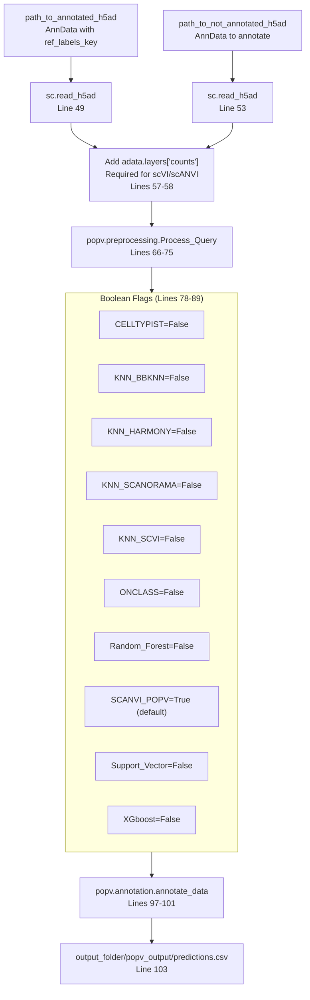

**Classifier Selection:** Each of the 10 methods is controlled by a boolean parameter. Default is `SCANVI_POPV=True` only. Multiple methods can be enabled simultaneously for ensemble predictions. The function uses `popv.settings.n_jobs` for parallelization [biomni/tool/genomics.py:60-101]().

**Sources:** [biomni/tool/genomics.py:18-105](), [biomni/tool/tool_description/genomics.py:462-576]()

### LLM-Based Cell Type Annotation

**Figure 3: LLM-Guided Cluster Annotation Workflow**

The `annotate_celltype_scRNA` function uses LLM reasoning to assign cell types based on differentially expressed genes:

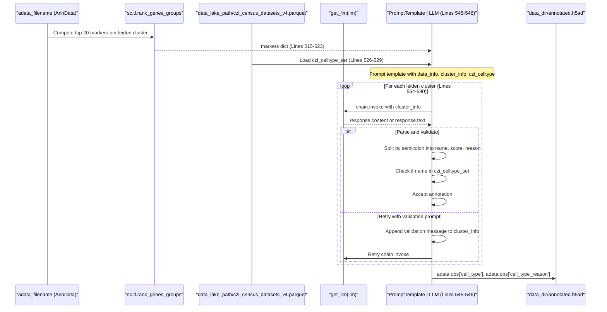

**Ontology Validation:** The function loads cell type names from the CZI Census dataset [biomni/tool/genomics.py:526-529]() and validates LLM outputs against this ontology [biomni/tool/genomics.py:572-579](). Invalid predictions trigger a retry with explicit validation feedback.

**Output Format:** The LLM must respond with `"name; score; reason"` format. Both `cell_type` and `cell_type_reason` columns are added to `adata.obs` [biomni/tool/genomics.py:591-593]().

**Sources:** [biomni/tool/genomics.py:463-597](), [biomni/tool/tool_description/genomics.py:1-54]()

### Batch Integration and Embeddings

**Table 2: Embedding Generation Functions**

| Function | Algorithm | Output Location | Implementation |
|----------|-----------|-----------------|----------------|
| `create_scvi_embeddings_scRNA` | scVI VAE (Lines 813-817) + scANVI semi-supervised (Lines 822-833) | `adata.obsm['X_scVI']`, `adata.obsm['X_scANVI']` | Lines 801-839 |
| `create_harmony_embeddings_scRNA` | Harmony iterative PCA correction (Line 851) | `adata.obsm['X_harmony']` | Lines 842-857 |
| `get_uce_embeddings_scRNA` | UCE foundation model via `eval_single_anndata.main` | `adata.obsm['X_uce']` | Lines 861-911 |
| `map_to_ima_interpret_scRNA` | kNN on UCE embeddings to IMA reference | `adata.obs['mapped_cell_type']`, `adata.obs['mapping_confidence']` | Lines 914-971 |

**UCE + IMA Workflow:** The `get_uce_embeddings_scRNA` function checks if `{basename}_uce_adata.h5ad` exists to avoid recomputation [biomni/tool/genomics.py:886-889](). The `map_to_ima_interpret_scRNA` function requires `X_uce` in `adata.obsm` [biomni/tool/genomics.py:922-923]() and uses `sklearn.neighbors.NearestNeighbors` to find nearest cells in the IMA atlas [biomni/tool/genomics.py:936-943]().

**Sources:** [biomni/tool/genomics.py:801-971](), [biomni/tool/tool_description/genomics.py:96-215]()

### Azimuth Neural Network Annotation

**Figure 4: Isolated Environment Execution for panhumanpy**

The `annotate_celltype_with_panhumanpy` function runs panhumanpy in an isolated conda environment due to dependency conflicts:

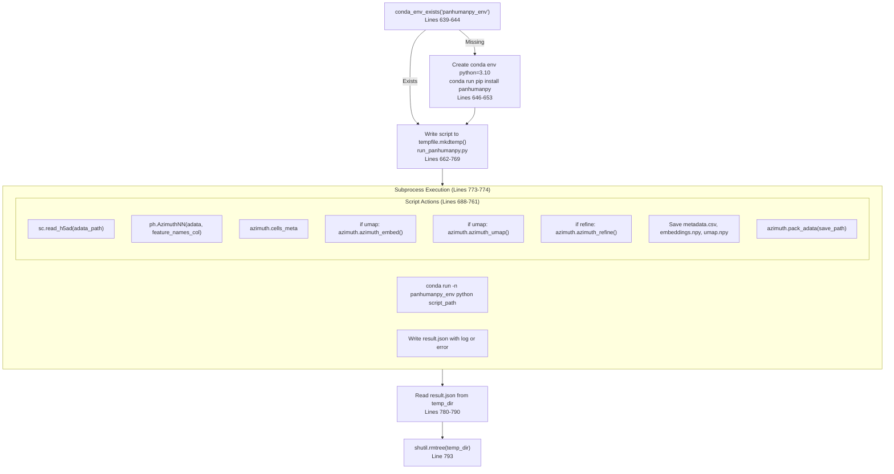

**Dependency Isolation:** The panhumanpy package requires dependencies that conflict with the main `biomni_e1` environment [biomni/tool/genomics.py:655-659](). The function uses `subprocess.run` with `conda run -n panhumanpy_env` [biomni/tool/genomics.py:773-774]() to execute in isolation.

**Communication Protocol:** The main process writes a Python script to a temporary directory [biomni/tool/genomics.py:662-769](), executes it via subprocess, and reads results from `result.json` [biomni/tool/genomics.py:780-790](). The temporary directory is cleaned up after execution [biomni/tool/genomics.py:793]().

**Sources:** [biomni/tool/genomics.py:600-795](), [biomni/tool/tool_description/genomics.py:55-94]()

## Gene Analysis Tools

### Interspecies Gene Conversion

**Figure 5: BioMart Homology Mapping with Fallback Strategy**

The `interspecies_gene_conversion` function maps ENSEMBL gene IDs between 13 species using the Ensembl BioMart API:

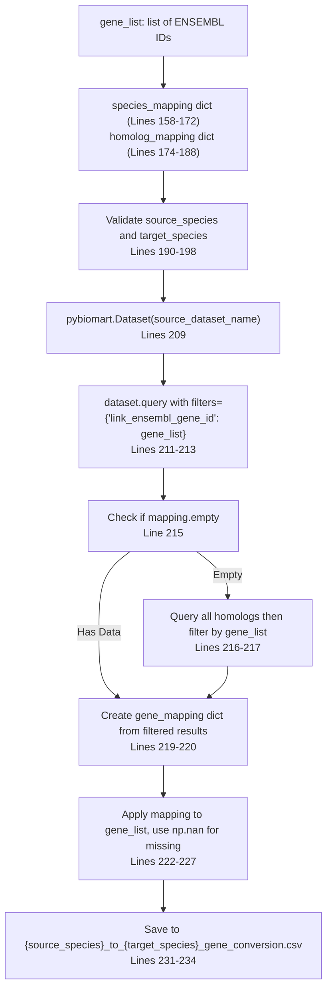

**Species Support:** The function defines two dictionaries: `species_mapping` maps common names to Ensembl dataset names (e.g., "human" → "hsapiens_gene_ensembl") [biomni/tool/genomics.py:158-172](), and `homolog_mapping` maps to homolog attribute names [biomni/tool/genomics.py:174-188](). Supports 13 species total.

**Fallback Strategy:** If the primary filtered query returns empty results [biomni/tool/genomics.py:215](), the function queries all homologs without filters [biomni/tool/genomics.py:216-217]() then filters locally. A second exception handler [biomni/tool/genomics.py:238-281]() provides additional robustness.

**Sources:** [biomni/tool/genomics.py:108-281](), [biomni/tool/tool_description/genomics.py:577-605]()

### Protein Language Model Embeddings

**Figure 6: ESM Model Embedding Generation with Memory-Safe Batching**

The `generate_gene_embeddings_with_ESM_models` function generates protein embeddings using Facebook AI's ESM models:

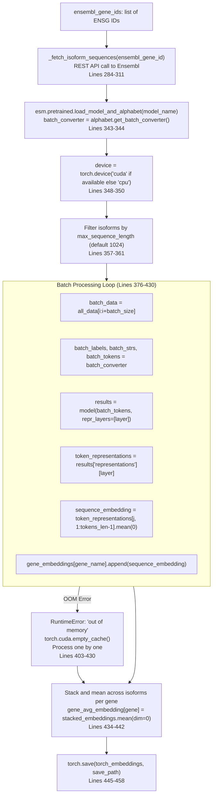

**ESM Model Selection:** The function accepts any ESM model name via the `model_name` parameter (default: "esm2_t6_8M_UR50D"). Billion-parameter ESM models require FSDP or 80GB GPU [biomni/tool/genomics.py:341-343](). The `layer` parameter specifies which transformer layer to extract embeddings from (default: 6, typically the last layer) [biomni/tool/genomics.py:314-321]().

**Memory-Safe Implementation:** Uses batch_size=1 by default to minimize memory [biomni/tool/genomics.py:319](). On RuntimeError with "out of memory" [biomni/tool/genomics.py:403](), the function calls `torch.cuda.empty_cache()` and falls back to single-sequence processing [biomni/tool/genomics.py:406-430]().

**Sources:** [biomni/tool/genomics.py:284-460](), [biomni/tool/tool_description/genomics.py:606-656]()

### Gene Set Enrichment Analysis

The `gene_set_enrichment_analysis` function wraps `gget.enrichr` for pathway and ontology enrichment:

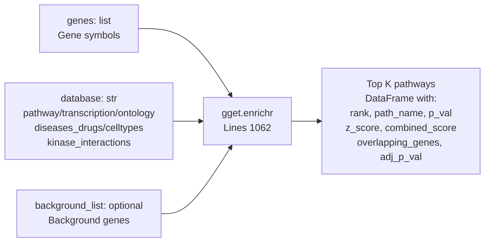

**Database Options:** Use `get_gene_set_enrichment_analysis_supported_database_list()` to retrieve all available databases [biomni/tool/genomics.py:1017-1018](). Common options include KEGG_2021_Human (pathway), GO_Biological_Process_2021 (ontology), ChEA_2016 (transcription), etc.

**Sources:** [biomni/tool/genomics.py:974-1088](), [biomni/tool/tool_description/genomics.py:216-282]()

## Chromatin Analysis Tools

### Hi-C Chromatin Interaction Analysis

The `analyze_chromatin_interactions` function identifies enhancer-promoter interactions and TADs from Hi-C data:

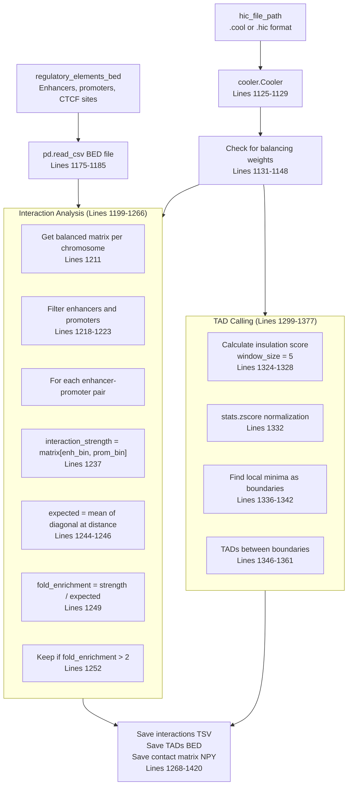

**Input Format:** The function accepts Hi-C data in `.cool` (cooler format) or `.hic` format. Regulatory elements should be provided in BED format with naming convention including "enhancer" or "promoter" keywords [biomni/tool/genomics.py:1182-1185]().

**Interaction Significance:** Interactions are considered significant if fold enrichment over expected (based on genomic distance) is greater than 2 [biomni/tool/genomics.py:1252-1265]().

**TAD Detection:** The function uses a simple insulation score method with window size 5 and local minima detection [biomni/tool/genomics.py:1309-1342](). For production use, specialized tools like tadbit or HiCExplorer are recommended [biomni/tool/genomics.py:1306-1307]().

**Sources:** [biomni/tool/genomics.py:1091-1421](), [biomni/tool/tool_description/genomics.py:283-312]()

### ChIP-seq Peak Calling with MACS2

The `perform_chipseq_peak_calling_with_macs2` function wraps the MACS2 command-line tool:

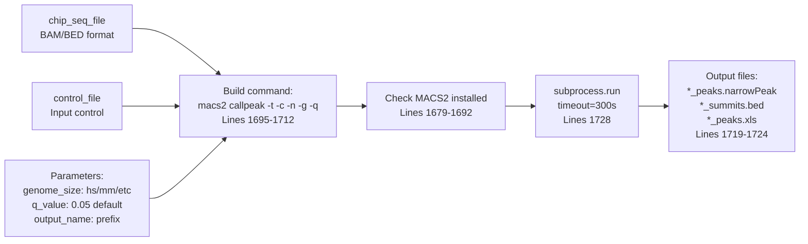

**Output Files:**
- `*_peaks.narrowPeak`: BED6+4 format with peak locations and statistics [biomni/tool/genomics.py:1770-1772]()
- `*_summits.bed`: Summit positions (highest point) of each peak [biomni/tool/genomics.py:1773]()
- `*_peaks.xls`: Tab-delimited detailed information [biomni/tool/genomics.py:1774]()

**Sources:** [biomni/tool/genomics.py:1617-1791](), [biomni/tool/tool_description/genomics.py:342-380]()

### Motif Discovery with HOMER

The `find_enriched_motifs_with_homer` function runs HOMER's findMotifsGenome.pl:

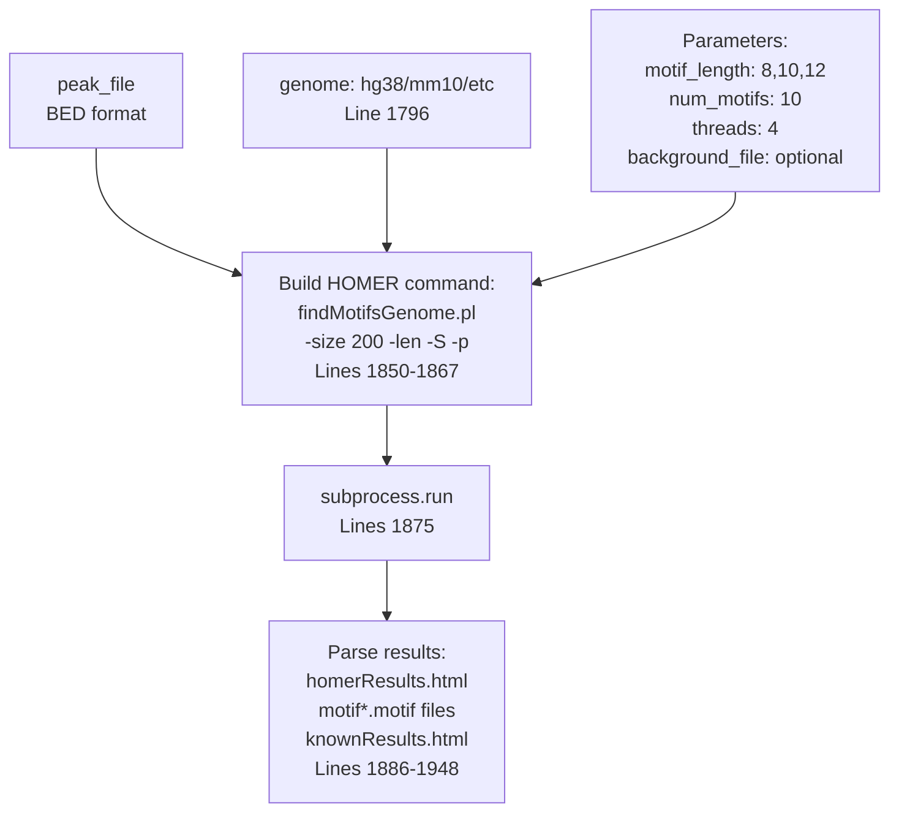

**Search Region:** HOMER searches 200bp centered on each peak by default [biomni/tool/genomics.py:1855-1856](). The function parses motif consensus sequences, matching transcription factors, and p-values from the output files [biomni/tool/genomics.py:1900-1925]().

**Sources:** [biomni/tool/genomics.py:1794-1962](), [biomni/tool/tool_description/genomics.py:381-435]()

### Genomic Region Overlap Analysis

The `analyze_genomic_region_overlap` function uses pybedtools for pairwise region comparisons:

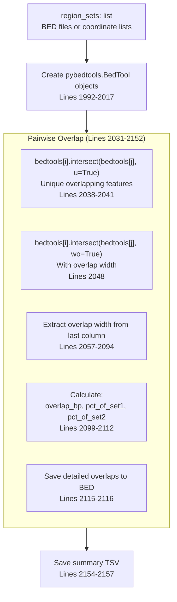

**Input Flexibility:** Each region set can be either a path to a BED file or a list of tuples `(chrom, start, end)` or `(chrom, start, end, name)` [biomni/tool/genomics.py:1969-2015]().

**Overlap Metrics:** For each pair, the function reports:
- Number of overlapping regions from each set
- Total overlap size in base pairs
- Percentage of each set covered by overlaps [biomni/tool/genomics.py:2099-2112]()

**Sources:** [biomni/tool/genomics.py:1965-2164](), [biomni/tool/tool_description/genomics.py:436-460]()

## Comparative Genomics Tools

The `analyze_comparative_genomics_and_haplotypes` function performs whole-genome comparison and haplotype analysis:

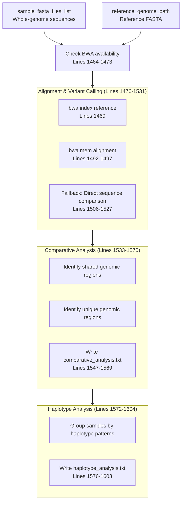

**BWA Integration:** If BWA is available, the function performs proper alignment and variant calling [biomni/tool/genomics.py:1490-1504](). Otherwise, it falls back to direct sequence comparison using BioPython's SeqIO [biomni/tool/genomics.py:1509-1527]().

**Output Files:**
- `comparative_analysis.txt`: Shared and unique genomic regions [biomni/tool/genomics.py:1547-1569]()
- `haplotype_analysis.txt`: Haplotype grouping and characteristics [biomni/tool/genomics.py:1576-1603]()

**Sources:** [biomni/tool/genomics.py:1424-1614](), [biomni/tool/tool_description/genomics.py:313-341]()

## Dependencies and External Tools

**Figure 7: Python Package Dependencies**

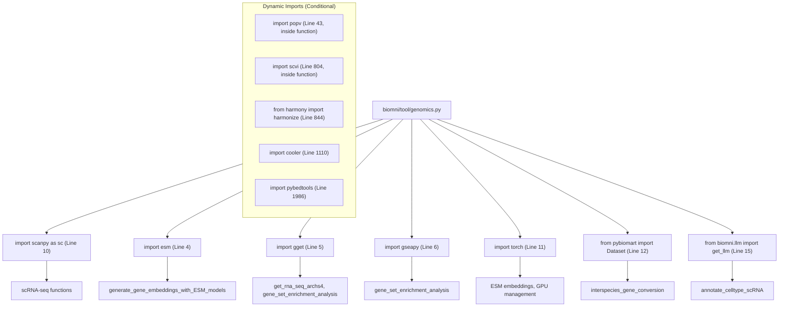

**Sources:** [biomni/tool/genomics.py:1-16]()

### Command-Line Tool Integration

**Table 3: External CLI Tool Integrations**

| CLI Tool | Function | Availability Check | Invocation | Fallback Strategy |
|----------|----------|-------------------|------------|-------------------|
| MACS2 | `perform_chipseq_peak_calling_with_macs2` | Lines 1679-1692 | `subprocess.run(['macs2', 'callpeak', ...])` (Line 1728) | Error message, return log |
| HOMER | `find_enriched_motifs_with_homer` | Implicit in subprocess call | `subprocess.run(['findMotifsGenome.pl', ...])` (Line 1875) | Error message, return log |
| BWA | `analyze_comparative_genomics_and_haplotypes` | Lines 1465-1473 | `subprocess.run(['bwa', 'mem', ...])` (Lines 1492-1497) | Direct sequence comparison (Lines 1506-1527) |

**Sources:** [biomni/tool/genomics.py:1465-1473, 1679-1692, 1873-1875]()

### Command-Line Tool Integration

| CLI Tool | Function | Installation Check | Usage Pattern |
|----------|----------|-------------------|---------------|
| MACS2 | `perform_chipseq_peak_calling_with_macs2` | Lines 1679-1692 | `subprocess.run(['macs2', 'callpeak', ...])` |
| HOMER | `find_enriched_motifs_with_homer` | Lines 1873-1875 | `subprocess.run(['findMotifsGenome.pl', ...])` |
| BWA | `analyze_comparative_genomics_and_haplotypes` | Lines 1465-1473 | `subprocess.run(['bwa', 'mem', ...])` with fallback |

**Error Handling:** All CLI tool integrations check for tool availability before execution and provide fallback strategies or clear error messages [biomni/tool/genomics.py:1465-1473, 1679-1692]().

**Sources:** [biomni/tool/genomics.py:1465-1473, 1679-1692, 1873-1875]()

## Common Patterns and Usage

### LLM Integration for Biological Reasoning

The `annotate_celltype_scRNA` function demonstrates LLM integration:

```python
# Lines 544-546
llm = get_llm(llm)  # From biomni.llm
prompt = PromptTemplate(input_variables=["cluster_info"], template=prompt_template)
chain = prompt | llm
```

The LLM is used iteratively to predict cell types with validation against the CZI Census ontology [biomni/tool/genomics.py:554-580](). This pattern of LLM-guided biological annotation can be extended to other tasks.

**Sources:** [biomni/tool/genomics.py:463-597]()

### Isolated Environment Execution

The `annotate_celltype_with_panhumanpy` function uses subprocess to execute code in a separate conda environment:

```python
# Lines 655-659
PANHUMANPY_ENV = "panhumanpy_env"
if not conda_env_exists(PANHUMANPY_ENV):
    create_panhumanpy_env(PANHUMANPY_ENV)

# Lines 773-774
run_cmd = ["conda", "run", "-n", PANHUMANPY_ENV, "python", script_path]
subprocess.run(run_cmd, check=True)
```

This pattern isolates conflicting dependencies while maintaining integration with the main agent system [biomni/tool/genomics.py:600-795]().

**Sources:** [biomni/tool/genomics.py:600-795]()

### Progress Logging and Result Tracking

All functions return a multi-line string documenting execution steps:

```python
# Lines 45-46, 103-105 (example pattern)
steps = []
steps.append("Starting unsupervised cell type transfer using popV")
# ... processing ...
return "\n".join(steps)
```

This provides transparency for the agent's reasoning process and makes results reproducible [biomni/tool/genomics.py:45-105]().

**Sources:** [biomni/tool/genomics.py:18-2164]()

---