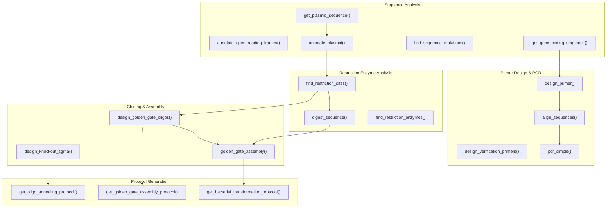
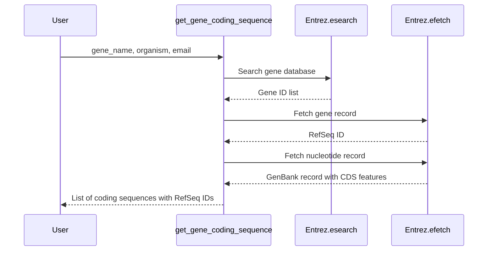
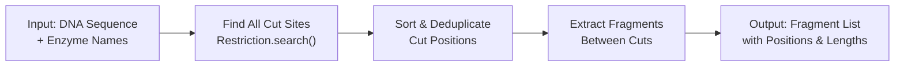
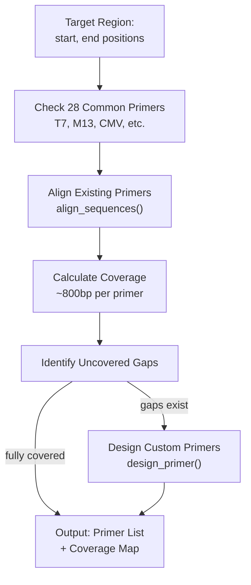
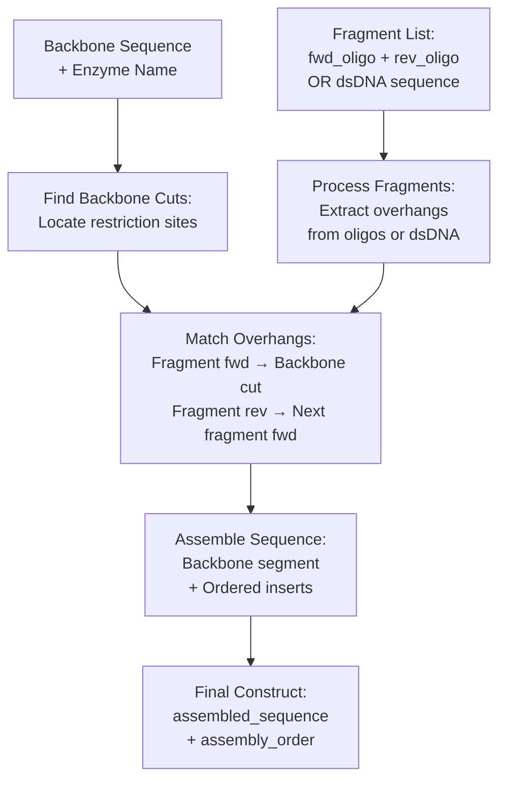
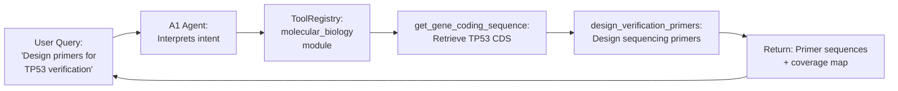

# Molecular Biology Tools

<details>
<summary>Relevant source files</summary>

The following files were used as context for generating this wiki page:

- [biomni/env_desc.py](biomni/env_desc.py)
- [biomni/tool/molecular_biology.py](biomni/tool/molecular_biology.py)

</details>


This document covers the molecular biology tool suite in Biomni, which provides functions for DNA sequence analysis, primer design, restriction enzyme analysis, PCR simulation, and cloning protocol generation. These tools support common laboratory molecular biology workflows including plasmid construction, CRISPR design, and sequence verification.

For database queries (UniProt, PDB, KEGG, etc.), see [Database Query Tools](#5.1). For genomics analysis (scRNA-seq, CRISPR screens), see [Genomics and Single-Cell Tools](#5.2). For drug discovery tools (docking, ADMET), see [Pharmacology Tools](#5.4).

## Tool Organization

The molecular biology toolkit contains 19 functions organized into five functional categories: sequence analysis, restriction enzyme analysis, primer design and PCR, cloning and assembly, and protocol generation.



**Sources:** [biomni/tool/molecular_biology.py:1-2223]()

## Sequence Analysis Tools

These tools analyze DNA sequences to identify coding regions, retrieve sequences from databases, and detect mutations.

### Open Reading Frame Detection

The `annotate_open_reading_frames` function identifies all ORFs in a DNA sequence using start (ATG) and stop codons (TAA, TAG, TGA). It searches both forward and reverse complement strands.

**Function signature:** [biomni/tool/molecular_biology.py:15-164]()

| Parameter | Type | Default | Description |
|-----------|------|---------|-------------|
| `sequence` | str | required | DNA sequence to analyze |
| `min_length` | int | required | Minimum ORF length in nucleotides |
| `search_reverse` | bool | False | Whether to search reverse complement |
| `filter_subsets` | bool | False | Remove nested ORFs with same end position |

**Returns:** Dictionary containing:
- `summary_stats`: Total ORFs, forward/reverse counts, average length
- `orfs`: List of ORF objects with sequence, amino acid sequence, start/end positions, strand, and reading frame

### Coding Sequence Retrieval

The `get_gene_coding_sequence` function retrieves coding sequences from NCBI Entrez using gene name and organism.

**Function signature:** [biomni/tool/molecular_biology.py:252-328]()



**Sources:** [biomni/tool/molecular_biology.py:252-328]()

### Plasmid Sequence Retrieval

The `get_plasmid_sequence` function retrieves plasmid sequences from either Addgene (by numeric ID) or NCBI (by plasmid name).

**Function signature:** [biomni/tool/molecular_biology.py:330-420]()

Auto-detection logic:
- If `identifier.isdigit()` → uses Addgene
- Otherwise → searches NCBI with query format: "Cloning vector {plasmid_name}"

### Plasmid Annotation

The `annotate_plasmid` function uses the `plannotate` CLI tool to annotate DNA sequences with common features from a curated database.

**Function signature:** [biomni/tool/molecular_biology.py:167-250]()

The function:
1. Writes sequence to temporary FASTA file
2. Executes `plannotate batch` with detailed search flag
3. Parses CSV output into structured records

Each annotation includes: feature name, type (CDS, promoter, rep_origin), positions, alignment scores, and percentage identity.

### Mutation Detection

The `find_sequence_mutations` function compares query and reference sequences to identify point mutations.

**Function signature:** [biomni/tool/molecular_biology.py:822-873]()

Output format: `"{RefAA}{Position}{QueryAA}"` (e.g., "A123T" means position 123 changed from A to T)

**Sources:** [biomni/tool/molecular_biology.py:15-164](), [biomni/tool/molecular_biology.py:252-328](), [biomni/tool/molecular_biology.py:330-420](), [biomni/tool/molecular_biology.py:167-250](), [biomni/tool/molecular_biology.py:822-873]()

## Restriction Enzyme Analysis

These tools identify and analyze restriction enzyme cut sites using Biopython's `Bio.Restriction` module.

### Enzyme Database

The toolkit uses Biopython's comprehensive restriction enzyme database. Common enzymes include:

| Enzyme | Recognition Site | Overhang Type | Common Use |
|--------|-----------------|---------------|------------|
| BsaI | GGTCTC | 4 bp sticky | Golden Gate assembly |
| BsmBI | CGTCTC | 4 bp sticky | Golden Gate assembly |
| EcoRI | GAATTC | 4 bp sticky | General cloning |
| BamHI | GGATCC | 4 bp sticky | General cloning |
| PstI | CTGCAG | 4 bp sticky | General cloning |

### Restriction Site Identification

The `find_restriction_sites` function locates all cut sites for specified enzymes.

**Function signature:** [biomni/tool/molecular_biology.py:725-788]()

```python
# Example: Find BsaI and EcoRI sites in a plasmid
result = find_restriction_sites(
    dna_sequence=plasmid_seq,
    enzymes=["BsaI", "EcoRI"],
    is_circular=True
)
```

Output includes:
- Recognition sequence
- Cut positions (5' and 3' strand offsets)
- Overhang length and type (sticky/blunt)
- List of all cut positions in sequence

### Enzyme Discovery

The `find_restriction_enzymes` function searches for all common restriction enzymes that cut a sequence.

**Function signature:** [biomni/tool/molecular_biology.py:791-820]()

Uses `Restriction.CommOnly` batch to search ~200 commonly available enzymes. Returns dictionary mapping enzyme names to lists of cut positions.

### Digestion Simulation

The `digest_sequence` function simulates complete restriction digestion and reports all resulting fragments.

**Function signature:** [biomni/tool/molecular_biology.py:602-723]()



For circular sequences, the function handles wraparound fragments correctly. Each fragment includes:
- DNA sequence
- Length in base pairs
- Start and end positions
- `is_wrapped` flag for circular sequences

**Sources:** [biomni/tool/molecular_biology.py:725-788](), [biomni/tool/molecular_biology.py:791-820](), [biomni/tool/molecular_biology.py:602-723]()

## Primer Design and PCR Tools

These tools support primer design for PCR, sequencing, and sequence verification with melting temperature and GC content calculations.

### Sequence Alignment

The `align_sequences` function aligns short sequences (primers) to a longer target sequence, allowing up to one mismatch. Checks both forward and reverse complement strands.

**Function signature:** [biomni/tool/molecular_biology.py:422-494]()

Returns alignment positions, strand orientation, and mismatch details for each primer.

### Primer Design

The `design_primer` function generates a single primer within a sequence window that meets specified constraints.

**Function signature:** [biomni/tool/molecular_biology.py:1277-1351]()

| Parameter | Default | Description |
|-----------|---------|-------------|
| `min_gc` | 0.4 | Minimum GC content (40%) |
| `max_gc` | 0.6 | Maximum GC content (60%) |
| `min_tm` | 55.0°C | Minimum melting temperature |
| `max_tm` | 65.0°C | Maximum melting temperature |
| `primer_length` | 20 bp | Length of designed primer |
| `search_window` | 100 bp | Size of search region |

The function uses `Bio.SeqUtils.MeltingTemp.Tm_Wallace` for temperature calculation and scores candidates by distance from ideal GC content and Tm.

### Verification Primer Design

The `design_verification_primers` function designs primers for Sanger sequencing to verify a specific region in a plasmid. It first attempts to use existing common primers (T7, M13, CMV, etc.), then designs custom primers for any gaps.

**Function signature:** [biomni/tool/molecular_biology.py:1353-1697]()



The function includes 28 common laboratory primers: [biomni/tool/molecular_biology.py:1393-1424]()

Coverage strategy:
- Each primer reads ~800 bp (configurable)
- Greedy algorithm selects primers with maximum coverage
- Custom primers designed for remaining gaps
- Ensures complete target region coverage

### PCR Simulation

The `pcr_simple` function simulates PCR amplification given a template sequence and forward/reverse primers.

**Function signature:** [biomni/tool/molecular_biology.py:496-600]()

Algorithm:
1. Find forward primer binding sites using `align_sequences`
2. Find reverse primer binding sites (reverse complement)
3. For each valid primer pair, extract amplicon sequence
4. Handle circular templates with wraparound support

Returns all possible PCR products with:
- Product size
- Amplicon sequence
- Primer binding positions
- Mismatch information

**Sources:** [biomni/tool/molecular_biology.py:422-494](), [biomni/tool/molecular_biology.py:1277-1351](), [biomni/tool/molecular_biology.py:1353-1697](), [biomni/tool/molecular_biology.py:496-600]()

## Cloning and Assembly Tools

These tools support modern cloning techniques including CRISPR sgRNA design and Golden Gate assembly.

### CRISPR sgRNA Design

The `design_knockout_sgrna` function retrieves optimized sgRNA sequences from pre-computed genome-wide libraries.

**Function signature:** [biomni/tool/molecular_biology.py:876-948]()

**Data dependencies:**
- Human library: `sgRNA_KO_SP_human.txt` from data lake
- Mouse library: `sgRNA_KO_SP_mouse.txt` from data lake

Libraries contain pre-computed sgRNAs with Combined Rank scoring. The function:
1. Loads species-specific library from data lake
2. Filters by gene symbol (case-insensitive)
3. Sorts by Combined Rank (lower is better)
4. Returns top N sgRNA sequences

**Sources:** [biomni/tool/molecular_biology.py:876-948](), [biomni/env_desc.py:69-70]()

### Golden Gate Oligo Design

The `design_golden_gate_oligos` function designs oligonucleotides for Golden Gate assembly by analyzing backbone overhangs.

**Function signature:** [biomni/tool/molecular_biology.py:1699-1847]()

Supported Type IIS enzymes: [biomni/tool/molecular_biology.py:1719-1726]()

| Enzyme | Recognition Site | Offset (fwd, rev) |
|--------|-----------------|-------------------|
| BsaI | GGTCTC | 1, 5 |
| BsmBI | CGTCTC | 1, 5 |
| BbsI | GAAGAC | 2, 6 |
| Esp3I | CGTCTC | 1, 5 |
| BtgZI | GCGATG | 10, 14 |
| SapI | GCTCTTC | 1, 4 |

Process:
1. Find all restriction sites in backbone (forward and reverse complement)
2. Calculate cut positions based on enzyme offsets
3. Extract overhangs at cut sites
4. Design forward oligo: `upstream_overhang + insert_sequence`
5. Design reverse oligo: `reverse_complement(insert + downstream_overhang)`

### Golden Gate Assembly Simulation

The `golden_gate_assembly` function simulates Golden Gate assembly to predict the final construct sequence.

**Function signature:** [biomni/tool/molecular_biology.py:1849-2223]()



The function accepts two fragment formats:
1. **Oligo pairs:** `fwd_oligo` and `rev_oligo` with 4 bp overhangs
2. **Double-stranded DNA:** Complete sequence with restriction sites

For dsDNA fragments, the function: [biomni/tool/molecular_biology.py:1908-1974]()
- Finds restriction sites in fragment
- Calculates cut positions
- Extracts insert and overhangs
- Converts to equivalent oligo format

Assembly algorithm: [biomni/tool/molecular_biology.py:2105-2215]()
1. Build overhang maps for all fragments
2. Find entry point where fragment matches backbone cut
3. Chain fragments by matching overhangs
4. Verify complete assembly path
5. Concatenate backbone segment + ordered inserts

**Sources:** [biomni/tool/molecular_biology.py:1699-1847](), [biomni/tool/molecular_biology.py:1849-2223]()

## Protocol Generation Tools

These functions generate standardized laboratory protocols for common molecular biology procedures.

### Oligo Annealing Protocol

The `get_oligo_annealing_protocol` function returns a standard protocol for annealing complementary oligonucleotides.

**Function signature:** [biomni/tool/molecular_biology.py:951-1004]()

Protocol steps:
1. Mix 1 μl each oligo (100 μM) + 8 μl water
2. Heat to 95°C for 5 minutes
3. Cool to 25°C at 5°C/minute
4. Dilute 1:200 in water

### Golden Gate Assembly Protocol

The `get_golden_gate_assembly_protocol` function generates customized protocols based on number of inserts and vector/insert lengths.

**Function signature:** [biomni/tool/molecular_biology.py:1006-1194]()

Protocol varies by insert count:

| Inserts | Thermal Cycling | Assembly Mix Volume |
|---------|----------------|---------------------|
| 1 (standard) | 37°C 5 min → 60°C 5 min | 1 μl |
| 1 (library) | 37°C 1 hour → 60°C 5 min | 1 μl |
| 2-10 | 30 cycles: 37°C 1 min / 16°C 1 min | 1 μl |
| 11+ | 30 cycles: 37°C 5 min / 16°C 5 min | 2 μl |

The function calculates molar ratios: [biomni/tool/molecular_biology.py:1112-1141]()
```
pmol = (ng) / (bp × 650 g/mol per bp) × 10^6
```

Recommended insert:vector ratio is 2:1 molar for optimal efficiency.

### Bacterial Transformation Protocol

The `get_bacterial_transformation_protocol` function generates transformation protocols with antibiotic-specific and repetitive sequence considerations.

**Function signature:** [biomni/tool/molecular_biology.py:1196-1275]()

Key parameters:
- `antibiotic`: Selection marker (default: "ampicillin")
- `is_repetitive`: If True, uses 30°C incubation instead of 37°C to maintain sequence integrity

Protocol steps:
1. Add 5 μl DNA to 50 μl competent cells on ice
2. Incubate on ice for 30 minutes
3. Heat shock at 42°C for 45 seconds
4. Recover on ice for 2 minutes
5. Add 950 μl SOC medium
6. Incubate with shaking for 1 hour (temperature depends on `is_repetitive`)
7. Plate 100 μl on selective media
8. Incubate overnight (temperature depends on `is_repetitive`)

**Sources:** [biomni/tool/molecular_biology.py:951-1004](), [biomni/tool/molecular_biology.py:1006-1194](), [biomni/tool/molecular_biology.py:1196-1275]()

## Data Dependencies

Molecular biology tools require access to specific data lake files and external software.

### Data Lake Files

| File | Description | Used By |
|------|-------------|---------|
| `sgRNA_KO_SP_human.txt` | Human CRISPR knockout sgRNA library | `design_knockout_sgrna` |
| `sgRNA_KO_SP_mouse.txt` | Mouse CRISPR knockout sgRNA library | `design_knockout_sgrna` |

**Sources:** [biomni/env_desc.py:69-70]()

### External Software Dependencies

| Tool | Description | Used By | Installation |
|------|-------------|---------|--------------|
| `plannotate` | Plasmid annotation CLI | `annotate_plasmid` | Available in conda environment |
| BioPython | Sequence analysis library | Most functions | `pip install biopython` |

**Sources:** [biomni/tool/molecular_biology.py:9]()

### Python Package Dependencies

All molecular biology tools depend on: [biomni/tool/molecular_biology.py:1-12]()

```python
import subprocess  # For CLI tool execution
from Bio import Entrez, Restriction, SeqIO  # BioPython modules
from Bio.Seq import Seq
from Bio.SeqUtils import MeltingTemp as mt
import pandas as pd  # For data processing
import requests  # For web scraping (Addgene)
from bs4 import BeautifulSoup  # For HTML parsing
```

## Integration with Agent System

The molecular biology tools are registered in the agent's tool registry and can be accessed via natural language queries. The agent uses tool descriptions to understand when to invoke each function.



Tool descriptions are defined in `biomni/tool_description/` which generates API schemas for the agent to understand function signatures and usage patterns.

**Sources:** [biomni/tool/molecular_biology.py:1-2223]()

---