# Pharmacology Tools

<details>
<summary>Relevant source files</summary>

The following files were used as context for generating this wiki page:

- [biomni/tool/pharmacology.py](biomni/tool/pharmacology.py)
- [biomni/tool/tool_description/pharmacology.py](biomni/tool/tool_description/pharmacology.py)

</details>


## Purpose and Scope

This document covers the pharmacology and drug discovery tools available in Biomni. These tools support computational drug discovery workflows including molecular docking, ADMET prediction, drug-drug interaction analysis, FDA regulatory data queries, and preclinical study analysis. All tools are implemented as Python functions in [biomni/tool/pharmacology.py]() and registered in the tool registry via [biomni/tool/tool_description/pharmacology.py]().

For database query tools (UniProt, PDB, etc.), see [Database Query Tools](#5.1). For molecular biology tools (cloning, PCR), see [Molecular Biology Tools](#5.3). For genomics analysis, see [Genomics and Single-Cell Tools](#5.2).

---

## Tool Organization and Categories

The pharmacology tools are organized into seven functional categories:

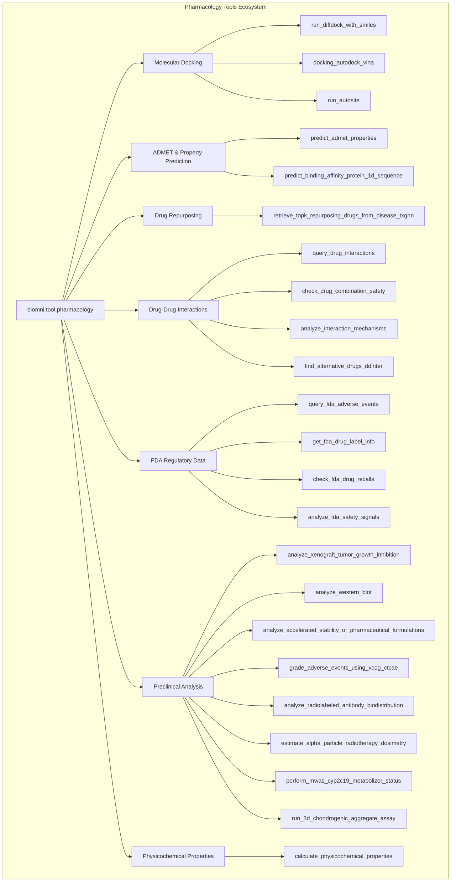

**Tool Categories Overview**

| Category | Number of Functions | Primary Use Case | Key Dependencies |
|----------|-------------------|------------------|------------------|
| Molecular Docking | 3 | Protein-ligand binding prediction | Docker, TDC, AutoDock Vina |
| ADMET Prediction | 2 | Pharmacokinetic property prediction | DeepPurpose, RDKit |
| Drug Repurposing | 1 | Disease-drug association | TxGNN model data |
| Drug-Drug Interactions | 4 | Safety screening | DDInter database |
| FDA Regulatory | 4 | Post-market surveillance | OpenFDA API |
| Preclinical Analysis | 8 | In vivo/in vitro assays | NumPy, Pandas, SciPy, scikit-image |
| Physicochemical Properties | 1 | Molecular descriptor calculation | RDKit |

Sources: [biomni/tool/pharmacology.py:1-2965](), [biomni/tool/tool_description/pharmacology.py:1-724]()

---

## Molecular Docking Tools

Molecular docking tools predict binding modes and affinities between small molecules and protein targets. Biomni provides three complementary docking approaches.

### run_diffdock_with_smiles

DiffDock is a diffusion-based deep learning method for molecular docking that runs in a Docker container. This function handles the complete workflow from input preparation to result extraction.

**Function Signature:**
```python
run_diffdock_with_smiles(
    pdb_path: str,
    smiles_string: str,
    local_output_dir: str,
    gpu_device: int = 0,
    use_gpu: bool = True
) -> str
```

**Workflow:**

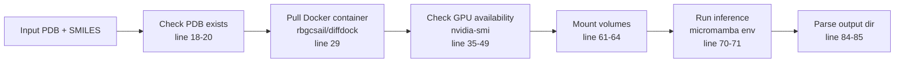

**Key Implementation Details:**
- Container image: `rbgcsail/diffdock` from Docker Hub
- GPU support via `--gpus device={gpu_device}` flag
- Volume mounts: PDB file to `/home/appuser/input/protein.pdb`, output to `/home/appuser/output`
- Executes within micromamba environment: `micromamba run -n diffdock python -m inference`
- Returns summary string with status updates

**Example Usage:**
```python
result = run_diffdock_with_smiles(
    pdb_path="/path/to/protein.pdb",
    smiles_string="CC(C)Cc1ccc(cc1)C(C)C(=O)O",  # Ibuprofen
    local_output_dir="./diffdock_results",
    gpu_device=0
)
```

Sources: [biomni/tool/pharmacology.py:13-94](), [biomni/tool/tool_description/pharmacology.py:2-41]()

### docking_autodock_vina

AutoDock Vina is a classical molecular docking program using a semi-empirical force field. This function interfaces with Vina through the TDC (Therapeutics Data Commons) Oracle API.

**Function Signature:**
```python
docking_autodock_vina(
    smiles_list: List[str],
    receptor_pdb_file: str,
    box_center: List[float],
    box_size: List[float],
    ncpu: int = 1
) -> str
```

**Parameters:**
- `box_center`: [x, y, z] coordinates in Angstroms defining the center of the docking box
- `box_size`: [x, y, z] dimensions in Angstroms for the search space
- `ncpu`: Number of CPU cores for parallel docking

**Implementation Flow:**
1. Initialize TDC Oracle with `name="pyscreener"` [line 108-114]()
2. Pass receptor PDB, box parameters to Oracle constructor
3. Call oracle with SMILES list to obtain docking scores [line 121]()
4. Return dictionary mapping SMILES to scores [line 125]()

Sources: [biomni/tool/pharmacology.py:96-134](), [biomni/tool/tool_description/pharmacology.py:42-81]()

### run_autosite

AutoSite identifies potential binding sites on a protein surface by analyzing the electrostatic and geometric properties. It is commonly used before docking to determine appropriate `box_center` and `box_size` parameters.

**Function Signature:**
```python
run_autosite(
    pdb_file: str,
    output_dir: str,
    spacing: float = 1.0
) -> str
```

**Workflow:**
1. Convert PDB to PDBQT format using `prepare_receptor` [line 143]()
2. Execute AutoSite command with spacing parameter [line 146-155]()
3. Parse `_AutoSiteSummary.log` for box center and size [line 159-170]()
4. Return research log with extracted parameters

Sources: [biomni/tool/pharmacology.py:136-181](), [biomni/tool/tool_description/pharmacology.py:82-108]()

---

## ADMET and Property Prediction

ADMET (Absorption, Distribution, Metabolism, Excretion, Toxicity) prediction is critical for early-stage drug candidate screening. Biomni uses DeepPurpose's pre-trained models.

### predict_admet_properties

This function predicts 16 different ADMET properties using pre-trained deep learning models.

**Function Signature:**
```python
predict_admet_properties(
    smiles_list: List[str],
    ADMET_model_type: str = "MPNN"
) -> str
```

**Supported Model Types:**
- `MPNN`: Message Passing Neural Network
- `CNN`: Convolutional Neural Network
- `Morgan`: Morgan fingerprint-based

**Predicted Properties:**

```mermaid
graph TD
    ADMET["predict_admet_properties"]
    
    PHYS["Physicochemical<br/>line 315-318"]
    ABS["Absorption<br/>line 321-328"]
    DIST["Distribution<br/>line 331-334"]
    META["Metabolism<br/>line 337-346"]
    EXC["Excretion<br/>line 349-352"]
    TOX["Toxicity<br/>line 355-356"]
    
    ADMET --> PHYS
    ADMET --> ABS
    ADMET --> DIST
    ADMET --> META
    ADMET --> EXC
    ADMET --> TOX
    
    PHYS --> SOL["Solubility (AqSolDB)"]
    PHYS --> LIPO["Lipophilicity (Lipo_AZ)"]
    
    ABS --> CACO2["Caco-2 permeability"]
    ABS --> HIA["Human Intestinal Absorption"]
    ABS --> PGP["Pgp Inhibitor"]
    ABS --> BIO["Bioavailability"]
    
    DIST --> BBB["BBB Permeation"]
    DIST --> PPBR["Plasma Protein Binding"]
    
    META --> CYP2C19["CYP2C19 Inhibition"]
    META --> CYP2D6["CYP2D6 Inhibition"]
    META --> CYP3A4["CYP3A4 Inhibition"]
    META --> CYP1A2["CYP1A2 Inhibition"]
    META --> CYP2C9["CYP2C9 Inhibition"]
    
    EXC --> HALF["Half-life (eDrug3D)"]
    EXC --> CLEAR["Clearance (eDrug3D)"]
    
    TOX --> CLIN["Clinical Toxicity"]
```

**Model Loading Strategy:**
- Models loaded once into `model_ADMETs` dictionary [line 264-287]()
- Each task has format: `{task}_{model_type}_model` (e.g., `AqSolDB_MPNN_model`)
- Uses DeepPurpose's `CompoundPred.model_pretrained()` API

**Prediction Helper Function:**
The internal `ADMET_pred` function [line 290-303]():
1. Processes drug SMILES with specified encoding
2. Predicts using loaded model
3. Applies unit conversion (e.g., percentage scaling)
4. Formats output with units

Sources: [biomni/tool/pharmacology.py:248-361](), [biomni/tool/tool_description/pharmacology.py:137-158]()

### predict_binding_affinity_protein_1d_sequence

Predicts binding affinity (Kd in nM) between small molecules and protein sequences using drug-target interaction (DTI) models.

**Function Signature:**
```python
predict_binding_affinity_protein_1d_sequence(
    smiles_list: List[str],
    amino_acid_sequence: str,
    affinity_model_type: str = "MPNN-CNN"
) -> str
```

**Supported Model Types:**
| Model Type | Drug Encoding | Target Encoding | Use Case |
|------------|---------------|-----------------|----------|
| CNN-CNN | CNN | CNN | General purpose |
| MPNN-CNN | MPNN | CNN | Best for graph-based drug representation |
| Morgan-CNN | Morgan fingerprint | CNN | Fast inference |
| Morgan-AAC | Morgan fingerprint | Amino acid composition | Sequence-based |
| Daylight-AAC | Daylight fingerprint | Amino acid composition | Lightweight |

**Implementation:**
1. Load pre-trained BindingDB model: `model_DTI = DTI.model_pretrained(model=...)` [line 385]()
2. Process input with `utils.data_process()` specifying drug/target encodings [line 397-404]()
3. Predict Kd in log scale [line 405]()
4. Convert to nM: `y_pred_nM = 10**(-y_pred) / 1e-9` [line 406]()

Sources: [biomni/tool/pharmacology.py:363-412](), [biomni/tool/tool_description/pharmacology.py:159-189]()

---

## Drug Repurposing with TxGNN

### retrieve_topk_repurposing_drugs_from_disease_txgnn

TxGNN (Therapeutics Graph Neural Network) predicts drug repurposing candidates using a knowledge graph of disease-drug-gene relationships.

**Function Signature:**
```python
retrieve_topk_repurposing_drugs_from_disease_txgnn(
    disease_name: str,
    data_lake_path: str,
    k: int = 5
) -> str
```

**Data Files:**
- `txgnn_name_mapping.pkl`: Maps drug/disease IDs to human-readable names
- `txgnn_prediction.pkl`: Pre-computed predictions for diseases

**Workflow:**

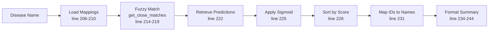

**Sigmoid Transformation:**
Raw TxGNN scores are transformed using sigmoid to produce probabilities:
```python
def sigmoid(x):
    return 1 / (1 + np.exp(-x))
```

**Fuzzy Matching:**
Uses `difflib.get_close_matches()` with cutoff=0.6 to handle disease name variations [line 214]().

Sources: [biomni/tool/pharmacology.py:183-246](), [biomni/tool/tool_description/pharmacology.py:109-136]()

---

## Drug-Drug Interaction Analysis (DDInter)

The DDInter database integration provides comprehensive drug-drug interaction screening. DDInter 2.0 contains interactions categorized by therapeutic class.

### Data Processing Architecture

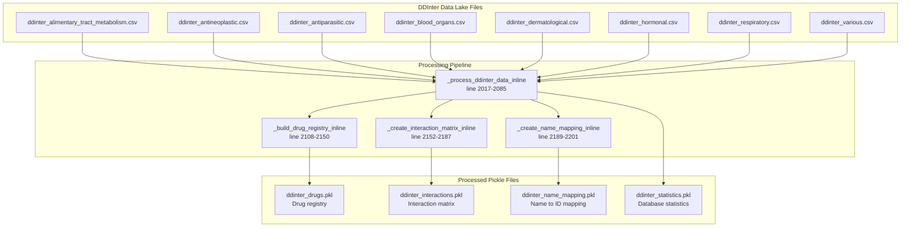

Sources: [biomni/tool/pharmacology.py:1970-2241]()

### query_drug_interactions

Query specific drug-drug interactions from the DDInter database.

**Function Signature:**
```python
query_drug_interactions(
    drug_names: List[str],
    interaction_types: Optional[List[str]] = None,
    severity_levels: Optional[List[str]] = None,
    data_lake_path: Optional[str] = None
) -> str
```

**Severity Levels:**
- `Major`: High clinical significance, contraindicated combinations
- `Moderate`: Monitor closely, adjust dosages
- `Minor`: Low clinical impact

**Implementation Flow:**
1. Load DDInter data via `_load_ddinter_data()` [line 2350]()
2. Standardize drug names with `_standardize_drug_name()` [line 2357-2363]()
3. Query interaction matrix for all pairwise combinations [line 2377-2392]()
4. Apply severity and type filters [line 2387-2391]()
5. Format results with `_format_interaction_result()` [line 2396-2403]()

**Drug Name Standardization:**
The `_standardize_drug_name_processing()` function [line 2087-2106]():
- Converts to lowercase
- Removes common salt suffixes (hydrochloride, sulfate, sodium, etc.)
- Enables fuzzy matching with cutoff=0.8

Sources: [biomni/tool/pharmacology.py:2311-2433](), [biomni/tool/tool_description/pharmacology.py:491-522]()

### check_drug_combination_safety

Comprehensive safety assessment for drug combinations with clinical recommendations.

**Function Signature:**
```python
check_drug_combination_safety(
    drug_list: List[str],
    include_mechanisms: bool = True,
    include_management: bool = True,
    data_lake_path: Optional[str] = None
) -> str
```

**Risk Assessment Categories:**
| Total Major Interactions | Risk Level | Clinical Action |
|-------------------------|------------|-----------------|
| 0 | Low | Standard monitoring |
| 1-2 | Moderate | Enhanced monitoring |
| 3-4 | High | Dosage adjustments likely |
| 5+ | Very High | Alternative regimen recommended |

**Output Includes:**
1. Overall risk classification
2. Interaction count by severity
3. Mechanism descriptions (if `include_mechanisms=True`)
4. Management recommendations (if `include_management=True`)
5. Pairwise interaction details

Sources: [biomni/tool/pharmacology.py:2435-2565](), [biomni/tool/tool_description/pharmacology.py:523-554]()

### analyze_interaction_mechanisms

Detailed mechanistic analysis for specific drug pairs.

**Function Signature:**
```python
analyze_interaction_mechanisms(
    drug_pair: Tuple[str, str],
    detailed_analysis: bool = True,
    data_lake_path: Optional[str] = None
) -> str
```

**Mechanism Information:**
- Pharmacokinetic interactions (absorption, metabolism, excretion)
- Pharmacodynamic interactions (synergistic, antagonistic effects)
- Therapeutic category context
- Clinical significance assessment

Sources: [biomni/tool/pharmacology.py:2567-2649](), [biomni/tool/tool_description/pharmacology.py:555-580]()

### find_alternative_drugs_ddinter

Identifies safer therapeutic alternatives that avoid contraindicated interactions.

**Function Signature:**
```python
find_alternative_drugs_ddinter(
    target_drug: str,
    contraindicated_drugs: List[str],
    therapeutic_class: Optional[str] = None,
    data_lake_path: Optional[str] = None
) -> str
```

**Algorithm:**
1. Identify drugs in same therapeutic class as target
2. Check each candidate against contraindicated drugs
3. Count interactions by severity
4. Rank alternatives by interaction-free score
5. Return top recommendations with rationale

Sources: [biomni/tool/pharmacology.py:2651-2776](), [biomni/tool/tool_description/pharmacology.py:581-612]()

---

## FDA Regulatory Data Tools

These tools query the OpenFDA API for post-market surveillance data, drug labels, and recall information.

### OpenFDA Integration Architecture

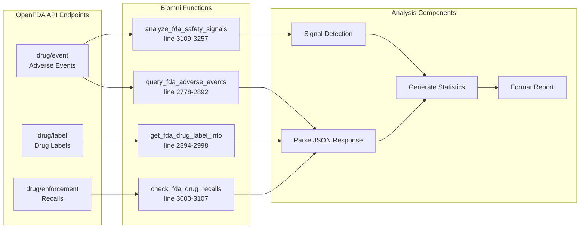

### query_fda_adverse_events

Retrieves and analyzes FDA adverse event reports from FAERS (FDA Adverse Event Reporting System).

**Function Signature:**
```python
query_fda_adverse_events(
    drug_name: str,
    date_range: Optional[Tuple[str, str]] = None,
    severity_filter: Optional[List[str]] = None,
    outcome_filter: Optional[List[str]] = None,
    limit: int = 100
) -> str
```

**Available Filters:**
- **Severity**: `['serious', 'non_serious']`
- **Outcomes**: `['life_threatening', 'hospitalization', 'death', 'disability', 'congenital_anomaly']`
- **Date Range**: Format `YYYY-MM-DD` to `YYYY-MM-DD`

**Query Construction:**
```python
base_url = "https://api.fda.gov/drug/event.json"
search_query = f"patient.drug.medicinalproduct:{drug_name}"
```

**Response Analysis:**
1. Extract reaction frequencies
2. Identify serious adverse events
3. Calculate temporal trends
4. Generate safety signal indicators

Sources: [biomni/tool/pharmacology.py:2778-2892](), [biomni/tool/tool_description/pharmacology.py:613-650]()

### get_fda_drug_label_info

Retrieves structured drug label information from FDA SPL (Structured Product Labels).

**Function Signature:**
```python
get_fda_drug_label_info(
    drug_name: str,
    sections: Optional[List[str]] = None
) -> str
```

**Available Label Sections:**
| Section Key | Description | Typical Use |
|-------------|-------------|-------------|
| `indications_and_usage` | Approved therapeutic uses | Clinical guidance |
| `contraindications` | Absolute contraindications | Safety screening |
| `warnings` | Boxed warnings, precautions | Risk assessment |
| `dosage_and_administration` | Dosing schedules | Treatment planning |
| `adverse_reactions` | Known side effects | Informed consent |
| `drug_interactions` | Known interactions | Combination therapy |
| `clinical_pharmacology` | PK/PD data | Pharmacological context |

**API Endpoint:**
```
https://api.fda.gov/drug/label.json?search=openfda.brand_name:"{drug_name}"
```

Sources: [biomni/tool/pharmacology.py:2894-2998](), [biomni/tool/tool_description/pharmacology.py:651-670]()

### check_fda_drug_recalls

Queries FDA enforcement reports for drug recalls and safety alerts.

**Function Signature:**
```python
check_fda_drug_recalls(
    drug_name: str,
    classification: Optional[List[str]] = None,
    date_range: Optional[Tuple[str, str]] = None
) -> str
```

**Recall Classifications:**
- **Class I**: Dangerous or defective products that could cause serious health problems or death
- **Class II**: Products that might cause temporary health problems or slight threat of serious nature
- **Class III**: Products unlikely to cause adverse health reactions but violate FDA regulations

**Returned Information:**
- Recall initiation date
- Product description
- Reason for recall
- Distribution scope
- Current recall status

Sources: [biomni/tool/pharmacology.py:3000-3107](), [biomni/tool/tool_description/pharmacology.py:671-696]()

### analyze_fda_safety_signals

Comparative safety signal analysis across multiple drugs using disproportionality analysis.

**Function Signature:**
```python
analyze_fda_safety_signals(
    drug_list: List[str],
    comparison_period: Optional[Tuple[str, str]] = None,
    signal_threshold: float = 2.0
) -> str
```

**Signal Detection Methods:**
1. **Proportional Reporting Ratio (PRR)**: Ratio of observed to expected reports
2. **Reporting Odds Ratio (ROR)**: Odds of reporting for target drug vs. others
3. **Chi-squared test**: Statistical significance of association
4. **Threshold**: Signal detected when ROR > signal_threshold (default 2.0)

**Comparative Analysis:**
- Event frequency comparison
- Severity distribution across drugs
- Temporal trend analysis
- Statistical significance testing

Sources: [biomni/tool/pharmacology.py:3109-3257](), [biomni/tool/tool_description/pharmacology.py:697-722]()

---

## Preclinical Analysis Tools

These tools support analysis of in vivo and in vitro experimental data from preclinical drug development studies.

### analyze_xenograft_tumor_growth_inhibition

Analyzes tumor growth data from xenograft models with statistical testing and visualization.

**Function Signature:**
```python
analyze_xenograft_tumor_growth_inhibition(
    data_path: str,
    time_column: str,
    volume_column: str,
    group_column: str,
    subject_column: str,
    output_dir: str = "./results"
) -> str
```

**Statistical Analysis Pipeline:**

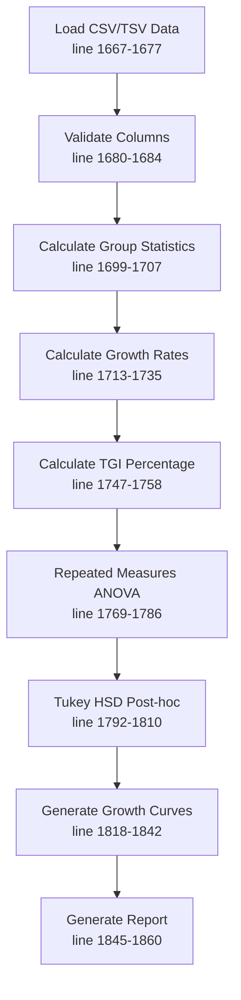

**Key Metrics Calculated:**
1. **Tumor Growth Rate**: Linear regression slope (mm³/day) per subject [line 1726]()
2. **Tumor Growth Inhibition (TGI)**: `((control_mean - treatment_mean) / control_mean) * 100` [line 1756]()
3. **Statistical Significance**: Repeated measures ANOVA with treatment × time interaction [line 1769]()
4. **Post-hoc Comparisons**: Tukey's HSD for pairwise group differences [line 1792]()

**Output Files:**
- `tumor_volume_statistics.csv`: Group means and SEM by timepoint
- `repeated_measures_anova.csv`: ANOVA table with F-statistics and p-values
- `tukey_posthoc_results.txt`: Pairwise comparison results
- `tumor_growth_curves.png`: Visualization with error bars

Sources: [biomni/tool/pharmacology.py:1616-1862](), [biomni/tool/tool_description/pharmacology.py:400-443]()

### Western Blot Image Analysis Workflow

Western blot analysis in Biomni involves a three-function pipeline for automated band detection and quantification.

**Complete Workflow:**

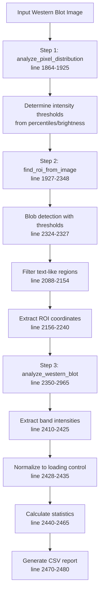

### analyze_pixel_distribution

Analyzes pixel intensity distribution to determine appropriate thresholds for band detection.

**Function Signature:**
```python
analyze_pixel_distribution(
    image_path: str
) -> dict
```

**Returns Dictionary:**
```python
{
    "shape": "(height, width)",
    "intensity_stats": {
        "min": int,
        "max": int,
        "mean": float,
        "std_dev": float
    },
    "percentiles_values": str,  # 1, 5, 10, 25, 50, 75, 90, 95, 99
    "pixel_brightness_distribution": List[str]  # Histogram by buckets
}
```

**Brightness Buckets:**
Predefined intensity ranges [line 1883-1893]():
- [0, 20): Very dark
- [20, 50): Dark
- [50, 80): Medium-dark
- [80, 110): Medium
- [110, 140): Medium-bright
- [140, 170): Bright
- [170, 200): Very bright
- [200, 256): Maximum brightness

**Usage Pattern:**
```python
# Step 1: Analyze image to determine thresholds
stats = analyze_pixel_distribution("western_blot.png")
# Examine percentiles and brightness distribution
# Choose lower_threshold and upper_threshold accordingly
```

Sources: [biomni/tool/pharmacology.py:1864-1925](), [biomni/tool/tool_description/pharmacology.py:444-456]()

### find_roi_from_image

Detects protein bands using threshold-based blob detection and convex hull analysis.

**Function Signature:**
```python
find_roi_from_image(
    image_path: str,
    lower_threshold: int,
    upper_threshold: int,
    number_of_bands: int,
    debug: bool = True
) -> Tuple[str, List[ROI]]
```

**Blob Detection Pipeline:**

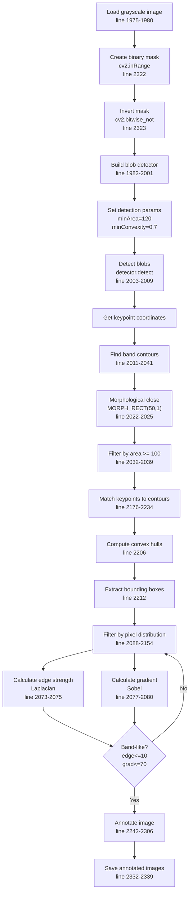

**Key Parameters:**
- `cv2.SimpleBlobDetector` parameters [line 1991-2000]():
  - `minArea`: 120 pixels (filters small noise)
  - `minConvexity`: 0.7 (ensures band-like shapes)
  - `minInertiaRatio`: 0.001, `maxInertiaRatio`: 0.4 (controls elongation)

**Morphological Operations:**
Uses horizontal kernel `(50, 1)` to connect fragmented bands [line 2022]():
```python
kernel_connect = cv2.getStructuringElement(cv2.MORPH_RECT, (50, 1))
processed_mask = cv2.morphologyEx(mask, cv2.MORPH_CLOSE, kernel_connect)
```

**Text vs. Band Discrimination:**
Filters text-like regions using pixel analysis [line 2088-2154]():
- **Bands**: `edge_strength <= 10`, `gradient_magnitude <= 70`, `std_dev <= 50`
- **Text**: Very high edge strength (>20), sharp gradients (>100)

**Returns:**
- Annotated image path with drawn ROIs
- List of ROI tuples: `[(x, y, width, height), ...]`

**Conversion to target_bands:**
```python
annotated_path, rois = find_roi_from_image(
    image_path="blot.png",
    lower_threshold=0,
    upper_threshold=80,
    number_of_bands=3
)

target_bands = [
    {"name": f"band_{i}", "roi": list(roi)}
    for i, roi in enumerate(rois)
]
```

Sources: [biomni/tool/pharmacology.py:1927-2348](), [biomni/tool/tool_description/pharmacology.py:457-494]()

### analyze_western_blot

Performs densitometric quantification of Western blot bands with statistical analysis.

**Function Signature:**
```python
analyze_western_blot(
    blot_image_path: str,
    target_bands: List[dict],
    loading_control_band: dict,
    antibody_info: dict,
    output_dir: str = "./results"
) -> str
```

**Band Specification Format:**
```python
target_bands = [
    {
        "name": "p53",
        "roi": [x, y, width, height]  # From find_roi_from_image
    }
]

loading_control_band = {
    "name": "β-actin",
    "roi": [x, y, width, height]
}

antibody_info = {
    "primary": "Anti-p53 (1:1000)",
    "secondary": "HRP-conjugated anti-rabbit (1:5000)"
}
```

**Quantification Method:**

**Intensity Extraction:**
For each ROI, calculates mean pixel intensity [line 2410-2425]():
```python
roi_region = image[y:y+h, x:x+w]
mean_intensity = np.mean(roi_region)
```

**Normalization Formula:**
```python
relative_expression = target_intensity / loading_control_intensity
```

**Statistical Analysis:**
- Mean intensity per band
- Standard deviation within ROI
- Coefficient of variation (CV)
- Relative expression ratios

**Output Files:**
1. `densitometry_results.csv`: Band intensities and relative expressions
2. `band_visualization.png`: Image with annotated ROIs
3. `intensity_profile.png`: Intensity distribution plots

**Complete Example:**
```python
# Step 1: Analyze pixel distribution
stats = analyze_pixel_distribution("western_blot.png")
print(stats["percentiles_values"])  # Use to choose thresholds

# Step 2: Detect bands automatically
annotated_path, rois = find_roi_from_image(
    image_path="western_blot.png",
    lower_threshold=0,
    upper_threshold=80,
    number_of_bands=4,  # 3 targets + 1 loading control
    debug=True
)

# Step 3: Quantify bands
target_bands = [
    {"name": "p53", "roi": list(rois[0])},
    {"name": "MDM2", "roi": list(rois[1])},
    {"name": "p21", "roi": list(rois[2])}
]
loading_control = {"name": "β-actin", "roi": list(rois[3])}

results = analyze_western_blot(
    blot_image_path="western_blot.png",
    target_bands=target_bands,
    loading_control_band=loading_control,
    antibody_info={
        "primary": "Anti-p53 (1:1000)",
        "secondary": "HRP-conjugated (1:5000)"
    }
)
```

**Normalization Rationale:**
All target bands are normalized to the loading control to account for:
- Sample loading variations (pipetting errors)
- Transfer efficiency differences (membrane contact)
- Detection sensitivity variations (ECL exposure time)

Sources: [biomni/tool/pharmacology.py:2350-2965](), [biomni/tool/tool_description/pharmacology.py:495-541]()

### analyze_radiolabeled_antibody_biodistribution

Analyzes biodistribution data and calculates pharmacokinetic parameters using bi-exponential modeling.

**Function Signature:**
```python
analyze_radiolabeled_antibody_biodistribution(
    time_points: List[float],
    tissue_data: Dict[str, List[float]]
) -> str
```

**Bi-Exponential Model:**
The function fits concentration-time data to:
```
C(t) = A * exp(-alpha * t) + B * exp(-beta * t)
```
Where:
- `A`, `alpha`: Distribution phase parameters
- `B`, `beta`: Elimination phase parameters

**Calculated PK Parameters:**
| Parameter | Formula | Clinical Interpretation |
|-----------|---------|------------------------|
| Distribution half-life | `ln(2) / alpha` | Time for 50% distribution [line 1130]() |
| Elimination half-life | `ln(2) / beta` | Time for 50% elimination [line 1133]() |
| AUC | `A/alpha + B/beta` | Total exposure [line 1136]() |
| MRT | `(A/alpha² + B/beta²) / AUC` | Mean residence time [line 1139]() |
| Tumor-to-normal ratios | `tumor[t] / tissue[t]` | Tumor selectivity [line 1167-1175]() |

**Curve Fitting:**
Uses `scipy.optimize.curve_fit()` with bounds to ensure physiologically realistic parameters [line 1118-1124]().

Sources: [biomni/tool/pharmacology.py:1073-1207](), [biomni/tool/tool_description/pharmacology.py:274-296]()

### estimate_alpha_particle_radiotherapy_dosimetry

Calculates radiation absorbed doses using the MIRD (Medical Internal Radiation Dose) schema for alpha-particle emitters.

**Function Signature:**
```python
estimate_alpha_particle_radiotherapy_dosimetry(
    biodistribution_data: Dict[str, List[Tuple[float, float]]],
    radiation_parameters: dict,
    output_file: str = "dosimetry_results.csv"
) -> str
```

**Required Radiation Parameters:**
```python
radiation_parameters = {
    "radionuclide": "Ac-225",  # e.g., Actinium-225
    "half_life_hours": 240.0,
    "energy_per_decay_MeV": 5.8,
    "radiation_weighting_factor": 20.0,  # Alpha particles
    "S_factors": {
        ("tumor", "tumor"): 1.5e-6,  # Gy/Bq-s
        ("liver", "liver"): 8.2e-7,
        # ... other organ pairs
    }
}
```

**MIRD Calculation Steps:**
1. Calculate time-integrated activity with decay correction [line 1255-1267]()
2. Apply S-factors for each source-target organ pair [line 1282-1290]()
3. Multiply by radiation weighting factor (20 for alpha) [line 1293]()
4. Calculate therapeutic indices (tumor-to-normal ratios) [line 1300-1307]()

**Physical Decay Correction:**
```python
decay_constant = np.log(2) / half_life_hours
decay_corrected_activities = [a * np.exp(-decay_constant * t) for a, t in measurements]
```

Sources: [biomni/tool/pharmacology.py:1209-1319](), [biomni/tool/tool_description/pharmacology.py:297-337]()

### grade_adverse_events_using_vcog_ctcae

Grades adverse events in veterinary studies using VCOG-CTCAE (Veterinary Cooperative Oncology Group - Common Terminology Criteria for Adverse Events) v1.1.

**Function Signature:**
```python
grade_adverse_events_using_vcog_ctcae(
    clinical_data_file: str
) -> str
```

**VCOG-CTCAE Grade Scale:**
| Grade | Severity | Description |
|-------|----------|-------------|
| 0 | None | No adverse event |
| 1 | Mild | Asymptomatic or mild symptoms |
| 2 | Moderate | Minimal/local intervention indicated |
| 3 | Severe | Hospitalization or intervention indicated |
| 4 | Life-threatening | Urgent intervention indicated |
| 5 | Death | Death related to adverse event |

**Implemented Criteria Categories:**
- **Hematologic**: Neutropenia, anemia, thrombocytopenia [line 724-759]()
- **Gastrointestinal**: Vomiting, diarrhea, anorexia [line 761-814]()
- **Hepatic**: ALT increase [line 816-827]()
- **Renal**: Creatinine increase [line 829-840]()
- **Constitutional**: Fever, weight loss [line 842-865]()
- **Dermatologic**: Alopecia [line 867-878]()
- **Neurologic**: Peripheral neuropathy [line 880-900]()

**Grading Logic:**
The `apply_vcog_grade()` function [line 903-972]():
1. Checks for symptom-specific criteria in `vcog_criteria` dict
2. If measurement provided, uses numeric ranges
3. Otherwise, maps severity text to grades
4. Returns grade and rationale string

**Progression Analysis:**
If time_point column exists:
- Creates pivot table of grades over time [line 996-1001]()
- Identifies trends: increasing, decreasing, stable, fluctuating [line 1004-1026]()
- Saves progression analysis to CSV

Sources: [biomni/tool/pharmacology.py:682-1071](), [biomni/tool/tool_description/pharmacology.py:257-273]()

### analyze_accelerated_stability_of_pharmaceutical_formulations

Models pharmaceutical formulation stability under accelerated storage conditions.

**Function Signature:**
```python
analyze_accelerated_stability_of_pharmaceutical_formulations(
    formulations: List[dict],
    storage_conditions: List[dict],
    time_points: List[int]
) -> str
```

**Formulation Specification:**
```python
formulations = [{
    "name": "Formulation A",
    "active_ingredient": "Drug X",
    "concentration": 50.0,  # mg/mL
    "excipients": ["PEG 400", "Polysorbate 80"]
}]
```

**Storage Conditions:**
```python
storage_conditions = [{
    "temperature": 40.0,  # °C
    "humidity": 75.0,     # % RH
    "description": "Accelerated (40°C/75% RH)"
}]
```

**Stability Modeling:**

**Acceleration Factor:**
Uses Arrhenius relationship: `2^((temp - 25) / 10)` [line 459]()
- Rule of thumb: reaction rate doubles every 10°C increase

**Chemical Stability:**
First-order degradation model [line 475]():
```python
chemical_stability = 100 * np.exp(-0.001 * effective_time)
```
Where `effective_time = time * accel_factor * humidity_factor`

**Physical Stability:**
Scored 1-10, decreasing over time [line 479-480]():
```python
physical_stability = 10 - (0.05 * effective_time)
```

**Stability Assessment Criteria:**
| Chemical Stability | Physical Stability | Assessment |
|-------------------|-------------------|------------|
| ≥90% | ≥7 | Stable |
| <90% or <7 | <85% or <5 | Potentially unstable |
| <85% | <5 | Unstable |

Sources: [biomni/tool/pharmacology.py:414-575](), [biomni/tool/tool_description/pharmacology.py:190-219]()

### perform_mwas_cyp2c19_metabolizer_status

Methylome-Wide Association Study to identify CpG sites associated with CYP2C19 metabolizer phenotype.

**Function Signature:**
```python
perform_mwas_cyp2c19_metabolizer_status(
    methylation_data_path: str,
    metabolizer_status_path: str,
    covariates_path: Optional[str] = None,
    pvalue_threshold: float = 0.05,
    output_file: str = "significant_cpg_sites.csv"
) -> str
```

**Metabolizer Status Encoding:**
```python
status_order = {
    "poor": 1,
    "intermediate": 2,
    "normal": 3,
    "rapid": 4,
    "ultrarapid": 5
}
```

**Statistical Analysis:**

**Without Covariates:**
Uses `scipy.stats.linregress()` [line 1458]():
```
methylation ~ metabolizer_status
```

**With Covariates:**
Uses `statsmodels.formula.api.ols()` [line 1476]():
```
methylation ~ metabolizer_status + age + sex + smoking_status + ...
```

**Multiple Testing Correction:**
Bonferroni correction [line 1490-1492]():
```python
adjusted_pvalue = pvalue * n_cpg_sites
adjusted_pvalue = min(adjusted_pvalue, 1.0)
```

**Output:**
- Significant CpG sites with coefficients and adjusted p-values
- Top 5 most significant sites in research log
- Full results saved to CSV

Sources: [biomni/tool/pharmacology.py:1321-1521](), [biomni/tool/tool_description/pharmacology.py:338-386]()

### run_3d_chondrogenic_aggregate_assay

Generates detailed protocol for 3D chondrogenic differentiation assays.

**Function Signature:**
```python
run_3d_chondrogenic_aggregate_assay(
    chondrocyte_cells: dict,
    test_compounds: List[dict],
    culture_duration_days: int = 21,
    measurement_intervals: int = 7
) -> str
```

**Protocol Components:**
1. Materials and reagents list [line 612-624]()
2. Experimental design parameters [line 626-639]()
3. Chondrogenic differentiation medium recipe [line 643-650]()
4. 3D aggregate formation procedure [line 657-666]()
5. Medium change schedule [line 668-671]()
6. Measurement timepoints and assays [line 673-677]()

**Chondrogenic Medium Composition:**
- High-glucose DMEM base
- 10 ng/mL TGF-β3 (transforming growth factor)
- 100 nM Dexamethasone
- 50 μg/mL Ascorbate-2-phosphate
- 1% ITS+ premix (insulin, transferrin, selenium)
- 1 mM Sodium pyruvate
- 100 U/mL Penicillin/Streptomycin

Sources: [biomni/tool/pharmacology.py:577-680](), [biomni/tool/tool_description/pharmacology.py:220-256]()

---

## Physicochemical Property Calculation

### calculate_physicochemical_properties

Calculates molecular descriptors relevant to drug-likeness using RDKit.

**Function Signature:**
```python
calculate_physicochemical_properties(
    smiles_string: str
) -> str
```

**Calculated Properties:**

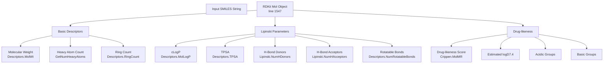

**Lipinski's Rule of Five:**
The calculated properties directly support Rule of Five analysis:
- Molecular Weight < 500 Da
- cLogP < 5
- H-Bond Donors ≤ 5
- H-Bond Acceptors ≤ 10

**pKa Estimation:**
Simplified counting approach [line 1570-1578]():
- **Acidic groups**: Count oxygen atoms bonded to sp² carbons (carboxylic acids)
- **Basic groups**: Count nitrogen atoms with degree < 4 (amines)

**Output Format:**
Results saved to `physicochemical_properties.csv` and formatted in research log.

Sources: [biomni/tool/pharmacology.py:1523-1614](), [biomni/tool/tool_description/pharmacology.py:387-399]()

---

## Data Dependencies and External Services

### External Dependencies Summary

| Tool Category | Dependencies | Data Source | Connection Type |
|--------------|-------------|-------------|-----------------|
| DiffDock | Docker, GPU drivers | Pre-built container | Docker volume mount |
| AutoDock Vina | TDC library | PyPI package | Python API |
| ADMET Prediction | DeepPurpose, PyTorch | HuggingFace Hub | Model download |
| Binding Affinity | DeepPurpose, PyTorch | BindingDB models | Model download |
| Drug Repurposing | TxGNN data | Data Lake S3 | Local pickle files |
| DDInter | Pandas | Data Lake S3 | CSV → Pickle processing |
| OpenFDA | requests | api.fda.gov | REST API |
| Preclinical Tools | NumPy, SciPy, scikit-image | N/A | Computational only |
| Physicochemical | RDKit | N/A | Computational only |

### Data Lake Integration

**DDInter Files Required:**
```
data_lake/
├── ddinter_alimentary_tract_metabolism.csv
├── ddinter_antineoplastic.csv
├── ddinter_antiparasitic.csv
├── ddinter_blood_organs.csv
├── ddinter_dermatological.csv
├── ddinter_hormonal.csv
├── ddinter_respiratory.csv
└── ddinter_various.csv
```

**TxGNN Files Required:**
```
data_lake/
├── txgnn_name_mapping.pkl
└── txgnn_prediction.pkl
```

**Automatic Processing:**
DDInter CSV files are automatically processed into optimized pickle files on first use via `_process_ddinter_data_inline()` [line 2017-2085](). Processed files are stored in `biomni/tool/schema_db/` for fast subsequent access.

Sources: [biomni/tool/pharmacology.py:1970-2085]()

---

## Integration with A1 Agent

All pharmacology tools are automatically registered in the tool registry and available to the A1 agent through the schema-based discovery system.

### Tool Registration Flow

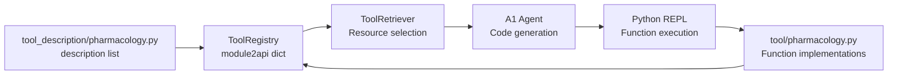

**Schema Example:**
Each function has a corresponding description entry [biomni/tool/tool_description/pharmacology.py:1-724]():
```python
{
    "name": "predict_admet_properties",
    "description": "Predicts ADMET properties...",
    "required_parameters": [
        {
            "name": "smiles_list",
            "type": "List[str]",
            "description": "List of SMILES strings..."
        }
    ],
    "optional_parameters": [...]
}
```

**Agent Usage:**
When a user requests drug property prediction, the agent:
1. ToolRetriever identifies relevant tools via description matching
2. Agent generates import and function call code
3. Python REPL executes the generated code
4. Results are captured and returned to conversation

**Example Agent Code Generation:**
```python
from biomni.tool.pharmacology import predict_admet_properties

smiles = ["CC(C)Cc1ccc(cc1)C(C)C(=O)O"]  # Ibuprofen
result = predict_admet_properties(smiles, ADMET_model_type="MPNN")
print(result)
```

Sources: [biomni/tool/tool_description/pharmacology.py:1-724]()

---

## Common Usage Patterns

### Pattern 1: Complete Drug Discovery Workflow

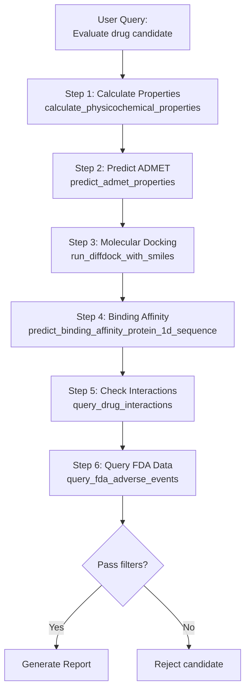

### Pattern 2: Drug Safety Assessment

```python
# Step 1: Check individual drug safety
fda_events = query_fda_adverse_events("Drug_A", severity_filter=["serious"])

# Step 2: Check combination safety
combination_safety = check_drug_combination_safety(
    ["Drug_A", "Drug_B", "Drug_C"],
    include_mechanisms=True,
    include_management=True
)

# Step 3: Check for recalls
recalls = check_fda_drug_recalls("Drug_A", classification=["Class I"])

# Step 4: Analyze safety signals
signals = analyze_fda_safety_signals(
    ["Drug_A", "Drug_B"],
    signal_threshold=2.0
)
```

### Pattern 3: Preclinical Study Analysis

```python
# Xenograft study
xenograft_results = analyze_xenograft_tumor_growth_inhibition(
    data_path="xenograft_data.csv",
    time_column="Day",
    volume_column="Tumor_Volume_mm3",
    group_column="Treatment",
    subject_column="Mouse_ID"
)

# Western blot analysis
western_results = analyze_western_blot(
    blot_image_path="western_blot.tif",
    target_bands=[{"name": "p53", "roi": [100, 50, 80, 40]}],
    loading_control_band={"name": "β-actin", "roi": [100, 200, 80, 40]},
    antibody_info={"primary": "Anti-p53", "secondary": "HRP-conjugated"}
)

# Adverse event grading
ae_grading = grade_adverse_events_using_vcog_ctcae("clinical_data.csv")
```

Sources: [biomni/tool/pharmacology.py:1-2965]()

---

## Error Handling and Validation

### Common Error Patterns

**Invalid SMILES Strings:**
Most SMILES-based functions validate input using RDKit [line 1547-1551]():
```python
mol = Chem.MolFromSmiles(smiles_string)
if mol is None:
    return "ERROR: Invalid SMILES string provided."
```

**Missing Data Lake Files:**
DDInter and TxGNN functions check for required data [line 2243-2270]():
```python
if not os.path.exists(data_file):
    raise FileNotFoundError(f"Required data file not found: {data_file}")
```

**API Rate Limiting:**
OpenFDA functions should handle rate limits (implementation in query functions):
```python
response = requests.get(url)
if response.status_code == 429:
    # Rate limit exceeded, retry with backoff
```

**Docker Availability:**
DiffDock requires Docker and GPU drivers [line 28-30]():
```python
try:
    subprocess.run(["docker", "pull", "rbgcsail/diffdock"], check=True)
except subprocess.CalledProcessError:
    return "Error: Docker not available or image pull failed"
```

**Image Analysis Errors:**
Western blot functions validate image files [line 1894-1896]():
```python
image = cv2.imread(image_path, cv2.IMREAD_GRAYSCALE)
if image is None:
    raise FileNotFoundError(f"Image not found at {image_path}")
```

**ROI Detection Mismatch:**
`find_roi_from_image` warns when detected ROIs don't match expected [line 2341-2345]():
```python
if len(rois) != number_of_bands:
    print(f"Warning: Detected {len(rois)} ROIs, but expected {number_of_bands} ROIs.")
    print("Please check the image and try to adjust the thresholds.")
```

### Input Validation Patterns

**Fuzzy Matching for Drug Names:**
```python
from difflib import get_close_matches

matched = get_close_matches(drug_name, known_drugs, n=1, cutoff=0.8)
if not matched:
    return f"Drug '{drug_name}' not found in database"
```

**Model Type Validation:**
```python
available_models = ["MPNN", "CNN", "Morgan"]
if model_type not in available_models:
    return f"Invalid model type. Available: {', '.join(available_models)}"
```

Sources: [biomni/tool/pharmacology.py:249-262](), [biomni/tool/pharmacology.py:1545-1551](), [biomni/tool/pharmacology.py:2243-2270]()

---

## Performance Considerations

### Computational Requirements

| Tool | CPU | GPU | Memory | Disk | Typical Runtime |
|------|-----|-----|--------|------|----------------|
| DiffDock | 4+ cores | Recommended | 8GB | 10GB (Docker image) | 5-30 min/ligand |
| AutoDock Vina | 1-8 cores | N/A | 2GB | <1GB | 1-5 min/ligand |
| ADMET Prediction | 2+ cores | Optional | 4GB | 2GB (models) | 10-30 sec/compound |
| Binding Affinity | 2+ cores | Optional | 4GB | 2GB (models) | 10-30 sec/pair |
| DDInter Query | 1 core | N/A | 500MB | 100MB (processed) | <1 sec |
| FDA Queries | 1 core | N/A | <100MB | None | 1-5 sec (API latency) |
| Preclinical Analysis | 2+ cores | N/A | 2GB | <100MB | Seconds to minutes |

### Optimization Strategies

**Batch Processing for ADMET:**
Process multiple compounds in single function call to amortize model loading [line 264-287]():
```python
# Efficient: single call (models loaded once)
results = predict_admet_properties(["SMILES1", "SMILES2", "SMILES3"])

# Inefficient: multiple calls (reloads 16 models each time)
for smiles in smiles_list:
    result = predict_admet_properties([smiles])
```

**DDInter Preprocessing:**
First query triggers CSV→Pickle conversion via `_process_ddinter_data_inline`. Subsequent queries use fast pickle loading [line 1996-1999](), [line 2017-2085]():
```python
pkl_files = [drugs_file, interactions_file, name_mapping_file, stats_file]
if not all(os.path.exists(f) for f in pkl_files):
    _process_ddinter_data_inline(data_lake_path, schema_dir)
```

**GPU Acceleration:**
Enable GPU for DiffDock (Docker GPU support) and DeepPurpose models:
```python
# DiffDock with GPU
run_diffdock_with_smiles(..., use_gpu=True, gpu_device=0)

# DeepPurpose automatically uses CUDA if available
```

**Image Analysis Performance:**
For large Western blot images, preprocessing reduces computation [line 2022-2025]():
```python
# Morphological operations on binary mask are faster than pixel-level processing
kernel_connect = cv2.getStructuringElement(cv2.MORPH_RECT, (50, 1))
processed_mask = cv2.morphologyEx(mask, cv2.MORPH_CLOSE, kernel_connect)
```

Sources: [biomni/tool/pharmacology.py:263-287](), [biomni/tool/pharmacology.py:1995-1999]()

---

## Related Documentation

- **[Database Query Tools](#5.1)**: For querying protein structures (PDB, UniProt), pathways (KEGG), and drug databases
- **[Genomics and Single-Cell Tools](#5.2)**: For CRISPR design, cell type annotation, and Hi-C analysis
- **[Molecular Biology Tools](#5.3)**: For primer design, PCR simulation, and cloning protocols
- **[Tool Development](#8.4)**: For adding new pharmacology tools to the system
- **[Configuration System](#2.5)**: For setting API keys and data lake paths
- **[Data Infrastructure](#2.6)**: For understanding data lake organization

Sources: [biomni/tool/pharmacology.py:1-2965](), [biomni/tool/tool_description/pharmacology.py:1-724]()

---