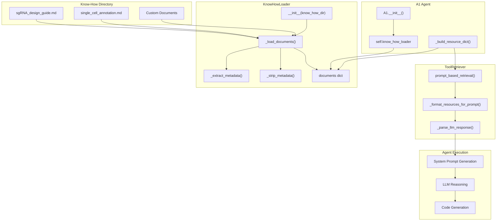
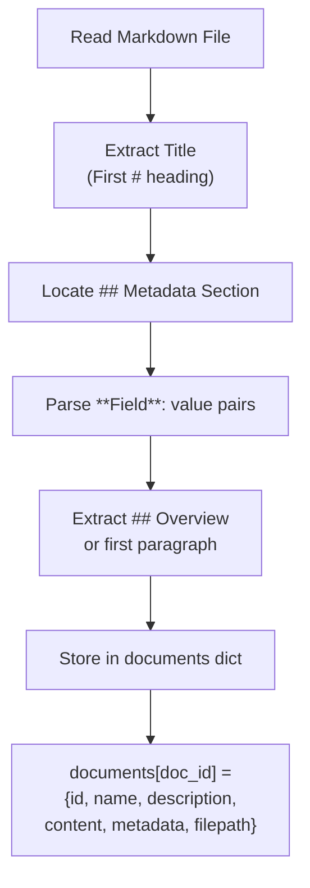
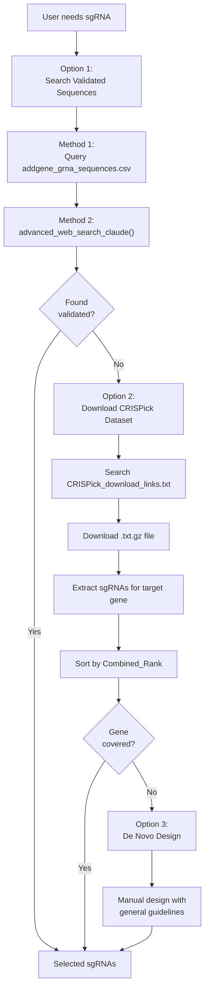
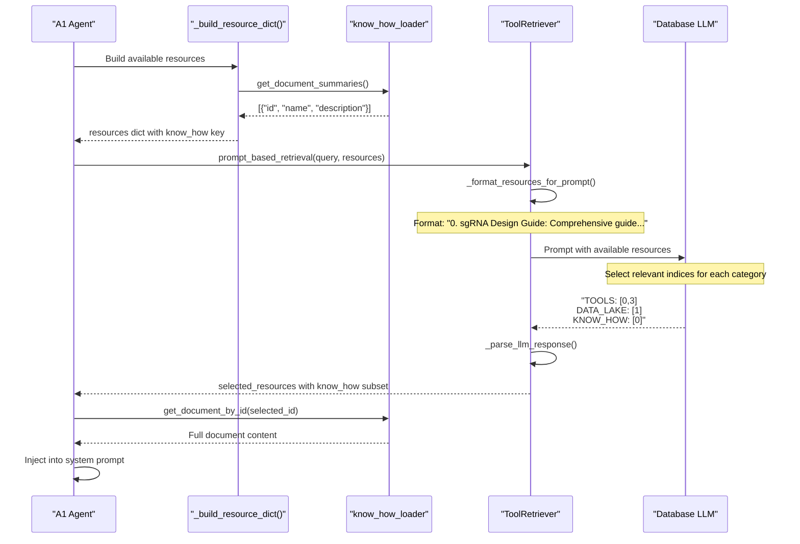
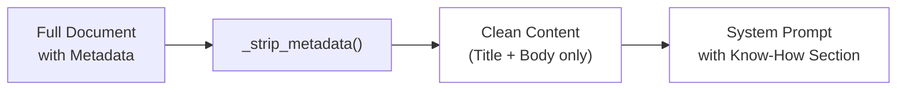
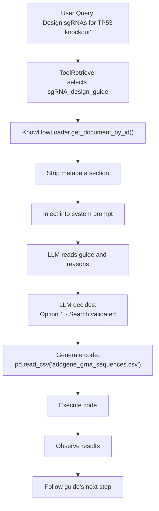

# Know-How Guides

<details>
<summary>Relevant source files</summary>

The following files were used as context for generating this wiki page:

- [biomni/know_how/sgRNA_design_guide.md](biomni/know_how/sgRNA_design_guide.md)
- [biomni/know_how/single_cell_annotation.md](biomni/know_how/single_cell_annotation.md)

</details>


## Purpose and Scope

This page documents the Know-How Library system, which provides domain-specific best practices, protocols, and troubleshooting guides to the A1 agent. Know-how documents are markdown files containing expert knowledge that the agent can retrieve and use during task execution to improve decision-making and avoid common pitfalls.

For information about the broader resource selection mechanism that includes know-how, see [Tool Registry and Retrieval](#2.4). For details about how the agent orchestrates execution, see [A1 Agent Core](#2.1).

---

## Architecture Overview

The Know-How Library system consists of three main components: document storage, loading, and retrieval integration.

### System Integration Diagram



**Sources:** [biomni/know_how/loader.py:1-349](), [biomni/model/retriever.py:1-204]()

---

## Document Structure

Know-how documents are markdown files with a standardized structure consisting of metadata, overview, and content sections.

### Standard Document Format

```markdown
# Document Title

---

## Metadata

**Short Description**: Brief one-line description

**Authors**: Author names or organization

**Version**: Version number

**Last Updated**: Date

**License**: License type (e.g., CC BY 4.0)

**Commercial Use**: ✅ Allowed or ❌ Not Allowed

**Citation**: How to cite this document

---

## Overview

High-level summary of the document's purpose and scope.

## Main Content Sections

Detailed protocols, best practices, code examples, etc.
```

### Metadata Extraction Process

The `KnowHowLoader` automatically extracts metadata from markdown documents using the `_extract_metadata()` method:



**Sources:** [biomni/know_how/loader.py:64-163]()

### Document Dictionary Structure

Each loaded document is stored with the following keys:

| Key | Type | Description |
|-----|------|-------------|
| `id` | `str` | Filename without extension (e.g., `sgRNA_design_guide`) |
| `name` | `str` | Extracted title from first H1 heading |
| `description` | `str` | Short description from metadata or overview section (max 200 chars) |
| `content` | `str` | Full markdown content including metadata |
| `content_without_metadata` | `str` | Content with metadata section stripped |
| `filepath` | `str` | Absolute path to the markdown file |
| `metadata` | `dict` | Extracted metadata fields (authors, version, license, etc.) |

**Sources:** [biomni/know_how/loader.py:52-62]()

---

## KnowHowLoader API

The `KnowHowLoader` class provides methods for loading, accessing, and managing know-how documents.

### Core Methods

| Method | Parameters | Returns | Description |
|--------|-----------|---------|-------------|
| `__init__()` | `know_how_dir: str \| None` | `None` | Initialize loader with directory path (defaults to package directory) |
| `get_all_documents()` | None | `list[dict]` | Get all documents with full content |
| `get_document_by_id()` | `doc_id: str` | `dict \| None` | Get specific document by ID |
| `get_document_summaries()` | None | `list[dict]` | Get id/name/description only (no content) |
| `add_custom_document()` | `doc_id, name, description, content, metadata` | `None` | Add document programmatically |
| `get_document_metadata()` | `doc_id: str` | `dict \| None` | Get metadata for specific document |
| `remove_document()` | `doc_id: str` | `None` | Remove document from loader |
| `reload()` | None | `None` | Reload all documents from disk |

**Sources:** [biomni/know_how/loader.py:226-349]()

### Loading Behavior

The loader automatically excludes certain files during initialization:

- Files with uppercase names (e.g., `README.MD`, `QUICK_START.MD`)
- Non-markdown files
- Files in the `resource/` subdirectory (these are referenced by documents but not loaded as standalone guides)

**Sources:** [biomni/know_how/loader.py:28-62]()

### Example Usage

```python
from biomni.know_how import KnowHowLoader

# Initialize with default directory
loader = KnowHowLoader()

# Get all document summaries
summaries = loader.get_document_summaries()
for doc in summaries:
    print(f"{doc['id']}: {doc['name']}")
    print(f"  Description: {doc['description']}")

# Get specific document with full content
sgrna_guide = loader.get_document_by_id('sgRNA_design_guide')
print(sgrna_guide['content'])

# Check metadata
metadata = loader.get_document_metadata('sgRNA_design_guide')
print(f"License: {metadata.get('license')}")
print(f"Commercial Use: {metadata.get('commercial_use')}")
```

**Sources:** [biomni/know_how/loader.py:226-293]()

---

## Built-In Know-How Documents

The Biomni package includes domain-specific guides covering common bioinformatics workflows.

### Available Documents

| Document ID | Title | Domain | Description |
|------------|-------|--------|-------------|
| `sgRNA_design_guide` | sgRNA Design Guide | CRISPR/Genomics | Three-tiered approach for finding or designing sgRNAs: validated sequences, CRISPick datasets, or de novo design |
| `single_cell_annotation` | Single Cell RNA-seq Cell Type Annotation | Genomics | Best practices for cell type annotation using marker-based, automated, and reference-based approaches |

### sgRNA Design Guide Structure

The sgRNA design guide implements a tiered decision tree:



**Content Highlights:**
- **Resource Files**: References `biomni/know_how/resource/addgene_grna_sequences.csv` (300+ validated sgRNAs) and `CRISPick_download_links.txt` (238 pre-computed datasets)
- **Citation Requirements**: Detailed attribution guidelines for Addgene and CRISPick sources
- **Cas Variants**: Critical distinctions between SpCas9, SaCas9, AsCas12a, and enAsCas12a
- **Selection Criteria**: Combined_Rank (default), On-Target Rank, Off-Target Rank strategies

**Sources:** [biomni/know_how/sgRNA_design_guide.md:1-420]()

### Single-Cell Annotation Guide Structure

| Approach | Tools | Best For |
|----------|-------|----------|
| Manual Marker-Based | Scanpy, Seurat | Small datasets, novel cell types, high confidence needs |
| Automated Annotation | CellTypist, scAnnotate | Standard tissues, quick annotation, large datasets |
| Reference-Based Transfer | scArches, scANVI, Azimuth, SingleR | Well-characterized tissues, integration with public data |

**Content Highlights:**
- **Marker Gene Reference**: Comprehensive tables for immune, epithelial, and stromal cell types
- **Quality Control**: Doublet detection, ambient RNA removal, batch correction
- **Validation Checklist**: 7-point checklist including cluster purity (>80%), marker consistency, biological plausibility
- **Common Pitfalls**: Doublet clusters, over-interpretation of small clusters, reference mismatch

**Sources:** [biomni/know_how/single_cell_annotation.md:1-224]()

---

## Integration with ToolRetriever

Know-how documents are integrated into the agent's resource selection process through the `ToolRetriever.prompt_based_retrieval()` method.

### Retrieval Flow



**Sources:** [biomni/model/retriever.py:14-132](), [biomni/know_how/loader.py:226-256]()

### Resource Dictionary Format

When `use_tool_retriever=True`, the A1 agent builds a resource dictionary that includes know-how:

```python
resources = {
    "tools": [...],          # Tool descriptions from tool registry
    "data_lake": [...],      # Data lake items
    "libraries": [...],      # Software libraries
    "know_how": [            # Know-how document summaries
        {
            "id": "sgRNA_design_guide",
            "name": "sgRNA Design Guide: Three-Tiered Approach",
            "description": "Comprehensive guide for finding or designing sgRNAs..."
        },
        {
            "id": "single_cell_annotation",
            "name": "Single Cell RNA-seq Cell Type Annotation",
            "description": "Best practices for annotating cell types..."
        }
    ]
}
```

The `ToolRetriever` formats these summaries in the prompt sent to the LLM:

```
AVAILABLE KNOW-HOW DOCUMENTS (Best Practices & Protocols):
0. sgRNA Design Guide: Three-Tiered Approach: Comprehensive guide for finding or designing sgRNAs using validated sequences, CRISPick datasets, or de novo design tools.
1. Single Cell RNA-seq Cell Type Annotation: Best practices for annotating cell types in single-cell RNA-seq data using marker-based, automated, and reference-based approaches.
```

**Sources:** [biomni/model/retriever.py:46-72](), [biomni/know_how/loader.py:247-256]()

### Response Parsing

The LLM responds with selected indices for each category:

```
TOOLS: [0, 3, 5]
DATA_LAKE: [1, 2]
LIBRARIES: [0, 4]
KNOW_HOW: [0]
```

The `_parse_llm_response()` method extracts these indices using regex patterns:

- Pattern: `r"KNOW[-_]HOW:\s*\[(.*?)\]"` (case-insensitive)
- Handles both `KNOW_HOW` and `KNOW-HOW` formats
- Robust to whitespace variations

**Sources:** [biomni/model/retriever.py:154-202]()

---

## Content Injection into System Prompt

When know-how documents are selected by the retriever, their full content is injected into the agent's system prompt. The `_strip_metadata()` method removes the metadata section to reduce token usage:



The stripped content retains:
- Document title (H1)
- All content sections (H2 and below)
- Code examples and tables
- Citation information from body

The stripped content removes:
- `## Metadata` section
- Separator lines (`---`) around metadata
- Metadata fields (Authors, Version, License, etc.)

**Sources:** [biomni/know_how/loader.py:165-224]()

---

## Creating Custom Know-How Documents

Users can add custom know-how documents either as markdown files or programmatically.

### Method 1: Add Markdown File

1. Create a markdown file following the standard format
2. Place it in the know-how directory (or custom directory)
3. The `KnowHowLoader` will automatically load it on initialization

```python
from biomni.know_how import KnowHowLoader
import os

# Create custom know-how directory
custom_dir = "./my_know_how"
os.makedirs(custom_dir, exist_ok=True)

# Write custom document
custom_content = """# PCR Optimization Guide

---

## Metadata

**Short Description**: Troubleshooting guide for PCR amplification

**Authors**: Lab Protocol Team

**Version**: 1.0

**Last Updated**: January 2025

**License**: MIT

**Commercial Use**: ✅ Allowed

---

## Overview

This guide covers common PCR troubleshooting scenarios and optimization strategies.

## Common Issues

### No Amplification
- Check primer Tm...
"""

with open(os.path.join(custom_dir, "pcr_optimization.md"), "w") as f:
    f.write(custom_content)

# Load with custom directory
loader = KnowHowLoader(know_how_dir=custom_dir)
```

**Sources:** [biomni/know_how/loader.py:11-26]()

### Method 2: Add Programmatically

```python
from biomni.know_how import KnowHowLoader

loader = KnowHowLoader()

# Add custom document
loader.add_custom_document(
    doc_id="western_blot_protocol",
    name="Western Blot Troubleshooting",
    description="Common issues and solutions for western blotting",
    content="""# Western Blot Troubleshooting
    
## High Background
- Reduce antibody concentration
- Extend blocking time
...""",
    metadata={
        "authors": "Lab Team",
        "version": "1.0",
        "license": "CC BY 4.0",
        "commercial_use": "✅ Allowed"
    }
)

# Verify addition
doc = loader.get_document_by_id("western_blot_protocol")
print(doc['name'])
```

**Sources:** [biomni/know_how/loader.py:258-279]()

### Method 3: Agent-Level Integration

Custom documents can be passed to the A1 agent during initialization or added later:

```python
from biomni.agent import A1
from biomni.know_how import KnowHowLoader

# Option A: Use custom know-how directory
agent = A1(path="./data")
custom_loader = KnowHowLoader(know_how_dir="./my_know_how")
agent.know_how_loader = custom_loader

# Option B: Add to existing loader
agent.know_how_loader.add_custom_document(
    doc_id="custom_protocol",
    name="Custom Protocol",
    description="Lab-specific protocol",
    content="..."
)

# Rebuild resource registry to include new documents
# (happens automatically on next agent.go() call)
```

---

## Document Management Operations

### Viewing Document Information

The `print_document_info()` method displays formatted document details:

```python
loader = KnowHowLoader()
loader.print_document_info('sgRNA_design_guide')
```

**Output Format:**
```
======================================================================
📚 sgRNA Design Guide: Three-Tiered Approach
======================================================================

Description: Comprehensive guide for finding or designing sgRNAs using validated sequences, CRISPick datasets, or de novo design tools.

----------------------------------------------------------------------
METADATA
----------------------------------------------------------------------
Authors: Biomni Team
Version: 1.0
Last Updated: November 2025
License: CC BY 4.0
Commercial Use: ✅ Allowed
======================================================================
```

**Sources:** [biomni/know_how/loader.py:294-333]()

### Removing Documents

```python
# Remove a document
loader.remove_document('sgRNA_design_guide')

# Verify removal
doc = loader.get_document_by_id('sgRNA_design_guide')
assert doc is None
```

**Sources:** [biomni/know_how/loader.py:335-343]()

### Reloading from Disk

```python
# Reload all documents (discards programmatic additions)
loader.reload()

# All markdown files are re-parsed
# Custom documents added via add_custom_document() are lost
```

**Sources:** [biomni/know_how/loader.py:345-348]()

---

## Usage in Agent Execution

When the A1 agent uses know-how documents during execution:



The agent follows the structured guidance in the document, making decisions based on intermediate results (e.g., if validated sgRNAs aren't found, proceed to Option 2).

**Example from tutorial:**
The `biomni_101.ipynb` notebook shows an agent using the sgRNA design guide to plan a CRISPR screen. The agent:
1. Queries Reactome for T cell exhaustion pathways
2. Identifies candidate genes from multiple categories (checkpoint genes, transcription factors, metabolic genes, TCR signaling genes)
3. Prioritizes 32 genes for maximum perturbation effect
4. Would then design sgRNAs following the guide's three-tiered approach

**Sources:** [tutorials/biomni_101.ipynb:127-310]()

---

## File Structure Reference

```
biomni/
├── know_how/
│   ├── __init__.py                      # Module exports KnowHowLoader
│   ├── loader.py                        # KnowHowLoader implementation
│   ├── sgRNA_design_guide.md           # sgRNA design best practices
│   ├── single_cell_annotation.md       # Cell type annotation guide
│   └── resource/                        # Resource files referenced by guides
│       ├── addgene_grna_sequences.csv  # 300+ validated sgRNAs
│       └── CRISPick_download_links.txt # 238 CRISPick dataset URLs
```

**Sources:** [biomni/know_how/__init__.py:1-9](), [biomni/know_how/loader.py:1-349](), [biomni/know_how/sgRNA_design_guide.md:50-72]()

---

## Key Implementation Details

### Metadata Field Normalization

Metadata fields are converted to lowercase with underscores:
- `**Short Description**:` → `short_description`
- `**Last Updated**:` → `last_updated`
- `**Commercial Use**:` → `commercial_use`

**Sources:** [biomni/know_how/loader.py:103-128]()

### Description Length Limits

Descriptions are automatically truncated to 200 characters with ellipsis to maintain readable summaries in the retrieval prompt.

**Sources:** [biomni/know_how/loader.py:159-161]()

### Multi-line Metadata Values

The parser handles multi-line metadata values, including:
- Continuation lines (appended with spaces)
- List items (starting with `- `, joined with commas)
- Code blocks (ignored via line-start check)

**Sources:** [biomni/know_how/loader.py:113-128]()

### Document Exclusion Rules

Files are excluded from loading if:
- Filename is all uppercase (e.g., `README.MD`, `QUICK_START.MD`)
- Matches `filename.upper()` check
- Located in subdirectories (only top-level `.md` files are loaded)

**Sources:** [biomni/know_how/loader.py:38-39]()

---