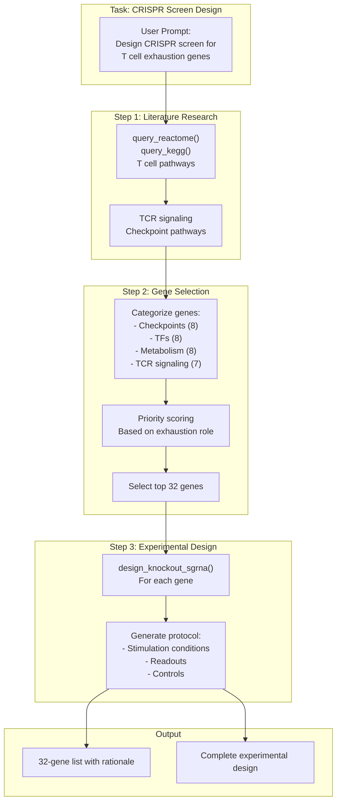
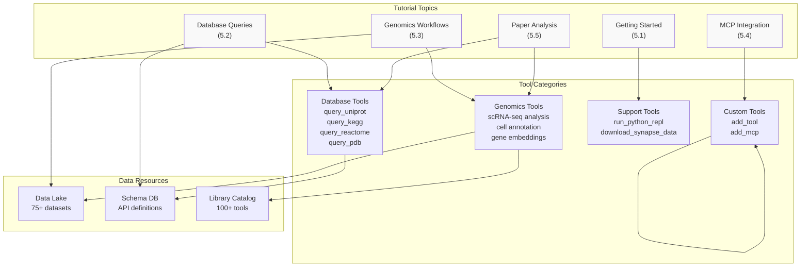
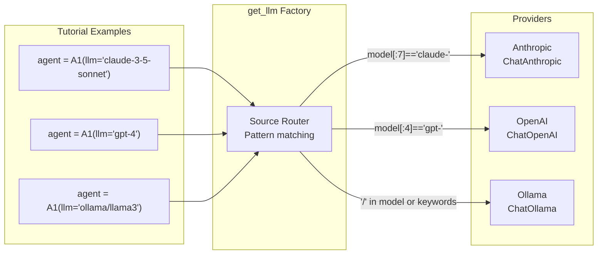
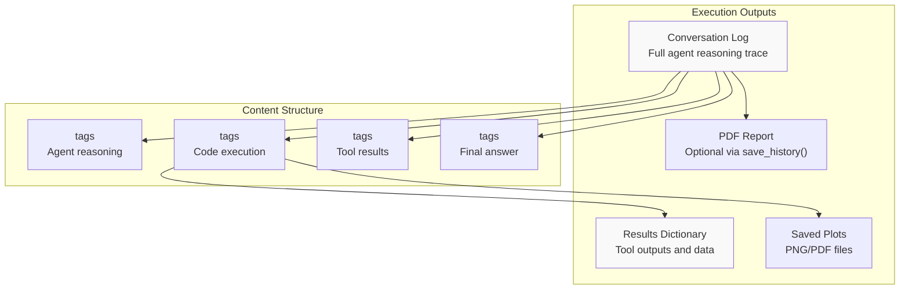

# Tutorials and Examples

<details>
<summary>Relevant source files</summary>

The following files were used as context for generating this wiki page:

- [README.md](README.md)
- [biomni/eval/__init__.py](biomni/eval/__init__.py)
- [biomni/eval/biomni_eval1.py](biomni/eval/biomni_eval1.py)
- [biomni/know_how/__init__.py](biomni/know_how/__init__.py)
- [biomni/know_how/loader.py](biomni/know_how/loader.py)
- [biomni/llm.py](biomni/llm.py)
- [biomni/model/retriever.py](biomni/model/retriever.py)
- [biomni/version.py](biomni/version.py)
- [tutorials/biomni_101.ipynb](tutorials/biomni_101.ipynb)

</details>


This section provides practical, hands-on examples demonstrating how to use Biomni for biomedical research tasks. The tutorials range from basic agent initialization to complex multi-step research workflows, covering database queries, genomics analysis, bioimaging, and custom tool integration.

Each tutorial includes complete, runnable code examples with explanations of key concepts and best practices. For installation and environment setup, see [Installation and Setup](#3). For configuration details, see [Configuration Guide](#4.2). For reference documentation on specific tools, see [Tool Ecosystem](#4.3).

## Tutorial Organization

The tutorials are organized by complexity and domain, progressing from basic operations to advanced workflows:

| Section | Focus Area | Complexity | Prerequisites |
|---------|-----------|------------|---------------|
| [5.1 Getting Started](#5.1) | Basic agent usage, `go()` method | Beginner | None |
| [5.2 Database Queries](#5.2) | Query biomedical databases | Beginner | 5.1 |
| [5.3 Genomics Workflows](#5.3) | scRNA-seq, cell annotation | Intermediate | 5.1, 5.2 |
| [5.4 MCP Integration](#5.4) | External tool integration | Intermediate | 5.1 |
| [5.5 Paper Analysis](#5.5) | Task extraction from papers | Advanced | 5.1, 5.2 |

Sources: [tutorials/biomni_101.ipynb:1-991]()

## Agent Interaction Pattern

All tutorials follow a common pattern for agent initialization, task execution, and result retrieval. Understanding this pattern is essential before diving into specific examples.

```mermaid
sequenceDiagram
    participant User
    participant A1["A1 Agent Instance"]
    participant Config["Configuration System"]
    participant LLM["LLM Provider<br/>(via get_llm)"]
    participant Tools["Tool Functions"]
    participant DataLake["Data Lake Resources"]
    
    User->>A1: "Initialize agent"
    A1->>Config: "Load configuration<br/>(API keys, paths)"
    Config-->>A1: "Config values"
    
    User->>A1: "agent.go(prompt)"
    A1->>LLM: "Initialize LLM instance"
    LLM-->>A1: "BaseChatModel"
    
    loop "ReAct Loop (max 50 iterations)"
        A1->>LLM: "Generate next action<br/><think>, <execute>, <solution>"
        LLM-->>A1: "Action + code"
        
        alt "Execute Action"
            A1->>Tools: "Invoke tool function"
            Tools->>DataLake: "Access data if needed"
            DataLake-->>Tools: "Data"
            Tools-->>A1: "Results + plots"
            A1->>A1: "Create <observation>"
        end
    end
    
    A1-->>User: "Final results + conversation log"
```

**Diagram: Agent Execution Flow**

The agent follows a three-tag system:
- `<think>`: Reasoning and planning steps
- `<execute>`: Code execution with tool invocations
- `<solution>`: Final answer delivery
- `<observation>`: Results from executed code

Sources: [tutorials/biomni_101.ipynb:47-868](), [biomni/llm.py:13-222]()

## Basic Usage Pattern

All tutorials start with this fundamental pattern:

### 1. Agent Initialization

```python
from biomni.agent import A1

# Initialize with configuration
agent = A1(
    path="/path/to/biomni_data",  # Data lake location
    llm="claude-3-5-sonnet-20241022",  # Model selection
    timeout=600,  # Execution timeout
    tool_retrieval=True  # Enable prompt-based tool selection
)
```

Configuration parameters:
- `path`: Location of data lake (downloaded automatically on first run)
- `llm`: Model name (auto-detects provider via [biomni/llm.py:56-95]())
- `timeout`: Maximum execution time per tool invocation
- `tool_retrieval`: Whether to filter tools based on prompt relevance

Sources: [tutorials/biomni_101.ipynb:30-38](), [biomni/llm.py:13-54]()

### 2. Task Execution

```python
# Execute a biomedical research task
log = agent.go("""
    Query UniProt for information about the TP53 protein,
    focusing on its role in cancer and known mutations.
""")
```

The `go()` method:
- Accepts natural language task descriptions
- Returns conversation history including reasoning steps
- Automatically selects and invokes relevant tools
- Handles errors and retries with self-correction

Sources: [tutorials/biomni_101.ipynb:48-966]()

### 3. Result Access

```python
# Conversation log contains all interactions
print(log)  # Full execution trace

# Results are also stored in agent state
# Plots and data files are saved to working directory
```

Sources: [tutorials/biomni_101.ipynb:48-966]()

## Example: Multi-Step Research Workflow

This example from [tutorials/biomni_101.ipynb]() demonstrates a complex research task involving database queries, genomics tools, and experimental design:



**Diagram: Multi-Step CRISPR Screen Design Workflow**

Sources: [tutorials/biomni_101.ipynb:48-966]()

### Execution Trace

The agent's reasoning process is visible in the conversation log:

```python
# From biomni_101.ipynb
agent = A1(path="/path/to/data", llm="claude-sonnet-4-20250514")

log = agent.go("""
    Plan a CRISPR screen to identify genes that regulate T cell exhaustion,
    measured by the change in T cell receptor (TCR) signaling between acute 
    (interleukin-2 [IL-2] only) and chronic (anti-CD3 and IL-2) stimulation.
    Generate 32 genes that maximize the perturbation effect.
""")
```

**Agent's Multi-Step Plan:**

1. ✓ Research T cell exhaustion biology and pathways
2. ✓ Query databases for relevant genes
3. ✓ Identify genes from exhaustion-related pathways
4. ✓ Select genes with differential effects between conditions
5. ✓ Design sgRNAs for selected genes
6. ✓ Validate gene list and provide experimental recommendations

Sources: [tutorials/biomni_101.ipynb:962-966]()

### Tool Usage in Example

The agent automatically invoked these tools during execution:

| Tool Function | Module | Purpose | Lines |
|--------------|--------|---------|-------|
| `query_reactome()` | `biomni.tool.database` | Find T cell signaling pathways | 88-93 |
| `query_kegg()` | `biomni.tool.database` | Retrieve pathway information | - |
| `design_knockout_sgrna()` | `biomni.tool.molecular_biology` | Generate sgRNA sequences | 364-376 |
| `gene_set_enrichment_analysis()` | `biomni.tool.genomics` | Analyze gene categories | 81 |

**Observation**: The agent handles tool failures gracefully (e.g., missing sgRNA library at [tutorials/biomni_101.ipynb:386-400]()) and adapts by providing theoretical recommendations instead.

Sources: [tutorials/biomni_101.ipynb:78-866]()

## Tool Integration Map

Understanding which tools are available and how they integrate is key to effective tutorial usage:



**Diagram: Tutorial-to-Tool Mapping**

Sources: [tutorials/biomni_101.ipynb:78-866]()

## Common Patterns Across Tutorials

### Pattern 1: Database Query Chain

Multiple database queries combined for comprehensive information:

```python
# Pattern from biomni_101.ipynb
from biomni.tool.database import query_reactome, query_kegg, query_uniprot

# Agent executes this internally via <execute> tags
exhaustion_pathways = query_reactome(
    prompt="Find pathways related to T cell exhaustion, TCR signaling"
)

checkpoint_pathways = query_reactome(
    prompt="Find pathways related to immune checkpoint inhibition, PD-1, CTLA-4"
)
```

The `query_*` functions use schema-guided query generation via `_query_llm_for_api()` (see [4.3.1](#4.3.1) for details).

Sources: [tutorials/biomni_101.ipynb:88-109]()

### Pattern 2: Gene List Analysis

Processing gene lists through enrichment and annotation:

```python
# Categorization pattern
gene_categories = {
    'Immune Checkpoints': ['PDCD1', 'HAVCR2', 'LAG3', 'TIGIT'],
    'Transcription Factors': ['TOX', 'EOMES', 'BATF', 'TBX21'],
    'Metabolic Regulators': ['HIF1A', 'MYC', 'MTOR', 'PRKAA1'],
    'TCR Signaling': ['LCK', 'ZAP70', 'LAT', 'PLCG1']
}

# Priority scoring for selection
high_priority_genes = {
    'TOX': {'priority': 10, 'category': 'Master TF', 'rationale': '...'},
    'PDCD1': {'priority': 10, 'category': 'Checkpoint', 'rationale': '...'}
}
```

Sources: [tutorials/biomni_101.ipynb:120-294]()

### Pattern 3: Error Handling and Adaptation

The agent adapts when tools fail:

```python
# From line 363-376: Attempted sgRNA design
try:
    result = design_knockout_sgrna(
        gene_name=gene,
        data_lake_path=data_lake_path,
        species="human",
        num_guides=3
    )
except Exception as e:
    # Agent adapts by providing theoretical recommendations
    print(f"Error: {str(e)}")
    # Continues with alternative approach
```

When the sgRNA library was missing [tutorials/biomni_101.ipynb:386-400](), the agent switched to providing theoretical design recommendations instead.

Sources: [tutorials/biomni_101.ipynb:363-442]()

## LLM Provider Configuration in Tutorials

Tutorials work with any supported LLM provider. The `get_llm()` factory auto-detects providers:



**Diagram: LLM Configuration in Tutorials**

Auto-detection logic from [biomni/llm.py:56-95]():
- `claude-*` → Anthropic
- `gpt-*` → OpenAI
- `azure-*` → AzureOpenAI
- `/` or keywords (`llama`, `mistral`, etc.) → Ollama
- `gemini-*` → Gemini
- `groq` → Groq

Sources: [biomni/llm.py:56-95](), [tutorials/biomni_101.ipynb:36-37]()

## Tutorial Execution Environment

All tutorials require:

| Requirement | Purpose | Configuration |
|------------|---------|---------------|
| Conda environment | Package dependencies | `biomni_e1` or `biomni_fixed` |
| API keys | LLM access | Environment variables (see [4.2](#4.2)) |
| Data lake | Datasets and schemas | Auto-downloaded to `path` parameter |
| Working directory | Plot and result output | Current directory, write-accessible |

### Minimal Setup for Tutorials

```bash
# 1. Install environment
conda env create -f environment.yml
conda activate biomni_e1

# 2. Set API key (choose one)
export ANTHROPIC_API_KEY="your_key"
export OPENAI_API_KEY="your_key"

# 3. Run tutorial
jupyter notebook tutorials/biomni_101.ipynb
```

Sources: [tutorials/biomni_101.ipynb:30-38]()

## Tutorial Output Structure

Each tutorial produces structured outputs:



**Diagram: Tutorial Output Structure**

The conversation log includes:
- Human messages: Original prompts
- AI messages: Agent reasoning and actions
- Observations: Truncated tool outputs (first 10K characters if too long)
- Solutions: Final structured answers

Sources: [tutorials/biomni_101.ipynb:54-958]()

## Learning Path Recommendations

### For Beginners

1. Start with [Getting Started Tutorial](#5.1) to understand basic agent usage
2. Try [Database Query Examples](#5.2) to learn tool invocation
3. Experiment with different prompts to see agent reasoning

### For Intermediate Users

1. Complete beginner tutorials
2. Work through [Genomics Analysis Workflows](#5.3) for domain-specific tasks
3. Explore [MCP Integration Examples](#5.4) for extensibility

### For Advanced Users

1. Study [Paper Analysis and Task Extraction](#5.5) for complex workflows
2. Review [Tool Development](#6.3) to create custom tools
3. Examine agent source code for customization opportunities

## Running Tutorial Code

All tutorial code can be executed in three ways:

### 1. Jupyter Notebooks

```bash
jupyter notebook tutorials/biomni_101.ipynb
# Interactive execution with inline outputs
```

### 2. Python Scripts

```python
# Convert notebook cells to script
from biomni.agent import A1
agent = A1(path="./biomni_data", llm="claude-3-5-sonnet-20241022")
log = agent.go("Your task here")
```

### 3. Command Line

```bash
python -c "
from biomni.agent import A1
agent = A1(path='./biomni_data')
agent.go('Query UniProt for TP53')
"
```

Sources: [tutorials/biomni_101.ipynb:30-966]()

## Tutorial Dataset Requirements

Different tutorials require different data resources:

| Tutorial Section | Required Data | Size | Auto-Download |
|-----------------|---------------|------|---------------|
| 5.1 Getting Started | Minimal (schemas only) | <100 MB | Yes |
| 5.2 Database Queries | Schema databases | ~500 MB | Yes |
| 5.3 Genomics Workflows | Data lake + schemas | ~11 GB | Yes |
| 5.4 MCP Integration | None (external tools) | - | N/A |
| 5.5 Paper Analysis | Minimal | <100 MB | Yes |

Data is downloaded automatically on first `A1` initialization to the `path` parameter location.

Sources: [tutorials/biomni_101.ipynb:30-38]()

## Next Steps

After reviewing this overview:

- **New users**: Begin with [Getting Started Tutorial](#5.1) for hands-on introduction
- **Database work**: Explore [Database Query Examples](#5.2) for comprehensive query patterns  
- **Genomics research**: Study [Genomics Analysis Workflows](#5.3) for domain-specific techniques
- **Integration needs**: Review [MCP Integration Examples](#5.4) for extending functionality
- **Advanced analysis**: Examine [Paper Analysis and Task Extraction](#5.5) for research automation

For troubleshooting tutorial execution, see [Installation and Setup](#3). For detailed tool documentation, see [Tool Ecosystem](#4.3).

Sources: [tutorials/biomni_101.ipynb:1-991]()

---