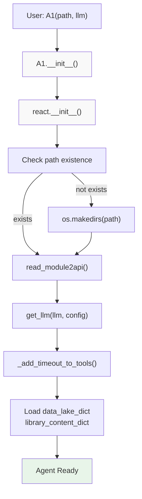
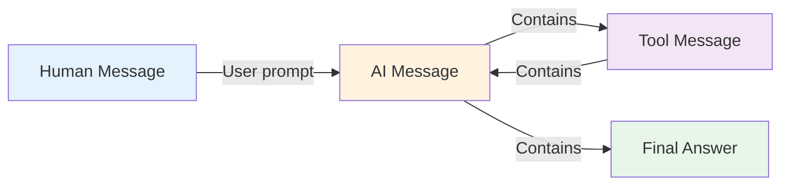
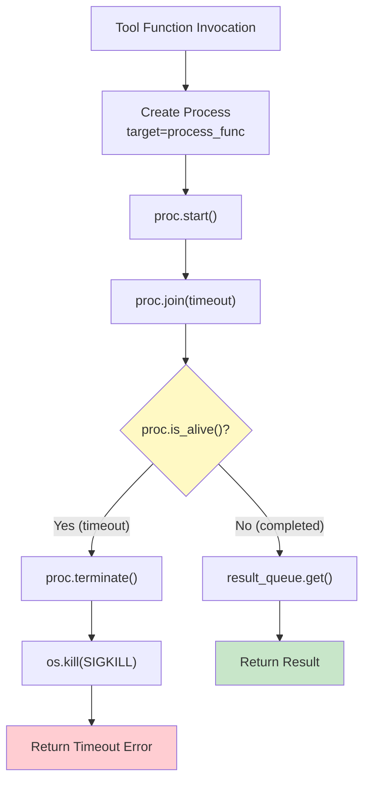
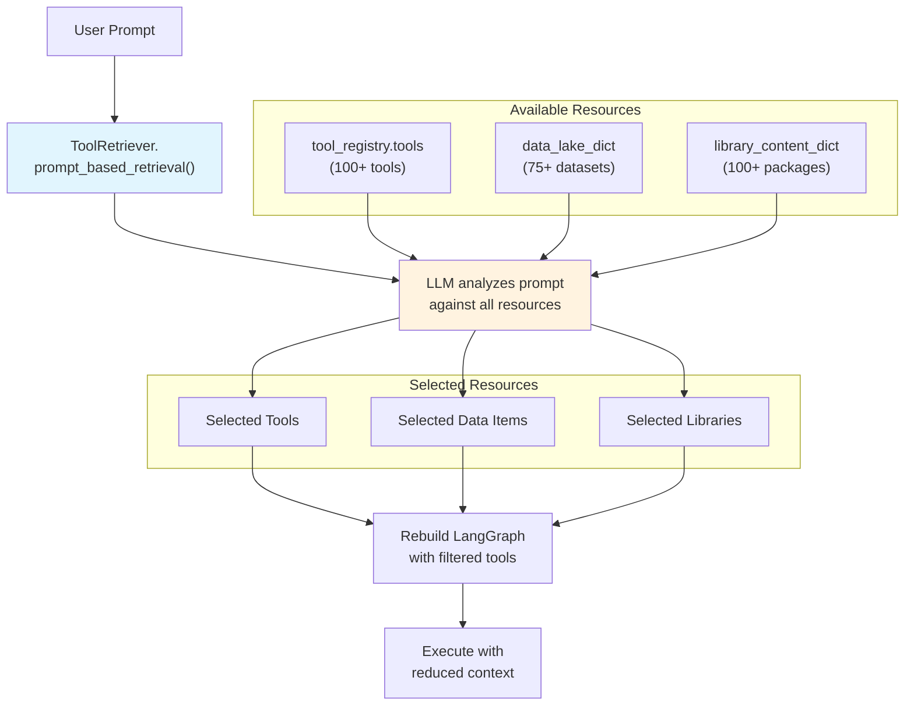
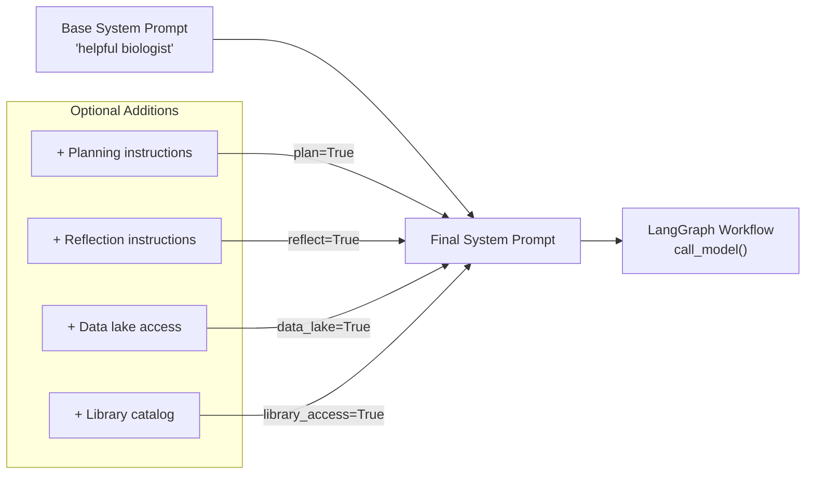

# Getting Started Tutorial

<details>
<summary>Relevant source files</summary>

The following files were used as context for generating this wiki page:

- [biomni/know_how/__init__.py](biomni/know_how/__init__.py)
- [biomni/know_how/loader.py](biomni/know_how/loader.py)
- [biomni/llm.py](biomni/llm.py)
- [biomni/model/retriever.py](biomni/model/retriever.py)
- [tutorials/biomni_101.ipynb](tutorials/biomni_101.ipynb)

</details>


**Purpose**: This tutorial provides a step-by-step walkthrough of using Biomni for your first biomedical research task. You will learn how to initialize the agent, execute a task, interpret the output format, and access conversation history. By the end, you'll understand the complete workflow from prompt to result.

**Scope**: This tutorial covers basic single-task execution. For multi-step workflows, see examples in [Database Query Examples](#5.2) and [Genomics Analysis Workflows](#5.3). For configuration details, see the [Configuration Guide](#4.2).

---

## Prerequisites

Before starting this tutorial, ensure you have:

1. **Environment Setup**: The `biomni_e1` conda environment installed and activated. See [Installation and Setup](#3) for details.
2. **API Keys**: At least one LLM provider API key configured (Anthropic, OpenAI, etc.). See [README.md:58-128]() for configuration options.
3. **Data Lake**: Approximately 11GB of disk space for the automated data lake download on first initialization.

Sources: [README.md:36-56](), [docs/configuration.md:24-38]()

---

## Step 1: Basic Agent Initialization

### Creating Your First Agent

The simplest way to initialize an agent:

```python
from biomni.agent import A1

# Initialize agent with default configuration
agent = A1(path='./data', llm='claude-sonnet-4-20250514')
```

**What happens during initialization**:

1. **Data Lake Download**: If `./data` doesn't exist, Biomni automatically downloads ~11GB of curated biomedical datasets
2. **Tool Registration**: All 100+ built-in tools are loaded from `module2api` dictionary
3. **LLM Initialization**: The specified model is configured via the `get_llm` factory function
4. **Timeout Wrapper**: All tools are wrapped with timeout protection (default: 600 seconds)

Sources: [biomni/agent/react.py:39-88](), [README.md:140-149]()

### Initialization Flow Diagram



Sources: [biomni/agent/react.py:39-88]()

### Configuration Options

| Parameter | Default | Description |
|-----------|---------|-------------|
| `path` | `default_config.path` | Directory for data lake storage |
| `llm` | `default_config.llm` | Model name (e.g., 'claude-sonnet-4-20250514', 'gpt-4') |
| `use_tool_retriever` | `default_config.use_tool_retriever` | Enable prompt-based tool selection |
| `timeout_seconds` | `default_config.timeout_seconds` | Maximum execution time per tool (default: 600) |

Sources: [biomni/agent/react.py:39-55](), [docs/configuration.md:114-126]()

---

## Step 2: Executing Your First Task

### The `go()` Method

Once initialized, execute tasks using natural language:

```python
# Simple query example
result = agent.go("What is the molecular weight of aspirin?")

# More complex analysis
result = agent.go(
    "Find proteins that interact with TP53 and are involved in DNA repair pathways"
)
```

The `go()` method returns a tuple: `(log, final_answer)` where:
- `log`: List of all conversation messages
- `final_answer`: The agent's final response text

Sources: [biomni/agent/react.py:347-445](), [tutorials/biomni_101.ipynb:46-95]()

### Execution Flow Architecture

```mermaid
sequenceDiagram
    participant User
    participant GoMethod["agent.go(prompt)"]
    participant ToolRetriever["ToolRetriever<br/>(optional)"]
    participant LangGraph["LangGraph Workflow"]
    participant LLM["Language Model"]
    participant ToolNode["Tool Execution"]
    participant Logger["Log Storage"]
    
    User->>GoMethod: "user prompt"
    
    opt Tool Retrieval Enabled
        GoMethod->>ToolRetriever: "prompt_based_retrieval()"
        ToolRetriever->>LLM: "Select relevant tools"
        LLM-->>ToolRetriever: "tool names list"
        ToolRetriever-->>GoMethod: "filtered_tools"
    end
    
    GoMethod->>LangGraph: "app.stream(inputs)"
    
    loop ReAct Iterations (max 50)
        LangGraph->>LLM: "call_model(state)"
        LLM-->>LangGraph: "response with tool_calls"
        
        alt Has Tool Calls
            LangGraph->>ToolNode: "tool_node(state)"
            ToolNode->>ToolNode: "Invoke with timeout"
            ToolNode-->>LangGraph: "ToolMessage results"
        else No Tool Calls
            LangGraph-->>GoMethod: "Final answer"
        end
        
        LangGraph->>Logger: "Append to log"
    end
    
    GoMethod-->>User: "(log, final_answer)"
```

Sources: [biomni/agent/react.py:347-445](), [biomni/agent/react.py:268-345]()

---

## Step 3: Understanding the Output Format

### Special XML Tags

Biomni uses three special XML tags to structure its reasoning:

| Tag | Purpose | Example |
|-----|---------|---------|
| `<think>` | Internal reasoning, planning | Not yet implemented in output |
| `<execute>` | Code/tool invocation | `<execute>query_uniprot("TP53")</execute>` |
| `<observation>` | Tool execution results | `<observation>{"protein_name": "Tumor protein p53"}</observation>` |
| `<solution>` | Final answer | `<solution>The molecular weight is 180.16 g/mol</solution>` |

Sources: [tutorials/biomni_101.ipynb:78-94]()

### Example Output Structure

From the biomni_101 tutorial, a typical execution shows:

```
================================ Human Message =================================

Plan a CRISPR screen to identify genes that regulate T cell exhaustion...

================================== Ai Message ==================================

I'll help you plan a CRISPR screen. Let me break this down...

## Plan:
1. [ ] Research T cell exhaustion biology
2. [ ] Query databases for relevant genes
3. [ ] Select 32 genes for maximum perturbation
...

<execute>
from biomni.tool.database import query_reactome
exhaustion_pathways = query_reactome(
    prompt="Find pathways related to T cell exhaustion"
)
</execute>

================================== Ai Message ==================================

<observation>
{'success': True, 'result': {'results': [...]}}
</observation>

================================== Ai Message ==================================

<solution>
# Selected 32 Genes for CRISPR Screen
...
</solution>
```

Sources: [tutorials/biomni_101.ipynb:56-866]()

### Message Types in Conversation Log



Sources: [biomni/agent/react.py:276-307]()

---

## Step 4: Working with Conversation History

### Accessing the Log

The `log` returned by `go()` contains all messages:

```python
log, final_answer = agent.go("Your task here")

# Access individual messages
for entry in log:
    print(entry)  # Each entry is a formatted string

# Get just the final answer
print(final_answer)
```

Sources: [biomni/agent/react.py:440-445]()

### Generating PDF Reports

Biomni can export conversation history as formatted PDFs:

```python
from biomni.agent import A1

agent = A1(path='./data', llm='claude-sonnet-4-20250514')

# Execute task
agent.go("Analyze TP53 mutations in lung cancer")

# Save to PDF
agent.save_conversation_history("tp53_analysis.pdf")
```

**PDF Generation Requirements**: Install one of:
- **WeasyPrint** (recommended): `conda install weasyprint`
- **markdown2pdf**: `brew install theiskaa/tap/markdown2pdf`
- **Pandoc**: `pip install pandoc`

Sources: [README.md:172-216]()

---

## Step 5: Complete Example Walkthrough

### Task: Protein Information Lookup

```python
from biomni.agent import A1

# Step 1: Initialize
agent = A1(path='./data', llm='claude-sonnet-4-20250514')

# Step 2: Execute task
log, answer = agent.go(
    "What is the function of the BRCA1 protein and which pathways is it involved in?"
)

# Step 3: Examine execution trace
print("=== Execution Trace ===")
for i, entry in enumerate(log):
    print(f"\n--- Message {i+1} ---")
    print(entry)

# Step 4: Get final answer
print("\n=== Final Answer ===")
print(answer)

# Step 5: Save results
agent.save_conversation_history("brca1_analysis.pdf")
```

**Expected Execution Pattern**:

1. **Planning**: Agent identifies need to query protein databases
2. **Tool Selection**: With `use_tool_retriever=True`, selects `query_uniprot` and `query_reactome`
3. **Execution**: Invokes tools with timeout protection
4. **Synthesis**: Combines results into coherent answer

Sources: [tutorials/biomni_101.ipynb:30-46](), [README.md:136-149]()

### Tool Execution with Timeout



Sources: [biomni/agent/react.py:90-152]()

---

## Step 6: Understanding Tool Retrieval

### When Tool Retrieval is Enabled

If `use_tool_retriever=True` (default), Biomni filters tools before execution:

```python
agent = A1(use_tool_retriever=True)
agent.go("Find TP53 interactions")

# Output shows:
# Using prompt-based retrieval with the agent's LLM
# 
# Selected tools:
# - query_uniprot: Query UniProt protein database
# - query_string: Query STRING protein interaction database
# - run_python_repl: Execute Python code
```

**Retrieval Process**:
1. Agent's LLM analyzes the prompt
2. Selects relevant tools from 100+ available
3. Filters data lake items and libraries
4. Reconstructs workflow with reduced context

Sources: [biomni/agent/react.py:354-435]()

### Tool Retrieval Flow



Sources: [biomni/agent/react.py:354-435](), [biomni/model/retriever.py]()

---

## Step 7: Customization Options

### Configuring Agent Behavior

The `configure()` method allows advanced customization:

```python
agent = A1(path='./data', llm='claude-sonnet-4-20250514')

# Enable planning and reflection
agent.configure(
    plan=True,           # Add planning step
    reflect=True,        # Add reflection after each action
    data_lake=True,      # Expose data lake path
    library_access=True  # Expose software library catalog
)

agent.go("Your complex task here")
```

**Configuration Options**:

| Parameter | Effect |
|-----------|--------|
| `plan=True` | Adds "Research Plan and Status" tracking |
| `reflect=True` | Adds reflection step after each tool use |
| `data_lake=True` | Makes data lake path visible to agent |
| `library_access=True` | Makes software catalog available |
| `react_code_search=True` | Restricts to only Python REPL and Google search |

Sources: [biomni/agent/react.py:166-266]()

### System Prompt Modification



Sources: [biomni/agent/react.py:166-266](), [biomni/agent/react.py:276-283]()

---

## Common Patterns and Best Practices

### Pattern 1: Simple Query

```python
# For straightforward information retrieval
agent = A1(llm='claude-sonnet-4-20250514')
result = agent.go("Query UniProt for EGFR protein information")
```

### Pattern 2: Complex Analysis

```python
# For multi-step computational tasks
agent = A1(llm='claude-sonnet-4-20250514')
agent.configure(plan=True, reflect=True, data_lake=True)
result = agent.go(
    "Perform scRNA-seq analysis on data at ./my_data.h5ad "
    "and identify differentially expressed genes"
)
```

### Pattern 3: Custom Timeout

```python
# For long-running tasks
from biomni.config import default_config

default_config.timeout_seconds = 1800  # 30 minutes
agent = A1()
result = agent.go("Run genome-wide association study...")
```

Sources: [tutorials/biomni_101.ipynb](), [docs/configuration.md:40-56]()

---

## Troubleshooting Common Issues

### Issue: Data Lake Download Stalled

**Symptom**: Agent initialization hangs during first run

**Solution**: The data lake is ~11GB. Ensure:
- Sufficient disk space (15GB recommended)
- Stable internet connection
- No firewall blocking AWS S3 access

### Issue: Tool Timeout Errors

**Symptom**: "ERROR: Tool execution timed out after 600 seconds"

**Solution**:
```python
from biomni.config import default_config
default_config.timeout_seconds = 1200  # Increase to 20 minutes
```

### Issue: No Tool Calls Generated

**Symptom**: Agent returns text answer without using any tools

**Possible Causes**:
1. Prompt too vague - be specific about desired analysis
2. Tool retrieval filtered all relevant tools - try `use_tool_retriever=False`
3. Model hallucinating solution - use stronger model (claude-sonnet-4 vs haiku)

Sources: [biomni/agent/react.py:90-152](), [docs/configuration.md:134-148]()

---

## Next Steps

After completing this tutorial, explore:

- **[Database Query Examples](#5.2)**: Learn to query 30+ biomedical databases
- **[Genomics Analysis Workflows](#5.3)**: End-to-end scRNA-seq and chromatin analysis
- **[Adding Custom Tools](#4.5)**: Extend Biomni with your own functions
- **[Configuration Guide](#4.2)**: Advanced configuration for production use

**For specific use cases**:
- Protein analysis → [Database Query Tools](#4.3.1)
- Single-cell analysis → [Genomics Analysis Tools](#4.3.2)
- Image analysis → [BioImaging Tools](#4.3.3)

Sources: [README.md:266-270]()

---