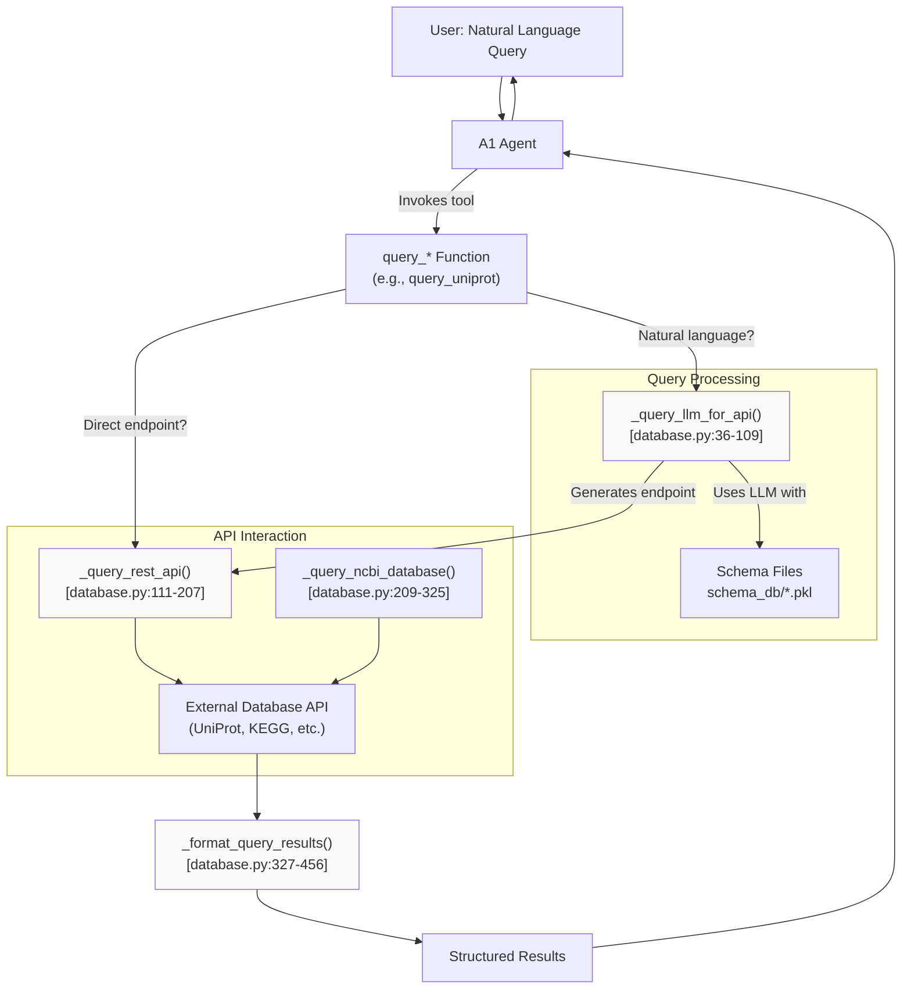
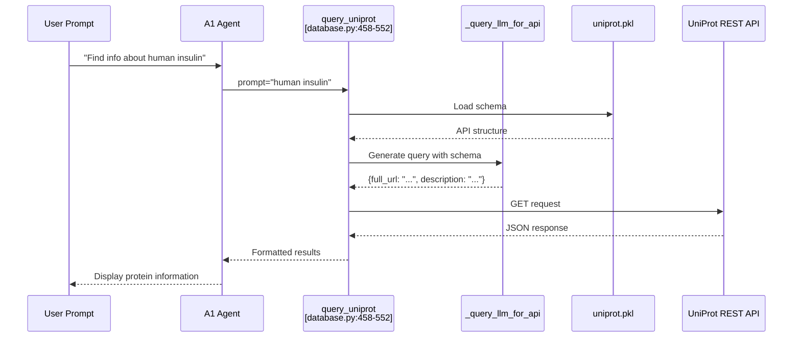
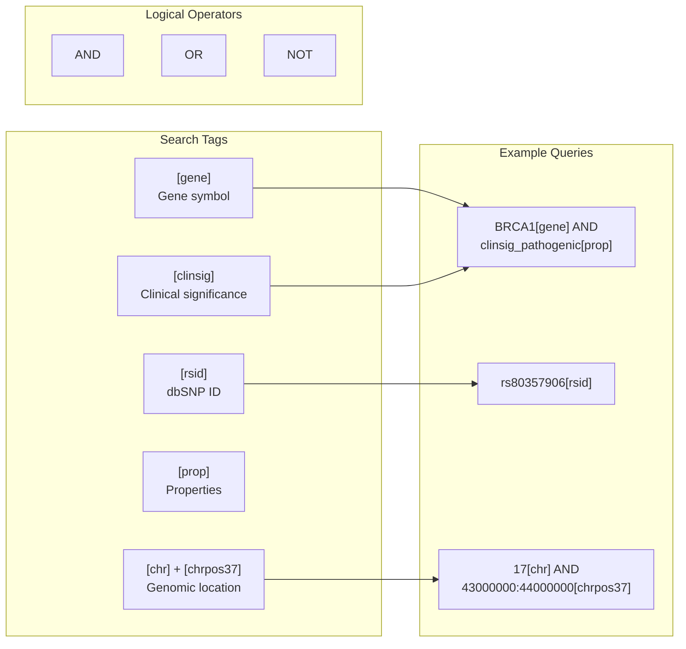
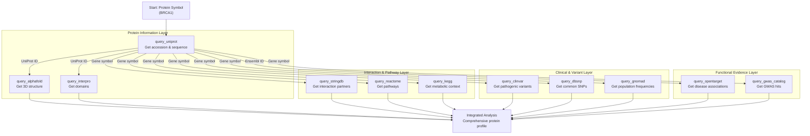
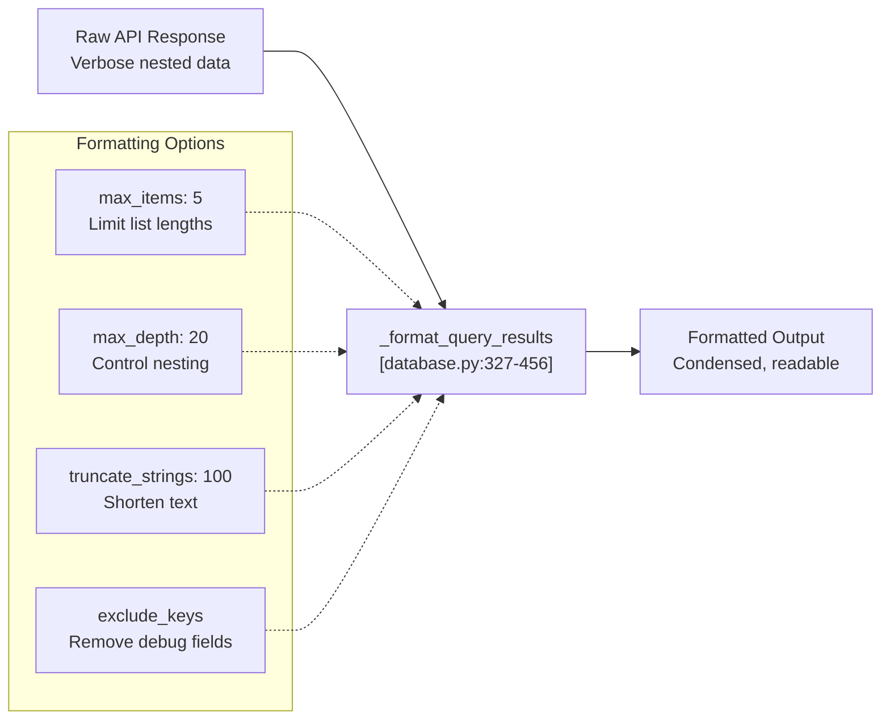

# Database Query Examples

<details>
<summary>Relevant source files</summary>

The following files were used as context for generating this wiki page:

- [biomni/tool/database.py](biomni/tool/database.py)
- [biomni/tool/tool_description/database.py](biomni/tool/tool_description/database.py)

</details>


This page provides practical examples of using Biomni's database query tools to retrieve information from 30+ biomedical databases. These examples demonstrate common research workflows, from basic protein lookups to complex multi-database queries.

For comprehensive documentation of all available database query functions, see [Database Query Tools](#4.3.1). For broader analysis workflows that integrate multiple tool types, see [Genomics Analysis Workflows](#5.3).

## Overview of Database Query System

Biomni's database query tools use a **schema-guided natural language interface** that converts research questions into properly formatted API calls. Each query function supports two modes:

1. **Natural language mode**: Provide a `prompt` parameter describing your research question
2. **Direct mode**: Provide an `endpoint` or `search_term` parameter for precise control

All database query functions follow a consistent pattern implemented in `biomni/tool/database.py`.

### Query Architecture



**Sources**: [biomni/tool/database.py:1-2900]()

### Core Helper Functions

| Function | Purpose | Key Parameters |
|----------|---------|----------------|
| `_query_llm_for_api` | Converts natural language to API calls using LLM | `prompt`, `schema`, `system_template` |
| `_query_rest_api` | Executes REST API requests with error handling | `endpoint`, `method`, `params`, `headers` |
| `_query_ncbi_database` | Specialized handler for NCBI E-utilities | `database`, `search_term`, `max_results` |
| `_format_query_results` | Condenses verbose API responses | `result`, `options` |

**Sources**: [biomni/tool/database.py:36-456]()

## Protein Information Queries

### Example 1: Looking Up Protein Information in UniProt

The `query_uniprot` function retrieves protein information from the UniProt knowledge base using natural language queries or direct accession IDs.

```python
from biomni.agent import A1

agent = A1()

# Natural language query
result = agent.go("""
Use query_uniprot to find information about human insulin protein, 
including its sequence, function, and known variants.
""")

# Direct accession lookup
result = agent.go("""
Use query_uniprot with endpoint "https://rest.uniprot.org/uniprotkb/P01308" 
to get detailed information about insulin (UniProt ID: P01308).
""")
```

**Query Flow**:



**Key Parameters**:
- `prompt`: Natural language description (e.g., "human insulin protein")
- `endpoint`: Direct URL or accession ID (e.g., "P01308" or full URL)
- `max_results`: Limit number of search results (default: 5)

**Example Results Structure**:
```python
{
    "success": True,
    "query_info": {
        "endpoint": "https://rest.uniprot.org/uniprotkb/search?query=...",
        "description": "Search for human insulin protein"
    },
    "result": {
        "results": [
            {
                "primaryAccession": "P01308",
                "uniProtkbId": "INS_HUMAN",
                "genes": [{"geneName": {"value": "INS"}}],
                "organism": {"scientificName": "Homo sapiens"},
                "sequence": {"length": 110, "molWeight": 11945, ...}
            }
        ]
    }
}
```

**Sources**: [biomni/tool/database.py:458-552](), [biomni/tool/tool_description/database.py:1-25]()

### Example 2: Retrieving AlphaFold Structure Predictions

The `query_alphafold` function accesses predicted 3D structures from the AlphaFold Database.

```python
# Get structure prediction for a protein
result = agent.go("""
Use query_alphafold with uniprot_id "P53_HUMAN" to get the AlphaFold 
structure prediction for human p53 protein. Download the structure file.
""")

# Alternative: Get specific residue range annotations
result = agent.go("""
Use query_alphafold with:
- uniprot_id: "P01308"
- endpoint: "annotations"
- residue_range: "1-50"
to get quality metrics for the first 50 residues of insulin.
""")
```

**Key Features**:
- `endpoint`: Choose "prediction", "summary", or "annotations"
- `download`: Set to `True` to download PDB/CIF files
- `model_version`: Select from v4 (latest), v3, v2, or v1
- `model_number`: Choose model 1-5 (1 = highest confidence)

**Sources**: [biomni/tool/database.py:554-701](), [biomni/tool/tool_description/database.py:27-76]()

### Example 3: Finding Protein Domains with InterPro

The `query_interpro` function searches for protein families, domains, and functional sites.

```python
# Natural language search
result = agent.go("""
Use query_interpro to find all kinase domains in the InterPro database 
and show their classification and member proteins.
""")

# Direct entry lookup
result = agent.go("""
Use query_interpro with endpoint "/entry/interpro/IPR000719" to get 
details about the Protein kinase domain entry.
""")
```

**Sources**: [biomni/tool/database.py:703-808](), [biomni/tool/tool_description/database.py:78-102]()

## Pathway and Interaction Queries

### Example 4: KEGG Pathway Analysis

The `query_kegg` function accesses the KEGG database for pathway, disease, and drug information.

```python
# Find pathways related to a process
result = agent.go("""
Use query_kegg to find human pathways related to glycolysis and 
show the genes involved.
""")

# Get specific gene information
result = agent.go("""
Use query_kegg with endpoint "https://rest.kegg.jp/get/hsa:672" to 
retrieve detailed information about the BRCA1 gene (KEGG ID: hsa:672).
""")

# Convert between identifier systems
result = agent.go("""
Use query_kegg to convert NCBI Gene ID 672 to KEGG gene identifier.
""")
```

**Common KEGG Operations**:

| Operation | Example Endpoint | Purpose |
|-----------|------------------|---------|
| `info` | `/info/pathway` | Get database statistics |
| `list` | `/list/pathway/hsa` | List all human pathways |
| `find` | `/find/genes/brca1` | Search for entries |
| `get` | `/get/hsa:672` | Retrieve entry details |
| `conv` | `/conv/genes/ncbi-geneid:672` | Convert IDs |
| `link` | `/link/pathway/hsa:672` | Find linked entries |

**Sources**: [biomni/tool/database.py:1040-1127](), [biomni/tool/tool_description/database.py:156-178]()

### Example 5: Protein Interaction Networks with STRING

The `query_stringdb` function retrieves protein-protein interaction data.

```python
# Get interaction network for specific proteins
result = agent.go("""
Use query_stringdb to show protein interactions for BRCA1 and BRCA2 
in humans, including confidence scores.
""")

# Download network visualization
result = agent.go("""
Use query_stringdb with:
- prompt: "Show interaction network for TP53 in human"
- download_image: True
- output_dir: "./networks"
to save the network diagram.
""")
```

**Key Parameters**:
- `species`: Taxonomic ID (9606 for human, 10090 for mouse)
- `required_score`: Confidence threshold (0-1000, higher = more stringent)
- `download_image`: Save network visualization

**Sources**: [biomni/tool/database.py:1129-1294](), [biomni/tool/tool_description/database.py:180-211]()

### Example 6: Reactome Pathway Database

The `query_reactome` function accesses biological pathway information from Reactome.

```python
# Search for pathways
result = agent.go("""
Use query_reactome to find all pathways related to DNA repair in humans 
and show participating proteins.
""")

# Get specific pathway details
result = agent.go("""
Use query_reactome with endpoint 
"https://reactome.org/ContentService/data/pathway/R-HSA-73894/containedEvents"
to get sub-pathways of DNA Repair (R-HSA-73894).
""")
```

**Sources**: [biomni/tool/database.py:2530-2663](), [biomni/tool/tool_description/database.py:579-600]()

## Genetic Variant Queries

### Example 7: ClinVar Variant Pathogenicity

The `query_clinvar` function searches for clinically significant genetic variants.

```python
# Find pathogenic variants in a gene
result = agent.go("""
Use query_clinvar to find all pathogenic or likely pathogenic variants 
in the BRCA1 gene and show their clinical significance.
""")

# Look up specific variant
result = agent.go("""
Use query_clinvar to find information about the variant rs80357906, 
including its pathogenicity classification and associated conditions.
""")

# Regional search
result = agent.go("""
Use query_clinvar to find variants in chromosome 17 between positions 
43000000 and 44000000 (GRCh37).
""")
```

**ClinVar Search Syntax** (used by LLM automatically):



**Sources**: [biomni/tool/database.py:1834-1915](), [biomni/tool/tool_description/database.py:337-356]()

### Example 8: dbSNP Variant Database

The `query_dbsnp` function searches the NCBI dbSNP database for genetic variants.

```python
# Search for variants by gene
result = agent.go("""
Use query_dbsnp to find common SNPs in the EGFR gene that are 
associated with drug response.
""")

# Look up specific SNP
result = agent.go("""
Use query_dbsnp with search_term "rs6025[rs]" to get details about 
this specific SNP including allele frequencies.
""")
```

**Sources**: [biomni/tool/database.py:2015-2101](), [biomni/tool/tool_description/database.py:375-394]()

### Example 9: gnomAD Population Genetics

The `query_gnomad` function accesses population-scale sequencing data.

```python
# Get variant frequencies in a gene
result = agent.go("""
Use query_gnomad to find all variants in the BRCA2 gene and their 
allele frequencies across different populations.
""")

# Direct gene symbol query
result = agent.go("""
Use query_gnomad with gene_symbol "CFTR" to retrieve variant data 
for the cystic fibrosis transmembrane conductance regulator gene.
""")
```

**Sources**: [biomni/tool/database.py:2666-2782](), [biomni/tool/tool_description/database.py:489-508]()

## Genomic Data Queries

### Example 10: Ensembl Gene Information

The `query_ensembl` function accesses comprehensive genomic data from Ensembl.

```python
# Gene lookup by symbol
result = agent.go("""
Use query_ensembl to get information about the human BRCA2 gene, 
including its genomic coordinates, transcript variants, and exon structure.
""")

# Get DNA sequence for a region
result = agent.go("""
Use query_ensembl to retrieve the DNA sequence for human chromosome 17 
from position 43044295 to 43125364 (BRCA1 gene region).
""")

# Convert rsID to genomic coordinates
result = agent.go("""
Use query_ensembl to convert the variant ID rs334 to its genomic 
coordinates in the hg38 human genome assembly.
""")
```

**Important Ensembl Constraints**:
- Maximum region size: 4,900,000 bp for sequence queries
- Species format: Use scientific names or common names (e.g., "homo_sapiens" or "human")
- Chromosome format: Use standard notation (e.g., "1", "X", "MT")

**Sources**: [biomni/tool/database.py:2205-2323](), [biomni/tool/tool_description/database.py:416-436]()

### Example 11: UCSC Genome Browser Data

The `query_ucsc` function accesses genomic data from the UCSC Genome Browser.

```python
# Get DNA sequence
result = agent.go("""
Use query_ucsc to get the DNA sequence of human chromosome M (mitochondrial) 
positions 1-100 in the hg38 assembly.
""")

# List available chromosomes
result = agent.go("""
Use query_ucsc with endpoint 
"https://api.genome.ucsc.edu/list/chromosomes?genome=hg38" 
to see all chromosomes in the human genome.
""")
```

**Sources**: [biomni/tool/database.py:2103-2203](), [biomni/tool/tool_description/database.py:396-415]()

## Expression and Functional Genomics

### Example 12: Gene Expression Omnibus (GEO)

The `query_geo` function searches for gene expression datasets.

```python
# Find RNA-seq datasets
result = agent.go("""
Use query_geo to find RNA-seq datasets studying breast cancer 
published between 2020 and 2023.
""")

# Search for specific gene expression
result = agent.go("""
Use query_geo to find expression profiles of the TP53 gene 
in lung cancer samples.
""")

# Direct search term
result = agent.go("""
Use query_geo with search_term 
"RNA-seq AND breast cancer AND gse[ETYP] AND 2020:2023[PDAT]"
to find relevant datasets.
""")
```

**GEO Database Types**:
- `gds`: GEO DataSets (series, platforms, samples metadata) - default
- `geoprofiles`: GEO Profiles (gene expression data)

**Sources**: [biomni/tool/database.py:1917-2013](), [biomni/tool/tool_description/database.py:358-373]()

## Drug Target and Disease Queries

### Example 13: OpenTargets Platform

The `query_opentarget` function uses GraphQL to query drug target associations.

```python
# Find drug targets for a disease
result = agent.go("""
Use query_opentarget to find all known therapeutic targets for 
Alzheimer's disease, including their association scores and evidence.
""")

# Get drug-target associations
result = agent.go("""
Use query_opentarget to find all drugs that target the EGFR protein 
and their development status.
""")
```

**OpenTargets Query Structure**:
- Uses GraphQL instead of REST API
- Disease IDs: EFO ontology (e.g., "EFO_0000249" for Alzheimer's)
- Target IDs: Ensembl gene IDs (e.g., "ENSG00000146648" for EGFR)
- Returns detailed evidence chains and association scores

**Sources**: [biomni/tool/database.py:2325-2423](), [biomni/tool/tool_description/database.py:438-453]()

### Example 14: Clinical Trials Database

The `query_clinicaltrials` function searches ClinicalTrials.gov for ongoing and completed studies.

```python
# Find recruiting trials for a condition
result = agent.go("""
Use query_clinicaltrials to find all currently recruiting clinical trials 
for breast cancer in the United States, including trial phases and interventions.
""")

# Search by intervention
result = agent.go("""
Use query_clinicaltrials with:
- condition: "diabetes"
- intervention: "metformin"
- phase: "PHASE3"
- status: "COMPLETED"
to find completed Phase 3 metformin trials for diabetes.
""")

# Complex natural language query
result = agent.go("""
Use query_clinicaltrials to find Phase 2 or Phase 3 immunotherapy trials 
for melanoma that are recruiting in California.
""")
```

**Structured Parameters**:

| Parameter | Values | Example |
|-----------|--------|---------|
| `status` | RECRUITING, COMPLETED, TERMINATED | "RECRUITING" |
| `phase` | PHASE1, PHASE2, PHASE3, PHASE4 | "PHASE3" |
| `condition` | Free text | "breast cancer" |
| `intervention` | Free text | "pembrolizumab" |
| `location` | Country, city, state | "California" |

**Sources**: [biomni/tool/database.py:2783-2934](), [biomni/tool/tool_description/database.py:529-577]()

## Combining Multiple Databases

### Example 15: Multi-Database Protein Analysis

This workflow demonstrates combining information from multiple databases to build a comprehensive protein profile.

```python
# Step 1: Get basic protein information from UniProt
result1 = agent.go("""
Use query_uniprot to find the UniProt accession ID and basic information 
for the human BRCA1 protein.
""")

# Step 2: Get structure prediction from AlphaFold
result2 = agent.go("""
Use query_alphafold with uniprot_id "P38398" (BRCA1) to get structure 
prediction and confidence scores, downloading the PDB file.
""")

# Step 3: Find protein domains with InterPro
result3 = agent.go("""
Use query_interpro to find all conserved domains and functional sites 
in the BRCA1 protein (UniProt: P38398).
""")

# Step 4: Get interaction partners from STRING
result4 = agent.go("""
Use query_stringdb to find all known protein-protein interactions for 
BRCA1 with confidence scores above 0.7.
""")

# Step 5: Find associated pathways in Reactome
result5 = agent.go("""
Use query_reactome to find all biological pathways that include BRCA1 
and show their roles in DNA repair.
""")

# Step 6: Look up clinical variants in ClinVar
result6 = agent.go("""
Use query_clinvar to find all pathogenic mutations in BRCA1 and their 
clinical significance for cancer risk.
""")
```

**Workflow Diagram**:



**Sources**: [biomni/tool/database.py:458-2900]()

### Example 16: Disease-Focused Multi-Database Query

This example shows how to investigate a disease from multiple angles.

```python
# Comprehensive disease investigation for Type 2 Diabetes
workflow = """
1. Use query_opentarget to find all validated therapeutic targets for 
   Type 2 Diabetes (EFO_0001360) with their association scores.

2. Use query_gwas_catalog to find GWAS hits associated with Type 2 Diabetes 
   and identify candidate genes.

3. For the top 5 genes from GWAS:
   - Use query_uniprot to get protein information
   - Use query_stringdb to find their interaction networks
   - Use query_reactome to identify shared pathways

4. Use query_clinicaltrials to find ongoing Phase 2 or Phase 3 trials 
   for Type 2 Diabetes and their intervention strategies.

5. Use query_geo to find gene expression datasets comparing diabetic 
   vs healthy pancreatic tissue.
"""

result = agent.go(workflow)
```

**Sources**: [biomni/tool/database.py:1-2900]()

## Error Handling and Best Practices

### Understanding Query Results

All database query functions return a dictionary with consistent structure:

```python
# Successful query
{
    "success": True,
    "query_info": {
        "endpoint": "https://...",
        "description": "Human-readable description"
    },
    "result": {
        # Database-specific response data
    }
}

# Failed query
{
    "success": False,
    "error": "Error message describing what went wrong",
    "query_info": {
        "endpoint": "https://...",
        "description": "What was attempted"
    },
    "response_text": "Raw error response (if available)"
}
```

### Common Query Patterns

```python
# Pattern 1: Natural language with automatic schema guidance
result = agent.go("""
Use query_uniprot to find human proteins involved in DNA repair.
""")

# Pattern 2: Direct endpoint for precise control
result = agent.go("""
Use query_uniprot with endpoint 
"https://rest.uniprot.org/uniprotkb/search?query=reviewed:true+AND+organism_id:9606+AND+keyword:KW-0234"
to search reviewed human proteins with DNA repair keyword.
""")

# Pattern 3: Combining prompt with constraints
result = agent.go("""
Use query_pdb to find crystal structures of human insulin 
with resolution better than 2.0 Angstroms, limiting to 5 results.
""")
```

**Sources**: [biomni/tool/database.py:111-207]()

### Result Formatting

The `_format_query_results` function can condense verbose API responses:



Most query functions accept a `verbose` parameter:
- `verbose=True`: Return full API response with metadata (default for most)
- `verbose=False`: Return formatted, condensed results

**Sources**: [biomni/tool/database.py:327-456]()

### API Rate Limits and Authentication

Some databases require authentication or have rate limits:

| Database | Authentication | Rate Limits | Notes |
|----------|----------------|-------------|-------|
| UniProt | None | None stated | Public access |
| KEGG | None | None stated | Public access |
| ClinVar (NCBI) | None | 3 req/sec without key | Use history server for large queries |
| Ensembl | None | 15 req/sec | Use POST for batch queries |
| IUCN | Required | Unknown | Get token at apiv3.iucnredlist.org |
| OpenTargets | None | None stated | GraphQL endpoint |
| Synapse | Optional | Varies | Set `SYNAPSE_AUTH_TOKEN` for restricted data |

**Authentication Setup** (when required):
```python
import os

# Set authentication in environment
os.environ['IUCN_API_TOKEN'] = 'your-token-here'
os.environ['SYNAPSE_AUTH_TOKEN'] = 'your-token-here'

# Then use query functions normally
result = agent.go("""
Use query_iucn with token from environment to get conservation 
status of white rhinoceros.
""")
```

**Sources**: [biomni/tool/database.py:1-2900]()

## Advanced Query Techniques

### Schema Files and Custom Queries

Each database query function uses a schema file to guide LLM-based query generation:

```python
# Schema files are stored as pickled dictionaries
schema_path = "biomni/tool/schema_db/uniprot.pkl"
schema_path = "biomni/tool/schema_db/kegg.pkl"
schema_path = "biomni/tool/schema_db/ensembl.pkl"
# ... etc
```

The schema contains:
- Available endpoints and their parameters
- Data types and required/optional fields
- Example queries and response formats
- API-specific constraints and best practices

When you provide a natural language prompt, the query function:
1. Loads the appropriate schema file
2. Constructs a system prompt with the schema
3. Uses the LLM (via `_query_llm_for_api`) to generate a structured query
4. Executes the query and returns results

**Sources**: [biomni/tool/database.py:36-109]()

### Direct GraphQL Queries

For databases using GraphQL (OpenTargets), you can provide direct queries:

```python
result = agent.go("""
Use query_opentarget with this GraphQL query:
query {
  target(ensemblId: "ENSG00000146648") {
    id
    approvedSymbol
    associatedDiseases {
      rows {
        disease {
          name
        }
        score
      }
    }
  }
}
""")
```

**Sources**: [biomni/tool/database.py:2325-2423]()

### Pagination for Large Result Sets

Some functions support pagination through `max_results` parameter:

```python
# Get more results
result = agent.go("""
Use query_clinvar to find BRCA1 variants with max_results=20 
instead of the default 3.
""")

# For ClinicalTrials, use page_size and max_pages
result = agent.go("""
Use query_clinicaltrials with:
- condition: "cancer"
- status: "RECRUITING"
- page_size: 50
- max_pages: 3
to retrieve up to 150 trials.
""")
```

**Sources**: [biomni/tool/database.py:209-325](), [biomni/tool/database.py:2783-2934]()

## Summary of Available Query Functions

### Complete Function List

| Function | Database | Primary Use Case | Natural Language | Direct Mode |
|----------|----------|-----------------|------------------|-------------|
| `query_uniprot` | UniProt | Protein sequences and annotations | ✓ | ✓ endpoint |
| `query_alphafold` | AlphaFold DB | Predicted protein structures | ✗ | ✓ uniprot_id |
| `query_interpro` | InterPro | Protein domains and families | ✓ | ✓ endpoint |
| `query_pdb` | RCSB PDB | Experimental protein structures | ✓ | ✓ query dict |
| `query_pdb_identifiers` | RCSB PDB | Detailed PDB data retrieval | ✗ | ✓ identifiers |
| `query_kegg` | KEGG | Pathways and molecular networks | ✓ | ✓ endpoint |
| `query_stringdb` | STRING | Protein-protein interactions | ✓ | ✓ endpoint |
| `query_reactome` | Reactome | Biological pathways | ✓ | ✓ endpoint |
| `query_clinvar` | ClinVar | Clinical genetic variants | ✓ | ✓ search_term |
| `query_geo` | GEO | Gene expression datasets | ✓ | ✓ search_term |
| `query_dbsnp` | dbSNP | Genetic variants (SNPs) | ✓ | ✓ search_term |
| `query_ensembl` | Ensembl | Genomic sequences and annotations | ✓ | ✓ endpoint |
| `query_ucsc` | UCSC | Genome browser data | ✓ | ✓ endpoint |
| `query_opentarget` | OpenTargets | Drug targets and disease associations | ✓ | ✓ GraphQL |
| `query_monarch` | Monarch | Phenotype and disease associations | ✓ | ✓ endpoint |
| `query_gnomad` | gnomAD | Population variant frequencies | ✓ | ✓ gene_symbol |
| `query_gwas_catalog` | GWAS Catalog | Genome-wide association studies | ✓ | ✓ endpoint |
| `query_clinicaltrials` | ClinicalTrials.gov | Clinical trial information | ✓ | ✓ parameters |
| `query_cbioportal` | cBioPortal | Cancer genomics data | ✓ | ✓ endpoint |
| `query_jaspar` | JASPAR | Transcription factor binding | ✓ | ✓ endpoint |
| `query_regulomedb` | RegulomeDB | Regulatory element annotations | ✓ | ✓ endpoint |
| `query_remap` | ReMap | TF binding sites | ✓ | ✓ endpoint |
| `query_pride` | PRIDE | Proteomics data | ✓ | ✓ endpoint |
| `query_gtopdb` | GtoPdb | Pharmacological targets | ✓ | ✓ endpoint |
| `query_worms` | WoRMS | Marine species taxonomy | ✓ | ✓ endpoint |
| `query_iucn` | IUCN Red List | Conservation status | ✓ | ✓ endpoint |
| `query_paleobiology` | PBDB | Fossil records | ✓ | ✓ endpoint |
| `query_mpd` | Mouse Phenome DB | Mouse phenotype data | ✓ | ✓ endpoint |
| `query_emdb` | EMDB | Electron microscopy structures | ✓ | ✓ endpoint |
| `query_synapse` | Synapse | Biomedical datasets | ✓ | ✓ parameters |
| `blast_sequence` | NCBI BLAST | Sequence similarity search | ✗ | ✓ sequence |
| `region_to_ccre_screen` | ENCODE SCREEN | Regulatory elements | ✗ | ✓ coordinates |
| `get_genes_near_ccre` | ENCODE SCREEN | Nearby genes | ✗ | ✓ accession |

**Legend**:
- ✓ = Supported
- ✗ = Not supported (requires specific parameters)

**Sources**: [biomni/tool/database.py:1-2900](), [biomni/tool/tool_description/database.py:1-826]()

---