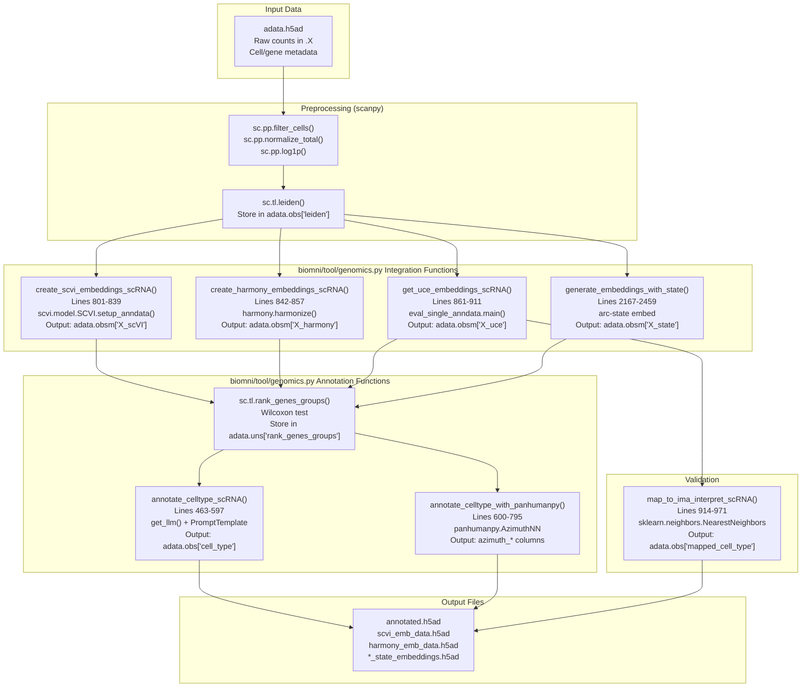
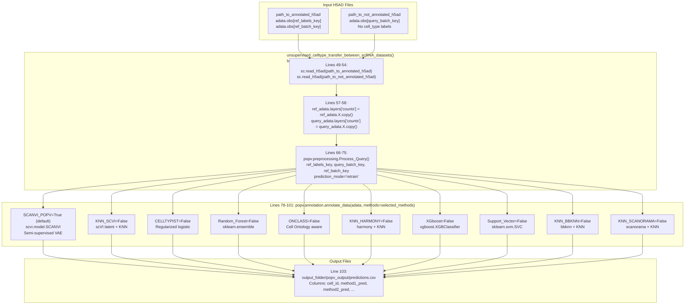
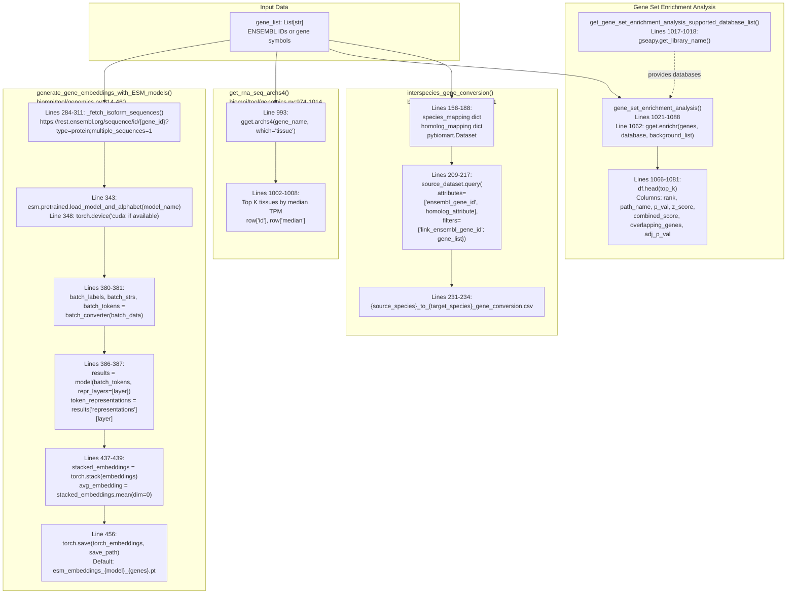
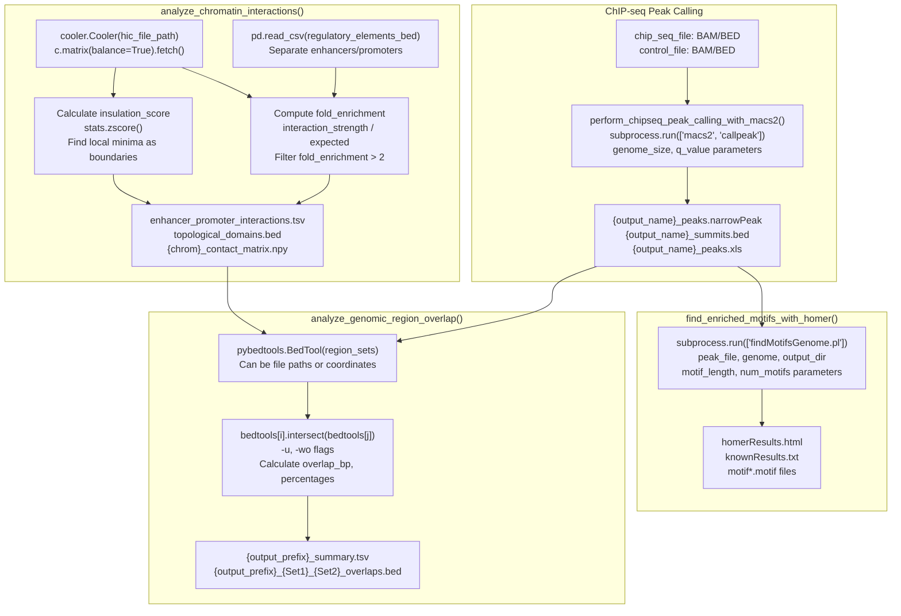
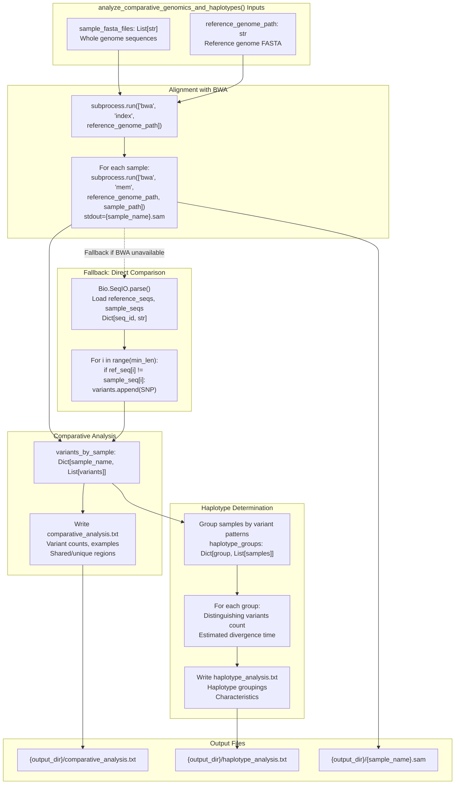

# Genomics Analysis Workflows

<details>
<summary>Relevant source files</summary>

The following files were used as context for generating this wiki page:

- [biomni/tool/genomics.py](biomni/tool/genomics.py)
- [biomni/tool/tool_description/genomics.py](biomni/tool/tool_description/genomics.py)

</details>


This page provides end-to-end tutorials for common genomics analysis workflows using Biomni's genomics tools. These workflows demonstrate how to combine multiple tools to accomplish complete research tasks, from single-cell RNA-seq analysis to ChIP-seq peak calling and comparative genomics.

For basic agent usage and configuration, see [Basic Agent Usage](#4.2). For detailed tool reference documentation, see [Genomics and Single-Cell Tools](#5.2). For database query examples, see [Database Query Examples](#6.2).

---

## Workflow Overview

Biomni provides comprehensive genomics analysis capabilities organized into five major workflow categories:

| Workflow Category | Key Functions | Use Cases |
|-------------------|---------------|-----------|
| Single-Cell RNA-seq | `annotate_celltype_scRNA`, `create_scvi_embeddings_scRNA`, `create_harmony_embeddings_scRNA` | Cell type annotation, batch integration, dimensionality reduction |
| Cell Type Transfer | `unsupervised_celltype_transfer_between_scRNA_datasets`, `annotate_celltype_with_panhumanpy` | Label transfer between datasets, reference-based annotation |
| Gene-Level Analysis | `interspecies_gene_conversion`, `gene_set_enrichment_analysis`, `generate_gene_embeddings_with_ESM_models` | Cross-species mapping, pathway enrichment, protein embeddings |
| Genomic Regions | `perform_chipseq_peak_calling_with_macs2`, `analyze_chromatin_interactions`, `find_enriched_motifs_with_homer` | Peak calling, Hi-C analysis, motif discovery |
| Comparative Genomics | `analyze_comparative_genomics_and_haplotypes`, `analyze_genomic_region_overlap` | Variant identification, haplotype analysis, region overlaps |

**Sources:** [biomni/tool/genomics.py:1-2165](), [biomni/tool/tool_description/genomics.py:1-657]()

---

## Workflow 1: Complete Single-Cell RNA-seq Analysis Pipeline

This workflow demonstrates a complete scRNA-seq analysis from raw counts to annotated cell types with integrated embeddings.

### Analysis Flow Diagram



**Sources:** [biomni/tool/genomics.py:463-597](), [biomni/tool/genomics.py:600-795](), [biomni/tool/genomics.py:801-858](), [biomni/tool/genomics.py:861-911](), [biomni/tool/genomics.py:2167-2459]()

### Step-by-Step Implementation

#### Step 1: Generate Embeddings

The first step is to create batch-corrected embeddings for downstream analysis. You can use scVI for probabilistic modeling or Harmony for faster linear correction:

```python
# Initialize agent
from biomni import A1

agent = A1()

# Option A: Use scVI for deep learning-based integration
task_scvi = """
I have a single-cell RNA-seq dataset at ./data/raw_counts.h5ad with batch information 
in the 'batch' column and preliminary cell type labels in 'leiden' column.

Create scVI and scANVI embeddings for this dataset.
"""
result = agent.go(task_scvi)

# Option B: Use Harmony for faster batch correction
task_harmony = """
I have a single-cell RNA-seq dataset at ./data/raw_counts.h5ad with batch information 
in the 'batch' column. The PCA embeddings are stored in adata.obsm['X_pca'].

Create Harmony embeddings to correct for batch effects.
"""
result = agent.go(task_harmony)
```

The `create_scvi_embeddings_scRNA` function [biomni/tool/genomics.py:801-839]():
1. Calls `scvi.model.SCVI.setup_anndata()` with the batch key [biomni/tool/genomics.py:813]()
2. Creates and trains `scvi.model.SCVI(adata)` [biomni/tool/genomics.py:816-817]()
3. Generates latent representation and stores in `adata.obsm['X_scVI']` [biomni/tool/genomics.py:820]()
4. Creates `scvi.model.SCANVI.from_scvi_model()` with label key [biomni/tool/genomics.py:823-827]()
5. Trains scANVI and stores embeddings in `adata.obsm['X_scANVI']` [biomni/tool/genomics.py:829-833]()
6. Saves output to `{data_dir}/scvi_emb_data.h5ad` [biomni/tool/genomics.py:835-836]()

The `create_harmony_embeddings_scRNA` function [biomni/tool/genomics.py:842-857]():
1. Loads AnnData with `sc.read_h5ad()` [biomni/tool/genomics.py:848]()
2. Applies Harmony via `harmonize(adata.obsm['X_pca'], adata.obs, batch_key)` [biomni/tool/genomics.py:851]()
3. Stores results in `adata.obsm['X_harmony']` [biomni/tool/genomics.py:851]()
4. Saves to `{data_dir}/harmony_emb_data.h5ad` [biomni/tool/genomics.py:853-854]()

#### Step 2: LLM-Based Cell Type Annotation

After clustering and identifying marker genes, use LLM-based annotation with domain knowledge:

```python
task_annotate = """
I have a clustered scRNA-seq dataset at ./data/scvi_emb_data.h5ad from human brain tissue.
The data is from normal tissue (not diseased).

The leiden clustering is stored in the 'leiden' column.
The data lake path is /dfs/project/bioagentos/data/data_lake.

Annotate the cell types using marker genes and the CZI cell ontology.
"""
result = agent.go(task_annotate)
```

The `annotate_celltype_scRNA` function [biomni/tool/genomics.py:463-597]() performs the following steps:

1. **Loads AnnData** with `sc.read_h5ad(f"{data_dir}/{adata_filename}")` [biomni/tool/genomics.py:512]()
2. **Identifies marker genes** via `sc.tl.rank_genes_groups(adata, groupby='leiden', method='wilcoxon')` [biomni/tool/genomics.py:515]()
3. **Extracts top genes** with scores > 0 from `pd.DataFrame(adata.uns['rank_genes_groups']['names']).head(20)` [biomni/tool/genomics.py:516-523]()
4. **Loads CZI cell ontology** from `{data_lake_path}/czi_census_datasets_v4.parquet`, creating `czi_celltype_set` [biomni/tool/genomics.py:526-529]()
5. **Constructs LLM prompt** via `PromptTemplate(input_variables=["cluster_info"], template=prompt_template)` with cluster info, marker genes, and cell ontology [biomni/tool/genomics.py:531-545]()
6. **Creates chain** with `prompt | llm` from `get_llm(llm)` and invokes for each cluster [biomni/tool/genomics.py:544-558]()
7. **Validates response** against `czi_celltype_set` until valid cell type obtained, retrying with additional context [biomni/tool/genomics.py:570-580]()
8. **Maps annotations** to `adata.obs['cell_type']` and reasoning to `adata.obs['cell_type_reason']` [biomni/tool/genomics.py:591-592]()
9. **Saves annotated AnnData** to `{data_dir}/annotated.h5ad` with `adata.write()` [biomni/tool/genomics.py:595]()

#### Step 3: Alternative - Azimuth Neural Network Annotation

For human tissues, panhumanpy provides reference-based annotation:

```python
task_azimuth = """
I have a scRNA-seq dataset at ./data/raw_counts.h5ad from human tissue.
Gene names are in the index of adata.var.

Annotate cell types using the Panhuman Azimuth neural network with UMAP visualization.
Save results to ./output/azimuth.
"""
result = agent.go(task_azimuth)
```

The `annotate_celltype_with_panhumanpy` function [biomni/tool/genomics.py:600-795]():
1. **Checks for conda environment** named `panhumanpy_env` via `subprocess.run(["conda", "env", "list"])` [biomni/tool/genomics.py:639-644]()
2. **Creates environment if needed** with `subprocess.run(["conda", "create", "-y", "-n", env_name, "python=3.10"])` and installs panhumanpy from GitHub [biomni/tool/genomics.py:646-653]()
3. **Writes temporary Python script** to `os.path.join(temp_dir, "run_panhumanpy.py")` that uses `panhumanpy.AzimuthNN` [biomni/tool/genomics.py:663-768]()
4. **Runs script** in panhumanpy_env via `subprocess.run(["conda", "run", "-n", PANHUMANPY_ENV, "python", script_path])` [biomni/tool/genomics.py:772-774]()
5. **Performs annotation** with `azimuth = ph.AzimuthNN(adata, feature_names_col=feature_names_col)` [biomni/tool/genomics.py:703-705]()
6. **Generates embeddings** with `embeddings = azimuth.azimuth_embed()` and UMAP via `azimuth.azimuth_umap()` if requested [biomni/tool/genomics.py:710-725]()
7. **Refines labels** with `azimuth.azimuth_refine()` for consistent granularity [biomni/tool/genomics.py:730-737]()
8. **Saves outputs** to `{output_dir}/annotated_cell_metadata.csv` via `cell_metadata.to_csv()` and `{output_dir}/annotated_obj.h5ad` via `azimuth.pack_adata()` [biomni/tool/genomics.py:741-755]()

**Sources:** [biomni/tool/genomics.py:463-597](), [biomni/tool/genomics.py:600-795](), [biomni/tool/genomics.py:801-858](), [biomni/tool/tool_description/genomics.py:1-94]()

---

## Workflow 2: Cell Type Transfer Between Datasets

This workflow transfers cell type labels from a well-annotated reference dataset to a new query dataset using the popV framework.

### Cell Type Transfer Architecture



**Sources:** [biomni/tool/genomics.py:18-105](), [biomni/tool/tool_description/genomics.py:462-576]()

### Implementation Example

```python
# Transfer cell types using default SCANVI method
task_transfer = """
I have two scRNA-seq datasets:
- Reference (annotated): ./data/reference_annotated.h5ad
  - Cell type labels are in column 'cell_type'
  - Batch information in column 'sample_id'
  
- Query (unannotated): ./data/query_raw.h5ad
  - Batch information in column 'donor'

Transfer cell type labels from reference to query using the SCANVI_POPV method.
Save results to ./output/transfer/.
"""
result = agent.go(task_transfer)
```

The `unsupervised_celltype_transfer_between_scRNA_datasets` function [biomni/tool/genomics.py:18-105]():
1. **Loads AnnData files** with `sc.read_h5ad()` for reference and query [biomni/tool/genomics.py:49-54]()
2. **Creates counts layers** via `adata.layers['counts'] = adata.X.copy()` required for scVI/SCANVI [biomni/tool/genomics.py:57-58]()
3. **Processes query** with `popv.preprocessing.Process_Query()` for gene matching [biomni/tool/genomics.py:66-75]()
4. **Selects methods** based on boolean flags (SCANVI_POPV, KNN_SCVI, etc.) [biomni/tool/genomics.py:78-94]()
5. **Runs annotation** with `popv.annotation.annotate_data(adata, methods=selected_methods)` [biomni/tool/genomics.py:97-101]()
6. **Saves predictions** to `{output_folder}/popv_output/predictions.csv` [biomni/tool/genomics.py:103]()

The function supports 10 different annotation methods:

| Method | Mechanism | Strengths | Use Case |
|--------|-----------|-----------|----------|
| `SCANVI_POPV` | Semi-supervised VAE with classification head | Leverages unlabeled data, provides uncertainty | Default, general-purpose |
| `KNN_SCVI` | KNN in scVI latent space | Robust probabilistic embedding | Large datasets |
| `CELLTYPIST` | Regularized logistic regression | Fast, scalable | Common cell types |
| `KNN_HARMONY` | KNN after Harmony correction | Good batch correction | Strong batch effects |
| `Random_Forest` | Ensemble decision trees | Robust to noise | Feature-rich data |
| `ONCLASS` | Ontology-aware classifier | Zero-shot learning | Novel cell types |
| `Support_Vector` | Maximum-margin hyperplane | High-dimensional data | Small samples |
| `XGboost` | Gradient-boosted trees | High accuracy | Nonlinear signals |
| `KNN_BBKNN` | Batch-balanced KNN | Preserves local structure | Balanced batches |
| `KNN_SCANORAMA` | KNN after Scanorama alignment | Cross-dataset alignment | Multiple studies |

### Method Selection Example

```python
# Use multiple methods for robust transfer
task_multi_method = """
Transfer cell types from ./data/pbmc_reference.h5ad (labels in 'celltype') 
to ./data/pbmc_query.h5ad using three complementary methods:
- SCANVI_POPV for semi-supervised learning
- KNN_SCVI for robust nearest neighbor transfer
- Random_Forest for ensemble prediction

Save results to ./output/multi_method/.
"""
result = agent.go(task_multi_method)
```

The function sets up counts layers required for scVI-based methods [biomni/tool/genomics.py:56-58](), processes the query through popV [biomni/tool/genomics.py:66-75](), and runs selected annotation methods [biomni/tool/genomics.py:97-101]().

**Sources:** [biomni/tool/genomics.py:18-105](), [biomni/tool/tool_description/genomics.py:462-576]()

---

## Workflow 3: Gene-Level Analysis

This workflow demonstrates gene conversion, enrichment analysis, and protein embedding generation.

### Gene Analysis Pipeline



**Sources:** [biomni/tool/genomics.py:108-281](), [biomni/tool/genomics.py:974-1014](), [biomni/tool/genomics.py:1021-1088](), [biomni/tool/genomics.py:314-460]()

### Step 1: Cross-Species Gene Conversion

Convert gene IDs between 13 supported species using BioMart ortholog mapping:

```python
task_convert = """
I have a list of human ENSEMBL gene IDs: ['ENSG00000007372', 'ENSG00000181449', 'ENSG00000157764']

Convert these from human to mouse orthologs.
"""
result = agent.go(task_convert)
```

The `interspecies_gene_conversion` function [biomni/tool/genomics.py:108-281]():
1. **Maps species names** to BioMart dataset names via `species_mapping` dict (e.g., `"human": "hsapiens_gene_ensembl"`) [biomni/tool/genomics.py:158-172]()
2. **Maps to homolog attributes** via `homolog_mapping` dict (e.g., `"mouse": "mmusculus_homolog_ensembl_gene"`) [biomni/tool/genomics.py:174-188]()
3. **Validates species** are in supported lists, raising `ValueError` if not [biomni/tool/genomics.py:190-198]()
4. **Queries BioMart** with `source_dataset.query(attributes=['ensembl_gene_id', homolog_attribute], filters={'link_ensembl_gene_id': gene_list})` [biomni/tool/genomics.py:209-217]()
5. **Builds gene mapping** dict via `dict(zip(mapping_filtered.iloc[:, 0], mapping_filtered.iloc[:, 1]))` after filtering non-empty homolog values [biomni/tool/genomics.py:219-220]()
6. **Maps gene list** to converted genes, appending `np.nan` for unmapped genes [biomni/tool/genomics.py:222-228]()
7. **Saves to CSV** as `{source_species}_to_{target_species}_gene_conversion.csv` via `conversion_df.to_csv(filename, index=False)` [biomni/tool/genomics.py:231-234]()
8. **Implements fallback** if initial query fails, fetching all mappings via `source_dataset.query(attributes=['ensembl_gene_id', homolog_attribute])` then filtering [biomni/tool/genomics.py:240-266]()

Supported species: human, mouse, rat, zebrafish, fly, drosophila, worm, yeast, chicken, pig, cow, dog, macaque.

### Step 2: Gene Set Enrichment Analysis

Perform pathway and functional enrichment analysis:

```python
task_enrichment = """
I have a list of differentially expressed genes:
['TP53', 'BRCA1', 'PTEN', 'EGFR', 'MYC']

Perform gene set enrichment analysis using:
1. The 'pathway' database for KEGG pathways
2. The 'ontology' database for GO biological processes
3. The 'transcription' database for transcription factor targets

Show the top 10 enriched terms for each database.
"""
result = agent.go(task_enrichment)
```

The `gene_set_enrichment_analysis` function [biomni/tool/genomics.py:1021-1088]():
1. **Calls gget.enrichr()** with `gget.enrichr(genes, database=database, background_list=background_list, plot=plot)` [biomni/tool/genomics.py:1062]()
2. **Filters to top K** via `df = df.head(top_k)` [biomni/tool/genomics.py:1066]()
3. **Formats results** by iterating rows and extracting `row['rank']`, `row['path_name']`, `row['p_val']`, `row['z_score']`, `row['combined_score']`, `row['overlapping_genes']`, `row['adj_p_val']` [biomni/tool/genomics.py:1070-1081]()
4. **Returns formatted string** concatenating `steps_log` with enrichment details [biomni/tool/genomics.py:1083]()

Supported databases (query via `get_gene_set_enrichment_analysis_supported_database_list()` [biomni/tool/genomics.py:1017-1018]()):
- `pathway`: KEGG_2021_Human
- `transcription`: ChEA_2016 (transcription factors)
- `ontology`: GO_Biological_Process_2021
- `diseases_drugs`: GWAS_Catalog_2019
- `celltypes`: PanglaoDB_Augmented_2021
- `kinase_interactions`: KEA_2015

### Step 3: Protein Embedding Generation

Generate protein embeddings using ESM2 language models:

```python
task_embeddings = """
Generate protein embeddings for these genes: ['ENSG00000012048', 'ENSG00000141510']

Use the ESM2 model 'esm2_t6_8M_UR50D' and extract embeddings from layer 6.
Process sequences up to 1024 residues in length.
Save the embeddings to ./embeddings/gene_embeddings.pt
"""
result = agent.go(task_embeddings)
```

The `generate_gene_embeddings_with_ESM_models` function [biomni/tool/genomics.py:314-460]():
1. **Loads ESM model** via `esm.pretrained.load_model_and_alphabet(model_name)` [biomni/tool/genomics.py:343]()
2. **Detects device** with `torch.device("cuda" if torch.cuda.is_available() else "cpu")` [biomni/tool/genomics.py:348]()
3. **Fetches isoform sequences** using `_fetch_isoform_sequences()` which calls Ensembl REST API [biomni/tool/genomics.py:354-361]()
   - API endpoint: `https://rest.ensembl.org/sequence/id/{gene_id}?type=protein;multiple_sequences=1` [biomni/tool/genomics.py:297]()
4. **Filters by length** to avoid memory issues, keeping sequences <= max_sequence_length [biomni/tool/genomics.py:357-361]()
5. **Processes in batches** with `batch_converter()` and `model(batch_tokens, repr_layers=[layer])` [biomni/tool/genomics.py:376-430]()
6. **Handles OOM errors** by falling back to single-sequence processing [biomni/tool/genomics.py:402-430]()
7. **Computes gene embeddings** via `torch.stack(embeddings, dim=0).mean(dim=0)` across all isoforms [biomni/tool/genomics.py:437-439]()
8. **Saves to disk** with `torch.save(torch_embeddings, save_path)` [biomni/tool/genomics.py:456]()
   - Default filename: `esm_embeddings_{model_name}_{gene_list}.pt` [biomni/tool/genomics.py:446-449]()

Supported ESM models: `esm2_t6_8M_UR50D`, `esm2_t12_35M_UR50D`, `esm2_t30_150M_UR50D`, `esm2_t33_650M_UR50D`, and larger billion-parameter models (require GPU with 80GB memory).

**Sources:** [biomni/tool/genomics.py:108-281](), [biomni/tool/genomics.py:1021-1088](), [biomni/tool/genomics.py:314-460](), [biomni/tool/tool_description/genomics.py:577-656]()

---

## Workflow 4: Genomic Region Analysis (ChIP-seq + Hi-C)

This workflow combines ChIP-seq peak calling, motif discovery, Hi-C chromatin interaction analysis, and region overlap calculations.

### Genomic Region Analysis Flow



**Sources:** [biomni/tool/genomics.py:1617-1791](), [biomni/tool/genomics.py:1794-1962](), [biomni/tool/genomics.py:1091-1421](), [biomni/tool/genomics.py:1965-2164]()

### Step 1: ChIP-seq Peak Calling with MACS2

Identify genomic regions with significant transcription factor binding:

```python
task_chipseq = """
I have ChIP-seq data files:
- Treatment: ./data/H3K27ac_treatment.bam
- Control: ./data/input_control.bam

Call peaks using MACS2 with:
- Genome size: hg38 (human)
- q-value cutoff: 0.01 (stricter than default)
- Output prefix: H3K27ac_peaks
- Save to directory: ./chipseq_results/
"""
result = agent.go(task_chipseq)
```

The `perform_chipseq_peak_calling_with_macs2` function [biomni/tool/genomics.py:1617-1791]():
1. **Validates input files** with `os.path.exists()` [biomni/tool/genomics.py:1653-1659]()
2. **Creates output directory** with `os.makedirs()` [biomni/tool/genomics.py:1665]()
3. **Checks MACS2 installation** via `subprocess.run(["macs2", "--version"])` [biomni/tool/genomics.py:1680-1686]()
4. **Constructs command** as list: `["macs2", "callpeak", "-t", chip_seq_file, "-c", control_file, ...]` [biomni/tool/genomics.py:1695-1712]()
5. **Executes MACS2** with `subprocess.run(macs2_cmd, capture_output=True, text=True, check=True, timeout=300)` [biomni/tool/genomics.py:1728]()
6. **Counts peaks** by reading narrowPeak file: `sum(1 for _ in f)` [biomni/tool/genomics.py:1758-1760]()
7. **Reports output files** and basic statistics [biomni/tool/genomics.py:1747-1779]()

Output files:
- `{output_name}_peaks.narrowPeak`: BED6+4 format with peak coordinates, p-value, q-value, fold enrichment
- `{output_name}_summits.bed`: Exact summit positions (highest signal point)
- `{output_name}_peaks.xls`: Tab-delimited detailed peak information

### Step 2: Motif Discovery with HOMER

Find enriched DNA sequence motifs in the called peaks:

```python
task_motifs = """
I have ChIP-seq peaks at ./chipseq_results/H3K27ac_peaks_peaks.narrowPeak

Find enriched motifs using HOMER with:
- Reference genome: hg38
- Motif lengths: 8,10,12
- Find top 15 motifs
- Use 4 CPU threads
- Save results to ./motif_results/
"""
result = agent.go(task_motifs)
```

The `find_enriched_motifs_with_homer` function [biomni/tool/genomics.py:1794-1962]():
1. **Creates output directory** with `os.makedirs(output_dir, exist_ok=True)` [biomni/tool/genomics.py:1834]()
2. **Constructs HOMER command**: `["findMotifsGenome.pl", peak_file, genome, output_dir, "-size", "200", ...]` [biomni/tool/genomics.py:1849-1867]()
3. **Adds background** via `-bg` flag if provided [biomni/tool/genomics.py:1866-1867]()
4. **Executes HOMER** with `subprocess.run(homer_cmd, capture_output=True, text=True, check=True)` [biomni/tool/genomics.py:1875]()
5. **Finds motif files** via `glob.glob(os.path.join(output_dir, "motif*.motif"))` [biomni/tool/genomics.py:1894]()
6. **Parses motif headers** to extract consensus sequence, matching TF, and p-value [biomni/tool/genomics.py:1902-1924]()
7. **Parses known motifs** from `knownResults.txt` if available [biomni/tool/genomics.py:1936-1948]()

Output files:
- `homerResults.html`: Main results page with de novo motifs
- `knownResults.html`: Known motif enrichment results
- `motif*.motif`: Individual motif PWM files with headers containing TF matches and p-values

### Step 3: Hi-C Chromatin Interaction Analysis

Analyze 3D chromatin organization from Hi-C data:

```python
task_hic = """
I have Hi-C data at ./data/sample.cool and regulatory elements at ./data/regulatory_elements.bed

The regulatory elements BED file has columns: chrom, start, end, name, score, strand
Names contain "enhancer" or "promoter" to distinguish element types.

Analyze chromatin interactions to:
1. Identify enhancer-promoter interactions with fold enrichment > 2
2. Call topologically associated domains (TADs) using insulation score
3. Export normalized contact matrices

Save results to ./hic_analysis/
"""
result = agent.go(task_hic)
```

The `analyze_chromatin_interactions` function [biomni/tool/genomics.py:1091-1421]():
1. **Loads Hi-C data** with `cooler.Cooler(hic_file_path)` [biomni/tool/genomics.py:1125]()
2. **Checks for balancing weights** in `c.bins()` columns [biomni/tool/genomics.py:1131-1145]()
3. **Defines matrix getter** function that tries `c.matrix(balance=True).fetch(chrom)` first, falls back to unbalanced [biomni/tool/genomics.py:1151-1166]()
4. **Loads regulatory elements** with `pd.read_csv(regulatory_elements_bed, sep='\t')` [biomni/tool/genomics.py:1175-1179]()
5. **Separates enhancers/promoters** based on name field containing "enhancer" or "promoter" [biomni/tool/genomics.py:1183-1185]()
6. **Iterates chromosomes** and for each enhancer-promoter pair: [biomni/tool/genomics.py:1206-1265]()
   - Gets interaction strength: `matrix[enh_bin, prom_bin]` [biomni/tool/genomics.py:1237]()
   - Calculates expected: `np.nanmean(np.diagonal(matrix, offset=distance))` [biomni/tool/genomics.py:1244-1245]()
   - Computes fold enrichment: `interaction_strength / expected` [biomni/tool/genomics.py:1249]()
   - Stores if `fold_enrichment > 2` [biomni/tool/genomics.py:1252]()
7. **Calls TADs** by calculating insulation score in sliding windows [biomni/tool/genomics.py:1309-1332]()
   - Normalizes with `stats.zscore()` [biomni/tool/genomics.py:1332]()
   - Finds local minima as boundaries [biomni/tool/genomics.py:1335-1342]()
8. **Saves outputs** to TSV/BED files [biomni/tool/genomics.py:1271-1275, 1364-1373]()
9. **Exports contact matrix** with `np.save(matrix_file, matrix)` [biomni/tool/genomics.py:1393]()

Output files:
- `enhancer_promoter_interactions.tsv`: Columns include chrom, enhancer_start/end, promoter_start/end, interaction_strength, fold_enrichment
- `topological_domains.bed`: Columns include chrom, start, end, size_kb
- `{chrom}_contact_matrix.npy`: Normalized contact matrix as NumPy array

### Step 4: Region Overlap Analysis

Calculate overlaps between different genomic region sets:

```python
task_overlap = """
I want to analyze overlaps between:
1. ChIP-seq peaks: ./chipseq_results/H3K27ac_peaks_peaks.narrowPeak
2. TAD boundaries: ./hic_analysis/topological_domains.bed
3. Known enhancers: ./data/known_enhancers.bed

Calculate pairwise overlaps and save detailed results with prefix: region_overlap
"""
result = agent.go(task_overlap)
```

The `analyze_genomic_region_overlap` function [biomni/tool/genomics.py:1965-2164]():
1. **Creates BedTool objects** [biomni/tool/genomics.py:1996-2017]():
   - From file: `pybedtools.BedTool(regions)` if path exists [biomni/tool/genomics.py:2003]()
   - From list: writes temp BED file then `pybedtools.BedTool(temp_bed_file)` [biomni/tool/genomics.py:2008-2014]()
2. **Calculates basic stats** by summing bin lengths: `sum(int(feature.end) - int(feature.start) for feature in bt)` [biomni/tool/genomics.py:2025]()
3. **Performs pairwise intersections** for i, j in nested loop [biomni/tool/genomics.py:2032-2152]():
   - Gets overlapping features: `bedtools[i].intersect(bedtools[j], u=True)` [biomni/tool/genomics.py:2036-2041]()
   - Gets overlap with widths: `bedtools[i].intersect(bedtools[j], wo=True)` [biomni/tool/genomics.py:2048]()
   - Extracts overlap width from last field of -wo output [biomni/tool/genomics.py:2063-2074]()
4. **Calculates percentages**: `(overlap_bp / stats[i]["Total_BP"]) * 100` [biomni/tool/genomics.py:2100-2101]()
5. **Saves detailed overlaps** with `overlap_with_bases.saveas(overlap_file)` [biomni/tool/genomics.py:2116]()
6. **Creates summary DataFrame** with `pd.DataFrame(results)` and saves to TSV [biomni/tool/genomics.py:2156-2157]()

Output files:
- `{output_prefix}_summary.tsv`: Pairwise comparison statistics (Set1, Set2, Overlap_Regions, Overlap_BP, Pct_of_Set1, Pct_of_Set2)
- `{output_prefix}_{Set1}_{Set2}_overlaps.bed`: Detailed overlap coordinates for each pair

**Sources:** [biomni/tool/genomics.py:1617-1791](), [biomni/tool/genomics.py:1794-1962](), [biomni/tool/genomics.py:1091-1421](), [biomni/tool/genomics.py:1965-2164](), [biomni/tool/tool_description/genomics.py:342-459]()

---

## Workflow 5: Comparative Genomics and Variant Analysis

This workflow performs whole-genome alignment, variant calling, and haplotype analysis across multiple samples.

### Comparative Genomics Architecture



**Sources:** [biomni/tool/genomics.py:1424-1614]()

### Implementation Example

```python
task_comparative = """
I have three whole-genome sequences to compare:
- Sample A: ./genomes/sample_a.fasta
- Sample B: ./genomes/sample_b.fasta  
- Sample C: ./genomes/sample_c.fasta

Reference genome: ./reference/hg38.fasta

Perform comparative genomics analysis:
1. Align each sample to the reference using BWA
2. Identify variants (SNPs and indels)
3. Analyze shared and unique genomic regions across samples
4. Determine haplotype structure and group samples

Save all results to ./comparative_results/
"""
result = agent.go(task_comparative)
```

The `analyze_comparative_genomics_and_haplotypes` function [biomni/tool/genomics.py:1424-1614]() performs:

#### Alignment Phase

1. **Checks BWA availability** with `subprocess.run(["bwa"])` [biomni/tool/genomics.py:1465]()
2. **Indexes reference** via `subprocess.run(["bwa", "index", reference_genome_path])` [biomni/tool/genomics.py:1469]()
3. **Aligns each sample** [biomni/tool/genomics.py:1482-1503]():
   - Command: `["bwa", "mem", reference_genome_path, sample_path]`
   - Redirects stdout to `{sample_name}.sam` [biomni/tool/genomics.py:1492-1497]()
4. **Falls back to BioPython** if BWA unavailable [biomni/tool/genomics.py:1505-1531]():
   - Loads sequences with `SeqIO.parse(path, "fasta")` into dicts [biomni/tool/genomics.py:1510-1511]()

#### Variant Calling

For each sample, the function [biomni/tool/genomics.py:1514-1528]():
- **Compares sequences** position-by-position: `if ref_seq[i] != sample_seq[i]` [biomni/tool/genomics.py:1521]()
- **Identifies SNPs**: `variants.append(f"SNP at position {i+1}: {ref_seq[i]} -> {sample_seq[i]}")` [biomni/tool/genomics.py:1522]()
- **Limits to 10 variants** per sample for demonstration [biomni/tool/genomics.py:1524-1526]()
- **Stores in dict**: `variants_by_sample[sample_name] = variants` [biomni/tool/genomics.py:1531]()

#### Comparative Analysis

1. **Creates comparison results file** [biomni/tool/genomics.py:1547-1568]():
   - Writes to `{output_dir}/comparative_analysis.txt`
   - Documents variant counts: `f"Number of variants: {len(vars)}\n"` [biomni/tool/genomics.py:1554]()
   - Lists example variants (first 5) [biomni/tool/genomics.py:1556-1558]()
   - Notes shared/unique regions analysis [biomni/tool/genomics.py:1562-1568]()

#### Haplotype Determination

1. **Groups samples** by simulated haplotype patterns [biomni/tool/genomics.py:1586-1592]():
   - Assigns group: `f"Haplotype-{chr(65 + i % 3)}"` (A, B, or C) [biomni/tool/genomics.py:1589]()
2. **Writes haplotype file** to `{output_dir}/haplotype_analysis.txt` [biomni/tool/genomics.py:1576-1604]():
   - Lists sample groupings [biomni/tool/genomics.py:1595-1597]()
   - Characterizes each haplotype with distinguishing variants count and estimated divergence time [biomni/tool/genomics.py:1599-1602]()

### Output Files

| File | Content | Use Case |
|------|---------|----------|
| `comparative_analysis.txt` | Variant lists, shared/unique regions | Understanding conservation |
| `haplotype_analysis.txt` | Haplotype groupings, characteristics | Population structure |
| `*.sam` | Alignment files per sample | Detailed variant inspection |

**Sources:** [biomni/tool/genomics.py:1424-1614](), [biomni/tool/tool_description/genomics.py:313-341]()

---

## Complete Workflow Example: From Raw Data to Insights

This section demonstrates a complete multi-step analysis combining multiple workflows:

```python
from biomni import A1

# Initialize agent
agent = A1()

# Step 1: Process scRNA-seq data with batch correction
step1 = """
I have a scRNA-seq dataset at ./data/pbmc_raw.h5ad with:
- Multiple donors in the 'donor' column
- PCA already computed in adata.obsm['X_pca']

Create Harmony embeddings to correct for donor effects, then perform Leiden clustering.
Save the result to ./data/pbmc_integrated.h5ad
"""
result1 = agent.go(step1)

# Step 2: Annotate cell types with LLM
step2 = """
The dataset ./data/pbmc_integrated.h5ad is from human peripheral blood (PBMC), healthy donors.
Leiden clustering is in the 'leiden' column.
Data lake path: /data/data_lake

Annotate cell types using marker genes and CZI cell ontology.
Use GPT-4 as the LLM for annotation.
"""
result2 = agent.go(step2)

# Step 3: Find marker genes for annotated cell types
step3 = """
From the annotated dataset ./data/annotated.h5ad, identify the top 50 marker genes 
for T cells (where cell_type contains 'T cell').

Perform gene set enrichment analysis on these markers using:
- pathway database for KEGG pathways
- transcription database for TF targets
"""
result3 = agent.go(step3)

# Step 4: Generate protein embeddings for key markers
step4 = """
From the enrichment results, I identified these key genes with ENSEMBL IDs:
['ENSG00000010610', 'ENSG00000167286', 'ENSG00000010278']

Generate ESM2 protein embeddings using model 'esm2_t12_35M_UR50D' from layer 12.
Save to ./embeddings/tcell_markers.pt
"""
result4 = agent.go(step4)

# Step 5: Get tissue expression for validation
step5 = """
For the marker gene CD3E, fetch RNA-seq expression data from ARCHS4.
Show expression in the top 20 tissues.
"""
result5 = agent.go(step5)

print("Analysis complete!")
print(f"Step 1 result: {result1}")
print(f"Step 2 result: {result2}")
print(f"Step 3 result: {result3}")
print(f"Step 4 result: {result4}")
print(f"Step 5 result: {result5}")
```

This example chains together: batch correction → cell type annotation → marker identification → enrichment analysis → protein embeddings → expression validation, demonstrating how to compose Biomni's genomics tools into complex analytical pipelines.

**Sources:** [biomni/tool/genomics.py:1-2165](), [biomni/tool/tool_description/genomics.py:1-657]()

---

## Common Parameters and Best Practices

### AnnData Object Requirements

Most scRNA-seq functions expect AnnData objects with specific structure:

| Component | Description | Example |
|-----------|-------------|---------|
| `adata.X` | Expression matrix (log-normalized or raw counts) | Sparse or dense matrix |
| `adata.obs` | Cell metadata | batch, leiden, cell_type columns |
| `adata.var` | Gene metadata | gene_ids, gene_names |
| `adata.obsm` | Cell embeddings | X_pca, X_umap, X_scVI |
| `adata.layers` | Alternative expression matrices | counts (raw), normalized |

### Memory Management for Large Datasets

For large-scale analyses:

1. **Use retrieval mode** to reduce tool context [biomni/tool/genomics.py:314-460]()
2. **Process in batches** for embedding generation [biomni/tool/genomics.py:376-380]()
3. **Enable GPU** for ESM models when available [biomni/tool/genomics.py:347-350]()
4. **Limit sequence length** to avoid OOM errors [biomni/tool/genomics.py:357-361]()

### Tool Selection Guidelines

| Analysis Type | Recommended Tool | Alternative |
|---------------|-----------------|-------------|
| Cell annotation (human) | `annotate_celltype_with_panhumanpy` | `annotate_celltype_scRNA` |
| Cell annotation (any species) | `annotate_celltype_scRNA` | N/A |
| Batch correction (large) | `create_harmony_embeddings_scRNA` | `create_scvi_embeddings_scRNA` |
| Batch correction (deep learning) | `create_scvi_embeddings_scRNA` | `get_uce_embeddings_scRNA` |
| Label transfer | `unsupervised_celltype_transfer_between_scRNA_datasets` (SCANVI_POPV) | Multiple methods |
| Peak calling | `perform_chipseq_peak_calling_with_macs2` | N/A |
| Motif discovery | `find_enriched_motifs_with_homer` | N/A |

**Sources:** [biomni/tool/genomics.py:1-2165](), [biomni/tool/tool_description/genomics.py:1-657]()

---