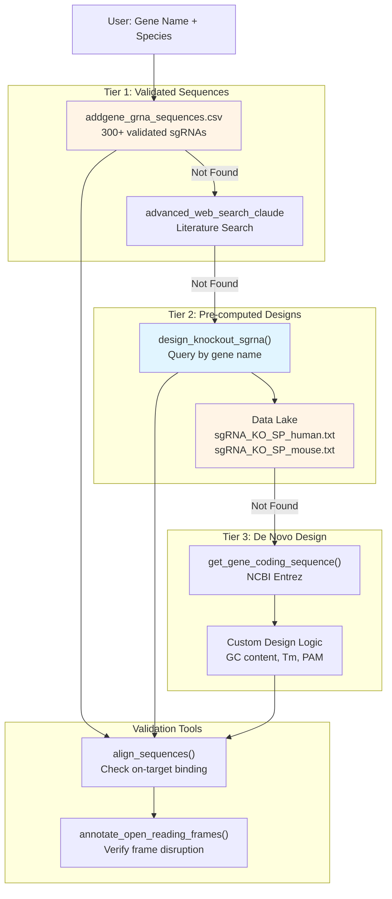
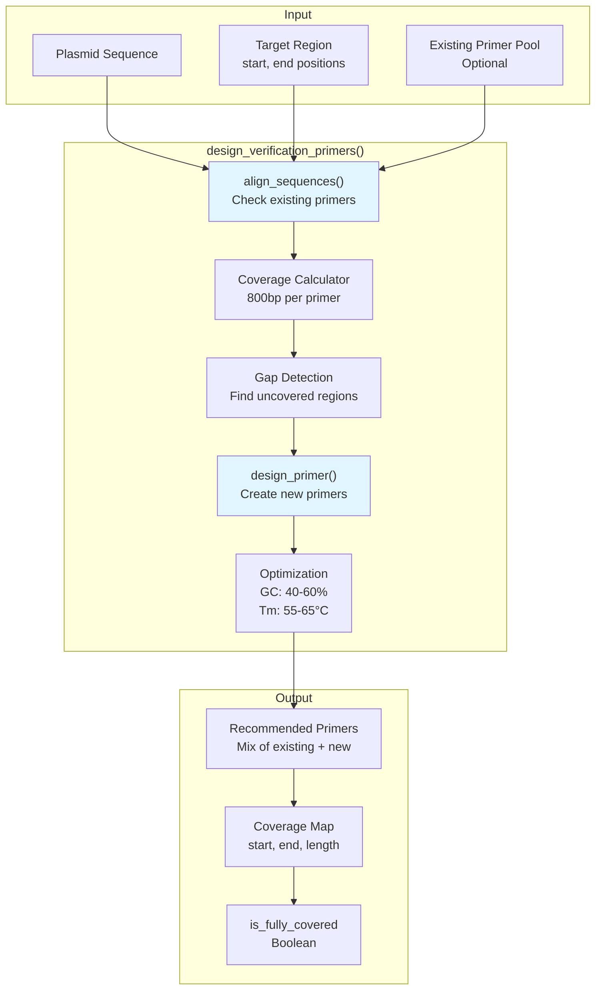
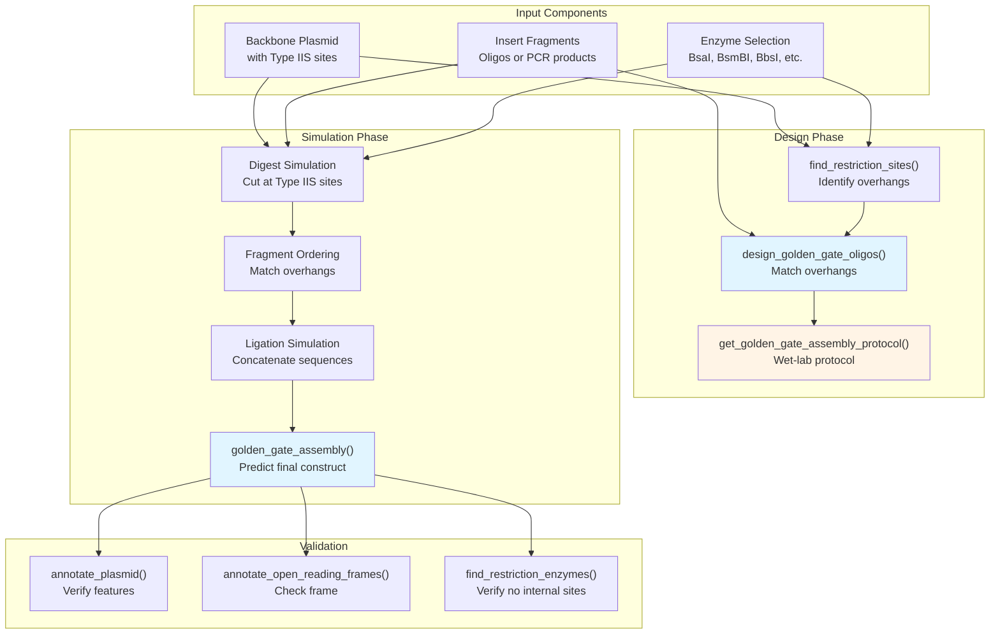
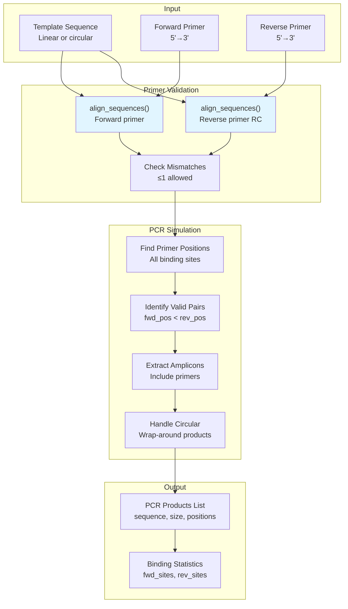
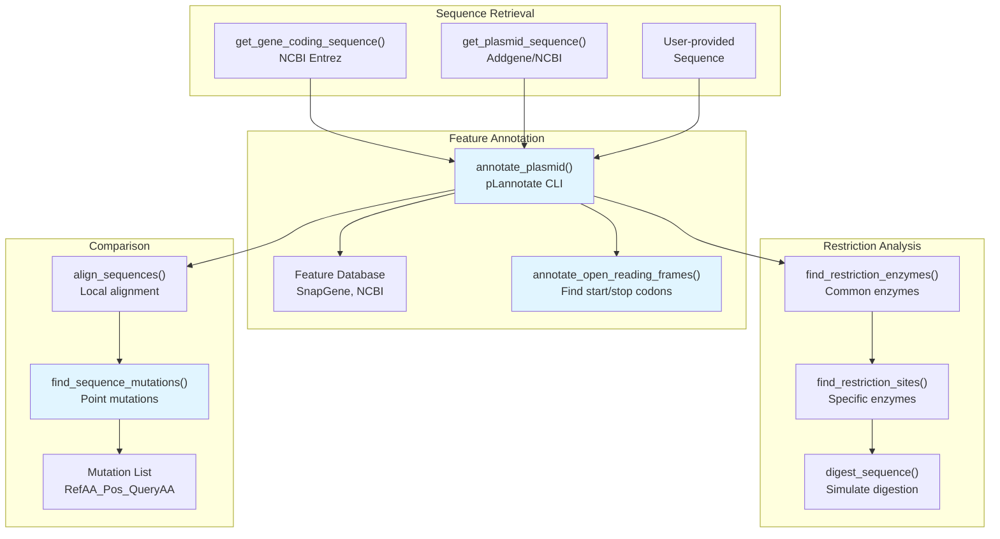

# Molecular Biology Workflows

<details>
<summary>Relevant source files</summary>

The following files were used as context for generating this wiki page:

- [biomni/env_desc.py](biomni/env_desc.py)
- [biomni/know_how/sgRNA_design_guide.md](biomni/know_how/sgRNA_design_guide.md)
- [biomni/know_how/single_cell_annotation.md](biomni/know_how/single_cell_annotation.md)
- [biomni/tool/molecular_biology.py](biomni/tool/molecular_biology.py)

</details>


This page provides practical workflows for common molecular biology tasks using Biomni's molecular biology tools. Each workflow demonstrates how to chain multiple tool functions together to accomplish complete laboratory objectives such as CRISPR design, primer design, plasmid construction, and sequence verification.

For database queries of biological resources, see [Database Query Examples](#6.2). For genomics analysis workflows including scRNA-seq and ChIP-seq, see [Genomics Analysis Workflows](#6.3). For comprehensive molecular biology tool reference documentation, see [Molecular Biology Tools](#5.4).

## Overview of Molecular Biology Tools

Biomni provides a comprehensive suite of molecular biology tools organized into several functional categories:

| Category | Functions | Purpose |
|----------|-----------|---------|
| **CRISPR Design** | `design_knockout_sgrna` | sgRNA selection from validated libraries |
| **Primer Design** | `design_primer`, `design_verification_primers` | PCR and sequencing primer design |
| **Plasmid Analysis** | `get_plasmid_sequence`, `annotate_plasmid`, `annotate_open_reading_frames` | Retrieve and annotate plasmid sequences |
| **Sequence Manipulation** | `align_sequences`, `pcr_simple`, `find_sequence_mutations` | Alignment, PCR simulation, mutation detection |
| **Restriction Analysis** | `digest_sequence`, `find_restriction_sites`, `find_restriction_enzymes` | Restriction enzyme analysis and simulation |
| **Cloning** | `design_golden_gate_oligos`, `golden_gate_assembly` | Golden Gate assembly design and simulation |
| **Protocols** | `get_golden_gate_assembly_protocol`, `get_oligo_annealing_protocol`, `get_bacterial_transformation_protocol` | Standardized wet-lab protocols |

Sources: [biomni/tool/molecular_biology.py:1-2223]()

---

## Workflow 1: CRISPR sgRNA Design

This workflow demonstrates the complete process for designing sgRNAs for CRISPR knockout experiments, following the three-tiered approach described in the sgRNA design guide.

### System Architecture for sgRNA Design



**Diagram: Three-Tier sgRNA Design Strategy**

Sources: [biomni/know_how/sgRNA_design_guide.md:1-420](), [biomni/tool/molecular_biology.py:876-948]()

### Step-by-Step sgRNA Design

#### Step 1: Search Validated sgRNAs

First, always check for experimentally validated sgRNAs in the curated database:

```python
import pandas as pd
from biomni.tool.literature import advanced_web_search_claude

# Method 1: Search local database
df = pd.read_csv('biomni/know_how/resource/addgene_grna_sequences.csv')
gene_name = "TP53"
species = "H. sapiens"

results = df[
    (df['Target_Gene'].str.upper() == gene_name.upper()) &
    (df['Target_Species'] == species) &
    (df['Application'] == 'cut')
]

if not results.empty:
    print(results[['Target_Sequence', 'PubMed_ID', 'Plasmid_ID']])
else:
    # Method 2: Literature search (REQUIRED even if Method 1 fails)
    search_results = advanced_web_search_claude(
        f'sgRNA {gene_name} validated {species} experimental'
    )
```

**Key Points:**
- Database location: `biomni/know_how/resource/addgene_grna_sequences.csv`
- Always cite the `PubMed_ID` when using validated sequences
- Must perform BOTH Method 1 (database) and Method 2 (web search) before proceeding

Sources: [biomni/know_how/sgRNA_design_guide.md:40-143]()

#### Step 2: Use Pre-computed CRISPick Designs

If no validated sequences are found, use the `design_knockout_sgrna` function to query pre-computed libraries:

```python
from biomni.tool.molecular_biology import design_knockout_sgrna

# Design sgRNAs for human gene
result = design_knockout_sgrna(
    gene_name="TP53",
    data_lake_path="/path/to/data_lake",
    species="human",
    num_guides=4
)

print(f"Found {len(result['guides'])} sgRNAs for {result['gene_name']}")
for i, guide in enumerate(result['guides'], 1):
    print(f"  sgRNA {i}: {guide}")
```

**Function Details:**
- Location: [biomni/tool/molecular_biology.py:876-948]()
- Data sources: `sgRNA_KO_SP_human.txt`, `sgRNA_KO_SP_mouse.txt` from data lake
- Ranking: Uses `Combined Rank` by default (balances efficiency and specificity)
- Coverage: CRISPick provides 238 datasets for human, mouse, and other organisms

**Available CRISPick Datasets:**

| Organism | Cas Enzyme | Application | File Pattern |
|----------|-----------|-------------|--------------|
| Human (GRCh38) | SpCas9 | Knockout | `9606_GRCh38_SpyoCas9_CRISPRko` |
| Human (GRCh38) | SpCas9 | Activation | `9606_GRCh38_SpyoCas9_CRISPRa` |
| Mouse (GRCm38) | SpCas9 | Knockout | `10090_GRCm38_SpyoCas9_CRISPRko` |
| Human (GRCh38) | AsCas12a | Knockout | `9606_GRCh38_AsCas12a_CRISPRko` |

Sources: [biomni/tool/molecular_biology.py:876-948](), [biomni/know_how/sgRNA_design_guide.md:146-244](), [biomni/env_desc.py:69-70]()

#### Step 3: Validate sgRNA Binding

After selecting sgRNAs, validate their binding to the target sequence:

```python
from biomni.tool.molecular_biology import (
    get_gene_coding_sequence,
    align_sequences
)

# Get target gene sequence
cds_result = get_gene_coding_sequence(
    gene_name="TP53",
    organism="Homo sapiens",
    email="your_email@example.com"
)

target_sequence = cds_result['sequences'][0]['sequence']

# Validate sgRNA binding (check on-target)
sgrna = "GAGGTTGTGAGGCGCTGCCC"
alignment = align_sequences(
    long_seq=target_sequence,
    short_seqs=sgrna
)

for seq_result in alignment['sequences']:
    alignments = seq_result['alignments']
    print(f"Found {len(alignments)} binding sites")
    for align in alignments:
        print(f"  Position: {align['position']}, Strand: {align['strand']}")
        if align['mismatches']:
            print(f"  Mismatches: {align['mismatches']}")
```

Sources: [biomni/tool/molecular_biology.py:252-328](), [biomni/tool/molecular_biology.py:422-493]()

### Complete sgRNA Design Example

```python
# Complete workflow for TP53 knockout
from biomni.tool.molecular_biology import (
    design_knockout_sgrna,
    get_gene_coding_sequence,
    align_sequences,
    annotate_open_reading_frames
)

# Step 1: Get sgRNA candidates
guides_result = design_knockout_sgrna(
    gene_name="TP53",
    data_lake_path="/path/to/data_lake",
    species="human",
    num_guides=4
)

# Step 2: Get target sequence for validation
cds_result = get_gene_coding_sequence(
    gene_name="TP53",
    organism="Homo sapiens",
    email="your_email@example.com"
)

target_sequence = cds_result['sequences'][0]['sequence']

# Step 3: Validate each sgRNA
for sgrna in guides_result['guides']:
    print(f"\nValidating sgRNA: {sgrna}")
    
    # Check binding
    alignment = align_sequences(target_sequence, sgrna)
    num_sites = len(alignment['sequences'][0]['alignments'])
    print(f"  Binding sites found: {num_sites}")
    
    # Check if it disrupts reading frame
    if num_sites > 0:
        bind_pos = alignment['sequences'][0]['alignments'][0]['position']
        print(f"  Binding position: {bind_pos}")
        
        # Simulate cut at position +3 from PAM (typical Cas9 cut site)
        cut_pos = bind_pos + 17
        print(f"  Predicted cut position: {cut_pos}")
        print(f"  Frame disruption: {cut_pos % 3 != 0}")
```

Sources: [biomni/tool/molecular_biology.py:876-948](), [biomni/tool/molecular_biology.py:252-328](), [biomni/tool/molecular_biology.py:422-493]()

---

## Workflow 2: Primer Design for Sequencing

This workflow demonstrates designing primers for Sanger sequencing verification of plasmid constructs.

### Primer Design Architecture



**Diagram: Primer Design Flow Using `design_verification_primers`**

Sources: [biomni/tool/molecular_biology.py:1353-1696](), [biomni/tool/molecular_biology.py:1277-1350]()

### Basic Primer Design

```python
from biomni.tool.molecular_biology import (
    get_plasmid_sequence,
    design_verification_primers
)

# Get plasmid sequence from Addgene
plasmid_result = get_plasmid_sequence(
    identifier="12345",  # Addgene plasmid ID
    is_addgene=True
)

plasmid_seq = plasmid_result['sequence']

# Design primers to verify a 2000bp insert at position 1000-3000
primer_design = design_verification_primers(
    plasmid_sequence=plasmid_seq,
    target_region=(1000, 3000),
    is_circular=True,
    coverage_length=800,  # Typical Sanger read length
    primer_length=20,
    min_gc=0.4,
    max_gc=0.6,
    min_tm=55.0,
    max_tm=65.0
)

# Review results
print(f"Target region: {primer_design['target_region']}")
print(f"Fully covered: {primer_design['is_fully_covered']}")
print(f"\nRecommended {len(primer_design['recommended_primers'])} primers:")

for primer in primer_design['recommended_primers']:
    print(f"\n{primer['name']}:")
    print(f"  Sequence: {primer['sequence']}")
    print(f"  Position: {primer['position']}")
    print(f"  Source: {primer['source']}")
    if 'gc' in primer:
        print(f"  GC%: {primer['gc']:.1%}")
        print(f"  Tm: {primer['tm']:.1f}°C")
```

**Key Parameters:**
- `target_region`: Tuple of (start, end) positions to verify (0-based)
- `coverage_length`: Expected read length (default 800bp for Sanger)
- `existing_primers`: Optional list of lab primers to try first
- Returns: Mix of existing primers and newly designed primers to achieve full coverage

Sources: [biomni/tool/molecular_biology.py:1353-1696](), [biomni/tool/molecular_biology.py:330-419]()

### Using Custom Primer Pools

The function automatically tries common lab primers, but you can provide a custom pool:

```python
# Define custom primer pool
custom_primers = [
    {"name": "Lab_Primer_1", "sequence": "ATGCGCTGCAGTACGATCGA"},
    {"name": "Lab_Primer_2", "sequence": "GCTAGCTAGCTACGATCGAT"},
    {"name": "Lab_Primer_3", "sequence": "CGTAGCTAGCTACGATCGAT"}
]

# Design with custom pool
primer_design = design_verification_primers(
    plasmid_sequence=plasmid_seq,
    target_region=(1000, 3000),
    existing_primers=custom_primers,
    is_circular=True
)

# Check which existing primers were used
used_existing = [p for p in primer_design['recommended_primers'] 
                 if p['source'] == 'existing']
print(f"Used {len(used_existing)} existing primers")

# Check which primers were newly designed
newly_designed = [p for p in primer_design['recommended_primers'] 
                  if p['source'] == 'newly_designed']
print(f"Designed {len(newly_designed)} new primers")
```

**Default Primer Pool Includes:**
- T7, T3, SP6 promoter primers
- M13F, M13R universal primers
- CMV-Forward, SV40pA-R
- ATTB1/2, ATTL1/2 for Gateway cloning
- 28 total common laboratory primers

Sources: [biomni/tool/molecular_biology.py:1391-1424]()

### Visualizing Coverage

```python
# After designing primers, visualize coverage
coverage_map = primer_design['coverage_map']

print("\nCoverage Map:")
print(f"{'Primer':<20} {'Start':<8} {'End':<8} {'Length':<8}")
print("-" * 50)

for entry in coverage_map:
    print(f"{entry['primer']:<20} {entry['start']:<8} "
          f"{entry['end']:<8} {entry['length']:<8}")

# Check for gaps
if not primer_design['is_fully_covered']:
    print("\nWARNING: Region not fully covered")
    if 'warning' in primer_design:
        print(primer_design['warning'])
```

Sources: [biomni/tool/molecular_biology.py:1679-1696]()

---

## Workflow 3: Golden Gate Assembly

This workflow demonstrates designing and simulating Golden Gate cloning assemblies.

### Golden Gate Assembly System



**Diagram: Golden Gate Assembly Workflow**

Sources: [biomni/tool/molecular_biology.py:1699-1847](), [biomni/tool/molecular_biology.py:1849-2222](), [biomni/tool/molecular_biology.py:1006-1193]()

### Step 1: Analyze Backbone and Design Oligos

```python
from biomni.tool.molecular_biology import (
    get_plasmid_sequence,
    find_restriction_sites,
    design_golden_gate_oligos
)

# Get backbone plasmid
backbone = get_plasmid_sequence(
    identifier="pDEST-His-MBP",
    is_addgene=False  # Search NCBI
)

backbone_seq = backbone['sequence']

# Check for BsmBI sites
sites = find_restriction_sites(
    dna_sequence=backbone_seq,
    enzymes=["BsmBI"],
    is_circular=True
)

print(f"Found {len(sites['restriction_sites']['BsmBI']['sites'])} BsmBI sites")
print(f"Recognition sequence: {sites['restriction_sites']['BsmBI']['recognition_sequence']}")
print(f"Cut positions: {sites['restriction_sites']['BsmBI']['sites']}")

# Design oligos for insert
insert_seq = "ATGGCTAGCTAGCTAGCTAGCTAGCTAG"

oligo_design = design_golden_gate_oligos(
    backbone_sequence=backbone_seq,
    insert_sequence=insert_seq,
    enzyme_name="BsmBI",
    is_circular=True
)

if oligo_design['success']:
    print(f"\nOverhangs identified:")
    print(f"  Upstream: {oligo_design['overhangs']['upstream']}")
    print(f"  Downstream: {oligo_design['overhangs']['downstream']}")
    
    print(f"\nDesigned oligos:")
    print(f"  Forward: {oligo_design['oligos']['forward']}")
    print(f"  Reverse: {oligo_design['oligos']['reverse']}")
```

**Supported Type IIS Enzymes:**

| Enzyme | Recognition Site | Offset (5'→3') | Common Use |
|--------|-----------------|---------------|-----------|
| BsaI | GGTCTC | 1-5 | General cloning |
| BsmBI | CGTCTC | 1-5 | General cloning |
| BbsI | GAAGAC | 2-6 | Alternative to BsaI |
| SapI | GCTCTTC | 1-4 | Single-overhang designs |

Sources: [biomni/tool/molecular_biology.py:725-788](), [biomni/tool/molecular_biology.py:1699-1847](), [biomni/tool/molecular_biology.py:1719-1726]()

### Step 2: Get Assembly Protocol

```python
from biomni.tool.molecular_biology import get_golden_gate_assembly_protocol

# Get protocol for single-insert assembly
protocol = get_golden_gate_assembly_protocol(
    num_inserts=1,
    enzyme_name="BsmBI",
    vector_length=3500,
    vector_amount_ng=75.0,
    insert_lengths=[500],  # Single 500bp insert
    is_library_prep=False
)

print(f"{protocol['title']}")
print(f"{protocol['description']}\n")

for step in protocol['steps']:
    print(f"Step {step['step_number']}: {step['title']}")
    print(f"  {step['description']}")
    
    if 'components' in step:
        print("  Components:")
        for comp in step['components']:
            if 'volume' in comp:
                print(f"    - {comp['name']}: {comp['volume']}")
            elif 'amount' in comp:
                print(f"    - {comp['name']}: {comp['amount']}")
    
    if 'program' in step:
        print("  Thermocycler program:")
        for prog in step['program']:
            print(f"    - {prog['temperature']}: {prog['time']}")
    print()
```

**Protocol Variations:**
- **1 insert**: 5 min at 37°C (or 1h for library prep)
- **2-10 inserts**: 30 cycles of 37°C/1min, 16°C/1min
- **11+ inserts**: 30 cycles of 37°C/5min, 16°C/5min

Sources: [biomni/tool/molecular_biology.py:1006-1193]()

### Step 3: Simulate Assembly

```python
from biomni.tool.molecular_biology import golden_gate_assembly

# Simulate Golden Gate assembly
assembly_result = golden_gate_assembly(
    backbone_sequence=backbone_seq,
    enzyme_name="BsmBI",
    fragments=[
        {
            "name": "insert1",
            "fwd_oligo": oligo_design['oligos']['forward'],
            "rev_oligo": oligo_design['oligos']['reverse']
        }
    ],
    is_circular=True
)

if assembly_result['success']:
    print(f"Assembly successful!")
    print(f"Final construct length: {len(assembly_result['assembled_sequence'])} bp")
    print(f"Message: {assembly_result['message']}")
    
    # Save result
    final_sequence = assembly_result['assembled_sequence']
else:
    print(f"Assembly failed: {assembly_result['message']}")
```

**Function Accepts Two Fragment Formats:**
1. **Oligo pairs**: `fwd_oligo` + `rev_oligo` with matching overhangs
2. **Double-stranded fragments**: `sequence` containing Type IIS sites

Sources: [biomni/tool/molecular_biology.py:1849-2222]()

### Step 4: Validate Assembly

```python
from biomni.tool.molecular_biology import (
    annotate_plasmid,
    annotate_open_reading_frames,
    find_restriction_enzymes
)

# Annotate features using pLannotate
annotations = annotate_plasmid(
    sequence=final_sequence,
    is_circular=True
)

if annotations:
    print(f"\nFound {len(annotations['annotations'])} features:")
    for annot in annotations['annotations'][:10]:  # Show first 10
        print(f"  {annot['Feature']}: {annot['Type']} "
              f"({annot['qstart']}-{annot['qend']})")

# Check reading frames
orfs = annotate_open_reading_frames(
    sequence=final_sequence,
    min_length=100,
    search_reverse=True,
    filter_subsets=True
)

print(f"\nFound {orfs['summary_stats']['total_orfs']} ORFs")
print(f"Longest ORF: {orfs['orfs'][0]['end'] - orfs['orfs'][0]['start']} bp")

# Verify no unwanted restriction sites
re_sites = find_restriction_enzymes(
    sequence=final_sequence,
    is_circular=True
)

print(f"\nCommon restriction enzymes found: {len(re_sites['enzyme_sites'])}")
```

Sources: [biomni/tool/molecular_biology.py:167-249](), [biomni/tool/molecular_biology.py:15-164](), [biomni/tool/molecular_biology.py:791-819]()

### Multi-Fragment Golden Gate Assembly

```python
# For assemblies with multiple inserts
fragments = [
    {
        "name": "promoter",
        "fwd_oligo": "GCATGCTAGCTAGCTACGATCGA...",
        "rev_oligo": "ATCGTAGCTAGCTAGCATGC..."
    },
    {
        "name": "coding_sequence", 
        "fwd_oligo": "ATCGATGGCTAGCTACGATCG...",
        "rev_oligo": "CGATCGTAGCTAGCCATCGAT..."
    },
    {
        "name": "terminator",
        "fwd_oligo": "CGATCGTAGCTAGCTAGCTAG...",
        "rev_oligo": "CTAGCTAGCTAGCTAGCGATCG..."
    }
]

# Assembly automatically orders fragments by matching overhangs
assembly = golden_gate_assembly(
    backbone_sequence=backbone_seq,
    enzyme_name="BsmBI",
    fragments=fragments,
    is_circular=True
)

if assembly['success']:
    print(f"Assembly order: {assembly['assembly_order']}")
    print(f"Used {assembly['cuts_used']} backbone cut sites")
```

Sources: [biomni/tool/molecular_biology.py:2078-2215]()

---

## Workflow 4: PCR Simulation and Verification

This workflow demonstrates simulating PCR amplification and verifying primer specificity.

### PCR Simulation System



**Diagram: PCR Simulation Using `pcr_simple`**

Sources: [biomni/tool/molecular_biology.py:496-599](), [biomni/tool/molecular_biology.py:422-493]()

### Basic PCR Simulation

```python
from biomni.tool.molecular_biology import (
    get_plasmid_sequence,
    pcr_simple
)

# Get template sequence
plasmid = get_plasmid_sequence(
    identifier="12345",
    is_addgene=True
)

template = plasmid['sequence']

# Define primers
forward_primer = "ATGCGATCGTAGCTAGCTAG"
reverse_primer = "CTAGCTAGCGATCGATCGAT"

# Simulate PCR
pcr_result = pcr_simple(
    sequence=template,
    forward_primer=forward_primer,
    reverse_primer=reverse_primer,
    circular=True
)

if pcr_result['success']:
    print(f"PCR successful!")
    print(f"Found {len(pcr_result['products'])} products")
    print(f"Forward primer binds at {pcr_result['forward_binding_sites']} sites")
    print(f"Reverse primer binds at {pcr_result['reverse_binding_sites']} sites")
    
    for i, product in enumerate(pcr_result['products'], 1):
        print(f"\nProduct {i}:")
        print(f"  Size: {product['size']} bp")
        print(f"  Fwd position: {product['forward_position']}")
        print(f"  Rev position: {product['reverse_position']}")
        print(f"  Sequence: {product['sequence'][:50]}...")
        
        if product['forward_mismatches']:
            print(f"  Fwd mismatches: {product['forward_mismatches']}")
        if product['reverse_mismatches']:
            print(f"  Rev mismatches: {product['reverse_mismatches']}")
else:
    print(f"PCR failed: {pcr_result['message']}")
```

**Key Features:**
- Allows up to 1 mismatch per primer
- Checks both forward and reverse complement strands
- Handles circular templates with wrap-around products
- Reports all possible products if primers bind multiple times

Sources: [biomni/tool/molecular_biology.py:496-599]()

### Validating Primer Specificity

```python
from biomni.tool.molecular_biology import align_sequences

# Check primer specificity across entire plasmid
full_plasmid = "ATGCGATCG..." * 1000  # Large plasmid

# Check forward primer
fwd_alignment = align_sequences(
    long_seq=full_plasmid,
    short_seqs=forward_primer
)

num_fwd_sites = len(fwd_alignment['sequences'][0]['alignments'])
print(f"Forward primer binds at {num_fwd_sites} sites")

# Check each binding site
for align in fwd_alignment['sequences'][0]['alignments']:
    print(f"  Position {align['position']} "
          f"(Strand: {align['strand']}, "
          f"Mismatches: {len(align['mismatches'])})")

# Check reverse primer
rev_alignment = align_sequences(
    long_seq=full_plasmid,
    short_seqs=reverse_primer
)

num_rev_sites = len(rev_alignment['sequences'][0]['alignments'])
print(f"Reverse primer binds at {num_rev_sites} sites")

# Warn if non-specific
if num_fwd_sites > 1 or num_rev_sites > 1:
    print("\nWARNING: Primers are not specific!")
    print("Consider redesigning primers or expect multiple PCR products")
```

Sources: [biomni/tool/molecular_biology.py:422-493]()

---

## Workflow 5: Sequence Analysis and Mutation Detection

This workflow demonstrates analyzing DNA sequences for features, ORFs, and mutations.

### Sequence Analysis Flow



**Diagram: Sequence Analysis Workflow**

Sources: [biomni/tool/molecular_biology.py:167-249](), [biomni/tool/molecular_biology.py:15-164](), [biomni/tool/molecular_biology.py:822-873]()

### Comprehensive Plasmid Analysis

```python
from biomni.tool.molecular_biology import (
    get_plasmid_sequence,
    annotate_plasmid,
    annotate_open_reading_frames,
    find_restriction_enzymes
)

# Get plasmid
plasmid = get_plasmid_sequence(
    identifier="pET28a",
    is_addgene=False
)

sequence = plasmid['sequence']

# 1. Annotate features using pLannotate
print("Annotating features...")
annotations = annotate_plasmid(
    sequence=sequence,
    is_circular=True
)

if annotations:
    print(f"Found {len(annotations['annotations'])} features:\n")
    
    # Group by feature type
    by_type = {}
    for annot in annotations['annotations']:
        ftype = annot['Type']
        if ftype not in by_type:
            by_type[ftype] = []
        by_type[ftype].append(annot)
    
    for ftype, features in by_type.items():
        print(f"{ftype}: {len(features)} features")
        for feat in features[:3]:  # Show first 3 of each type
            print(f"  - {feat['Feature']} ({feat['qstart']}-{feat['qend']})")

# 2. Find all ORFs
print("\nFinding open reading frames...")
orfs = annotate_open_reading_frames(
    sequence=sequence,
    min_length=300,  # At least 100 amino acids
    search_reverse=True,
    filter_subsets=True
)

print(f"Found {orfs['summary_stats']['total_orfs']} ORFs")
print(f"Forward strand: {orfs['summary_stats']['forward_orfs']}")
print(f"Reverse strand: {orfs['summary_stats']['reverse_orfs']}")
print(f"Average length: {orfs['summary_stats']['avg_length']} bp")

# Show longest ORF
longest = orfs['orfs'][0]
print(f"\nLongest ORF:")
print(f"  Length: {len(longest.sequence)} bp")
print(f"  Frame: {longest.frame}")
print(f"  Position: {longest.start}-{longest.end}")
print(f"  Protein: {longest.aa_sequence[:50]}...")

# 3. Find all restriction sites
print("\nFinding restriction sites...")
re_sites = find_restriction_enzymes(
    sequence=sequence,
    is_circular=True
)

print(f"Found {len(re_sites['enzyme_sites'])} enzyme sites")

# Show single-cutters (good for linearization)
single_cutters = {k: v for k, v in re_sites['enzyme_sites'].items() 
                  if len(v) == 1}
print(f"Single-cutter enzymes: {len(single_cutters)}")
for enzyme, positions in list(single_cutters.items())[:5]:
    print(f"  {enzyme}: position {positions[0]}")
```

Sources: [biomni/tool/molecular_biology.py:167-249](), [biomni/tool/molecular_biology.py:15-164](), [biomni/tool/molecular_biology.py:791-819]()

### Mutation Detection

```python
from biomni.tool.molecular_biology import find_sequence_mutations

# Compare sequences (e.g., wild-type vs mutant)
reference_seq = "ATGGCTAGCTAGCGATCGATCG"
query_seq =     "ATGGCTAGCTAGCTATCGATCG"
#                                ^
#                         Position 15: G→T

mutations = find_sequence_mutations(
    query_sequence=query_seq,
    reference_sequence=reference_seq,
    query_start=1
)

if mutations['success']:
    print(f"Found {len(mutations['mutations'])} mutations:")
    for mut in mutations['mutations']:
        print(f"  {mut}")
else:
    print("No mutations detected")

# For protein sequences
ref_protein = "MAEIKRTGVTA"
query_protein = "MAEIKTGVTA"
#                     ^
#                  Position 6: R→K

aa_mutations = find_sequence_mutations(
    query_sequence=query_protein,
    reference_sequence=ref_protein,
    query_start=1
)

print(f"\nProtein mutations: {aa_mutations['mutations']}")
```

**Mutation Format:** `RefAA_Position_QueryAA`
- Example: `G15T` means position 15 changed from G to T
- Works for both nucleotide and amino acid sequences

Sources: [biomni/tool/molecular_biology.py:822-873]()

### Restriction Digest Simulation

```python
from biomni.tool.molecular_biology import digest_sequence

# Simulate double digest
digest_result = digest_sequence(
    dna_sequence=sequence,
    enzyme_names=["EcoRI", "BamHI"],
    is_circular=True
)

print(f"Digestion with {digest_result['digestion_info']['enzymes_used']}")
print(f"Cut at positions: {digest_result['digestion_info']['cut_positions']}")
print(f"Generated {digest_result['digestion_info']['number_of_fragments']} fragments\n")

# Show fragments sorted by size
print("Fragments (sorted by size):")
for i, frag in enumerate(digest_result['fragments'], 1):
    print(f"  Fragment {i}: {frag['length']} bp "
          f"(positions {frag['start']}-{frag['end']})")
    if 'is_wrapped' in frag and frag['is_wrapped']:
        print(f"    (wraps around origin)")

# Save largest fragment (useful for cloning)
largest_fragment = digest_result['fragments'][0]['fragment']
print(f"\nLargest fragment: {len(largest_fragment)} bp")
```

**Use Cases:**
- Planning restriction cloning strategies
- Verifying fragment sizes before gel electrophoresis
- Extracting specific regions from plasmids
- Confirming digest products

Sources: [biomni/tool/molecular_biology.py:602-722]()

---

## Workflow 6: Complete Cloning Pipeline

This workflow integrates multiple tools to design and validate a complete cloning project.

### End-to-End Cloning Example

```python
from biomni.tool.molecular_biology import (
    get_gene_coding_sequence,
    get_plasmid_sequence,
    design_golden_gate_oligos,
    golden_gate_assembly,
    get_golden_gate_assembly_protocol,
    design_verification_primers,
    get_oligo_annealing_protocol,
    get_bacterial_transformation_protocol,
    annotate_plasmid
)

# ==================================================
# Step 1: Get gene and vector sequences
# ==================================================
print("Step 1: Retrieving sequences...")

# Get target gene
gene_result = get_gene_coding_sequence(
    gene_name="EGFP",
    organism="synthetic construct",
    email="your_email@example.com"
)
insert_seq = gene_result['sequences'][0]['sequence']
print(f"  Gene length: {len(insert_seq)} bp")

# Get destination vector
vector_result = get_plasmid_sequence(
    identifier="pDEST-His",
    is_addgene=False
)
backbone_seq = vector_result['sequence']
print(f"  Vector length: {len(backbone_seq)} bp")

# ==================================================
# Step 2: Design Golden Gate oligos
# ==================================================
print("\nStep 2: Designing Golden Gate oligos...")

oligos = design_golden_gate_oligos(
    backbone_sequence=backbone_seq,
    insert_sequence=insert_seq,
    enzyme_name="BsmBI",
    is_circular=True
)

if not oligos['success']:
    print(f"  ERROR: {oligos['message']}")
    exit(1)

fwd_oligo = oligos['oligos']['forward']
rev_oligo = oligos['oligos']['reverse']
print(f"  Forward oligo: {fwd_oligo[:40]}... ({len(fwd_oligo)} bp)")
print(f"  Reverse oligo: {rev_oligo[:40]}... ({len(rev_oligo)} bp)")

# ==================================================
# Step 3: Get oligo annealing protocol
# ==================================================
print("\nStep 3: Getting oligo annealing protocol...")

anneal_protocol = get_oligo_annealing_protocol()
print(f"  Protocol: {anneal_protocol['title']}")

# ==================================================
# Step 4: Get Golden Gate assembly protocol
# ==================================================
print("\nStep 4: Getting Golden Gate assembly protocol...")

gg_protocol = get_golden_gate_assembly_protocol(
    num_inserts=1,
    enzyme_name="BsmBI",
    vector_length=len(backbone_seq),
    vector_amount_ng=75.0,
    insert_lengths=[len(insert_seq)],
    is_library_prep=False
)

print(f"  Protocol: {gg_protocol['title']}")
for step in gg_protocol['steps']:
    print(f"    Step {step['step_number']}: {step['title']}")

# ==================================================
# Step 5: Simulate assembly
# ==================================================
print("\nStep 5: Simulating Golden Gate assembly...")

assembly = golden_gate_assembly(
    backbone_sequence=backbone_seq,
    enzyme_name="BsmBI",
    fragments=[{
        "name": "EGFP_insert",
        "fwd_oligo": fwd_oligo,
        "rev_oligo": rev_oligo
    }],
    is_circular=True
)

if not assembly['success']:
    print(f"  ERROR: {assembly['message']}")
    exit(1)

final_construct = assembly['assembled_sequence']
print(f"  Assembly successful!")
print(f"  Final construct: {len(final_construct)} bp")

# ==================================================
# Step 6: Annotate final construct
# ==================================================
print("\nStep 6: Annotating final construct...")

annotations = annotate_plasmid(
    sequence=final_construct,
    is_circular=True
)

if annotations:
    print(f"  Found {len(annotations['annotations'])} features")
    # Check for expected features
    feature_names = [a['Feature'] for a in annotations['annotations']]
    if 'EGFP' in ' '.join(feature_names):
        print("  ✓ EGFP insert detected")

# ==================================================
# Step 7: Design sequencing primers
# ==================================================
print("\nStep 7: Designing verification primers...")

# Find insert position in final construct
insert_start = final_construct.find(insert_seq[:50])  # Use first 50bp as probe

if insert_start != -1:
    primers = design_verification_primers(
        plasmid_sequence=final_construct,
        target_region=(insert_start, insert_start + len(insert_seq)),
        is_circular=True
    )
    
    print(f"  Designed {len(primers['recommended_primers'])} primers")
    print(f"  Coverage: {'Full' if primers['is_fully_covered'] else 'Partial'}")

# ==================================================
# Step 8: Get transformation protocol
# ==================================================
print("\nStep 8: Getting transformation protocol...")

transform_protocol = get_bacterial_transformation_protocol(
    antibiotic="kanamycin",
    is_repetitive=False
)

print(f"  Protocol: {transform_protocol['title']}")
print(f"  Antibiotic: kanamycin")
print(f"  Incubation: 37°C overnight")

print("\n" + "="*50)
print("CLONING PIPELINE COMPLETE")
print("="*50)
print(f"Final construct size: {len(final_construct)} bp")
print(f"Ready for transformation and verification")
```

Sources: [biomni/tool/molecular_biology.py:252-328](), [biomni/tool/molecular_biology.py:330-419](), [biomni/tool/molecular_biology.py:1699-1847](), [biomni/tool/molecular_biology.py:1849-2222](), [biomni/tool/molecular_biology.py:1006-1193](), [biomni/tool/molecular_biology.py:1353-1696](), [biomni/tool/molecular_biology.py:951-1003](), [biomni/tool/molecular_biology.py:1196-1274](), [biomni/tool/molecular_biology.py:167-249]()

---

## Common Patterns and Best Practices

### Pattern 1: Always Validate sgRNA Designs

```python
# CORRECT: Three-tiered approach
# 1. Check validated database
validated = search_addgene_database(gene)
if not validated:
    # 2. Check literature
    validated = advanced_web_search_claude(gene)
if not validated:
    # 3. Use pre-computed designs
    sgrnas = design_knockout_sgrna(gene, species="human")

# INCORRECT: Skip validation
sgrnas = design_knockout_sgrna(gene, species="human")  # Missing tiers 1 & 2
```

### Pattern 2: Verify Primer Specificity

```python
# CORRECT: Check all binding sites
alignment = align_sequences(template, primer)
num_sites = len(alignment['sequences'][0]['alignments'])
if num_sites > 1:
    print("WARNING: Non-specific primer")

# INCORRECT: Assume primers work
pcr_result = pcr_simple(template, fwd, rev)  # No validation
```

### Pattern 3: Annotate Before and After Cloning

```python
# CORRECT: Verify features
before = annotate_plasmid(backbone_seq)
assembly = golden_gate_assembly(...)
after = annotate_plasmid(assembly['assembled_sequence'])

# Compare features
before_features = set(a['Feature'] for a in before['annotations'])
after_features = set(a['Feature'] for a in after['annotations'])
new_features = after_features - before_features

# INCORRECT: No validation
assembly = golden_gate_assembly(...)
# Assume assembly worked correctly
```

### Pattern 4: Use Protocols for Reproducibility

```python
# CORRECT: Generate standardized protocols
protocol = get_golden_gate_assembly_protocol(
    num_inserts=2,
    enzyme_name="BsmBI",
    vector_length=len(backbone)
)
# Save protocol to lab notebook

# INCORRECT: Manual protocol without validation
# "Mix vector and inserts, heat at 37°C"
```

Sources: [biomni/know_how/sgRNA_design_guide.md:1-420](), [biomni/tool/molecular_biology.py:422-493](), [biomni/tool/molecular_biology.py:167-249](), [biomni/tool/molecular_biology.py:1006-1193]()

---

## Data Lake Resources for Molecular Biology

Biomni provides pre-computed sgRNA libraries in the data lake:

| File | Description | Size | Location |
|------|-------------|------|----------|
| `sgRNA_KO_SP_human.txt` | Human SpCas9 knockout sgRNAs | ~400 MB | `/data_lake/sgRNA_KO_SP_human.txt` |
| `sgRNA_KO_SP_mouse.txt` | Mouse SpCas9 knockout sgRNAs | ~350 MB | `/data_lake/sgRNA_KO_SP_mouse.txt` |

**sgRNA Library Contents:**
- Target Gene Symbol
- sgRNA Sequence (20bp)
- Combined Rank (overall quality score)
- On-Target Rank (efficiency)
- Off-Target Rank (specificity)
- Exon Number
- sgRNA Cut Position
- PAM Sequence

**Additional Resources:**
- `addgene_grna_sequences.csv`: 300+ validated sgRNAs with references
- `CRISPick_download_links.txt`: URLs for 238 CRISPick datasets

Sources: [biomni/env_desc.py:69-70](), [biomni/know_how/sgRNA_design_guide.md:169-177]()

---

## Software Dependencies

Molecular biology workflows rely on several key software packages:

**Python Packages:**
- `biopython`: Sequence parsing, translation, restriction enzymes
- `pandas`: Data manipulation for sgRNA libraries
- `requests`: API calls to Addgene/NCBI
- `beautifulsoup4`: Web scraping for plasmid sequences

**CLI Tools:**
- `plannotate`: Plasmid annotation using SnapGene database
- `samtools`: (Optional) For BAM/SAM file manipulation
- `mafft`: (Optional) Multiple sequence alignment

**R Packages:**
- Not required for core molecular biology workflows

Sources: [biomni/env_desc.py:85-221](), [biomni/tool/molecular_biology.py:1-13]()

---

## Troubleshooting

### Issue: sgRNA library file not found

```
FileNotFoundError: Library file for human not found at path: /data_lake/sgRNA_KO_SP_human.txt
```

**Solution:** Ensure data lake is downloaded:
```python
from biomni.agent import A1
agent = A1()  # Automatically downloads data lake on first run
```

### Issue: No validated sgRNAs found

```
Found 0 validated sgRNAs for gene XYZ
```

**Solution:** Complete all three tiers:
1. Check `addgene_grna_sequences.csv` (local database)
2. Use `advanced_web_search_claude()` (literature search)
3. Fall back to `design_knockout_sgrna()` (CRISPick)

### Issue: Primer design fails

```
Could not find suitable primer in window
```

**Solution:** Adjust design parameters:
- Increase `search_window` (default 100bp)
- Relax GC constraints: `min_gc=0.35, max_gc=0.65`
- Relax Tm constraints: `min_tm=52.0, max_tm=68.0`

### Issue: Golden Gate assembly fails

```
Could not find valid assembly path
```

**Solution:** Verify fragment overhangs:
- Check that overhangs are complementary
- Ensure correct enzyme selected
- Verify restriction sites are in correct orientation
- Use `find_restriction_sites()` to debug

Sources: [biomni/tool/molecular_biology.py:876-948](), [biomni/tool/molecular_biology.py:1277-1350](), [biomni/tool/molecular_biology.py:1849-2222]()

---