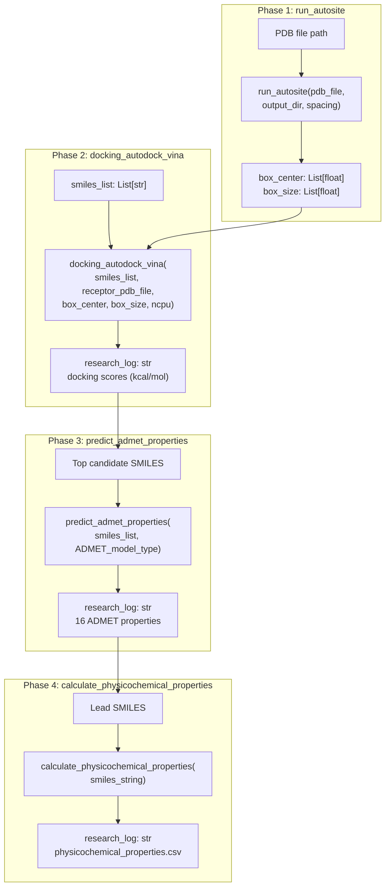
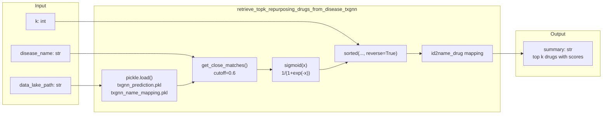
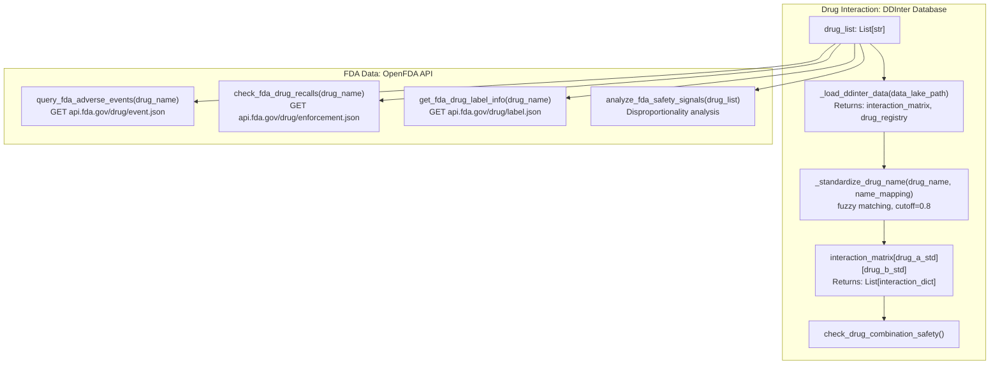

# Drug Discovery Workflows

<details>
<summary>Relevant source files</summary>

The following files were used as context for generating this wiki page:

- [biomni/tool/pharmacology.py](biomni/tool/pharmacology.py)
- [biomni/tool/tool_description/pharmacology.py](biomni/tool/tool_description/pharmacology.py)

</details>


This page documents drug discovery workflows using pharmacology tools from `biomni.tool.pharmacology`. Workflows combine multiple functions for virtual screening, drug repurposing, safety assessment, and preclinical validation.

For pharmacology tool reference, see page 5.5. For database query examples, see page 6.2.

---

## Overview of Available Functions

The pharmacology module provides functions across five categories:

| Category | Functions | Primary Use |
|----------|-----------|-------------|
| **Molecular Docking** | `run_diffdock_with_smiles`, `docking_autodock_vina`, `run_autosite` | Target-based screening |
| **Drug Repurposing** | `retrieve_topk_repurposing_drugs_from_disease_txgnn` | Knowledge graph predictions |
| **Property Prediction** | `predict_admet_properties`, `calculate_physicochemical_properties`, `predict_binding_affinity_protein_1d_sequence` | Lead optimization |
| **Safety Assessment** | `query_drug_interactions`, `check_drug_combination_safety`, `analyze_interaction_mechanisms`, `query_fda_adverse_events`, `check_fda_drug_recalls`, `get_fda_drug_label_info`, `analyze_fda_safety_signals` | Polypharmacy screening, pharmacovigilance |
| **Preclinical Analysis** | `analyze_xenograft_tumor_growth_inhibition`, `analyze_radiolabeled_antibody_biodistribution`, `estimate_alpha_particle_radiotherapy_dosimetry`, `grade_adverse_events_using_vcog_ctcae`, `analyze_western_blot`, `analyze_accelerated_stability_of_pharmaceutical_formulations` | In vivo efficacy, toxicology |

Sources: [biomni/tool/pharmacology.py:1-2863](), [biomni/tool/tool_description/pharmacology.py:1-774]()

---

## Workflow 1: Virtual Screening and Lead Optimization

### Function Call Sequence

Target-based virtual screening combines binding site identification, docking, and property prediction.



Sources: [biomni/tool/pharmacology.py:136-180](), [biomni/tool/pharmacology.py:96-133](), [biomni/tool/pharmacology.py:249-360](), [biomni/tool/pharmacology.py:1523-1614]()

### Example Code

```python
from biomni.agent import A1

# Initialize agent
agent = A1(path="./workspace", llm="claude-sonnet-4")

# Step 1: Identify binding sites
prompt1 = """
I have a protein structure at data/protein.pdb. 
Use AutoSite to identify potential binding pockets and determine the optimal docking box parameters.
"""
result1 = agent.go(prompt1)

# Step 2: Virtual screening with docking
prompt2 = """
Using the binding site coordinates from the previous result, perform molecular docking 
for these candidate compounds:
- Compound A: CCO (ethanol)
- Compound B: CC(=O)Oc1ccccc1C(=O)O (aspirin)
- Compound C: CN1C=NC2=C1C(=O)N(C(=O)N2C)C (caffeine)

Use docking_autodock_vina() with the receptor PDB at data/protein.pdb.
Rank compounds by their predicted binding affinity.
"""
result2 = agent.go(prompt2)

# Step 3: ADMET profiling for top candidates
prompt3 = """
For the top 3 compounds from the docking results, predict their ADMET properties 
using predict_admet_properties() with the MPNN model. 

Focus on:
- Solubility (log mol/L)
- Caco-2 permeability (absorption)
- Blood-brain barrier permeability
- CYP metabolism liability
- Clinical toxicity predictions

Filter out any compounds that fail Lipinski's Rule of Five.
"""
result3 = agent.go(prompt3)

# Step 4: Calculate detailed physicochemical properties
prompt4 = """
For the final lead candidates, use calculate_physicochemical_properties() 
to get comprehensive property profiles including:
- Molecular weight
- LogP
- Topological polar surface area
- Number of H-bond donors/acceptors
- Rotatable bonds

Generate a summary table comparing all lead compounds.
"""
result4 = agent.go(prompt4)
```

Sources: [biomni/tool/pharmacology.py:136-180](), [biomni/tool/pharmacology.py:96-133](), [biomni/tool/pharmacology.py:249-360]()

### Implementation Details

#### 1. run_autosite

[biomni/tool/pharmacology.py:136-180]() identifies binding pockets:
- Converts PDB to PDBQT via `prepare_receptor` [line 143]()
- Executes `autosite` subprocess with spacing parameter [lines 146-155]()
- Parses `_AutoSiteSummary.log` for box coordinates via regex [lines 164-170]()
- Returns `research_log: str` containing box_center and box_size

#### 2. docking_autodock_vina

[biomni/tool/pharmacology.py:96-133]() performs docking:
- Initializes `Oracle(name="pyscreener", ...)` from TDC [lines 108-114]()
- Calls `oracle(smiles_list)` to compute docking scores [line 121]()
- Returns `research_log: str` with SMILES to score mapping [lines 125-133]()
- Scores in kcal/mol (lower = stronger binding)

#### 3. predict_admet_properties

[biomni/tool/pharmacology.py:249-360]() predicts 16 properties:
- Loads CompoundPred models for 16 tasks [lines 264-287]()
- Tasks: AqSolDB, Caco2, HIA, Pgp_inhibitor, Bioavailability, BBB_MolNet, PPBR, CYP2C19, CYP2D6, CYP3A4, CYP1A2, CYP2C9, ClinTox, Lipo_AZ, Half_life_eDrug3D, Clearance_eDrug3D [lines 265-282]()
- Model types: "MPNN", "CNN", "Morgan" [lines 257-261]()
- Returns `research_log: str` with predictions per SMILES [lines 306-360]()

#### 4. calculate_physicochemical_properties

[biomni/tool/pharmacology.py:1523-1614]() calculates descriptors:
- Uses `Chem.MolFromSmiles(smiles_string)` [line 1547]()
- Computes: MW, cLogP, TPSA, H-bond donors/acceptors, rotatable bonds [lines 1554-1564]()
- Saves to `physicochemical_properties.csv` [lines 1587-1592]()
- Returns `research_log: str` with property summary [lines 1595-1611]()

Sources: [biomni/tool/pharmacology.py:136-180](), [biomni/tool/pharmacology.py:96-133](), [biomni/tool/pharmacology.py:249-360](), [biomni/tool/pharmacology.py:1523-1614]()

---

## Workflow 2: Drug Repurposing

### TxGNN Prediction Function

`retrieve_topk_repurposing_drugs_from_disease_txgnn` queries pre-computed knowledge graph predictions.



Sources: [biomni/tool/pharmacology.py:184-245]()

### Example Code

```python
from biomni.agent import A1

agent = A1(path="./repurposing", llm="claude-sonnet-4")

# Step 1: Get TxGNN predictions
prompt1 = """
Use retrieve_topk_repurposing_drugs_from_disease_txgnn() to find the top 10 
drug repurposing candidates for "Parkinson's disease".

The data lake path should be automatically provided by the agent context.
Return the drug names and their prediction scores.
"""
result1 = agent.go(prompt1)

# Step 2: Validate with binding affinity predictions
prompt2 = """
For the top 3 candidates from TxGNN, predict their binding affinity 
to the alpha-synuclein protein (UniProt ID: P37840).

First, retrieve the amino acid sequence using query_protein_sequence_uniprot().
Then use predict_binding_affinity_protein_1d_sequence() with the MPNN-CNN model.

Compare binding affinities to known Parkinson's drugs like rasagiline.
"""
result2 = agent.go(prompt2)

# Step 3: Safety assessment
prompt3 = """
For each repurposing candidate, check FDA adverse event data using 
query_fda_adverse_events() for the last 5 years.

Focus on:
- Total number of adverse event reports
- Serious adverse events
- Neurological side effects
- Death outcomes

Create a safety profile summary for clinical consideration.
"""
result3 = agent.go(prompt3)

# Step 4: Drug interaction screening
prompt4 = """
Check potential drug-drug interactions between the repurposing candidates 
and standard Parkinson's medications (levodopa, carbidopa, pramipexole) 
using query_drug_interactions() from the DDInter database.

Identify any major interactions that would contraindicate repurposing.
"""
result4 = agent.go(prompt4)
```

Sources: [biomni/tool/pharmacology.py:183-245](), [biomni/tool/pharmacology.py:363-411]()

### Implementation Details

[biomni/tool/pharmacology.py:184-245]() implements:

1. **Data Loading** [lines 203-210]():
   - Loads `data_lake_path + "/txgnn_prediction.pkl"` containing `result: dict[disease_name, dict[drug_id, score]]`
   - Loads `data_lake_path + "/txgnn_name_mapping.pkl"` containing `mapping: dict` with `id2name_drug` key

2. **Fuzzy Matching** [lines 213-219]():
   - Calls `get_close_matches(disease_name, possible_diseases, n=1, cutoff=0.6)`
   - Returns error if no match found
   - Uses matched disease name for lookup

3. **Score Transformation** [lines 199-200](), [lines 225]():
   - Defines `sigmoid(x) = 1 / (1 + np.exp(-x))`
   - Applies to raw prediction scores: `sigmoid_predictions = {drug_id: sigmoid(score) for drug_id, score in disease_predictions.items()}`

4. **Ranking** [lines 228-231]():
   - Sorts: `top_k_drugs = sorted(sigmoid_predictions.items(), key=lambda x: x[1], reverse=True)[:k]`
   - Maps IDs to names: `top_k_drug_names = [(mapping["id2name_drug"].get(drug_id, "Unknown Drug"), score) for drug_id, score in top_k_drugs]`

5. **Output Format** [lines 234-244]():
   - Returns formatted string: `"TxGNN Drug Repurposing Predictions for '{matched_disease}':\nTop {k} predicted drugs..."`

Sources: [biomni/tool/pharmacology.py:184-245]()

---

## Workflow 3: Safety Assessment

### DDInter and OpenFDA Functions

Safety assessment combines drug interaction database queries with FDA adverse event data.



Sources: [biomni/tool/pharmacology.py:1970-2271](), [biomni/tool/pharmacology.py:2311-2863]()

### Example Code

```python
from biomni.agent import A1

agent = A1(path="./safety", llm="claude-sonnet-4")

# Step 1: Check drug combination safety
prompt1 = """
A patient is prescribed the following medication regimen:
- Warfarin (anticoagulant)
- Aspirin (antiplatelet)
- Metformin (diabetes)
- Atorvastatin (cholesterol)

Use check_drug_combination_safety() to analyze all pairwise interactions 
from the DDInter database. Include mechanisms and management recommendations.
"""
result1 = agent.go(prompt1)

# Step 2: FDA adverse event analysis
prompt2 = """
For each drug in the combination, query FDA adverse event data from 
the last 3 years using query_fda_adverse_events().

Focus on:
- Bleeding events (for warfarin + aspirin)
- Hepatotoxicity events
- Serious outcomes requiring hospitalization

Calculate reporting rates per 100,000 prescriptions if data is available.
"""
result2 = agent.go(prompt2)

# Step 3: Safety signal detection
prompt3 = """
Use analyze_fda_safety_signals() to perform disproportionality analysis 
across the drug combination. 

Compare observed vs expected adverse event rates for:
- Major bleeding
- Rhabdomyolysis (statin + drug interactions)
- Hypoglycemia

Use a signal threshold of 2.0 for clinical significance.
"""
result3 = agent.go(prompt3)

# Step 4: Check for recalls and label updates
prompt4 = """
For each drug, check:
1. FDA drug recalls in the last 2 years using check_fda_drug_recalls()
2. Current label information for updated contraindications using get_fda_drug_label_info()

Summarize any recent safety concerns or regulatory actions.
"""
result4 = agent.go(prompt4)

# Step 5: Generate clinical recommendation
prompt5 = """
Based on all safety data collected, generate a clinical recommendation report:

1. Overall risk assessment (low/moderate/high)
2. Specific interaction pairs requiring monitoring
3. Laboratory monitoring recommendations
4. Dose adjustment suggestions
5. Alternative drug options if contraindications exist

Format as a structured clinical decision support output.
"""
result5 = agent.go(prompt5)
```

Sources: [biomni/tool/pharmacology.py:2311-2863]()

### DDInter Database Implementation

#### Data Loading and Processing

[biomni/tool/pharmacology.py:1970-2014]() implements lazy loading:

- `_load_ddinter_data(data_lake_path)` [lines 1970-2014]():
  - Checks for pickle files: `interaction_matrix.pkl`, `drug_registry.pkl` [lines 1977-1979]()
  - If not found, calls `_process_ddinter_data_inline()` [line 1988]()
  - Returns `(interaction_matrix, drug_registry, name_mapping)`

#### Data Processing Functions

[biomni/tool/pharmacology.py:2017-2186]() processes raw DDInter CSV files:

1. `_process_ddinter_data_inline(data_lake_path, output_dir)` [lines 2017-2085]():
   - Loads 8 CSV files from `data_lake_path + "/ddinter/"` [lines 2041-2050]()
   - Categories: `alimentary`, `antineoplastic`, `antiparasitic`, `blood`, `dermatological`, `hormonal`, `respiratory`, `various`
   - Calls `_build_drug_registry_inline()` and `_create_interaction_matrix_inline()` [lines 2070-2071]()

2. `_build_drug_registry_inline(dataframes)` [lines 2108-2149]():
   - Creates `drug_registry: dict[drug_id, drug_info]` and `name_mapping: dict[drug_name_lower, drug_name]`
   - Stores: `drug_id`, `drug_name`, `category`, `interacts_with` [lines 2121-2135]()

3. `_create_interaction_matrix_inline(dataframes)` [lines 2152-2186]():
   - Builds `interaction_matrix: dict[drug_a_std, dict[drug_b_std, List[interaction_dict]]]`
   - Each interaction_dict contains: `severity_level`, `category`, `drug_a_id`, `drug_b_id` [lines 2173-2178]()

#### Name Standardization

`_standardize_drug_name(drug_name, name_mapping)` [lines 1990-2003]():
- Converts to lowercase, strips whitespace
- Uses `get_close_matches(drug_name_lower, name_mapping.keys(), n=1, cutoff=0.8)` [line 1999]()

Sources: [biomni/tool/pharmacology.py:1970-2186]()

---

## Workflow 4: Preclinical Validation

### Preclinical Analysis Functions



```mermaid
graph TD
    subgraph "analyze_xenograft_tumor_growth_inhibition"
        XENO_CSV["data_path: str<br/>time_column, volume_column,<br/>group_column, subject_column"]
        XENO_FUNC["analyze_xenograft_tumor_growth_inhibition()"]
        TGI["research_log: str<br/>TGI%, ANOVA, Tukey HSD<br/>tumor_growth_curves.png"]
    end
    
    subgraph "analyze_radiolabeled_antibody_biodistribution"
        BIO_DATA["time_points: List[float]<br/>tissue_data: dict[tissue, List[float]]"]
        BIO_FUNC["analyze_radiolabeled_antibody_biodistribution()"]
        PK["research_log: str<br/>biodistribution_pk_results.json<br/>t½_dist, t½_elim, AUC, MRT"]
    end
    
    subgraph "estimate_alpha_particle_radiotherapy_dosimetry"
        DOSE_DATA["biodistribution_data: dict<br/>radiation_parameters: dict"]
        DOSE_FUNC["estimate_alpha_particle_radiotherapy_dosimetry()"]
        MIRD["research_log: str<br/>dosimetry_results.csv<br/>absorbed dose (Gy/MBq)"]
    end
    
    subgraph "grade_adverse_events_using_vcog_ctcae"
        AE_CSV["clinical_data_file: str<br/>subject_id, time_point,<br/>symptom, severity, measurement"]
        AE_FUNC["grade_adverse_events_using_vcog_ctcae()"]
        VCOG["research_log: str<br/>vcog_ctcae_graded_events.csv<br/>Grade 0-5"]
    end
    
    XENO_CSV --> XENO_FUNC
    XENO_FUNC --> TGI
    
    BIO_DATA --> BIO_FUNC
    BIO_FUNC --> PK
    
    DOSE_DATA --> DOSE_FUNC
    DOSE_FUNC --> MIRD
    
    AE_CSV --> AE_FUNC
    AE_FUNC --> VCOG
```

Sources: [biomni/tool/pharmacology.py:1616-1861](), [biomni/tool/pharmacology.py:1073-1206](), [biomni/tool/pharmacology.py:1209-1318](), [biomni/tool/pharmacology.py:682-1070]()

### Example: Xenograft Analysis

```python
from biomni.agent import A1

agent = A1(path="./preclinical", llm="claude-sonnet-4")

# Analyze tumor growth inhibition
prompt = """
I have xenograft tumor growth data in data/xenograft_study.csv with columns:
- Day: time point in days
- Volume: tumor volume in mm³
- Treatment: treatment group (Control, Drug_A, Drug_B)
- Mouse_ID: subject identifier

Use analyze_xenograft_tumor_growth_inhibition() to:
1. Calculate tumor growth rates for each group
2. Compute TGI (%) for Drug_A and Drug_B relative to Control
3. Perform repeated measures ANOVA with post-hoc Tukey HSD
4. Generate tumor growth curve plots
5. Identify the most effective treatment

Save all results to ./results/ directory.
"""
result = agent.go(prompt)
```

### Implementation: analyze_xenograft_tumor_growth_inhibition

[biomni/tool/pharmacology.py:1616-1861]() implements:

1. **Data Loading** [lines 1665-1693]():
   - Reads CSV/TSV: `pd.read_csv(data_path)` or `pd.read_csv(data_path, sep="\t")`
   - Validates columns: `time_column`, `volume_column`, `group_column`, `subject_column`

2. **Growth Rate Calculation** [lines 1710-1735]():
   - Per subject: `slope, _, _, _, _ = stats.linregress(x, y)` where `x = subject_data[time_column].values`, `y = subject_data[volume_column].values`
   - Group aggregation: `mean_rate = np.mean(subject_growth_rates)`, `sem_rate = stats.sem(subject_growth_rates)`

3. **TGI Calculation** [lines 1738-1758]():
   - Formula: `tgi = ((control_final_mean - group_final_mean) / control_final_mean) * 100`
   - Evaluated at `final_time = max(time_points)`

4. **Repeated Measures ANOVA** [lines 1767-1786]():
   - Formula: `f"{volume_column} ~ C({group_column}) * C({time_column}) + C({subject_column})"`
   - Execution: `model = ols(formula, data=data_df).fit()`, `anova_table = sm.stats.anova_lm(model, typ=2)`
   - Extracts p-values: `group_effect_p`, `time_effect_p`, `interaction_p`

5. **Post-hoc Analysis** [lines 1789-1810]():
   - Tukey HSD: `tukey = pairwise_tukeyhsd(endog=final_data[volume_column], groups=final_data[group_column], alpha=0.05)`
   - Filters significant pairs: `sig_pairs = tukey_df[tukey_df["p-adj"] < 0.05]`

6. **Visualization** [lines 1816-1842]():
   - Error bar plot: `plt.errorbar(group_stats[time_column], group_stats["mean"], yerr=group_stats["sem"], ...)`
   - Saves: `plt.savefig(plot_file, dpi=300, bbox_inches="tight")`

Sources: [biomni/tool/pharmacology.py:1616-1861]()

### Example: Biodistribution Analysis

```python
# Analyze radiolabeled antibody biodistribution
prompt = """
Analyze biodistribution data for a radiolabeled antibody with measurements at 
1, 4, 24, 48, 72, and 168 hours post-injection.

Tissue data (%IA/g):
- tumor: [15.2, 22.1, 28.5, 25.3, 20.1, 12.4]
- blood: [45.2, 25.3, 10.2, 5.1, 2.8, 1.2]
- liver: [8.2, 12.1, 15.3, 12.8, 9.5, 5.2]
- kidney: [10.5, 14.2, 12.1, 8.3, 5.2, 2.1]
- spleen: [5.2, 8.1, 10.2, 8.5, 6.1, 3.2]

Use analyze_radiolabeled_antibody_biodistribution() to:
1. Fit bi-exponential pharmacokinetic models
2. Calculate distribution and elimination half-lives
3. Compute tumor-to-normal tissue ratios
4. Determine optimal imaging/therapy timepoints

Save detailed PK parameters to JSON.
"""
result = agent.go(prompt)
```

### Implementation: analyze_radiolabeled_antibody_biodistribution

[biomni/tool/pharmacology.py:1073-1206]() implements:

1. **Bi-exponential Model Definition** [lines 1102-1104]():
   ```python
   def bi_exp_model(t, A, alpha, B, beta):
       return A * np.exp(-alpha * t) + B * np.exp(-beta * t)
   ```

2. **Parameter Fitting** [lines 1117-1124]():
   - Call: `params, _ = curve_fit(bi_exp_model, time_points, measurements, p0=[50, 0.1, 50, 0.01], bounds=([0, 0, 0, 0], [100, 5, 100, 1]))`
   - Extracts: `A, alpha, B, beta = params`

3. **PK Parameter Calculation** [lines 1128-1143]():
   - Distribution half-life: `t_half_dist = np.log(2) / alpha`
   - Elimination half-life: `t_half_elim = np.log(2) / beta`
   - AUC: `auc = A / alpha + B / beta`
   - MRT: `mrt = (A / (alpha**2) + B / (beta**2)) / auc`
   - Clearance (for blood/plasma): `clearance = 1 / auc` [lines 142-144]()

4. **Tumor-to-Normal Ratio Calculation** [lines 1165-1175]():
   - Per timepoint: `ratios = [t / n if n > 0 else float("inf") for t, n in zip(tissue_data["tumor"], tissue_data[tissue], strict=False)]`
   - Max ratio: `max(ratios)`, time at max: `time_points[np.argmax(ratios)]`

5. **Output** [lines 1177-1180]():
   - Saves JSON: `json.dump(results, f, indent=2)` to `biodistribution_pk_results.json`

Sources: [biomni/tool/pharmacology.py:1073-1206]()

---

## Workflow 5: Formulation Stability

### Accelerated Stability Testing

```python
from biomni.agent import A1

agent = A1(path="./formulation", llm="claude-sonnet-4")

prompt = """
Design and analyze an accelerated stability study for three formulations of a novel kinase inhibitor:

Formulations:
1. Tablet (compressed):
   - active_ingredient: "Kinase Inhibitor X"
   - concentration: 50 mg
   - excipients: ["microcrystalline cellulose", "croscarmellose sodium", "magnesium stearate"]
   - dosage_form: "solid"

2. Oral suspension:
   - active_ingredient: "Kinase Inhibitor X"
   - concentration: 10 mg/mL
   - excipients: ["citric acid", "sodium citrate", "sucrose", "methylparaben"]
   - dosage_form: "liquid"

3. Lyophilized powder:
   - active_ingredient: "Kinase Inhibitor X"
   - concentration: 100 mg
   - excipients: ["mannitol", "histidine", "polysorbate 80"]
   - dosage_form: "solid"

Storage conditions:
- Room temperature: 25°C, 60% RH
- Accelerated: 40°C, 75% RH
- Stressed: 50°C

Evaluate at time points: [0, 1, 3, 6, 9, 12] months

Use analyze_accelerated_stability_of_pharmaceutical_formulations() to predict:
1. Chemical stability (% remaining active ingredient)
2. Physical stability scores
3. Particle size changes
4. Identify most stable formulation
5. Recommend storage conditions and shelf life

Save detailed results to CSV.
"""
result = agent.go(prompt)
```

### Implementation: analyze_accelerated_stability_of_pharmaceutical_formulations

[biomni/tool/pharmacology.py:414-574]() implements:

1. **Acceleration Factor** [lines 458-459]():
   - Q10 rule: `accel_factor = 2 ** ((temp_c - 25) / 10)`
   - Reaction rate doubles every 10°C

2. **Humidity Factor** [lines 461-466]():
   - Applied if `"humidity" in condition`: `humidity_factor = 1.0 + (humidity - 60) / 100 if humidity > 60 else 1.0`
   - Increases degradation above 60% RH

3. **Chemical Stability Calculation** [lines 474-475]():
   - First-order kinetics: `chemical_stability = initial_content * np.exp(-0.001 * effective_time)`
   - Where `effective_time = time * accel_factor * humidity_factor` [line 474]()

4. **Physical Stability Score** [lines 478-480]():
   - Decreases over time: `physical_stability = 10 - (0.05 * effective_time)`
   - Clamped: `physical_stability = max(1, physical_stability)`

5. **Particle Size Change** [lines 483-486]():
   - For solid dosage forms: `particle_size_change = 0.2 * effective_time if "solid" in formulation.get("dosage_form", "").lower() else 0`

6. **Stability Classification** [lines 549-555]():
   - Stable: `chem_stab >= 90 and phys_stab >= 7`
   - Potentially unstable: `chem_stab < 90 or phys_stab < 7`
   - Unstable: `chem_stab < 85 or phys_stab < 5`

7. **Output** [lines 506-508]():
   - Saves CSV: `results_df.to_csv(csv_filename, index=False)` to `stability_test_results/stability_results_{timestamp}.csv`

Sources: [biomni/tool/pharmacology.py:414-574]()

---

## Combined Workflows

### Multi-Stage Drug Discovery

```python
from biomni.agent import A1

agent = A1(path="./integrated", llm="claude-sonnet-4")

# Multi-stage drug discovery
prompt = """
I'm searching for treatments for Huntington's disease. Execute this integrated workflow:

STAGE 1 - Dual Approach:
A. Use TxGNN to identify top 5 repurposing candidates
B. Perform virtual screening of 10 novel compounds against huntingtin protein

STAGE 2 - Convergence:
- Predict ADMET for all candidates (repurposed + novel)
- Calculate physicochemical properties
- Filter by Lipinski's Rule of Five and BBB permeability

STAGE 3 - Safety Assessment:
- Query FDA adverse events for repurposing candidates
- Check drug interactions with standard Huntington's medications (tetrabenazine)
- Analyze safety signals across all candidates

STAGE 4 - Final Ranking:
Create a ranked list combining:
- Predicted efficacy (docking score or TxGNN score)
- ADMET favorability
- Safety profile
- Development feasibility (repurposed vs novel)

Generate a comprehensive report with recommendations for clinical development.
"""
result = agent.go(prompt)
```

Sources: [biomni/tool/pharmacology.py:1-2863]()

### Clinical Trial Simulation

```python
# Preclinical to clinical bridge
prompt = """
Based on preclinical data, design a Phase 1 dose-escalation study:

INPUT DATA:
1. Xenograft TGI: 65% at 10 mg/kg dose
2. Biodistribution: tumor accumulation peaks at 48h, t½ = 72h
3. Dosimetry: therapeutic index (tumor/normal) = 5.2
4. ADMET: high solubility, moderate clearance, no CYP inhibition

TASKS:
1. Use allometric scaling to estimate human dose range
2. Design 3+3 dose escalation scheme
3. Recommend dosing schedule based on PK/PD
4. Define adverse event monitoring using VCOG-CTCAE categories
5. Specify laboratory monitoring based on toxicology findings

Generate a Phase 1 protocol outline suitable for IND submission.
"""
result = agent.go(prompt)
```

Sources: [biomni/tool/pharmacology.py:682-1070](), [biomni/tool/pharmacology.py:1616-1861]()

---

## Function Parameter Reference

### Docking Functions

#### run_diffdock_with_smiles

[biomni/tool/pharmacology.py:13-93]()

**Parameters:**
- `pdb_path: str` - Path to protein PDB file [line 13]()
- `smiles_string: str` - Ligand SMILES representation [line 13]()
- `local_output_dir: str` - Output directory path [line 13]()
- `gpu_device: int = 0` - GPU device ID [line 13]()
- `use_gpu: bool = True` - Enable GPU acceleration [line 13]()

**Returns:** `str` - Summary of docking execution

**Implementation:**
- Pulls Docker image: `rbgcsail/diffdock` [line 29]()
- Mounts PDB and output directory [lines 62-64]()
- Executes: `micromamba run -n diffdock python -m inference --config default_inference_args.yaml --protein_path /home/appuser/input/protein.pdb --ligand '{smiles_string}' --out_dir /home/appuser/output` [lines 70-71]()

#### docking_autodock_vina

[biomni/tool/pharmacology.py:96-133]()

**Parameters:**
- `smiles_list: List[str]` - List of SMILES strings [line 96]()
- `receptor_pdb_file: str` - Receptor PDB file path [line 96]()
- `box_center: List[float]` - Docking box center [x, y, z] [line 96]()
- `box_size: List[float]` - Docking box dimensions [x, y, z] [line 96]()
- `ncpu: int = 1` - Number of CPUs [line 96]()

**Returns:** `str` - Research log with docking scores (kcal/mol)

**Implementation:**
- Initializes TDC Oracle: `Oracle(name="pyscreener", receptor_pdb_file=receptor_pdb_file, box_center=box_center, box_size=box_size, ncpu=ncpu)` [lines 108-114]()
- Returns dict: `results_dict = dict(zip(smiles_list, docking_scores, strict=False))` [line 125]()

### Property Prediction Functions

#### predict_admet_properties

[biomni/tool/pharmacology.py:249-360]()

**Parameters:**
- `smiles_list: List[str]` - SMILES strings [line 249]()
- `ADMET_model_type: str = "MPNN"` - Model type: "MPNN", "CNN", or "Morgan" [line 249]()

**Returns:** `str` - Research log with 16 ADMET properties per SMILES

**Models:** [lines 265-282]()
- Solubility: AqSolDB
- Absorption: Caco2, HIA, Pgp_inhibitor, Bioavailability
- Distribution: BBB_MolNet, PPBR
- Metabolism: CYP2C19, CYP2D6, CYP3A4, CYP1A2, CYP2C9
- Excretion: Half_life_eDrug3D, Clearance_eDrug3D
- Toxicity: ClinTox, Lipo_AZ

#### predict_binding_affinity_protein_1d_sequence

[biomni/tool/pharmacology.py:364-411]()

**Parameters:**
- `smiles_list: List[str]` - SMILES strings [line 364]()
- `amino_acid_sequence: str` - Protein amino acid sequence [line 364]()
- `affinity_model_type: str = "MPNN-CNN"` - Model: "CNN-CNN", "MPNN-CNN", "Morgan-CNN", "Morgan-AAC", "Daylight-AAC" [line 364]()

**Returns:** `str` - Research log with binding affinity (nM) per SMILES

**Implementation:**
- Loads model: `DTI.model_pretrained(model=affinity_model_type.replace("-", "_") + "_BindingDB")` [line 385]()
- Prediction: `y_pred_nM = 10 ** (-y_pred) / 1e-9` [line 406]()

### Safety Assessment Functions

#### check_drug_combination_safety

[biomni/tool/pharmacology.py:2274-2471]()

**Parameters:**
- `drug_list: List[str]` - Drug names [line 2274]()
- `include_mechanisms: bool = True` - Include mechanism descriptions [line 2274]()
- `include_management: bool = True` - Include management recommendations [line 2274]()
- `data_lake_path: str = None` - Data lake directory [line 2274]()

**Returns:** `str` - Comprehensive safety report

**Implementation:**
- Loads DDInter: `interaction_matrix, drug_registry, name_mapping = _load_ddinter_data(data_lake_path)` [line 2285]()
- Checks all pairs: `for i in range(len(drug_list)): for j in range(i + 1, len(drug_list)):` [lines 2297-2298]()

#### query_fda_adverse_events

[biomni/tool/pharmacology.py:2311-2451]()

**Parameters:**
- `drug_name: str` - Drug name [line 2311]()
- `date_range: Tuple[str, str] = None` - Date range (YYYY-MM-DD, YYYY-MM-DD) [line 2311]()
- `severity_filter: List[str] = None` - Filter: ["serious", "non_serious"] [line 2311]()
- `outcome_filter: List[str] = None` - Filter: ["life_threatening", "hospitalization", "death"] [line 2311]()
- `limit: int = 100` - Max results [line 2311]()

**Returns:** `str` - Adverse event statistics

**API Endpoint:** `https://api.fda.gov/drug/event.json` [line 2328]()

### Preclinical Analysis Functions

#### analyze_xenograft_tumor_growth_inhibition

[biomni/tool/pharmacology.py:1616-1861]()

**Parameters:**
- `data_path: str` - CSV/TSV file path [line 1616]()
- `time_column: str` - Column name for time points [line 1617]()
- `volume_column: str` - Column name for tumor volume [line 1618]()
- `group_column: str` - Column name for treatment group [line 1619]()
- `subject_column: str` - Column name for subject ID [line 1620]()
- `output_dir: str = "./results"` - Output directory [line 1621]()

**Returns:** `str` - Research log with TGI%, statistics, plot paths

**Output Files:**
- `tumor_volume_statistics.csv` [line 1706]()
- `repeated_measures_anova.csv` [line 1774]()
- `tukey_posthoc_results.txt` [line 1796]()
- `tumor_growth_curves.png` [line 1838]()

#### analyze_radiolabeled_antibody_biodistribution

[biomni/tool/pharmacology.py:1073-1206]()

**Parameters:**
- `time_points: List[float] | np.ndarray` - Time points (hours) [line 1073]()
- `tissue_data: dict` - `{tissue_name: List[float]}` with %IA/g measurements, must include "tumor" [line 1074]()

**Returns:** `str` - Research log with PK parameters

**Output File:** `biodistribution_pk_results.json` [line 1179]()

**PK Parameters:**
- `distribution_half_life_h`, `elimination_half_life_h`, `mean_residence_time_h`, `clearance` (if blood/plasma)
- Tumor-to-normal ratios: `max_ratio`, `max_ratio_time_point`

#### grade_adverse_events_using_vcog_ctcae

[biomni/tool/pharmacology.py:682-1070]()

**Parameters:**
- `clinical_data_file: str` - CSV file with columns: `subject_id`, `time_point`, `symptom`, `severity`, `measurement` (optional) [line 682]()

**Returns:** `str` - Research log with VCOG-CTCAE grades

**Output Files:**
- `vcog_ctcae_graded_events.csv` [line 1061]()
- `vcog_ctcae_progression_analysis.csv` [line 1030]()
- `vcog_ctcae_criteria_reference.json` [line 1067]()

**VCOG-CTCAE Grades:** 0 (none), 1 (mild), 2 (moderate), 3 (severe), 4 (life-threatening), 5 (death)

**Supported Symptoms:** [lines 722-901]()
- Hematologic: neutropenia, anemia, thrombocytopenia
- Gastrointestinal: vomiting, diarrhea, anorexia
- Hepatic: alt_increase
- Renal: creatinine_increase
- Constitutional: fever, weight_loss
- Dermatologic: alopecia
- Neurologic: neuropathy

Sources: [biomni/tool/pharmacology.py:1-2863](), [biomni/tool/tool_description/pharmacology.py:1-774]()

---

## Function Reference Quick Guide

### Molecular Docking

| Function | Input | Output | Use Case |
|----------|-------|--------|----------|
| `run_diffdock_with_smiles` | PDB path, SMILES, output_dir | Docking poses, summary | High-accuracy docking with ML |
| `docking_autodock_vina` | SMILES list, PDB, box params | Binding scores (kcal/mol) | Fast screening, empirical force field |
| `run_autosite` | PDB file, output_dir | Box center, box size | Binding site identification |

### Property Prediction

| Function | Input | Output | Use Case |
|----------|-------|--------|----------|
| `predict_admet_properties` | SMILES list, model_type | ADMET profile (16 properties) | Lead optimization |
| `predict_binding_affinity_protein_1d_sequence` | SMILES, AA sequence | Binding affinity (nM) | Target-based validation |
| `calculate_physicochemical_properties` | SMILES string | Molecular descriptors | Drug-likeness assessment |

### Drug Repurposing

| Function | Input | Output | Use Case |
|----------|-------|--------|----------|
| `retrieve_topk_repurposing_drugs_from_disease_txgnn` | Disease name, data_lake_path, k | Top-K drugs with scores | Knowledge graph predictions |

### Safety Assessment

| Function | Input | Output | Use Case |
|----------|-------|--------|----------|
| `query_drug_interactions` | Drug names list | Interaction pairs with severity | Polypharmacy screening |
| `check_drug_combination_safety` | Drug list | Comprehensive safety report | Clinical decision support |
| `analyze_interaction_mechanisms` | Drug pair tuple | Mechanistic details | Deep dive analysis |
| `query_fda_adverse_events` | Drug name, filters | Adverse event statistics | Pharmacovigilance |
| `check_fda_drug_recalls` | Drug name, classification | Recall history | Regulatory intelligence |

### Preclinical Analysis

| Function | Input | Output | Use Case |
|----------|-------|--------|----------|
| `analyze_xenograft_tumor_growth_inhibition` | CSV path, column names | TGI%, statistics, plots | In vivo efficacy |
| `analyze_radiolabeled_antibody_biodistribution` | Time points, tissue_data | PK parameters, ratios | Biodistribution studies |
| `estimate_alpha_particle_radiotherapy_dosimetry` | Biodistribution, radiation params | Absorbed doses (Gy/MBq) | Radiopharmaceutical dosing |
| `grade_adverse_events_using_vcog_ctcae` | Clinical data CSV | VCOG-CTCAE grades | Toxicology monitoring |
| `analyze_western_blot` | Image path, band ROIs | Relative expression | Protein quantification |

### Formulation

| Function | Input | Output | Use Case |
|----------|-------|--------|----------|
| `analyze_accelerated_stability_of_pharmaceutical_formulations` | Formulations, conditions, time points | Stability predictions | Shelf-life estimation |
| `run_3d_chondrogenic_aggregate_assay` | Cell info, compounds | Protocol document | Assay design |

Sources: [biomni/tool/tool_description/pharmacology.py:1-724]()

---