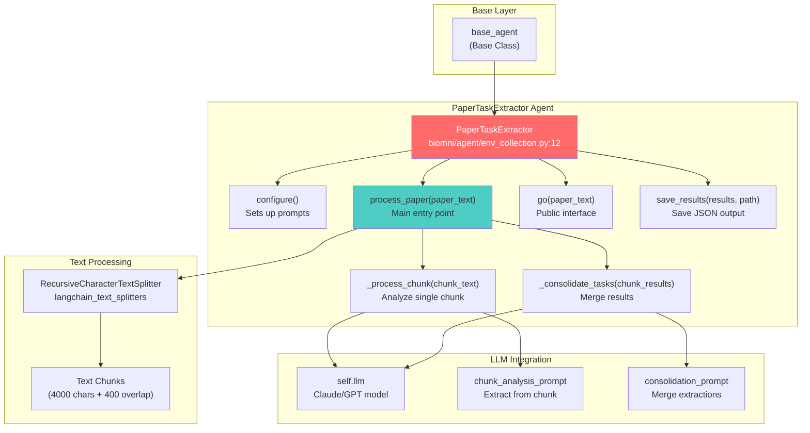
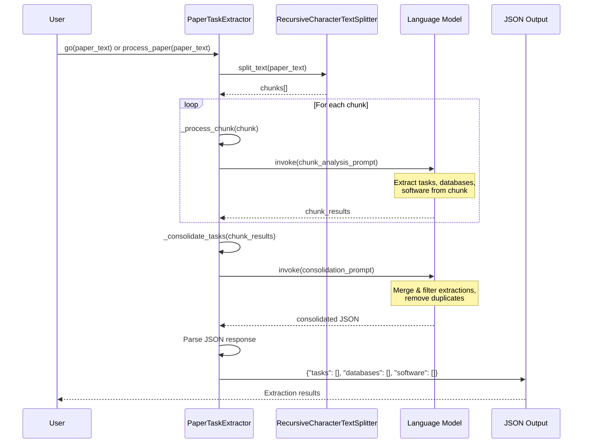
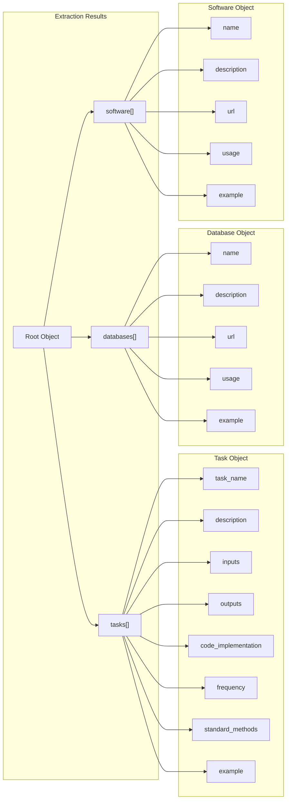
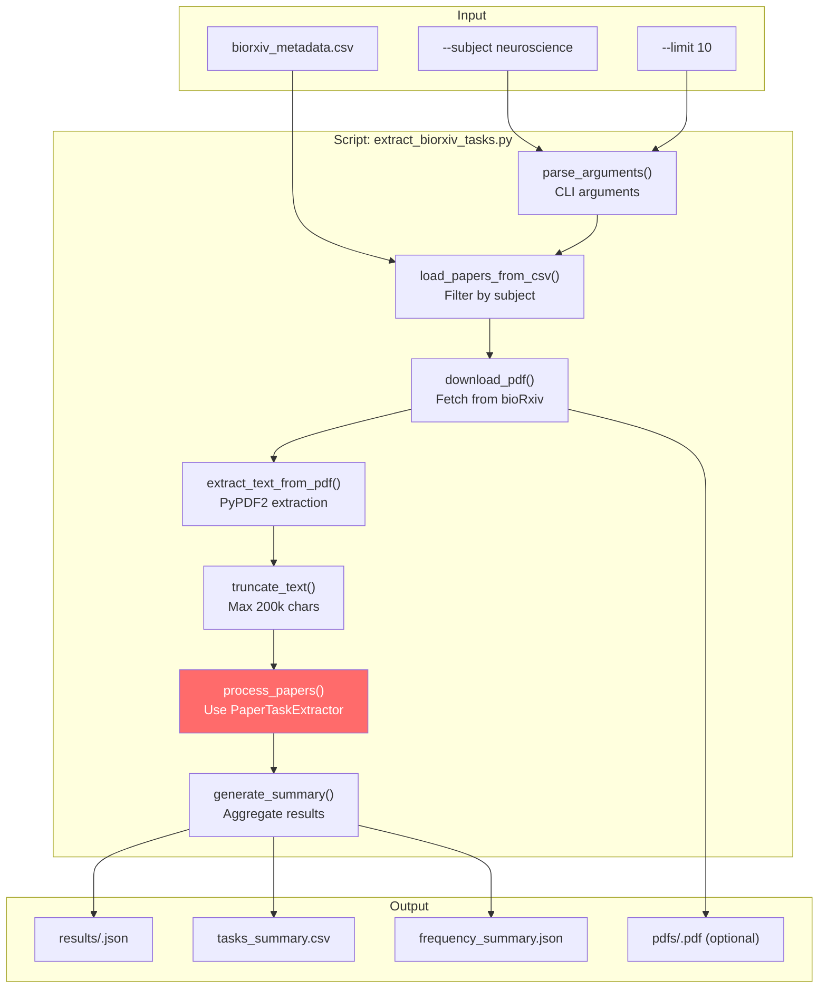
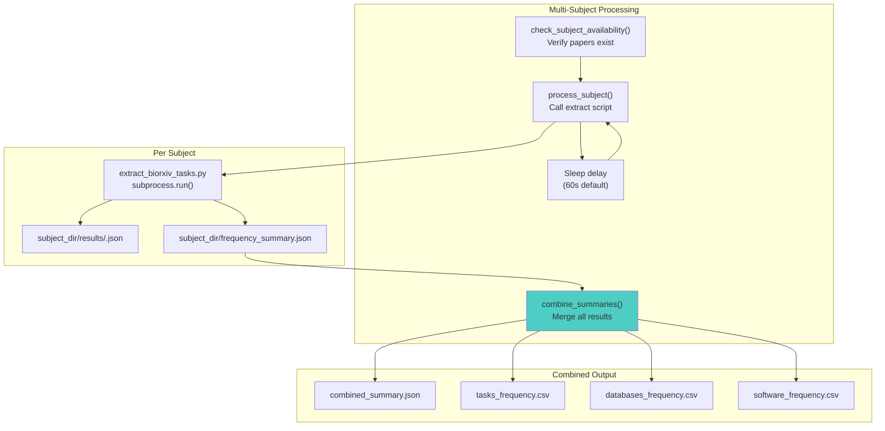
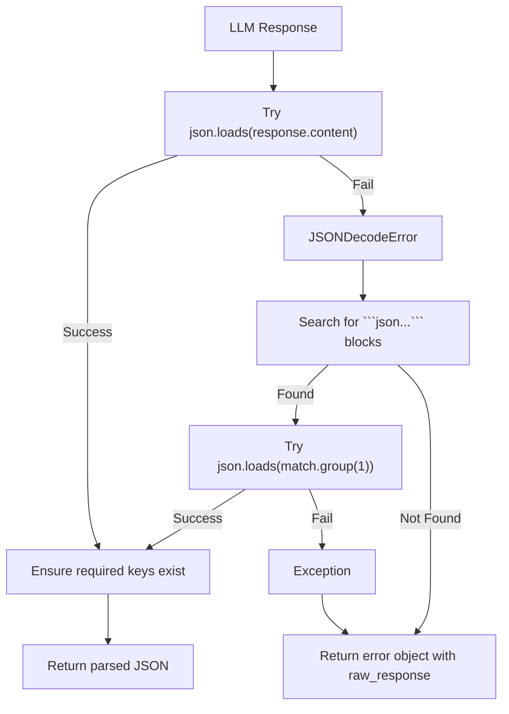
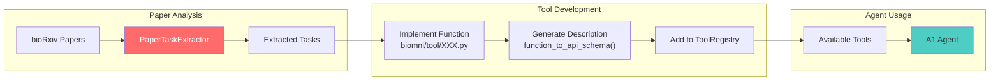

# Paper Analysis and Task Extraction

<details>
<summary>Relevant source files</summary>

The following files were used as context for generating this wiki page:

- [.pre-commit-config.yaml](.pre-commit-config.yaml)
- [CONTRIBUTION.md](CONTRIBUTION.md)
- [biomni/agent/env_collection.py](biomni/agent/env_collection.py)
- [biomni/agent/qa_llm.py](biomni/agent/qa_llm.py)
- [biomni/biorxiv_scripts/extract_biorxiv_tasks.py](biomni/biorxiv_scripts/extract_biorxiv_tasks.py)
- [biomni/biorxiv_scripts/process_all_subjects.py](biomni/biorxiv_scripts/process_all_subjects.py)

</details>


## Purpose and Scope

This document describes the **PaperTaskExtractor** system, a specialized agent designed to analyze academic papers from bioRxiv and extract generalizable computational tasks, databases, and software tools mentioned in the literature. This system helps identify common research workflows and tools that could be incorporated into Biomni's tool ecosystem.

For information about the core A1 agent and its orchestration, see [A1 Agent Core](#2.1). For general agent configuration and usage patterns, see [Basic Agent Usage](#4.2).

## Overview

The `PaperTaskExtractor` is implemented in [biomni/agent/env_collection.py:12-314]() and extends the `base_agent` class. Unlike the main A1 agent which executes computational tasks, this specialized agent analyzes academic papers to identify:

1. **Computational Tasks**: Common, generalizable research procedures that can be implemented with code
2. **Databases**: Biological and biomedical databases referenced in papers
3. **Software Tools**: Computational tools and packages used in research workflows

The system is designed to be highly selective, only extracting tasks that are widely applicable across biomedical research and can be implemented computationally.

## Architecture

### Class Structure



Sources: [biomni/agent/env_collection.py:12-314]()

### Initialization Parameters

The `PaperTaskExtractor` constructor accepts the following parameters:

| Parameter | Type | Default | Description |
|-----------|------|---------|-------------|
| `llm` | str | `"claude-3-7-sonnet-20250219"` | LLM model identifier for task extraction |
| `cheap_llm` | str | None | Optional cheaper model (not currently used) |
| `tools` | list | None | Tools to use (not needed for this agent) |
| `chunk_size` | int | 4000 | Size of text chunks for processing |
| `chunk_overlap` | int | 400 | Overlap between consecutive chunks |

Sources: [biomni/agent/env_collection.py:17-39]()

## Processing Workflow

### Paper Processing Pipeline



Sources: [biomni/agent/env_collection.py:136-245]()

### Text Chunking Strategy

The system uses `RecursiveCharacterTextSplitter` from LangChain to divide papers into manageable chunks:

- **Chunk Size**: 4000 characters by default
- **Overlap**: 400 characters to maintain context across boundaries
- **Separators**: `["\n\n", "\n", ". ", " ", ""]` (hierarchical splitting)

This ensures that task descriptions spanning multiple sections are not artificially split.

Sources: [biomni/agent/env_collection.py:147-153]()

## Prompt Engineering

### Chunk Analysis Prompt

The `chunk_analysis_prompt` is used to analyze individual paper chunks. It enforces strict guidelines:

**Key Guidelines** (from [biomni/agent/env_collection.py:44-79]()):
1. Only extract extremely common, standard computational tasks
2. Each task must have clear inputs and outputs
3. Tasks must be generalizable across many papers
4. Focus on computational tasks implementable with Python/Linux code
5. Use CONCRETE and SPECIFIC task names with methodological details
6. Exclude wet lab procedures that cannot be automated

**Required Information for Each Task**:
- **Task name**: Specific with methodological details (e.g., "RNA-seq Differential Expression Analysis with DESeq2")
- **Input**: Specific data types or parameters required
- **Output**: Specific data types or results produced
- **Code implementation**: How to implement with Python/Linux, including key libraries
- **Frequency**: How common the task is in biomedical research
- **Standard methods**: Established computational techniques
- **Example**: How this specific paper uses the task

Sources: [biomni/agent/env_collection.py:44-79]()

### Consolidation Prompt

The `consolidation_prompt` merges results from all chunks and filters for quality:

**Filtering Criteria** (from [biomni/agent/env_collection.py:82-134]()):
- Remove paper-specific tasks
- Remove tasks lacking clear inputs/outputs
- Remove niche or specialized techniques
- Remove vague task names without methodological details
- Remove tasks requiring physical lab equipment

**Output Structure**: JSON with three main keys:
1. `"tasks"`: Array of task objects with detailed metadata
2. `"databases"`: Array of database objects with URLs and usage
3. `"software"`: Array of software package objects with descriptions

Sources: [biomni/agent/env_collection.py:82-134]()

## Output Format

### JSON Structure



Sources: [biomni/agent/env_collection.py:104-134]()

### Example Task Object

```json
{
  "task_name": "Single-cell RNA-seq Clustering with Seurat",
  "description": "Unsupervised clustering of single-cell transcriptomes",
  "inputs": "Normalized gene expression matrix (cells x genes)",
  "outputs": "Cell cluster assignments and UMAP/t-SNE coordinates",
  "code_implementation": "Use Seurat R package with FindClusters() after PCA",
  "frequency": "Used in >1000 papers annually",
  "standard_methods": "Louvain/Leiden clustering on PCA space",
  "example": "Paper clustered 50,000 PBMCs into 12 cell types"
}
```

Sources: [biomni/agent/env_collection.py:106-113]()

## Command-Line Scripts

### Single Subject Extraction

The `extract_biorxiv_tasks.py` script processes papers from a specific bioRxiv subject area:



**Usage Example**:
```bash
python biomni/biorxiv_scripts/extract_biorxiv_tasks.py \
    --subject "neuroscience" \
    --limit 10 \
    --model "claude-3-haiku-20240307" \
    --max-paper-length 200000
```

**Key Functions**:
- `load_papers_from_csv()`: Filters papers by subject from metadata [biomni/biorxiv_scripts/extract_biorxiv_tasks.py:85-119]()
- `download_pdf()`: Fetches PDF from bioRxiv with rate limiting [biomni/biorxiv_scripts/extract_biorxiv_tasks.py:122-156]()
- `extract_text_from_pdf()`: Extracts text using PyPDF2 [biomni/biorxiv_scripts/extract_biorxiv_tasks.py:159-178]()
- `truncate_text()`: Truncates to max length at sentence boundaries [biomni/biorxiv_scripts/extract_biorxiv_tasks.py:181-208]()
- `process_papers()`: Batch processes using PaperTaskExtractor [biomni/biorxiv_scripts/extract_biorxiv_tasks.py:211-289]()
- `generate_summary()`: Aggregates tasks/databases/software across papers [biomni/biorxiv_scripts/extract_biorxiv_tasks.py:292-368]()

Sources: [biomni/biorxiv_scripts/extract_biorxiv_tasks.py:1-405]()

### Multi-Subject Processing

The `process_all_subjects.py` script processes all 25 bioRxiv subject areas:

**Available Subjects** (from [biomni/biorxiv_scripts/process_all_subjects.py:17-43]()):
```python
BIORXIV_SUBJECTS = [
    "evolutionary biology", "ecology", "neuroscience",
    "developmental biology", "plant biology", "microbiology",
    "cancer biology", "immunology", "cell biology",
    "biochemistry", "genetics", "bioinformatics",
    "animal behavior and cognition", "biophysics", "genomics",
    "systems biology", "bioengineering", "molecular biology",
    "physiology", "zoology", "scientific communication and education",
    "pathology", "synthetic biology", "paleontology",
    "pharmacology and toxicology"
]
```

**Processing Flow**:


**Usage Example**:
```bash
python biomni/biorxiv_scripts/process_all_subjects.py \
    --papers-per-subject 100 \
    --model "claude-3-haiku-20240307" \
    --delay 60
```

Sources: [biomni/biorxiv_scripts/process_all_subjects.py:1-316]()

## Error Handling and JSON Parsing

The `_consolidate_tasks()` method includes robust JSON parsing logic:



**Fallback Structure** (from [biomni/agent/env_collection.py:210-230]()):
```python
{
    "tasks": [{"error": "Could not parse JSON", "raw_response": response.content}],
    "databases": [],
    "software": []
}
```

**Validation** (from [biomni/agent/env_collection.py:233-244]()):
- Ensures result is a dictionary
- Adds missing keys (`"tasks"`, `"databases"`, `"software"`)
- Initializes missing keys as empty arrays

Sources: [biomni/agent/env_collection.py:180-245]()

## Usage Examples

### Basic Usage in Python

```python
from biomni.agent.env_collection import PaperTaskExtractor

# Initialize extractor
extractor = PaperTaskExtractor(
    llm="claude-3-haiku-20240307",
    chunk_size=4000,
    chunk_overlap=400
)

# Process a paper
paper_text = "..."  # Full text of paper
log, results = extractor.go(paper_text)

# Results structure:
# {
#     "tasks": [...],
#     "databases": [...],
#     "software": [...]
# }

# Save results
extractor.save_results(results, "output/paper_analysis.json")
```

Sources: [biomni/agent/env_collection.py:247-283]()

### Batch Processing Script

```bash
# Process 10 neuroscience papers
python biomni/biorxiv_scripts/extract_biorxiv_tasks.py \
    --subject "neuroscience" \
    --limit 10 \
    --metadata-path data/biorxiv_metadata.csv \
    --output-dir results/neuroscience_10 \
    --model "claude-3-haiku-20240307" \
    --save-pdfs

# Process all subjects (100 papers each)
python biomni/biorxiv_scripts/process_all_subjects.py \
    --papers-per-subject 100 \
    --output-dir results/all_subjects \
    --model "claude-3-haiku-20240307" \
    --delay 60
```

Sources: [biomni/biorxiv_scripts/extract_biorxiv_tasks.py:25-82](), [biomni/biorxiv_scripts/process_all_subjects.py:46-114]()

## Integration with Biomni Ecosystem

### Relationship to Tool Development

The extracted tasks inform the development of new Biomni tools:

1. **Task Identification**: PaperTaskExtractor identifies common computational workflows
2. **Tool Implementation**: Developers implement identified tasks as new tool functions
3. **Tool Description**: Use `function_to_api_schema()` to generate descriptions (see [Contributing Guidelines](#8.2))
4. **Tool Integration**: Add to appropriate category in `biomni/tool/` directory



Sources: [CONTRIBUTION.md:14-35]()

### Database and Software Tracking

Extracted databases and software inform:
- New database API integrations (see [Database Query Tools](#5.2))
- Software dependencies in `library_content_dict` (see [Software and Library Reference](#9.2))
- Installation scripts for new tools (see [Adding Data and Software](#8.5))

Sources: [biomni/biorxiv_scripts/extract_biorxiv_tasks.py:292-368]()

## Configuration and Customization

### LLM Model Selection

The extractor supports any LLM model available through Biomni's `get_llm()` factory:

| Model | Use Case | Cost | Speed |
|-------|----------|------|-------|
| `claude-3-haiku-20240307` | Batch processing | Low | Fast |
| `claude-3-7-sonnet-20250219` | High-quality extraction | Medium | Medium |
| `gpt-4o` | Alternative high-quality | Medium | Medium |

Sources: [biomni/agent/env_collection.py:19](), [biomni/biorxiv_scripts/extract_biorxiv_tasks.py:54-57]()

### Chunk Size Tuning

Adjust chunk size based on paper characteristics:

| Paper Type | Recommended Chunk Size | Overlap |
|------------|----------------------|---------|
| Methods-heavy | 4000 (default) | 400 |
| Results-heavy | 6000 | 600 |
| Review papers | 8000 | 800 |
| Short papers | 2000 | 200 |

Sources: [biomni/agent/env_collection.py:23-24](), [biomni/biorxiv_scripts/extract_biorxiv_tasks.py:59-68]()

## Performance Considerations

### Rate Limiting

The batch processing scripts implement rate limiting:
- Random delay (1-3s) between PDF downloads [biomni/biorxiv_scripts/extract_biorxiv_tasks.py:138]()
- Configurable delay (60s default) between subjects [biomni/biorxiv_scripts/process_all_subjects.py:104-108]()

### Text Length Limits

Papers are truncated to prevent excessive API costs:
- Default max length: 200,000 characters
- Truncation at sentence boundaries [biomni/biorxiv_scripts/extract_biorxiv_tasks.py:181-208]()

### Caching

Results are cached to avoid reprocessing:
- Check for existing `results/<doi>.json` before processing
- Skip if file exists [biomni/biorxiv_scripts/extract_biorxiv_tasks.py:242-247]()

Sources: [biomni/biorxiv_scripts/extract_biorxiv_tasks.py:138](), [biomni/biorxiv_scripts/extract_biorxiv_tasks.py:181-208](), [biomni/biorxiv_scripts/extract_biorxiv_tasks.py:242-247]()

## Output Files and Directory Structure

### Single Subject Processing

```
./biorxiv_results_{subject}_{limit}/
├── results/
│   ├── 10.1101_2024.01.01.573773.json
│   ├── 10.1101_2024.01.02.574001.json
│   └── ...
├── pdfs/ (optional)
│   ├── 10.1101_2024.01.01.573773.pdf
│   └── ...
├── tasks_summary.csv
├── databases_summary.csv
├── software_summary.csv
└── frequency_summary.json
```

### Multi-Subject Processing

```
./biorxiv_all_subjects/
├── combined_summary.json
├── tasks_frequency.csv
├── databases_frequency.csv
└── software_frequency.csv
```

Sources: [biomni/biorxiv_scripts/extract_biorxiv_tasks.py:236-283](), [biomni/biorxiv_scripts/process_all_subjects.py:199-279]()

---