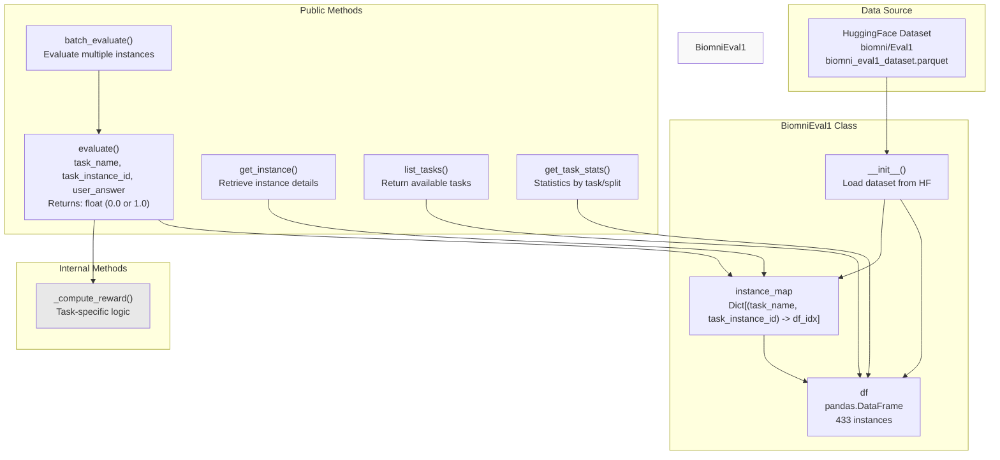
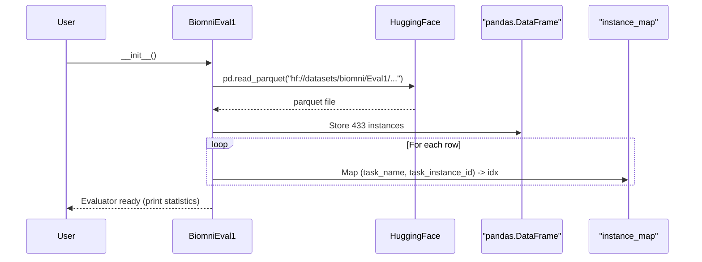
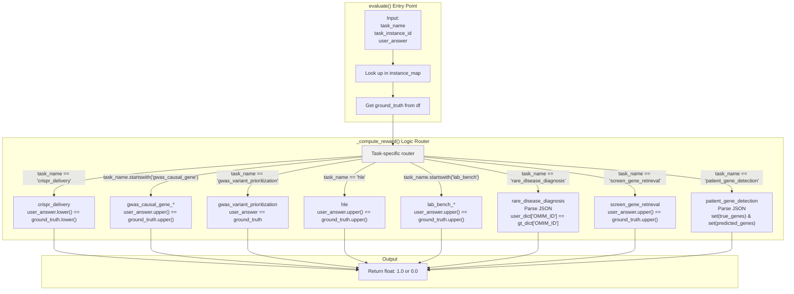
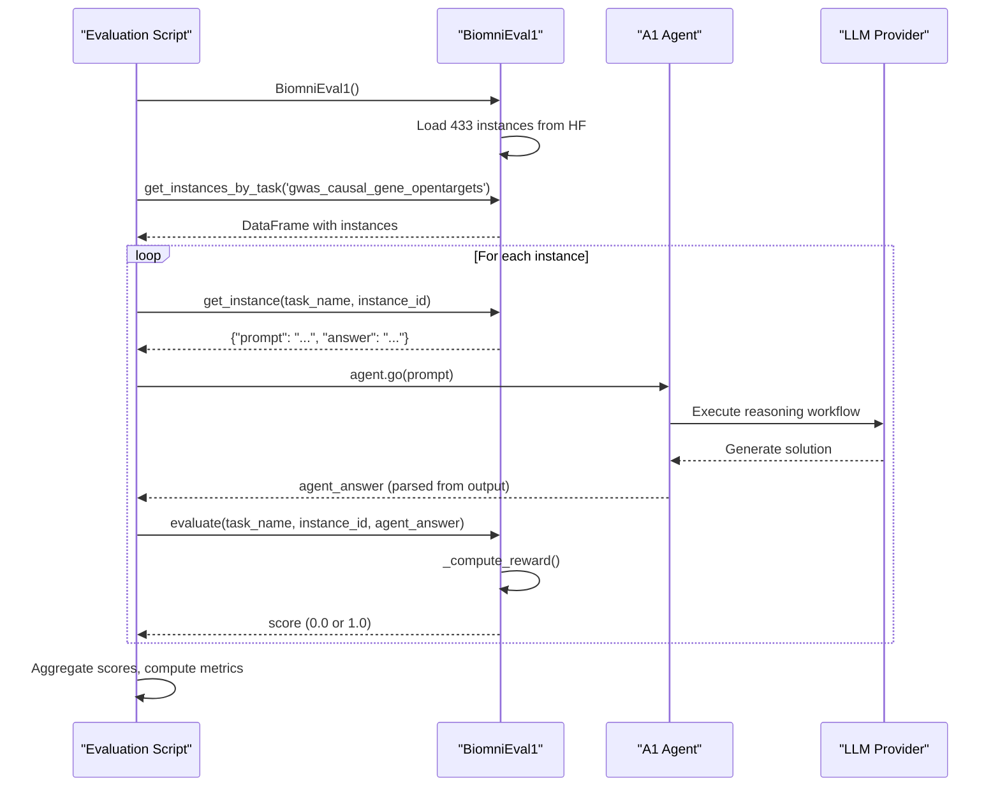
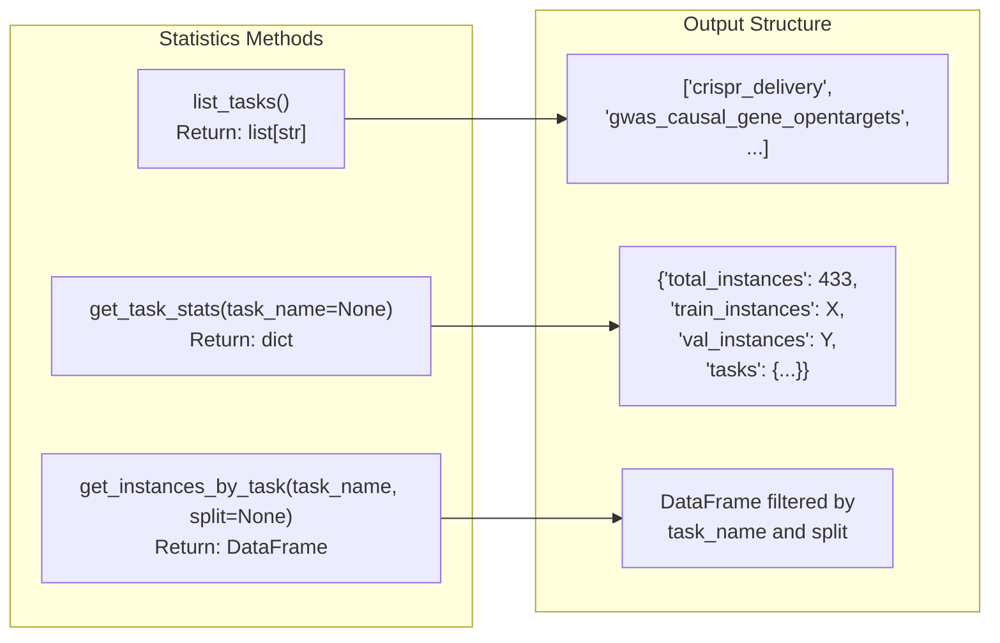

# Evaluation and Benchmarking

<details>
<summary>Relevant source files</summary>

The following files were used as context for generating this wiki page:

- [README.md](README.md)
- [biomni/eval/__init__.py](biomni/eval/__init__.py)
- [biomni/eval/biomni_eval1.py](biomni/eval/biomni_eval1.py)
- [biomni/version.py](biomni/version.py)

</details>


This document provides an overview of the evaluation and benchmarking infrastructure in Biomni, focusing on the **BiomniEval1** benchmark system. BiomniEval1 is a comprehensive evaluation framework that assesses agent performance across 433 test instances spanning 10 distinct biological reasoning tasks, from gene identification to disease diagnosis.

For detailed information on specific benchmark tasks and their evaluation criteria, see [BiomniEval1 Overview](#7.1). For practical guidance on running evaluations, see [Running Evaluations](#7.2). For instructions on extending the benchmark with custom tasks, see [Creating Custom Benchmarks](#7.3).

## Overview

The Biomni evaluation system is designed to measure agent capabilities across diverse biomedical domains through standardized task interfaces and automated scoring. The system provides:

- **Unified Interface**: Single `BiomniEval1` class handles all task types
- **Task-Specific Validation**: Different evaluation logic per task (exact match, JSON parsing, set intersection)
- **Hugging Face Integration**: Dataset hosted at `hf://datasets/biomni/Eval1`
- **Batch Processing**: Support for evaluating multiple instances simultaneously

Sources: [biomni/eval/biomni_eval1.py:1-325](), [README.md:311-333]()

## BiomniEval1 Architecture

The evaluation system is implemented through the `BiomniEval1` class, which loads benchmark data from Hugging Face and provides methods for answer validation.

### Core Components



**Initialization Flow**

The `BiomniEval1` class loads data automatically on instantiation:



Sources: [biomni/eval/biomni_eval1.py:14-40]()

## Task Categories and Evaluation Logic

BiomniEval1 supports 10 task types, each with specialized validation logic implemented in the `_compute_reward()` method. The reward is binary: 1.0 for correct answers, 0.0 for incorrect.

### Task-to-Logic Mapping

| Task Name | Answer Format | Validation Logic | Code Reference |
|-----------|--------------|------------------|----------------|
| `crispr_delivery` | Letter (a-f) | Case-insensitive exact match | [biomni/eval/biomni_eval1.py:74-76]() |
| `gwas_causal_gene_*` | Gene symbol | Case-insensitive exact match | [biomni/eval/biomni_eval1.py:78-80]() |
| `gwas_variant_prioritization` | Variant ID | Exact match | [biomni/eval/biomni_eval1.py:83-84]() |
| `hle` | Letter (A-Z) | Case-insensitive exact match | [biomni/eval/biomni_eval1.py:87-88]() |
| `lab_bench_*` | Letter (A-Z) | Case-insensitive exact match | [biomni/eval/biomni_eval1.py:91-92]() |
| `rare_disease_diagnosis` | JSON with OMIM_ID | JSON parsing + OMIM_ID match | [biomni/eval/biomni_eval1.py:94-117]() |
| `screen_gene_retrieval` | Gene symbol | Case-insensitive exact match | [biomni/eval/biomni_eval1.py:120-121]() |
| `patient_gene_detection` | JSON with causal_gene list | JSON parsing + set intersection | [biomni/eval/biomni_eval1.py:124-155]() |

### Evaluation Logic Diagram



Sources: [biomni/eval/biomni_eval1.py:71-158]()

### Complex Validation Examples

**Rare Disease Diagnosis (JSON-based)**

This task requires parsing nested JSON structures and comparing OMIM disease identifiers:

```python
# User answer format
{
    "OMIM_ID": "615349",
    "disease_name": "...",
    "supporting_evidence": "..."
}

# Validation: user_dict.get("OMIM_ID") == gt_dict.get("OMIM_ID")
```

**Patient Gene Detection (Set Intersection)**

This task handles comma-separated gene lists and uses set intersection for validation:

```python
# Ground truth: "BRCA1,TP53" or "BRCA1"
# User answer: {"causal_gene": ["BRCA1", "ATM"]}
# Validation: set(["BRCA1", "TP53"]) & set(["BRCA1", "ATM"]) != empty
```

Sources: [biomni/eval/biomni_eval1.py:94-155]()

## Dataset Structure

The BiomniEval1 dataset is stored as a parquet file with the following schema:

| Column | Type | Description |
|--------|------|-------------|
| `instance_id` | int | Global unique identifier (0-432) |
| `task_instance_id` | int | Task-specific instance ID (starts from 0 for each task) |
| `task_name` | str | Task identifier (e.g., "gwas_causal_gene_opentargets") |
| `split` | str | Dataset split ("train" or "val") |
| `prompt` | str | Full prompt text for the task instance |
| `answer` | str/JSON | Ground truth answer (format varies by task) |

**Indexing Strategy**

The `instance_map` dictionary enables O(1) lookup by task name and task-specific ID:

```python
# Key: (task_name, task_instance_id) -> Value: dataframe index
instance_map = {
    ("gwas_causal_gene_opentargets", 0): 0,
    ("gwas_causal_gene_opentargets", 1): 1,
    ("crispr_delivery", 0): 42,
    # ...
}
```

Sources: [biomni/eval/biomni_eval1.py:23-37](), [biomni/eval/biomni_eval1.py:160-186]()

## Integration with Agent System

The evaluation system integrates with the A1 agent through programmatic API calls. While the agent's autonomous execution is documented in [A1 Agent Core](#2.1), the evaluation workflow is as follows:



**Usage Pattern**

```python
from biomni.eval import BiomniEval1
from biomni.agent import A1

# Initialize evaluation system
evaluator = BiomniEval1()

# Initialize agent
agent = A1(path='./data', llm='claude-sonnet-4-20250514')

# Evaluate single instance
instance = evaluator.get_instance('gwas_causal_gene_opentargets', 0)
agent.go(instance['prompt'])
# Extract answer from agent output
score = evaluator.evaluate('gwas_causal_gene_opentargets', 0, extracted_answer)
```

Sources: [biomni/eval/biomni_eval1.py:41-70](), [README.md:311-332]()

## Statistical Methods

The `BiomniEval1` class provides several methods for analyzing benchmark coverage and performance:

**Task Statistics**



**Example Output**

```python
evaluator = BiomniEval1()

# Get all task names
evaluator.list_tasks()
# ['crispr_delivery', 'gwas_causal_gene_genebass', ...]

# Get overall statistics
evaluator.get_task_stats()
# {
#   'total_instances': 433,
#   'train_instances': 346,
#   'val_instances': 87,
#   'tasks': {
#     'gwas_causal_gene_opentargets': {...},
#     ...
#   }
# }

# Get task-specific statistics
evaluator.get_task_stats('crispr_delivery')
# {'total_instances': 50, 'train_instances': 40, 'val_instances': 10}
```

Sources: [biomni/eval/biomni_eval1.py:187-219](), [biomni/eval/biomni_eval1.py:242-258]()

## Batch Evaluation

The `batch_evaluate()` method enables efficient evaluation of multiple instances with error handling:

```python
evaluations = [
    ('gwas_causal_gene_opentargets', 0, 'BRCA1'),
    ('gwas_causal_gene_opentargets', 1, 'TP53'),
    ('crispr_delivery', 0, 'a'),
]

scores = evaluator.batch_evaluate(evaluations)
# [1.0, 1.0, 0.0]  # BRCA1 correct, TP53 correct, 'a' incorrect
```

**Error Handling**: Individual evaluation failures return 0.0 score and print error message without stopping batch processing.

Sources: [biomni/eval/biomni_eval1.py:221-240]()

## Error Handling and Validation

The evaluation system includes robust error handling for edge cases:

**Instance Lookup Errors**

```python
# Raises ValueError with descriptive message
evaluator.evaluate('nonexistent_task', 0, 'answer')
# ValueError: Instance not found: task=nonexistent_task, task_instance_id=0
```

**JSON Parsing Errors**

For JSON-based tasks (`rare_disease_diagnosis`, `patient_gene_detection`), the system attempts multiple parsing strategies:

1. `json.loads()` - Standard JSON parsing
2. `ast.literal_eval()` - Python literal evaluation (handles single quotes)
3. Exception catch - Returns 0.0 if parsing fails

**Reward Computation Errors**

Unknown task names raise explicit errors with context preservation:

```python
# Raises ValueError for unknown tasks
_compute_reward('unknown_task_type', answer, ground_truth)
# ValueError: Unknown task: unknown_task_type

# RuntimeError with full traceback for computation errors
evaluate('task_name', 0, 'answer')
# RuntimeError: Error computing reward for task_name instance 0: ...
```

Sources: [biomni/eval/biomni_eval1.py:52-70](), [biomni/eval/biomni_eval1.py:94-158]()

## Module Organization

The evaluation system is organized as a standalone module within the Biomni package:

```
biomni/
├── eval/
│   ├── __init__.py          # Exports BiomniEval1
│   └── biomni_eval1.py      # Main evaluation class (325 lines)
```

The `__init__.py` file provides a clean public API:

```python
from .biomni_eval1 import BiomniEval1

__all__ = ["BiomniEval1"]
```

Sources: [biomni/eval/__init__.py:1-3]()

---