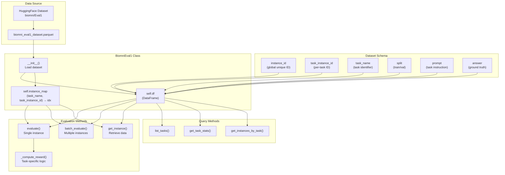
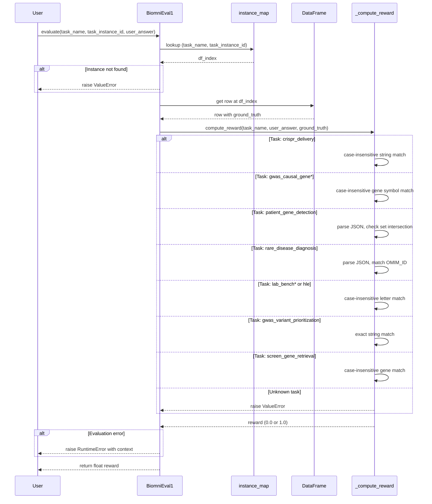
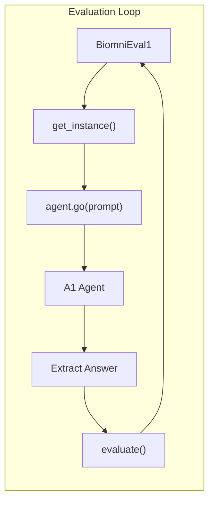

# BiomniEval1 Overview

<details>
<summary>Relevant source files</summary>

The following files were used as context for generating this wiki page:

- [README.md](README.md)
- [biomni/eval/__init__.py](biomni/eval/__init__.py)
- [biomni/eval/biomni_eval1.py](biomni/eval/biomni_eval1.py)
- [biomni/version.py](biomni/version.py)

</details>


## Purpose and Scope

This document describes **BiomniEval1**, a comprehensive evaluation benchmark for assessing biological reasoning capabilities across diverse tasks. It explains the benchmark structure, the 10 task types covering 433 instances, the evaluation methodology, and usage patterns through the `BiomniEval1` class.

For practical guidance on running evaluations with A1 agents, see [Running Evaluations](#7.2). For creating custom benchmark tasks, see [Creating Custom Benchmarks](#7.3).

---

## Benchmark Structure

BiomniEval1 is a standardized benchmark containing **433 task instances** across **10 distinct biological reasoning tasks**, ranging from gene identification to disease diagnosis. The benchmark is designed to evaluate biological AI agents on real-world research scenarios requiring domain knowledge, multi-step reasoning, and integration of diverse data sources.

### Key Features

| Feature | Description |
|---------|-------------|
| **Total Instances** | 433 evaluation instances |
| **Task Categories** | 10 distinct biological reasoning tasks |
| **Data Splits** | Train and validation splits for each task |
| **Dataset Format** | Single Parquet file with unified schema |
| **Hosting** | HuggingFace Datasets: `biomni/Eval1` |
| **Evaluation Interface** | `BiomniEval1` class with programmatic access |
| **Scoring** | Task-specific reward functions returning 0.0-1.0 |

**Sources:** [README.md:309-331](), [biomni/eval/biomni_eval1.py:1-39]()

---

## Dataset Architecture



**Dataset Schema**

The unified Parquet file contains the following columns:

| Column | Type | Description |
|--------|------|-------------|
| `instance_id` | int | Global unique identifier across all tasks |
| `task_instance_id` | int | Instance ID within the specific task (0-indexed) |
| `task_name` | str | Task identifier (e.g., `"gwas_causal_gene_opentargets"`) |
| `split` | str | Data split: `"train"` or `"val"` |
| `prompt` | str | Natural language task instruction with context |
| `answer` | str/JSON | Ground truth answer (format varies by task) |

**Sources:** [biomni/eval/biomni_eval1.py:23-39]()

---

## Task Categories

BiomniEval1 covers 10 distinct task types, each representing a different biological reasoning challenge. Tasks are named with descriptive identifiers and may have multiple variants distinguished by suffixes.

### Task Type Reference

```mermaid
graph TB
    subgraph "GWAS Analysis Tasks"
        GWAS1["gwas_causal_gene_opentargets<br/>Gene identification via OpenTargets"]
        GWAS2["gwas_causal_gene_ensembl<br/>Gene identification via Ensembl"]
        GWAS3["gwas_causal_gene_text2genome<br/>Gene identification via Text2Genome"]
        GWAS4["gwas_variant_prioritization<br/>Variant selection"]
    end
    
    subgraph "Genomic Screen Tasks"
        SCREEN["screen_gene_retrieval<br/>Identify screen genes"]
        PATIENT["patient_gene_detection<br/>Causal gene from variants"]
    end
    
    subgraph "Lab Protocol Tasks"
        LAB1["lab_bench_qa<br/>General lab Q&A"]
        LAB2["lab_bench_transfection<br/>Transfection-specific Q&A"]
    end
    
    subgraph "Clinical Tasks"
        RARE["rare_disease_diagnosis<br/>OMIM disease identification"]
        HLE["hle<br/>High-level reasoning"]
    end
    
    subgraph "CRISPR Design"
        CRISPR["crispr_delivery<br/>Delivery method selection"]
    end
    
    subgraph "Answer Formats"
        GENE["Gene Symbol<br/>(case-insensitive)"]
        VARIANT["Variant ID<br/>(exact match)"]
        LETTER["Letter Choice<br/>(A-Z, case-insensitive)"]
        JSON_FORMAT["JSON Structure<br/>(parsed and matched)"]
    end
    
    GWAS1 --> GENE
    GWAS2 --> GENE
    GWAS3 --> GENE
    GWAS4 --> VARIANT
    SCREEN --> GENE
    PATIENT --> JSON_FORMAT
    LAB1 --> LETTER
    LAB2 --> LETTER
    RARE --> JSON_FORMAT
    HLE --> LETTER
    CRISPR --> LETTER
```



**Sources:** [biomni/eval/biomni_eval1.py:71-158](), [README.md:313-320]()

### Detailed Task Descriptions

#### 1. GWAS Causal Gene Identification (3 variants)

**Task Names:** `gwas_causal_gene_opentargets`, `gwas_causal_gene_ensembl`, `gwas_causal_gene_text2genome`

**Description:** Identify the causal gene for a genetic association using different data sources (OpenTargets, Ensembl, or Text2Genome databases).

**Answer Format:** Gene symbol as string (e.g., `"BRCA1"`)

**Evaluation:** Case-insensitive exact string match

**Implementation:** [biomni/eval/biomni_eval1.py:78-80]()

#### 2. GWAS Variant Prioritization

**Task Name:** `gwas_variant_prioritization`

**Description:** Select the most likely causal variant from GWAS association results based on functional evidence.

**Answer Format:** Variant identifier as string (e.g., `"rs1234567"`)

**Evaluation:** Exact string match (case-sensitive)

**Implementation:** [biomni/eval/biomni_eval1.py:82-84]()

#### 3. Screen Gene Retrieval

**Task Name:** `screen_gene_retrieval`

**Description:** Identify the gene target from CRISPR screening or other genetic perturbation experiments.

**Answer Format:** Gene symbol as string

**Evaluation:** Case-insensitive exact match

**Implementation:** [biomni/eval/biomni_eval1.py:119-121]()

#### 4. Patient Gene Detection

**Task Name:** `patient_gene_detection`

**Description:** Identify causal gene(s) from patient genetic variants, potentially multiple genes.

**Answer Format:** JSON structure with `causal_gene` field containing a list:
```json
{
  "causal_gene": ["GENE1", "GENE2"]
}
```

**Evaluation:** Set intersection - reward 1.0 if any predicted gene matches ground truth

**Implementation:** [biomni/eval/biomni_eval1.py:123-155]()

#### 5. Lab Bench Q&A (2 variants)

**Task Names:** `lab_bench_qa`, `lab_bench_transfection`

**Description:** Multiple-choice questions about laboratory protocols and techniques. The `transfection` variant focuses specifically on transfection methods.

**Answer Format:** Letter choice (e.g., `"A"`, `"B"`, `"C"`)

**Evaluation:** Case-insensitive exact match

**Implementation:** [biomni/eval/biomni_eval1.py:90-92]()

#### 6. Rare Disease Diagnosis

**Task Name:** `rare_disease_diagnosis`

**Description:** Diagnose rare genetic diseases from clinical presentations and genetic findings, matching to OMIM database entries.

**Answer Format:** JSON structure with `OMIM_ID` field:
```json
{
  "OMIM_ID": "123456"
}
```

**Evaluation:** Exact match on `OMIM_ID` field

**Implementation:** [biomni/eval/biomni_eval1.py:94-117]()

#### 7. CRISPR Delivery Method Selection

**Task Name:** `crispr_delivery`

**Description:** Select the appropriate CRISPR delivery method (viral vector, electroporation, lipid nanoparticles, etc.) for specific experimental contexts.

**Answer Format:** Letter choice (e.g., `"a"`, `"b"`, `"c"`)

**Evaluation:** Case-insensitive exact match

**Implementation:** [biomni/eval/biomni_eval1.py:74-76]()

#### 8. High-Level Reasoning (HLE)

**Task Name:** `hle`

**Description:** Complex biological reasoning tasks requiring integration of multiple knowledge domains.

**Answer Format:** Letter choice (A-Z)

**Evaluation:** Case-insensitive exact match

**Implementation:** [biomni/eval/biomni_eval1.py:86-88]()

**Sources:** [biomni/eval/biomni_eval1.py:71-158]()

---

## BiomniEval1 Class Architecture

The `BiomniEval1` class provides a unified interface for loading the benchmark dataset and evaluating agent responses.

### Class Structure

```mermaid
classDiagram
    class BiomniEval1 {
        +DataFrame df
        +dict instance_map
        
        +__init__()
        +evaluate(task_name, task_instance_id, user_answer) float
        +_compute_reward(task_name, user_answer, ground_truth) float
        +get_instance(task_name, task_instance_id) dict
        +list_tasks() list
        +get_task_stats(task_name) dict
        +batch_evaluate(evaluations) list
        +get_instances_by_task(task_name, split) DataFrame
        +__repr__() str
        +__len__() int
    }
    
    class DataFrame {
        instance_id
        task_instance_id
        task_name
        split
        prompt
        answer
    }
    
    class InstanceMap {
        (task_name, task_instance_id) : df_index
    }
    
    BiomniEval1 --> DataFrame : contains
    BiomniEval1 --> InstanceMap : contains
```

**Sources:** [biomni/eval/biomni_eval1.py:14-264]()

### Key Methods

#### Initialization

**Method:** `__init__()`

**Purpose:** Loads the dataset from HuggingFace and creates an efficient lookup index.

**Behavior:**
1. Downloads Parquet file from `hf://datasets/biomni/Eval1/biomni_eval1_dataset.parquet`
2. Creates `instance_map` dictionary mapping `(task_name, task_instance_id)` tuples to DataFrame indices
3. Prints summary statistics

**Implementation:** [biomni/eval/biomni_eval1.py:23-39]()

#### Single Instance Evaluation

**Method:** `evaluate(task_name: str, task_instance_id: int, user_answer: str) -> float`

**Purpose:** Evaluate a user's answer for a specific task instance.

**Parameters:**
- `task_name`: Task identifier (e.g., `"gwas_causal_gene_opentargets"`)
- `task_instance_id`: Instance ID within the task (0-indexed, per-task counter)
- `user_answer`: User's answer in task-appropriate format

**Returns:** Reward score from 0.0 (incorrect) to 1.0 (correct)

**Raises:** `ValueError` if instance not found, `RuntimeError` if evaluation fails

**Implementation:** [biomni/eval/biomni_eval1.py:41-69]()

#### Task-Specific Reward Computation

**Method:** `_compute_reward(task_name: str, user_answer: str, ground_truth: str) -> float`

**Purpose:** Internal method containing task-specific evaluation logic.

**Logic Flow:**
1. Pattern match on `task_name`
2. Apply task-appropriate parsing and comparison
3. Return binary reward (0.0 or 1.0)

**Special Cases:**
- JSON parsing with fallback to `ast.literal_eval` for malformed JSON
- Case-insensitive comparisons for gene symbols and letter choices
- Set intersection logic for multi-gene predictions

**Implementation:** [biomni/eval/biomni_eval1.py:71-158]()

#### Batch Evaluation

**Method:** `batch_evaluate(evaluations: list) -> list`

**Purpose:** Evaluate multiple instances efficiently.

**Parameters:**
- `evaluations`: List of `(task_name, task_instance_id, user_answer)` tuples

**Returns:** List of reward scores (0.0 on evaluation error)

**Implementation:** [biomni/eval/biomni_eval1.py:221-240]()

#### Instance Retrieval

**Method:** `get_instance(task_name: str, task_instance_id: int) -> dict`

**Purpose:** Retrieve full instance information including prompt and ground truth.

**Returns:** Dictionary with keys:
- `global_instance_id`: Unique ID across all tasks
- `task_instance_id`: ID within the specific task
- `task_name`: Task identifier
- `split`: "train" or "val"
- `prompt`: Task instruction text
- `answer`: Ground truth answer

**Implementation:** [biomni/eval/biomni_eval1.py:160-185]()

#### Query Methods

**Method:** `list_tasks() -> list`

**Purpose:** Get sorted list of all task names in the dataset.

**Implementation:** [biomni/eval/biomni_eval1.py:187-189]()

---

**Method:** `get_task_stats(task_name: str = None) -> dict`

**Purpose:** Get statistics for a specific task or all tasks.

**Returns:** Dictionary with instance counts by split:
- `total_instances`: Total count
- `train_instances`: Training split count
- `val_instances`: Validation split count
- `tasks`: Nested statistics if `task_name=None`

**Implementation:** [biomni/eval/biomni_eval1.py:191-219]()

---

**Method:** `get_instances_by_task(task_name: str, split: str = None) -> pd.DataFrame`

**Purpose:** Retrieve all instances for a specific task, optionally filtered by split.

**Returns:** DataFrame copy with matching instances

**Implementation:** [biomni/eval/biomni_eval1.py:242-258]()

**Sources:** [biomni/eval/biomni_eval1.py:41-258]()

---

## Evaluation Pipeline

The evaluation process follows a consistent pipeline regardless of task type:



**Sources:** [biomni/eval/biomni_eval1.py:41-158]()

---

## Usage Examples

### Basic Evaluation

```python
from biomni.eval import BiomniEval1

# Initialize evaluator (downloads dataset on first run)
evaluator = BiomniEval1()

# Evaluate a single instance
score = evaluator.evaluate(
    task_name='gwas_causal_gene_opentargets',
    task_instance_id=0,
    user_answer='BRCA1'
)
print(f"Score: {score}")  # 1.0 if correct, 0.0 if incorrect
```

**Sources:** [README.md:325-330](), [biomni/eval/biomni_eval1.py:41-52]()

### Exploring the Dataset

```python
# List all available tasks
tasks = evaluator.list_tasks()
print(f"Available tasks: {tasks}")

# Get overall statistics
stats = evaluator.get_task_stats()
print(f"Total instances: {stats['total_instances']}")
print(f"Train: {stats['train_instances']}, Val: {stats['val_instances']}")

# Get per-task statistics
task_stats = evaluator.get_task_stats('gwas_causal_gene_opentargets')
print(f"Task instances: {task_stats['total_instances']}")

# Retrieve instance details
instance = evaluator.get_instance('gwas_causal_gene_opentargets', 0)
print(f"Prompt: {instance['prompt']}")
print(f"Ground truth: {instance['answer']}")
```

**Sources:** [biomni/eval/biomni_eval1.py:267-285]()

### Batch Evaluation

```python
# Prepare multiple evaluations
evaluations = [
    ('gwas_causal_gene_opentargets', 0, 'BRCA1'),
    ('gwas_causal_gene_opentargets', 1, 'TP53'),
    ('crispr_delivery', 0, 'a'),
]

# Evaluate all at once
scores = evaluator.batch_evaluate(evaluations)
print(f"Batch scores: {scores}")  # [1.0, 0.0, 1.0] example

# Calculate success rate
success_rate = sum(scores) / len(scores)
print(f"Success rate: {success_rate:.2%}")
```

**Sources:** [biomni/eval/biomni_eval1.py:221-240](), [biomni/eval/biomni_eval1.py:312-320]()

### Task-Specific Queries

```python
# Get all instances for a specific task and split
train_instances = evaluator.get_instances_by_task(
    task_name='gwas_causal_gene_opentargets',
    split='train'
)
print(f"Training instances: {len(train_instances)}")

# Iterate over all instances in a task
for idx, row in train_instances.iterrows():
    task_instance_id = row['task_instance_id']
    prompt = row['prompt']
    answer = row['answer']
    print(f"Instance {task_instance_id}: {prompt[:100]}...")
```

**Sources:** [biomni/eval/biomni_eval1.py:242-258]()

---

## Task-Specific Answer Formats

Different tasks require different answer formats. Here's a reference table for developers:

| Task Pattern | Answer Format | Example | Parsing Requirements |
|--------------|---------------|---------|---------------------|
| `gwas_causal_gene*` | Gene symbol string | `"BRCA1"` | Case-insensitive |
| `gwas_variant_prioritization` | Variant ID string | `"rs1234567"` | Case-sensitive |
| `screen_gene_retrieval` | Gene symbol string | `"TP53"` | Case-insensitive |
| `patient_gene_detection` | JSON with list | `{"causal_gene": ["GENE1"]}` | JSON or ast.literal_eval |
| `rare_disease_diagnosis` | JSON with OMIM | `{"OMIM_ID": "123456"}` | JSON or ast.literal_eval |
| `lab_bench*` | Letter choice | `"A"` or `"a"` | Case-insensitive |
| `hle` | Letter choice | `"B"` or `"b"` | Case-insensitive |
| `crispr_delivery` | Letter choice | `"c"` | Case-insensitive |

**JSON Parsing Fallback:** Tasks requiring JSON answers (`patient_gene_detection`, `rare_disease_diagnosis`) attempt `json.loads()` first, then fall back to `ast.literal_eval()` for robustness against malformed JSON strings.

**Sources:** [biomni/eval/biomni_eval1.py:71-158]()

---

## Integration with Agent Evaluation

BiomniEval1 is designed to work seamlessly with the A1 agent for automated evaluation:



**Example Integration:**
```python
from biomni.agent import A1
from biomni.eval import BiomniEval1

# Initialize agent and evaluator
agent = A1(path='./data', llm='claude-sonnet-4-20250514')
evaluator = BiomniEval1()

# Get a task instance
instance = evaluator.get_instance('gwas_causal_gene_opentargets', 0)
prompt = instance['prompt']

# Run agent
response = agent.go(prompt)

# Extract answer from agent response (implementation-specific)
user_answer = extract_answer_from_response(response)

# Evaluate
score = evaluator.evaluate(
    task_name='gwas_causal_gene_opentargets',
    task_instance_id=0,
    user_answer=user_answer
)
```

For comprehensive evaluation workflows, see [Running Evaluations](#7.2).

**Sources:** [biomni/eval/biomni_eval1.py:1-325](), [README.md:309-331]()

---

## Package Structure

The evaluation module is organized as follows:

```
biomni/
└── eval/
    ├── __init__.py          # Exports BiomniEval1
    └── biomni_eval1.py      # Main BiomniEval1 class implementation
```

**Import Path:** `from biomni.eval import BiomniEval1`

**Sources:** [biomni/eval/__init__.py:1-3](), [biomni/eval/biomni_eval1.py:1-6]()

---

## Dataset Hosting

The BiomniEval1 dataset is hosted on HuggingFace Datasets and automatically downloaded when the `BiomniEval1` class is instantiated.

**Dataset Location:** `hf://datasets/biomni/Eval1/biomni_eval1_dataset.parquet`

**Download:** Automatic via `pd.read_parquet()` using HuggingFace's `hf://` protocol

**Size:** ~433 instances with text prompts and metadata

**Sources:** [biomni/eval/biomni_eval1.py:31](), [README.md:323]()

---