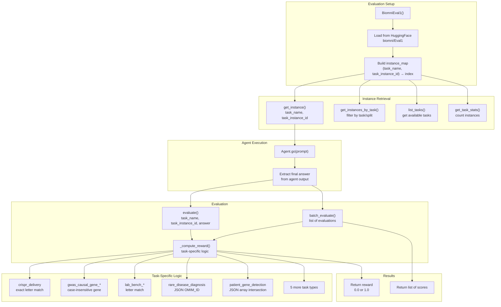
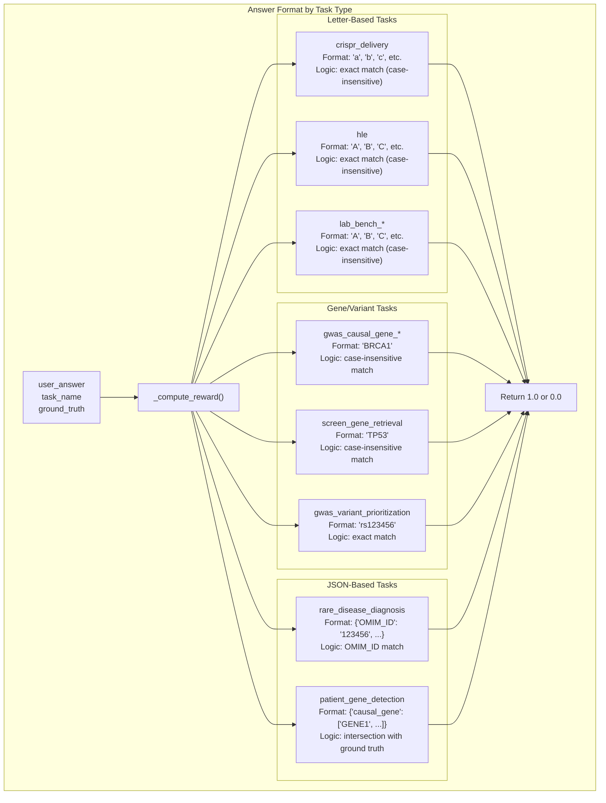
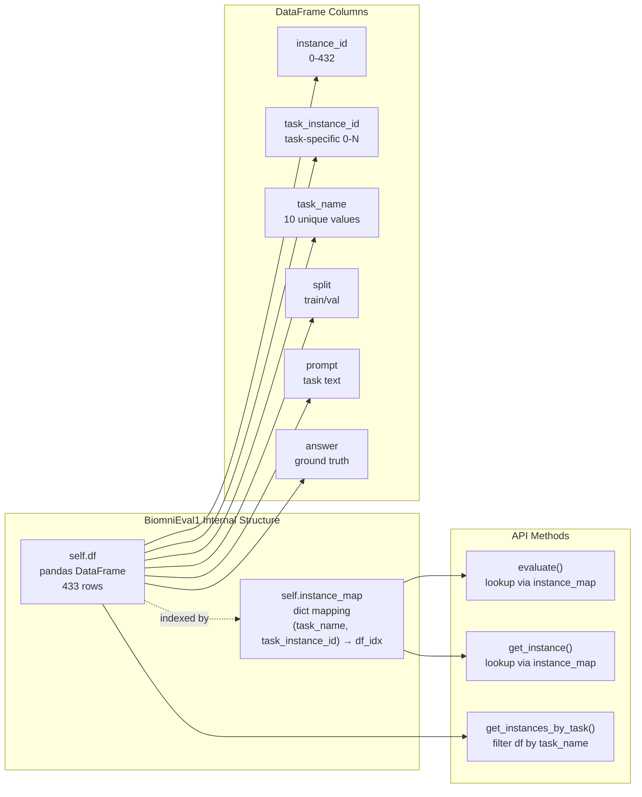
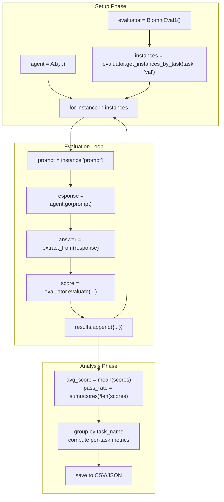

# Running Evaluations

<details>
<summary>Relevant source files</summary>

The following files were used as context for generating this wiki page:

- [README.md](README.md)
- [biomni/eval/__init__.py](biomni/eval/__init__.py)
- [biomni/eval/biomni_eval1.py](biomni/eval/biomni_eval1.py)
- [biomni/version.py](biomni/version.py)

</details>


This document explains how to use the BiomniEval1 evaluation API to assess agent performance on benchmark tasks. For an overview of the benchmark structure, dataset composition, and task types, see [BiomniEval1 Benchmark](#7.1).

The evaluation system provides a programmatic interface for:
- Evaluating agent answers against ground truth
- Retrieving task instances and prompts
- Batch evaluation across multiple instances
- Querying dataset statistics and task distributions

---

## Evaluation Workflow Overview



**Sources:** [biomni/eval/biomni_eval1.py:1-324]()

---

## Initialization

The `BiomniEval1` class loads the evaluation dataset from HuggingFace and builds an internal index for fast lookups.

### Basic Initialization

```python
from biomni.eval import BiomniEval1

# Initialize evaluator (downloads dataset on first run)
evaluator = BiomniEval1()
# Output: Loaded BiomniEval1 dataset: 433 instances across 10 tasks
```

The initialization automatically:
1. Downloads the dataset from `hf://datasets/biomni/Eval1/biomni_eval1_dataset.parquet`
2. Loads it into a pandas DataFrame
3. Creates an `instance_map` for fast lookups using `(task_name, task_instance_id)` as keys

**Sources:** [biomni/eval/biomni_eval1.py:23-39](), [README.md:272-293]()

---

## Dataset Exploration

Before running evaluations, you can explore the available tasks and instances.

### Listing Available Tasks

```python
# Get list of all task names
tasks = evaluator.list_tasks()
print(tasks)
# ['crispr_delivery', 'gwas_causal_gene_genebass', 'gwas_causal_gene_gwascatalog', ...]
```

**Sources:** [biomni/eval/biomni_eval1.py:186-188]()

### Getting Task Statistics

```python
# Get overall statistics
stats = evaluator.get_task_stats()
print(f"Total instances: {stats['total_instances']}")
print(f"Train: {stats['train_instances']}, Val: {stats['val_instances']}")

# Get statistics for a specific task
gwas_stats = evaluator.get_task_stats('gwas_causal_gene_opentargets')
print(f"Task instances: {gwas_stats['total_instances']}")
```

**Statistics Structure:**

| Field | Description |
|-------|-------------|
| `total_instances` | Total number of instances (train + val) |
| `train_instances` | Number of training instances |
| `val_instances` | Number of validation instances |
| `tasks` | Dictionary of per-task statistics (only if task_name=None) |

**Sources:** [biomni/eval/biomni_eval1.py:190-218]()

### Retrieving Instances

```python
# Get a specific instance by task_name and task_instance_id
instance = evaluator.get_instance('gwas_causal_gene_opentargets', 0)
print(instance['prompt'])    # Task prompt
print(instance['answer'])    # Ground truth answer

# Get all instances for a task
task_instances = evaluator.get_instances_by_task('crispr_delivery')
print(f"Found {len(task_instances)} instances")

# Filter by split
val_instances = evaluator.get_instances_by_task('crispr_delivery', split='val')
```

**Instance Dictionary Structure:**

| Field | Description |
|-------|-------------|
| `global_instance_id` | Unique ID across entire dataset |
| `task_instance_id` | Task-specific instance ID (0-indexed per task) |
| `task_name` | Name of the task |
| `split` | Dataset split ('train' or 'val') |
| `prompt` | Task prompt text |
| `answer` | Ground truth answer |

**Sources:** [biomni/eval/biomni_eval1.py:159-184](), [biomni/eval/biomni_eval1.py:241-257]()

---

## Running Evaluations

### Single Instance Evaluation

The `evaluate()` method compares a user answer against ground truth using task-specific logic.

```python
# Evaluate a single answer
score = evaluator.evaluate(
    task_name='gwas_causal_gene_opentargets',
    task_instance_id=0,
    user_answer='BRCA1'
)
print(f"Score: {score}")  # 1.0 if correct, 0.0 if incorrect
```

**Method Signature:**
- **Parameters:**
  - `task_name` (str): Task identifier
  - `task_instance_id` (int): Task-specific instance ID (not global instance_id)
  - `user_answer` (str): Answer to evaluate
- **Returns:** `float` - Reward score (0.0 or 1.0)

**Sources:** [biomni/eval/biomni_eval1.py:41-68](), [README.md:289-293]()

### Batch Evaluation

Evaluate multiple instances in one call for efficiency.

```python
# Prepare batch evaluations
evaluations = [
    ('gwas_causal_gene_opentargets', 0, 'BRCA1'),
    ('gwas_causal_gene_opentargets', 1, 'TP53'),
    ('crispr_delivery', 0, 'a'),
]

# Batch evaluate
scores = evaluator.batch_evaluate(evaluations)
print(f"Scores: {scores}")  # [1.0, 1.0, 0.0]
print(f"Average: {sum(scores)/len(scores):.2%}")
```

The batch evaluation automatically handles errors and returns 0.0 for failed evaluations while printing error messages.

**Sources:** [biomni/eval/biomni_eval1.py:220-239]()

---

## Task-Specific Evaluation Logic

Different tasks expect different answer formats. The `_compute_reward()` method implements task-specific evaluation logic.



### Evaluation Rules by Task

| Task Type | Answer Format | Matching Logic |
|-----------|---------------|----------------|
| `crispr_delivery` | Letter (a-f) | Exact match, case-insensitive |
| `gwas_causal_gene_*` | Gene symbol | Case-insensitive match |
| `gwas_variant_prioritization` | Variant ID | Exact match |
| `hle` | Letter (A-Z) | Case-insensitive match |
| `lab_bench_*` | Letter (A-Z) | Case-insensitive match |
| `rare_disease_diagnosis` | JSON with OMIM_ID | OMIM_ID equality |
| `screen_gene_retrieval` | Gene symbol | Case-insensitive match |
| `patient_gene_detection` | JSON with causal_gene array | Set intersection |

### JSON Task Details

#### Rare Disease Diagnosis

```python
# Expected format
user_answer = '{"OMIM_ID": "123456", "disease_name": "..."}'

# Evaluation checks OMIM_ID equality
# Handles both string JSON and dict input
```

#### Patient Gene Detection

```python
# Expected format
user_answer = '{"causal_gene": ["GENE1", "GENE2"]}'

# Ground truth can be:
# - Single gene: "GENE1"
# - Multiple genes: "GENE1,GENE2,GENE3"

# Evaluation checks if ANY predicted gene appears in ground truth
```

**Sources:** [biomni/eval/biomni_eval1.py:70-157]()

---

## Complete Evaluation Workflow

Here's a complete example showing how to evaluate an agent on a benchmark task:

```python
from biomni.agent import A1
from biomni.eval import BiomniEval1

# Initialize evaluator
evaluator = BiomniEval1()

# Get an instance to evaluate
instance = evaluator.get_instance('gwas_causal_gene_opentargets', 0)
prompt = instance['prompt']
ground_truth = instance['answer']

# Run agent on the task
agent = A1(path='./data', llm='claude-sonnet-4-20250514')
response = agent.go(prompt)

# Extract answer from agent response
# (You need to parse the final answer from the agent's output)
user_answer = extract_final_answer(response)  # Implement based on your needs

# Evaluate the answer
score = evaluator.evaluate('gwas_causal_gene_opentargets', 0, user_answer)
print(f"Score: {score}")
print(f"Ground truth: {ground_truth}")
print(f"Agent answer: {user_answer}")
```

### Evaluating Across Multiple Tasks

```python
from biomni.eval import BiomniEval1
from biomni.agent import A1
import pandas as pd

evaluator = BiomniEval1()
agent = A1(path='./data')

results = []

# Evaluate on all validation instances for a task
val_instances = evaluator.get_instances_by_task('gwas_causal_gene_opentargets', split='val')

for _, instance in val_instances.iterrows():
    task_name = instance['task_name']
    task_instance_id = instance['task_instance_id']
    prompt = instance['prompt']
    
    # Run agent
    response = agent.go(prompt)
    user_answer = extract_final_answer(response)
    
    # Evaluate
    score = evaluator.evaluate(task_name, task_instance_id, user_answer)
    
    results.append({
        'task_name': task_name,
        'task_instance_id': task_instance_id,
        'score': score,
        'answer': user_answer
    })

# Analyze results
results_df = pd.DataFrame(results)
print(f"Average score: {results_df['score'].mean():.2%}")
print(f"Instances solved: {results_df['score'].sum()}/{len(results_df)}")
```

**Sources:** [biomni/eval/biomni_eval1.py:266-323]()

---

## Error Handling

The evaluation system includes robust error handling:

### Instance Not Found

```python
try:
    score = evaluator.evaluate('nonexistent_task', 0, 'answer')
except ValueError as e:
    print(f"Error: {e}")
    # Error: Instance not found: task=nonexistent_task, task_instance_id=0
```

### Evaluation Errors

```python
try:
    score = evaluator.evaluate('rare_disease_diagnosis', 0, 'invalid_json')
except RuntimeError as e:
    print(f"Error: {e}")
    # Error: Error computing reward for rare_disease_diagnosis instance 0: ...
```

### Batch Evaluation Errors

The `batch_evaluate()` method handles errors gracefully:
- Prints error messages for failed evaluations
- Returns 0.0 for failed instances
- Continues processing remaining instances

**Sources:** [biomni/eval/biomni_eval1.py:52-68](), [biomni/eval/biomni_eval1.py:220-239]()

---

## Dataset Access Pattern



**Key Implementation Details:**

- **Lookup Strategy:** The `instance_map` uses `(task_name, task_instance_id)` as composite key for O(1) lookups
- **Task Instance ID:** Each task has its own 0-indexed sequence (not the global instance_id)
- **Data Source:** Dataset loaded from HuggingFace on initialization via `pd.read_parquet()`

**Sources:** [biomni/eval/biomni_eval1.py:31-39](), [biomni/eval/biomni_eval1.py:159-184]()

---

## Performance Considerations

### Caching Evaluator Instance

Create the evaluator once and reuse it:

```python
# Good: Initialize once
evaluator = BiomniEval1()
for task, id, answer in evaluations:
    score = evaluator.evaluate(task, id, answer)

# Avoid: Reinitializing on every call
# This re-downloads and re-indexes the dataset
for task, id, answer in evaluations:
    evaluator = BiomniEval1()  # Expensive!
    score = evaluator.evaluate(task, id, answer)
```

### Batch Operations

Use batch evaluation when possible:

```python
# Better: Batch evaluation
scores = evaluator.batch_evaluate([
    (task1, id1, answer1),
    (task2, id2, answer2),
    (task3, id3, answer3),
])

# Works but less efficient: Individual calls
scores = [
    evaluator.evaluate(task1, id1, answer1),
    evaluator.evaluate(task2, id2, answer2),
    evaluator.evaluate(task3, id3, answer3),
]
```

**Sources:** [biomni/eval/biomni_eval1.py:23-39](), [biomni/eval/biomni_eval1.py:220-239]()

---

## Integration with Agent Workflows

Typical integration pattern for agent evaluation:



**Critical Note:** The evaluation system only checks final answers. You are responsible for:
1. Running the agent on task prompts
2. Extracting the final answer from agent output (may involve parsing XML tags, JSON, or text)
3. Formatting the answer according to task requirements

**Sources:** [biomni/eval/biomni_eval1.py:266-323](), [README.md:272-293]()

---