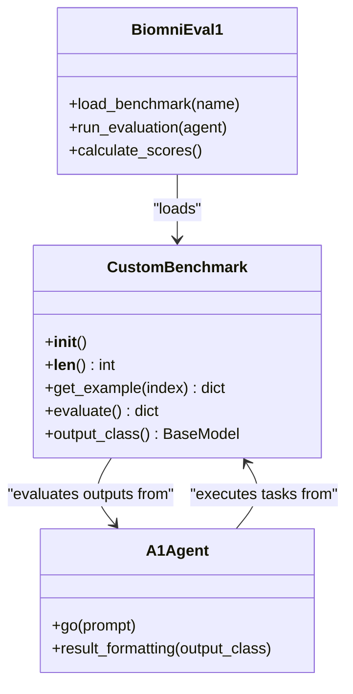
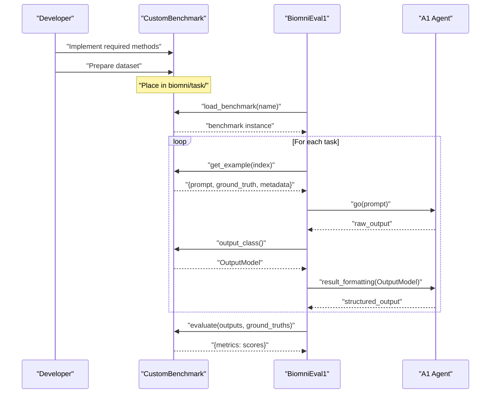
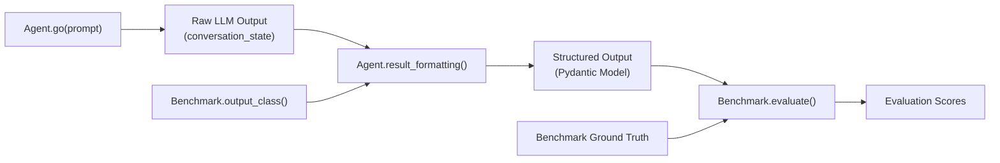
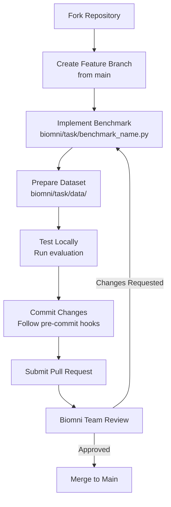
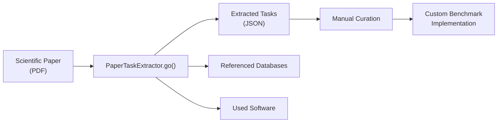

# Creating Custom Benchmarks

<details>
<summary>Relevant source files</summary>

The following files were used as context for generating this wiki page:

- [.pre-commit-config.yaml](.pre-commit-config.yaml)
- [CONTRIBUTION.md](CONTRIBUTION.md)
- [README.md](README.md)
- [biomni/agent/env_collection.py](biomni/agent/env_collection.py)
- [biomni/agent/qa_llm.py](biomni/agent/qa_llm.py)
- [biomni/biorxiv_scripts/extract_biorxiv_tasks.py](biomni/biorxiv_scripts/extract_biorxiv_tasks.py)
- [biomni/biorxiv_scripts/process_all_subjects.py](biomni/biorxiv_scripts/process_all_subjects.py)
- [biomni/eval/__init__.py](biomni/eval/__init__.py)
- [biomni/eval/biomni_eval1.py](biomni/eval/biomni_eval1.py)
- [biomni/version.py](biomni/version.py)

</details>


## Purpose and Scope

This document explains how to create custom benchmark datasets for evaluating Biomni agents. It covers the required class structure, method implementations, data management, and integration patterns. For information about running evaluations with existing benchmarks, see [Running Evaluations](#7.2). For an overview of the BiomniEval1 benchmark system, see [BiomniEval1 Overview](#7.1).

---

## Benchmark Class Structure

Custom benchmarks in Biomni follow a standardized interface that enables seamless integration with the evaluation system. All benchmarks are implemented as Python classes in the `biomni/task/` directory and must implement five required methods.

### Core Interface Contract



**Sources:** [CONTRIBUTION.md:65-91]()

---

## Required Methods

### `__init__(self)`

The initialization method sets up the benchmark's internal state, loads necessary data, and configures any required resources.

**Responsibilities:**
- Load benchmark dataset from disk or initialize data structures
- Set up evaluation metrics and scoring functions
- Initialize any auxiliary resources (models, databases, reference data)
- Configure benchmark-specific parameters

**Example Pattern:**
```python
def __init__(self):
    self.data_path = os.path.join("biomni/task/data", "benchmark_name")
    self.dataset = self._load_dataset()
    self.metrics = self._configure_metrics()
    self.reference_answers = self._load_references()
```

### `__len__(self)`

Returns the total number of task instances in the benchmark.

**Return Type:** `int`

**Purpose:** Enables iteration and progress tracking during evaluation runs. The BiomniEval1 system uses this to determine how many tasks to evaluate.

**Example:**
```python
def __len__(self):
    return len(self.dataset)
```

### `get_example(self, index)`

Retrieves a single task instance at the specified index.

**Parameters:**
- `index` (int): Zero-based index of the task instance to retrieve

**Return Type:** `dict`

**Required Keys in Return Dictionary:**
- `"prompt"` (str): The task description or question to present to the agent
- `"ground_truth"` (Any): The expected correct answer or reference solution
- `"metadata"` (dict, optional): Additional context like task ID, difficulty, category

**Example Structure:**
```python
def get_example(self, index):
    task = self.dataset[index]
    return {
        "prompt": task["question"],
        "ground_truth": task["answer"],
        "metadata": {
            "task_id": task["id"],
            "category": task["category"],
            "difficulty": task["difficulty"]
        }
    }
```

### `evaluate(self)`

Implements the evaluation logic for comparing agent outputs against ground truth. The input format is flexible to accommodate different evaluation patterns.

**Flexible Input Patterns:**
1. **Direct comparison:** Accept `(agent_output, ground_truth)` pairs
2. **Batch evaluation:** Accept lists of outputs and ground truths
3. **Stateful evaluation:** Maintain internal state from previous `get_example()` calls

**Return Type:** `dict`

**Required Keys in Return Dictionary:**
- Metric names as keys (e.g., `"accuracy"`, `"f1_score"`, `"bleu"`)
- Metric values as numerical scores

**Example:**
```python
def evaluate(self, agent_outputs, ground_truths):
    correct = sum(1 for pred, gt in zip(agent_outputs, ground_truths) 
                  if self._compare(pred, gt))
    return {
        "accuracy": correct / len(agent_outputs),
        "total_correct": correct,
        "total_tasks": len(agent_outputs)
    }
```

### `output_class(self)`

Returns the expected output format as a Pydantic `BaseModel` class. This enables structured output parsing from agent responses.

**Return Type:** `BaseModel` subclass

**Purpose:**
- Enforces output format consistency
- Enables automatic validation and parsing
- Provides type safety for evaluation

**Example:**
```python
from pydantic import BaseModel, Field

def output_class(self):
    class TaskOutput(BaseModel):
        answer: str = Field(description="The final answer")
        confidence: float = Field(description="Confidence score 0-1")
        reasoning: str = Field(description="Step-by-step reasoning")
    
    return TaskOutput
```

**Sources:** [CONTRIBUTION.md:69-91]()

---

## Benchmark Implementation Flow



**Sources:** [CONTRIBUTION.md:65-91](), [biomni/agent/qa_llm.py:32-50]()

---

## Data Management

### Dataset Organization

Benchmark datasets should be organized in the `biomni/task/data/` directory with a clear structure:

```
biomni/task/data/
├── benchmark_name/
│   ├── train.jsonl          # Training split (if applicable)
│   ├── test.jsonl           # Test split
│   ├── metadata.json        # Dataset description
│   └── references/          # Reference solutions/outputs
```

### Data Loading Patterns

**Pattern 1: JSON Lines Format**
```python
def _load_dataset(self):
    data = []
    with open(os.path.join(self.data_path, "test.jsonl")) as f:
        for line in f:
            data.append(json.loads(line))
    return data
```

**Pattern 2: CSV Format**
```python
def _load_dataset(self):
    import pandas as pd
    df = pd.read_csv(os.path.join(self.data_path, "test.csv"))
    return df.to_dict('records')
```

**Pattern 3: Multiple Files**
```python
def _load_dataset(self):
    tasks = []
    for file_path in glob.glob(os.path.join(self.data_path, "*.json")):
        with open(file_path) as f:
            tasks.append(json.load(f))
    return tasks
```

### Data Download Integration

If your benchmark requires external data downloads, provide a download link and instructions:

1. **Include download URL in benchmark docstring:**
```python
class MyBenchmark:
    """Custom benchmark for evaluating X capability.
    
    Data can be downloaded from:
    https://example.com/benchmark_data.zip
    
    Extract to: biomni/task/data/my_benchmark/
    """
```

2. **Implement automatic download (optional):**
```python
def __init__(self):
    self.data_path = os.path.join("biomni/task/data", "my_benchmark")
    if not os.path.exists(self.data_path):
        self._download_data()
    self.dataset = self._load_dataset()

def _download_data(self):
    # Implementation using requests or urllib
    pass
```

**Sources:** [CONTRIBUTION.md:95-97](), [biomni/biorxiv_scripts/extract_biorxiv_tasks.py:122-156]()

---

## Integration with Evaluation System

### Agent Result Formatting

The `output_class()` method integrates with the agent's `result_formatting()` method to extract structured outputs:



The agent's `result_formatting()` method uses an LLM to parse conversation history:

```python
# From biomni/agent/qa_llm.py:32-50
def result_formatting(self, output_class, task_intention):
    self.format_check_prompt = ChatPromptTemplate.from_messages([
        ("system", (
            "You are evaluateGPT, tasked with extract and parse "
            "the task output based on the history of an agent. "
            "Review the entire history of messages provided. "
            "Here is the task output requirement: \n"
            f"'{task_intention.replace('{', '{{').replace('}', '}}')}'.\n"
        )),
        ("placeholder", "{messages}"),
    ])
    
    checker_llm = self.format_check_prompt | self.llm.with_structured_output(output_class)
    result = checker_llm.invoke({"messages": [("user", str(self.log))]}).dict()
    return result
```

**Sources:** [biomni/agent/qa_llm.py:32-50](), [biomni/agent/env_collection.py:286-313]()

---

## Evaluation Metrics

### Common Metric Patterns

**Exact Match Accuracy:**
```python
def _exact_match(self, predicted, ground_truth):
    return float(predicted.strip().lower() == ground_truth.strip().lower())
```

**F1 Score for Token Overlap:**
```python
def _f1_score(self, predicted, ground_truth):
    pred_tokens = set(predicted.split())
    gt_tokens = set(ground_truth.split())
    
    if len(pred_tokens) == 0 or len(gt_tokens) == 0:
        return 0.0
    
    precision = len(pred_tokens & gt_tokens) / len(pred_tokens)
    recall = len(pred_tokens & gt_tokens) / len(gt_tokens)
    
    if precision + recall == 0:
        return 0.0
    
    return 2 * (precision * recall) / (precision + recall)
```

**Semantic Similarity:**
```python
def _semantic_similarity(self, predicted, ground_truth):
    # Use sentence transformers or other embedding models
    from sentence_transformers import SentenceTransformer
    model = SentenceTransformer('all-MiniLM-L6-v2')
    
    pred_emb = model.encode(predicted)
    gt_emb = model.encode(ground_truth)
    
    similarity = cosine_similarity(pred_emb, gt_emb)
    return float(similarity)
```

**Task-Specific Metrics:**
```python
def evaluate(self, outputs, ground_truths):
    scores = {
        "exact_match": [],
        "f1_score": [],
        "semantic_similarity": []
    }
    
    for pred, gt in zip(outputs, ground_truths):
        scores["exact_match"].append(self._exact_match(pred, gt))
        scores["f1_score"].append(self._f1_score(pred, gt))
        scores["semantic_similarity"].append(self._semantic_similarity(pred, gt))
    
    return {
        "exact_match_avg": np.mean(scores["exact_match"]),
        "f1_score_avg": np.mean(scores["f1_score"]),
        "semantic_similarity_avg": np.mean(scores["semantic_similarity"])
    }
```

---

## File Organization and Naming

### Benchmark Module Structure

```
biomni/task/
├── __init__.py                  # Import benchmark classes
├── my_benchmark.py              # Your benchmark implementation
├── data/
│   └── my_benchmark/           # Benchmark data directory
│       ├── test.jsonl
│       └── metadata.json
└── README.md                    # Documentation
```

### Benchmark Class Naming Convention

- Use descriptive, PascalCase names: `ProteinFunctionPrediction`, `DrugTargetInteraction`
- Avoid generic names: `Benchmark1`, `TestBenchmark`
- Include domain specificity: `SingleCellAnnotationBenchmark`

### Module Registration

Add your benchmark to `biomni/task/__init__.py`:

```python
from .my_benchmark import MyBenchmark

__all__ = [
    "BiomniEval1",
    "MyBenchmark",  # Add your benchmark here
]
```

**Sources:** [CONTRIBUTION.md:94-97]()

---

## Submission Process

### Pre-Submission Checklist

| Requirement | Status |
|------------|--------|
| All five required methods implemented | ☐ |
| Dataset downloadable with verified redistribution rights | ☐ |
| `output_class()` returns valid Pydantic model | ☐ |
| `evaluate()` returns numerical metrics | ☐ |
| Data directory structure follows conventions | ☐ |
| Unit tests written for evaluation logic | ☐ |
| Documentation includes usage examples | ☐ |
| Pre-commit hooks pass (Ruff, Biome) | ☐ |

### Pull Request Workflow



### Required PR Contents

1. **Benchmark Implementation File:** `biomni/task/benchmark_name.py`
2. **Data Download Link:** In PR description or benchmark docstring
3. **Example Usage:** Demonstrate how to run the benchmark
4. **Test Results:** Show successful evaluation with sample agent

**Example PR Description Template:**
```markdown
## Benchmark: [Name]

**Description:** Brief description of what this benchmark evaluates

**Dataset:** 
- Size: [number] task instances
- Source: [link to data]
- License: [license type]

**Metrics:**
- Metric 1: [description]
- Metric 2: [description]

**Example Usage:**
```python
from biomni.task import MyBenchmark
from biomni.agent import A1

benchmark = MyBenchmark()
agent = A1(llm='claude-sonnet-4')

# Run evaluation
results = []
for i in range(len(benchmark)):
    example = benchmark.get_example(i)
    output = agent.go(example['prompt'])
    results.append(output)

scores = benchmark.evaluate(results, [ex['ground_truth'] for ex in examples])
print(scores)
```

**Test Results:**
[Include output showing successful evaluation]
```

**Sources:** [CONTRIBUTION.md:112-122](), [.pre-commit-config.yaml:1-42]()

---

## Example: Minimal Benchmark Implementation

### Complete Example

```python
# biomni/task/minimal_example.py

import json
import os
from pydantic import BaseModel, Field


class MinimalBenchmark:
    """Minimal example benchmark for demonstration.
    
    This benchmark tests simple question answering.
    Dataset should be placed in biomni/task/data/minimal_example/test.jsonl
    """
    
    def __init__(self):
        """Load the benchmark dataset."""
        self.data_path = os.path.join(
            os.path.dirname(__file__), 
            "data", 
            "minimal_example"
        )
        self.dataset = self._load_dataset()
    
    def _load_dataset(self):
        """Load dataset from JSONL file."""
        data = []
        file_path = os.path.join(self.data_path, "test.jsonl")
        with open(file_path) as f:
            for line in f:
                data.append(json.loads(line))
        return data
    
    def __len__(self):
        """Return the number of task instances."""
        return len(self.dataset)
    
    def get_example(self, index):
        """Get a single task instance.
        
        Args:
            index: Zero-based task index
            
        Returns:
            Dictionary with prompt, ground_truth, and metadata
        """
        task = self.dataset[index]
        return {
            "prompt": task["question"],
            "ground_truth": task["answer"],
            "metadata": {
                "task_id": task.get("id", f"task_{index}"),
                "category": task.get("category", "general")
            }
        }
    
    def evaluate(self, agent_outputs, ground_truths):
        """Evaluate agent outputs against ground truths.
        
        Args:
            agent_outputs: List of agent responses
            ground_truths: List of correct answers
            
        Returns:
            Dictionary of evaluation metrics
        """
        exact_matches = 0
        for pred, gt in zip(agent_outputs, ground_truths):
            if pred.strip().lower() == gt.strip().lower():
                exact_matches += 1
        
        return {
            "accuracy": exact_matches / len(agent_outputs),
            "correct": exact_matches,
            "total": len(agent_outputs)
        }
    
    def output_class(self):
        """Return the expected output format.
        
        Returns:
            Pydantic BaseModel class
        """
        class QuestionAnswer(BaseModel):
            answer: str = Field(description="The answer to the question")
            confidence: float = Field(
                description="Confidence in the answer (0-1)",
                ge=0.0,
                le=1.0
            )
        
        return QuestionAnswer
```

### Data Format Example

`biomni/task/data/minimal_example/test.jsonl`:
```json
{"id": "q1", "question": "What is the primary function of mitochondria?", "answer": "Energy production", "category": "cell_biology"}
{"id": "q2", "question": "What enzyme breaks down hydrogen peroxide?", "answer": "Catalase", "category": "biochemistry"}
{"id": "q3", "question": "What is the central dogma of molecular biology?", "answer": "DNA to RNA to protein", "category": "molecular_biology"}
```

**Sources:** [CONTRIBUTION.md:69-91]()

---

## Advanced Patterns

### Multi-Modal Benchmarks

For benchmarks that require images, files, or other non-text inputs:

```python
def get_example(self, index):
    task = self.dataset[index]
    return {
        "prompt": task["question"],
        "ground_truth": task["answer"],
        "metadata": {
            "image_path": os.path.join(self.data_path, task["image_file"]),
            "data_files": [
                os.path.join(self.data_path, f) 
                for f in task.get("data_files", [])
            ]
        }
    }
```

### Hierarchical Evaluation

For benchmarks with multiple subtasks or difficulty levels:

```python
def evaluate(self, agent_outputs, ground_truths):
    scores_by_category = {}
    
    for output, gt, metadata in zip(agent_outputs, ground_truths, self.metadata):
        category = metadata["category"]
        if category not in scores_by_category:
            scores_by_category[category] = {"correct": 0, "total": 0}
        
        if self._compare(output, gt):
            scores_by_category[category]["correct"] += 1
        scores_by_category[category]["total"] += 1
    
    # Calculate per-category accuracy
    results = {}
    for category, counts in scores_by_category.items():
        results[f"{category}_accuracy"] = counts["correct"] / counts["total"]
    
    # Overall accuracy
    total_correct = sum(c["correct"] for c in scores_by_category.values())
    total_tasks = sum(c["total"] for c in scores_by_category.values())
    results["overall_accuracy"] = total_correct / total_tasks
    
    return results
```

### Dynamic Task Generation

For benchmarks that generate tasks programmatically:

```python
def __init__(self, num_tasks=100, seed=42):
    self.num_tasks = num_tasks
    self.rng = random.Random(seed)
    self.tasks = self._generate_tasks()

def _generate_tasks(self):
    tasks = []
    for i in range(self.num_tasks):
        # Generate task parameters
        task = self._create_task(i)
        tasks.append(task)
    return tasks
```

---

## Testing Your Benchmark

### Local Testing Script

Create a test script to validate your benchmark:

```python
# test_my_benchmark.py

from biomni.task import MyBenchmark
from biomni.agent import A1

def test_benchmark():
    # Initialize benchmark
    benchmark = MyBenchmark()
    print(f"Loaded {len(benchmark)} tasks")
    
    # Test get_example
    example = benchmark.get_example(0)
    assert "prompt" in example
    assert "ground_truth" in example
    print("✓ get_example works")
    
    # Test output_class
    output_cls = benchmark.output_class()
    assert issubclass(output_cls, BaseModel)
    print("✓ output_class returns valid Pydantic model")
    
    # Test with agent (optional, requires API keys)
    agent = A1(llm='claude-sonnet-4')
    log, result = agent.go(example["prompt"])
    formatted = agent.result_formatting(output_cls, example["prompt"])
    print(f"✓ Agent produced output: {formatted}")
    
    # Test evaluate
    scores = benchmark.evaluate(
        [formatted["answer"]], 
        [example["ground_truth"]]
    )
    print(f"✓ Evaluation scores: {scores}")

if __name__ == "__main__":
    test_benchmark()
```

### Validation Checklist

Run through these checks before submission:

1. **Data Loading:** `benchmark = MyBenchmark()` succeeds without errors
2. **Length:** `len(benchmark)` returns correct count
3. **Example Access:** All indices from `0` to `len(benchmark)-1` are accessible
4. **Output Format:** `output_class()` returns valid Pydantic model
5. **Evaluation:** `evaluate()` returns numerical scores
6. **Edge Cases:** Empty outputs, malformed data handled gracefully

**Sources:** [CONTRIBUTION.md:94-97]()

---

## Best Practices

### Design Principles

1. **Single Responsibility:** Each benchmark should test one specific capability
2. **Clear Ground Truth:** Answers should be unambiguous and verifiable
3. **Reproducible Metrics:** Evaluation should produce consistent scores
4. **Minimal Dependencies:** Avoid requiring large external libraries when possible
5. **Efficient Loading:** Cache data in `__init__`, don't reload on each `get_example()`

### Common Pitfalls to Avoid

| Pitfall | Problem | Solution |
|---------|---------|----------|
| Missing data files | Benchmark fails on import | Include data download link, check paths in `__init__` |
| Inconsistent evaluation | Scores vary between runs | Use deterministic comparison, set random seeds |
| Vague output format | Agent outputs unparseable | Define strict Pydantic schema with clear field descriptions |
| Slow data loading | `__init__` takes minutes | Load data once, cache in memory |
| Hardcoded paths | Fails on different systems | Use `os.path.join()` with relative paths |

### Documentation Standards

Every benchmark should include:

1. **Docstring:** Description, data source, license, citation
2. **Usage Example:** How to load and run the benchmark
3. **Metric Definitions:** What each score means
4. **Known Limitations:** Edge cases, assumptions, constraints

---

## Task Extraction from Literature

For creating benchmarks from scientific papers, Biomni provides the `PaperTaskExtractor` agent:



The `PaperTaskExtractor` processes papers in chunks and identifies:
- Common computational tasks with clear inputs/outputs
- Referenced databases and APIs
- Software tools and packages

This can serve as a starting point for benchmark creation, though manual curation is required to ensure task quality.

**Sources:** [biomni/agent/env_collection.py:12-270](), [biomni/biorxiv_scripts/extract_biorxiv_tasks.py:1-404]()

---

## Summary

Creating a custom benchmark requires implementing five methods in a class placed in `biomni/task/`:

| Method | Returns | Purpose |
|--------|---------|---------|
| `__init__()` | None | Load dataset and initialize resources |
| `__len__()` | `int` | Return number of task instances |
| `get_example(index)` | `dict` | Return task prompt and ground truth |
| `evaluate()` | `dict` | Compare outputs to ground truths, return scores |
| `output_class()` | `BaseModel` | Define expected output format |

Follow the submission checklist, provide data download links, and test thoroughly before creating a pull request. The Biomni team will review contributions and may provide feedback for improvements.

---