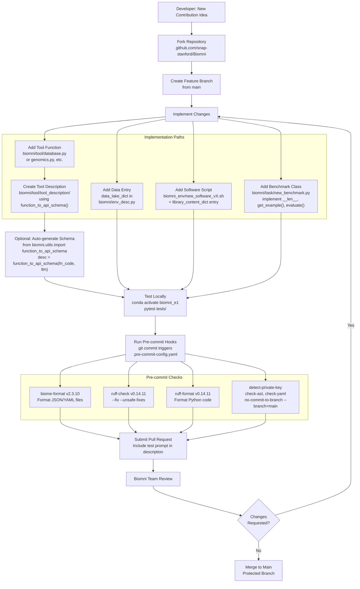
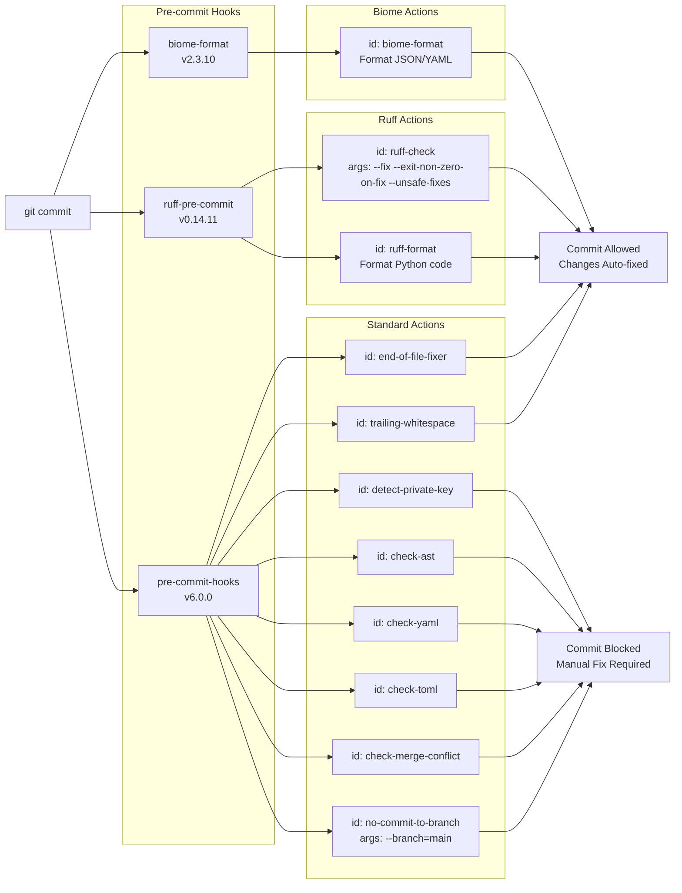
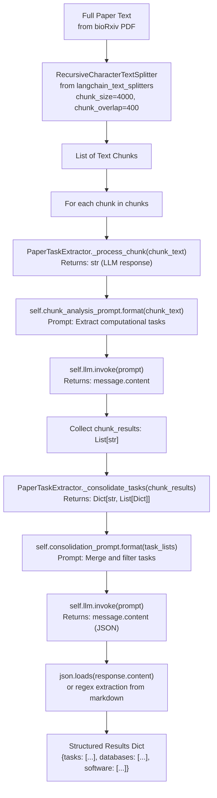

# Development Guide

<details>
<summary>Relevant source files</summary>

The following files were used as context for generating this wiki page:

- [.pre-commit-config.yaml](.pre-commit-config.yaml)
- [CONTRIBUTION.md](CONTRIBUTION.md)
- [biomni/agent/env_collection.py](biomni/agent/env_collection.py)
- [biomni/agent/qa_llm.py](biomni/agent/qa_llm.py)
- [biomni/biorxiv_scripts/extract_biorxiv_tasks.py](biomni/biorxiv_scripts/extract_biorxiv_tasks.py)
- [biomni/biorxiv_scripts/process_all_subjects.py](biomni/biorxiv_scripts/process_all_subjects.py)

</details>


## Purpose and Scope

This guide provides an overview of development practices for contributing to the Biomni codebase. It covers the essential workflows, tools, and standards that contributors should follow when adding new functionality or fixing bugs.

For detailed instructions on specific development tasks:
- Package structure and file organization: see [Package Structure](#8.1)
- Step-by-step contribution process: see [Contributing Guidelines](#8.2)
- Code quality tools and pre-commit hooks: see [Code Quality and Testing](#8.3)
- Implementing new tools with schemas: see [Tool Development](#8.4)
- Adding datasets and software packages: see [Adding Data and Software](#8.5)
- Modifying conda environment: see [Environment Management](#8.6)

For user-facing documentation:
- Basic usage and configuration: see [User Guide](#4)
- Tool reference documentation: see [Tool Reference](#5)
- Example workflows: see [Tutorials and Examples](#6)

---

## Development Environment

Biomni development uses a unified conda environment defined in [biomni_env/environment.yml:1-40](). All development activities should occur within the `biomni_e1` environment to ensure reproducibility.

### Core Dependencies

| Category | Key Packages | Purpose |
|----------|--------------|---------|
| **Language** | `python=3.11` | Base interpreter version |
| **Orchestration** | `langgraph==0.3.18`, `langchain` | Agent workflow and state management |
| **Scientific** | `numpy==2.1`, `pandas`, `scipy`, `scikit-learn` | Data analysis and computation |
| **LLM Providers** | `langchain-openai`, `langchain-anthropic`, `langchain-ollama` | Multi-provider LLM support |
| **UI** | `gradio`, `jupyter`, `notebook` | Interactive interfaces |
| **Testing** | `pytest` | Unit and integration testing |
| **Extensibility** | `mcp`, `tooluniverse` | External tool integration |

### Version Pinning Strategy

Only critical packages with breaking changes are pinned:
- `numpy==2.1` - Pin prevents API incompatibilities
- `langgraph==0.3.18` - Pin ensures state machine compatibility

All other packages use flexible versioning to allow updates while maintaining stability.

**Sources:** [biomni_env/environment.yml:1-40]()

---

## Codebase Structure

```
biomni/
├── agent/              # Agent implementations
│   ├── agent.py       # A1 class - main orchestrator agent
│   ├── base_agent.py  # base_agent class - abstract interface
│   ├── env_collection.py  # PaperTaskExtractor class
│   └── qa_llm.py      # qa_llm class - simple Q&A agent
├── tool/              # Tool function implementations
│   ├── database.py    # query_uniprot(), query_kegg(), etc.
│   ├── genomics.py    # annotate_celltype_scRNA(), create_scvi_embeddings()
│   ├── pharmacology.py  # run_diffdock_with_smiles(), predict_admet_properties()
│   ├── molecular_biology.py  # design_knockout_sgrna(), design_verification_primers()
│   └── tool_description/  # API schema definitions
│       ├── database.py
│       ├── genomics.py
│       └── ...
├── task/              # Benchmark task implementations
│   └── biomni_eval1.py  # BiomniEval1 class
├── llm.py             # get_llm() factory function
├── env_desc.py        # data_lake_dict, library_content_dict globals
└── utils.py           # function_to_api_schema() helper

biomni_env/
├── environment.yml    # Conda environment specification
├── new_software_v1.sh # Software installation script v1
└── new_software_v2.sh # Software installation script v2
```

The codebase follows a modular organization where:
- **Agent classes** orchestrate reasoning and execution
- **Tool functions** provide domain-specific capabilities
- **Tool descriptions** define API schemas for LLM consumption
- **Environment dictionaries** catalog available resources

**Sources:** [biomni/agent/env_collection.py:1-314](), [biomni/agent/qa_llm.py:1-51]()

---

## Development Workflow

### Contribution Workflow Diagram



**Sources:** [CONTRIBUTION.md:1-130](), [.pre-commit-config.yaml:1-42]()

---

## Code Quality Pipeline

### Pre-commit Hook Architecture



### Code Quality Tools

| Tool | Version | Purpose | Auto-fix |
|------|---------|---------|----------|
| **Biome** | v2.3.10 | JSON/YAML formatting | ✓ |
| **Ruff** | v0.14.11 | Python linting and formatting | ✓ |
| **detect-private-key** | - | Prevent API key commits | ✗ |
| **check-ast** | - | Validate Python syntax | ✗ |
| **end-of-file-fixer** | - | Ensure files end with newline | ✓ |
| **trailing-whitespace** | - | Remove trailing whitespace | ✓ |
| **check-yaml** | - | Validate YAML syntax | ✗ |
| **check-toml** | - | Validate TOML syntax | ✗ |
| **check-merge-conflict** | - | Detect merge conflict markers | ✗ |
| **no-commit-to-branch** | - | Prevent direct commits to main | ✗ |

### Ruff Configuration

Ruff is configured with aggressive auto-fixing enabled via [.pre-commit-config.yaml:16-18]():
```yaml
- id: ruff-check
  args: [--fix, --exit-non-zero-on-fix, --unsafe-fixes]
```

The `--unsafe-fixes` flag allows Ruff to apply transformations that might change code semantics, emphasizing code quality over conservative changes.

**Sources:** [.pre-commit-config.yaml:1-42]()

---

## Testing Practices

### Test Requirements

All contributions should include appropriate tests:

1. **Tool Functions**: Test with sample inputs to verify outputs
2. **Agent Methods**: Test with mock LLM responses
3. **Benchmark Tasks**: Verify scoring functions with known inputs
4. **Data Additions**: Verify download and parsing logic

### Running Tests

```bash
# Activate environment
conda activate biomni_e1

# Run all tests
pytest

# Run specific test file
pytest tests/test_tools.py

# Run with verbose output
pytest -v
```

The `pytest` package is included in the development environment [biomni_env/environment.yml:34]().

### Test Coverage Areas

| Component | Test Focus |
|-----------|-----------|
| **Tools** | Input validation, output format, error handling |
| **Agents** | State transitions, message formatting, execution logic |
| **LLM Integration** | Provider routing, configuration handling, response parsing |
| **Data Lake** | Download logic, file integrity, parsing correctness |
| **Benchmarks** | Scoring accuracy, output validation, edge cases |

**Sources:** [biomni_env/environment.yml:34]()

---

## Tool Development Helper

### Auto-generating Tool Descriptions

The `function_to_api_schema()` utility in [biomni/utils.py]() uses an LLM to automatically generate tool descriptions from function code [CONTRIBUTION.md:26-32]():

```python
from biomni.utils import function_to_api_schema
from biomni.llm import get_llm

# Get an LLM instance (any provider works)
llm = get_llm('claude-sonnet-4-20250514')

# Generate API schema from function source code
desc = function_to_api_schema(function_code, llm)

# Output: Structured tool description ready for
# biomni/tool/tool_description/XXX.py
```

This helper:
1. Analyzes the function signature and docstring
2. Generates a structured API schema compatible with LangChain
3. Creates detailed parameter descriptions with types
4. Provides usage examples and expected outputs

The generated schema should be reviewed and manually edited as needed before committing to ensure accuracy and completeness.

**Sources:** [CONTRIBUTION.md:26-32]()

---

## Environment Management

### Software Installation Scripts

New software packages are installed via shell scripts in `biomni_env/`:
- Scripts are named `new_software_{VERSION}.sh`
- Each script appends to the existing environment
- Scripts must be tested for environment conflicts

### Adding Dependencies

To add a new Python package:

1. Add to [biomni_env/environment.yml:9-39]() under `pip:` section
2. Test environment creation:
   ```bash
   conda env create -f biomni_env/environment.yml
   ```
3. Verify no conflicts with existing packages

To add system-level software:

1. Create installation script in `biomni_env/new_software_{VERSION}.sh`
2. Add entry to `library_content_dict` in `biomni/env_desc.py`
3. Test installation in clean environment
4. Provide screenshot demonstrating no conflicts [CONTRIBUTION.md:58-63]()

**Sources:** [CONTRIBUTION.md:58-63](), [biomni_env/environment.yml:1-40]()

---

## Contribution Types

### Tool Contributions

Tools are organized by domain in `biomni/tool/`:

| Domain | File | Example Functions |
|--------|------|-------------------|
| **Database** | `database.py` | `query_uniprot()`, `query_pdb()`, `query_kegg()`, `blast_sequence()` |
| **Genomics** | `genomics.py` | `annotate_celltype_scRNA()`, `create_scvi_embeddings()`, `gene_set_enrichment_analysis()` |
| **Pharmacology** | `pharmacology.py` | `run_diffdock_with_smiles()`, `predict_admet_properties()`, `analyze_western_blot()` |
| **Molecular Biology** | `molecular_biology.py` | `design_knockout_sgrna()`, `design_verification_primers()`, `golden_gate_assembly()` |

Each tool requires:
1. **Implementation** in appropriate domain file [biomni/tool/XXX.py]()
2. **Description** in [biomni/tool/tool_description/XXX.py]() following LangChain schema format
3. **Test prompt** demonstrating functionality in PR description
4. **Software dependencies** added to [biomni_env/new_software_vX.sh]() if needed

**Sources:** [CONTRIBUTION.md:14-34]()

### Data Contributions

For data with web APIs:
1. Implement `query_XX()` function in [biomni/tool/database.py]()
2. Add tool description in [biomni/tool/tool_description/database.py]()

For data without APIs:
1. Prepare download link with redistribution rights
2. Add entry to `data_lake_dict` in [biomni/env_desc.py]()
3. Verify download and parsing logic

**Sources:** [CONTRIBUTION.md:36-53]()

### Benchmark Contributions

Benchmarks in `biomni/task/` must implement:

```python
class YourBenchmark:
    def __init__(self):
        """Initialize benchmark resources"""
        pass
    
    def __len__(self):
        """Return total number of task instances"""
        pass
    
    def get_example(self, index):
        """Return task instance at given index"""
        pass
    
    def evaluate(self):
        """Score agent output against ground truth"""
        pass
    
    def output_class(self):
        """Return expected output format schema"""
        pass
```

**Sources:** [CONTRIBUTION.md:66-97]()

---

## Development Best Practices

### Code Style

- Follow PEP 8 conventions (enforced by Ruff)
- Use type hints for function signatures
- Write descriptive docstrings
- Keep functions focused and modular
- Use meaningful variable names

### Documentation

- Update tool descriptions when modifying tools
- Add inline comments for complex logic
- Update README.md if adding major features
- Include usage examples in docstrings

### Git Workflow

- Create descriptive branch names: `feature/add-blast-tool`, `fix/primer-design-bug`
- Write clear commit messages
- Keep commits atomic and focused
- Rebase on main before submitting PR
- Never commit directly to main (blocked by pre-commit hook)

### Testing Before Submission

1. Test locally in `biomni_e1` environment
2. Verify pre-commit hooks pass
3. Test with multiple LLM providers if applicable
4. Verify documentation is accurate
5. Include test prompt in PR description

**Sources:** [CONTRIBUTION.md:99-125](), [.pre-commit-config.yaml:33-34]()

---

## PaperTaskExtractor Development Tool

The `PaperTaskExtractor` class [biomni/agent/env_collection.py:12-314]() is a specialized agent for extracting computational tasks from scientific papers. This tool assists in identifying new tool implementations by analyzing bioRxiv papers.

### Usage

```python
from biomni.agent.env_collection import PaperTaskExtractor

extractor = PaperTaskExtractor(
    llm="claude-3-7-sonnet-20250219",
    chunk_size=4000,
    chunk_overlap=400
)

log, results = extractor.go(paper_text)

# Results structure:
# {
#   "tasks": [...],      # Computational tasks with inputs/outputs
#   "databases": [...],   # Referenced databases
#   "software": [...]     # Software packages used
# }
```

### Extraction Process



### Key Methods

| Method | Purpose | Implementation | Returns |
|--------|---------|----------------|---------|
| `process_paper(paper_text)` | Extract tasks from full paper | [biomni/agent/env_collection.py:136-164]() | `Dict[str, List[Dict]]` |
| `_process_chunk(chunk_text)` | Analyze single chunk | [biomni/agent/env_collection.py:166-178]() | `str` (LLM response) |
| `_consolidate_tasks(chunk_results)` | Merge chunk results | [biomni/agent/env_collection.py:180-245]() | `Dict[str, List[Dict]]` |
| `save_results(results, output_path)` | Save to JSON file | [biomni/agent/env_collection.py:272-283]() | `None` |
| `go(paper_text)` | Main entry point | [biomni/agent/env_collection.py:247-270]() | `(log, results)` tuple |

### Extraction Scripts

Two helper scripts automate paper analysis:

1. **extract_biorxiv_tasks.py** [biomni/biorxiv_scripts/extract_biorxiv_tasks.py:1-405]()
   - Processes papers from a specific bioRxiv subject
   - Downloads PDFs and extracts text
   - Generates frequency summaries

2. **process_all_subjects.py** [biomni/biorxiv_scripts/process_all_subjects.py:1-316]()
   - Processes all 25 bioRxiv subject areas
   - Combines results across subjects
   - Identifies most common tasks

These scripts are useful for identifying gaps in tool coverage and prioritizing new tool development.

**Sources:** [biomni/agent/env_collection.py:12-314](), [biomni/biorxiv_scripts/extract_biorxiv_tasks.py:1-405](), [biomni/biorxiv_scripts/process_all_subjects.py:1-316]()

---

## Getting Help

For questions about development:
1. Check existing issues on GitHub
2. Review contribution guidelines in [CONTRIBUTION.md]()
3. Open a new issue with the `question` label
4. Reach out to maintainers

Significant contributors will be invited to co-author publications in top-tier journals and conferences [CONTRIBUTION.md:3]().

**Sources:** [CONTRIBUTION.md:123-125]()

---