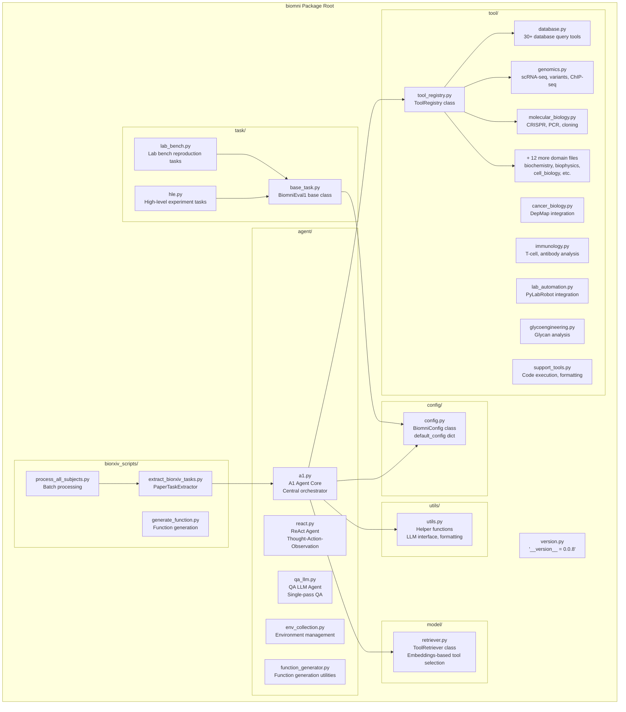
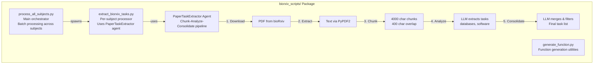
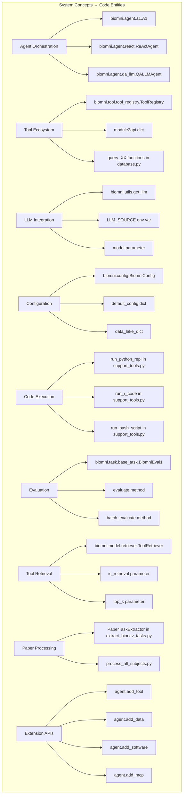

# Package Structure

<details>
<summary>Relevant source files</summary>

The following files were used as context for generating this wiki page:

- [.pre-commit-config.yaml](.pre-commit-config.yaml)
- [CONTRIBUTION.md](CONTRIBUTION.md)
- [biomni/agent/a1.py](biomni/agent/a1.py)
- [biomni/agent/env_collection.py](biomni/agent/env_collection.py)
- [biomni/agent/qa_llm.py](biomni/agent/qa_llm.py)
- [biomni/biorxiv_scripts/extract_biorxiv_tasks.py](biomni/biorxiv_scripts/extract_biorxiv_tasks.py)
- [biomni/biorxiv_scripts/process_all_subjects.py](biomni/biorxiv_scripts/process_all_subjects.py)
- [biomni/tool/support_tools.py](biomni/tool/support_tools.py)
- [biomni/tool/tool_description/support_tools.py](biomni/tool/tool_description/support_tools.py)
- [biomni/utils.py](biomni/utils.py)

</details>


This document provides a comprehensive overview of the Biomni codebase organization, detailing the purpose and contents of each major package. This information is essential for contributors who need to navigate the codebase, add new functionality, or understand how components are organized. For guidelines on contributing code, see [Contributing Guidelines](#8.2). For specific instructions on creating new tools, see [Tool Development Guide](#8.3).

## Overview

The Biomni codebase follows a modular architecture organized into functional packages. The top-level structure separates core agent logic, domain-specific tools, task definitions, models, configuration, and utilities into distinct directories. This organization enables clear separation of concerns and makes it easy to extend functionality within specific domains.

**Sources:** [docs/source/index.rst:1-43]()

## Top-Level Directory Structure

The repository is organized as follows:

```
biomni/
├── agent/          # Agent implementations (A1, ReAct, QA, etc.)
├── tool/           # Domain-specific tools organized by biology subdomain
├── task/           # Task definitions and evaluation logic
├── model/          # Model-related components (retrievers, embeddings)
├── config/         # Configuration management and defaults
├── utils/          # Utility functions and support code
├── biorxiv_scripts/ # Paper processing and task extraction scripts
└── version.py      # Version information
```

The package version is centrally defined in [biomni/version.py:1](), currently at version `0.0.8`.

**Sources:** [biomni/version.py:1](), [docs/source/index.rst:1-43]()

## Directory-to-Functionality Mapping



**Sources:** [docs/source/index.rst:1-43]()

## Agent Package (`agent/`)

The `agent/` directory contains all agent implementation classes and supporting utilities. These are the core orchestration components that interact with LLMs and execute workflows.

### Module Breakdown

| Module | Primary Class/Function | Purpose |
|--------|----------------------|---------|
| `a1.py` | `A1` class | Central agent orchestrator with generate-execute loop, LangGraph workflow |
| `react.py` | `ReActAgent` class | ReAct-style agent using Thought-Action-Observation pattern |
| `qa_llm.py` | `QALLMAgent` class | Simple QA agent for single-pass question answering |
| `env_collection.py` | Environment utilities | Conda environment and library management functions |
| `function_generator.py` | Function generation | Utilities for generating function schemas |

The `A1` class in `a1.py` is the most important component (importance 80.20 from Diagram 1), serving as the central orchestrator for all agent operations. It implements the generate-execute-observe loop using LangGraph and manages system prompts, tool registration, and conversation history.

**Sources:** [docs/source/index.rst:8-12]()

## Tool Package (`tool/`)

The `tool/` directory is organized by biological domain, with each module containing tools specific to that domain. This organization makes it easy to locate and extend domain-specific functionality.

### Domain Organization

```mermaid
graph LR
    subgraph "tool/ Package"
        direction TB
        
        Registry["tool_registry.py<br/>ToolRegistry class<br/>module2api dict"]
        
        subgraph "Core Tools"
            DB["database.py<br/>query_XX functions<br/>30+ databases"]
            Gen["genomics.py<br/>scRNA-seq tools<br/>variant analysis"]
            Support["support_tools.py<br/>run_python_repl<br/>run_r_code<br/>run_bash_script"]
        end
        
        subgraph "Molecular Tools"
            MolBio["molecular_biology.py<br/>CRISPR, PCR, cloning"]
            Biochem["biochemistry.py<br/>Protein analysis"]
            Biophys["biophysics.py<br/>Structure prediction"]
            SysBio["systems_biology.py<br/>Network analysis"]
        end
        
        subgraph "Disease & Drug Tools"
            Cancer["cancer_biology.py<br/>DepMap queries"]
            Immuno["immunology.py<br/>TCR/BCR analysis"]
            Pharma["pharmacology.py<br/>Drug interactions"]
            Pathology["pathology.py<br/>Disease analysis"]
        end
        
        subgraph "Specialized Tools"
            Glyco["glycoengineering.py<br/>Glycan structures"]
            LabAuto["lab_automation.py<br/>PyLabRobot scripts"]
            Imaging["bioimaging.py<br/>Image processing"]
            Synth["synthetic_biology.py<br/>Design tools"]
        end
        
        Registry --> DB
        Registry --> Gen
        Registry --> Support
        Registry --> MolBio
        Registry --> Cancer
        Registry --> Glyco
    end
```



### Key Tool Modules

**Database Tools (`database.py`)**
- Contains `query_XX` functions for 30+ biological databases
- Examples: `query_uniprot`, `query_pdb`, `query_kegg`, `query_ncbi_clinvar`
- Implements LLM-based query translation pattern using `_query_llm_for_api` helper
- Importance: 36.42 from Diagram 3

**Genomics Tools (`genomics.py`)**
- Single-cell RNA-seq: `annotate_celltype_scRNA`, `create_scvi_embeddings`
- Variant analysis: genomic region operations, ChIP-seq peak calling
- Gene embeddings: `generate_gene_embeddings_with_ESM`
- Importance: 44.76 from Diagram 3

**Support Tools (`support_tools.py`)**
- Code execution: `run_python_repl`, `run_r_code`, `run_bash_script`
- Formatting: `function_to_api_schema`, `format_return_value`
- Utility functions for schema generation and result processing

**Tool Registry (`tool_registry.py`)**
- `ToolRegistry` class: Central registry for all tools
- `module2api` dict: Mapping of module names to API schemas
- Tool retrieval and discovery functionality

**Sources:** [docs/source/index.rst:21-41]()

## Task Package (`task/`)

The `task/` directory contains task definitions and evaluation logic for the BiomniEval1 benchmark system (importance 52.75 from Diagram 5).

### Task Module Structure

| Module | Class | Purpose |
|--------|-------|---------|
| `base_task.py` | `BiomniEval1` | Base evaluation class with dataset loading and evaluation API |
| `hle.py` | Task definitions | High-level experiment task implementations |
| `lab_bench.py` | Task definitions | Lab bench reproduction task implementations |

The `BiomniEval1` class in `base_task.py` provides:
- Dataset loading from HuggingFace (`biomni_eval1_dataset.parquet`)
- Evaluation methods: `evaluate()`, `batch_evaluate()`
- Dataset utilities: `get_instance()`, `get_task_stats()`
- 433 evaluation instances across 10 task types

**Sources:** [docs/source/index.rst:18-20]()

## Model Package (`model/`)

The `model/` directory contains model-related components for embeddings and retrieval.

### Retriever Module (`retriever.py`)

The `ToolRetriever` class implements embeddings-based tool selection for retrieval-augmented generation:
- Embeds tool descriptions using sentence transformers
- Performs similarity search to select relevant tools for a given query
- Reduces the system prompt size by filtering tools
- Used when `is_retrieval=True` in agent configuration

This component enables the agent to work with a large tool ecosystem without overwhelming the LLM context window.

**Sources:** [docs/source/index.rst:17]()

## Configuration Package (`config/`)

The `config/` directory manages system-wide configuration and defaults.

### Configuration Module (`config.py`)

Contains two primary components:

1. **`BiomniConfig` class**: Dataclass for agent configuration parameters
   - LLM settings (model, temperature, max_tokens)
   - Agent behavior (max_iterations, self_critic)
   - Tool retrieval settings (is_retrieval, top_k)

2. **`default_config` dictionary**: System-wide defaults
   - Data lake paths and descriptions (`data_lake_dict`)
   - Library content (`library_content_dict`)
   - Tool schemas and metadata
   - MCP server configurations

The configuration system implements a three-level hierarchy:
1. Explicit parameters passed to agent initialization
2. `BiomniConfig` object values
3. `default_config` dictionary defaults

**Sources:** [docs/source/index.rst:16]()

## Utilities Package (`utils/`)

The `utils/` directory contains helper functions used across the codebase.

### Utils Module (`utils.py`)

Key functions include:
- **`get_llm`**: Universal LLM factory function (importance 42.72 from Diagram 4)
  - Auto-detects provider from model name
  - Supports 8+ LLM providers (OpenAI, Anthropic, Gemini, etc.)
- **Formatting utilities**: Result formatting, schema generation
- **LLM interface helpers**: Standardized API call patterns
- **Data processing utilities**: Dataset loading, preprocessing

This module serves as the common infrastructure layer used by agents and tools.

**Sources:** [docs/source/index.rst:42]()

## BioRxiv Scripts Package (`biorxiv_scripts/`)

The `biorxiv_scripts/` directory contains specialized scripts for extracting computational tasks from bioRxiv papers.

### Script Organization



### Module Breakdown

| Module | Primary Function | Purpose |
|--------|-----------------|---------|
| `process_all_subjects.py` | Orchestration | Batch processes papers across all bioRxiv subjects |
| `extract_biorxiv_tasks.py` | `PaperTaskExtractor` | Extracts computational tasks from individual papers |
| `generate_function.py` | Function generation | Utilities for generating function schemas from papers |

The pipeline implements a chunk-analyze-consolidate pattern:
1. Downloads PDFs from bioRxiv
2. Extracts text using PyPDF2
3. Chunks text (4000 chars with 400 char overlap)
4. Analyzes each chunk with LLM to extract tasks/databases/software
5. Consolidates results across chunks using LLM

**Sources:** [docs/source/index.rst:13-15]()

## Code-to-Natural-Language Mapping

This diagram maps high-level system concepts to specific code entities that implement them:



**Sources:** [docs/source/index.rst:1-43]()

## Environment and Dependencies

The Conda environment definition is located outside the main `biomni/` package but is essential to the system architecture:

### Environment Files

| File | Purpose |
|------|---------|
| `biomni_env/fixed_env.yml` | Complete environment specification with pinned versions |
| Environment name | `biomni_e1` |
| Python version | `3.11.13` |

The environment includes:
- **Bioinformatics CLI tools**: samtools, BWA, bowtie2, bedtools, MACS2, FastQC (lines 28-243)
- **Python scientific stack**: numpy==2.1, pandas, scipy, scikit-learn (lines 244-507)
- **Single-cell packages**: scanpy, anndata, scvi-tools, squidpy, muon (lines 255-676)
- **AI/ML frameworks**: PyTorch, JAX, transformers, langchain, langgraph==0.3.18 (lines 412-448)
- **LLM provider SDKs**: openai, anthropic, ollama, langchain integrations (lines 258, 442-443, 524, 527)

Only two packages are version-pinned:
- `numpy==2.1.0` (line 507) - Due to breaking API changes in numpy 2.x
- `langgraph==0.3.18` (line 444) - For API stability in agent workflows

**Sources:** [biomni_env/fixed_env.yml:1-743]()

## Import Patterns and Module Access

Common import patterns for accessing Biomni components:

```python
# Agent imports
from biomni.agent.a1 import A1
from biomni.agent.react import ReActAgent
from biomni.agent.qa_llm import QALLMAgent

# Configuration imports
from biomni.config import BiomniConfig, default_config

# Tool registry imports
from biomni.tool.tool_registry import ToolRegistry

# Evaluation imports
from biomni.task.base_task import BiomniEval1

# Model imports
from biomni.model.retriever import ToolRetriever

# Utility imports
from biomni.utils import get_llm

# Tool imports (domain-specific)
from biomni.tool.database import query_uniprot, query_pdb
from biomni.tool.genomics import annotate_celltype_scRNA
from biomni.tool.support_tools import run_python_repl
```

The package is designed for easy top-level imports of the most commonly used components, with deeper imports available for specialized functionality.

**Sources:** [docs/source/index.rst:1-43]()

## Extension Points and Customization

The package structure supports multiple extension mechanisms:

### Adding New Tools
1. Create implementation in appropriate `tool/DOMAIN.py` file
2. Add tool description to match the domain
3. Tool automatically registered via `ToolRegistry`
4. See [Tool Development Guide](#8.3) for details

### Adding New Data Sources
1. For databases with APIs: Add `query_XX` function to `database.py`
2. For static datasets: Add entry to `data_lake_dict` in `config.py`
3. See [Adding Data and Software](#8.4) for details

### Adding New Agent Types
1. Create new module in `agent/` directory
2. Inherit from appropriate base class or implement standard interface
3. Register in documentation (`docs/source/index.rst`)

### Adding New Tasks
1. Create task definition in `task/` directory
2. Implement evaluation logic extending `BiomniEval1`
3. Add task-specific evaluation criteria

**Sources:** [docs/source/index.rst:1-43]()

## Documentation Structure

The Sphinx documentation mirrors the package structure:

```
docs/source/
├── index.rst                    # Main API reference index
├── api/
│   ├── agent/                   # Agent module docs
│   │   ├── a1.rst
│   │   ├── react.rst
│   │   └── qa_llm.rst
│   ├── tool/                    # Tool module docs (by domain)
│   │   ├── database.rst
│   │   ├── genomics.rst
│   │   ├── molecular_biology.rst
│   │   └── ...
│   ├── task/                    # Task module docs
│   ├── model/                   # Model module docs
│   ├── config.rst               # Configuration docs
│   └── utils.rst                # Utils docs
└── conf.py                      # Sphinx configuration
```

Documentation is generated using Sphinx with autodoc, napoleon, and viewcode extensions (lines 21-25 in conf.py). The current documented version is `0.0.7` (line 16 in conf.py), though the package version is `0.0.8`.

**Sources:** [docs/source/conf.py:1-50](), [docs/source/index.rst:1-43]()

---