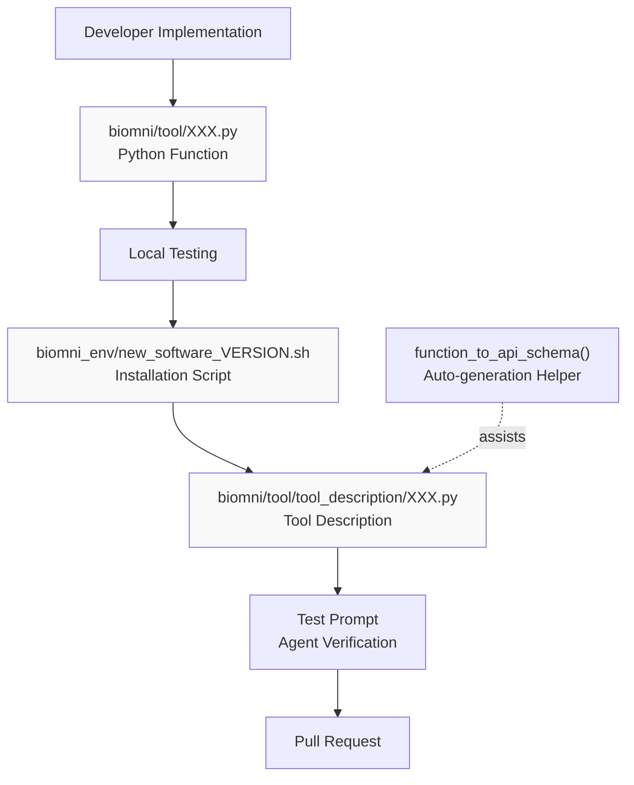
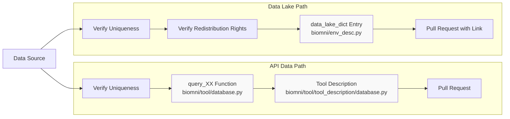
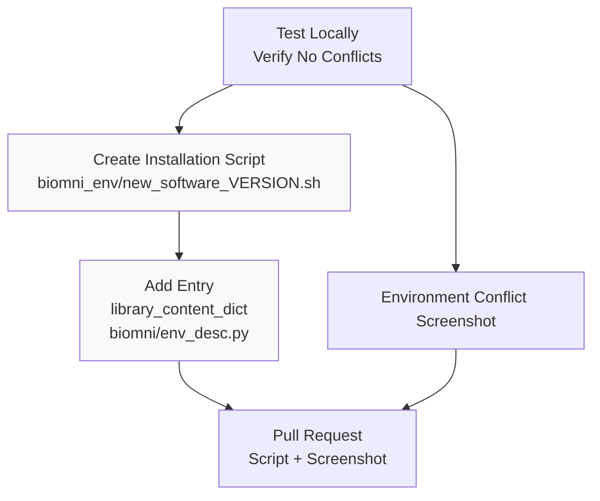
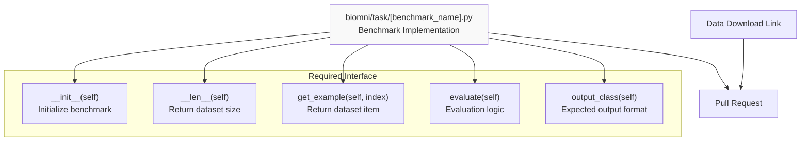
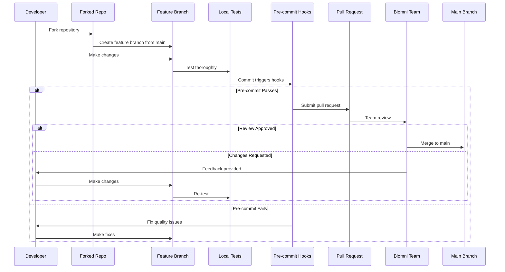
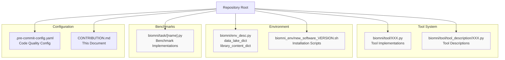
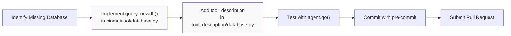

# Contributing Guidelines

<details>
<summary>Relevant source files</summary>

The following files were used as context for generating this wiki page:

- [.pre-commit-config.yaml](.pre-commit-config.yaml)
- [CONTRIBUTION.md](CONTRIBUTION.md)
- [biomni/agent/env_collection.py](biomni/agent/env_collection.py)
- [biomni/agent/qa_llm.py](biomni/agent/qa_llm.py)
- [biomni/biorxiv_scripts/extract_biorxiv_tasks.py](biomni/biorxiv_scripts/extract_biorxiv_tasks.py)
- [biomni/biorxiv_scripts/process_all_subjects.py](biomni/biorxiv_scripts/process_all_subjects.py)

</details>


This page provides comprehensive guidelines for contributing to Biomni, including adding new tools, data sources, software packages, and benchmarks. It covers the contribution workflow, code quality standards, and review process.

For information about the codebase structure and key modules, see [Package Structure](#8.1). For detailed instructions on tool development, see [Tool Development](#8.4). For code quality standards and testing, see [Code Quality and Testing](#8.3).

---

## Overview

Biomni welcomes community contributions to expand its capabilities as a biomedical AI agent platform. Contributors who make significant contributions will be invited to co-author publications in top-tier journals and conferences. The contribution process is designed to maintain code quality, ensure compatibility with existing systems, and provide clear documentation for new features.

**Supported Contribution Types:**
- **Tools**: Python functions for new capabilities (genomics, database queries, etc.)
- **Data**: New datasets via API or data lake additions
- **Software**: External packages and CLI tools
- **Benchmarks**: Evaluation tasks following standard interfaces
- **Bug Fixes**: Improvements to existing functionality

Sources: [CONTRIBUTION.md:1-13]()

---

## Types of Contributions

### Adding a New Tool

Tools are implemented as Python functions organized by subject area in `biomni/tool/` and described in `biomni/tool/tool_description/`. Tools extend the agent's capabilities by providing new functions that can be called during task execution.



**Tool Addition Workflow:**

1. **Implement and Test**: Create your function in the appropriate subject category file (e.g., `biomni/tool/database.py`, `biomni/tool/genomics.py`)

2. **Add Installation Script**: If the tool requires additional software dependencies, append installation commands to `biomni_env/new_software_{VERSION}.sh`

3. **Create Tool Description**: Add a tool description file in `biomni/tool/tool_description/XXX.py` following existing format. This description is used by the ToolRetriever for RAG-based tool selection.

   **Auto-generation Helper:**
   ```python
   from biomni.utils import function_to_api_schema
   from biomni.llm import get_llm

   llm = get_llm('claude-sonnet-4-20250514')
   desc = function_to_api_schema(function_code, llm)
   ```

4. **Verify with Test Prompt**: Create a test prompt that exercises your tool and verify the agent can use it correctly

5. **Submit Pull Request**: Include your implementation, tool description, installation script (if applicable), and test prompt

Sources: [CONTRIBUTION.md:14-35]()

---

### Adding New Data

Data additions follow different paths depending on whether the data source has a web API or requires direct file access.



**For Web API Data Sources:**

1. **Verify Uniqueness**: Ensure no overlap with existing database query functions
2. **Add Query Function**: Implement `query_XX()` function in `biomni/tool/database.py` following the existing pattern
3. **Create Tool Description**: Add corresponding description in `biomni/tool/tool_description/database.py`
4. **Submit Pull Request**: Include function implementation and description

**For Data Lake Additions:**

1. **Verify Uniqueness**: Check that the dataset doesn't overlap with existing entries in `data_lake_dict`
2. **Prepare Download Link**: Verify redistribution rights and prepare a stable download URL
3. **Add Dictionary Entry**: Add an entry to `data_lake_dict` in `biomni/env_desc.py` with:
   - Dataset name
   - Description
   - Download URL
   - File format and size information
4. **Submit Pull Request**: Include the dictionary update with the download link

Sources: [CONTRIBUTION.md:36-53]()

---

### Adding New Software

Software additions extend the execution environment with new packages or CLI tools that can be used by the agent.



**Software Addition Workflow:**

1. **Test Locally**: Install the software in your local `biomni_e1` environment and verify:
   - No conflicts with existing packages
   - Compatible with current Python/R versions
   - Works with existing tools

2. **Create Installation Script**: Append installation commands to `biomni_env/new_software_{VERSION}.sh`. Use appropriate package manager:
   - `conda install` for conda packages
   - `pip install` for Python packages
   - `install.packages()` for R packages
   - Raw bash commands for CLI tools

3. **Add Dictionary Entry**: Update `library_content_dict` in `biomni/env_desc.py` with:
   - Package/tool name
   - Version
   - Brief description
   - Category (Python, R, CLI)

4. **Submit Pull Request**: Include:
   - Installation script
   - Dictionary update
   - Screenshot demonstrating no environment conflicts

Sources: [CONTRIBUTION.md:55-64]()

---

### Adding a New Benchmark

Benchmarks are created in `biomni/task/` and must implement a standard interface for evaluation.



**Benchmark Implementation Requirements:**

| Method | Purpose | Return Type |
|--------|---------|-------------|
| `__init__()` | Initialize benchmark, load data | None |
| `__len__()` | Return number of test instances | int |
| `get_example(index)` | Return test case at index | dict or custom object |
| `evaluate()` | Run evaluation on agent outputs | dict with metrics |
| `output_class()` | Define expected output format | class or schema |

**Example Implementation Structure:**

```python
class YourBenchmark:
    def __init__(self):
        # Load benchmark data
        # Initialize evaluation metrics
        pass

    def __len__(self):
        # Return dataset size
        return len(self.dataset)

    def get_example(self, index):
        # Return dataset item at index
        return self.dataset[index]

    def evaluate(self):
        # Evaluation logic (flexible input format)
        # Return metrics dictionary
        pass

    def output_class(self):
        # Return expected agent output format
        return ExpectedOutputClass
```

**Benchmark Addition Workflow:**

1. **Create Benchmark File**: Implement `biomni/task/[benchmark_name].py` with required methods
2. **Implement Standard Interface**: Follow the template above
3. **Provide Data Link**: Include download link for associated datasets
4. **Submit Pull Request**: Include implementation and data access information

Sources: [CONTRIBUTION.md:66-98]()

---

### Bug Fixes & Enhancements

Bug fixes and enhancements to existing functionality are welcome. Before starting work:

1. **Create an Issue**: Discuss the bug or enhancement with the Biomni team first
2. **Clearly Describe**: Provide clear description of the issue or proposed enhancement
3. **Include Tests**: Add tests when applicable
4. **Follow Patterns**: Maintain consistency with existing code patterns
5. **Update Documentation**: Update relevant documentation if behavior changes

Sources: [CONTRIBUTION.md:99-110]()

---

## Submission Process

All contributions follow a standard git workflow with code quality gates.



**Step-by-Step Process:**

1. **Fork Repository**: Create your own fork of the Biomni repository

2. **Create Feature Branch**: Branch from `main` with a descriptive name:
   ```bash
   git checkout -b add-tool-variant-analysis
   ```

3. **Make Changes**: Implement your contribution following the guidelines above

4. **Test Thoroughly**: Verify your changes work in your local environment:
   - Run existing tests: `pytest`
   - Test your specific addition
   - Verify no conflicts with existing functionality

5. **Commit Changes**: Pre-commit hooks will automatically run (see Code Quality Gates below)

6. **Submit Pull Request**: Create a PR with:
   - Clear description of changes
   - Test results or screenshots
   - References to related issues
   - Example usage if applicable

7. **Review Process**: The Biomni team will review and may request changes

Sources: [CONTRIBUTION.md:111-122]()

---

## Code Quality Gates

All submissions must pass automated code quality checks via pre-commit hooks.

```mermaid
graph TB
    Commit["git commit"]
    
    subgraph "Pre-commit Hooks"
        Biome["biome-format<br/>JavaScript/JSON/CSS formatting"]
        RuffCheck["ruff-check<br/>Python linting with auto-fix"]
        RuffFormat["ruff-format<br/>Python code formatting"]
        
        subgraph "Security & Validation"
            PrivKey["detect-private-key<br/>Security check"]
            AST["check-ast<br/>Python syntax"]
            TOML["check-toml<br/>Config validation"]
            YAML["check-yaml<br/>Config validation"]
        end
        
        subgraph "File Quality"
            EOF["end-of-file-fixer<br/>Newline enforcement"]
            LineEnd["mixed-line-ending<br/>LF enforcement"]
            Whitespace["trailing-whitespace<br/>Cleanup"]
            Case["check-case-conflict<br/>Filename check"]
            Large["check-added-large-files<br/>Size limit"]
        end
        
        Merge["check-merge-conflict<br/>Conflict markers"]
        Branch["no-commit-to-branch<br/>Protect main"]
    end
    
    Success["Commit Successful"]
    Failure["Fix Issues & Retry"]
    
    Commit --> Biome
    Commit --> RuffCheck
    Commit --> RuffFormat
    Commit --> PrivKey
    Commit --> AST
    Commit --> TOML
    Commit --> YAML
    Commit --> EOF
    Commit --> LineEnd
    Commit --> Whitespace
    Commit --> Case
    Commit --> Large
    Commit --> Merge
    Commit --> Branch
    
    Biome --> Success
    RuffCheck --> Success
    RuffFormat --> Success
    PrivKey --> Success
    AST --> Success
    TOML --> Success
    YAML --> Success
    EOF --> Success
    LineEnd --> Success
    Whitespace --> Success
    Case --> Success
    Large --> Success
    Merge --> Success
    Branch --> Success
    
    Biome -.fails.-> Failure
    RuffCheck -.fails.-> Failure
    RuffFormat -.fails.-> Failure
    
    style Biome fill:#f9f9f9
    style RuffCheck fill:#f9f9f9
    style RuffFormat fill:#f9f9f9
```



**Pre-commit Hook Configuration:**

The repository uses `.pre-commit-config.yaml` to enforce code quality standards automatically. When you commit changes, these hooks run:

| Hook | Purpose | Auto-fix |
|------|---------|----------|
| **biome-format** | Format JavaScript, JSON, CSS files | ✓ |
| **ruff-check** | Python linting with extensive rules | ✓ (with `--fix`) |
| **ruff-format** | Python code formatting (PEP 8) | ✓ |
| **detect-private-key** | Security: prevent committing keys | ✗ |
| **check-ast** | Validate Python syntax | ✗ |
| **end-of-file-fixer** | Ensure files end with newline | ✓ |
| **mixed-line-ending** | Enforce LF line endings | ✓ |
| **trailing-whitespace** | Remove trailing whitespace | ✓ |
| **check-case-conflict** | Prevent case-sensitive filename issues | ✗ |
| **check-added-large-files** | Prevent committing large files | ✗ |
| **check-toml** | Validate TOML config files | ✗ |
| **check-yaml** | Validate YAML config files | ✗ |
| **check-merge-conflict** | Detect unresolved merge markers | ✗ |
| **no-commit-to-branch** | Prevent direct commits to `main` | ✗ |

**Setting Up Pre-commit Hooks:**

```bash
# Install pre-commit
pip install pre-commit

# Install the hooks
pre-commit install

# Manually run all hooks
pre-commit run --all-files
```

**Ruff Configuration:**

Ruff is configured with aggressive auto-fixing enabled:
- `--fix`: Automatically fix issues
- `--exit-non-zero-on-fix`: Fail if fixes were needed (ensures you review changes)
- `--unsafe-fixes`: Enable potentially unsafe auto-fixes

Sources: [.pre-commit-config.yaml:1-42]()

---

## File Organization Reference

When adding contributions, files should be placed in the correct locations:



**Key File Locations:**

| Contribution Type | Implementation | Metadata/Description |
|-------------------|----------------|---------------------|
| **Tool** | `biomni/tool/[category].py` | `biomni/tool/tool_description/[category].py` |
| **Data (API)** | `biomni/tool/database.py` | `biomni/tool/tool_description/database.py` |
| **Data (Lake)** | External URL | `biomni/env_desc.py` → `data_lake_dict` |
| **Software** | `biomni_env/new_software_VERSION.sh` | `biomni/env_desc.py` → `library_content_dict` |
| **Benchmark** | `biomni/task/[name].py` | Inline in class |

Sources: [CONTRIBUTION.md:14-98]()

---

## Review Process and Timeline

After submitting a pull request:

1. **Automated Checks**: GitHub Actions run automated tests and quality checks
2. **Team Review**: Biomni maintainers review the submission (typically within 1 week)
3. **Feedback**: Reviewers may request changes or provide suggestions
4. **Iteration**: Make requested changes and update the PR
5. **Merge**: Once approved, changes are merged to main branch
6. **Recognition**: Significant contributors invited to co-author publications

**What Reviewers Check:**
- Code quality and style consistency
- Documentation completeness
- Test coverage and verification
- Compatibility with existing systems
- Security considerations (especially for external tools)
- Performance implications

Sources: [CONTRIBUTION.md:119-122]()

---

## Example Contribution Workflows

### Example: Adding a Database Query Tool



**Concrete Steps:**
1. Add `query_newdb()` function in [biomni/tool/database.py]()
2. Add description in [biomni/tool/tool_description/database.py]()
3. Test: `agent = A1(); agent.go("Query newdb for gene XYZ")`
4. Commit changes (pre-commit hooks run automatically)
5. Create PR with test prompt

---

### Example: Adding a Genomics Analysis Tool

```mermaid
graph LR
    Start["New Analysis Need"]
    Check["Check for Required Software<br/>e.g., samtools"]
    Install["Add to new_software_VERSION.sh<br/>if needed"]
    Impl["Implement tool in<br/>biomni/tool/genomics.py"]
    Desc["Add tool_description"]
    Dict["Update library_content_dict<br/>if new software added"]
    Test["Integration Test"]
    PR["Submit PR with<br/>Code + Screenshot"]
    
    Start --> Check
    Check --> Install
    Install --> Impl
    Impl --> Desc
    Desc --> Dict
    Dict --> Test
    Test --> PR
    
    style Install fill:#f9f9f9
    style Impl fill:#f9f9f9
    style Dict fill:#f9f9f9
```



**Concrete Steps:**
1. Check if required CLI tools (e.g., `samtools`) are in [biomni/env_desc.py]() → `library_content_dict`
2. If not, append installation to [biomni_env/new_software_VERSION.sh]()
3. Implement function in [biomni/tool/genomics.py]()
4. Add description in [biomni/tool/tool_description/genomics.py]()
5. Update `library_content_dict` if new software added
6. Test in clean environment with screenshot showing no conflicts
7. Submit PR with all files and screenshot

Sources: [CONTRIBUTION.md:14-64]()

---

## Questions and Support

If you have questions about contributing:

1. **Check Existing Documentation**: Review relevant wiki pages ([Package Structure](#8.1), [Tool Development](#8.4))
2. **Open an Issue**: Create a GitHub issue with your question
3. **Reach Out**: Contact maintainers directly for complex contributions

**Common Questions:**
- "Which category should my tool go in?" → Choose the most specific category that fits
- "Do I need to add tests?" → Yes, at minimum provide a test prompt
- "How do I test without committing?" → Use `pre-commit run --all-files`
- "Can I add multiple contributions in one PR?" → Prefer separate PRs for different types

Sources: [CONTRIBUTION.md:123-126]()

---

## Next Steps

After reading this guide:
- Review [Tool Development](#8.4) for detailed tool creation patterns
- Check [Code Quality and Testing](#8.3) for testing best practices
- See [Adding Data and Software](#8.5) for environment management details
- Read [Package Structure](#8.1) to understand the codebase organization

*Together, let's build the future of biomedical AI agents!*

Sources: [CONTRIBUTION.md:127-130]()

---