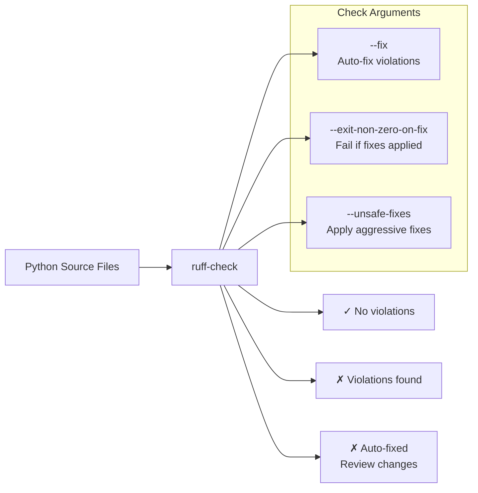
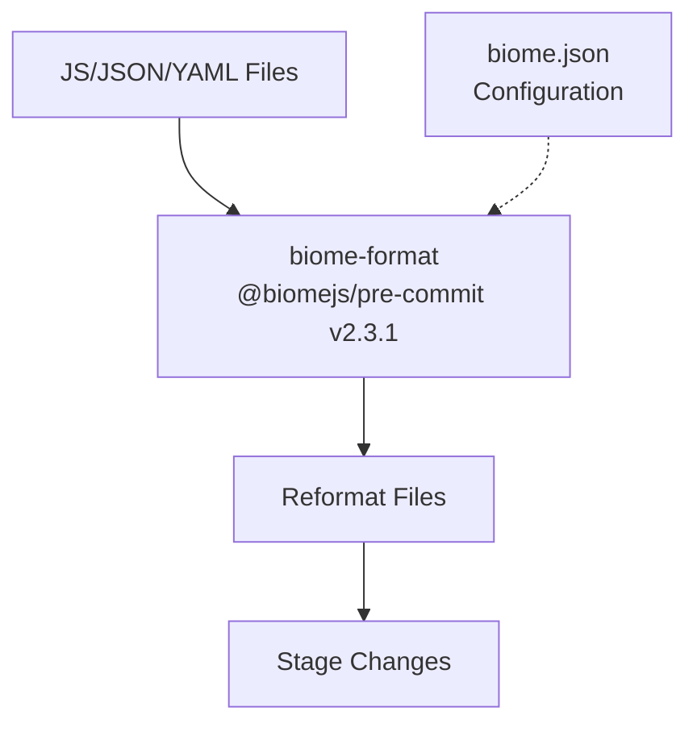
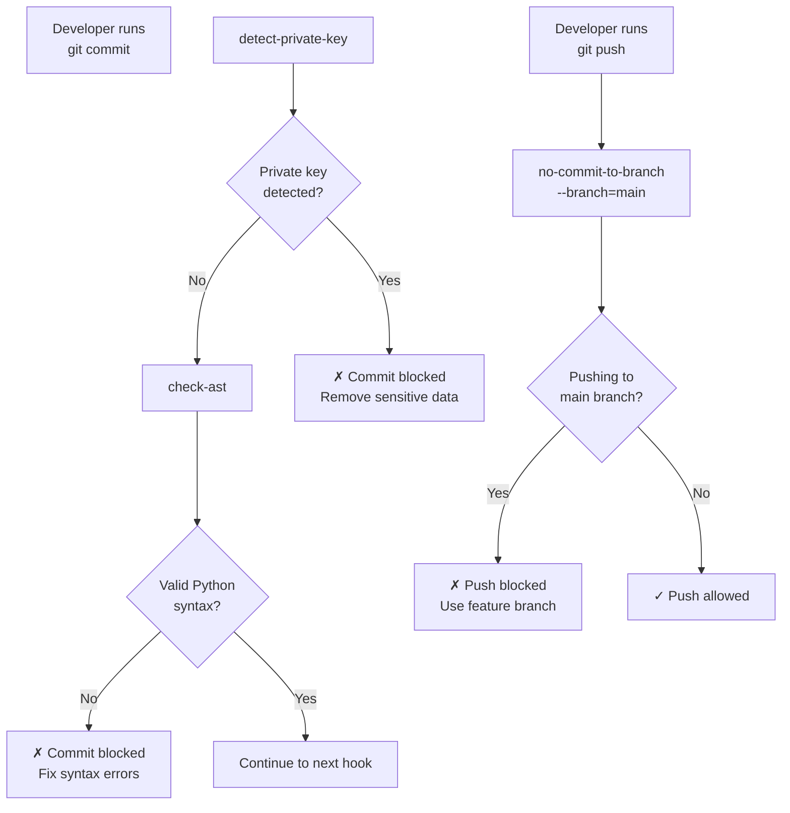
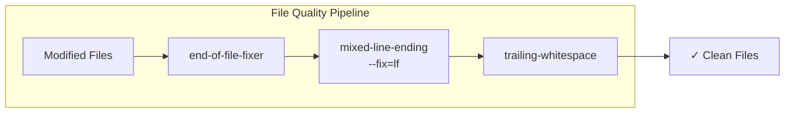
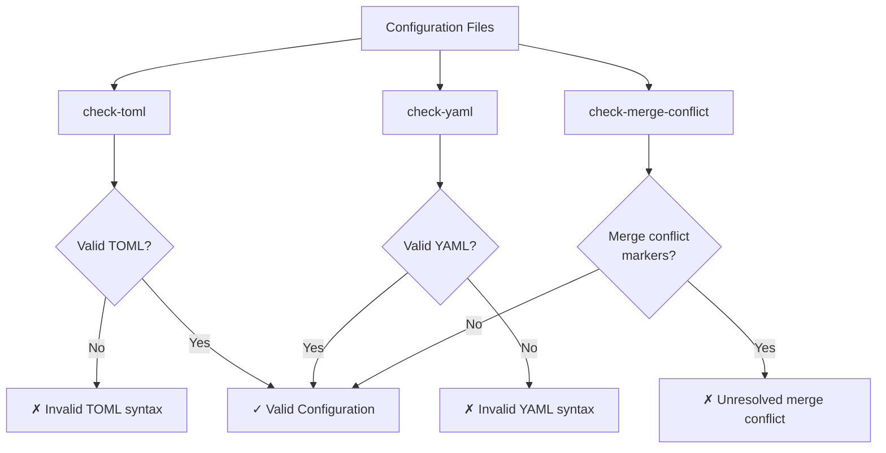
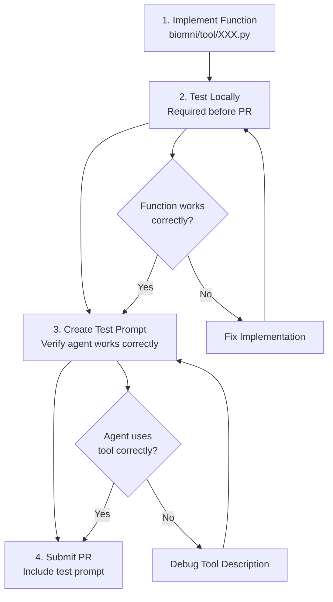
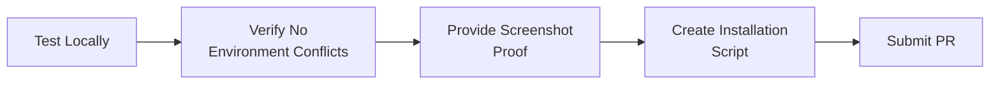
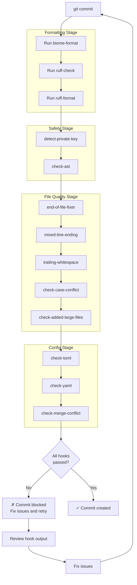
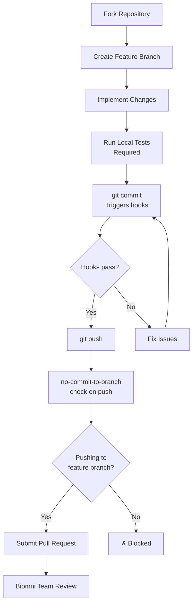

# Code Quality and Testing

<details>
<summary>Relevant source files</summary>

The following files were used as context for generating this wiki page:

- [.pre-commit-config.yaml](.pre-commit-config.yaml)
- [CONTRIBUTION.md](CONTRIBUTION.md)
- [biomni/agent/env_collection.py](biomni/agent/env_collection.py)
- [biomni/agent/qa_llm.py](biomni/agent/qa_llm.py)
- [biomni/biorxiv_scripts/extract_biorxiv_tasks.py](biomni/biorxiv_scripts/extract_biorxiv_tasks.py)
- [biomni/biorxiv_scripts/process_all_subjects.py](biomni/biorxiv_scripts/process_all_subjects.py)

</details>


## Purpose and Scope

This document covers the code quality infrastructure and testing requirements for the Biomni codebase. It explains the automated quality gates enforced via pre-commit hooks, the linting and formatting tools used (Ruff and Biome), and the testing requirements for contributions. For information about benchmark evaluation and task validation, see [Evaluation and Benchmarking](#7). For details on the contribution workflow, see [Contributing Guidelines](#8.2).

---

## Pre-commit Hooks System

Biomni enforces code quality through a multi-stage pre-commit hook system configured in [.pre-commit-config.yaml:1-42](). The hooks run automatically before commits and pushes, preventing low-quality code from entering the repository.

### Hook Configuration Overview

```mermaid
graph TB
    subgraph "Stage Configuration"
        CONFIG[".pre-commit-config.yaml"]
        PRECOMMIT["pre-commit stage"]
        PREPUSH["pre-push stage"]
    end
    
    subgraph "Formatting Hooks"
        BIOME["biome-format<br/>@biomejs/pre-commit<br/>v2.3.1"]
        RUFF_FORMAT["ruff-format<br/>@astral-sh/ruff-pre-commit<br/>v0.14.2"]
    end
    
    subgraph "Linting Hooks"
        RUFF_CHECK["ruff-check<br/>--fix --exit-non-zero-on-fix<br/>--unsafe-fixes"]
    end
    
    subgraph "Safety Hooks"
        PRIVATE_KEY["detect-private-key"]
        CHECK_AST["check-ast"]
        NO_COMMIT["no-commit-to-branch<br/>--branch=main"]
    end
    
    subgraph "File Quality Hooks"
        EOF["end-of-file-fixer"]
        LINE_ENDING["mixed-line-ending<br/>--fix=lf"]
        TRAILING["trailing-whitespace"]
        CASE["check-case-conflict"]
        LARGE_FILES["check-added-large-files"]
    end
    
    subgraph "Config File Hooks"
        TOML["check-toml"]
        YAML["check-yaml"]
        MERGE["check-merge-conflict"]
    end
    
    CONFIG --> PRECOMMIT
    CONFIG --> PREPUSH
    
    PRECOMMIT --> BIOME
    PRECOMMIT --> RUFF_CHECK
    PRECOMMIT --> RUFF_FORMAT
    PRECOMMIT --> PRIVATE_KEY
    PRECOMMIT --> CHECK_AST
    PRECOMMIT --> EOF
    PRECOMMIT --> LINE_ENDING
    PRECOMMIT --> TRAILING
    PRECOMMIT --> CASE
    PRECOMMIT --> LARGE_FILES
    PRECOMMIT --> TOML
    PRECOMMIT --> YAML
    PRECOMMIT --> MERGE
    
    PREPUSH --> NO_COMMIT
```



**Sources:** [.pre-commit-config.yaml:1-42]()

### Hook Execution Stages

The system defines two execution stages configured at [.pre-commit-config.yaml:4-6]():

| Stage | Trigger | Purpose |
|-------|---------|---------|
| `pre-commit` | Before `git commit` | Fast local checks for formatting and basic quality |
| `pre-push` | Before `git push` | Additional checks to prevent accidental pushes to protected branches |

The configuration uses `fail_fast: false` [.pre-commit-config.yaml:1]() to ensure all hooks run even if one fails, providing comprehensive feedback.

---

## Code Formatting and Linting

### Ruff: Python Code Quality

Ruff is configured at [.pre-commit-config.yaml:13-18]() to provide fast Python linting and formatting. The system runs two Ruff hooks:

#### ruff-check Hook



The `--exit-non-zero-on-fix` argument [.pre-commit-config.yaml:17]() ensures that even successful auto-fixes require developer review by failing the commit.

#### ruff-format Hook

The `ruff-format` hook [.pre-commit-config.yaml:18]() enforces consistent code style similar to Black, with opinionated formatting rules.

**Sources:** [.pre-commit-config.yaml:13-18]()

### Biome: Multi-language Formatting

Biome handles formatting for JavaScript, JSON, and other non-Python files:



**Sources:** [.pre-commit-config.yaml:9-12]()

---

## Security and Safety Checks

### Critical Safety Hooks

The following hooks prevent dangerous commits:

| Hook ID | Purpose | Configuration |
|---------|---------|---------------|
| `detect-private-key` | Prevents committing API keys, SSH keys, or other secrets | [.pre-commit-config.yaml:22]() |
| `check-ast` | Validates Python syntax by parsing to AST | [.pre-commit-config.yaml:23]() |
| `no-commit-to-branch` | Blocks direct commits to `main` branch | [.pre-commit-config.yaml:33-34]() |



**Sources:** [.pre-commit-config.yaml:19-34]()

---

## File Quality Enforcement

### Line Ending and Whitespace Normalization



The hooks enforce:
- **Single newline at end of file** [.pre-commit-config.yaml:24]()
- **Unix line endings (LF)** via `--fix=lf` argument [.pre-commit-config.yaml:25-26]()
- **No trailing whitespace** [.pre-commit-config.yaml:27]()

### File System Checks

| Hook | Purpose | Line Reference |
|------|---------|----------------|
| `check-case-conflict` | Prevents case-insensitive filename conflicts | [.pre-commit-config.yaml:28]() |
| `check-added-large-files` | Blocks accidentally large file additions | [.pre-commit-config.yaml:29]() |

**Sources:** [.pre-commit-config.yaml:24-29]()

---

## Configuration File Validation

Three hooks validate structured configuration files:



**Sources:** [.pre-commit-config.yaml:30-32]()

---

## Testing Requirements for Contributors

### Local Testing Mandate

The contribution guidelines specify strict testing requirements at [CONTRIBUTION.md:8]():

> "Have tested your changes locally"

### Tool Contribution Testing Workflow



For tool contributions, developers must [CONTRIBUTION.md:33-34]():
1. Create a test prompt that exercises the new tool
2. Verify the agent successfully uses the tool
3. Include the test prompt in the pull request

**Sources:** [CONTRIBUTION.md:1-34]()

### Software Addition Testing

Software contributions require additional verification [CONTRIBUTION.md:58-63]():



Contributors must submit:
- Installation bash script appended to `biomni_env/new_software_{VERSION}.sh`
- Screenshot demonstrating no environment conflicts

**Sources:** [CONTRIBUTION.md:55-63]()

---

## Quality Gates in Practice

### Complete Pre-commit Flow



**Sources:** [.pre-commit-config.yaml:1-42]()

### Hook Failure Handling

The `fail_fast: false` configuration [.pre-commit-config.yaml:1]() means:
- All hooks run even if one fails
- Developers see all issues at once
- No need for multiple commit attempts to discover all problems

---

## Disabled Quality Checks

### MyPy Type Checking

The configuration includes a commented-out MyPy hook [.pre-commit-config.yaml:35-41]():

```yaml
#- repo: https://github.com/pre-commit/mirrors-mypy
# rev: v1.16.1
#  hooks:
#      - id: mypy
#        args: [--no-strict-optional, --ignore-missing-imports]
#        additional_dependencies:
#            ["types-setuptools", "types-requests", "types-attrs"]
```

This indicates that static type checking is not currently enforced, though the infrastructure is prepared for future enablement. The configuration would use:
- MyPy v1.16.1
- `--no-strict-optional` flag
- `--ignore-missing-imports` flag
- Type stubs for `setuptools`, `requests`, and `attrs`

**Sources:** [.pre-commit-config.yaml:35-41]()

---

## Integration with Development Workflow

### Minimum Pre-commit Version

The system requires pre-commit version 2.16.0 or later [.pre-commit-config.yaml:7](), ensuring compatibility with all configured hooks.

### Python Version Configuration

The default Python version is set to `python3` [.pre-commit-config.yaml:2-3](), which defers to the system's default Python 3 installation. This aligns with Biomni's requirement for Python 3.11 as documented in the environment setup.

### Contribution Quality Workflow



**Sources:** [CONTRIBUTION.md:111-118](), [.pre-commit-config.yaml:1-42]()

---

## Summary

The Biomni code quality infrastructure enforces standards through:

1. **Automated Pre-commit Hooks**: 14 hooks covering formatting, linting, security, and file quality
2. **Multi-language Support**: Ruff for Python, Biome for JS/JSON/YAML
3. **Security Gates**: Private key detection and branch protection
4. **Testing Requirements**: Mandatory local testing for all contributions
5. **Quality Over Speed**: `fail_fast: false` provides comprehensive feedback

This system ensures that all code entering the repository meets consistent quality standards without requiring manual review of basic issues.

---