# Tool Development

<details>
<summary>Relevant source files</summary>

The following files were used as context for generating this wiki page:

- [.pre-commit-config.yaml](.pre-commit-config.yaml)
- [CONTRIBUTION.md](CONTRIBUTION.md)
- [biomni/agent/a1.py](biomni/agent/a1.py)
- [biomni/agent/env_collection.py](biomni/agent/env_collection.py)
- [biomni/agent/qa_llm.py](biomni/agent/qa_llm.py)
- [biomni/biorxiv_scripts/extract_biorxiv_tasks.py](biomni/biorxiv_scripts/extract_biorxiv_tasks.py)
- [biomni/biorxiv_scripts/process_all_subjects.py](biomni/biorxiv_scripts/process_all_subjects.py)
- [biomni/tool/support_tools.py](biomni/tool/support_tools.py)
- [biomni/tool/tool_description/support_tools.py](biomni/tool/tool_description/support_tools.py)
- [biomni/utils.py](biomni/utils.py)

</details>


This document provides a comprehensive guide for developing new tools to extend Biomni's capabilities. It covers both static tool development (adding tools to the codebase) and dynamic tool addition (registering tools at runtime).

For information about using existing tools, see page 5. For details on external tool integration via MCP, see page 4.5. For contributing guidelines, see page 8.2.

## Tool Development Overview

Biomni supports two approaches to tool development:

1. **Static Tool Development**: Adding tools to the codebase in `biomni/tool/` with descriptions in `biomni/tool/tool_description/`
2. **Dynamic Tool Addition**: Registering tools at runtime using `agent.add_tool()` or `agent.add_mcp()`

Both approaches use automatic schema generation and integration with the Tool Registry for retrieval-augmented planning.

### Static Tool Development Workflow

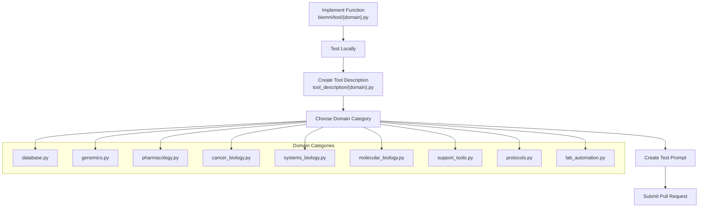

**Static Tool Development Process from Implementation to Integration**

Sources: [CONTRIBUTION.md:14-35](), [biomni/utils.py:845-876]()

### Dynamic Tool Addition Workflow

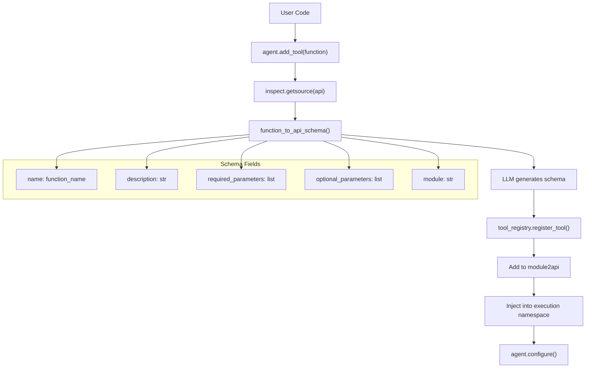

**Dynamic Tool Addition via add_tool() Method**

Sources: [biomni/agent/a1.py:225-348](), [biomni/utils.py:251-291]()

## Creating New Tools

### Simple Tool Implementation Pattern

Tools are implemented as Python functions with clear type hints and docstrings. The implementation pattern follows these principles:

| Component | Purpose | Example |
|-----------|---------|---------|
| Type Hints | Define parameter and return types | `def tool(param: str) -> str:` |
| Docstring | Explain functionality and usage | Triple-quoted documentation |
| Error Handling | Graceful failure with informative messages | Try-except blocks |
| Return Format | Consistent string output | Success message or error details |

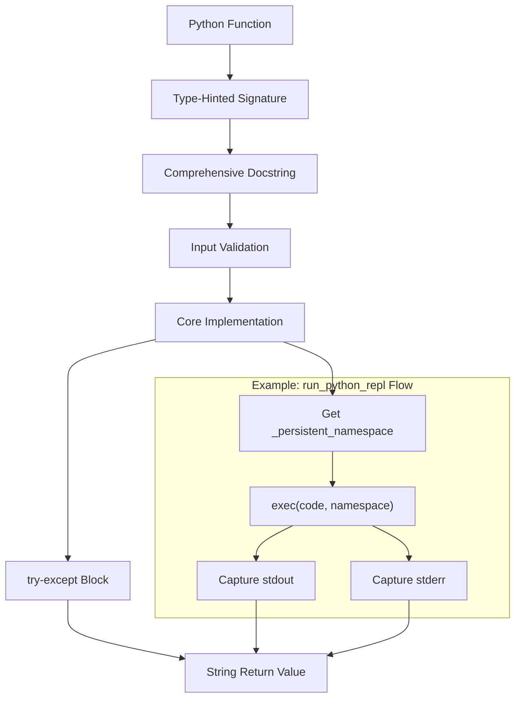

**Tool Implementation Pattern with Type Safety and Error Handling**

Sources: [biomni/tool/support_tools.py:8-68]()

### Tool Function Requirements

All tool functions must adhere to these requirements:

```python
# Required structure
def tool_name(
    required_param: type,
    optional_param: type = default_value
) -> str:
    """Brief description.
    
    Args:
        required_param: Description
        optional_param: Description with default
    
    Returns:
        Success message or error details
    """
    try:
        # Implementation
        result = perform_operation(required_param, optional_param)
        return f"Success: {result}"
    except Exception as e:
        return f"Error: {str(e)}"
```

The function should return a string that is either:
- A success message with results
- An error message with diagnostic information

Sources: [biomni/tool/support_tools.py:1-100]()

### Database Integration Tools

Database tools follow a standardized pattern using helper functions for consistent error handling and LLM integration:

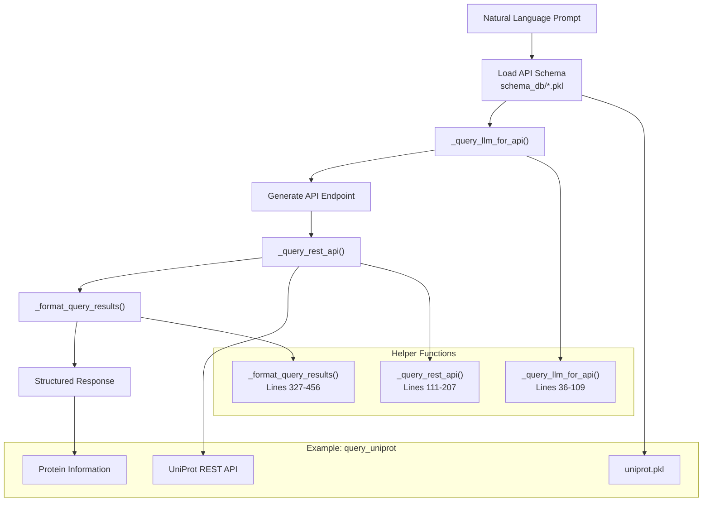

**Database Tool Integration Pattern with Helper Functions**

Sources: [biomni/tool/database.py:36-109](), [biomni/tool/database.py:111-207](), [biomni/tool/database.py:458-551]()

## Tool Description Schema

Every tool requires a corresponding description in the `tool_description` module. The schema follows a standardized format that enables automatic tool discovery and validation.

### Description Structure

| Field | Type | Purpose | Example |
|-------|------|---------|---------|
| `name` | string | Function name | `"query_uniprot"` |
| `description` | string | What the tool does | `"Query the UniProt REST API..."` |
| `required_parameters` | array | Must-have parameters | `[{"name": "prompt", "type": "str", ...}]` |
| `optional_parameters` | array | Optional parameters | `[{"name": "max_results", "type": "int", ...}]` |

### Parameter Schema Format

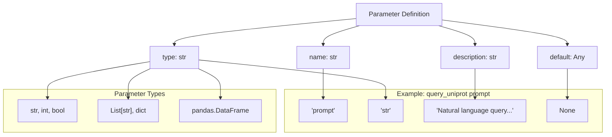

**Parameter Schema Structure with Examples**

Sources: [biomni/tool/tool_description/database.py:17-25](), [biomni/tool/tool_description/support_tools.py:6-13]()

### Auto-Generation of Tool Schemas

Tool descriptions can be automatically generated using the `function_to_api_schema` utility, which uses an LLM to analyze function signatures and docstrings:

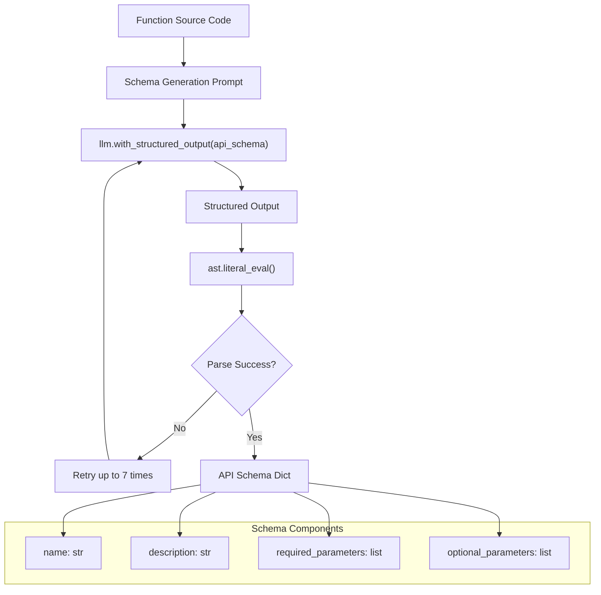

**Automatic Schema Generation Using LLM**

Usage example:

```python
from biomni.utils import function_to_api_schema
from biomni.llm import get_llm
import inspect

# Get function source code
function_code = inspect.getsource(my_function)

# Generate schema
llm = get_llm('claude-sonnet-4-20250514')
schema = function_to_api_schema(function_code, llm)

# Schema contains: name, description, required_parameters, optional_parameters
```

The function uses a carefully crafted prompt that instructs the LLM to:
- Follow the function signature strictly
- Set None for parameters without defaults (not null)
- Use capitalized True/False for booleans
- Keep descriptions clear and succinct
- Avoid creating fake optional parameters

Sources: [biomni/utils.py:251-291](), [CONTRIBUTION.md:26-32]()

## Database Integration Pattern

Database tools in Biomni use a three-layer architecture to translate natural language queries into API calls:

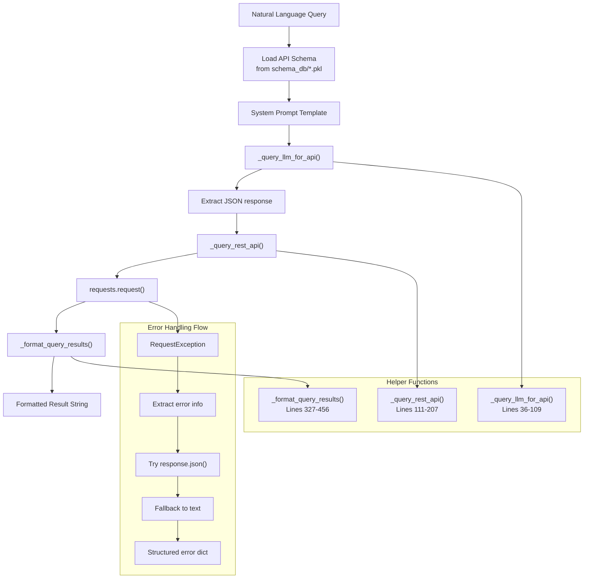

**Three-Layer Database Tool Architecture**

### LLM-Powered Natural Language to API Translation

The `_query_llm_for_api` function converts natural language to structured API parameters:

| Step | Action | Implementation |
|------|--------|----------------|
| 1. Load Schema | Read API schema from pickle file | `load_pickle(schema_path)` |
| 2. Build Prompt | Insert schema into template | `template.format(schema=schema, prompt=prompt)` |
| 3. Invoke LLM | Get structured response | `default_config.llm.invoke(system_prompt)` |
| 4. Parse JSON | Extract API parameters | `json.loads()` with retry logic |
| 5. Return | Provide API endpoint and params | Dictionary with endpoint, method, params |

The system prompt template instructs the LLM to:
- Analyze the natural language query
- Map it to appropriate API endpoints
- Extract required and optional parameters
- Return valid JSON matching the schema

Sources: [biomni/tool/database.py:36-109]()

### Database Helper Functions Reference

Three core helper functions provide consistent behavior across all database tools:

| Function | Purpose | Key Parameters | Return Type |
|----------|---------|----------------|-------------|
| `_query_llm_for_api()` | Convert NL to API call | `prompt`, `schema_path`, `template` | `dict` with endpoint info |
| `_query_rest_api()` | Execute HTTP requests | `endpoint`, `method`, `params`, `headers` | API response or error dict |
| `_format_query_results()` | Reduce response size | `result`, `max_results`, `include_fields` | Formatted string |

### REST API Execution and Error Handling

The `_query_rest_api` function handles all HTTP interactions:

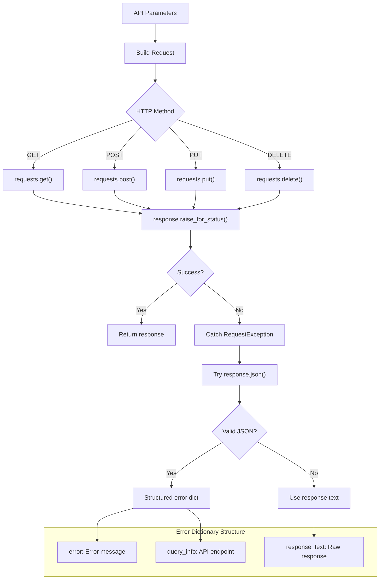

**REST API Execution with Comprehensive Error Handling**

The error handling pattern ensures:
- All HTTP exceptions are caught and structured
- API error responses are parsed when available
- Diagnostic information is preserved for debugging
- Users receive actionable error messages

Sources: [biomni/tool/database.py:111-207]()

### Result Formatting

The `_format_query_results` function reduces response sizes for LLM context management:

```python
# Truncates large responses while preserving structure
# Handles both list and dict responses
# Includes continuation indicators ("...")
```

This prevents context overflow when APIs return large datasets.

Sources: [biomni/tool/database.py:327-456]()

## Development Workflow and Quality Control

### Pre-commit Hooks and Code Quality

The project uses automated code quality checks to maintain consistency:

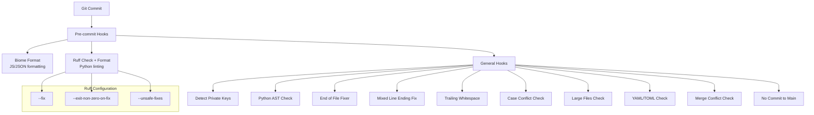

**Automated Code Quality Pipeline**

Sources: [.pre-commit-config.yaml:8-34]()

### Testing Requirements

Before submitting tools, developers must create test prompts to validate functionality:

| Test Component | Purpose | Example |
|----------------|---------|---------|
| Function Test | Verify implementation | Unit test with sample inputs |
| Agent Test | Verify A1 integration | Test prompt using the tool |
| Error Test | Verify error handling | Invalid inputs and edge cases |

### Software Dependencies

For tools requiring additional software, create installation scripts:

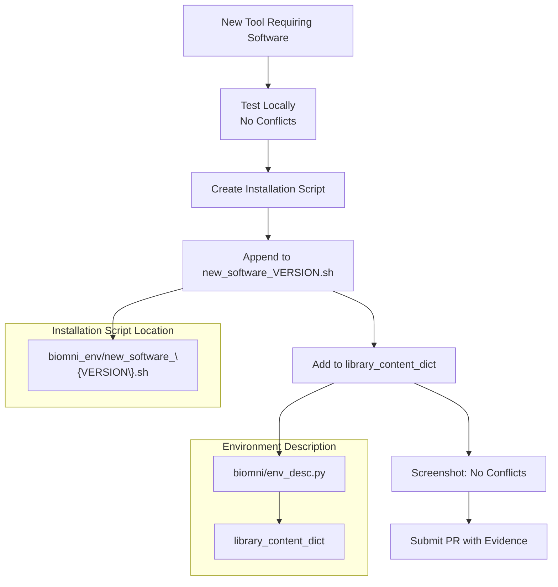

**Software Dependency Management Workflow**

Sources: [CONTRIBUTION.md:56-64]()

## Code Execution Tools

Biomni supports execution across multiple environments with standardized interfaces and timeout protection.

### Multi-Language Execution Architecture

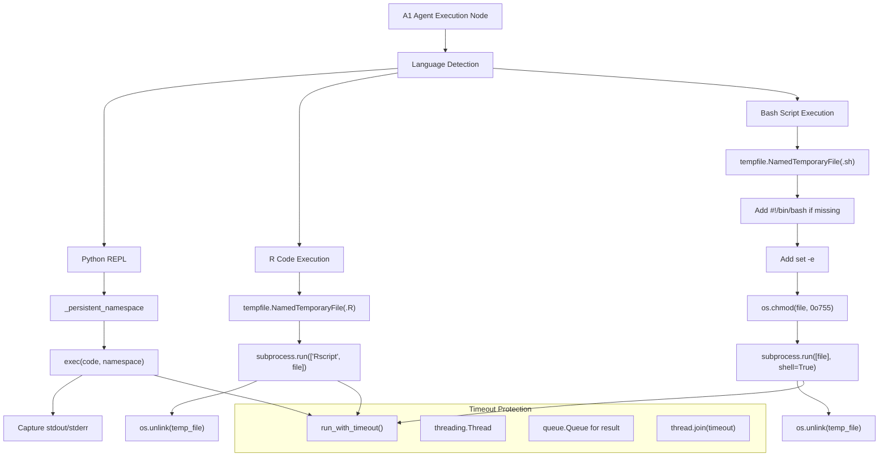

**Multi-Language Code Execution with Timeout Protection**

### Execution Environment Details

| Environment | Function | Temporary File | Cleanup | Timeout Support |
|-------------|----------|----------------|---------|-----------------|
| Python | `run_python_repl` | No (uses namespace) | N/A | Yes |
| R | `run_r_code` | `.R` file | `os.unlink()` | No (direct subprocess) |
| Bash | `run_bash_script` | `.sh` file | `os.unlink()` | No (direct subprocess) |
| CLI | `run_cli_command` | No | N/A | No |

### Python REPL with Persistent State

The Python execution environment maintains state across code blocks:

```python
# Variables and imports persist between executions
# Located in global _persistent_namespace dictionary
# Allows multi-step workflows without re-initialization
```

The A1 agent injects custom tools into this namespace before execution, making them available to generated code.

Sources: [biomni/tool/support_tools.py:1-100]()

### Timeout Implementation

The `run_with_timeout` function uses threading to prevent infinite execution:

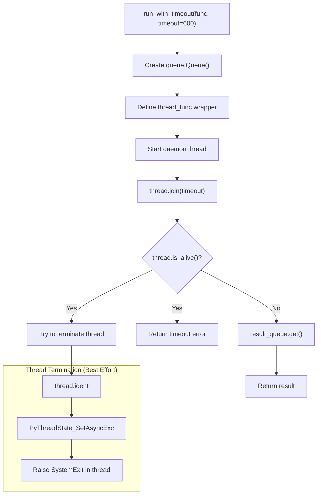

**Threading-Based Timeout Protection**

Note: Thread termination in Python is not 100% reliable. The function uses daemon threads and attempts `PyThreadState_SetAsyncExc` as a best-effort approach.

Sources: [biomni/utils.py:183-243]()

### Bash Script Execution

The `run_bash_script` function includes automatic safety features:

| Feature | Purpose | Implementation |
|---------|---------|----------------|
| Shebang injection | Ensure bash interpreter | Prepends `#!/bin/bash` if missing |
| Error propagation | Exit on first error | Adds `set -e` if not present |
| Executable permissions | Allow execution | `os.chmod(file, 0o755)` |
| Environment inheritance | Preserve context | `env=os.environ.copy()` |
| Working directory | Maintain path context | `cwd=os.getcwd()` |

Sources: [biomni/utils.py:56-145]()

## Tool Registry Architecture

### Module-Based Organization

The tool system organizes functionality by biological domain:

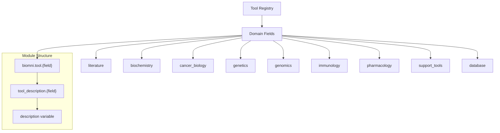

**Domain-Based Tool Organization**

Sources: [biomni/utils.py:845-873]()

This architecture enables the A1 agent to dynamically discover and utilize tools across the entire biomedical research spectrum while maintaining type safety and user-friendly error handling.

---