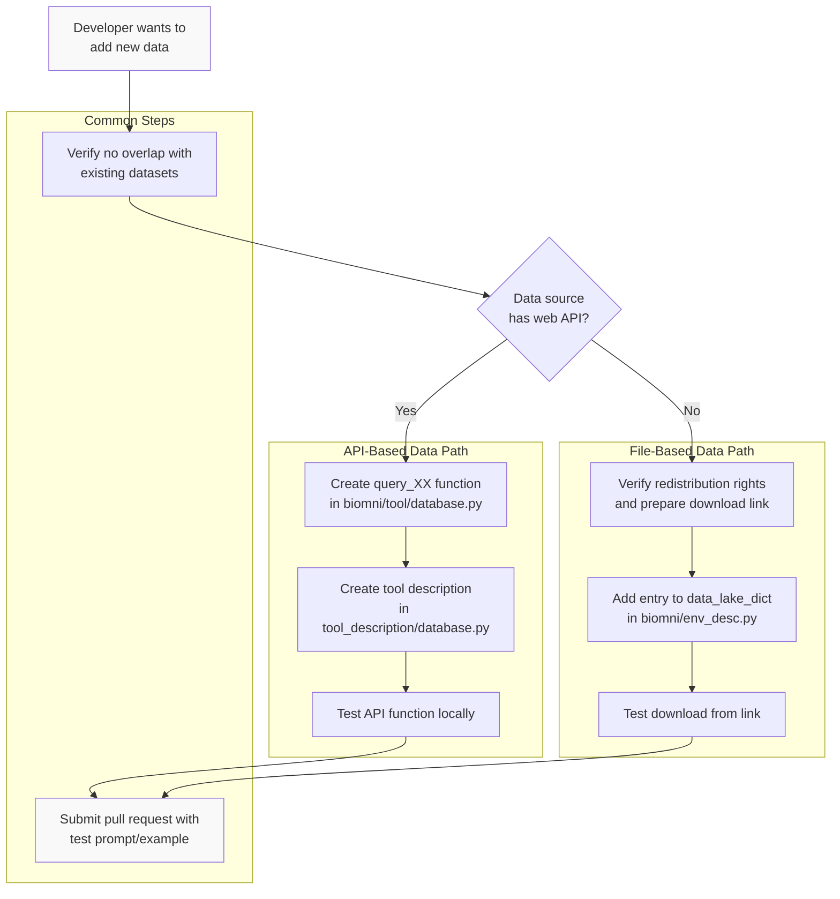
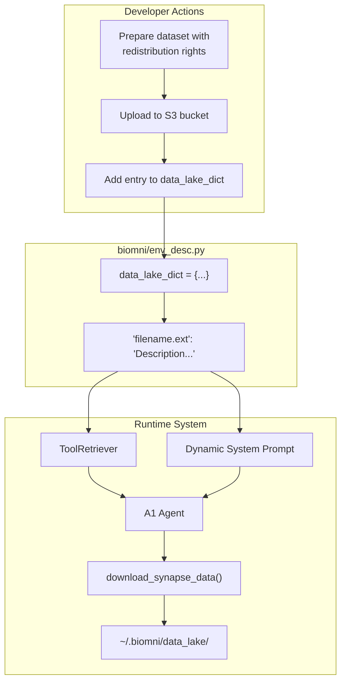
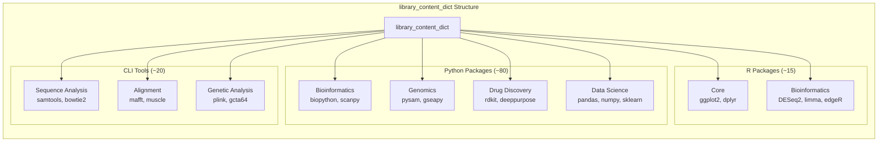
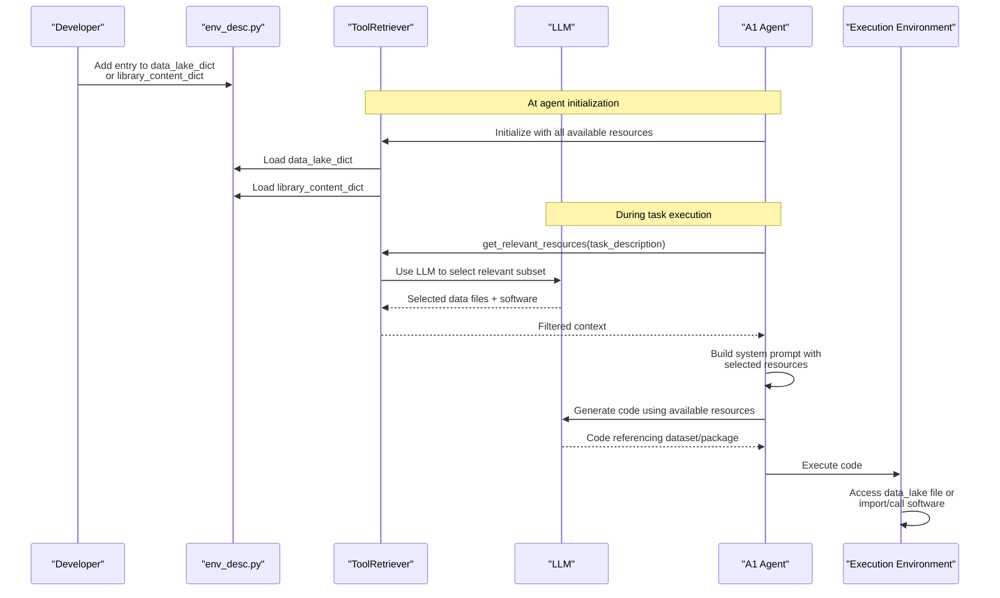

# Adding Data and Software

<details>
<summary>Relevant source files</summary>

The following files were used as context for generating this wiki page:

- [.pre-commit-config.yaml](.pre-commit-config.yaml)
- [CONTRIBUTION.md](CONTRIBUTION.md)
- [biomni/agent/env_collection.py](biomni/agent/env_collection.py)
- [biomni/agent/qa_llm.py](biomni/agent/qa_llm.py)
- [biomni/biorxiv_scripts/extract_biorxiv_tasks.py](biomni/biorxiv_scripts/extract_biorxiv_tasks.py)
- [biomni/biorxiv_scripts/process_all_subjects.py](biomni/biorxiv_scripts/process_all_subjects.py)
- [biomni/env_desc.py](biomni/env_desc.py)
- [biomni/tool/molecular_biology.py](biomni/tool/molecular_biology.py)

</details>


This page provides a comprehensive guide for developers who want to extend Biomni's data and software ecosystem. It covers the process of adding new datasets (both API-based and file-based) and software packages (Python packages, R packages, and CLI tools) to the system.

For information about adding new tools (functions), see [Tool Development](#8.4). For general contribution guidelines and code quality standards, see [Contributing Guidelines](#8.2).

## Overview

Biomni maintains two core dictionaries that catalog available resources:

- **`data_lake_dict`** - A registry of 77 datasets (~11GB total) stored in S3 or accessed via APIs
- **`library_content_dict`** - A catalog of 100+ software packages (Python, R, CLI tools) available in the environment

These dictionaries serve multiple purposes:
- **Agent awareness**: The A1 agent uses these dictionaries to understand available resources during planning
- **Tool retrieval**: The ToolRetriever system references these for RAG-based resource selection
- **Documentation**: Provides clear descriptions for users and the LLM

Both dictionaries are defined in [biomni/env_desc.py]().

**Sources:** [biomni/env_desc.py:1-221](), [CONTRIBUTION.md:35-64]()

## Data Addition Workflow



**Sources:** [CONTRIBUTION.md:36-54]()

## Adding API-Based Data Sources

When a dataset is accessible via a web API (e.g., RESTful API, GraphQL endpoint), implement it as a queryable tool function.

### Process Steps

1. **Create Query Function** in [biomni/tool/database.py]():

```python
def query_your_database(query_param: str, other_param: int = 10) -> dict:
    """Query the YourDatabase API for biological information.
    
    Args:
        query_param: Primary search parameter
        other_param: Optional filter parameter
        
    Returns:
        dict: Structured results with explanation field
    """
    # Implementation
    results = fetch_from_api(query_param, other_param)
    
    return {
        "explanation": "Output fields: ...",
        "results": results
    }
```

2. **Create Tool Description** in [biomni/tool/tool_description/database.py]():

Use the auto-generation helper:

```python
from biomni.utils import function_to_api_schema
from biomni.llm import get_llm

llm = get_llm('claude-sonnet-4-20250514')
desc = function_to_api_schema(your_function_code, llm)
```

3. **Test Locally**: Verify the agent can successfully use your new tool

4. **Submit Pull Request** with:
   - Function implementation
   - Tool description
   - Test prompt demonstrating usage

### Example: Existing Database Tools

The [biomni/tool/database.py]() file contains 40+ database query functions following this pattern:

| Function | Database | Purpose |
|----------|----------|---------|
| `query_uniprot` | UniProt | Protein sequence and annotation data |
| `query_kegg` | KEGG | Pathway and enzyme information |
| `query_pubchem` | PubChem | Chemical compound properties |
| `query_ensembl` | Ensembl | Genomic features and variants |
| `blast_sequence` | NCBI BLAST | Sequence similarity search |

**Sources:** [CONTRIBUTION.md:38-43](), [biomni/tool/database.py]()

## Adding File-Based Data to Data Lake

When data must be downloaded as files (no suitable API), add it to the centralized data lake.

### Data Lake Architecture



**Sources:** [biomni/env_desc.py:1-79](), [CONTRIBUTION.md:45-54]()

### Process Steps

1. **Verify Uniqueness**: Check that no existing dataset overlaps with your data
   - Review [biomni/env_desc.py:1-79]() for existing datasets
   - Ensure your data adds unique value

2. **Prepare Download Link**: 
   - Verify redistribution rights (commercial-friendly license)
   - Upload to S3 bucket or provide stable URL
   - Test download accessibility

3. **Add Dictionary Entry** in [biomni/env_desc.py]():

```python
data_lake_dict = {
    # ... existing entries ...
    "your_dataset_name.parquet": "Clear description of dataset contents, source, and purpose.",
}
```

**Format Guidelines:**
- **Filename**: Use lowercase with underscores, include file extension
- **Description**: Start with data type/category, include source and intended use
- **Length**: 1-2 sentences, clear and concise

4. **Submit Pull Request** with:
   - Modified `biomni/env_desc.py`
   - Download link and access instructions
   - Example use case or test prompt

### Existing Data Lake Categories

The data lake contains 77 datasets organized by domain:

| Category | Count | Examples |
|----------|-------|----------|
| Protein Interactions | 8 | affinity_capture-ms.parquet, two-hybrid.parquet |
| Drug Discovery | 5 | BindingDB_All_202409.tsv, broad_repurposing_hub_*.parquet |
| Genomics & Variants | 5 | genebass_pLoF_filtered.pkl, gwas_catalog.pkl |
| Expression Data | 4 | gtex_tissue_gene_tpm.parquet, DepMap_*.csv |
| Gene Sets | 19 | msigdb_human_*_geneset.parquet, mousemine_*_geneset.parquet |
| Assay Data | 8 | evebio_*_table.csv |
| Other | 28 | Various specialized datasets |

**Sources:** [biomni/env_desc.py:1-79]()

## Adding Software Packages

Software packages include Python packages, R packages, and CLI tools that can be invoked by the agent.

### Software Categories in library_content_dict



**Sources:** [biomni/env_desc.py:82-221]()

### Process Steps

1. **Test Locally**: Install in your environment and verify no conflicts
   ```bash
   conda activate biomni_e1
   # Test installation
   pip install your-package  # or conda install
   # Verify no conflicts with existing packages
   ```

2. **Create Installation Script**: Append to `biomni_env/new_software_{VERSION}.sh`
   ```bash
   # Install your new software
   conda install -c conda-forge your-package
   # or
   pip install your-package==1.2.3
   
   # For CLI tools
   conda install -c bioconda your-cli-tool
   ```

3. **Add Dictionary Entry** in [biomni/env_desc.py:82-221]():

**Python Package Format:**
```python
library_content_dict = {
    # ... existing entries ...
    "your-package": "[Python Package] Brief description of functionality, primary use cases, and key features.",
}
```

**R Package Format:**
```python
"your-r-package": "[R Package] Description of package functionality. Use with subprocess.run(['Rscript', '-e', 'library(your-r-package); ...']).",
```

**CLI Tool Format:**
```python
"your-cli-tool": "[CLI Tool] Description of the tool's purpose. Use with subprocess.run(['your-cli-tool', ...]).",
```

4. **Submit Pull Request** with:
   - Installation script
   - Modified `biomni/env_desc.py`
   - Screenshot showing no environment conflicts
   - Example code demonstrating usage

**Sources:** [CONTRIBUTION.md:56-64](), [biomni/env_desc.py:82-221]()

## Entry Format Specifications

### data_lake_dict Entry Format

**Structure:**
```python
"filename.extension": "Description of dataset contents and source."
```

**Requirements:**
- **Key**: Exact filename as stored in S3 (case-sensitive)
- **Value**: Single-sentence description starting with data type
- **File extensions**: `.parquet`, `.csv`, `.pkl`, `.tsv`, `.txt`, `.json`, `.obo`

**Example Entries:**
```python
data_lake_dict = {
    "BindingDB_All_202409.tsv": "Measured binding affinities between proteins and small molecules for drug discovery.",
    "gtex_tissue_gene_tpm.parquet": "Gene expression (TPM) across human tissues from GTEx.",
    "msigdb_human_h_hallmark_geneset.parquet": "Hallmark gene sets from MSigDB.",
}
```

### library_content_dict Entry Format

**Structure:**
```python
"package-name": "[Type] Description with usage instructions."
```

**Requirements:**
- **Key**: Exact package name (pip/conda name for Python, CRAN name for R)
- **Prefix**: One of `[Python Package]`, `[R Package]`, `[CLI Tool]`
- **Description**: Functionality + usage pattern for R/CLI tools
- **Usage hints**: Include `subprocess.run()` examples for R and CLI

**Example Entries:**

```python
library_content_dict = {
    # Python package (no subprocess needed)
    "scanpy": "[Python Package] A scalable toolkit for analyzing single-cell gene expression data, specifically designed for large datasets using AnnData.",
    
    # R package (include subprocess pattern)
    "DESeq2": "[R Package] Differential gene expression analysis based on the negative binomial distribution. Use with subprocess.run(['Rscript', '-e', 'library(DESeq2); ...']).",
    
    # CLI tool (include subprocess pattern)
    "samtools": "[CLI Tool] A suite of programs for interacting with high-throughput sequencing data. Use with subprocess.run(['samtools', ...]).",
}
```

**Sources:** [biomni/env_desc.py:1-221]()

## Integration with Agent System

Understanding how these dictionaries are used at runtime helps ensure proper formatting.



**Key Points:**
- **Dynamic selection**: Not all 77 datasets are shown to the LLM every time
- **RAG-based filtering**: ToolRetriever uses descriptions to select relevant resources
- **Context assembly**: Selected entries appear in the system prompt
- **Code generation**: LLM generates code referencing these resources by name

**Sources:** [biomni/env_desc.py:1-221](), [biomni/agent/base_agent.py]()

## Commercial Mode Filtering

Biomni supports a `commercial_mode` flag that filters resources to only those with permissive licenses.

### Implementation Pattern

For datasets that should be excluded in commercial mode:

```python
# In biomni/env_desc.py or tool loading code
if not commercial_mode:
    data_lake_dict["licensed_dataset.parquet"] = "Description..."
```

For software that requires licensing:

```python
if not commercial_mode:
    library_content_dict["licensed-tool"] = "[Python Package] Description..."
```

**When to use:**
- Datasets with non-commercial licenses (CC BY-NC, academic-only)
- Proprietary software requiring paid licenses
- Any resource that cannot be freely used commercially

**Note:** Most existing resources in Biomni are commercially-friendly. Only add commercial filters when necessary and document the licensing restriction clearly in your PR.

**Sources:** [CONTRIBUTION.md:1-130]()

## Validation and Testing

### Pre-Submission Checklist

Before submitting your pull request:

**For Data:**
- [ ] Downloaded and validated data file format
- [ ] Confirmed no overlap with existing datasets
- [ ] Tested download link accessibility
- [ ] Description is clear and concise
- [ ] Created test prompt demonstrating usage

**For Software:**
- [ ] Installed in clean `biomni_e1` environment
- [ ] No dependency conflicts (`conda list`, `pip list`)
- [ ] Created installation script
- [ ] Entry includes usage pattern (for R/CLI)
- [ ] Screenshot showing successful installation

**For Both:**
- [ ] Entry added to correct dictionary in `env_desc.py`
- [ ] Followed format conventions exactly
- [ ] Pre-commit hooks pass (see [Code Quality and Testing](#8.3))

### Local Testing Example

Test that the agent can discover and use your new resource:

```python
from biomni.agent.biomni_agent import BiomniAgent

# Initialize agent
agent = BiomniAgent(llm='claude-sonnet-4-20250514')

# Test with a prompt that should use your new resource
log, result = agent.go(
    "Use the your_new_dataset to analyze X. "
    "Use your-new-package for processing."
)

# Verify the resource was selected and used
print("Agent used resources:", result)
```

**Sources:** [CONTRIBUTION.md:1-130]()

## Related Pages

- [Tool Development](#8.4) - Creating new tool functions
- [Contributing Guidelines](#8.2) - General contribution process
- [Code Quality and Testing](#8.3) - Pre-commit hooks and testing
- [Data Lake Catalog](#9.1) - Complete list of existing datasets
- [Software and Library Reference](#9.2) - Complete list of existing software

**Sources:** [CONTRIBUTION.md:1-130](), [biomni/env_desc.py:1-221]()

---