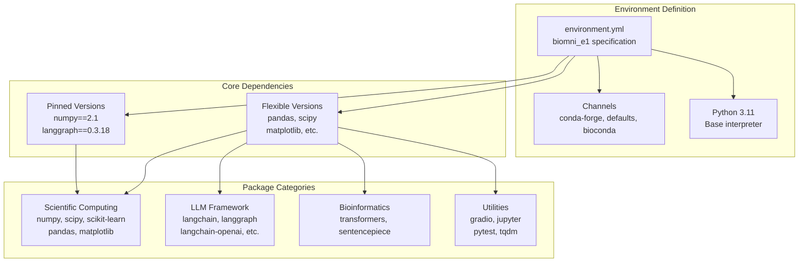
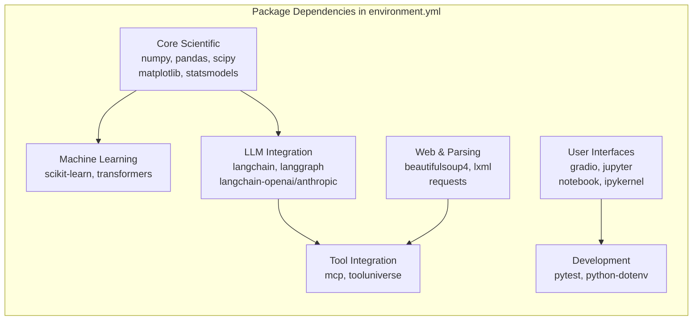
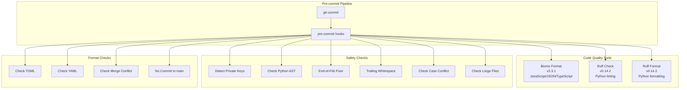
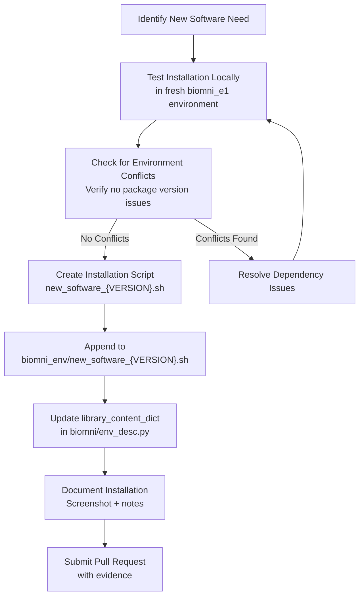
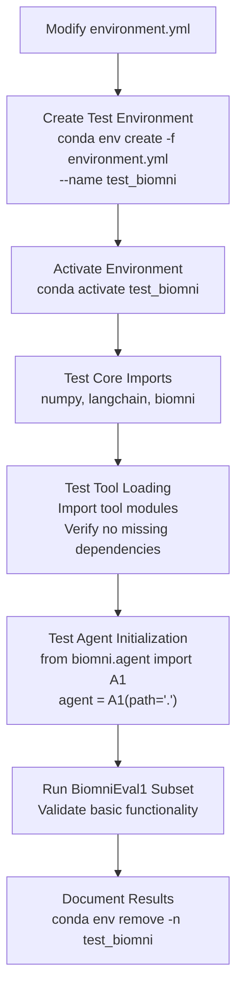
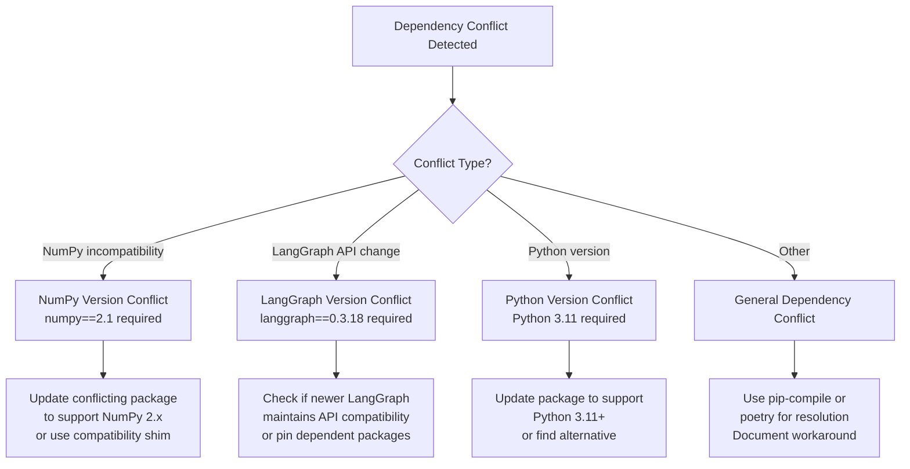

# Environment Management

<details>
<summary>Relevant source files</summary>

The following files were used as context for generating this wiki page:

- [biomni_env/environment.yml](biomni_env/environment.yml)

</details>


## Purpose and Scope

This document explains how to manage and modify the Biomni development environment, including the conda environment specification, dependency management, and development tooling. It covers the technical details of the `biomni_e1` environment and the procedures for adding new software packages.

For information about configuring LLM API keys and runtime settings, see [API Keys and Configuration](#3.2). For the broader installation process, see [Installation and Setup](#3).

---

## The biomni_e1 Conda Environment

### Environment Structure

Biomni uses a single conda environment named `biomni_e1` to ensure reproducibility across installations. The environment specification is defined in [biomni_env/environment.yml:1-40]().



**Sources:** [biomni_env/environment.yml:1-40]()

### Version Pinning Strategy

Biomni uses a **selective pinning** approach to balance stability and flexibility:

| Package | Version Constraint | Reason |
|---------|-------------------|---------|
| `python` | `=3.11` | Compatibility with NumPy 2.x and modern language features |
| `numpy` | `==2.1` | Major version change requires explicit pin |
| `langgraph` | `==0.3.18` | Specific API contract for state machine execution |
| All others | Latest available | Maximize compatibility and access to bug fixes |

This strategy minimizes dependency conflicts while ensuring critical components maintain stable behavior.

**Sources:** [biomni_env/environment.yml:7-18]()

### Package Organization

The environment installs all packages via `pip` rather than mixing conda and pip installations:

```yaml
dependencies:
  - python=3.11
  - pip
  - pip:
      - numpy==2.1
      - pandas
      - matplotlib
      # ... (all other packages)
```

This approach avoids conda/pip dependency resolution conflicts and ensures reproducible installations.

**Sources:** [biomni_env/environment.yml:6-40]()

---

## Dependency Management

### Adding Python Packages

To add a new Python package to the environment:

1. **Identify the package name and version** (if pinning is required)
2. **Edit environment.yml**:
   - Add the package to the `pip:` list in [biomni_env/environment.yml:9-40]()
   - Use version pinning only if necessary for compatibility
3. **Test the modified environment**:
   ```bash
   conda env create -f biomni_env/environment.yml --name test_env
   conda activate test_env
   # Run tests to verify compatibility
   ```
4. **Update the environment** for existing installations:
   ```bash
   conda env update -f biomni_env/environment.yml --prune
   ```

### Package Categories

The environment includes packages organized by function:



**Sources:** [biomni_env/environment.yml:10-39]()

### Dependency Resolution

When adding packages, verify compatibility with existing dependencies:

1. **Check for conflicts** with pinned versions (`numpy==2.1`, `langgraph==0.3.18`)
2. **Test import statements** in a fresh Python session
3. **Run the benchmark suite** to ensure no regressions:
   ```python
   from biomni.task.biomni_eval1 import BiomniEval1
   eval = BiomniEval1()
   # Run subset of tests
   ```

**Sources:** [biomni_env/environment.yml:10-18]()

---

## Development Tooling

### Pre-commit Hooks

Biomni uses pre-commit hooks to enforce code quality standards. The configuration is defined in [.pre-commit-config.yaml:1-42]().



**Sources:** [.pre-commit-config.yaml:1-42]()

### Installing Pre-commit Hooks

After cloning the repository:

```bash
# Install pre-commit (if not already installed)
pip install pre-commit

# Install the git hooks
pre-commit install

# Run hooks manually on all files
pre-commit run --all-files
```

### Ruff Configuration

Ruff provides both linting and formatting with these settings:

| Hook | Configuration | Purpose |
|------|--------------|---------|
| `ruff-check` | `--fix --exit-non-zero-on-fix --unsafe-fixes` | Auto-fix linting issues, fail if changes made |
| `ruff-format` | (default) | Enforce consistent code formatting |

The hooks run on both `pre-commit` and `pre-push` stages [.pre-commit-config.yaml:4-6]().

**Sources:** [.pre-commit-config.yaml:13-18]()

### Biome Integration

Biome handles formatting for non-Python files:

- JavaScript/TypeScript
- JSON configuration files
- CSS/HTML (if present)

This ensures consistent formatting across the entire codebase, not just Python files.

**Sources:** [.pre-commit-config.yaml:9-12]()

### Branch Protection

The pre-commit configuration prevents direct commits to the `main` branch:

```yaml
- id: no-commit-to-branch
  args: ["--branch=main"]
```

This enforces the pull request workflow described in [CONTRIBUTION.md:111-117]().

**Sources:** [.pre-commit-config.yaml:33-34]()

---

## Adding New Software

### Installation Script Pattern

When adding software that requires system-level installation (not just Python packages), follow this workflow:



**Sources:** [CONTRIBUTION.md:56-64]()

### Installation Script Structure

Installation scripts should be idempotent and check for existing installations:

```bash
#!/bin/bash
# Example structure for new_software_v1.sh

set -e  # Exit on error

# Check if software already exists
if command -v software_command &> /dev/null; then
    echo "Software already installed"
    exit 0
fi

# Installation steps
echo "Installing new software..."
# ... installation commands ...

# Verify installation
software_command --version
echo "Installation complete"
```

### Updating Environment Descriptions

After adding software, update `library_content_dict` in `biomni/env_desc.py` to make it discoverable by the tool retriever:

```python
library_content_dict = {
    # ... existing entries ...
    "new_software_name": {
        "description": "Brief description of what the software does",
        "installation": "Command or reference to installation script",
        "version": "1.0.0",
        "purpose": "Detailed explanation of use cases",
    }
}
```

This enables the agent to discover and use the new software through the tool retrieval system (see [Tool Registry and Retrieval](#2.4)).

**Sources:** [CONTRIBUTION.md:56-64]()

### Evidence Requirements

Pull requests for new software must include:

1. **Installation bash script** - Complete, tested commands
2. **Conflict verification** - Screenshot showing:
   - Successful installation in clean `biomni_e1` environment
   - `conda list` or `pip list` output showing no conflicts
   - Test execution proving functionality
3. **Documentation update** - Entry in `library_content_dict`

**Sources:** [CONTRIBUTION.md:60-63]()

---

## Environment Testing and Validation

### Testing Modified Environments

Before submitting changes to `environment.yml`, validate the modified environment:



### Validation Checklist

| Component | Validation Method | Expected Result |
|-----------|------------------|-----------------|
| Core imports | `import numpy, pandas, langchain` | No errors |
| Agent creation | `A1(path='.')` | Successful initialization |
| Tool imports | `from biomni.tool import database` | All tools load |
| LLM integration | `get_llm('gpt-4')` with mock API | Returns ChatOpenAI instance |
| Gradio UI | `agent.launch_gradio_demo()` | Interface launches |

**Sources:** [CONTRIBUTION.md:8-10]()

---

## Environment Conflict Resolution

### Common Conflict Scenarios



### Resolution Strategies

1. **NumPy 2.x Migration**: Many scientific packages require updates for NumPy 2.x compatibility. Check package issue trackers for compatibility status.

2. **LangGraph API Stability**: LangGraph 0.3.18 is pinned for the state machine workflow in [biomni/agent/base_agent.py](). Changes to this version require testing the entire execution pipeline.

3. **Version Ranges**: For new packages, prefer minimum version constraints (`package>=1.0`) rather than exact pins unless necessary.

**Sources:** [biomni_env/environment.yml:10-18]()

---

## Best Practices

### Development Workflow

1. **Always work in a branch**:
   ```bash
   git checkout -b feature/new-dependency
   ```

2. **Test changes locally** before pushing:
   ```bash
   conda env update -f biomni_env/environment.yml --prune
   python -m pytest tests/
   ```

3. **Run pre-commit hooks** before committing:
   ```bash
   pre-commit run --all-files
   ```

4. **Document changes** in pull request description:
   - Why the dependency was added
   - Version compatibility verification
   - Test results

**Sources:** [CONTRIBUTION.md:111-117](), [.pre-commit-config.yaml:33-34]()

### Version Documentation

When modifying `environment.yml`, document the rationale for any version pins:

```yaml
pip:
  - numpy==2.1  # Required for Python 3.11 compatibility
  - langgraph==0.3.18  # State machine API used in base_agent.py
  - pandas  # No pin needed, stable API
```

Include inline comments for future maintainers to understand version constraints.

### Testing on Multiple Platforms

If possible, test environment changes on multiple platforms:

- **Linux**: Primary development platform
- **macOS**: Common for researchers
- **Windows**: May have conda-forge package differences

Note platform-specific issues in the pull request.

**Sources:** [CONTRIBUTION.md:105-109]()

---

## Environment Creation from Scratch

### Initial Setup Command

To create the `biomni_e1` environment from the specification:

```bash
# Create environment
conda env create -f biomni_env/environment.yml

# Activate environment
conda activate biomni_e1

# Verify installation
python -c "import biomni; from biomni.agent import A1; print('Environment ready')"
```

### Environment Update Command

To update an existing environment after `environment.yml` changes:

```bash
# Update environment (keeps existing packages if compatible)
conda env update -f biomni_env/environment.yml

# Or, update with cleanup (removes packages not in yml)
conda env update -f biomni_env/environment.yml --prune
```

### Environment Removal

To completely remove and recreate:

```bash
# Remove old environment
conda env remove -n biomni_e1

# Recreate from scratch
conda env create -f biomni_env/environment.yml
```

**Sources:** [biomni_env/environment.yml:1-40]()

---

## Integration with Development Guide

This environment management documentation connects to other development resources:

- **[Package Structure](#8.1)**: Understand where environment-related files live
- **[Contributing Guidelines](#8.2)**: Full contribution workflow including environment changes
- **[Code Quality and Testing](#8.3)**: How pre-commit hooks integrate with testing
- **[Tool Development](#8.4)**: Dependencies needed for new tools
- **[Adding Data and Software](#8.5)**: Process for extending the environment with new capabilities

The environment forms the foundation for all Biomni development activities, ensuring consistent behavior across installations and deployments.

---