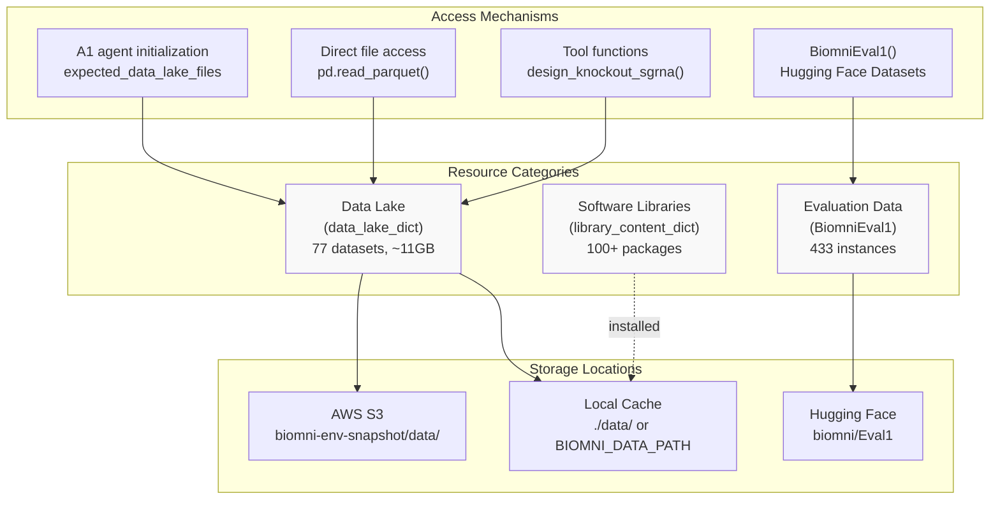
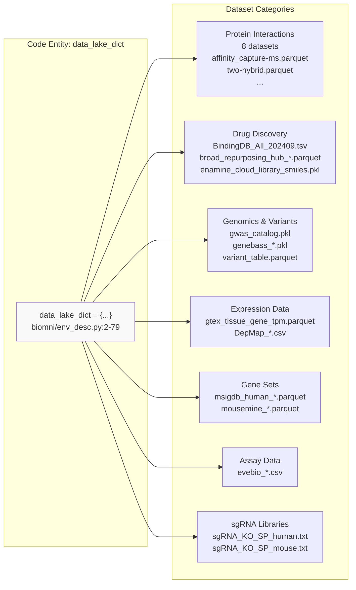
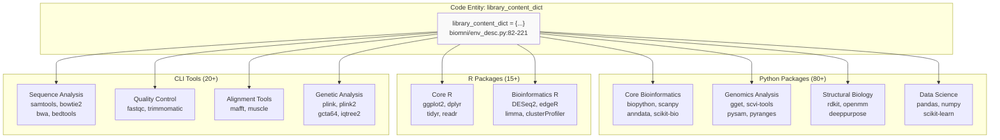
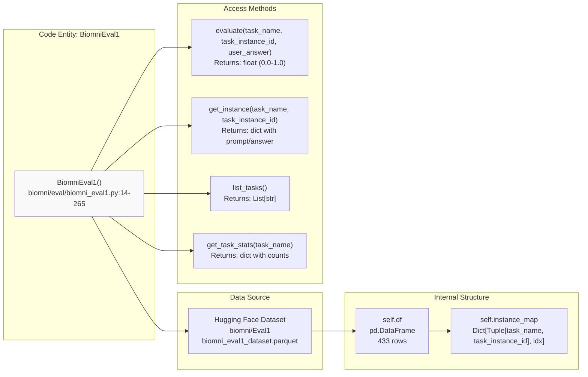
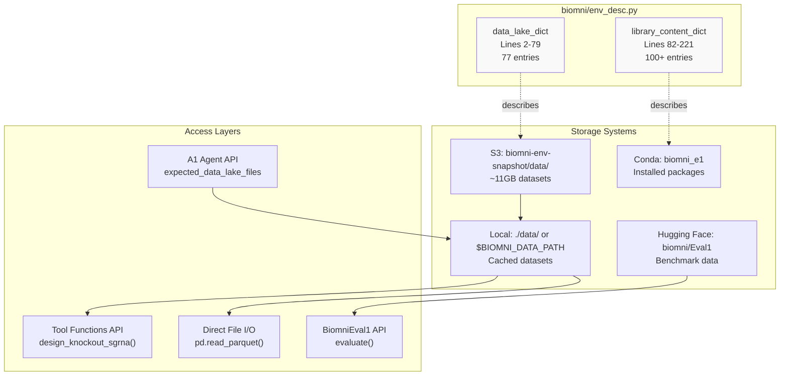

# Data and Resources Reference

<details>
<summary>Relevant source files</summary>

The following files were used as context for generating this wiki page:

- [README.md](README.md)
- [biomni/env_desc.py](biomni/env_desc.py)
- [biomni/eval/__init__.py](biomni/eval/__init__.py)
- [biomni/eval/biomni_eval1.py](biomni/eval/biomni_eval1.py)
- [biomni/tool/molecular_biology.py](biomni/tool/molecular_biology.py)
- [biomni/version.py](biomni/version.py)

</details>


This page provides a comprehensive reference for the data and software resources available in the Biomni ecosystem. It covers the organization, structure, and access patterns for the ~11GB data lake, evaluation datasets, and 100+ integrated software tools and libraries.

For detailed catalogs of specific resources, see:
- [Data Lake Catalog](#9.1) - Complete listing of 77 datasets with descriptions and use cases
- [Software and Library Reference](#9.2) - Full catalog of Python packages, R packages, and CLI tools

For information about using tools that access these resources, see [Tool Reference](#5).

---

## Resource Ecosystem Overview

The Biomni system provides three main categories of resources that support biomedical AI workflows:

**Resource Organization by Type**



**Sources:** [biomni/env_desc.py:1-222](), [biomni/eval/biomni_eval1.py:1-325](), [README.md:142-158]()

---

## Data Lake Architecture

The data lake is a curated collection of 77 biomedical datasets totaling approximately 11GB, automatically downloaded and cached on first use.

### Data Lake Dictionary Structure

**Mapping Natural Language to Code: `data_lake_dict`**



**Sources:** [biomni/env_desc.py:1-79]()

The `data_lake_dict` is a Python dictionary where:
- **Keys**: Filenames of datasets (e.g., `"BindingDB_All_202409.tsv"`)
- **Values**: Human-readable descriptions of dataset contents and purpose

### Storage and Access Patterns

| Component | Location | Size | Access Method |
|-----------|----------|------|---------------|
| Raw datasets | S3: `biomni-env-snapshot/data/` | ~11GB | Auto-download via `A1()` initialization |
| Local cache | `./data/` or `$BIOMNI_DATA_PATH` | ~11GB | Direct file I/O (`pd.read_parquet()`, `pd.read_csv()`) |
| Dataset metadata | `data_lake_dict` in [biomni/env_desc.py:2-79]() | N/A | Import and reference |

**Sources:** [biomni/env_desc.py:1-79](), [README.md:142-158]()

### Automatic Data Lake Download

The data lake is automatically downloaded when creating an A1 agent instance:

```python
# Default behavior: downloads all data lake files (~11GB)
agent = A1(path='./data', llm='claude-sonnet-4-20250514')

# Skip download for faster initialization
agent = A1(path='./data', llm='claude-sonnet-4-20250514', 
           expected_data_lake_files=[])
```

**Download Mechanism:**
1. Agent initialization checks for expected files in `path` directory
2. Missing files trigger S3 download from `biomni-env-snapshot/data/`
3. Files are cached locally for subsequent use
4. Progress bars show download status

**Sources:** [README.md:151-164]()

### Dataset Categories

**Protein Interactions (8 datasets)**
- Affinity capture MS/RNA interactions
- Co-fractionation data
- Proximity labeling results
- Two-hybrid assays
- Virus-host interactions

**Drug Discovery (4 datasets)**
- BindingDB binding affinities
- Broad Repurposing Hub molecules and annotations
- Enamine REAL library compounds

**Genomics & Variants (6 datasets)**
- GWAS catalog associations
- GeneBass missense, pLoF, synonymous variants
- Comprehensive variant annotations

**Expression Data (5 datasets)**
- GTEx tissue-specific expression
- DepMap gene dependency, effect, and expression
- Protein Atlas tissue profiling

**Gene Sets (19 datasets)**
- MSigDB: hallmark, curated, computational, ontology-based
- MouseMine: positional, curated, regulatory, cell type signatures

**Assay Data (9 datasets)**
- EveBio screening data: assays, compounds, targets, results

**sgRNA Libraries (2 datasets)**
- Pre-computed knockout guides for human and mouse genomes

**Sources:** [biomni/env_desc.py:2-79]()

---

## Software and Library Catalog

The `library_content_dict` defines 100+ integrated software tools, organized by language and domain.

### Library Dictionary Structure

**Mapping Natural Language to Code: `library_content_dict`**



**Sources:** [biomni/env_desc.py:82-221]()

### Package Categories and Descriptions

The `library_content_dict` uses a consistent format:
- **Keys**: Package/tool names (e.g., `"biopython"`, `"samtools"`)
- **Values**: Formatted strings with `[Type] Description`
  - `[Python Package]` - Python library installed via pip/conda
  - `[R Package]` - R library with subprocess usage notes
  - `[CLI Tool]` - Command-line tool with subprocess usage notes

**Example entries:**

```python
"biopython": "[Python Package] A set of tools for biological computation..."
"DESeq2": "[R Package] Differential gene expression analysis... Use with subprocess.run(['Rscript', '-e', 'library(DESeq2); ...'])."
"samtools": "[CLI Tool] A suite of programs for interacting with high-throughput sequencing data. Use with subprocess.run(['samtools', ...])."
```

**Sources:** [biomni/env_desc.py:85-221]()

### Language-Specific Tool Counts

| Language/Type | Count | Installation Method | Access Pattern |
|---------------|-------|---------------------|----------------|
| Python Packages | 80+ | pip/conda in biomni_e1 | Direct import |
| R Packages | 15+ | R/Bioconductor | `subprocess.run(['Rscript', ...])` |
| CLI Tools | 20+ | Binary installation | `subprocess.run(['tool', ...])` |

**Sources:** [biomni/env_desc.py:82-221]()

---

## Evaluation Benchmark Data

The BiomniEval1 benchmark provides 433 test instances across 10 biological reasoning tasks.

**BiomniEval1 Data Access Pattern**



**Sources:** [biomni/eval/biomni_eval1.py:14-265]()

### Dataset Schema

The BiomniEval1 parquet file contains the following columns:

| Column | Type | Description |
|--------|------|-------------|
| `instance_id` | int | Global instance identifier (0-432) |
| `task_instance_id` | int | Task-specific instance identifier |
| `task_name` | str | Task category (e.g., `gwas_causal_gene_opentargets`) |
| `split` | str | Train/validation split indicator |
| `prompt` | str | Task prompt text |
| `answer` | str | Ground truth answer |

**Sources:** [biomni/eval/biomni_eval1.py:31-40](), [biomni/eval/biomni_eval1.py:160-186]()

### Task Types and Validation Logic

The evaluation system uses task-specific validation logic in `_compute_reward()`:

| Task Name | Validation Method | Example Answer |
|-----------|------------------|----------------|
| `gwas_causal_gene_*` | Case-insensitive exact gene match | `"BRCA1"` |
| `crispr_delivery` | Case-insensitive letter match (a-f) | `"c"` |
| `rare_disease_diagnosis` | JSON `OMIM_ID` field match | `{"OMIM_ID": "615291"}` |
| `patient_gene_detection` | JSON `causal_gene` list intersection | `{"causal_gene": ["GENE1"]}` |
| `gwas_variant_prioritization` | Exact variant ID match | `"rs12345"` |
| `hle`, `lab_bench_*` | Case-insensitive letter match | `"B"` |
| `screen_gene_retrieval` | Case-insensitive gene symbol match | `"TP53"` |

**Sources:** [biomni/eval/biomni_eval1.py:71-159]()

---

## Resource Access Patterns

### Accessing Data Lake Files

**Direct File Access:**

```python
import pandas as pd

# Read parquet files
ppi_data = pd.read_parquet('./data/affinity_capture-ms.parquet')

# Read CSV files
depmap_dependency = pd.read_csv('./data/DepMap_CRISPRGeneDependency.csv')

# Read pickle files
import pickle
with open('./data/gwas_catalog.pkl', 'rb') as f:
    gwas_data = pickle.load(f)
```

**Via Tool Functions:**

Some tools automatically access data lake files when needed:

```python
from biomni.tool.molecular_biology import design_knockout_sgrna

# Automatically reads sgRNA_KO_SP_human.txt from data lake
guides = design_knockout_sgrna(
    gene_name="EGFR",
    data_lake_path="./data",
    species="human",
    num_guides=5
)
```

**Sources:** [biomni/tool/molecular_biology.py:876-948]()

### Accessing Library Metadata

**Querying Available Libraries:**

```python
from biomni.env_desc import library_content_dict, data_lake_dict

# Check if a tool is available
if "samtools" in library_content_dict:
    print(library_content_dict["samtools"])
    # Output: "[CLI Tool] A suite of programs for interacting..."

# List all Python packages
python_packages = {k: v for k, v in library_content_dict.items() 
                   if "[Python Package]" in v}

# List all datasets
all_datasets = list(data_lake_dict.keys())
print(f"Total datasets: {len(all_datasets)}")  # 77
```

**Sources:** [biomni/env_desc.py:1-222]()

### Accessing Evaluation Data

**Loading and Using BiomniEval1:**

```python
from biomni.eval import BiomniEval1

# Initialize evaluator (auto-downloads from Hugging Face)
evaluator = BiomniEval1()

# Get task statistics
stats = evaluator.get_task_stats()
print(f"Total instances: {stats['total_instances']}")  # 433

# List available tasks
tasks = evaluator.list_tasks()
# ['crispr_delivery', 'gwas_causal_gene_opentargets', ...]

# Get a specific instance
instance = evaluator.get_instance('gwas_causal_gene_opentargets', 0)
print(instance['prompt'])
print(instance['answer'])

# Evaluate an answer
score = evaluator.evaluate('gwas_causal_gene_opentargets', 0, 'BRCA1')
print(f"Score: {score}")  # 0.0 or 1.0
```

**Sources:** [biomni/eval/biomni_eval1.py:14-325]()

---

## Resource Configuration

### Environment Variables

Control resource behavior through environment variables:

| Variable | Default | Description |
|----------|---------|-------------|
| `BIOMNI_DATA_PATH` | `./data` | Local cache directory for data lake files |
| `BIOMNI_TIMEOUT_SECONDS` | `600` | Timeout for operations (not directly related to resources but affects usage) |

**Sources:** [README.md:105-109]()

### Agent Initialization Options

Control data lake behavior when creating agents:

```python
# Option 1: Download all data lake files (default)
agent = A1(path='./data', llm='claude-sonnet-4-20250514')

# Option 2: Skip data lake download
agent = A1(path='./data', llm='claude-sonnet-4-20250514',
           expected_data_lake_files=[])

# Option 3: Download specific files only
agent = A1(path='./data', llm='claude-sonnet-4-20250514',
           expected_data_lake_files=[
               'BindingDB_All_202409.tsv',
               'gwas_catalog.pkl'
           ])
```

**Sources:** [README.md:151-164]()

---

## Resource Organization Summary

**Complete Resource Hierarchy**



**Sources:** [biomni/env_desc.py:1-222](), [biomni/eval/biomni_eval1.py:1-325](), [README.md:142-164]()

### Quick Reference Table

| Resource Type | Count | Definition Location | Storage Location | Access Method |
|---------------|-------|---------------------|------------------|---------------|
| Data Lake Datasets | 77 | `data_lake_dict` in [biomni/env_desc.py:2-79]() | S3 + Local cache | Auto-download or direct I/O |
| Python Packages | 80+ | `library_content_dict` in [biomni/env_desc.py:83-172]() | Conda environment | Direct import |
| R Packages | 15+ | `library_content_dict` in [biomni/env_desc.py:174-193]() | R library | subprocess |
| CLI Tools | 20+ | `library_content_dict` in [biomni/env_desc.py:195-221]() | System binaries | subprocess |
| Benchmark Instances | 433 | `BiomniEval1` in [biomni/eval/biomni_eval1.py:14-265]() | Hugging Face | `BiomniEval1()` class |

**Sources:** [biomni/env_desc.py:1-222](), [biomni/eval/biomni_eval1.py:1-325]()

---