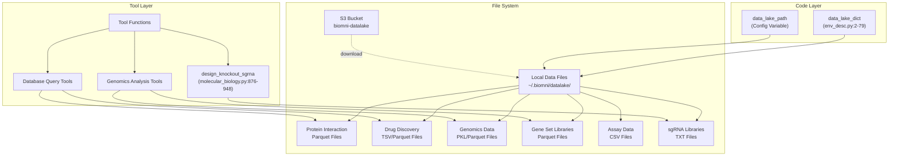
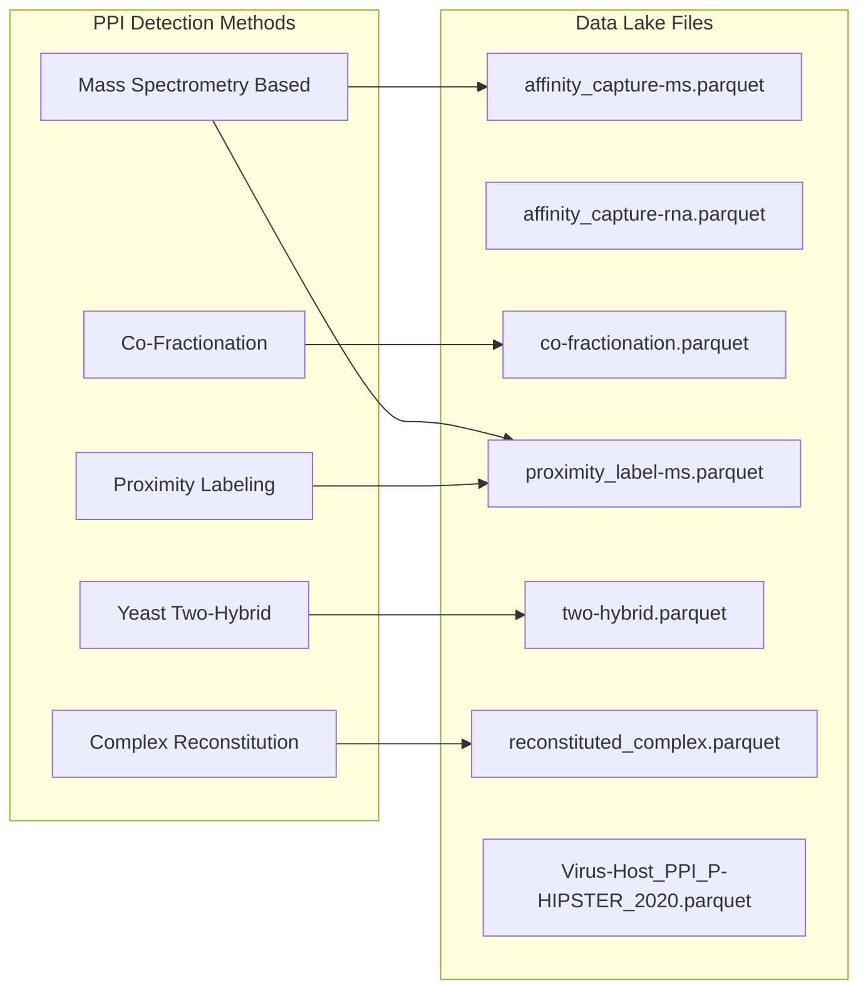
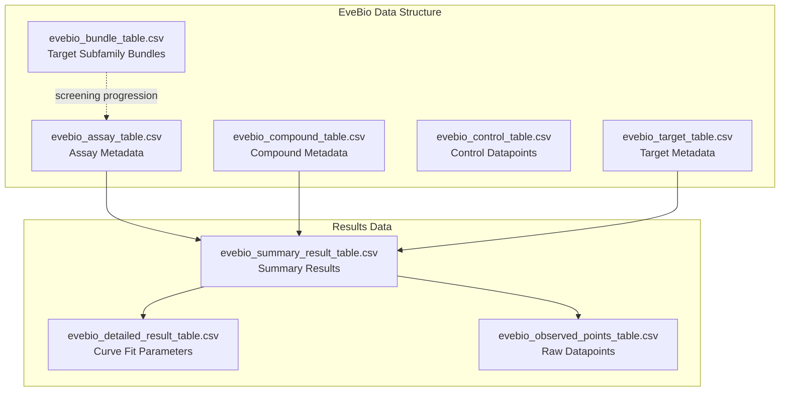
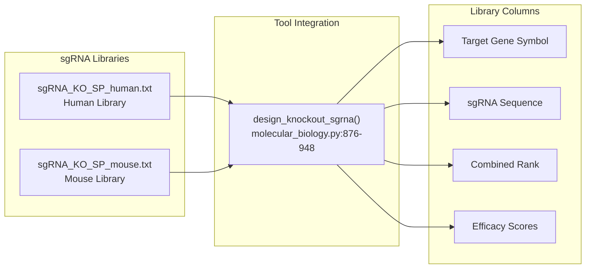
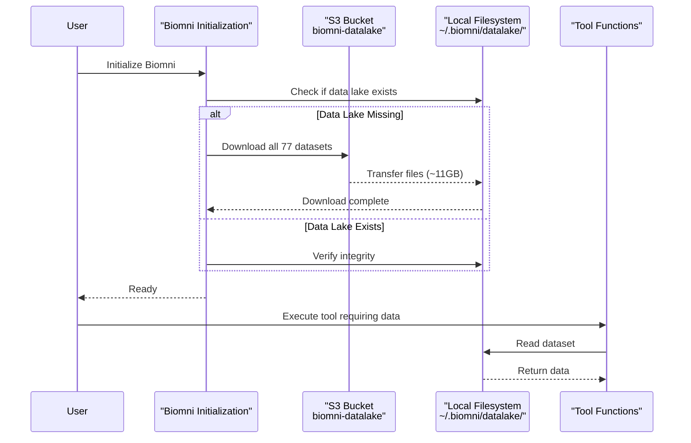

# Data Lake Catalog

<details>
<summary>Relevant source files</summary>

The following files were used as context for generating this wiki page:

- [biomni/env_desc.py](biomni/env_desc.py)
- [biomni/tool/molecular_biology.py](biomni/tool/molecular_biology.py)

</details>


## Purpose and Scope

This page provides a complete catalog of the 77 datasets available in Biomni's data lake, as defined in the `data_lake_dict` dictionary. Each dataset is described with its biological purpose and typical use cases. The data lake provides pre-downloaded, curated datasets spanning protein interactions, drug discovery, genomics, expression data, gene sets, and CRISPR libraries.

For information about software packages and CLI tools available in Biomni, see [Software and Library Reference](#9.2). For guidance on adding custom datasets to the system, see [Adding Data and Software](#8.5).

---

## Data Lake Architecture

The Biomni data lake is structured as a centralized repository of biological datasets, stored locally after download from S3 and made accessible to agent tools through a metadata dictionary.

### Data Lake Dictionary Structure



**Sources:** [biomni/env_desc.py:1-79]()

The `data_lake_dict` maps filename keys to human-readable descriptions. File paths are constructed by combining the `data_lake_path` configuration variable with the dictionary keys.

---

## Dataset Categories

The 77 datasets in the data lake are organized into the following categories:

### Category Overview

| Category | Dataset Count | File Formats | Typical Use Cases |
|----------|---------------|--------------|-------------------|
| Protein-Protein Interactions | 8 | Parquet | Network analysis, pathway discovery |
| Drug Discovery | 3 | TSV, Parquet | Compound screening, drug repurposing |
| DepMap Cancer Models | 4 | CSV | Cancer dependency analysis, drug targets |
| Drug-Drug Interactions | 8 | CSV | Drug safety, clinical decision support |
| Genomics & Variants | 5 | PKL, Parquet | GWAS analysis, variant interpretation |
| Expression Data | 2 | Parquet, TSV | Tissue-specific expression, biomarkers |
| Gene Sets (MSigDB) | 10 | Parquet | Pathway enrichment, functional analysis |
| Gene Sets (MouseMine) | 5 | Parquet | Mouse model analysis |
| EveBio Assay Data | 8 | CSV | Pharmacological profiling, target engagement |
| sgRNA Libraries | 2 | TXT | CRISPR knockout design |
| Miscellaneous | 22 | Various | Cell type annotation, TCR analysis, etc. |

**Sources:** [biomni/env_desc.py:2-79]()

---

## Protein-Protein Interaction Datasets

These datasets capture physical and functional interactions between proteins using various experimental methodologies.



**Sources:** [biomni/env_desc.py:3-8,67-68,74]()

| Filename | Description |
|----------|-------------|
| `affinity_capture-ms.parquet` | Protein-protein interactions detected via affinity capture and mass spectrometry |
| `affinity_capture-rna.parquet` | Protein-RNA interactions detected by affinity capture |
| `co-fractionation.parquet` | Protein-protein interactions from co-fractionation experiments |
| `proximity_label-ms.parquet` | Protein interactions via proximity labeling and mass spectrometry |
| `two-hybrid.parquet` | Protein-protein interactions detected by yeast two-hybrid assays |
| `reconstituted_complex.parquet` | Protein complexes reconstituted in vitro |
| `Virus-Host_PPI_P-HIPSTER_2020.parquet` | Virus-host protein-protein interactions from P-HIPSTER |
| `dosage_growth_defect.parquet` | Gene dosage changes affecting growth |

---

## Drug Discovery Datasets

Large-scale compound libraries and binding affinity data for drug discovery and repurposing applications.

| Filename | Description | Size/Scope |
|----------|-------------|------------|
| `BindingDB_All_202409.tsv` | Measured binding affinities between proteins and small molecules | September 2024 release |
| `broad_repurposing_hub_molecule_with_smiles.parquet` | Molecules from Broad Institute's Drug Repurposing Hub with SMILES | ~6,000 compounds |
| `broad_repurposing_hub_phase_moa_target_info.parquet` | Drug phases, mechanisms of action, and target information | Clinical metadata |
| `enamine_cloud_library_smiles.pkl` | Compounds from Enamine REAL library with SMILES annotations | Ultra-large virtual library |

**Sources:** [biomni/env_desc.py:5-7,24]()

---

## DepMap Cancer Cell Line Data

The Cancer Dependency Map (DepMap) datasets provide comprehensive genomic and functional data for cancer cell lines.

| Filename | Description | Use Cases |
|----------|-------------|-----------|
| `DepMap_CRISPRGeneDependency.csv` | Gene dependency probability estimates for cancer cell lines | Identify essential genes per cell line |
| `DepMap_CRISPRGeneEffect.csv` | Genome-wide CRISPR gene effect estimates | Quantify knockout effects |
| `DepMap_Model.csv` | Metadata for all cancer models/cell lines in DepMap | Cell line characteristics, lineage |
| `DepMap_OmicsExpressionProteinCodingGenesTPMLogp1.csv` | Gene expression in TPMs for cancer cell lines | Expression profiling, biomarkers |

**Sources:** [biomni/env_desc.py:10-13]()

---

## Drug-Drug Interaction Datasets (DDInter)

The DDInter 2.0 database provides drug-drug interaction data organized by therapeutic category.

| Filename | Therapeutic Category |
|----------|---------------------|
| `ddinter_alimentary_tract_metabolism.csv` | Alimentary tract and metabolism drugs |
| `ddinter_antineoplastic.csv` | Antineoplastic and immunomodulating agents |
| `ddinter_antiparasitic.csv` | Antiparasitic products |
| `ddinter_blood_organs.csv` | Blood and blood forming organs drugs |
| `ddinter_dermatological.csv` | Dermatological drugs |
| `ddinter_hormonal.csv` | Systemic hormonal preparations |
| `ddinter_respiratory.csv` | Respiratory system drugs |
| `ddinter_various.csv` | Various drugs |

**Sources:** [biomni/env_desc.py:14-21]()

### Typical Usage Pattern

```python
# Drug-drug interactions are typically queried by drug name or ATC code
import pandas as pd

# Load specific therapeutic category
ddi_data = pd.read_csv(f"{data_lake_path}/ddinter_antineoplastic.csv")

# Filter for specific drug
interactions = ddi_data[ddi_data['Drug1_Name'] == 'Paclitaxel']
```

---

## Genomics and Variant Datasets

### GeneBass Variant Collections

GeneBass provides large-scale variant analysis from UK Biobank data, organized by variant consequence type.

| Filename | Variant Type | Description |
|----------|--------------|-------------|
| `genebass_missense_LC_filtered.pkl` | Missense | Filtered missense variants with low confidence removed |
| `genebass_pLoF_filtered.pkl` | pLoF | Predicted loss-of-function variants |
| `genebass_synonymous_filtered.pkl` | Synonymous | Filtered synonymous variants (negative controls) |

**Sources:** [biomni/env_desc.py:33-35]()

### Other Genomics Resources

| Filename | Description |
|----------|-------------|
| `gwas_catalog.pkl` | Genome-wide association studies (GWAS) results |
| `variant_table.parquet` | Annotated genetic variants table |
| `gene_info.parquet` | Comprehensive gene information |

**Sources:** [biomni/env_desc.py:36,40,75]()

---

## Expression Data

Tissue-specific and cancer cell line gene expression data.

| Filename | Source | Description | Format |
|----------|--------|-------------|--------|
| `gtex_tissue_gene_tpm.parquet` | GTEx | Gene expression (TPM) across human tissues | Parquet |
| `proteinatlas.tsv` | Human Protein Atlas | Protein expression data | TSV |

**Sources:** [biomni/env_desc.py:39,66]()

---

## MSigDB Gene Set Collections

The Molecular Signatures Database (MSigDB) provides curated gene sets for pathway enrichment analysis.

```mermaid
graph TB
    subgraph "MSigDB Collections"
        C1["C1: Positional<br/>msigdb_human_c1_positional_geneset.parquet"]
        C2["C2: Curated<br/>msigdb_human_c2_curated_geneset.parquet"]
        C3["C3: Regulatory Targets<br/>msigdb_human_c3_regulatory_target_geneset.parquet"]
        C3TF["C3 Subset: TF Targets<br/>msigdb_human_c3_subset_transcription_factor_targets_from_GTRD.parquet"]
        C4["C4: Computational<br/>msigdb_human_c4_computational_geneset.parquet"]
        C5["C5: Ontology<br/>msigdb_human_c5_ontology_geneset.parquet"]
        C6["C6: Oncogenic<br/>msigdb_human_c6_oncogenic_signature_geneset.parquet"]
        C7["C7: Immunologic<br/>msigdb_human_c7_immunologic_signature_geneset.parquet"]
        C8["C8: Cell Type<br/>msigdb_human_c8_celltype_signature_geneset.parquet"]
        H["H: Hallmark<br/>msigdb_human_h_hallmark_geneset.parquet"]
    end
    
    subgraph "Use Cases"
        GSEA["Gene Set Enrichment Analysis"]
        CellType["Cell Type Identification"]
        Pathway["Pathway Analysis"]
        TFTargets["Transcription Factor Analysis"]
    end
    
    C1 & C2 & C3 & C4 & C5 & C6 & C7 --> GSEA
    C8 --> CellType
    C2 & C5 & H --> Pathway
    C3 & C3TF --> TFTargets
```



**Sources:** [biomni/env_desc.py:55-64]()

| Collection | Description | Typical Size |
|------------|-------------|--------------|
| C1: Positional | Gene sets grouped by chromosomal location | ~300 gene sets |
| C2: Curated | Canonical pathways from KEGG, Reactome, BioCarta | ~5,500 gene sets |
| C3: Regulatory Targets | Gene sets defined by transcription factor and microRNA targets | ~3,700 gene sets |
| C4: Computational | Computationally defined gene sets | ~850 gene sets |
| C5: Ontology | Gene Ontology (GO) term gene sets | ~10,000 gene sets |
| C6: Oncogenic | Oncogenic signatures from cancer studies | ~200 gene sets |
| C7: Immunologic | Immunologic cell states and perturbations | ~5,000 gene sets |
| C8: Cell Type | Cell type-specific signatures | ~800 gene sets |
| H: Hallmark | Well-defined biological states/processes | 50 gene sets |

---

## MouseMine Gene Set Collections

Parallel gene set collections for mouse models.

| Filename | Description |
|----------|-------------|
| `mousemine_m1_positional_geneset.parquet` | Positional gene sets from MouseMine |
| `mousemine_m2_curated_geneset.parquet` | Curated gene sets from MouseMine |
| `mousemine_m3_regulatory_target_geneset.parquet` | Regulatory target gene sets from MouseMine |
| `mousemine_m5_ontology_geneset.parquet` | Ontology-based gene sets from MouseMine |
| `mousemine_m8_celltype_signature_geneset.parquet` | Cell type signature gene sets from MouseMine |
| `mousemine_mh_hallmark_geneset.parquet` | Hallmark gene sets from MouseMine |

**Sources:** [biomni/env_desc.py:49-54]()

---

## EveBio Pharmacological Assay Data

Comprehensive screening and profiling data from EveBio's pharmome mapping initiative.



**Sources:** [biomni/env_desc.py:25-32]()

| Filename | Description | Granularity |
|----------|-------------|-------------|
| `evebio_assay_table.csv` | Assay metadata with one row per assay | Assay-level |
| `evebio_bundle_table.csv` | Target subfamily bundles for screening progression | Bundle-level |
| `evebio_compound_table.csv` | Compound metadata with common identifiers | Compound-level |
| `evebio_control_table.csv` | Control datapoints for all plates | Control-level |
| `evebio_target_table.csv` | Target metadata with common identifiers | Target-level |
| `evebio_summary_result_table.csv` | Succinct summary for each assay-compound combination | Result-level |
| `evebio_detailed_result_table.csv` | Expanded results with curve fit parameters | Detailed result-level |
| `evebio_observed_points_table.csv` | Raw observed datapoints from all experiments | Raw data-level |

---

## CRISPR sgRNA Libraries

Pre-computed sgRNA libraries for knockout experiments in human and mouse.

### Library Structure and Usage



**Sources:** [biomni/env_desc.py:69-70](), [biomni/tool/molecular_biology.py:876-948]()

| Filename | Species | Format | Contents |
|----------|---------|--------|----------|
| `sgRNA_KO_SP_human.txt` | Homo sapiens | Tab-delimited | Pre-designed sgRNAs with efficacy scores |
| `sgRNA_KO_SP_mouse.txt` | Mus musculus | Tab-delimited | Pre-designed sgRNAs with efficacy scores |

### Code Integration Example

The `design_knockout_sgrna` function uses these libraries:

```python
# Default library paths defined in function
DEFAULT_LIBRARIES = {
    "human": data_lake_path + "/sgRNA_KO_SP_human.txt",
    "mouse": data_lake_path + "/sgRNA_KO_SP_mouse.txt",
}

# Load and filter by gene name
df = pd.read_csv(library_path, delimiter="\t")
gene_df = df[df["Target Gene Symbol"].str.upper() == gene_name]

# Sort by efficacy metrics
gene_df = gene_df.sort_values(by=["Combined Rank"])
```

**Sources:** [biomni/tool/molecular_biology.py:898-936]()

---

## Additional Specialized Datasets

### Disease and Phenotype Data

| Filename | Description | Format |
|----------|-------------|--------|
| `DisGeNET.parquet` | Gene-disease associations from multiple sources | Parquet |
| `omim.parquet` | Genetic disorders and associated genes from OMIM | Parquet |
| `hp.obo` | Official HPO release in obographs format | OBO |

**Sources:** [biomni/env_desc.py:22,41,65]()

### Cell Type and Single-Cell Resources

| Filename | Description |
|----------|-------------|
| `marker_celltype.parquet` | Cell type marker genes for identification |
| `czi_census_datasets_v4.parquet` | Datasets from Chan Zuckerberg Initiative's Cell Census |

**Sources:** [biomni/env_desc.py:9,43]()

### MicroRNA and Regulatory Data

| Filename | Description | Validation Status |
|----------|-------------|-------------------|
| `miRDB_v6.0_results.parquet` | Predicted microRNA targets from miRDB | Computational prediction |
| `miRTarBase_microRNA_target_interaction.parquet` | Experimentally validated microRNA-target interactions | Experimental validation |
| `miRTarBase_microRNA_target_interaction_pubmed_abtract.txt` | PubMed abstracts for interactions | Literature evidence |
| `miRTarBase_MicroRNA_Target_Sites.parquet` | Binding sites of microRNAs on target genes | Site-specific data |

**Sources:** [biomni/env_desc.py:45-48]()

### Immunology Data

| Filename | Description |
|----------|-------------|
| `McPAS-TCR.parquet` | T-cell receptor sequences and specificity data from McPAS database |

**Sources:** [biomni/env_desc.py:44]()

### Knowledge Graphs and Ontologies

| Filename | Description | Scale |
|----------|-------------|-------|
| `kg.csv` | Precision medicine knowledge graph | 17,080 diseases, 4+ million relationships |
| `go-plus.json` | Gene ontology data for functional annotations | Full GO hierarchy |

**Sources:** [biomni/env_desc.py:38,42]()

### Genetic Interactions

| Filename | Interaction Type |
|----------|------------------|
| `genetic_interaction.parquet` | Genetic interactions between genes |
| `synthetic_growth_defect.parquet` | Synthetic growth defects from genetic interactions |
| `synthetic_lethality.parquet` | Synthetic lethal interactions |
| `synthetic_rescue.parquet` | Genetic interactions rescuing phenotypes |

**Sources:** [biomni/env_desc.py:37,71-73]()

### Drug Prediction Models

| Filename | Description |
|----------|-------------|
| `txgnn_name_mapping.pkl` | Name mapping for TXGNN drug prediction model |
| `txgnn_prediction.pkl` | Prediction data for TXGNN model |

**Sources:** [biomni/env_desc.py:77-78]()

---

## File Format Summary

The data lake uses three primary file formats:

| Format | Extension | Libraries | Use Case |
|--------|-----------|-----------|----------|
| Parquet | `.parquet` | `pandas.read_parquet()` | Structured tabular data with efficient compression |
| CSV/TSV | `.csv`, `.tsv` | `pandas.read_csv()` | Human-readable tabular data |
| Pickle | `.pkl` | `pickle.load()` | Complex Python objects, serialized data structures |
| JSON | `.json` | `json.load()` | Hierarchical data, ontologies |
| Text | `.txt` | `pandas.read_csv()` | Tab-delimited data, plain text |
| OBO | `.obo` | Specialized parsers | Ontology definitions |

**Sources:** [biomni/env_desc.py:2-79]()

---

## Access Patterns in Code

### Direct File Access

Tools access data lake files by combining the `data_lake_path` configuration with dictionary keys:

```python
# Example from design_knockout_sgrna
library_path = data_lake_path + "/sgRNA_KO_SP_human.txt"
df = pd.read_csv(library_path, delimiter="\t")
```

**Sources:** [biomni/tool/molecular_biology.py:899,914]()

### Data Lake Path Configuration

The `data_lake_path` is typically set during initialization and points to the local download directory:

```
~/.biomni/datalake/
```

Each file in `data_lake_dict` is expected to exist at this location after the initial data lake download from S3.

---

## Data Lake Download Process



**Sources:** [biomni/env_desc.py:2-79]()

The data lake is automatically downloaded during first use. The download includes all 77 datasets totaling approximately 11GB of biological data.

---

## Dataset Statistics

| Metric | Value |
|--------|-------|
| Total Datasets | 77 |
| Total Size | ~11 GB |
| Parquet Files | 51 |
| CSV Files | 17 |
| Pickle Files | 4 |
| Text Files | 2 |
| JSON Files | 1 |
| TSV Files | 1 |
| OBO Files | 1 |

**Sources:** [biomni/env_desc.py:2-79]()

---