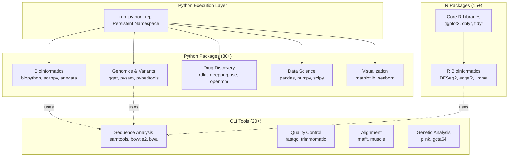
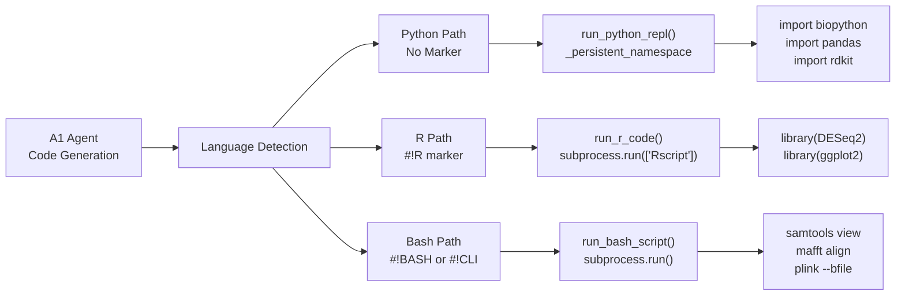
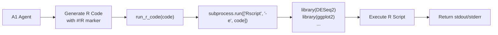
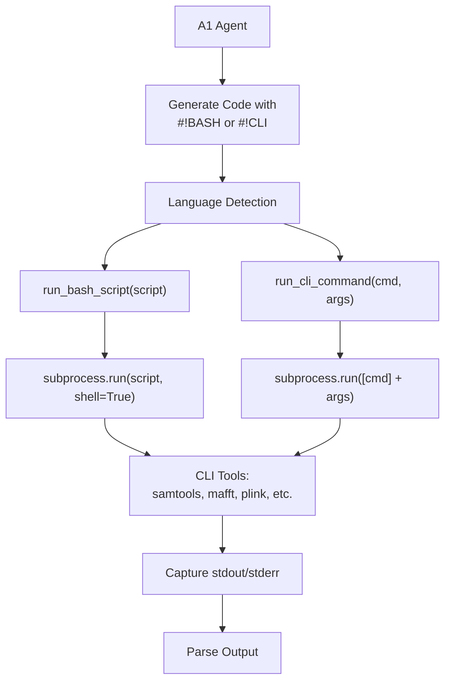
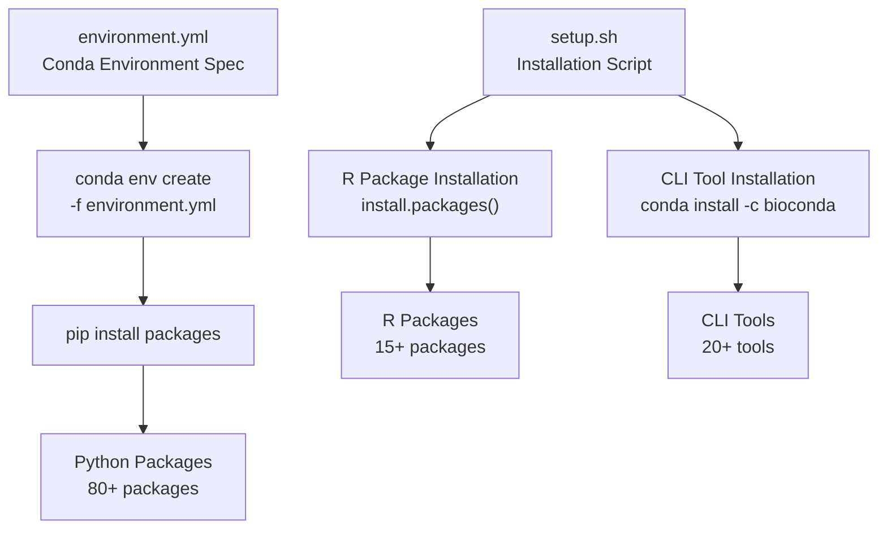
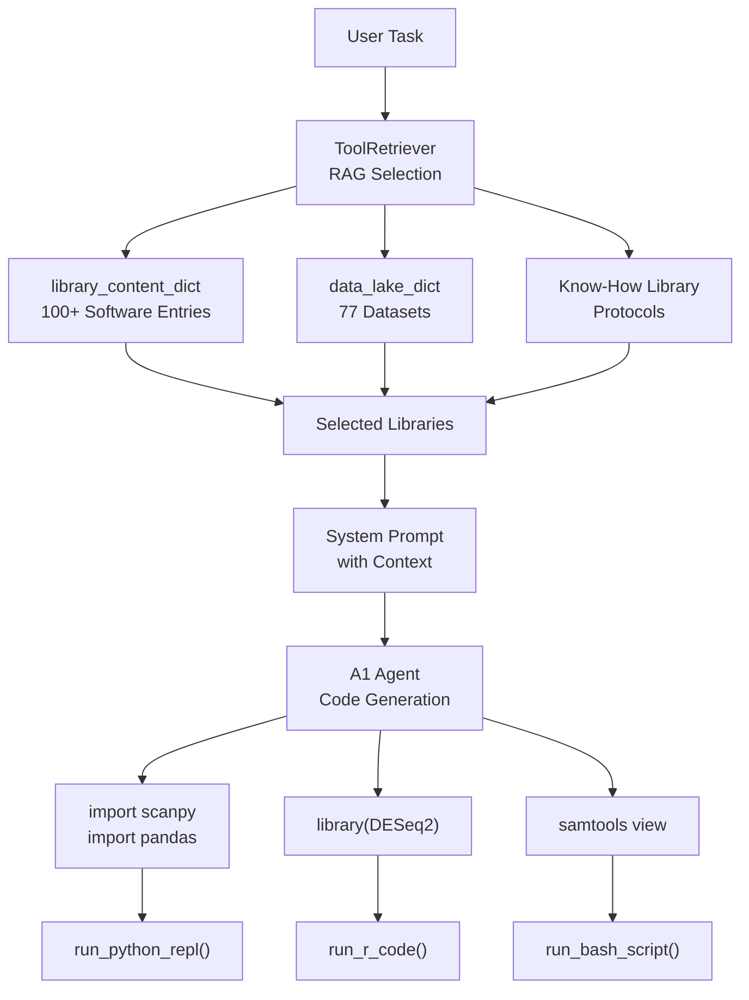

# Software and Library Reference

<details>
<summary>Relevant source files</summary>

The following files were used as context for generating this wiki page:

- [biomni/env_desc.py](biomni/env_desc.py)
- [biomni/tool/molecular_biology.py](biomni/tool/molecular_biology.py)
- [biomni_env/environment.yml](biomni_env/environment.yml)

</details>


## Purpose and Scope

This page provides a comprehensive catalog of the 100+ software packages, libraries, and command-line tools available within the Biomni ecosystem. These external dependencies are pre-installed in the `biomni_e1` conda environment and can be invoked by agents during task execution.

This reference covers the **external software dependencies** that agents can leverage. For information about:
- Biomni's built-in tool functions, see [Tool Reference](#5)
- Dataset resources in the data lake, see [Data Lake Catalog](#9.1)
- Environment setup and installation, see [Environment Setup](#3.1)

## Software Ecosystem Overview

The Biomni software stack is organized into three primary categories:



**Sources:** [biomni/env_desc.py:82-221]()

## Software Categories and Access Patterns

### Execution Context

All software is accessible through three execution contexts managed by the A1 agent:



**Sources:** [biomni/env_desc.py:82-221]()

## Python Packages

### Core Bioinformatics Libraries

| Package | Description | Usage Pattern |
|---------|-------------|---------------|
| `biopython` | Tools for biological computation, parsers for bioinformatics files | `from Bio import SeqIO, Entrez` |
| `biom-format` | Biological Observation Matrix (BIOM) format handling | `import biom` |
| `scanpy` | Single-cell gene expression analysis toolkit | `import scanpy as sc` |
| `scikit-bio` | Data structures and algorithms for bioinformatics | `import skbio` |
| `anndata` | Annotated data matrices for single-cell genomics | `import anndata as ad` |
| `mudata` | Multimodal data storage extending AnnData | `import mudata` |
| `pyliftover` | UCSC liftOver for converting genomic coordinates | `from pyliftover import LiftOver` |
| `biopandas` | Pandas DataFrames for molecular structures | `from biopandas.pdb import PandasPdb` |
| `biotite` | Comprehensive molecular biology library | `import biotite` |
| `lazyslide` | Whole slide image analysis framework | `import lazyslide` |

**Sources:** [biomni/env_desc.py:84-94]()

### Genomics and Variant Analysis

| Package | Description | Usage Pattern |
|---------|-------------|---------------|
| `gget` | Toolkit for accessing genomic databases | `import gget` |
| `lifelines` | Survival analysis library | `from lifelines import KaplanMeierFitter` |
| `gseapy` | Gene Set Enrichment Analysis wrapper | `import gseapy` |
| `scrublet` | Doublet detection in single-cell RNA-seq | `import scrublet` |
| `cellxgene-census` | Access to CellxGene Census datasets | `import cellxgene_census` |
| `hyperopt` | Hyperparameter optimization | `from hyperopt import fmin, tpe` |
| `scvelo` | RNA velocity analysis in single cells | `import scvelo as scv` |
| `pysam` | SAM/BAM/VCF/BCF file manipulation | `import pysam` |
| `pyfaidx` | Efficient FASTA file random access | `from pyfaidx import Fasta` |
| `pyranges` | Interval manipulation with pandas-like interface | `import pyranges as pr` |
| `pybedtools` | Python wrapper for BEDTools | `import pybedtools` |

**Sources:** [biomni/env_desc.py:95-108]()

### Structural Biology and Drug Discovery

| Package | Description | Usage Pattern |
|---------|-------------|---------------|
| `rdkit` | Cheminformatics and machine learning for chemistry | `from rdkit import Chem` |
| `deeppurpose` | Drug-target interaction prediction | `from DeepPurpose import CompoundPred` |
| `pyscreener` | Virtual screening of chemical compounds | `import pyscreener` |
| `openbabel` | Chemical toolbox for format conversion | `from openbabel import openbabel` |
| `descriptastorus` | Molecular descriptors for ML | `from descriptastorus.descriptors import rdDescriptors` |
| `openmm` | Molecular simulation toolkit | `from openmm import app` |
| `pytdc` | Therapeutics Data Commons access | `from tdc import Evaluator` |

**Sources:** [biomni/env_desc.py:109-118]()

### Data Science and Statistical Analysis

| Package | Description | Usage Pattern |
|---------|-------------|---------------|
| `pandas` | Data analysis and manipulation | `import pandas as pd` |
| `numpy` | Array and matrix operations | `import numpy as np` |
| `scipy` | Scientific computing (optimization, linear algebra) | `from scipy import stats` |
| `scikit-learn` | Machine learning algorithms | `from sklearn.decomposition import PCA` |
| `matplotlib` | Static, animated, and interactive visualizations | `import matplotlib.pyplot as plt` |
| `seaborn` | Statistical data visualization | `import seaborn as sns` |
| `statsmodels` | Statistical modeling and econometrics | `import statsmodels.api as sm` |
| `pymc3` | Bayesian statistical modeling | `import pymc3 as pm` |
| `umap-learn` | Dimension reduction technique | `import umap` |
| `faiss-cpu` | Similarity search and clustering | `import faiss` |
| `harmony-pytorch` | Single-cell data integration | `from harmony import harmonize` |

**Sources:** [biomni/env_desc.py:119-131]()

### Specialized Bioinformatics Tools

| Package | Description | Usage Pattern |
|---------|-------------|---------------|
| `tiledb` | Storage and analysis for genomic data | `import tiledb` |
| `tiledbsoma` | SOMA format with TileDB | `import tiledbsoma` |
| `h5py` | HDF5 binary data format interface | `import h5py` |
| `mageck` | CRISPR screen data analysis | `from mageck import core` |
| `igraph` | Network analysis and visualization | `import igraph` |
| `pyscenic` | Single-cell gene regulatory networks | `from pyscenic import aucell` |
| `cooler` | Hi-C data storage and analysis | `import cooler` |
| `trackpy` | Particle tracking in images | `import trackpy` |
| `cellpose` | Cell segmentation in microscopy | `from cellpose import models` |
| `viennarna` | RNA secondary structure prediction | `import RNA` |
| `cobra` | Constraint-based metabolic modeling | `import cobra` |
| `flowkit` | Flow cytometry data processing | `import flowkit` |
| `hmmlearn` | Hidden Markov model analysis | `from hmmlearn import hmm` |
| `msprime` | Genetic variation simulation | `import msprime` |
| `tskit` | Tree sequences and population genetics | `import tskit` |
| `cyvcf2` | Fast VCF file parsing | `from cyvcf2 import VCF` |
| `fanc` | Chromatin conformation data analysis | `import fanc` |
| `loompy` | Loom file format for omics datasets | `import loompy` |
| `pyBigWig` | BigWig and bigBed file access | `import pyBigWig` |
| `pymzml` | Mass spectrometry data analysis | `import pymzml` |
| `arboreto` | Gene regulatory network inference | `from arboreto.algo import grnboost2` |
| `pdbfixer` | PDB file problem fixing for simulations | `from pdbfixer import PDBFixer` |
| `PyLabRobot` | Liquid-handling robot control | `from pylabrobot import LiquidHandler` |

**Sources:** [biomni/env_desc.py:132-172]()

## R Packages

### Core R Libraries for Data Analysis

R packages are accessed via `run_r_code()` or by using the `#!R` marker in generated code. All R code is executed as subprocess calls to `Rscript`.

| Package | Description | Usage Pattern |
|---------|-------------|---------------|
| `ggplot2` | Grammar of Graphics declarative plotting | `library(ggplot2); ggplot(data, aes(...))` |
| `dplyr` | Grammar of data manipulation | `library(dplyr); data %>% filter(...) %>% select(...)` |
| `tidyr` | Tidy data creation | `library(tidyr); data %>% pivot_longer(...)` |
| `readr` | Fast rectangular data reading (CSV, TSV) | `library(readr); read_csv("file.csv")` |
| `stringr` | String manipulation functions | `library(stringr); str_detect(text, pattern)` |
| `Matrix` | Dense and sparse matrix classes | `library(Matrix); sparseMatrix(...)` |

**Sources:** [biomni/env_desc.py:175-181]()

### R Bioinformatics Packages

| Package | Description | Usage Pattern |
|---------|-------------|---------------|
| `DESeq2` | Differential gene expression (negative binomial) | `library(DESeq2); DESeqDataSetFromMatrix(...)` |
| `clusterProfiler` | Functional profile analysis for genes | `library(clusterProfiler); enrichGO(...)` |
| `edgeR` | Empirical analysis of digital gene expression | `library(edgeR); DGEList(counts)` |
| `limma` | Linear models for microarray/RNA-seq data | `library(limma); lmFit(data, design)` |
| `harmony` | Single-cell data integration | `library(harmony); RunHarmony(object, ...)` |
| `WGCNA` | Weighted correlation network analysis | `library(WGCNA); blockwiseModules(...)` |

**Sources:** [biomni/env_desc.py:185-193]()

### R Execution Pattern



**Sources:** [biomni/env_desc.py:175-193]()

## Command-Line Tools

### Sequence Analysis Tools

CLI tools are accessed via `run_bash_script()`, `run_cli_command()`, or by using `#!BASH` or `#!CLI` markers.

| Tool | Description | Usage Pattern |
|------|-------------|---------------|
| `samtools` | High-throughput sequencing data interaction | `samtools view -b input.sam > output.bam` |
| `bowtie2` | Fast alignment to reference sequences | `bowtie2 -x index -1 r1.fq -2 r2.fq -S out.sam` |
| `bwa` | Burrows-Wheeler Aligner for mapping reads | `bwa mem ref.fa reads.fq > aln.sam` |
| `bedtools` | Genome arithmetic operations | `bedtools intersect -a a.bed -b b.bed` |
| `macs2` | ChIP-Seq peak calling | `macs2 callpeak -t treatment.bam -c control.bam` |

**Sources:** [biomni/env_desc.py:196-200]()

### Quality Control and Processing Tools

| Tool | Description | Usage Pattern |
|------|-------------|---------------|
| `fastqc` | Quality control for sequence data | `fastqc reads.fastq -o output_dir/` |
| `trimmomatic` | Flexible read trimming for Illumina data | `trimmomatic PE input_r1.fq input_r2.fq ...` |

**Sources:** [biomni/env_desc.py:202-203]()

### Multiple Sequence Alignment and Phylogenetics

| Tool | Description | Usage Pattern |
|------|-------------|---------------|
| `mafft` | Multiple sequence alignment | `mafft --auto sequences.fasta > aligned.fasta` |
| `Homer` | Motif discovery and NGS analysis | `findMotifsGenome.pl peaks.bed genome/ output/` |
| `FastTree` | Phylogenetic trees from alignments | `FastTree -nt alignment.fasta > tree.nwk` |
| `muscle` | Multiple sequence alignment | `muscle -in sequences.fasta -out aligned.fasta` |

**Sources:** [biomni/env_desc.py:205-208]()

### Genetic Analysis Tools

| Tool | Description | Usage Pattern |
|------|-------------|---------------|
| `plink` | Genome association studies toolkit | `plink --bfile data --assoc --out results` |
| `plink2` | Next-generation PLINK | `plink2 --bfile data --glm --out results` |
| `gcta64` | Genome-wide Complex Trait Analysis | `gcta64 --grm data --reml --out results` |
| `iqtree2` | Maximum likelihood phylogenetic analysis | `iqtree2 -s alignment.fasta -m TEST` |

**Sources:** [biomni/env_desc.py:210-213]()

### Molecular Modeling and Analysis Tools

| Tool | Description | Usage Pattern |
|------|-------------|---------------|
| `ADFR` | AutoDock for molecular docking | `adfr --receptor protein.pdbqt --ligand ligand.pdbqt` |
| `diamond` | Protein and translated DNA sequence aligner | `diamond blastp -d db.dmnd -q query.fasta -o out.txt` |
| `plannotate` | Plasmid sequence annotation | `plannotate batch -i input.fasta -o output/` |
| `vina` | Molecular docking and virtual screening | `vina --receptor protein.pdbqt --ligand ligand.pdbqt` |
| `autosite` | Binding site detection | `autosite -r protein.pdb -o binding_sites.pdb` |

**Sources:** [biomni/env_desc.py:214-219]()

### CLI Execution Pattern



**Sources:** [biomni/env_desc.py:196-221]()

## Usage Examples by Domain

### Single-Cell Genomics Workflow

```python
# Example using Python packages in run_python_repl()
import scanpy as sc
import anndata as ad
import numpy as np

# Load data from data lake
adata = sc.read_h5ad("path/to/data.h5ad")

# Preprocessing with scanpy
sc.pp.filter_cells(adata, min_genes=200)
sc.pp.normalize_total(adata, target_sum=1e4)
sc.pp.log1p(adata)

# Dimensionality reduction
sc.tl.pca(adata)
sc.pp.neighbors(adata)
sc.tl.umap(adata)

# Clustering
sc.tl.leiden(adata)
```

**Sources:** [biomni/env_desc.py:87-88]()

### Differential Expression Analysis (R)

```r
#!R
library(DESeq2)
library(ggplot2)

# Load count data
counts <- read.csv("counts.csv", row.names=1)
coldata <- read.csv("coldata.csv", row.names=1)

# Create DESeq2 dataset
dds <- DESeqDataSetFromMatrix(
  countData = counts,
  colData = coldata,
  design = ~ condition
)

# Run DESeq2
dds <- DESeq(dds)
res <- results(dds)

# Visualize
plotMA(res)
```

**Sources:** [biomni/env_desc.py:185-186]()

### Sequence Alignment Pipeline (CLI)

```bash
#!BASH
# Quality control
fastqc sample_R1.fastq sample_R2.fastq -o qc_results/

# Trim adapters
trimmomatic PE sample_R1.fastq sample_R2.fastq \
  trimmed_R1.fastq unpaired_R1.fastq \
  trimmed_R2.fastq unpaired_R2.fastq \
  ILLUMINACLIP:adapters.fa:2:30:10

# Align to reference
bwa mem reference.fa trimmed_R1.fastq trimmed_R2.fastq | \
  samtools view -b | \
  samtools sort -o aligned.bam

# Index BAM file
samtools index aligned.bam
```

**Sources:** [biomni/env_desc.py:196-203]()

### Drug Discovery Workflow

```python
# Example using cheminformatics packages
from rdkit import Chem
from rdkit.Chem import Descriptors, AllChem
from DeepPurpose import CompoundPred
import pandas as pd

# Load compound SMILES
smiles_list = ["CCO", "CC(=O)O", "CN1C=NC2=C1C(=O)N(C(=O)N2C)C"]

# Generate RDKit molecules
mols = [Chem.MolFromSmiles(smi) for smi in smiles_list]

# Calculate molecular descriptors
descriptors = []
for mol in mols:
    desc = {
        'MolWt': Descriptors.MolWt(mol),
        'LogP': Descriptors.MolLogP(mol),
        'TPSA': Descriptors.TPSA(mol),
        'NumHDonors': Descriptors.NumHDonors(mol),
        'NumHAcceptors': Descriptors.NumHAcceptors(mol)
    }
    descriptors.append(desc)

df = pd.DataFrame(descriptors)
```

**Sources:** [biomni/env_desc.py:110-112]()

### Molecular Docking (CLI)

```bash
#!CLI
# Prepare receptor
prepare_receptor -r protein.pdb -o protein.pdbqt

# Prepare ligand
obabel ligand.sdf -O ligand.pdbqt

# Run AutoDock Vina
vina --receptor protein.pdbqt \
     --ligand ligand.pdbqt \
     --center_x 25.0 --center_y 30.0 --center_z 15.0 \
     --size_x 20.0 --size_y 20.0 --size_z 20.0 \
     --out docked_poses.pdbqt
```

**Sources:** [biomni/env_desc.py:218-219]()

## Package Installation and Environment

All packages are pre-installed in the `biomni_e1` conda environment. The installation is managed through:



### Environment File Structure

The environment is defined in [biomni_env/environment.yml:1-40]():

- **Base dependencies**: Python 3.11, pip
- **Core packages**: numpy, pandas, scipy, scikit-learn
- **LangChain ecosystem**: langchain, langgraph, langchain-openai, langchain-anthropic
- **Visualization**: gradio, matplotlib, seaborn
- **Utilities**: requests, pyyaml, jupyter, pytest
- **Specialized**: transformers, mcp, tooluniverse

**Sources:** [biomni_env/environment.yml:1-40]()

## Library Content Dictionary Structure

The `library_content_dict` in [biomni/env_desc.py:82-221]() serves as the authoritative catalog of available software. Each entry follows this format:

```python
library_content_dict = {
    "package_name": "[Type] Description with usage guidance",
    # Type can be: [Python Package], [R Package], or [CLI Tool]
}
```

This dictionary is used by:
1. **Tool Retriever**: For selecting relevant libraries when planning tasks
2. **System Prompt Generation**: To inform the LLM about available software
3. **Documentation**: As the source of truth for this reference page

### Integration with Agent Workflow



**Sources:** [biomni/env_desc.py:82-221]()

## Summary

The Biomni software ecosystem provides:

- **80+ Python packages** covering bioinformatics, genomics, drug discovery, and data science
- **15+ R packages** for statistical analysis and bioinformatics
- **20+ CLI tools** for sequence analysis, alignment, and genetic studies
- **Three execution contexts**: Python REPL, R subprocess, and Bash subprocess
- **Unified access pattern**: All software is pre-installed and immediately available to agents

The `library_content_dict` serves as the authoritative catalog, enabling the ToolRetriever to intelligently select relevant software for each task. Agents can seamlessly combine Python libraries, R packages, and CLI tools within a single workflow, executing code across all three contexts as needed.

**Sources:** [biomni/env_desc.py:82-221](), [biomni_env/environment.yml:1-40]()