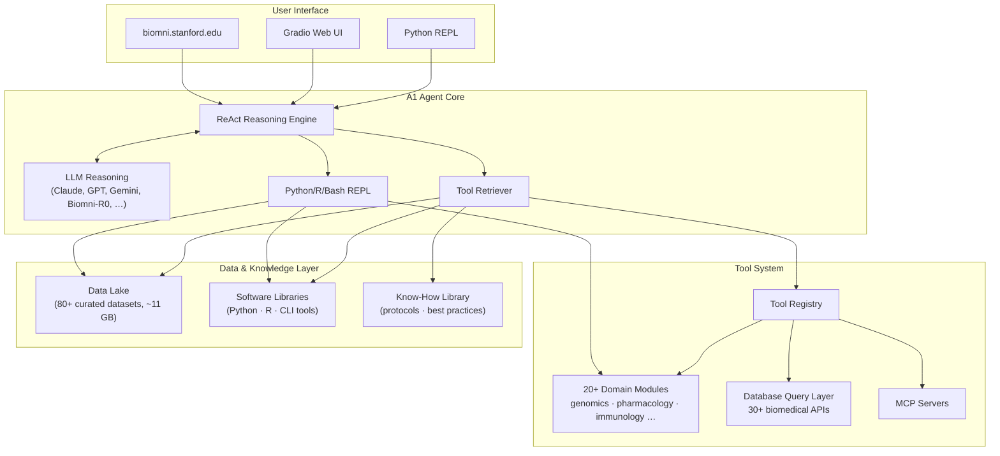

**Biomni** is a general-purpose biomedical AI agent that autonomously executes research tasks across diverse biomedical subfields. Developed at Stanford University and released under the Apache 2.0 license, it bridges the gap between large language model (LLM) reasoning and real-world biomedical computation by combining retrieval-augmented planning with code-based execution. Whether you're planning a CRISPR screen, annotating single-cell RNA-seq data, or predicting drug properties, Biomni translates natural language instructions into multi-step, tool-driven scientific workflows.

The current release is **v0.0.8** and is available both as a pip-installable package and as a no-code web interface at [biomni.stanford.edu](https://biomni.stanford.edu). This page introduces the project's high-level architecture, core capabilities, and how to navigate the rest of this documentation.

Sources: [README.md](README.md#L1-L30), [biomni/version.py](biomni/version.py#L1-L2), [pyproject.toml](pyproject.toml#L1-L18)

## High-Level Architecture

At its core, Biomni follows a **reason → retrieve → execute** loop. A user submits a natural language query, the agent reasons about which tools and data are needed, retrieves the most relevant resources from its vast ecosystem, then generates and runs Python/R/bash code to produce results. This cycle repeats until the task is complete.

The following diagram shows how the major subsystems connect:



The agent entry point is the **`A1`** class, which orchestrates everything from configuration loading to tool retrieval to code execution. On initialization, it downloads ~11 GB of curated data lake files from S3, builds a tool registry spanning 20+ domain modules, and sets up the LLM-backed reasoning pipeline. Users interact with `A1` through a single `agent.go("your task here")` call.

Sources: [biomni/agent/a1.py](biomni/agent/a1.py#L46-L200), [biomni/agent/react.py](biomni/agent/react.py#L38-L54), [biomni/config.py](biomni/config.py#L1-L100)

## Core Capabilities

### Natural Language Task Execution

Biomni accepts free-form biomedical questions and autonomously breaks them into subtasks. It selects the right combination of tools, writes executable code, interprets results, and iterates until the task is resolved. The agent supports multiple LLM providers and can even run the specialized **Biomni-R0** reasoning model for biology-focused tasks.

| Capability | Description | Example Prompt |
|---|---|---|
| **CRISPR Design** | Plan screens, design sgRNAs, analyze editing outcomes | *"Plan a CRISPR screen to identify genes that regulate T cell exhaustion"* |
| **Single-Cell Analysis** | scRNA-seq annotation, embedding generation, cell type transfer | *"Perform scRNA-seq annotation at [PATH] and generate meaningful hypothesis"* |
| **Drug Discovery** | ADMET prediction, molecular docking, drug repurposing | *"Predict ADMET properties for this compound: CC(C)CC1=CC=C(C=C1)C(C)C(=O)O"* |
| **Literature Search** | PubMed, arXiv, Google Scholar queries | *"Find recent publications on CAR-T cell therapy for solid tumors"* |
| **Genomic Analysis** | Variant prioritization, GWAS analysis, ChIP-seq, Hi-C | *"Perform Bayesian fine-mapping on this GWAS summary statistics"* |
| **Database Queries** | 30+ biomedical APIs (UniProt, KEGG, ClinVar, cBioPortal, …) | *"Query UniProt for human TP53 protein domains"* |

Sources: [README.md](README.md#L60-L78), [biomni/tool/database.py](biomni/tool/database.py#L448-L4975)

### Extensive Biomedical Tool Ecosystem

Biomni provides over **20 domain-specific tool modules** covering the breadth of biomedical research. Each module contains dozens of Python functions decorated with metadata that the Tool Registry indexes for automatic discovery. The agent doesn't need to know which function to call — the retrieval system selects the right tools based on the task context.

| Domain Module | Key Functions | Lines of Code |
|---|---|---|
| **Genomics** | Cell type annotation, gene set enrichment, ChIP-seq, comparative genomics | ~2,760 |
| **Genetics** | CRISPR editing analysis, GWAS fine-mapping, PCR simulation, phylogeny | ~1,673 |
| **Pharmacology** | Drug docking, ADMET prediction, FDA queries, drug-drug interactions | ~4,283 |
| **Immunology** | Flow cytometry, immune cell tracking, cytokine analysis, IHC | ~1,973 |
| **Cell Biology** | Cell cycle analysis, FACS sorting, mitochondrial morphology | ~743 |
| **Molecular Biology** | Primer design, restriction digestion, Golden Gate assembly, plasmid annotation | ~2,223 |
| **Synthetic Biology** | Gene circuit simulation, codon optimization, metabolic modeling | ~1,352 |
| **Database Queries** | 30+ API integrations (UniProt, KEGG, ClinVar, cBioPortal, etc.) | ~4,975 |

> [!TIP]
> The tool count above reflects only the function definitions visible in the source modules. The actual executable surface area expands significantly because each tool can call downstream Python packages (over 70 libraries), R packages (DESeq2, Seurat, etc.), and CLI tools (samtools, bowtie2, bedtools, etc.) that are all pre-installed in the Biomni conda environment.

Sources: [biomni/tool/genomics.py](biomni/tool/genomics.py#L18-L2442), [biomni/tool/genetics.py](biomni/tool/genetics.py#L1-L1673), [biomni/tool/pharmacology.py](biomni/tool/pharmacology.py#L13-L4234), [biomni/tool/immunology.py](biomni/tool/immunology.py#L1-L1973), [biomni/tool/cell_biology.py](biomni/tool/cell_biology.py#L1-L743), [biomni/tool/molecular_biology.py](biomni/tool/molecular_biology.py#L15-L2223), [biomni/tool/synthetic_biology.py](biomni/tool/synthetic_biology.py#L1-L1352), [biomni/tool/database.py](biomni/tool/database.py#L16-L4975)

### Data Lake with Curated Datasets

On first initialization, Biomni downloads a **~11 GB data lake** containing over 80 curated datasets spanning protein interactions, gene expression, drug databases, GWAS catalogs, and more. These datasets are stored locally as Parquet, CSV, and Pickle files and are automatically referenced by tools during execution.

Key datasets include DepMap (cancer cell line dependencies), GTEx (tissue gene expression), GWAS Catalog, MSigDB gene sets, DisGeNET (gene-disease associations), BindingDB (drug-target binding), and drug-drug interaction databases from DDInter. Users can skip the download for faster testing by passing `expected_data_lake_files=[]`.

Sources: [biomni/env_desc.py](biomni/env_desc.py#L1-L80), [biomni/agent/a1.py](biomni/agent/a1.py#L120-L150)

### Retrieval-Augmented Tool Selection

Rather than dumping every tool into the LLM context, Biomni uses a **Tool Retriever** powered by an LLM to intelligently select the most relevant tools, data lake files, software libraries, and know-how documents for each query. This keeps the context window manageable while ensuring the agent has access to everything it needs.

Sources: [biomni/model/retriever.py](biomni/model/retriever.py#L13-L70)

### Know-How Library

Biomni includes a curated **Know-How Library** — community-contributed markdown documents containing lab protocols, best practices, and troubleshooting guides. These are automatically loaded by the `KnowHowLoader`, indexed with metadata (authors, affiliations, licensing), and retrieved by the agent when relevant to the task at hand.

Sources: [biomni/know_how/loader.py](biomni/know_how/loader.py#L12-L100)

## Project Structure at a Glance

```
biomni/                      # Core Python package
├── agent/
│   ├── a1.py                # Main A1 agent class (entry point)
│   ├── react.py             # ReAct reasoning engine
│   └── function_generator.py # Tool function generation
├── config.py                # Centralized configuration (BiomniConfig)
├── model/
│   └── retriever.py         # LLM-based tool retrieval
├── tool/
│   ├── tool_registry.py     # Tool discovery and management
│   ├── support_tools.py     # Python REPL, plot capture
│   ├── database.py          # 30+ biomedical API integrations
│   ├── genomics.py          # Genomics analysis functions
│   ├── pharmacology.py      # Drug discovery & safety
│   ├── genetics.py          # Genetic analysis & CRISPR
│   ├── immunology.py        # Immunology & flow cytometry
│   ├── molecular_biology.py # Primer design, cloning, assembly
│   ├── synthetic_biology.py # Gene circuits, metabolic models
│   └── ... (14 more domains)
├── know_how/                # Know-how documents & loader
├── env_desc.py              # Data lake & library definitions
├── eval/                    # Benchmark evaluation (Biomni-Eval1)
└── task/                    # Task definitions (HLE, LabBench)

biomni_env/                  # Conda environment & setup scripts
tutorials/                   # Notebooks and examples
docs/                        # Documentation source
figs/                        # Branding assets
```

Sources: [README.md](README.md#L1-L421), [pyproject.toml](pyproject.toml#L1-L18)

## Key Design Principles

Biomni is built around three guiding principles that shape every architectural decision:

**Autonomous Reasoning over Templates.** Unlike workflow engines that require predefined pipelines, Biomni uses LLM-based ReAct reasoning to dynamically plan and adapt its approach. The agent decides which tools to use, in what order, and how to interpret results — all from a natural language description of the task.

**Retrieval-Augmented Efficiency.** With thousands of available tools and dozens of datasets, naively loading everything into the LLM context would be infeasible. The Tool Retriever solves this by using a secondary LLM call to filter resources down to the most relevant subset before the main reasoning loop begins.

**Extensibility by Design.** Every component — tools, datasets, know-how documents, MCP servers, and even LLM providers — can be added, removed, or replaced without modifying the core agent logic. New tools are registered by decorating Python functions with metadata; new datasets are added to the data lake dictionary; new LLM providers are configured through the `source` parameter.

Sources: [biomni/agent/a1.py](biomni/agent/a1.py#L46-L80), [biomni/model/retriever.py](biomni/model/retriever.py#L13-L70), [biomni/tool/tool_registry.py](biomni/tool/tool_registry.py#L13-L50)

## Ecosystem Highlights

Beyond the core agent, the Biomni ecosystem includes two significant research artifacts:

**Biomni-R0** — A 32B-parameter reasoning model fine-tuned with reinforcement learning from agent interaction data. Built on Qwen-32B, it excels at multi-step biological reasoning and tool use. It can be served locally via SGLang and used as the agent's reasoning LLM while keeping database queries on a separate provider.

**Biomni-Eval1** — A benchmark with 433 instances across 10 biological reasoning tasks, including GWAS causal gene identification, rare disease diagnosis, patient gene detection, and CRISPR delivery method selection. It provides a standardized way to evaluate biomedical AI agents.

Sources: [README.md](README.md#L310-L370), [biomni/eval/biomni_eval1.py](biomni/eval/biomni_eval1.py)

## Important Notes

Biomni executes LLM-generated code with **full system privileges**. In production settings, always run it in isolated or sandboxed environments. The agent can access files, networks, and system commands. Additionally, while the Biomni framework itself is Apache 2.0-licensed, some integrated tools, databases, and datasets carry more restrictive commercial licenses. The `commercial_mode` configuration flag automatically filters out non-commercial datasets for compliance.

Sources: [README.md](README.md#L400-L421), [biomni/config.py](biomni/config.py#L30-L35)

## Where to Go Next

This documentation is organized to guide you from first run to deep customization:

- **[Quick Start](2-quick-start)** — Install the environment and run your first task in under 10 minutes
- **[API Key Configuration](3-api-key-configuration)** — Set up your LLM provider credentials (Anthropic, OpenAI, Gemini, etc.)
- **[Architecture Overview](8-architecture-overview)** — Deep dive into the agent's internal design and data flow
- **[A1 Agent Core Class](9-a1-agent-core-class)** — Detailed reference for the `A1` class API
- **[Tool Registry and Discovery](12-tool-registry-and-discovery)** — How tools are registered, validated, and discovered
- **[Domain Tool Implementations](14-domain-tool-implementations)** — Catalog of all 20+ biomedical domain modules
- **[MCP Server Integration](19-mcp-server-integration)** — Connect external tools via the Model Context Protocol
- **[Configuration Reference](21-configuration-reference)** — Complete `BiomniConfig` parameter reference